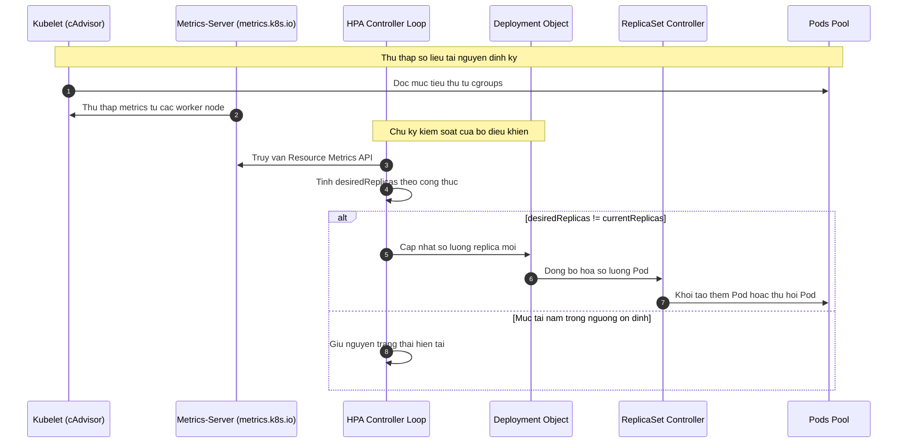

# 6_7_8 Autoscaling

- **Khóa học**: Cloud & DevOps Basic
- **Phân nhóm**: Domain 6 - Containers and Kubernetes / 6_7 Kubernetes Security Scheduling and Scaling
- **Chủ đề**: 6_7_8 Autoscaling
- **Trạng thái**: Bản nháp, chờ kiểm chứng
- **Checklist đối chiếu**: [CHECKLIST](../../CHECKLIST.md)

---

## 1. Khái Niệm Cốt Lõi & Bản Chất Kỹ Thuật (Core Concepts & Technical Deep Dive)

Trong môi trường điện toán đám mây, lưu lượng người dùng luôn biến động liên tục. Cấu hình số lượng bản sao tĩnh sẽ dẫn đến lãng phí chi phí khi vắng khách hoặc sập dịch vụ khi quá tải. Kubernetes cung cấp cơ chế tự động co giãn tài nguyên linh hoạt nhằm cân bằng giữa hiệu năng và chi phí vận hành.

### 1.1 Khái Niệm và Cơ Chế Hoạt Động của Horizontal Pod Autoscaler (HPA autoscaling/v2)

Horizontal Pod Autoscaler (HPA) là một Kubernetes controller tự động điều chỉnh số lượng bản sao Pod (replicas) của các workload như Deployment, ReplicaSet hoặc StatefulSet dựa trên mức độ sử dụng tài nguyên hoặc các số liệu đo lường quan sát được. <!-- ev: C8.1 -->

Vòng lặp kiểm soát của HPA định kỳ truy vấn các chỉ số tải thực tế, tính toán số lượng bản sao mong muốn và cập nhật vào đối tượng quản lý Pod. <!-- ev: C8.1 -->

Trong phiên bản API `autoscaling/v2`, trường `spec.metrics` hỗ trợ ba loại mục tiêu: `Resource` (tài nguyên Pod như CPU hoặc Memory), `Pods` (metric trung bình theo từng Pod), và `Object` hoặc `External` (metric từ Kubernetes object khác hoặc nguồn bên ngoài cluster). <!-- ev: C8.5 -->

### 1.2 Vai Trò Sống Còn của Metrics-Server và Resource Metrics API

HPA không thể tự mình đo lường trực tiếp mức độ tiêu thụ tài nguyên của container mà cần một hệ thống thu thập số liệu trung gian.

HPA truy vấn số liệu sử dụng CPU và bộ nhớ từ Resource Metrics API (`metrics.k8s.io`), do `metrics-server` thu thập định kỳ từ `kubelet` (cAdvisor) trên các node và tổng hợp lại trong cluster. <!-- ev: C8.2 -->

Khi thiếu thành phần thu thập số liệu trong cụm, HPA không thể lấy được thông tin tài nguyên và sẽ rơi vào trạng thái không xác định. <!-- ev: C8.2 -->

### 1.3 Thuật Toán Tính Số Lượng Replicas và Lý Do Bắt Buộc Khai Báo Requests

Thuật toán của HPA tính toán số lượng Pod mong muốn theo công thức chuẩn: `desiredReplicas = ceil[currentReplicas * (currentMetricValue / desiredMetricValue)]`. <!-- ev: C8.3 -->

Trong công thức trên, hệ thống lấy số lượng bản sao hiện tại nhân với tỷ số giữa mức tải đo được và mức tải mục tiêu, sau đó làm tròn lên để đảm bảo luôn đáp ứng đủ nhu cầu xử lý. <!-- ev: C8.3 -->

**Vì sao HPA bắt buộc Pod phải khai báo requests?**

HPA tính tỷ lệ phần trăm sử dụng tài nguyên (target average utilization) dựa trên giá trị `requests` của container trong Pod spec; nếu một container trong Pod không khai báo `requests.cpu` (hoặc `requests.memory`), HPA không thể tính toán tỷ lệ utilization cho metric đó và cơ chế autoscaling dựa trên utilization sẽ không hoạt động. <!-- ev: C8.4 -->

Nếu thiếu định mức yêu cầu ban đầu, hệ thống không có mốc đối chiếu để quy đổi lượng tài nguyên thực tế ra tỷ lệ phần trăm, dẫn đến việc bộ điều khiển từ chối thực hiện co giãn. <!-- ev: C8.4 -->

### 1.4 Kiểm Soát Hành Vi Co Giãn (Behavior, Policies & Stabilization Window)

Khi lưu lượng mạng biến động răng cưa, phản ứng co giãn quá nhanh sẽ khiến cụm rơi vào tình trạng dao động liên tục (flapping), làm lãng phí năng lực tính toán khi liên tục khởi tạo và hủy Pod.

HPA hỗ trợ trường `spec.behavior` cho phép tùy biến thuật toán co giãn riêng biệt cho `scaleUp` và `scaleDown`, bao gồm thiết lập thời gian cửa sổ ổn định `stabilizationWindowSeconds` để ngăn chặn hiện tượng dao động nhanh (flapping). <!-- ev: C8.6 -->

Trong `spec.behavior`, các chính sách `policies` cho phép quy định tốc độ co giãn theo đơn vị phần trăm (`type: Percent`) hoặc số lượng Pod tuyệt đối (`type: Pods`) trong một khoảng thời gian `periodSeconds`. <!-- ev: C8.7 -->

Mặc định trong Kubernetes, cửa sổ ổn định `stabilizationWindowSeconds` cho hành vi `scaleDown` được đặt là 300 giây (5 phút) để đảm bảo hệ thống không vội vàng hủy Pod ngay khi tải vừa sụt giảm tạm thời. <!-- ev: C8.8 -->

### 1.5 Phân Biệt HPA, VPA (Vertical Pod Autoscaler) và Cluster Autoscaler / Karpenter

Kubernetes hỗ trợ tự động co giãn ở nhiều cấp bậc:

- **HPA (Co giãn ngang Pod)**: Tăng hoặc giảm số lượng Pod chạy song song, thích hợp cho các ứng dụng không lưu trạng thái. <!-- ev: C8.1 -->
- **VPA (Co giãn dọc Pod)**:
Vertical Pod Autoscaler (VPA) tự động điều chỉnh giá trị `requests` và `limits` tài nguyên CPU và Memory cho các Pod hiện có, bao gồm ba thành phần kiến trúc cốt lõi: VPA Recommender (tính toán khuyến nghị), VPA Updater (quyết định cập nhật Pod), và VPA Admission Controller (chặn và áp dụng cấu hình tài nguyên mới khi Pod khởi tạo). <!-- ev: C8.9 -->
- Do xung đột cơ chế điều khiển, Kubernetes khuyến cáo không nên cấu hình đồng thời HPA và VPA cùng theo dõi và điều chỉnh trên cùng một metric tài nguyên (như cùng dựa trên CPU hoặc Memory utilization) cho một workload. <!-- ev: C8.10 -->
- **Cluster Autoscaler & Karpenter (Co giãn hạ tầng Node)**:
Khi tải vượt quá tổng dung lượng năng lực tính toán của toàn bộ cụm node (các Pod rơi vào trạng thái `Pending` do thiếu tài nguyên), Cluster Autoscaler hoặc Karpenter sẽ tự động cấp phát và mở rộng thêm máy chủ worker node vật lý hoặc máy ảo vào cụm. <!-- ev: C8.11 -->

### 1.6 Thay Đổi Tài Nguyên Tại Chỗ (In-place Pod Resource Resize)

Tính năng In-place Pod Resource Resize (thông qua feature gate `InPlacePodVerticalScaling`) cho phép người quản trị sửa đổi trực tiếp các trường `resources.requests` và `resources.limits` của container trong một Pod đang chạy mà không yêu cầu khởi động lại Pod. <!-- ev: C8.14 -->

Cơ chế này cập nhật trực tiếp giới hạn tài nguyên xuống tầng nhân hệ điều hành mà không làm gián đoạn tiến trình đang xử lý của ứng dụng. <!-- ev: C8.14 -->

---

## 2. Ví Dụ Đời Sống Thực Tế Dễ Hiểu (Intuitive Real-World Analogies)

Để hình dung bức tranh tổng thể về các cơ chế Autoscaling trong Kubernetes, hãy tưởng tượng một hệ thống điều phối đội xe bus công cộng đô thị:

1. **HPA (Thêm xe chạy cùng tuyến)**:
   Mỗi chiếc xe bus có sức chứa định mức là năm mươi chỗ ngồi. Khi giờ cao điểm đến, lượng khách tại trạm chờ vượt quá bảy mươi phần trăm số ghế, trung tâm điều hành lập tức điều động thêm hai chiếc xe bus cùng chạy vào tuyến đường để giải tỏa hành khách.

2. **VPA (Đổi xe to hơn)**:
   Nếu tuyến phố quá hẹp không thể cho nhiều xe chạy cùng lúc, công ty vận tải thay thế xe bus một tầng bằng xe bus hai tầng có sức chứa gấp đôi. Kích thước của chiếc xe được co giãn dọc để phục vụ nhiều khách hơn trên cùng một chuyến.

3. **Cluster Autoscaler / Karpenter (Mở rộng thêm bãi đỗ xe)**:
   Khi số lượng xe bus tăng lên nhưng bãi xe trung tâm đã hết chỗ đỗ, công ty mở rộng thêm bãi đỗ xe mới ở ngoại thành. Karpenter hoạt động như đội thi công thần tốc, nhanh chóng dựng thêm bãi đỗ đúng kích cỡ xe cần gửi.

4. **Xung đột GitOps (Mệnh lệnh hành chính cứng nhắc)**:
   Trong khi trung tâm đang tự động tăng xe giải tỏa ùn tắc, người quản lý ở văn phòng nhìn vào bản kế hoạch giấy in sẵn quy định tuyến này chỉ chạy cố định ba xe. Cứ sau vài phút, người quản lý lại bắt rút bớt các xe mới về bãi, khiến hai bên liên tục giằng co và làm hệ thống vận tải rơi vào hỗn loạn.

---

## 3. Kiến Trúc, Luồng Hoạt Động & Hình Ảnh Trực Quan (Architecture, Diagrams & Visual Media)

Sơ đồ quy trình thu thập dữ liệu và điều phối hành vi co giãn của HPA trong Kubernetes:



---

## 4. Code Mẫu Trực Quan Hoặc Dòng Lệnh Thực Chiến (Runnable Sample Code / CLI)

Kịch bản triển khai mẫu cho ứng dụng Web backend đáp ứng chuẩn thực chiến Kubernetes:

### 4.1 Khai Báo Deployment Chuẩn Sẵn Sàng Cho HPA

Cấu hình Deployment chuẩn bắt buộc khai báo định mức tài nguyên và loại bỏ trường số lượng bản sao:

```yaml
apiVersion: apps/v1
kind: Deployment
metadata:
  name: order-api
  labels:
    app: order-api
spec:
  # Luu y: Khong khai bao truong replicas tai day
  selector:
    matchLabels:
      app: order-api
  template:
    metadata:
      labels:
        app: order-api
    spec:
      containers:
      - name: web
        image: nginx:1.25-alpine
        ports:
        - containerPort: 80
        resources:
          requests:
            cpu: "200m"
            memory: "256Mi"
          limits:
            cpu: "500m"
            memory: "512Mi"
```

### 4.2 Cấu Hình HorizontalPodAutoscaler (API autoscaling/v2)

Cấu hình HPA thiết lập ngưỡng tải tài nguyên kèm chính sách ổn định hành vi:

```yaml
apiVersion: autoscaling/v2
kind: HorizontalPodAutoscaler
metadata:
  name: order-api-hpa
spec:
  scaleTargetRef:
    apiVersion: apps/v1
    kind: Deployment
    name: order-api
  minReplicas: 2
  maxReplicas: 10
  metrics:
  - type: Resource
    resource:
      name: cpu
      target:
        type: Utilization
        averageUtilization: 70
  - type: Resource
    resource:
      name: memory
      target:
        type: AverageValue
        averageValue: 400Mi
  behavior:
    scaleUp:
      stabilizationWindowSeconds: 0
      policies:
      - type: Percent
        value: 100
        periodSeconds: 15
      - type: Pods
        value: 4
        periodSeconds: 15
      selectPolicy: Max
    scaleDown:
      stabilizationWindowSeconds: 300
      policies:
      - type: Percent
        value: 20
        periodSeconds: 60
      selectPolicy: Min
```

### 4.3 Dòng Lệnh CLI Thao Tác Thực Chiến

<!-- ev: C8.15 -->
```bash
# Khởi tạo nhanh tài nguyên HPA bằng một câu lệnh duy nhất
kubectl autoscale deployment order-api --min=2 --max=10 --cpu-percent=80
```

<!-- ev: C8.16 -->
```bash
# Xem danh sách và trạng thái hoạt động của các đối tượng HPA
kubectl get hpa
```

Đầu ra mẫu khi quan sát HPA:
```text
NAME            REFERENCE              TARGETS        MINPODS   MAXPODS   REPLICAS   AGE
order-api-hpa   Deployment/order-api   45%/70%        2         10        3          15m
```

Kiểm tra chi tiết sự kiện co giãn:
```bash
kubectl describe hpa order-api-hpa
```

---

## 5. Cạm Bẫy Thực Tế & Thực Tiễn Sản Xuất (Production Gotchas & Best Practices)

### Cạm Bẫy 1: Xung Đột Dữ Liệu Khiến HPA Đánh Nhau Với Helm và GitOps

Trong quy trình GitOps (như Argo CD, Flux) hoặc triển khai bằng Helm, nếu trường `spec.replicas` được khai báo cố định trong manifest Deployment, mỗi chu kỳ GitOps sync hoặc Helm upgrade sẽ ghi đè số bản sao Pod về giá trị tĩnh trong Git, xung đột trực tiếp với số lượng replica động do HPA quản trị. <!-- ev: C8.12 -->

Để tránh xung đột giữa HPA và công cụ GitOps/Helm, giải pháp chuẩn là xóa bỏ hoàn toàn trường `spec.replicas` khỏi file YAML Deployment để GitOps/Helm không quản lý số lượng replica, hoặc cấu hình GitOps bỏ qua chênh lệch (ignore differences) trên trường `spec.replicas`. <!-- ev: C8.13 -->

Kỹ sư có thể đặt điều kiện trong gói triển khai để bỏ qua trường số lượng bản sao khi bật tính năng co giãn tự động. <!-- ev: C8.13 -->

### Cạm Bẫy 2: Thiếu Khai Báo Requests Khiến HPA Bị Tê Liệt

Nếu không khai báo định mức yêu cầu ban đầu cho container, HPA không thể tính toán được tỷ lệ tải và không thể đưa ra bất kỳ quyết định co giãn nào. <!-- ev: C8.4 -->

Để phòng ngừa, đội ngũ vận hành nên thiết lập chính sách áp đặt giá trị mặc định theo từng phân vùng hoặc dùng công cụ kiểm tra tự động trước khi triển khai. <!-- ev: C8.4 -->

### Cạm Bẫy 3: Cấu Hình Co Giãn Quá Gấp Gây Hiện Tượng Flapping

Nếu loại bỏ hoàn toàn thời gian chờ làm dịu khi giảm tải, hệ thống sẽ thu hồi Pod ngay khi lượng yêu cầu suy giảm tạm thời, dẫn đến quá tải trở lại khi lưu lượng mới ập tới. <!-- ev: C8.6 -->

Thời gian cửa sổ ổn định ba trăm giây mặc định giúp đảm bảo lưu lượng đã thực sự ổn định trước khi quyết định giảm bản sao. <!-- ev: C8.8 -->

### Cạm Bẫy 4: Chạy Đồng Thời Cả HPA và VPA Trên Cùng Một Chỉ Số

Khi hai bộ điều khiển cùng theo dõi một chỉ số tài nguyên, cả hai sẽ cùng phản ứng đồng thời làm mất kiểm soát định mức cấp phát trong cụm. <!-- ev: C8.10 -->

Quy tắc thực tiễn là chỉ kết hợp khi hai cơ chế theo dõi các thước đo hoàn toàn độc lập với nhau. <!-- ev: C8.10 -->

---

## 6. Câu Hỏi Củng Cố Kiến Thức (Active Recall Quiz)

### Câu hỏi 1:
Một kỹ sư DevOps triển khai HPA cho Deployment với mục tiêu CPU utilization là 50%. Khi kiểm tra bằng lệnh xem trạng thái HPA, kỹ sư thấy cột TARGETS hiển thị giá trị chưa xác định và số lượng Pod không bao giờ co giãn dù tải đang rất cao. Hai nguyên nhân kỹ thuật cốt lõi có thể dẫn đến hiện tượng này là gì?

<details>
<summary>Đáp án</summary>
1. Container trong Pod spec chưa được khai báo trường requests cho CPU, khiến HPA không có mốc quy chuẩn để tính ra tỷ lệ phần trăm sử dụng.
2. Cụm Kubernetes chưa được cài đặt hoặc gặp sự cố với add-on metrics-server, dẫn đến Resource Metrics API không có dữ liệu đo lường.
</details>

### Câu hỏi 2:
Trong hệ thống triển khai qua GitOps, sau khi HPA tự động tăng số lượng Pod từ 2 lên 6 để gánh tải, vì sao chỉ ít phút sau số lượng Pod lại bị giảm về 2 bản sao dù lượng truy cập không hề giảm? Cách khắc phục chuẩn là gì?

<details>
<summary>Đáp án</summary>
- **Nguyên nhân**: Manifest Deployment trên Git vẫn khai báo cứng trường số lượng bản sao là 2. Khi tiến trình GitOps thực hiện đồng bộ, nó coi trạng thái 6 Pod là sai lệch và tự động ghi đè số bản sao về lại 2.
- **Cách khắc phục**: Xóa hoàn toàn trường số lượng bản sao khỏi manifest Deployment trong kho Git hoặc cấu hình công cụ GitOps bỏ qua chênh lệch đối với trường này.
</details>

### Câu hỏi 3:
Một Deployment đang chạy với 4 Pods, ngưỡng CPU mục tiêu của HPA là 50%. Khi tải đo được trung bình thực tế đạt 75%, theo thuật toán tiêu chuẩn của HPA thì số lượng Pod mong muốn mới sẽ được tính toán ra là bao nhiêu?

<details>
<summary>Đáp án</summary>
Áp dụng công thức: 4 nhân với (75 chia cho 50) bằng 6 bản sao. Hệ thống sẽ mở rộng lên 6 Pods.
</details>

---

## 7. 📚 Nguồn Tài Liệu Chính Thống (Tier-1 Official References)

- [Kubernetes Documentation: Horizontal Pod Autoscaling](https://kubernetes.io/docs/tasks/run-application/horizontal-pod-autoscale/) - Tài liệu chính thức từ Kubernetes về khái niệm, kiến trúc và thuật toán của HPA.
- [Kubernetes Documentation: Horizontal Pod Autoscaler Walkthrough](https://kubernetes.io/docs/tasks/run-application/horizontal-pod-autoscale-walkthrough/) - Hướng dẫn thực hành từng bước cấu hình HPA với API `autoscaling/v2` và kiểm tra tải.
- [Kubernetes Documentation: In-place Update of Pod Resources](https://kubernetes.io/docs/tasks/configure-pod-container/resize-container-resources/) - Tài liệu chính thức về tính năng thay đổi tài nguyên Pod tại chỗ không cần restart container.
- [Kubernetes SIG Autoscaling Repository](https://github.com/kubernetes/autoscaler) - Kho mã nguồn và tài liệu kiến trúc chính thức của Kubernetes cho VPA, Cluster Autoscaler và các add-on co giãn.
