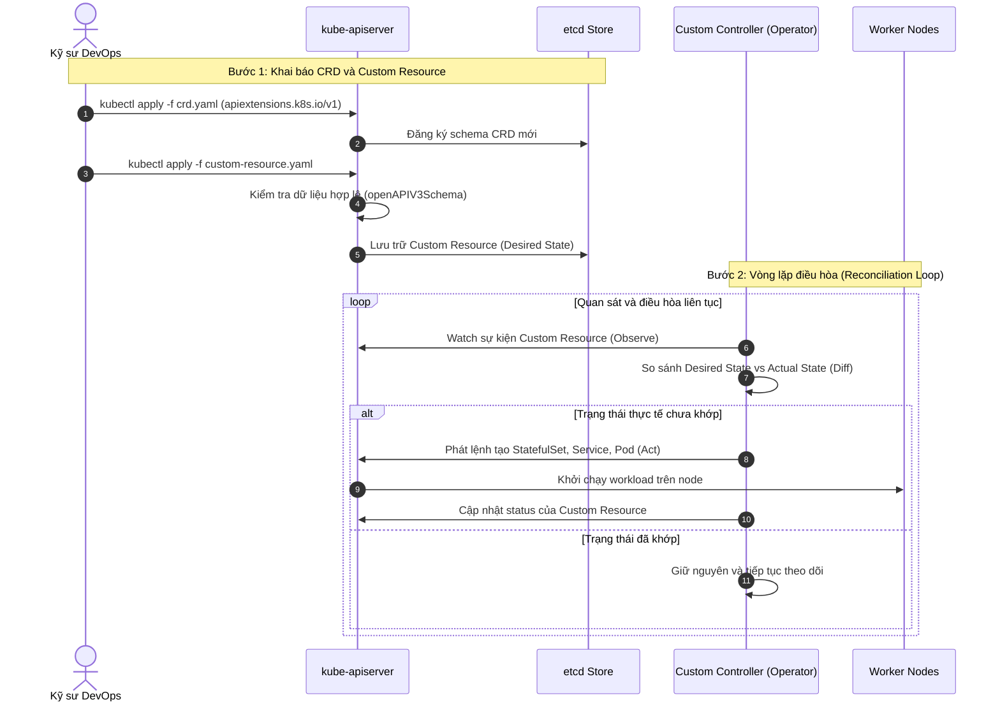

# 6_7_9 Mở Rộng Kubernetes: CRD và Operator

> **Khóa học**: Cloud DevOps Basic — Containers & Kubernetes  
> **Phân nhóm**: 6 Domain 6 - Containers and Kubernetes › 6_7 Kubernetes Security Scheduling and Scaling  
> **Chủ đề**: 6_7_9 Mở Rộng Kubernetes: CRD và Operator  
> **Phiên bản áp dụng**: Kubernetes 1.30+, Helm 3.x / Helm 4.x  
> **Trạng thái**: Bản nháp, chờ kiểm chứng  
> **Phạm vi**: [Topic README](./README.md#6_7_9-mở-rộng-kubernetes-crd-và-operator) · **Checkpoint của người học**: [CHECKLIST](../../CHECKLIST.md#6_7-kubernetes-security-scheduling-and-scaling)  
> **Kiến thức liên quan**: [6_3_2 kubectl and API Objects](<../6_3 Kubernetes Architecture and Core Workloads/6_3_2 kubectl and API Objects.md>) · [6_5_2 Chart Structure](<../6_5 Helm Package Management/6_5_2 Chart Structure.md>)  

---

## 0. Tình Huống Mở Đầu: Khi Tài Nguyên Mặc Định Không Đủ Thông Minh

Kubernetes cung cấp sẵn các tài nguyên nền tảng như Pod, Deployment, StatefulSet, Service, ConfigMap. Những tài nguyên này hoạt động rất tốt cho các ứng dụng web stateless thông thường.

Tuy nhiên, khi vận hành các hệ thống phân tán phức tạp có trạng thái (stateful workloads) như cụm Apache Kafka, cơ sở dữ liệu có cơ chế replication, hoặc tự động cấp phát chứng chỉ SSL, StatefulSet chỉ biết quản lý thứ tự Pod và gán ổ đĩa. Nó hoàn toàn không hiểu nghiệp vụ bầu chọn leader, rebalance dữ liệu hay rolling update chuyên biệt của từng ứng dụng. Để quản lý các hệ thống này mà không cần viết script thủ công ngoài cluster, Kubernetes cung cấp cơ chế mở rộng API qua **CustomResourceDefinition (CRD)** và tự động hóa quy trình vận hành bằng **Operator Pattern**.

---

## 1. Khái Niệm Cốt Lõi & Bản Chất Kỹ Thuật (Core Concepts & Technical Deep Dive)

Kubernetes được xây dựng theo kiến trúc mở, cho phép mở rộng schema dữ liệu lẫn logic điều khiển mà không cần biên dịch lại mã nguồn API server.

### 1.1 CustomResourceDefinition (CRD) — Mở Rộng Schema của Kubernetes API

Tài nguyên CustomResourceDefinition (CRD) thuộc API group `apiextensions.k8s.io/v1` cho phép định nghĩa các kiểu tài nguyên tùy biến mới trong Kubernetes. <!-- ev: C9.1 -->

<!-- ev: C9.2 -->
- **Group**: Định danh không gian tên logic của API (ví dụ: `kafka.strimzi.io` hoặc `cert-manager.io`).
- **Names**: Định nghĩa tên tài nguyên ở các dạng khác nhau, bao gồm `kind` (viết hoa CamelCase như `KafkaTopic`), `plural` (dạng số nhiều như `kafkatopics`), và `singular` (dạng số ít như `kafkatopic`).
- **Scope**: Xác định phạm vi tài nguyên, nhận một trong hai giá trị là `Namespaced` (tài nguyên theo namespace) hoặc `Cluster` (tài nguyên toàn cluster).
- **Versions**: Danh sách các phiên bản API của tài nguyên (ví dụ: `v1alpha1`, `v1beta1`, `v1`).

Để ngăn chặn người dùng gửi dữ liệu sai cấu trúc lên cluster, CRD sử dụng schema OpenAPI v3 được khai báo trong trường `openAPIV3Schema` để kiểm tra tính hợp lệ của dữ liệu đầu vào. <!-- ev: C9.3 -->

Khi một CRD được tạo thành công trên cluster, API server Kubernetes tự động phơi bày các RESTful endpoint mới tương ứng cho Custom Resource đó. <!-- ev: C9.4 --> Kể từ thời điểm này, người dùng có thể thao tác với Custom Resource mới thông qua `kubectl` hoặc Kubernetes client SDK như các tài nguyên gốc.

### 1.2 Operator Pattern & Vòng Lặp Điều Hòa (Reconciliation Loop)

CRD đơn thuần chỉ là dữ liệu cấu hình tĩnh lưu trong cơ sở dữ liệu etcd. Nếu không có bộ điều khiển xử lý phía sau, dữ liệu đó hoàn toàn thụ động.

Operator Pattern kết hợp một CRD đóng vai trò mô tả trạng thái mong muốn (declarative desired state) với một Custom Controller chạy liên tục. <!-- ev: C9.5 -->

Custom Controller vận hành theo một vòng lặp kín gọi là vòng lặp điều hòa (Reconciliation loop) gồm 3 bước: quan sát trạng thái thực tế (Observe), so sánh với cấu hình mong muốn trong spec (Diff), và thực thi hành động để đưa trạng thái thực tế về đúng mong muốn (Act). <!-- ev: C9.6 -->

Operator mã hóa các tri thức vận hành con người (human operational domain knowledge) như sao lưu, mở rộng, phục hồi sự cố thành phần mềm tự động. <!-- ev: C9.7 --> Khi một thành phần bị lỗi, Operator tự động đối chiếu và thực hiện các bước khôi phục mà không cần kỹ sư can thiệp thủ công.

### 1.3 Các Operator Phổ Biến Trong Thực Tế Gắn Liền Với JD DevOps

Trong các hệ thống production, kỹ sư DevOps thường xuyên làm việc với ba Operator tiêu chuẩn:

- **Strimzi Operator**: Cung cấp các CRD chuyên biệt để quản lý việc triển khai và vận hành cụm Apache Kafka trên Kubernetes. <!-- ev: C9.8 -->
- **Prometheus Operator**: Giới thiệu các CRD như `ServiceMonitor`, `PodMonitor`, và `PrometheusRule` để tự động hóa cấu hình thu thập metric của Prometheus. <!-- ev: C9.9 -->
- **cert-manager**: Sử dụng các CRD như `Issuer`, `ClusterIssuer`, và `Certificate` để tự động hóa việc xin cấp và gia hạn chứng chỉ TLS/SSL. <!-- ev: C9.10 -->

### 1.4 Quản Lý Vòng Đời CRD Với Helm (`crds/` Directory)

Khi đóng gói các giải pháp chứa CRD vào Helm chart, việc quản lý vòng đời CRD tuân theo các quy định nghiêm ngặt:

Trong cấu trúc Helm chart, thư mục `crds/` ở thư mục gốc của chart được Helm sử dụng để chứa các định nghĩa CRD. <!-- ev: C9.11 -->

Khi chạy lệnh `helm install`, Helm sẽ tự động cài đặt các CRD nằm trong thư mục `crds/` lên cluster trước khi render các template khác. <!-- ev: C9.12 --> Điều này đảm bảo API server nhận diện được schema trước khi các Custom Resource trong `templates/` được tạo ra.

Helm cố ý không tự động nâng cấp hoặc xóa các CRD trong thư mục `crds/` khi chạy `helm upgrade` hoặc `helm uninstall` nhằm ngăn ngừa rủi ro xóa mất dữ liệu của tất cả Custom Resource liên quan. <!-- ev: C9.13 --> Đây là thiết kế an toàn của Helm nhằm tránh việc xóa nhầm CRD làm sập các hệ thống phụ thuộc.

Để nâng cấp CRD được đóng gói trong thư mục `crds/` của Helm chart, quản trị viên phải áp dụng thủ công bằng lệnh `kubectl apply -f <path-to-crd>` hoặc tách CRD thành một Helm chart độc lập riêng. <!-- ev: C9.14 -->

---

## 2. Ví Dụ Đời Sống Thực Tế Dễ Hiểu (Intuitive Real-World Analogies)

Hãy tưởng tượng mô hình làm việc tại một khách sạn quốc tế để hiểu mối quan hệ giữa CRD và Operator:

### Bộ Biểu Mẫu Có Sẵn
Bình thường, ban lễ tân khách sạn chỉ tiếp nhận các biểu mẫu quen thuộc: "Phiếu thuê phòng đơn" (Pod), "Phiếu thuê theo tầng" (Deployment). Mọi quy trình diễn ra ổn định với khách lưu trú thông thường.

### Nhu Cầu Dịch Vụ Mới
Khi khách sạn mở thêm dịch vụ chăm sóc thú cưng cao cấp, lễ tân sẽ từ chối các yêu cầu đặc thù vì chưa có biểu mẫu tương ứng.

- **Ban hành CRD (CustomResourceDefinition)**: Ban quản lý tạo ra một biểu mẫu mới: "Phiếu Dịch Vụ Thú Cưng". Biểu mẫu này quy định rõ các ô bắt buộc phải điền: loại thú cưng, cân nặng, khẩu phần ăn. Từ lúc này, lễ tân có thể tiếp nhận và lưu phiếu vào tủ hồ sơ.
- **Hồ sơ chỉ là giấy tờ**: Tờ phiếu nằm trong ngăn kéo không thể tự đi mua thức ăn hay chăm sóc thú cưng.
- **Thuê Chuyên Gia Vận Hành (Operator)**: Khách sạn thuê một chuyên gia chăm sóc thú cưng túc trực 24/7 (Custom Controller). Chuyên gia này liên tục kiểm tra ngăn kéo hồ sơ (Observe), so sánh tình trạng phòng thú cưng với yêu cầu trong phiếu (Diff), và trực tiếp chuẩn bị lồng, điều hòa, thức ăn (Act).

Chuyên gia này chính là **Operator**: kết hợp biểu mẫu chuẩn hóa (CRD) với hành động tự động hóa chuyên sâu để hoàn thành yêu cầu thực tế.

---

## 3. Kiến Trúc, Luồng Hoạt Động & Hình Ảnh Trực Quan (Architecture, Diagrams & Visual Media)

Mô hình điều hòa giữa người dùng, API server, etcd và Operator:



<!-- ev: C9.6 -->
- **Cơ chế Watch**: Operator thiết lập kết nối streaming HTTP dài hạn với API server để nhận sự kiện tức thời thay vì thăm dò liên tục.
- **Phân tách Spec và Status**: `spec` là trạng thái mong muốn do người dùng khai báo, còn `status` là trạng thái thực tế do controller ghi nhận.

---

## 4. Code Mẫu Trực Quan Hoặc Dòng Lệnh Thực Chiến (Runnable Sample Code / CLI)

Ví dụ thực hành định nghĩa CRD sao lưu cơ sở dữ liệu và thao tác Custom Resource với kubectl và Helm.

### 4.1 Định Nghĩa CRD (`database-backup-crd.yaml`)

File manifest định nghĩa tài nguyên tùy biến DatabaseBackup:

```yaml
apiVersion: apiextensions.k8s.io/v1
kind: CustomResourceDefinition
metadata:
  name: databasebackups.storage.example.com
spec:
  group: storage.example.com
  names:
    kind: DatabaseBackup
    plural: databasebackups
    singular: databasebackup
    shortNames:
      - dbbackup
  scope: Namespaced
  versions:
    - name: v1alpha1
      served: true
      storage: true
      schema:
        openAPIV3Schema:
          type: object
          properties:
            spec:
              type: object
              required:
                - databaseName
              properties:
                databaseName:
                  type: string
                retentionDays:
                  type: integer
                  minimum: 1
                  maximum: 365
            status:
              type: object
              properties:
                phase:
                  type: string
```

### 4.2 Khai Báo Custom Resource (`my-db-backup.yaml`)

Tạo đối tượng Custom Resource cụ thể theo schema đã định nghĩa:

```yaml
apiVersion: storage.example.com/v1alpha1
kind: DatabaseBackup
metadata:
  name: orders-db-backup
  namespace: default
spec:
  databaseName: orders-production
  retentionDays: 30
```

### 4.3 Dòng Lệnh CLI Thao Tác Với CRD

<!-- ev: C9.17 -->
```bash
# 1. Áp dụng định nghĩa CRD vào cluster
kubectl apply -f database-backup-crd.yaml

# 2. Liệt kê danh sách tất cả các CRD trên cluster
kubectl get crd

# 3. Tra cứu schema chi tiết của Custom Resource
kubectl explain databasebackup.spec

# 4. Áp dụng manifest Custom Resource
kubectl apply -f my-db-backup.yaml

# 5. Kiểm tra Custom Resource vừa tạo qua tên rút gọn (shortName)
kubectl get dbbackup -n default
```

### 4.4 Quy Trình Nâng Cấp CRD Trong Helm

Khi nâng cấp phiên bản chart có bổ sung trường mới cho CRD:

```bash
# Bước 1: Chủ động áp dụng schema CRD mới nhất bằng kubectl
kubectl apply -f my-chart/crds/my-crd.yaml

# Bước 2: Nâng cấp Helm release an toàn
helm upgrade my-release my-chart/ -n default
```

---

## 5. Cạm Bẫy Thực Tế & Thực Tiễn Sản Xuất (Production Gotchas & Best Practices)

Trong môi trường doanh nghiệp, việc vận hành CRD và Operator cần chú ý các rủi ro bảo mật và dữ liệu:

### 5.1 Cạm Bẫy Xóa CRD Gây Mất Dữ Liệu Toàn Cụm

Khi một CRD bị xóa khỏi cluster (`kubectl delete crd`), Kubernetes sẽ tự động xóa tất cả các Custom Resource instances thuộc CRD đó cùng với dữ liệu của chúng trong etcd. <!-- ev: C9.15 -->

- **Phòng ngừa**: Không cấp quyền xóa tài nguyên customresourcedefinitions cho CI/CD hoặc các ServiceAccount thông thường. Quyền này chỉ dành cho quản trị viên cluster trong phiên bảo trì đặc biệt.

### 5.2 Cơ Chế Finalizers Và Nguy Cơ Treo Trạng Thái Xóa

Finalizers là cơ chế ngăn chặn Kubernetes xóa Custom Resource ngay lập tức để chờ controller dọn dẹp các tài nguyên phụ trợ trước khi hoàn tất việc xóa object. <!-- ev: C9.16 -->

Nếu Operator quản lý tài nguyên bị ngừng hoạt động hoặc gặp sự cố mạng, controller không thể hoàn thành việc dọn dẹp để gỡ khóa. Khi đó Custom Resource sẽ bị giữ vô hạn ở trạng thái Terminating. Để giải phóng tài nguyên trong tình huống khẩn cấp khi hạ tầng ngoài đã an toàn, quản trị viên có thể gỡ bỏ danh sách finalizer bằng lệnh patch:

```bash
kubectl patch dbbackup orders-db-backup -p '{"metadata":{"finalizers":[]}}' --type=merge
```

### 5.3 Nâng Cấp CRD Độc Lập Khỏi Helm Release

Do Helm không cập nhật thư mục `crds/` trong lệnh nâng cấp release, pipeline CI/CD cần có bước áp dụng CRD riêng biệt trước khi chạy `helm upgrade` để tránh lỗi schema không tương thích giữa controller mới và CRD cũ. <!-- ev: C9.14 -->

### 5.4 Nguyên Tắc Đặc Quyền Tối Thiểu Cho ServiceAccount Của Operator

Tránh gán quyền quản trị tối cao toàn cluster cho ServiceAccount của Operator. Nếu Operator chỉ quản trị tài nguyên trong một namespace nhất định, hãy sử dụng Role và RoleBinding để giới hạn phạm vi tác động.

---

## 6. Câu Hỏi Củng Cố Kiến Thức (Active Recall Quiz)

Các câu hỏi tình huống thực tế giúp củng cố kiến thức về CRD và Operator:

### Câu 1: Lỗi Thiếu Trường Dữ Liệu Sau Khi Chạy Helm Upgrade
**Tình huống**: Bạn vừa chạy `helm upgrade` cho một Operator lên bản mới nhất. Khi tạo Custom Resource theo tài liệu hướng dẫn mới, API server từ chối với thông báo không nhận diện được trường cấu hình mới. Nguyên nhân và giải pháp là gì?

<details>
<summary>Đáp án</summary>

**Nguyên nhân**: Helm không tự động cập nhật các file trong thư mục `crds/` khi chạy `helm upgrade`. Schema trên cluster vẫn thuộc phiên bản cũ nên API server từ chối trường mới.

**Giải pháp**: Áp dụng thủ công file CRD mới bằng lệnh `kubectl apply -f <path-to-new-crd>` trước khi áp dụng Custom Resource.
</details>

---

### Câu 2: Sự Khác Biệt Giữa CRD Đơn Thuần Và Operator
**Tình huống**: Nếu bạn tạo một CRD và tạo một đối tượng Custom Resource yêu cầu 3 cụm Redis, nhưng trong cluster chưa hề cài đặt controller cho tài nguyên này, điều gì sẽ xảy ra?

<details>
<summary>Đáp án</summary>

**Kết quả**: API server kiểm tra dữ liệu và lưu Custom Resource vào etcd thành công, nhưng hoàn toàn không có Pod hay container Redis nào được tạo ra. CRD chỉ là định nghĩa cấu trúc dữ liệu; cần có Operator (Custom Controller) chạy vòng lặp điều hòa để biến khai báo đó thành workload thực tế.
</details>

---

### Câu 3: Nguy Cơ Khi Xóa Một Định Nghĩa CRD Trên Cluster
**Tình huống**: Quản trị viên vô tình chạy lệnh `kubectl delete crd` đối với CRD của một hệ thống cơ sở dữ liệu trên production. Hậu quả tức thời là gì?

<details>
<summary>Đáp án</summary>

**Hậu quả**: Toàn bộ các đối tượng Custom Resource thuộc CRD đó trên tất cả các namespace sẽ bị xóa ngay lập tức cùng dữ liệu cấu hình trong etcd. Các controller phụ thuộc sẽ tiến hành dọn dẹp workload, dẫn đến gián đoạn dịch vụ toàn bộ hệ thống.
</details>

---

## 7. 📚 Nguồn Tài Liệu Chính Thống (Tier-1 Official References)

- [Kubernetes Documentation: Custom Resources](https://kubernetes.io/docs/concepts/extend-kubernetes/api-extension/custom-resources/) - Tổng quan chính thức về tài nguyên mở rộng và các phương pháp tùy biến API trong Kubernetes.
- [Kubernetes Documentation: Extend the Kubernetes API with CustomResourceDefinitions](https://kubernetes.io/docs/tasks/extend-kubernetes/custom-resources/custom-resource-definitions/) - Hướng dẫn chi tiết cú pháp khai báo, phiên bản hóa và validation schema cho CRD.
- [Kubernetes Documentation: Operator Pattern](https://kubernetes.io/docs/concepts/extend-kubernetes/operator/) - Tài liệu chuẩn mực giải thích kiến trúc Operator, nguyên lý hoạt động và mối quan hệ với Custom Controller.
- [Kubernetes Documentation: Using Finalizers](https://kubernetes.io/docs/concepts/overview/working-with-objects/finalizers/) - Cơ chế kiểm soát vòng đời xóa đối tượng và bảo vệ tài nguyên phụ trợ trong Kubernetes.
- [Helm Documentation: Custom Resource Definitions](https://helm.sh/docs/chart_best_practices/custom_resource_definitions/) - Quy chuẩn và thực tiễn tốt nhất về cách đóng gói, thứ tự cài đặt và bảo vệ CRD trong Helm charts.
