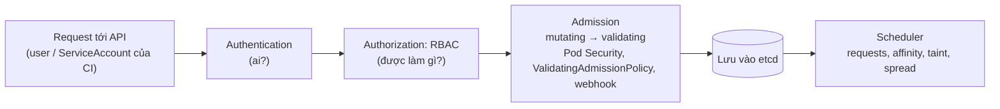

# 6_7 Kubernetes Security, Scheduling and Scaling

> **Khóa học**: Cloud DevOps Basic — Containers & Kubernetes
> **Phân nhóm**: 6 Domain 6 - Containers and Kubernetes › 6_7 Kubernetes Security Scheduling and Scaling
> **Chủ đề**: RBAC và ServiceAccount, Pod Security, NetworkPolicy, admission control, xếp lịch (affinity, taint/toleration, topology spread), PodDisruptionBudget, autoscaling, CRD/Operator, nâng cấp cluster
> **Trạng thái**: Định nghĩa (nội dung cần học + đề bài lab + checkpoint), chưa chạy thử, 15-11-2026
> **Lộ trình tổng**: [container/README.md](../../README.md) · **Checkpoint**: [CHECKLIST.md](../../CHECKLIST.md#6_7-kubernetes-security-scheduling-and-scaling)

---

## 🎯 Mục Tiêu

Chạy được chưa đủ. Cần trả lời được: **ai được làm gì** (RBAC), **Pod được phép làm gì** (Pod Security), **ai được nói chuyện với ai** (NetworkPolicy), **Pod chạy ở đâu** (scheduling), **sống sót khi bảo trì node** (PDB) và **co giãn theo tải** (HPA). Đây cũng là chỗ pipeline CI của bạn cần quyền tối thiểu để deploy.

---

## 📚 Những Gì Cần Học

### 6_7_1 Xác Thực, RBAC và ServiceAccount
- [ ] Người dùng (đến từ cert/OIDC, Kubernetes không lưu user) vs **ServiceAccount** (object trong namespace, dành cho workload và CI).
- [ ] `Role` / `ClusterRole` (verbs × resources × apiGroups) và `RoleBinding` / `ClusterRoleBinding`; ClusterRole gắn bằng RoleBinding chỉ có hiệu lực trong namespace đó.
- [ ] `kubectl auth can-i <verb> <resource> --as=system:serviceaccount:<ns>:<sa> -n <ns>`; `kubectl auth can-i --list`.
- [ ] Token ServiceAccount: projected token ngắn hạn qua TokenRequest API; từ v1.24 không còn tự tạo Secret token lâu dài; `automountServiceAccountToken: false` cho Pod không cần gọi API.
- [ ] Quyền tối thiểu cho deployer của CI: chỉ namespace của mình, các resource chart dùng, **và Secret** (Helm lưu release vào Secret).
- [ ] Liên hệ kinh nghiệm: lỗi RBAC của service principal trên Azure ↔ `Forbidden` trên Kubernetes.

### 6_7_2 Bảo Mật Pod
- [ ] `securityContext`: `runAsNonRoot`, `runAsUser`/`runAsGroup`/`fsGroup`, `readOnlyRootFilesystem`, `allowPrivilegeEscalation: false`, `capabilities.drop: ["ALL"]`, `seccompProfile.type: RuntimeDefault` (liên hệ 6_1_7, 6_2_6).
- [ ] **Pod Security Standards**: `privileged`, `baseline`, `restricted`.
- [ ] **Pod Security Admission**: nhãn namespace `pod-security.kubernetes.io/enforce|audit|warn=<level>` (PodSecurityPolicy đã bị gỡ từ v1.25).
- [ ] `readOnlyRootFilesystem` + `emptyDir` cho `/tmp` với app Java.

### 6_7_3 NetworkPolicy
- [ ] Mặc định mọi Pod nói chuyện được với nhau; NetworkPolicy chỉ có tác dụng khi **CNI hỗ trợ thực thi** (Calico, Cilium...). *Khả năng thực thi của CNI mặc định trong kind phụ thuộc phiên bản kind, cần đối chiếu; chắc chắn nhất là tắt CNI mặc định và cài Calico/Cilium.*
- [ ] Mẫu **default-deny** ingress/egress, rồi mở dần theo `podSelector` / `namespaceSelector` / `ipBlock` và port.
- [ ] Bẫy: default-deny egress chặn luôn DNS → phải mở UDP/TCP 53 tới CoreDNS.

### 6_7_4 Bảo Vệ Secret và Chuỗi Cung Ứng
- [ ] Encryption at rest cho Secret trong etcd (`EncryptionConfiguration`, KMS provider); managed K8s thường có sẵn tùy chọn.
- [ ] Hạn chế `get/list/watch` Secret trong RBAC (`list` Secret = đọc được toàn bộ nội dung).
- [ ] Ký image và chỉ cho chạy image đã ký/từ registry tin cậy (cosign + policy engine, khái niệm).

### 6_7_5 Admission Control và Policy
- [ ] Mutating vs validating admission; admission webhook.
- [ ] **ValidatingAdmissionPolicy** (biểu thức CEL, có sẵn trong Kubernetes, không cần webhook).
- [ ] Policy engine: Kyverno, OPA Gatekeeper (khái niệm): ví dụ chặn `:latest`, bắt buộc có `resources`.

### 6_7_6 Xếp Lịch (Scheduling)
- [ ] `nodeSelector`, **node affinity** (`required...` vs `preferred...`).
- [ ] **Pod anti-affinity** để không đặt các replica cùng một node; **topologySpreadConstraints** chia đều theo node/zone.
- [ ] **Taint / toleration** (node chuyên dụng, node control plane); effect `NoSchedule`, `PreferNoSchedule`, `NoExecute`.
- [ ] `PriorityClass` và preemption.
- [ ] Đọc lý do Pod `Pending` trong Events: `Insufficient cpu`, `didn't match node affinity`, `untolerated taint`.

### 6_7_7 Sẵn Sàng Khi Bảo Trì: PDB, Drain
- [ ] `kubectl cordon / drain / uncordon`; drain dùng Eviction API.
- [ ] **PodDisruptionBudget** (`minAvailable` / `maxUnavailable`) chặn eviction làm sập service; PDB quá chặt làm drain treo mãi.
- [ ] Gián đoạn tự nguyện (drain, nâng cấp) vs không tự nguyện (node chết): PDB chỉ bảo vệ loại thứ nhất.

### 6_7_8 Autoscaling
- [ ] **HPA** (`autoscaling/v2`): dựa trên % so với **requests**; cần **metrics-server**; metric tùy chỉnh qua adapter (khái niệm).
- [ ] VPA (add-on, gợi ý/đặt requests), Cluster Autoscaler / Karpenter (thêm node) ở mức khái niệm.
- [ ] Tương tác HPA với Helm/GitOps: không đặt cứng `replicas` trong chart khi HPA bật.
- [ ] Thay đổi resources tại chỗ (in-place Pod resize): *tính năng mới, trạng thái theo phiên bản cần đối chiếu tài liệu Kubernetes của bản bạn dùng*.

### 6_7_9 Mở Rộng Kubernetes: CRD và Operator
- [ ] CustomResourceDefinition tạo kiểu object mới; controller tự viết điều hòa chúng = **Operator pattern**.
- [ ] Ví dụ gắn với JD: Strimzi (Kafka), Prometheus Operator (`ServiceMonitor`, 6_8), cert-manager (`Certificate`).
- [ ] CRD + Helm: thứ tự cài, vì sao Helm không nâng cấp CRD trong thư mục `crds/`.

### 6_7_10 Vòng Đời Cluster
- [ ] Nâng cấp từng minor version: control plane trước, node sau; version skew policy.
- [ ] API bị deprecate/xóa giữa các phiên bản: kiểm tra manifest/chart trước khi nâng cấp (Deprecated API Migration Guide).
- [ ] Sao lưu etcd (cluster tự dựng) và sao lưu tài nguyên + PV (ví dụ Velero, khái niệm).

---

## 🧪 Labs

> **Bản định nghĩa**: chưa tạo thư mục `labs/`, chưa chạy thử. Lab 6_7_5 cần cluster kind nhiều node (file cấu hình kind với 1 control-plane + 3 worker).

| Lab | Nội dung | Thời gian | Trạng thái |
| :--- | :--- | :---: | :--- |
| lab-6_7_1-rbac-for-ci-deployer | ServiceAccount quyền tối thiểu cho Helm deploy, kiểm bằng `can-i` | 60 phút | Định nghĩa |
| lab-6_7_2-restricted-pod-security | Namespace `restricted`, sửa `securityContext` cho `hello-svc` | 45 phút | Định nghĩa |
| lab-6_7_3-network-policy-default-deny | Default-deny, mở dần, bẫy DNS | 60–90 phút | Định nghĩa |
| lab-6_7_4-hpa-and-load | metrics-server, HPA theo CPU, tạo tải, quan sát scale | 60 phút | Định nghĩa |
| lab-6_7_5-scheduling-pdb-and-drain | Anti-affinity, taint, PDB, drain node | 60 phút | Định nghĩa |

### lab-6_7_1-rbac-for-ci-deployer
- **Các bước chính**:
  1. Tạo namespace `dev`, `prod`; ServiceAccount `ci-deployer` trong `dev`.
  2. Viết `Role` cho `deployments`, `services`, `configmaps`, `secrets`, `pods` (chỉ `get/list` để `--wait` theo dõi) và `RoleBinding`.
  3. `kubectl auth can-i --list --as=system:serviceaccount:dev:ci-deployer -n dev`; thử trên `prod` → `no`.
  4. Tạo token ngắn hạn `kubectl create token ci-deployer -n dev --duration=1h`, dựng kubeconfig riêng, chạy `helm upgrade --install` bằng kubeconfig đó.
  5. Bớt quyền `secrets` → đọc lỗi Helm trả về.
- **Checkpoint**:
  - [ ] Helm deploy thành công vào `dev` và bị `Forbidden` ở `prod`.
  - [ ] Giải thích được vì sao deployer của Helm cần quyền với Secret.

### lab-6_7_2-restricted-pod-security
- **Các bước chính**: gắn nhãn `pod-security.kubernetes.io/enforce=restricted` cho namespace; deploy bản manifest không có `securityContext` → đọc thông báo bị chặn; sửa từng mục cho tới khi qua; thêm `readOnlyRootFilesystem` + `emptyDir` `/tmp`.
- **Checkpoint**:
  - [ ] `hello-svc` chạy trong namespace `restricted`; liệt kê được từng trường đã thêm và lý do.

### lab-6_7_3-network-policy-default-deny
- **Chuẩn bị**: cluster kind với `networking.disableDefaultCNI: true` và cài Calico hoặc Cilium theo hướng dẫn chính thức (*cần đối chiếu nếu dùng CNI mặc định*).
- **Các bước chính**: deploy `frontend` (busybox) và `hello-svc` ở 2 namespace; áp default-deny ingress+egress; thấy `wget` lỗi kể cả phân giải tên; mở egress DNS; mở ingress từ `frontend` vào `hello-svc:8080`; thử một Pod khác bị chặn.
- **Checkpoint**:
  - [ ] Chỉ `frontend` gọi được `hello-svc`; giải thích được vì sao lỗi đầu tiên là DNS.

### lab-6_7_4-hpa-and-load
- **Các bước chính**: cài metrics-server (trên kind thường cần thêm cờ cho kubelet TLS tự ký, *đối chiếu README của metrics-server*); đặt `requests.cpu: 100m`; HPA 1–5 replica, mục tiêu 50% CPU; tạo tải bằng Pod chạy vòng lặp gọi `/`; `kubectl get hpa -w`; dừng tải, quan sát scale-down chậm (stabilization window).
- **Checkpoint**:
  - [ ] Giải thích công thức số replica mong muốn của HPA và vì sao thiếu `requests` thì HPA không hoạt động.

### lab-6_7_5-scheduling-pdb-and-drain
- **Các bước chính**: kind 3 worker; Deployment 3 replica với `podAntiAffinity` bắt buộc theo `kubernetes.io/hostname`; scale lên 4 → 1 Pod `Pending`, đọc lý do; taint một node và thêm toleration cho một workload riêng; tạo PDB `minAvailable: 2`, `kubectl drain` lần lượt các node, quan sát drain chờ.
- **Checkpoint**:
  - [ ] Đọc đúng lý do `Pending` từ Events; drain không bao giờ làm số Pod Ready xuống dưới 2.

---

## 📚 Nguồn Tài Liệu Chính Thống (Official References)
- [Controlling Access to the Kubernetes API](https://kubernetes.io/docs/concepts/security/controlling-access/) - Luồng authn → authz → admission.
- [Using RBAC Authorization](https://kubernetes.io/docs/reference/access-authn-authz/rbac/) - Role, ClusterRole, binding.
- [Service Accounts](https://kubernetes.io/docs/concepts/security/service-accounts/) - ServiceAccount và token.
- [Pod Security Standards](https://kubernetes.io/docs/concepts/security/pod-security-standards/) và [Pod Security Admission](https://kubernetes.io/docs/concepts/security/pod-security-admission/) - Mức bảo mật và cách áp dụng theo namespace.
- [Configure a Security Context](https://kubernetes.io/docs/tasks/configure-pod-container/security-context/) - `securityContext`.
- [Network Policies](https://kubernetes.io/docs/concepts/services-networking/network-policies/) - NetworkPolicy.
- [Encrypting Confidential Data at Rest](https://kubernetes.io/docs/tasks/administer-cluster/encrypt-data/) - Mã hóa Secret trong etcd.
- [Validating Admission Policy](https://kubernetes.io/docs/reference/access-authn-authz/validating-admission-policy/) - Policy bằng CEL.
- [Assigning Pods to Nodes](https://kubernetes.io/docs/concepts/scheduling-eviction/assign-pod-node/), [Taints and Tolerations](https://kubernetes.io/docs/concepts/scheduling-eviction/taint-and-toleration/), [Pod Topology Spread Constraints](https://kubernetes.io/docs/concepts/scheduling-eviction/topology-spread-constraints/) - Xếp lịch.
- [Specifying a Disruption Budget](https://kubernetes.io/docs/tasks/run-application/configure-pdb/) và [Safely Drain a Node](https://kubernetes.io/docs/tasks/administer-cluster/safely-drain-node/) - PDB và drain.
- [Horizontal Pod Autoscaling](https://kubernetes.io/docs/tasks/run-application/horizontal-pod-autoscale/) - HPA.
- [Custom Resources](https://kubernetes.io/docs/concepts/extend-kubernetes/api-extension/custom-resources/) và [Operator pattern](https://kubernetes.io/docs/concepts/extend-kubernetes/operator/) - CRD và Operator.
- [Deprecated API Migration Guide](https://kubernetes.io/docs/reference/using-api/deprecation-guide/) - API bị gỡ theo phiên bản.
- [kind - Configuration](https://kind.sigs.k8s.io/docs/user/configuration/) - Cluster nhiều node, tắt CNI mặc định.
