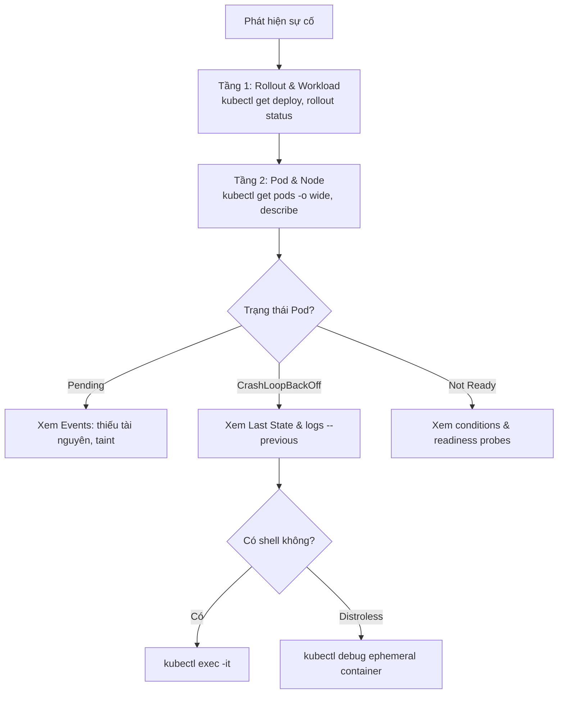

# 6_8_1 Quy Trình Chẩn Đoán Bằng kubectl

> **Khóa học**: Cloud DevOps Basic — Containers and Kubernetes  
> **Phân nhóm**: 6 Domain 6 - Containers and Kubernetes › 6_8 Kubernetes Observability and Troubleshooting  
> **Chủ đề**: Quy trình chẩn đoán sự cố Kubernetes từ trên xuống bằng bộ lệnh kubectl, ephemeral debug container và phân tích trạng thái Pod  
> **Phiên bản áp dụng**: Kubernetes 1.28+  
> **Trạng thái**: Bản nháp, chờ kiểm chứng  
> **Phạm vi**: [Topic README](./README.md#6_8_1-quy-trình-chẩn-đoán-bằng-kubectl)  
> **Checklist đối chiếu**: [CHECKLIST.md](../../CHECKLIST.md#6_8-kubernetes-observability-and-troubleshooting)  

---

## 1. Khái Niệm Cốt Lõi & Bản Chất Kỹ Thuật (Core Concepts & Technical Deep Dive)

Khi ứng dụng trên cụm gặp sự cố, phản xạ xóa hoặc khởi động lại làm mất dấu vết hiện trường. Kỹ sư tiếp cận điều tra có phương pháp theo từng tầng từ cao xuống thấp để thu thập bằng chứng chính xác.

### 1.1 Tư Duy Chẩn Đoán Từ Trên Xuống

Quy trình chẩn đoán từ trên xuống trong Kubernetes bắt đầu từ hạ tầng định tuyến và phát hành cấp cao (Ingress, Service, Helm), qua các workload controllers (Deployment, ReplicaSet), sau đó mới tới Pods, containers và mã nguồn ứng dụng. <!-- ev: C1.1 -->

<!-- ev: C1.1 -->
1. Tầng Điều Phối & Phát Hành: Xác nhận tiến trình rollout và trạng thái phát hành bản dựng.
2. Tầng Workload Controllers: So sánh số lượng bản sao mong muốn và bản sao thực tế đang sẵn sàng.
3. Tầng Pod & Lập Lịch: Kiểm tra việc phân bổ Node và các điều kiện trong status conditions.
4. Tầng Container & Runtime: Phân tích mã thoát exit code và lý do dừng trong terminated.
5. Tầng Ứng Dụng: Kiểm tra luồng log chuẩn stdout và stderr cùng các kết nối phụ thuộc nội bộ.

---

### 1.2 Bộ Lệnh Lõi Khám Nghiệm Hiện Trường Với kubectl

<!-- ev: C1.2 -->
```bash
kubectl get pods -n production -o wide
```

Lệnh `kubectl get pods -o wide` cung cấp thông tin mở rộng bao gồm địa chỉ IP của Pod, Node được gán lập lịch, trạng thái sẵn sàng (Readiness Gates) và số lần khởi động lại (Restarts). <!-- ev: C1.2 -->

<!-- ev: C1.3 -->
```bash
kubectl describe pod order-service-7bb8f9c94f-xk29q -n production
```

Lệnh `kubectl describe pod <pod-name>` trích xuất chi tiết cấu hình Pod, phần `Events` ghi nhận các thông điệp từ scheduler và kubelet, cùng khối `State` và `Last State` của từng container. <!-- ev: C1.3 -->

<!-- ev: C1.4 -->
```bash
kubectl get events -n production --sort-by=.lastTimestamp
```

Lệnh `kubectl get events --sort-by=.lastTimestamp` sắp xếp toàn bộ sự kiện trong namespace theo thứ tự thời gian tăng dần của trường mốc thời gian gần nhất (lastTimestamp). <!-- ev: C1.4 -->

<!-- ev: C1.5 -->
```bash
kubectl logs payment-gateway-5c4f8d9b-abcde -c payment-worker -n production
```

Cờ `-c <container-name>` trong `kubectl logs <pod-name>` cho phép chỉ định container cụ thể cần xem log trong một Pod chứa nhiều container (multi-container Pod). <!-- ev: C1.5 -->

<!-- ev: C1.6 -->
```bash
kubectl logs payment-gateway-5c4f8d9b-abcde -c payment-worker -p -n production
```

Cờ `--previous` (hoặc `-p`) trong `kubectl logs` cho phép đọc luồng log của container ở chu kỳ chạy trước đó ngay sau khi container bị crash hoặc restart. <!-- ev: C1.6 -->

<!-- ev: C1.7 -->
```bash
kubectl logs -l app=payment --prefix --tail=50 -f -n production
```

Lệnh `kubectl logs -l <selector> --prefix` cho phép gom log từ nhiều Pod cùng nhãn (label) và tự động gắn tiền tố (prefix) tên Pod vào đầu mỗi dòng log. <!-- ev: C1.7 -->

<!-- ev: C1.8 -->
```bash
kubectl exec -it order-service-7bb8f9c94f-xk29q -c web-app -n production -- /bin/sh
```

Lệnh `kubectl exec -it <pod-name> -c <container-name> -- <command>` khởi tạo một phiên dòng lệnh tương tác trực tiếp bên trong container đang chạy. <!-- ev: C1.8 -->

<!-- ev: C1.9 -->
```bash
kubectl port-forward pod/order-service-7bb8f9c94f-xk29q 8080:80 -n production
```

Lệnh `kubectl port-forward pod/<pod-name> <local-port>:<pod-port>` thiết lập đường hầm chuyển tiếp cổng từ máy trạm trực tiếp tới cổng mạng của Pod mà không cần phơi lộ Service. <!-- ev: C1.9 -->

<!-- ev: C1.10 -->
```bash
kubectl top pods -n production
```

Lệnh `kubectl top pods` và `kubectl top nodes` thu thập chỉ số tiêu thụ CPU và Memory tức thời thông qua Metrics API do thành phần metrics-server cung cấp. <!-- ev: C1.10 -->

---

### 1.3 Phân Tích Trạng Thái Pod: status.conditions & lastState.terminated

Mảng `status.conditions` của Pod phản ánh trạng thái vòng đời thông qua 4 điều kiện cốt lõi: `PodScheduled`, `Initialized`, `ContainersReady`, và `Ready`. <!-- ev: C1.11 -->

<!-- ev: C1.11 C1.12 -->
| Điều Kiện (Condition) | Giá Trị Mong Muốn | Ý Nghĩa Kỹ Thuật |
| :--- | :---: | :--- |
| `PodScheduled` | `True` | Scheduler đã phân bổ Pod vào một Node đáp ứng đủ yêu cầu tài nguyên. |
| `Initialized` | `True` | Tất cả init containers đã hoàn thành thành công mà không gặp lỗi. |
| `ContainersReady` | `True` | Toàn bộ container ứng dụng trong Pod đã vượt qua kiểm tra readiness probe. |
| `Ready` | `True` | Pod hoàn toàn sẵn sàng nhận lưu lượng truy cập từ Service endpoints. |

Điều kiện `ContainersReady` đạt `True` khi toàn bộ container trong Pod vượt qua probe sẵn sàng, và `Ready` chuyển `True` khi Pod đủ điều kiện tiếp nhận traffic mạng. <!-- ev: C1.12 -->

<!-- ev: C1.13 -->
```yaml
lastState:
  terminated:
    containerID: containerd://b3a4c5d6e7f8...
    exitCode: 137
    finishedAt: "2026-11-21T06:00:00Z"
    reason: OOMKilled
    startedAt: "2026-11-21T05:50:00Z"
```

Cấu trúc `containerStatuses[].lastState.terminated` ghi lại nguyên nhân tắt của container qua chuỗi `reason` (ví dụ OOMKilled, Error) và mã thoát số nguyên `exitCode`. <!-- ev: C1.13 -->

<!-- ev: C1.14 -->
```bash
kubectl get pod payment-service-xyz -n production \
  -o jsonpath='{.status.containerStatuses[*].lastState.terminated.exitCode}'
```

Cú pháp `kubectl get pod <pod-name> -o jsonpath='{.status.containerStatuses[*].lastState.terminated.exitCode}'` cho phép trích xuất nhanh mã thoát lỗi của container mà không cần duyệt toàn bộ file YAML. <!-- ev: C1.14 -->

---

### 1.4 Công Nghệ Debug Hiện Đại: Ephemeral Container & Pod Cloning Với kubectl debug

Ephemeral containers là các container tạm thời khai báo trong `ephemeralContainers`, không hỗ trợ cấu hình cổng mạng, không có probes và không tự động khởi động lại khi kết thúc. <!-- ev: C1.15 -->

<!-- ev: C1.16 -->
```bash
kubectl debug -it order-service-distroless -n production \
  --image=nicolaka/netshoot \
  --target=order-service
```

Lệnh `kubectl debug <target-pod> -it --image=<debug-image> --target=<container-name>` chèn một ephemeral container vào Pod đang chạy và chia sẻ không gian tiến trình (process namespace) với container mục tiêu. <!-- ev: C1.16 -->

<!-- ev: C1.17 -->
```bash
kubectl debug order-service-crash -n production \
  --copy-to=order-service-debug \
  --container=order-service \
  -- sh
```

Cờ `--copy-to=<new-pod>` trong `kubectl debug` tạo ra một bản sao mới của Pod để cho phép người dùng thay đổi câu lệnh khởi chạy, biến môi trường hoặc image mà không can thiệp Pod gốc. <!-- ev: C1.17 -->

<!-- ev: C1.18 -->
```bash
kubectl debug node/worker-01 -it --image=busybox
```

Lệnh `kubectl debug node/<node-name> -it --image=<debug-image>` khởi tạo một Pod đặc quyền chạy trên node chỉ định và gắn kết hệ thống tệp gốc của node vào thư mục `/host`. <!-- ev: C1.18 -->

---

## 2. Ví Dụ Đời Sống Thực Tế Dễ Hiểu (Intuitive Real-World Analogies)

Quy trình chẩn đoán sự cố Kubernetes tương tự như quy trình khám chữa bệnh tại một bệnh viện:

1. **Triệu chứng ban đầu**: Bệnh nhân thông báo cảm thấy khó chịu, tương đương cảnh báo dịch vụ gián đoạn từ hệ thống giám sát. Bác sĩ không can thiệp ngay mà xem bệnh án tổng thể.
2. **Khám lâm sàng tổng quát**: Bác sĩ đo nhiệt độ và huyết áp, tương ứng việc kỹ sư kiểm tra danh sách và xem sự kiện hệ thống để đánh giá thể trạng chung.
3. **Xét nghiệm chuyên sâu**: Bác sĩ lấy mẫu máu và chụp phim, tương ứng việc kỹ sư trích xuất mã dừng của tiến trình và đọc thông điệp trước khi dừng hoạt động.
4. **Nội soi can thiệp**: Với cơ thể đóng kín không có cổng giao tiếp sẵn có, bác sĩ luồn thiết bị quan sát chuyên biệt vào bên trong. Đây là cơ chế đưa thùng chứa hỗ trợ tạm thời vào theo dõi tiến trình mà không làm gián đoạn hoạt động của bệnh nhân.

---

## 3. Kiến Trúc, Luồng Hoạt Động & Hình Ảnh Trực Quan (Architecture, Diagrams & Visual Media)

Quy trình ra quyết định chẩn đoán có hệ thống:



---

## 4. Code Mẫu Trực Quan Hoặc Dòng Lệnh Thực Chiến (Runnable Sample Code / CLI)

Quy trình chẩn đoán thực tế xử lý sự cố Pod dịch vụ thanh toán bị lỗi CrashLoopBackOff:

### Bước 1: Khảo Sát Danh Sách Pod Và Dòng Sự Kiện

<!-- ev: C1.2 -->
```bash
kubectl get pods -n demo-troubleshoot -o wide
```

<!-- ev: C1.4 -->
```bash
kubectl get events -n demo-troubleshoot --sort-by=.lastTimestamp
```

### Bước 2: Kiểm Tra Chi Tiết Trạng Thái Dừng Của Container

<!-- ev: C1.3 -->
```bash
kubectl describe pod payment-service-4wz2t -n demo-troubleshoot
```

<!-- ev: C1.14 -->
```bash
kubectl get pod payment-service-4wz2t -n demo-troubleshoot \
  -o jsonpath='{.status.containerStatuses[0].lastState.terminated.exitCode}'
```

### Bước 3: Thu Thập Log Của Chu Kỳ Chạy Trước Đó

<!-- ev: C1.6 -->
```bash
kubectl logs payment-service-4wz2t -c payment-app -p -n demo-troubleshoot
```

### Bước 4: Chẩn Đoán Bằng Ephemeral Container Trên Pod Distroless

<!-- ev: C1.16 -->
```bash
kubectl debug -it payment-service-4wz2t -n demo-troubleshoot \
  --image=nicolaka/netshoot \
  --target=payment-app
```

Kiểm tra phân giải tên miền cơ sở dữ liệu nội bộ trong môi trường debug: <!-- ev: C1.16 -->
```bash
nslookup db-internal.database.svc.cluster.local
```

---

## 5. Cạm Bẫy Thực Tế & Thực Tiễn Sản Xuất (Production Gotchas & Best Practices)

- **Bẫy xóa Pod vội vã**: Xóa Pod làm ReplicaSet tạo Pod mới trên Node khác, làm mất dấu vết trong Last State và cờ `--previous` không còn đọc được log lỗi trước đó. Luôn thu thập chứng cứ trước khi can thiệp. <!-- ev: C1.3 C1.6 -->
- **Bẫy thiếu Metrics Server**: Lệnh `kubectl top pods` và `kubectl top nodes` trả về lỗi nếu cụm chưa triển khai metrics-server; công cụ này đo mức sử dụng tức thời chứ không thay thế Prometheus. <!-- ev: C1.10 -->
- **Bẫy phân quyền RBAC cho ephemeral containers**: Lệnh `kubectl debug` yêu cầu quyền tương tác với tài nguyên con `pods/ephemeralcontainers`. <!-- ev: C1.15 C1.16 -->
- **Bẫy nhầm lẫn giữa ContainersReady và Ready**: Một Pod có thể đạt `ContainersReady = True` nhưng vẫn nhận `Ready = False` nếu chưa vượt qua các tiêu chí kiểm tra bổ sung trong readiness gates. <!-- ev: C1.11 C1.12 -->

---

## 6. Câu Hỏi Củng Cố Kiến Thức (Active Recall Quiz)

### Câu Hỏi 1
Một container microservice trong hệ thống liên tục restart và rơi vào trạng thái `CrashLoopBackOff`. Khi bạn gõ lệnh `kubectl logs <pod-name>`, màn hình hoàn toàn rỗng hoặc chỉ in 1 dòng thông điệp khởi động. Lệnh nào sau đây giúp bạn đọc được thông báo lỗi do ứng dụng ném ra trước khi bị crash ở chu kỳ trước?

A. `kubectl logs <pod-name> --all-containers`  
B. `kubectl logs <pod-name> --previous`  
C. `kubectl describe pod <pod-name> --show-events`  
D. `kubectl get pod <pod-name> -o yaml`  

<details>
<summary>Đáp án</summary>

**Đáp án đúng: B**  
Cờ `--previous` (hoặc `-p`) chỉ định cho kubelet trả về luồng log của phiên bản container vừa thoát trước khi chu kỳ mới được khởi động lại. <!-- ev: C1.6 -->
</details>

---

### Câu Hỏi 2
Ứng dụng backend của bạn được xây dựng trên base image `distroless` (không chứa shell `/bin/sh` hay bất kỳ tiện ích mạng nào). Bạn cần kiểm tra kết nối mạng và các tiến trình nội bộ của Pod mà không được phép can thiệp làm gián đoạn Pod trên production. Phương án xử lý tối ưu nhất theo chuẩn Kubernetes là gì?

A. Sửa Dockerfile, build lại image có chứa `bash`, đẩy lên registry và cập nhật Deployment.  
B. Dùng `kubectl exec -it <pod-name> -- /bin/bash` và cài thêm `curl` vào container.  
C. Dùng `kubectl debug -it <pod-name> --image=nicolaka/netshoot --target=<container-name>` để chèn một ephemeral container vào Pod và chia sẻ PID namespace.  
D. Tải gói mã nguồn của ứng dụng về máy cá nhân và chạy kiểm thử mạng cục bộ.  

<details>
<summary>Đáp án</summary>

**Đáp án đúng: C**  
Ephemeral container gắn vào Pod đang chạy thông qua `kubectl debug` với cờ `--target` cho phép người vận hành sử dụng đầy đủ công cụ chẩn đoán chuyên sâu từ image phụ trợ mà không làm thay đổi hay restart container chính. <!-- ev: C1.16 -->
</details>

---

### Câu Hỏi 3
Một Pod có các điều kiện trong `status.conditions` hiển thị như sau: `PodScheduled = True`, `Initialized = True`, `ContainersReady = True`, nhưng `Ready = False`. Hậu quả trực tiếp của trạng thái này đối với lưu lượng truy cập từ người dùng là gì?

A. Toàn bộ các tiến trình trong container bị tạm dừng thực thi ngay lập tức.  
B. Scheduler sẽ lập tức điều chuyển Pod sang một Node khác trong cụm.  
C. Kubelet sẽ tự động gửi tín hiệu SIGKILL để khởi động lại Pod.  
D. Pod sẽ không được thêm vào danh sách Endpoints của Service, do đó không tiếp nhận lưu lượng mạng từ client.  

<details>
<summary>Đáp án</summary>

**Đáp án đúng: D**  
Điều kiện `Ready = True` là tiêu chí bắt buộc để endpoint controller đưa địa chỉ IP của Pod vào danh sách sẵn sàng phục vụ của Service. Khi `Ready = False`, Service sẽ tạm thời cô lập Pod khỏi luồng phân phối tải để tránh trả lỗi cho người dùng. <!-- ev: C1.12 -->
</details>

---

## 7. 📚 Nguồn Tài Liệu Chính Thống (Tier-1 Official References)

- [Kubernetes Documentation: Debug Pods](https://kubernetes.io/docs/tasks/debug/debug-application/debug-pods/) — Hướng dẫn chính thức về quy trình chẩn đoán sự cố Pod bằng bộ lệnh kubectl.
- [Kubernetes Documentation: Debug Running Pods with Ephemeral Containers](https://kubernetes.io/docs/tasks/debug/debug-application/debug-running-pod/) — Tài liệu kỹ thuật về cơ chế gắn ephemeral container và tạo bản sao Pod bằng kubectl debug.
- [Kubernetes Documentation: Pod Lifecycle](https://kubernetes.io/docs/concepts/workloads/pods/pod-lifecycle/) — Đặc tả chi tiết về các giai đoạn trạng thái, conditions và containerStatuses.
- [Kubernetes Documentation: kubectl debug Reference](https://kubernetes.io/docs/reference/kubectl/generated/kubectl_debug/) — Bảng tra cứu toàn diện các tùy chọn và cờ tham số của lệnh kubectl debug.
- [Kubernetes Documentation: Monitor Node Health](https://kubernetes.io/docs/tasks/debug/debug-cluster/monitor-node-health/) — Tài liệu giám sát tình trạng Node và sử dụng công cụ chẩn đoán hạ tầng.
