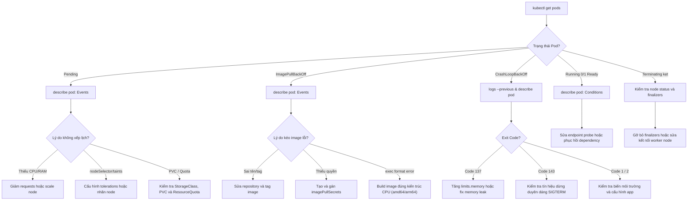

# 6_8_2 Danh Mục Lỗi Thường Gặp

> **Khóa học**: Cloud DevOps Basic — Containers and Kubernetes
> **Phân nhóm**: 6 Domain 6 - Containers and Kubernetes › 6_8 Kubernetes Observability and Troubleshooting
> **Chủ đề**: 6_8_2 Danh mục các trạng thái lỗi kinh điển trong Kubernetes workloads, nguyên nhân cốt lõi và phương pháp xác nhận, xử lý
> **Phiên bản áp dụng**: Kubernetes v1.28 - v1.32
> **Trạng thái**: Bản nháp, chờ kiểm chứng
> **Phạm vi**: [Topic README](./README.md#6_8_2-danh-mục-lỗi-thường-gặp) · **Checkpoint**: [CHECKLIST](../../CHECKLIST.md#6_8-kubernetes-observability-and-troubleshooting)
> **Kiến thức liên quan**: [6_8_1 Quy Trình Chẩn Đoán Bằng kubectl](./README.md#6_8_1-quy-trình-chẩn-đoán-bằng-kubectl) · [6_3_4 ReplicaSets and Deployments](<../6_3 Kubernetes Architecture and Core Workloads/6_3_4 ReplicaSets and Deployments.md>) · [6_4 Networking and Storage](<../6_4 Kubernetes Networking Configuration and Storage/README.md>)

---

## 1. Khái Niệm Cốt Lõi & Bản Chất Kỹ Thuật (Core Concepts & Technical Deep Dive)

Trong Kubernetes, Pod luôn trải qua các điều kiện vòng đời có cấu trúc. Khi sự cố xảy ra, Kubernetes phản ánh nguyên nhân gốc rễ qua trạng thái của Pod, lý do chờ của container và mã thoát của tiến trình Linux. Nắm vững danh mục lỗi giúp rút ngắn thời gian phục hồi dịch vụ (MTTR) từ hàng giờ xuống dưới vài phút.

### 1.1 Nhóm Lỗi Điều Phối Và Khởi Tạo (Scheduling & Initialization)

Trạng thái `Pending` xuất hiện khi scheduler không tìm được node nào thỏa mãn yêu cầu tài nguyên cấu hình trong `requests` (CPU/RAM), hoặc tất cả node vi phạm các ràng buộc như `nodeSelector`, `nodeAffinity`, hoặc chứa `taints` mà Pod không khai báo `tolerations` tương ứng. <!-- ev: C2.1 -->

Trạng thái `Pending` cũng xảy ra khi PersistentVolumeClaim của Pod chưa được liên kết (unbound PVC) do thiếu PersistentVolume khả dụng hoặc storage provisioner chưa sẵn sàng, hoặc do tạo Pod vượt quá hạn ngạch `ResourceQuota` của namespace. <!-- ev: C2.2 -->

Trạng thái `ErrImagePull` và `ImagePullBackOff` xuất hiện khi kubelet không thể tải image từ registry do sai tên image, sai tag phiên bản, thiếu khóa `imagePullSecrets` khi truy cập private registry, hoặc bị giới hạn tần suất kéo dữ liệu (rate limit) từ public registry. <!-- ev: C2.3 -->

Lỗi kéo image hoặc khởi tạo container thất bại có thể do không tương thích kiến trúc CPU, ví dụ image biên dịch cho `linux/arm64` chạy trên node `linux/amd64` dẫn đến lỗi thực thi nhị phân (`exec format error`). <!-- ev: C2.4 -->

### 1.2 Nhóm Lỗi Thực Thi Và Dừng Đột Ngột (Runtime & Crashes)

Trạng thái `CrashLoopBackOff` xuất hiện khi container liên tục thoát bất thường hoặc thất bại bài kiểm tra liveness probe, khiến Kubernetes tự động lùi thời gian khởi động lại theo cấp số nhân (exponential backoff từ 10 giây đến tối đa 300 giây) nhằm bảo vệ tài nguyên của node. <!-- ev: C2.5 -->

Kỹ sư vận hành có thể xác định nguyên nhân lần dừng trước đó bằng cách kiểm tra nhật ký qua lệnh `kubectl logs <pod-name> --previous` hoặc đọc lý do kết thúc trong trường `lastState.terminated` từ lệnh `kubectl describe pod <pod-name>`. <!-- ev: C2.6 -->

Container kết thúc với mã thoát exit code 137 (công thức 128 cộng tín hiệu SIGKILL có giá trị 9) chỉ ra tiến trình bị hệ điều hành cưỡng chế dừng ngay lập tức, phổ biến nhất do Linux OOM Killer kích hoạt khi container dùng RAM vượt ngưỡng `limits.memory` hoặc node cạn kiệt RAM. <!-- ev: C2.7 -->

Mã thoát exit code 143 (128 cộng tín hiệu SIGTERM có giá trị 15) xuất hiện khi hệ thống yêu cầu dừng duyên dáng, trong khi exit code 1 hoặc 2 thường phản ánh lỗi ứng dụng bên trong như sai cấu hình khởi chạy, thiếu biến môi trường, hoặc ngoại lệ runtime chưa xử lý. <!-- ev: C2.8 -->

Trạng thái `CreateContainerConfigError` xuất hiện khi container không thể khởi tạo do Pod tham chiếu đến ConfigMap hoặc Secret không tồn tại trong namespace, hoặc do tên khóa cấu hình khai báo trong trường `valueFrom` không tìm thấy trong dữ liệu tương ứng. <!-- ev: C2.9 -->

Trạng thái `Evicted` xảy ra khi kubelet chủ động thu hồi và đẩy Pod ra khỏi node nhằm giải phóng tài nguyên khi node gặp các áp lực cục bộ như thiếu bộ nhớ (`MemoryPressure`), thiếu dung lượng ổ đĩa (`DiskPressure`), hoặc cạn định danh tiến trình (`PIDPressure`). <!-- ev: C2.10 -->

### 1.3 Nhóm Lỗi Trạng Thái Sẵn Sàng Và Mạng Kết Nối (Readiness & Networking)

Trạng thái Pod hiển thị `Running` nhưng cột `READY` là `0/1` chỉ ra container đang chạy nhưng bài kiểm tra readiness probe thất bại, khiến kubelet lập tức loại bỏ địa chỉ IP của Pod ra khỏi danh sách Endpoints của Service. <!-- ev: C2.11 -->

Khi Service không có bất kỳ Pod nào đạt trạng thái sẵn sàng trong danh sách Endpoints, lưu lượng từ client gửi qua Ingress Controller sẽ nhận lại mã lỗi phản hồi HTTP 503 Service Unavailable hoặc nhận lỗi từ chối kết nối (connection refused) từ tầng mạng kube-proxy. <!-- ev: C2.12 -->

Lỗi định tuyến trong mạng Kubernetes thường xuất phát từ việc trường `spec.selector` trong định nghĩa Service không khớp với nhãn `metadata.labels` của Pod, hoặc trường `spec.ports[].targetPort` của Service không khớp với cổng mạng ứng dụng đang lắng nghe. <!-- ev: C2.13 -->

Giao tiếp giữa các Pod thuộc các namespace khác nhau sẽ thất bại nếu không sử dụng tên miền đầy đủ FQDN theo chuẩn `<service-name>.<namespace>.svc.cluster.local`, hoặc lưu lượng bị ngăn chặn bởi quy tắc NetworkPolicy khi namespace áp dụng chính sách mặc định từ chối (default deny). <!-- ev: C2.14 -->

### 1.4 Nhóm Lỗi Vòng Đời Kết Thúc Và Triển Khai CI/CD (Termination & CI/CD Rollout)

Pod bị kẹt ở trạng thái `Terminating` khi tiến trình xử lý trong hook `preStop` bị treo quá thời gian gia hạn, hoặc Pod chứa các khóa `metadata.finalizers` chưa được bộ điều khiển hoàn tất xử lý, hoặc do worker node chứa Pod mất kết nối dẫn tới trạng thái `NotReady`. <!-- ev: C2.15 -->

Namespace bị kẹt ở trạng thái `Terminating` khi bên trong namespace vẫn còn các tài nguyên con chứa finalizers chưa giải phóng, hoặc do một API service mở rộng (custom resource definition) bị mất phản hồi khiến control plane không thể dọn dẹp sạch đối tượng. <!-- ev: C2.16 -->

Trong triển khai tự động, Deployment rơi vào trạng thái lỗi `ProgressDeadlineExceeded` khi bộ điều khiển nhận thấy ReplicaSet phiên bản mới không thể đạt đủ số lượng Pod sẵn sàng trong thời hạn quy định (mặc định 600 giây). <!-- ev: C2.17 -->

Các sự cố triển khai CI/CD và Helm phổ biến gồm lỗi `Forbidden` do ServiceAccount thiếu quyền RBAC, lỗi Helm báo `another operation is in progress` khi phiên trước bị ngắt và để lại khóa trong Secret quản lý, hoặc lỗi timeout của cờ `--wait` khi Pod chưa sẵn sàng. <!-- ev: C2.18 -->

---

## 2. Ví Dụ Đời Sống Thực Tế Dễ Hiểu (Intuitive Real-World Analogies)

Bảng mã lỗi Kubernetes tương tự cụm đèn cảnh báo "Check Engine" trên bảng đồng hồ ô tô:

- **Đèn báo hết xăng / cấm tải (`Pending`)**: Bạn muốn chạy xe tải chở hàng nhưng trạm hết dầu hoặc cầu phía trước cấm tải trọng xe. Xe phải đứng chờ ở bãi đỗ cho đến khi có đủ nhiên liệu hoặc tìm được lộ trình phù hợp.
- **Đèn báo chìa khóa từ xa không hợp lệ (`ImagePullBackOff`)**: Bạn đứng trước cửa xe nhưng dùng nhầm chìa khóa hoặc chìa khóa chưa đăng ký mã bảo mật. Hệ thống chống trộm từ chối mở cửa, không cho khởi động xe.
- **Đèn báo bó máy vì cạn nhớt (`OOMKilled` - Exit Code 137)**: Xe đang chạy thì cạn sạch nhớt bôi trơn. Cảm biến phát hiện nguy cơ cháy nổ lập tức ngắt toàn bộ hệ thống đánh lửa để cứu bộ khung xe trước khi quá muộn.
- **Đề nổ rồi chết máy liên tục (`CrashLoopBackOff`)**: Bugi ướt xăng khiến bạn vừa đề là xe gầm lên một giây rồi tắt lịm. Hệ thống bắt bạn chờ mười giây ở lần đề sau và kéo dài thời gian chờ lên vài phút để bảo vệ ắc-quy.
- **Xe nổ cầm chừng nhưng chưa vào số đón khách (`Running` nhưng `0/1 Ready`)**: Động cơ nổ êm trong gara nhưng áp suất lốp chưa đủ an toàn. Dù máy đang nổ, xe vẫn bật biển tạm ngưng đón khách cho tới khi mọi thông số đạt chuẩn.

---

## 3. Kiến Trúc, Luồng Hoạt Động & Hình Ảnh Trực Quan (Architecture, Diagrams & Visual Media)

### 3.1 Cây Quyết Định Chẩn Đoán Sự Cố Workloads (Workload Triage Decision Tree)



### 3.2 Bảng Đối Chiếu Chữ Ký Kỹ Thuật (Workload Error Signatures)

| Trạng thái | Vị trí phản ánh | Nguyên nhân cốt lõi | Lệnh chẩn đoán ưu tiên |
| :--- | :--- | :--- | :--- |
| `Pending` | Pod Phase | Thiếu CPU/RAM requests, sai selector/taints, PVC chưa bound, vượt quota | `kubectl describe pod <name>` (Events) |
| `ImagePullBackOff` | Container Waiting | Sai tên/tag, thiếu `imagePullSecrets`, rate limit, lệch kiến trúc CPU | `kubectl describe pod <name>` (Events) |
| `CrashLoopBackOff` | Container Waiting | Ứng dụng thoát khi khởi động, sai config, liveness probe thất bại | `kubectl logs <name> --previous` |
| `OOMKilled` (137) | Container Terminated | Tiến trình vượt `limits.memory`, kernel gửi SIGKILL | `kubectl describe pod <name>` (Last State) |
| `0/1 Ready` | Pod Ready Condition | Ứng dụng chạy nhưng readiness probe trả về thất bại | `kubectl describe pod <name>` (Conditions) |
| `CreateContainerConfigError` | Container Waiting | Thiếu ConfigMap, thiếu Secret, hoặc sai tên key trong `valueFrom` | `kubectl describe pod <name>` (Events) |
| `Evicted` | Pod Status | Node chịu áp lực tài nguyên cục bộ (`MemoryPressure`, `DiskPressure`) | `kubectl get pod <name> -o yaml` |
| `Terminating` (kẹt) | Pod Metadata | Khóa `metadata.finalizers` chưa gỡ, preStop hook treo, node `NotReady` | `kubectl get pod <name> -o jsonpath` |

---

## 4. Code Mẫu Trực Quan Hoặc Dòng Lệnh Thực Chiến (Runnable Sample Code / CLI)

### 4.1 Chẩn Đoán Lỗi Scheduling Và Khởi Tạo Image

<!-- ev: C2.1 -->
Khi một Pod rơi vào trạng thái `Pending`, kiểm tra các sự kiện điều phối từ kube-scheduler:

```bash
kubectl describe pod <pod-name> | grep -A 10 Events:
```

<!-- ev: C2.2 -->
Nếu Pod kẹt do PersistentVolumeClaim chưa liên kết hoặc vượt hạn ngạch ResourceQuota:

```bash
kubectl get pvc
kubectl get resourcequota -n <namespace>
```

<!-- ev: C2.3 -->
Xác nhận chi tiết thông báo lỗi kéo image từ container registry:

```bash
kubectl describe pod <pod-name> | grep -E "Image:|Failed|BackOff|Message:"
```

<!-- ev: C2.4 -->
Khắc phục lỗi xác thực bằng cách tạo Secret hoặc kiểm tra lệch kiến trúc phần cứng:

```bash
kubectl create secret docker-registry acr-secret \
  --docker-server=myregistry.azurecr.io \
  --docker-username=myuser \
  --docker-password=mypassword \
  --docker-email=devops@example.com

# Kiểm tra thông báo exec format error khi lệch kiến trúc CPU arm64 và amd64
kubectl logs <pod-name>
```

### 4.2 Chẩn Đoán Lỗi Runtime, Container Crash Và Cấu Hình

<!-- ev: C2.6 -->
Khi container liên tục khởi động lại, kiểm tra nhật ký phiên chạy ngay trước đó:

```bash
kubectl logs <pod-name> --previous --tail=50
kubectl get pod <pod-name> -o jsonpath='{range .status.containerStatuses[*]}{.name}{": lastState="}{.lastState.terminated.reason}{" exitCode="}{.lastState.terminated.exitCode}{"\n"}{end}'
```

<!-- ev: C2.7 -->
Nếu container kết thúc với mã thoát exit code 137 do cơ chế Linux OOM Killer:

```bash
kubectl top pod <pod-name> --containers
```

<!-- ev: C2.9 -->
Kiểm tra chi tiết lỗi `CreateContainerConfigError` do thiếu ConfigMap hoặc Secret:

```bash
kubectl describe pod <pod-name> | grep -A 5 "CreateContainerConfigError"
```

### 4.3 Chẩn Đoán Lỗi Readiness Probe Và Định Tuyến Mạng

<!-- ev: C2.11 -->
Khi Pod hiển thị `Running` nhưng cột `READY` là `0/1`, kiểm tra các điều kiện trạng thái:

```bash
kubectl describe pod <pod-name> | grep -A 10 Conditions:
```

<!-- ev: C2.12 -->
Xác nhận danh sách địa chỉ mạng Endpoints của Service tương ứng:

```bash
kubectl get endpoints <service-name>
```

<!-- ev: C2.13 -->
Kiểm tra tính khớp nhãn giữa `spec.selector` của Service và `metadata.labels` của Pod:

```bash
kubectl get service <service-name> -o jsonpath='{.spec.selector}'
kubectl get pods --show-labels
```

### 4.4 Chẩn Đoán Lỗi Termination Và Triển Khai CI/CD

<!-- ev: C2.15 -->
Kiểm tra sự tồn tại của các khóa finalizers đang giữ Pod không cho giải phóng:

```bash
kubectl get pod <pod-name> -o jsonpath='{.metadata.finalizers}'
kubectl patch pod <pod-name> -p '{"metadata":{"finalizers":null}}'
```

<!-- ev: C2.16 -->
Xác nhận và gỡ bỏ finalizers trên Namespace bị kẹt dọn dẹp:

```bash
kubectl get namespace <namespace-name> -o json | \
  jq '.spec.finalizers = []' | \
  kubectl replace --raw "/api/v1/namespaces/<namespace-name>/finalize" -f -
```

<!-- ev: C2.17 -->
Kiểm tra thông báo lỗi tiến độ triển khai của Deployment:

```bash
kubectl rollout status deployment/<deployment-name>
kubectl describe deployment <deployment-name> | grep -A 5 Conditions:
```

<!-- ev: C2.18 -->
Giải phóng khóa khi Helm báo lỗi `another operation is in progress` trong pipeline CI/CD:

```bash
kubectl get secret -l owner=helm,name=<release-name> --sort-by=.metadata.creationTimestamp
kubectl delete secret <pending-release-secret-name>
```

---

## 5. Cạm Bẫy Thực Tế & Thực Tiễn Sản Xuất (Production Gotchas & Best Practices)

Trong vận hành thực tế, phản ứng vội vã khi thấy mã lỗi có thể gây ra những sự cố thứ cấp nghiêm trọng.

### 5.1 Cạm Bẫy Cưỡng Chế Xóa Pod Bằng Cờ `--force --grace-period=0`

Khi thấy Pod kẹt ở trạng thái `Terminating` trên node `NotReady`, cưỡng chế xóa bằng `--force --grace-period=0` chỉ xóa bản ghi trong `etcd` chứ không dừng tiến trình thực tế trên worker node. Nếu Pod thuộc StatefulSet hoặc gắn volume ReadWriteOnce (RWO), Pod mới được tạo trên node khác sẽ gắn cùng volume dữ liệu, dẫn tới tranh chấp dữ liệu (split-brain) hoặc hỏng file system. <!-- ev: C2.15 -->

### 5.2 Cạm Bẫy Cấu Hình Liveness Probe Quá Hung Hăng

Thiết lập `initialDelaySeconds` quá ngắn hoặc `timeoutSeconds` quá thấp cho ứng dụng khởi động chậm (như Java Spring Boot) sẽ biến nghẽn tạm thời thành thảm họa. Khi tải tăng, ứng dụng phản hồi chậm khiến probe thất bại; kubelet liên tục khởi động lại container tạo thành vòng lặp restart storm làm sập toàn bộ dịch vụ. <!-- ev: C2.5 -->

### 5.3 Cạm Bẫy Bỏ Trống Khai Báo Requests Dẫn Tới Eviction Diện Rộng

Nếu Pod không cấu hình `requests`, Kubernetes xếp Pod vào nhóm chất lượng dịch vụ thấp nhất `BestEffort`. Khi worker node chịu áp lực cạn kiệt bộ nhớ (`MemoryPressure`), kubelet ưu tiên trục xuất (evict) toàn bộ Pod `BestEffort` đầu tiên trước các nhóm `Burstable` và `Guaranteed`, gây gián đoạn hàng loạt Pod cùng lúc. <!-- ev: C2.10 -->

### 5.4 Cạm Bẫy Lệch Nhãn Âm Thầm Trong Service Selector

Ký tự thừa hoặc khoảng trắng trong trường `spec.selector` của Service khiến Service không tìm thấy Pod nào. Kubernetes không báo lỗi cú pháp vì Service có thể tạo trước Pod. Người dùng sẽ nhận lỗi HTTP 503 từ Ingress. Luôn kiểm tra `kubectl get endpoints <service-name>` sau mỗi lần triển khai để bảo đảm có IP hợp lệ. <!-- ev: C2.13 -->

---

## 6. Câu Hỏi Củng Cố Kiến Thức (Active Recall Quiz)

### Câu 1: Phân Biệt Nguyên Nhân Container Bị OOMKilled

Một Pod chuyển sang dừng với exit code 137. Làm thế nào xác định container dừng do vượt `limits.memory` hay do toàn bộ worker node cạn kiệt RAM vật lý?

<details>
<summary>Đáp án</summary>

- **Cấp Pod**: Chạy `kubectl describe pod <pod-name>`. Trong `Last State -> Terminated`, nếu `Reason` là `OOMKilled`, tiến trình container đã vượt ngưỡng cấu hình `limits.memory` và bị cgroup gửi SIGKILL tiêu diệt.
- **Cấp Node**: Chạy `kubectl describe node <node-name>`. Nếu điều kiện `MemoryPressure` là `True` kết hợp log `dmesg -T` hoặc `journalctl -k` có thông báo Linux kernel OOM Killer tiêu diệt tiến trình máy chủ, nguyên nhân do node cạn kiệt RAM vật lý khiến kubelet phải trục xuất Pod.
</details>

### Câu 2: Chẩn Đoán Lỗi Pod Running 0/1 Ready Gây Ra HTTP 503

Ingress liên tục trả về lỗi HTTP 503. Kiểm tra thấy 3 Pod đều `Running` nhưng cột `READY` là `0/1`. Hãy giải thích luồng dữ liệu bị đứt đoạn và cách xử lý.

<details>
<summary>Đáp án</summary>

- **Luồng dữ liệu**: `Running` chứng tỏ container đang chạy, nhưng `0/1` chỉ ra `readinessProbe` thất bại. Kubelet loại IP của Pod khỏi Endpoints của Service. Ingress thấy Service không có Endpoint nào (`<none>`) nên phản hồi HTTP 503 Service Unavailable.
- **Cách xử lý**: Chạy `kubectl describe pod <pod-name>` đọc lỗi probe trong phần Events (ví dụ HTTP 500 hoặc timeout). Khắc phục lỗi phụ thuộc ứng dụng (kết nối database, Redis). Khi probe trả về HTTP 200, kubelet tự động thêm IP Pod vào Endpoints và Ingress định tuyến lưu lượng trở lại.
</details>

### Câu 3: Khắc Phục Lỗi Helm Kẹt Lock Khi Pipeline Bị Hủy Ngang

Pipeline CI/CD bị cancel khi `helm upgrade --install` đang chạy dở. Lần chạy sau báo lỗi `UPGRADE FAILED: another operation is in progress`. Tại sao lỗi xảy ra và xử lý thế nào?

<details>
<summary>Đáp án</summary>

- **Nguyên nhân**: Helm quản lý release qua Secret mang nhãn `owner=helm`. Khi nâng cấp, Helm tạo bản ghi trạng thái chuyển tiếp `pending-upgrade` để khóa thao tác. Pipeline bị ngắt khiến tiến trình Helm dừng đột ngột mà chưa kịp dọn dẹp khóa này.
- **Cách xử lý**:
  1. Liệt kê Secret release: `kubectl get secret -l owner=helm,name=<release-name> --sort-by=.metadata.creationTimestamp`.
  2. Xác định Secret mới nhất có trạng thái pending bị treo (dạng `sh.helm.release.v1.<release-name>.v<N>`).
  3. Xóa Secret bị kẹt: `kubectl delete secret sh.helm.release.v1.<release-name>.v<N>`.
  4. Release trở về trạng thái ổn định trước đó (`deployed`), cho phép chạy lại pipeline bình thường.
</details>

---

## 7. 📚 Nguồn Tài Liệu Chính Thống (Tier-1 Official References)

Dưới đây là các tài liệu kỹ thuật chính thống từ Kubernetes Documentation để đối chiếu và tra cứu chuyên sâu về các trạng thái lỗi và phương pháp chẩn đoán:

- [Kubernetes Documentation: Determine the Reason for Pod Failure](https://kubernetes.io/docs/tasks/debug/debug-application/determine-reason-pod-failure/) - Hướng dẫn chính thức về cách xác định lý do Pod thất bại và giải mã trạng thái container.
- [Kubernetes Documentation: Debug Running Pods](https://kubernetes.io/docs/tasks/debug/debug-application/debug-running-pod/) - Tài liệu chẩn đoán sự cố cho Pod đang chạy, phân tích trạng thái readiness và liveness probe.
- [Kubernetes Documentation: Debug Services](https://kubernetes.io/docs/tasks/debug/debug-application/debug-service/) - Phương pháp chẩn đoán sự cố mạng tầng Service, kiểm tra Service selector và Endpoints.
- [Kubernetes Documentation: Pod Lifecycle](https://kubernetes.io/docs/concepts/workloads/pods/pod-lifecycle/) - Chi tiết về các pha vòng đời của Pod, điều kiện trạng thái container và cơ chế restart backoff.
- [Kubernetes Documentation: Deployment Progress Deadline](https://kubernetes.io/docs/concepts/workloads/controllers/deployment/#progress-deadline-seconds) - Quy chuẩn thiết lập và giám sát thời hạn hoàn tất của Deployment controller.
