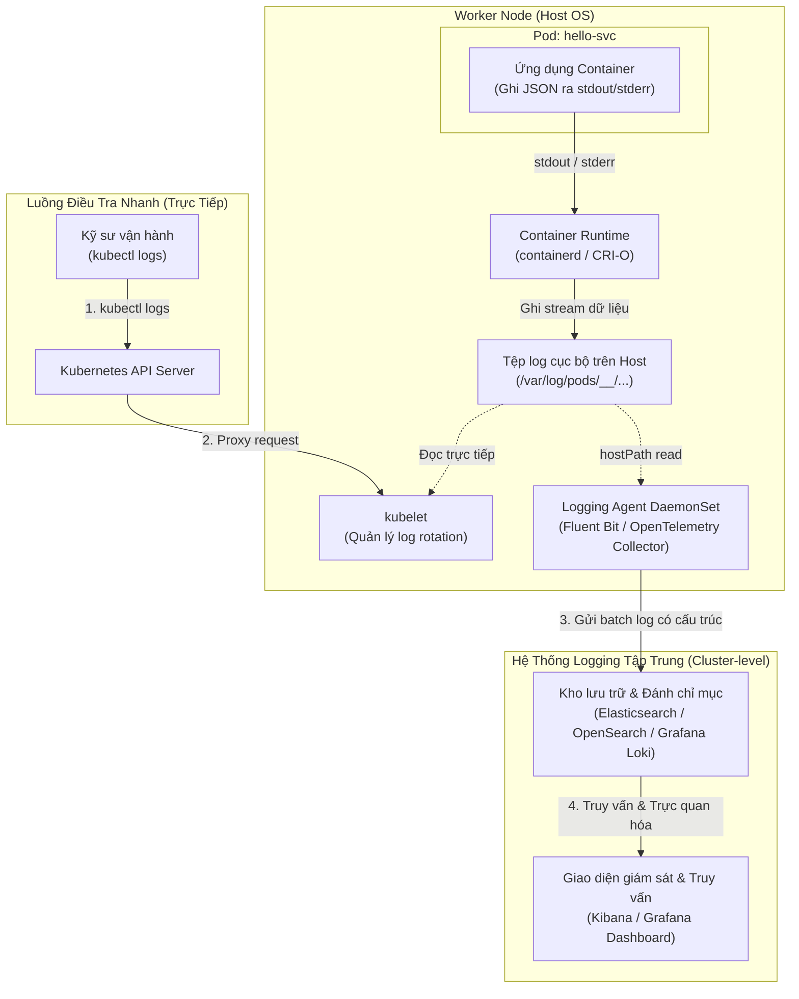

# 6_8_3 Logging

> **Khóa học**: Cloud & DevOps Basic  
> **Phân nhóm**: Domain 6 - Containers and Kubernetes  
> **Chủ đề**: 6_8 Kubernetes Observability and Troubleshooting  
> **Trạng thái**: Bản nháp, chờ kiểm chứng  
> **Checklist đối chiếu**: [CHECKLIST.md](../../CHECKLIST.md)

---

## 1. Khái Niệm Cốt Lõi & Bản Chất Kỹ Thuật (Core Concepts & Technical Deep Dive)

Trong mô hình máy chủ ảo truyền thống, ứng dụng thường ghi nhật ký hoạt động vào các tập tin tĩnh đặt trên hệ thống lưu trữ cục bộ. Tuy nhiên, kiến trúc microservices trên nền tảng Kubernetes vận hành theo nguyên lý tài nguyên phù du (ephemeral lifecycle). Một Pod có thể bị hủy bỏ, tái tạo hoặc dịch chuyển sang node khác bất kỳ lúc nào khi xảy ra sự cố phần cứng, mở rộng quy mô tự động hoặc nâng cấp phiên bản. Nếu ứng dụng tiếp tục lưu nhật ký vào hệ thống tệp bên trong container, toàn bộ dữ liệu lịch sử phục vụ điều tra lỗi sẽ biến mất cùng với vòng đời của container đó.

Nhằm giải quyết triệt để vấn đề này, Kubernetes áp dụng nguyên lý coi nhật ký hoạt động của ứng dụng như một luồng sự kiện liên tục (event streams).

### Cơ Chế Xử Lý Log Tại Cấp Độ Node Trong Kubernetes

Kubernetes quy định các ứng dụng chạy trong container ghi dữ liệu log ra hai luồng xuất chuẩn là standard output (`stdout`) và standard error (`stderr`). <!-- ev: C3.1 -->

Container runtime (như containerd hoặc CRI-O) chặn bắt các luồng `stdout`/`stderr` này và ghi nối tiếp vào các tệp log trên host node tại thư mục `/var/log/pods/`. <!-- ev: C3.2 -->

Kubelet trên từng worker node chịu trách nhiệm quản lý vòng đời xoay vòng tệp log (log rotation) cục bộ thông qua các tham số cấu hình gồm `containerLogMaxSize` và `containerLogMaxFiles`. <!-- ev: C3.3 -->

Khi một Pod bị xóa khỏi node hoặc bị trục xuất (evicted), toàn bộ các tập tin log cục bộ của Pod đó trên hệ thống tệp của worker node sẽ bị dọn dẹp và xóa bỏ hoàn toàn. <!-- ev: C3.4 -->

### Cơ Chế Truy Vấn Với `kubectl logs`

Lệnh `kubectl logs` gửi yêu cầu đến Kubernetes API Server, API Server sau đó ủy quyền kết nối trực tiếp đến kubelet trên worker node lưu giữ Pod để lấy dữ liệu từ tệp log cục bộ trả về cho người quản trị. <!-- ev: C3.5 -->

Khi một container gặp sự cố tắt đột ngột (crash), cờ `--previous` (hoặc `-p`) trong `kubectl logs` cho phép trích xuất nội dung log của container instance trước đó vừa bị chấm dứt thay vì container mới khởi động lại. <!-- ev: C3.6 -->

Để giới hạn phạm vi thời gian điều tra, cờ `--since` trong `kubectl logs` hỗ trợ lọc và chỉ hiển thị các dòng log được ghi nhận trong một khoảng thời gian tương đối đã chỉ định. <!-- ev: C3.7 -->

Khi cần theo dõi đồng thời nhiều Pod thuộc cùng một dịch vụ, cờ `-l` (hoặc `--selector`) cho phép người vận hành lọc và gom log từ tất cả các Pod khớp với nhãn (label) được cung cấp. <!-- ev: C3.8 -->

Khi tổng hợp log từ nhiều Pod hoặc nhiều container cùng lúc, cờ `--prefix` tự động bổ sung tiền tố định danh gồm tên Pod và tên container ở đầu mỗi dòng xuất. <!-- ev: C3.9 -->

Để bám sát các sự kiện đang diễn ra theo thời gian thực, cờ `-f` (hoặc `--follow`) duy trì kết nối luồng dữ liệu liên tục để hiển thị ngay khi có dòng log mới xuất hiện. <!-- ev: C3.10 -->

### Chuẩn Hóa Log Có Cấu Trúc (Structured Logging)

Trong hệ thống phân tán phức tạp, log dạng văn bản tự do (plain text) gây cản trở lớn cho việc tìm kiếm tự động. Chuẩn hóa log có cấu trúc yêu cầu ứng dụng xuất log dưới dạng Single-line JSON, tức mỗi bản ghi log là một dòng JSON hợp lệ duy nhất kết thúc bằng một ký tự xuống dòng. <!-- ev: C3.11 -->

Định dạng Single-line JSON đóng vai trò cốt lõi giúp các bộ phân tích cú pháp (parsers) nhận diện chính xác từng sự kiện, ngăn ngừa triệt để hiện tượng vỡ dòng (line splitting) thường gặp khi ghi nhận các dấu vết lỗi ngăn xếp (stack traces) có nhiều dòng. <!-- ev: C3.12 -->

Một bản ghi log có cấu trúc chuẩn mực bắt buộc phải chứa các trường dữ liệu thiết yếu sau: `timestamp` (thời gian theo chuẩn ISO 8601 hoặc RFC 3339), `level` (mức độ nghiêm trọng như INFO, WARN, ERROR), `service` (tên dịch vụ xuất log), `version` (phiên bản ứng dụng), `trace_id` (mã định danh vết phân tán), `request_id` (mã định danh yêu cầu HTTP), và `message` (nội dung thông điệp mô tả sự kiện). <!-- ev: C3.13 -->

### Kiến Trúc Thu Thập Log Tập Trung (Centralized Logging Architecture)

Do các tệp log trên node sẽ bị dọn sạch khi Pod bị hủy, các hệ sinh thái sản xuất bắt buộc phải xây dựng mô hình thu thập tập trung ở cấp độ toàn cụm. <!-- ev: C3.4 -->

Kiến trúc logging cấp cụm phổ biến và tối ưu tài nguyên nhất trong Kubernetes là sử dụng một logging agent chạy dưới dạng một `DaemonSet` trên mỗi worker node. <!-- ev: C3.14 -->

Logging agent DaemonSet gắn kết thư mục `/var/log/pods` từ máy chủ vật lý thông qua cơ chế `hostPath` volume để đọc trực tiếp luồng log của tất cả các container đang hoạt động trên node mà không đòi hỏi sửa đổi mã nguồn ứng dụng. <!-- ev: C3.15 -->

Các giải pháp logging agent chuyên dụng phổ biến nhất trong hệ sinh thái Kubernetes bao gồm Fluent Bit, Fluentd và OpenTelemetry Collector. <!-- ev: C3.16 -->

Các logging agent sau khi thu thập, bóc tách cấu trúc và làm giàu siêu dữ liệu (enrich metadata như namespace, tên Pod, nhãn) sẽ đẩy dữ liệu về các hệ thống lưu trữ và đánh chỉ mục tập trung như Elasticsearch, OpenSearch hoặc Grafana Loki. <!-- ev: C3.17 -->

Trong trường hợp cụm chưa triển khai hệ thống lưu trữ tập trung, người vận hành có thể kết hợp lệnh `kubectl logs` qua đường ống dẫn pipeline (`|`) với tiện ích dòng lệnh `jq` để lọc các trường JSON, truy vấn lỗi và hiển thị dữ liệu theo thời gian thực một cách trực quan. <!-- ev: C3.18 -->

---

## 2. Ví Dụ Đời Sống Thực Tế Dễ Hiểu (Intuitive Real-World Analogies)

Hãy tưởng tượng toàn bộ hệ thống Pod đang chạy trong cụm Kubernetes giống như một đội bay vận tải hàng không dân dụng trên bầu trời, và hệ thống log chính là các bản ghi âm hành trình bay:

1. **Hộp đen buồng lái và băng từ cục bộ (stdout/stderr & /var/log/pods/)**:
   Trong mỗi chuyến bay, mọi đối thoại của phi công và cảnh báo từ hệ thống lái đều được phát thanh qua loa buồng lái (stdout/stderr) và được thiết bị ghi âm hộp đen ghi tạm thời vào cuộn băng từ cục bộ trên thân máy bay (`/var/log/pods/` trên host node). Kỹ thuật viên bảo trì nếu cần có thể cắm tai nghe trực tiếp vào cổng kiểm tra của hộp đen khi máy bay vừa hạ cánh (`kubectl logs`).

2. **Nguy cơ tai nạn và băng từ bị tiêu hủy (Ephemeral Pod Lifecycle)**:
   Nếu máy bay gặp tai nạn rơi xuống biển sâu hoặc bị tháo dỡ thanh lý (Pod bị xóa hoặc bị trục xuất), cuộn băng từ hộp đen có thể bị chìm mất tích hoặc bị xóa đè hoàn toàn. Nếu toàn bộ quy trình chỉ trông cậy vào việc trích xuất hộp đen cục bộ sau khi sự cố diễn ra, đội ngũ điều tra sẽ hoàn toàn mất trắng manh mối để tìm ra nguyên nhân gốc rễ.

3. **Truyền tín hiệu vệ tinh liên tục về đài chỉ huy (DaemonSet & Centralized Logging)**:
   Để đảm bảo an toàn tuyệt đối, máy bay hiện đại trang bị thiết bị phát tín hiệu vệ tinh tự động (Logging Agent DaemonSet). Thiết bị này liên tục trích xuất từng giây dữ liệu âm thanh và thông số động cơ từ hộp đen, sau đó phát trực tiếp qua sóng viễn thông vệ tinh về kho lưu trữ trung tâm của trung tâm kiểm soát không lưu mặt đất (Elasticsearch/OpenSearch hoặc Grafana Loki). Dù chiếc máy bay có biến mất hoàn toàn khỏi bầu trời, toàn bộ nhật ký hành trình vẫn được lưu trữ vĩnh viễn trên mặt đất để các chuyên gia phân tích mở màn hình giám sát (Grafana/Kibana) và tái hiện lại sự việc ngay tức khắc.

---

## 3. Kiến Trúc, Luồng Hoạt Động & Hình Ảnh Trực Quan (Architecture, Diagrams & Visual Media)

Quy trình thu thập, xử lý và điều tra log trong Kubernetes diễn ra qua hai luồng chính: luồng trích xuất trực tiếp phục vụ xử lý tức thời và luồng thu thập tập trung phục vụ lưu trữ lâu dài.



### So Sánh Các Mô Hình Thu Thập Log Trong Kubernetes

<!-- ev: C3.14 C3.15 -->
| Tiêu chí | Logging Agent Node (DaemonSet) | Sidecar Logging Container | Ghi Trực Tiếp Từ Ứng Dụng |
| :--- | :--- | :--- | :--- |
| **Mô tả** | Một Pod Agent trên mỗi node đọc `/var/log/pods` | Container phụ chạy cùng Pod để thu thập file log | Ứng dụng tích hợp SDK gửi thẳng tới Storage |
| **Mức tiêu thụ tài nguyên** | Tối ưu nhất (1 agent duy nhất cho toàn bộ node) | Tốn tài nguyên (mỗi Pod gánh thêm 1 container) | Tốn CPU/RAM của chính container ứng dụng |
| **Xâm lấn mã nguồn** | Không xâm lấn (zero code changes) | Cần cấu hình bổ sung trong Pod manifest | Rất cao (phụ thuộc thư viện trong source code) |
| **Khi Pod crash** | Dữ liệu được bảo toàn nếu agent kịp gửi đi | Nguy cơ mất log nếu cả Pod bị xóa đồng thời | Có thể mất log chưa kịp flush qua network |
| **Trường hợp sử dụng** | Tiêu chuẩn bắt buộc cho hầu hết cụm production | Ứng dụng legacy chỉ ghi log ra file nội bộ | Trường hợp đặc thù ngoài hạ tầng Kubernetes |

---

## 4. Code Mẫu Trực Quan Hoặc Dòng Lệnh Thực Chiến (Runnable Sample Code / CLI)

### 4.1 Cấu Trúc Bản Ghi Log JSON Một Dòng (Single-line JSON)

Dưới đây là một ví dụ bản ghi nhật ký hoạt động chuẩn mực được xuất ra từ dịch vụ mẫu theo định dạng JSON một dòng: <!-- ev: C3.11 -->

```json
{"timestamp":"2026-11-21T06:15:30.125Z","level":"ERROR","service":"hello-svc","version":"v1.2.0","trace_id":"4bf92f3577b34da6a3ce929d0e0e4736","request_id":"req-89a1c2de","message":"Database connection timeout after 3000ms"}
```

Mỗi sự kiện log nằm trọn vẹn trên đúng một dòng văn bản. Khi xảy ra lỗi có vết ngăn xếp, các ký tự xuống dòng bên trong vết lỗi phải được mã hóa thành `\n` trong chuỗi `message` để tránh làm vỡ cấu trúc của bản ghi: <!-- ev: C3.12 -->

```json
{"timestamp":"2026-11-21T06:15:31.002Z","level":"ERROR","service":"hello-svc","version":"v1.2.0","trace_id":"4bf92f3577b34da6a3ce929d0e0e4736","request_id":"req-89a1c2de","message":"Connection refused\n  at com.example.db.Pool.connect(Pool.java:42)\n  at com.example.service.HelloService.getUser(HelloService.java:108)"}
```

### 4.2 Các Lệnh `kubectl logs` Thực Chiến Để Điều Tra Lỗi Nhanh

Dưới đây là các câu lệnh điều tra log thiết yếu trong công việc vận hành hàng ngày:

<!-- ev: C3.5 C3.8 C3.9 C3.7 C3.6 C3.10 C3.18 -->
```bash
# 1. Truy vấn log từ tất cả các Pod mang nhãn app=hello-svc, kèm tiền tố định danh Pod và trong 10 phút gần nhất
kubectl logs -l app=hello-svc --prefix --since=10m

# 2. Điều tra log của container instance vừa bị crash trước đó (đặc biệt hữu ích khi gặp lỗi CrashLoopBackOff)
kubectl logs hello-svc-789df-xk29j -p

# 3. Theo dõi luồng log thời gian thực của container chỉ định, lấy trước 50 dòng gần nhất
kubectl logs -f hello-svc-789df-xk29j -c app --tail=50

# 4. Lọc các bản ghi lỗi nghiêm trọng (ERROR) từ luồng log JSON một dòng và trích xuất các trường quan trọng bằng jq
kubectl logs -l app=hello-svc --prefix --since=10m | jq -r 'select(.level=="ERROR") | "\(.timestamp) [\(.service)] [\(.trace_id)] \(.message)"'
```

### 4.3 Trích Đoạn Cấu Hình Volume Cho Logging Agent DaemonSet

Trích đoạn manifest Kubernetes thể hiện cách DaemonSet gắn kết thư mục log từ máy chủ worker node thông qua `hostPath`: <!-- ev: C3.14 C3.15 -->

```yaml
apiVersion: apps/v1
kind: DaemonSet
metadata:
  name: fluent-bit
  namespace: logging
spec:
  selector:
    matchLabels:
      name: fluent-bit
  template:
    metadata:
      labels:
        name: fluent-bit
    spec:
      containers:
      - name: fluent-bit
        image: fluent/fluent-bit:3.0.0
        volumeMounts:
        - name: varlogpods
          mountPath: /var/log/pods
          readOnly: true
        - name: varlogcontainers
          mountPath: /var/log/containers
          readOnly: true
      volumes:
      - name: varlogpods
        hostPath:
          path: /var/log/pods
      - name: varlogcontainers
        hostPath:
          path: /var/log/containers
```

---

## 5. Cạm Bẫy Thực Tế & Thực Tiễn Sản Xuất (Production Gotchas & Best Practices)

- **Cạm bẫy ghi log vào file cục bộ trong container**: Một số ứng dụng chuyển dịch từ máy chủ truyền thống vẫn giữ thói quen ghi log vào đường dẫn file cục bộ bên trong container. Hành vi này khiến `kubectl logs` trả về kết quả rỗng hoàn toàn, tệp log phình to làm cạn kiệt dung lượng ổ đĩa phân vùng root của container, và biến mất ngay khi Pod restart. Luôn cấu hình framework ghi thẳng ra luồng xuất chuẩn `stdout`/`stderr`. <!-- ev: C3.1 -->
- **Hiểm họa vỡ dòng từ log đa dòng không chuẩn hóa**: Khi xuất lỗi Exception dưới dạng văn bản thô nhiều dòng, mỗi dòng của stack trace sẽ bị container runtime coi là một sự kiện log độc lập. Kết quả là trên hệ thống tìm kiếm tập trung, một lỗi duy nhất bị xé nhỏ thành hàng chục dòng rời rạc, làm sai lệch số liệu cảnh báo và vô hiệu hóa các truy vấn lọc. Bắt buộc cấu hình JSON Layout cho thư viện ghi log để đóng gói toàn bộ vết lỗi thành Single-line JSON. <!-- ev: C3.11 C3.12 -->
- **Nguy cơ cạn kiệt đĩa cứng worker node (Node Disk Pressure)**: Khi một dịch vụ bị lỗi lặp vòng lặp vô tận và xả lượng log khổng lồ ra `stdout`, thư mục `/var/log/pods/` trên worker node có thể bị lấp đầy rất nhanh. Điều này kích hoạt cơ chế bảo vệ của kubelet gán taint `DiskPressure` lên node và trục xuất (evict) hàng loạt Pod khác. Cần thiết lập cấu hình xoay vòng log chặt chẽ trên kubelet (`containerLogMaxSize`, `containerLogMaxFiles`) và áp dụng rate-limiting trên logging agent. <!-- ev: C3.3 -->
- **Rò rỉ thông tin nhạy cảm và dữ liệu định danh người dùng (PII)**: Tuyệt đối không ghi các thông tin nhạy cảm như mật khẩu tài khoản, chuỗi kết nối cơ sở dữ liệu, API key, token xác thực bí mật hoặc số thẻ thanh toán vào log. Cần thiết lập quy tắc lọc và làm mờ (masking / sanitization) ngay tại ứng dụng hoặc thông qua bộ lọc filter của logging agent trước khi gửi dữ liệu về kho lưu trữ tập trung. <!-- ev: C3.13 -->

---

## 6. Câu Hỏi Củng Cố Kiến Thức (Active Recall Quiz)

**Câu 1:** Một Pod chạy ứng dụng backend liên tục chuyển sang trạng thái `CrashLoopBackOff`. Khi bạn chạy lệnh `kubectl logs <pod-name>`, màn hình chỉ hiển thị các dòng log khởi tạo của lần chạy hiện tại hoặc không có dữ liệu gì. Bạn cần bổ sung tùy chọn nào để đọc log nguyên nhân gây crash ở lần chạy ngay trước đó?

<details>
<summary>Đáp án</summary>

Sử dụng cờ `--previous` (hoặc viết tắt là `-p`):
```bash
kubectl logs <pod-name> --previous
```
Cờ này chỉ dẫn kubelet lấy nội dung log của container instance trước đó đã bị crash và terminated thay vì container instance mới được khởi động lại.
</details>

**Câu 2:** Một nhóm phát triển triển khai ứng dụng lên Kubernetes nhưng phàn nàn rằng lệnh `kubectl logs` không hiển thị bất kỳ dòng nhật ký nào, dù ứng dụng vẫn đang xử lý các request. Khi kiểm tra cấu hình, bạn phát hiện ứng dụng đang sử dụng file appender ghi ra đường dẫn nội bộ `/app/logs/server.log`. Giải thích tại sao lệnh không hoạt động và đề xuất cách khắc phục chuẩn Kubernetes?

<details>
<summary>Đáp án</summary>

- **Nguyên nhân**: Kubernetes và container runtime chỉ thu thập dữ liệu từ hai luồng xuất chuẩn `stdout` và `stderr` của tiến trình gốc trong container. Bất kỳ dữ liệu nào ghi thẳng vào hệ thống tệp nội bộ `/app/logs/server.log` sẽ nằm ngoài tầm kiểm soát của container runtime và kubelet, do đó `kubectl logs` không nhận được gì. Hơn nữa, việc này gây nguy cơ phình to đĩa container và mất trắng log khi Pod tái tạo.
- **Khắc phục chuẩn**: Cấu hình logging framework của ứng dụng (như Logback, Log4j2, Winston, Zap) sử dụng Console Appender để ghi toàn bộ nhật ký trực tiếp ra `stdout`/`stderr`. Nếu bắt buộc phải dùng ứng dụng legacy không thể sửa mã, có thể dùng sidecar container để `tail -n +1 -F /app/logs/server.log` ra stdout của sidecar.
</details>

**Câu 3:** Trong hệ thống logging tập trung với Fluent Bit và Grafana Loki, một lập trình viên thắc mắc tại sao khi ứng dụng Java gặp lỗi NullPointerException, trên dashboard lại xuất hiện 25 dòng log riêng biệt thay vì gom thành một lỗi duy nhất. Nguyên nhân kỹ thuật là gì và giải pháp chuẩn hóa trong Kubernetes là gì?

<details>
<summary>Đáp án</summary>

- **Nguyên nhân**: Ứng dụng xuất stack trace dưới dạng văn bản thô (plain text) có các ký tự xuống dòng vật lý (`\n`). Container runtime và logging agent đọc từng dòng vật lý này như một sự kiện log độc lập, dẫn đến hiện tượng vỡ dòng (line splitting).
- **Giải pháp**: Chuẩn hóa ứng dụng sang định dạng **Single-line JSON**. Toàn bộ vết lỗi stack trace sẽ được mã hóa và đặt trọn vẹn trong trường chuỗi `"message"`. Nhờ đó, dù vết lỗi dài bao nhiêu, toàn bộ sự kiện vẫn chỉ chiếm đúng một dòng văn bản duy nhất kết thúc bằng `\n`, giúp logging agent và parser nhận diện chính xác 1 sự kiện log hoàn chỉnh.
</details>

---

## 7. 📚 Nguồn Tài Liệu Chính Thống (Tier-1 Official References)

- [Kubernetes Documentation: Logging Architecture](https://kubernetes.io/docs/concepts/cluster-administration/logging/) - Tài liệu chính thức từ Kubernetes về kiến trúc ghi log ở cấp độ node và cấp độ cụm (cluster-level logging).
- [Kubernetes Documentation: kubectl logs](https://kubernetes.io/docs/reference/kubectl/generated/kubectl_logs/) - Cú pháp chuẩn và các cờ tham số của lệnh kubectl logs để truy vấn log container.
- [Kubernetes Documentation: Debug Running Pods](https://kubernetes.io/docs/tasks/debug/debug-application/debug-running-pod/) - Hướng dẫn chính thức về kỹ thuật chẩn đoán và trích xuất log của Pod gặp sự cố trong Kubernetes.
