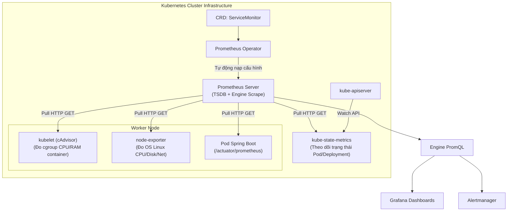

# 6_8_4 Metric và Prometheus

> **Khóa học**: Cloud DevOps Basic — Containers & Kubernetes
> **Phân nhóm**: 6 Domain 6 - Containers and Kubernetes › 6_8 Kubernetes Observability and Troubleshooting
> **Chủ đề**: 6_8_4 Metric và Prometheus
> **Phiên bản áp dụng**: Kubernetes 1.30+, Prometheus 2.50+, Prometheus Operator v0.70+
> **Trạng thái**: Bản nháp, chờ kiểm chứng
> **Phạm vi**: [Topic README](./README.md#6_8_4-metric-và-prometheus) · **Checkpoint của người học**: [CHECKLIST](../../CHECKLIST.md#6_8-kubernetes-observability-and-troubleshooting)
> **Kiến thức liên quan**: [6_3_1 Kubernetes Cluster Architecture](<../6_3 Kubernetes Architecture and Core Workloads/6_3_1 Kubernetes Cluster Architecture.md>) (kubelet, kube-apiserver) · [6_3_6 Resource Requests Limits and QoS](<../6_3 Kubernetes Architecture and Core Workloads/6_3_6 Resource Requests Limits and QoS.md>) (CPU/Memory cgroups)

---

## 0. Tình Huống Mở Đầu: "Hệ Thống Đang Nhanh Hay Chậm, Sắp Quá Tải Chưa?"

Khi vận hành ứng dụng trên Kubernetes, người dùng bắt đầu phàn nàn hệ thống phản hồi chậm chạp. Bạn mở terminal kiểm tra thì thấy mọi Pod đều sẵn sàng, CPU và RAM tức thời vẫn nằm trong ngưỡng cho phép.

Nhưng bạn không thể biết:
- Mức tiêu thụ tài nguyên cách đây mười phút có đột ngột tăng vọt không?
- Tỉ lệ các yêu cầu xử lý thất bại đang tăng hay giảm theo thời gian?
- Thời gian phản hồi phân vị 99% của người dùng thực tế đang là bao nhiêu?
- Khi nào phân vùng lưu trữ sẽ đầy nếu giữ nguyên tốc độ ghi dữ liệu hiện tại?

Lệnh kiểm tra thông thường chỉ chụp một lát cắt tức thời mà không có ký ức thời gian. Để nắm bắt xu hướng và chẩn đoán sự cố, hệ thống cần cơ sở dữ liệu chuỗi thời gian liên tục: đó là vai trò của Prometheus và các chỉ số định lượng (metrics).

---

## 1. Khái Niệm Cốt Lõi & Bản Chất Kỹ Thuật (Core Concepts & Technical Deep Dive)

### 1.1. Phân Biệt Metrics-Server Và Prometheus

Trong Kubernetes, công cụ thu thập tài nguyên Metrics Server và hệ thống Prometheus thường bị nhầm lẫn nhưng bản chất và mục đích hoàn toàn khác nhau:

<!-- ev: C4.1 -->
Kubernetes metrics-server là một giải pháp in-memory thu thập số liệu CPU và bộ nhớ từ kubelet thông qua Metrics API (metrics.k8s.io) phục vụ trực tiếp cho `kubectl top` và Horizontal Pod Autoscaler (HPA), không lưu trữ dữ liệu lịch sử vào đĩa.

<!-- ev: C4.2 -->
Prometheus là một hệ thống giám sát và cơ sở dữ liệu chuỗi thời gian (TSDB) đa chiều độc lập, định kỳ thu thập (scrape) metric qua HTTP theo mô hình pull từ các endpoint cấu hình sẵn và lưu trữ lịch sử để truy vấn và cảnh báo.

| Tiêu chí | Kubernetes metrics-server | Prometheus Server |
| :--- | :--- | :--- |
| **Lưu trữ** | Chỉ lưu tạm trong RAM (in-memory) | TSDB chuyên dụng lưu trên đĩa |
| **Lịch sử** | Không có (chỉ giữ giá trị mới nhất) | Lưu giữ nhiều ngày/tháng theo cấu hình retention |
| **Loại metric** | Chỉ đo CPU và RAM thô của Node/Pod | Đo mọi tầng: phần cứng, Kubernetes, tầng ứng dụng |
| **Truy vấn** | Không có ngôn ngữ truy vấn | Ngôn ngữ truy vấn mạnh mẽ PromQL |
| **Công dụng** | Phục vụ `kubectl top` và HPA cơ bản | Giám sát toàn diện, Grafana dashboard, Alertmanager |

### 1.2. Mô Hình Pull (Scrape) & Các Exporter Quan Trọng

Prometheus hoạt động theo mô hình Pull: máy chủ Prometheus định kỳ gửi HTTP request tới endpoint để thu thập dữ liệu dạng text. Trong cụm Kubernetes, ba thành phần thu thập cốt lõi gồm:

<!-- ev: C4.3 -->
Node Exporter chạy dưới dạng DaemonSet trên từng node Linux để thu thập các số liệu phần cứng và hệ điều hành tầng OS (CPU, memory, disk, network) thông qua các collector của nhân Linux.

<!-- ev: C4.4 -->
kube-state-metrics (KSM) lắng nghe Kubernetes API server để tạo ra các metric phản ánh trạng thái logic của các đối tượng Kubernetes như Deployment, Pod, PVC (ví dụ: số replica mong muốn so với thực tế, trạng thái Pod phase).

<!-- ev: C4.5 -->
cAdvisor (Container Advisor) được tích hợp trực tiếp vào daemon kubelet trên mỗi node, tự động phát hiện mọi container đang chạy và thu thập số liệu tài nguyên cgroup (CPU, bộ nhớ, file system, network usage).

### 1.3. Prometheus Operator & Quản Trị Declarative

Trong môi trường Kubernetes biến động, việc duy trì cấu hình tĩnh truyền thống không đáp ứng được tốc độ thay đổi của các Pod. Prometheus Operator mang tư duy khai báo vào hệ thống giám sát:

<!-- ev: C4.6 -->
Prometheus Operator triển khai các Custom Resource Definition (CRD) bao gồm `ServiceMonitor`, `PodMonitor` và `PrometheusRule` cho phép quản lý cấu hình scrape và luật cảnh báo theo phong cách Kubernetes declarative.

<!-- ev: C4.7 -->
`ServiceMonitor` chỉ định cách thức Prometheus Operator tự động cấu hình việc scrape tập hợp các Service Kubernetes dựa trên nhãn nhắm tới (Label Selector) và cổng endpoint được định nghĩa.

Khi triển khai microservice mới kèm theo một `ServiceMonitor`, Operator sẽ tự động cập nhật danh bạ scrape target của Prometheus Server mà không cần can thiệp thủ công. <!-- ev: C4.7 -->

### 1.4. 4 Kiểu Dữ Liệu Metric Trong Prometheus

Mọi metric trong Prometheus thuộc một trong bốn kiểu dữ liệu cơ bản:

<!-- ev: C4.8 -->
Metric kiểu Counter là giá trị số tích lũy đơn điệu chỉ có thể tăng dần theo thời gian hoặc được đặt lại về 0 khi tiến trình khởi động lại (restart).

<!-- ev: C4.9 -->
Metric kiểu Gauge thể hiện một giá trị số đơn lẻ có thể tăng lên hoặc giảm xuống bất kỳ lúc nào, chẳng hạn như mức sử dụng RAM hiện tại hoặc số lượng tiến trình đang chạy.

<!-- ev: C4.10 -->
Metric kiểu Histogram lấy mẫu các quan sát (thường là thời lượng yêu cầu hoặc kích thước phản hồi) và đếm chúng vào các bucket cấu hình trước kèm theo tổng số đếm (`_count`) và tổng giá trị quan sát (`_sum`).

Kiểu thứ tư là Summary: lấy mẫu quan sát như Histogram nhưng tính toán quantile trực tiếp tại client. Trong Kubernetes, Histogram phổ biến hơn vì các bucket có thể cộng dồn qua nhiều Pod bằng PromQL.

### 1.5. Cú Pháp PromQL Cốt Lõi

PromQL là ngôn ngữ biểu thức để lọc và tổng hợp dữ liệu chuỗi thời gian:

<!-- ev: C4.11 -->
Hàm `rate()` trong PromQL tính toán tốc độ tăng trung bình mỗi giây của một chuỗi thời gian counter trong một cửa sổ khoảng thời gian xác định (range vector) và tự động xử lý hiện tượng reset counter.

<!-- ev: C4.12 -->
Hàm `rate()` chỉ được thiết kế để áp dụng cho kiểu Counter, tuyệt đối không được dùng `rate()` trên kiểu Gauge vì Gauge có thể tăng giảm tự nhiên khiến việc bù trừ reset của `rate()` cho ra kết quả sai lệch.

<!-- ev: C4.13 -->
Hàm `increase()` trong PromQL tính toán mức tăng tuyệt đối của một counter trong khoảng thời gian xác định, tương đương với `rate(v[s]) * s` (sau khi tính ngoại suy).

<!-- ev: C4.14 -->
Mệnh đề `sum by (...)` thực hiện gom nhóm và tính tổng các time series theo các nhãn chỉ định, loại bỏ tất cả các nhãn không nằm trong danh sách mệnh đề by.

<!-- ev: C4.15 -->
Hàm `histogram_quantile(φ, sum(rate(http_request_duration_seconds_bucket[5m])) by (le))` tính toán phân vị phi (0 ≤ φ ≤ 1, ví dụ 0.95 hay 0.99) từ các bucket của histogram theo nguyên lý nội suy tuyến tính.

### 1.6. Phương Pháp Luận Giám Sát & Ứng Dụng Java

Để giám sát đúng trọng tâm, các kỹ sư SRE áp dụng ba phương pháp luận chuẩn mực:

<!-- ev: C4.16 -->
Phương pháp RED do Tom Wilkie phát triển dành cho giám sát microservices định nghĩa 3 thành phần cốt lõi: Rate (tốc độ yêu cầu/giây), Errors (số yêu cầu thất bại), và Duration (thời gian xử lý yêu cầu).

<!-- ev: C4.17 -->
Phương pháp USE của Brendan Gregg tập trung vào giám sát tài nguyên phần cứng/hệ thống gồm 3 khía cạnh: Utilization (tỉ lệ thời gian hoặc dung lượng tài nguyên đang bận), Saturation (mức độ quá tải/hàng đợi chờ xử lý), và Errors (số lỗi phần cứng hoặc thiết bị).

<!-- ev: C4.18 -->
Bốn Golden Signals của Google SRE gồm Latency (độ trễ), Traffic (lưu lượng nhu cầu hệ thống), Errors (tỉ lệ lỗi yêu cầu), và Saturation (độ bão hòa mức sử dụng tài nguyên có thể đạt ngưỡng giới hạn).

<!-- ev: C4.19 -->
Ứng dụng Java Spring Boot xuất dữ liệu metric sang định dạng Prometheus bằng cách tích hợp Spring Boot Actuator và thư viện Micrometer Prometheus registry thông qua endpoint `/actuator/prometheus`.

---

## 2. Ví Dụ Đời Sống Thực Tế Dễ Hiểu (Intuitive Real-World Analogies)

Hệ thống giám sát Kubernetes hoạt động tương tự như bảng đồng hồ điều khiển trên taplo xe ô tô:

1. **Công tơ mét đo tổng quãng đường là Counter**:
   - Con số hiển thị chỉ tăng dần theo thời gian.
   - Nhìn vào tổng số ki-lô-mét tích lũy, bạn không biết xe đang chạy nhanh hay chậm. Nhưng tính mức tăng trong một giờ qua, bạn sẽ biết vận tốc trung bình (nguyên lý của hàm `rate()`).
   - Nếu thay mới taplo khiến số đếm quay về 0 (như app restart), phép tính vẫn tự bù trừ chính xác.

2. **Đồng hồ tốc độ và kim báo xăng là Gauge**:
   - Mức xăng và vận tốc có thể tăng hoặc giảm bất kỳ lúc nào tùy hành vi lái xe và nạp nhiên liệu.
   - Nếu áp dụng công thức tính gia tốc lên kim xăng, mỗi khi xăng vơi đi, thuật toán sẽ tưởng taplo bị reset và tính toán sai lệch hoàn toàn.

3. **Đèn cảnh báo máy quá nhiệt là phương pháp USE**:
   - Tập trung vào máy móc hạ tầng: động cơ chịu tải bao nhiêu phần trăm (Utilization), quạt làm mát quá tải chưa (Saturation), và có báo lỗi thiết bị không (Errors).

4. **Đồng hồ tính cước taxi là phương pháp RED**:
   - Tập trung vào dịch vụ khách hàng: đón bao nhiêu chuyến mỗi ngày (Rate), bao nhiêu cuốc bị hủy (Errors), và mỗi chuyến kéo dài bao lâu (Duration).

---

## 3. Kiến Trúc, Luồng Hoạt Động & Hình Ảnh Trực Quan (Architecture, Diagrams & Visual Media)

Sơ đồ luồng thu thập và xử lý metric trong Kubernetes với Prometheus Operator:



### Luồng Hoạt Động Cốt Lõi (Core Data Flow)

<!-- ev: C4.7 -->
1. **Đăng ký mục tiêu (Discovery)**: Người dùng tạo khai báo `ServiceMonitor`. Prometheus Operator phát hiện qua API và cập nhật danh bạ scrape target cho Prometheus Server mà không cần khởi động lại.

<!-- ev: C4.2 C4.3 C4.4 C4.5 C4.19 -->
2. **Thu thập dữ liệu (Scraping)**: Theo chu kỳ, Prometheus Server kéo dữ liệu từ cAdvisor qua kubelet, từ host Linux qua node-exporter, từ trạng thái đối tượng qua kube-state-metrics, và từ ứng dụng qua `/actuator/prometheus`.

<!-- ev: C4.2 -->
3. **Lưu trữ và truy vấn (Storage & Evaluation)**: Dữ liệu được nén vào TSDB trên đĩa. PromQL định kỳ đánh giá luật cảnh báo và phục vụ truy vấn hiển thị đồ thị trên Grafana.

---

## 4. Code Mẫu Trực Quan Hoặc Dòng Lệnh Thực Chiến (Runnable Sample Code / CLI)

### 4.1. Lệnh Kiểm Tra Nhanh Với metrics-server

<!-- ev: C4.1 -->
Lệnh `kubectl top` sử dụng `metrics-server` để xem nhanh mức tiêu thụ CPU và bộ nhớ tức thời:

<!-- ev: C4.1 -->
```bash
# Xem mức sử dụng CPU và RAM tức thời của toàn bộ node trong cụm
kubectl top nodes

# Xem mức sử dụng tài nguyên của các Pod trong namespace chỉ định
kubectl top pods -n default --containers
```

### 4.2. Khai Báo Scrape Bằng ServiceMonitor

<!-- ev: C4.6 C4.7 -->
Khai báo tài nguyên `ServiceMonitor` để tự động thu thập metric từ microservice:

<!-- ev: C4.6 C4.7 -->
```yaml
apiVersion: monitoring.coreos.com/v1
kind: ServiceMonitor
metadata:
  name: payment-service-monitor
  namespace: monitoring
  labels:
    release: kube-prometheus-stack
spec:
  selector:
    matchLabels:
      app: payment-service
  namespaceSelector:
    matchNames:
      - production
  endpoints:
    - port: http-metrics
      path: /actuator/prometheus
      interval: 15s
      scrapeTimeout: 10s
```

### 4.3. Các Câu Truy Vấn PromQL Thực Chiến Thường Dùng

<!-- ev: C4.11 C4.14 C4.16 -->
1. **Lưu lượng yêu cầu mỗi giây (RPS) theo service (Phương pháp RED - Rate)**:
```promql
sum by (service) (rate(http_requests_total[5m]))
```

<!-- ev: C4.11 C4.16 -->
2. **Tỉ lệ lỗi HTTP 5xx theo phần trăm (Phương pháp RED - Errors)**:
```promql
(
  sum(rate(http_requests_total{status=~"5.."}[5m]))
  /
  sum(rate(http_requests_total[5m]))
) * 100
```

<!-- ev: C4.15 C4.16 -->
3. **Thời gian phản hồi phân vị 99% (Phương pháp RED - Duration)**:
```promql
histogram_quantile(0.99, sum by (le) (rate(http_request_duration_seconds_bucket[5m])))
```

<!-- ev: C4.13 -->
4. **Đếm số lần container restart trong 10 phút qua**:
```promql
increase(kube_pod_container_status_restarts_total{namespace="production"}[10m])
```

### 4.4. Cấu Hình Java Spring Boot Xuất Metric Chuẩn Prometheus

<!-- ev: C4.19 -->
Thêm thư viện Actuator và Micrometer Prometheus registry vào tệp cấu hình dự án:

<!-- ev: C4.19 -->
```xml
<dependencies>
    <dependency>
        <groupId>org.springframework.boot</groupId>
        <artifactId>spring-boot-starter-actuator</artifactId>
    </dependency>
    <dependency>
        <groupId>io.micrometer</groupId>
        <artifactId>micrometer-registry-prometheus</artifactId>
    </dependency>
</dependencies>
```

<!-- ev: C4.19 -->
Mở đường dẫn xuất metric trong tệp `application.properties`:

<!-- ev: C4.19 -->
```properties
management.endpoints.web.exposure.include=health,info,prometheus
management.endpoint.prometheus.enabled=true
```

---

## 5. Cạm Bẫy Thực Tế & Thực Tiễn Sản Xuất (Production Gotchas & Best Practices)

### 5.1. Bẫy Bùng Nổ Nhãn (Cardinality Explosion)

<!-- ev: C4.2 -->
Mỗi tổ hợp giá trị nhãn (label set) duy nhất sẽ tạo ra một chuỗi thời gian độc lập trong cơ sở dữ liệu TSDB của Prometheus.

<!-- ev: C4.2 -->
Nếu gắn các định danh vô hạn như `user_id` hay `order_id` vào nhãn metric, hệ thống sẽ sinh ra hàng triệu time series khiến máy chủ Prometheus cạn RAM và sập tiến trình. Chỉ nên đặt nhãn cho các tập giá trị hữu hạn như mã lỗi, HTTP method hoặc tên service.

### 5.2. Sai Lầm Khi Dùng Hàm rate() Lên Metric Kiểu Gauge

<!-- ev: C4.12 -->
Áp dụng hàm `rate()` lên metric kiểu Gauge như mức sử dụng RAM `node_memory_Active_bytes` là sai lầm phổ biến.

<!-- ev: C4.12 -->
Khi lượng RAM đang dùng giảm xuống, hàm `rate()` lầm tưởng bộ đếm vừa bị reset và tính bù trừ ngoại suy, sinh ra các đỉnh số liệu ảo trên đồ thị. Muốn đo mức biến thiên của Gauge, hãy sử dụng hàm `deriv()` hoặc `delta()`.

### 5.3. Bẫy Cửa Sổ Range Vector Quá Ngắn

<!-- ev: C4.11 -->
Gọi `rate()` với cửa sổ thời gian bằng đúng chu kỳ scrape (ví dụ 15 giây) có thể khiến truy vấn chỉ bắt được một điểm mẫu hoặc rỗng khi có trễ mạng nhẹ.

<!-- ev: C4.11 -->
Hàm `rate()` cần tối thiểu hai điểm mẫu dữ liệu trong cửa sổ để tính toán tốc độ tăng. Quy tắc thực hành tốt là đặt cửa sổ range vector tối thiểu gấp đôi và tốt nhất là gấp bốn lần chu kỳ scrape (ví dụ dùng `[1m]` cho chu kỳ 15 giây).

### 5.4. Quản Lý Dung Lượng Lưu Trữ TSDB

<!-- ev: C4.2 -->
Mặc định Prometheus giữ dữ liệu mười lăm ngày và có thể làm đầy phân vùng đĩa. Luôn thiết lập hai cờ giới hạn:
- `--storage.tsdb.retention.time`: thời gian lưu trữ tối đa (ví dụ: `30d`).
- `--storage.tsdb.retention.size`: hạn mức dung lượng tối đa trên đĩa (ví dụ: `50Gi`), giúp TSDB chủ động dọn dẹp dữ liệu cũ khi chạm ngưỡng.

---

## 6. Câu Hỏi Củng Cố Kiến Thức (Active Recall Quiz)

### Câu Hỏi 1
Một nhóm kỹ sư muốn cấu hình Horizontal Pod Autoscaler (HPA) tự động scale Pod theo lưu lượng request mỗi giây (RPS). Kỹ sư trưởng cho rằng chỉ cần cài đặt `metrics-server` là HPA có thể scale theo RPS. Nhận định này đúng hay sai? Vì sao?

<details>
<summary>Đáp án</summary>

**Nhận định này SAI.**

`metrics-server` chỉ triển khai `metrics.k8s.io` để đo CPU và RAM thô từ kubelet, hoàn toàn không thu thập các metric tầng ứng dụng như số lượng request.

Để HPA scale theo RPS, hệ thống bắt buộc phải thu thập số liệu qua Prometheus, sau đó triển khai Prometheus Adapter (hoặc KEDA) để chuyển đổi truy vấn PromQL thành chuẩn Kubernetes Custom Metrics API (`custom.metrics.k8s.io`).
</details>

### Câu Hỏi 2
Kỹ sư viết truy vấn `rate(app_error_count[10s])` cho một service có chu kỳ scrape interval là 15 giây. Đồ thị trên Grafana thường xuyên bị ngắt đoạn và báo không có dữ liệu. Nguyên nhân gốc rễ là gì và khắc phục thế nào?

<details>
<summary>Đáp án</summary>

**Nguyên nhân gốc rễ**:
Hàm `rate()` bắt buộc phải có ít nhất hai điểm mẫu trong cửa sổ range vector. Khi scrape interval là 15 giây mà cửa sổ chỉ đặt 10 giây, truy vấn chỉ bắt được một điểm hoặc không có điểm nào, khiến phép tính tốc độ không thể thực hiện.

**Cách khắc phục**:
Mở rộng cửa sổ lên tối thiểu gấp hai hoặc bốn lần chu kỳ scrape: `rate(app_error_count[1m])`. Cửa sổ một phút chứa khoảng bốn điểm mẫu, đảm bảo đồ thị liên tục và ổn định.
</details>

### Câu Hỏi 3
Vì sao việc đánh giá hiệu năng API chỉ dựa trên thời gian phản hồi trung bình `avg()` có thể che giấu trải nghiệm tiêu cực của người dùng, và PromQL giải quyết vấn đề này bằng chỉ số nào?

<details>
<summary>Đáp án</summary>

**Hạn chế của giá trị trung bình**:
Giá trị trung bình bị san phẳng bởi số đông yêu cầu nhanh. Nếu đa số request hoàn thành trong 50ms nhưng một vài request mất tới 5 giây, con số trung bình vẫn trông rất lý tưởng và bỏ sót trải nghiệm tồi tệ của nhóm khách hàng bị nghẽn mạng.

**Giải pháp với PromQL**:
Sử dụng phân vị thứ 99 (P99) qua hàm `histogram_quantile(0.99, ...)` trên metric dạng Histogram. Chỉ số này phản ánh ngưỡng thời gian mà 99% người dùng được đáp ứng nhanh hơn mức đó, làm nổi bật ngay lập tức độ trễ của nhóm người dùng chậm nhất.
</details>

---

## 7. 📚 Nguồn Tài Liệu Chính Thống (Tier-1 Official References)

- [Prometheus Overview](https://prometheus.io/docs/introduction/overview/) - Kiến trúc tổng quan, nguyên lý hoạt động và mô hình kéo của Prometheus.
- [Prometheus Metric Types](https://prometheus.io/docs/concepts/metric_types/) - Đặc tả kỹ thuật chi tiết của 4 kiểu dữ liệu: Counter, Gauge, Histogram, Summary.
- [PromQL Querying Basics](https://prometheus.io/docs/prometheus/latest/querying/basics/) - Tài liệu chính thức về ngôn ngữ truy vấn PromQL, hàm `rate()`, `increase()`, và các toán tử tổng hợp.
- [Kubernetes Resource Metrics Pipeline](https://kubernetes.io/docs/tasks/debug/debug-cluster/resource-metrics-pipeline/) - Kiến trúc chuẩn của Kubernetes metrics-server và Metrics API.
- [kube-state-metrics Documentation](https://github.com/kubernetes/kube-state-metrics) - Kho lưu trữ và đặc tả kỹ thuật chính thức về thu thập trạng thái tài nguyên Kubernetes.
