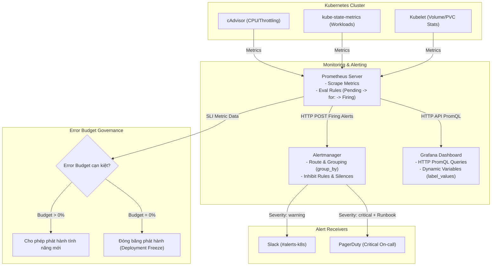

# 6_8_5 Dashboard, Alert và SLO

> **Khóa học**: Cloud DevOps Basic — Containers & Kubernetes
> **Phân nhóm**: 6 Domain 6 - Containers and Kubernetes › 6_8 Kubernetes Observability and Troubleshooting
> **Chủ đề**: 6_8_5 Dashboard, Alert và SLO
> **Phiên bản áp dụng**: Kubernetes 1.31+, Prometheus v2.54+, Alertmanager v0.27+, Grafana v11.x
> **Trạng thái**: Bản nháp, chờ kiểm chứng
> **Phạm vi**: [Topic README](./README.md#6_8_5-dashboard-alert-và-slo) · **Checkpoint của người học**: [CHECKLIST](../../CHECKLIST.md#6_8-kubernetes-observability-and-troubleshooting)

---

## 1. Khái Niệm Cốt Lõi & Bản Chất Kỹ Thuật (Core Concepts & Technical Deep Dive)

Trong hệ sinh thái quan sát Kubernetes, số liệu (metrics) chỉ phát huy giá trị khi được trực quan hóa trên bảng điều khiển tập trung và tự động kích hoạt cảnh báo trước khi sự cố ảnh hưởng đến người dùng cuối.

### 1.1 Grafana trong Kubernetes & Kỹ Thuật Dashboard Variables

Grafana đóng vai trò là tầng trực quan hóa (visualization layer) trung tâm cho toàn bộ cụm Kubernetes.

- **Data Source Prometheus**: Grafana hỗ trợ tích hợp Prometheus làm nguồn dữ liệu (Data Source) mặc định thông qua giao thức HTTP API để truy vấn số liệu chuỗi thời gian bằng ngôn ngữ PromQL. <!-- ev: C5.1 -->
- **Bảng điều khiển (Dashboard Design)**: Bảng điều khiển tổ chức dữ liệu thành các hàng và các bảng hiển thị như biểu đồ đường (Time series), số liệu đơn vị (Stat) hoặc đồng hồ đo (Gauge). <!-- ev: C5.1 -->
- **Dashboard Variables**: Tính năng Dashboard Variables trong Grafana cho phép định nghĩa các biến truy vấn động sử dụng hàm `label_values()` để trích xuất danh sách nhãn thời gian thực từ Prometheus, giúp kỹ sư lọc dữ liệu linh hoạt theo namespace, workload hoặc pod trên cùng một bảng hiển thị duy nhất mà không cần tạo nhiều bảng điều khiển riêng biệt. <!-- ev: C5.2 -->

### 1.2 Alertmanager: Bộ Não Định Tuyến và Xử Lý Cảnh Báo

Prometheus không gửi cảnh báo trực tiếp đến người dùng mà đẩy toàn bộ cảnh báo sang Alertmanager để quản trị tập trung.

- **Tiếp nhận tập trung**: Alertmanager tiếp nhận toàn bộ cảnh báo (alerts) từ một hoặc nhiều máy chủ Prometheus thông qua HTTP POST API để đảm nhiệm vai trò định tuyến, gom nhóm, khử trùng lặp và gửi thông báo. <!-- ev: C5.3 -->
- **Cơ chế Grouping (Gom nhóm)**: Cơ chế Grouping trong Alertmanager gom các cảnh báo có cùng bộ nhãn định nghĩa trong thuộc tính `group_by` thành một thông báo duy nhất nhằm ngăn chặn tình trạng bão tin nhắn (alert storm) khi sự cố trên diện rộng xảy ra. <!-- ev: C5.4 -->
- **Kiểm soát nhịp độ thông báo**: Hai tham số `group_wait` và `group_interval` trong cấu hình route lần lượt quy định khoảng thời gian chờ để gom thêm các cảnh báo ban đầu trước khi gửi thông báo đầu tiên và khoảng thời gian chờ trước khi gửi lô cảnh báo mới phát sinh cho cùng nhóm đó. <!-- ev: C5.5 -->
- **Cơ chế Inhibition (Ức chế cảnh báo)**: Cơ chế Inhibition trong Alertmanager cho phép triệt tiêu các cảnh báo thứ cấp (target_match) khi một cảnh báo gốc có mức độ nghiêm trọng cao hơn (source_match) đang kích hoạt và cùng chia sẻ các nhãn tương ứng. <!-- ev: C5.6 -->
- **Tính năng Silence (Tạm ngắt thông báo)**: Tính năng Silence trong Alertmanager cho phép kỹ sư trực ca tạm thời ngắt thông báo của một tập hợp cảnh báo trong một khoảng thời gian xác định trước dựa trên các biểu thức so khớp nhãn (matchers) mà không cần chỉnh sửa quy tắc cảnh báo. <!-- ev: C5.7 -->

### 1.3 Triết Lý Thiết Kế Cảnh Báo SRE: Chống Alert Fatigue

Hệ thống cảnh báo tồi là hệ thống liên tục gửi báo động giả, làm kiệt sức đội ngũ kỹ sư trực ca.

- **Chống cảnh báo chập chờn với thuộc tính `for`**: Thuộc tính `for` trong định nghĩa alerting rule của Prometheus quy định khoảng thời gian mà biểu thức điều kiện phải duy trì đúng liên tục trước khi cảnh báo chuyển từ trạng thái `Pending` sang `Firing`, giúp ngăn chặn hiện tượng cảnh báo chập chờn (alert flapping) do metric tăng đột biến tức thời. <!-- ev: C5.8 -->
- **Cảnh báo theo triệu chứng (Symptom-based)**: Nguyên tắc thiết kế SRE ưu tiên cảnh báo theo triệu chứng người dùng gánh chịu (symptom-based alerts như tỉ lệ lỗi 5xx tăng cao hoặc độ trễ phản hồi vượt ngưỡng) thay vì cảnh báo thuần theo nguyên nhân kỹ thuật (cause-based alerts như CPU chạm ngưỡng cao) nhằm giảm thiểu tình trạng kiệt sức vì báo động giả (alert fatigue). <!-- ev: C5.9 -->
- **Tính thực thi của cảnh báo (Actionable Alerts)**: Mọi cảnh báo gửi trực tiếp đến kỹ sư trực ca (on-call engineer) theo chuẩn SRE cần có tính thực thi hành động và dẫn trực tiếp đến tài liệu hướng dẫn quy trình xử lý sự cố (runbook). <!-- ev: C5.10 -->

### 1.4 Bộ Tứ Cảnh Báo Kubernetes Kinh Điển

Bốn quy tắc cảnh báo nền tảng cần có trên mọi cụm Kubernetes:

- **Pod restart liên tục**: Cảnh báo Pod restart nhiều lần sử dụng metric `kube_pod_container_status_restarts_total` kết hợp với hàm `increase()` hoặc `rate()` để phát hiện các container liên tục khởi động lại do lỗi ứng dụng hoặc cạn kiệt bộ nhớ. <!-- ev: C5.11 -->
- **Deployment thiếu replica khả dụng**: Cảnh báo Deployment thiếu replica khả dụng so sánh metric `kube_deployment_status_replicas_available` với `kube_deployment_spec_replicas` từ kube-state-metrics để nhận biết workload không đạt số lượng bản sao mong muốn. <!-- ev: C5.12 -->
- **CPU throttling cao**: Cảnh báo CPU throttling trong Kubernetes sử dụng tỉ lệ giữa `container_cpu_cfs_throttled_periods_total` và `container_cpu_cfs_periods_total` từ cAdvisor để phát hiện container bị kernel hạn chế thời gian CPU do chạm ngưỡng giới hạn (limits). <!-- ev: C5.13 -->
- **PersistentVolumeClaim (PVC) sắp đầy**: Cảnh báo dung lượng lưu trữ PersistentVolumeClaim (PVC) theo dõi tỷ lệ phần trăm dung lượng trống dựa trên metric `kubelet_volume_stats_available_bytes` chia cho `kubelet_volume_stats_capacity_bytes` do Kubelet thu thập để ngăn chặn gián đoạn do hết ổ đĩa. <!-- ev: C5.14 -->

### 1.5 Khung Chuẩn Quản Trị Độ Tin Cậy: SLI, SLO, SLA và Error Budget

Bộ khung định lượng SRE giúp doanh nghiệp cân bằng giữa tốc độ đổi mới và độ ổn định hệ thống:

- **SLI (Service Level Indicator)**: SLI là chỉ số định lượng đo lường trực tiếp mức độ phục vụ thực tế của dịch vụ, thường được biểu diễn dưới dạng tỉ lệ giữa số sự kiện tốt (good events) trên tổng số sự kiện hợp lệ (valid events). <!-- ev: C5.15 -->
- **SLO (Service Level Objective)**: SLO là mục tiêu định lượng về độ tin cậy được đội ngũ kỹ thuật cam kết nội bộ, thể hiện bằng giá trị mục tiêu của SLI trong một khoảng thời gian đo lường xác định. <!-- ev: C5.16 -->
- **SLA (Service Level Agreement)**: SLA là hợp đồng kinh doanh hoặc thỏa thuận pháp lý giữa nhà cung cấp dịch vụ và khách hàng, có điều khoản bồi thường tài chính nếu chất lượng dịch vụ không đạt mức cam kết, và thông thường chỉ tiêu SLA luôn đặt thấp hơn chỉ tiêu SLO để tạo vùng đệm an toàn. <!-- ev: C5.17 -->
- **Error Budget (Ngân sách sai số)**: Error Budget là ngân sách sai số được tính bằng 100% trừ đi SLO, đại diện cho mức độ không hoàn hảo tối đa mà dịch vụ được phép xảy ra mà không làm người dùng cảm thấy không hài lòng. <!-- ev: C5.18 -->
- **Chính sách đóng băng phát hành (Deployment Freeze Policy)**: Khi Error Budget trong chu kỳ đo lường bị cạn kiệt hoàn toàn, chính sách vận hành SRE kích hoạt lệnh đóng băng phát hành (deployment freeze) để đình chỉ việc triển khai tính năng mới và chuyển hướng nguồn lực kỹ thuật sang khắc phục lỗi và củng cố độ ổn định hệ thống. <!-- ev: C5.19 -->

---

## 2. Ví Dụ Đời Sống Thực Tế Dễ Hiểu (Intuitive Real-World Analogies)

### Chuông Báo Cháy Chung Cư và Căn Bệnh Kiệt Sức Vì Báo Động

Hãy tưởng tượng bạn sống trong một tòa chung cư cao tầng. Nếu cảm biến nhiệt được cấu hình theo kiểu nguyên nhân kỹ thuật: Mỗi khi có cư dân bật bếp rán cá hay thắp nến làm nhiệt độ phòng tăng nhẹ, chuông báo cháy lập tức reo inh ỏi đánh thức cả tòa nhà lúc hai giờ sáng. Sau vài đêm liên tiếp mất ngủ vô cớ, cư dân sẽ bực bội tháo pin chuông báo cháy hoặc bịt tai phớt lờ. Đó là hiện tượng **kiệt sức vì báo động giả (alert fatigue)**. Khi hỏa hoạn thật bùng phát, cư dân vẫn nghĩ ai đó đang rán cá và không kịp sơ tán. Hệ thống chuẩn mực chỉ reo chuông khi có triệu chứng thực sự đe dọa cư dân: khói độc tràn hành lang hoặc nhiệt độ cao duy trì nhiều phút liên tục. Trong Kubernetes, CPU chạm ngưỡng cao là việc bình thường khi xử lý tải; chỉ khi người dùng bị lỗi 5xx hoặc tải trang quá chậm thì kỹ sư trực ca mới cần nhận thông báo.

### Điểm Bằng Lái Xe và Ngân Sách Sai Số (Error Budget)

Error Budget giống như quỹ điểm trên bằng lái xe mười hai điểm mỗi năm. Đầu năm, bạn có đủ điểm nên hoàn toàn tự tin nhấn ga thử nghiệm các tuyến đường mới. Mỗi lần vô ý chạy quá tốc độ hay đỗ xe sai vị trí, bạn bị trừ dần điểm. Việc trừ vài điểm nhỏ không khiến bạn mất bằng, giúp bạn chủ động cân bằng giữa tốc độ và sự cẩn trọng. Tuy nhiên, nếu bạn lái ẩu đến mức trừ sạch toàn bộ điểm trong nửa đầu năm, cơ quan giao thông sẽ lập tức treo bằng cấm bạn lái xe. Lúc này mọi hành trình mới đều dừng lại, bạn buộc phải ở nhà học lại lý thuyết an toàn và bảo dưỡng phương tiện. Tương tự, khi Error Budget cạn kiệt, mọi hoạt động phát hành tính năng mới đều bị đóng băng để đội ngũ kỹ thuật tập trung vá lỗi hệ thống.

---

## 3. Kiến Trúc, Luồng Hoạt Động & Hình Ảnh Trực Quan (Architecture, Diagrams & Visual Media)

Kiến trúc quan sát và điều phối cảnh báo từ hạ tầng cụm Kubernetes qua Alertmanager, Grafana và vòng phản hồi quản trị Error Budget:



### Luồng Vận Hành Cốt Lõi

<!-- ev: C5.1 -->
- **Thu thập dữ liệu**: Prometheus định kỳ cào số liệu từ cAdvisor, kube-state-metrics, Kubelet và ứng dụng qua HTTP endpoint.
<!-- ev: C5.8 -->
- **Đánh giá quy tắc**: Khi PromQL trả về giá trị vượt ngưỡng, cảnh báo ở trạng thái Pending. Nếu kéo dài đủ khoảng thời gian `for`, cảnh báo chuyển sang Firing.
<!-- ev: C5.3 C5.4 C5.6 C5.7 -->
- **Phân luồng Alertmanager**: Cảnh báo Firing gửi sang Alertmanager qua HTTP POST, được gom nhóm theo `group_by`, lọc bởi `inhibit_rules` và kiểm tra trạng thái silence.
<!-- ev: C5.15 C5.16 C5.18 C5.19 -->
- **Phản hồi Error Budget**: Dữ liệu SLI được theo dõi liên tục. Khi ngân sách sai số về mức 0, lệnh đóng băng phát hành lập tức được kích hoạt.

---

## 4. Code Mẫu Trực Quan Hoặc Dòng Lệnh Thực Chiến (Runnable Sample Code / CLI)

### 4.1 Định Nghĩa PrometheusRule với Bộ Tứ Cảnh Báo Chuẩn SRE

<!-- ev: C5.8 C5.10 C5.11 C5.12 C5.13 C5.14 -->
Cấu hình Kubernetes CRD `PrometheusRule` cho bốn cảnh báo nền tảng có thuộc tính `for` và liên kết runbook:

```yaml
apiVersion: monitoring.coreos.com/v1
kind: PrometheusRule
metadata:
  name: workload-alerts
  namespace: monitoring
  labels:
    role: alert-rules
spec:
  groups:
    - name: workload.rules
      rules:
        # Cảnh báo 1: Pod restart liên tục
        - alert: PodFrequentlyRestarting
          expr: increase(kube_pod_container_status_restarts_total[10m]) > 3
          for: 5m
          labels:
            severity: warning
          annotations:
            summary: "Container {{ $labels.container }} trong Pod {{ $labels.pod }} restart liên tục"
            runbook_url: "https://wiki.example.internal/ops/runbooks/pod-restarting"

        # Cảnh báo 2: Deployment thiếu replica khả dụng
        - alert: DeploymentReplicasMismatch
          expr: kube_deployment_status_replicas_available < kube_deployment_spec_replicas
          for: 10m
          labels:
            severity: critical
          annotations:
            summary: "Deployment {{ $labels.deployment }} không đủ replica khả dụng"
            runbook_url: "https://wiki.example.internal/ops/runbooks/deployment-mismatch"

        # Cảnh báo 3: CPU Throttling cao
        - alert: ContainerCPUThrottlingHigh
          expr: |
            (
              sum(rate(container_cpu_cfs_throttled_periods_total[5m])) by (container, pod, namespace)
              /
              sum(rate(container_cpu_cfs_periods_total[5m])) by (container, pod, namespace)
            ) > 0.25
          for: 15m
          labels:
            severity: warning
          annotations:
            summary: "Container {{ $labels.container }} bị bóp nghẽn CPU hơn 25%"
            runbook_url: "https://wiki.example.internal/ops/runbooks/cpu-throttling"

        # Cảnh báo 4: Dung lượng PVC khả dụng dưới 15%
        - alert: PersistentVolumeClaimFillingUp
          expr: (kubelet_volume_stats_available_bytes / kubelet_volume_stats_capacity_bytes) < 0.15
          for: 10m
          labels:
            severity: critical
          annotations:
            summary: "PVC {{ $labels.persistentvolumeclaim }} còn dưới 15% dung lượng trống"
            runbook_url: "https://wiki.example.internal/ops/runbooks/pvc-filling-up"
```

### 4.2 Cấu Hình Alertmanager: Routing, Grouping và Inhibition

<!-- ev: C5.4 C5.5 C5.6 -->
File cấu hình `alertmanager.yml` minh họa cơ chế gom nhóm và dập tắt cảnh báo thứ cấp khi sập hạ tầng:

```yaml
global:
  resolve_timeout: 5m

route:
  receiver: "slack-notifications"
  group_by: ["alertname", "cluster", "namespace"]
  group_wait: 30s
  group_interval: 5m
  repeat_interval: 4h
  routes:
    - match:
        severity: critical
      receiver: "pagerduty-critical"
      continue: true
    - match:
        severity: warning
      receiver: "slack-notifications"

inhibit_rules:
  - source_match:
      alertname: "NodeDown"
      severity: "critical"
    target_match:
      severity: "warning"
    equal: ["node", "instance"]

receivers:
  - name: "slack-notifications"
    slack_configs:
      - channel: "#alerts-k8s"
        send_resolved: true
        api_url: "https://hooks.slack.com/services/T00/B00/XXX"

  - name: "pagerduty-critical"
    pagerduty_configs:
      - service_key: "pd-k8s-key"
        severity: "critical"
```

### 4.3 Dòng Lệnh `amtool` và Biến Grafana Variables

<!-- ev: C5.7 -->
Thao tác với CLI `amtool` để tạo khoảng lặng (Silence) khi bảo trì cụm:

```bash
# Liệt kê các cảnh báo đang Firing
amtool --alertmanager.url=http://alertmanager:9093 alert

# Tạo Silence tắt cảnh báo PodFrequentlyRestarting trong 2 giờ
amtool --alertmanager.url=http://alertmanager:9093 silence add \
  alertname=PodFrequentlyRestarting \
  namespace=production \
  --duration=2h \
  --comment="Bảo trì nâng cấp ứng dụng định kỳ"
```

<!-- ev: C5.2 -->
Cấu hình biến truy vấn động trong **Grafana Dashboard Settings > Variables**:

```text
Biến $namespace:
Query: label_values(kube_pod_info, namespace)

Biến $pod:
Query: label_values(kube_pod_info{namespace="$namespace"}, pod)
```

---

## 5. Cạm Bẫy Thực Tế & Thực Tiễn Sản Xuất (Production Gotchas & Best Practices)

### 5.1 Cạm Bẫy Cảnh Báo Theo Nguyên Nhân và Thiếu Thuộc Tính `for`
Viết cảnh báo CPU vượt 80% mà không kèm `for: 10m` khiến cảnh báo bị kích hoạt liên tục khi ứng dụng khởi động hoặc chạy Garbage Collection ngắn hạn. Hiện tượng cảnh báo chập chờn (alert flapping) này gây kiệt sức và khiến kỹ sư dần phớt lờ cảnh báo thật. <!-- ev: C5.8 C5.9 -->

### 5.2 Đánh Đồng Chỉ Tiêu Nội Bộ SLO với Cam Kết Hợp Đồng SLA
Thiết lập chỉ tiêu pháp lý SLA bằng đúng mục tiêu kỹ thuật SLO (cùng 99.9%) là sai lầm nguy hiểm. Khi hệ thống vừa chớm lỗi nội bộ, doanh nghiệp đã lập tức vi phạm hợp đồng kinh doanh và chịu phạt tài chính. Chuẩn SRE luôn yêu cầu SLA phải lỏng hơn SLO (ví dụ SLO 99.9% nhưng SLA là 99.5%) để tạo vùng đệm an toàn. <!-- ev: C5.16 C5.17 -->

### 5.3 Gửi Cảnh Báo Tràn Lan Thiếu Runbook và Thiếu Quy Tắc Inhibition
Khi một node máy chủ sập nguồn, hàng chục cảnh báo phụ đồng loạt xuất hiện: Pod crash, Service timeout, PVC unmounted. Thiếu quy tắc `inhibit_rules` sẽ tạo bão tin nhắn che lấp cảnh báo gốc `NodeDown`. Đồng thời, cảnh báo critical thiếu runbook sẽ khiến kỹ sư trực ca lúng túng trong đêm tối. <!-- ev: C5.6 C5.10 -->

---

## 6. Câu Hỏi Củng Cố Kiến Thức (Active Recall Quiz)

### Câu Hỏi 1: Khắc Phục Báo Động Flapping của Tác Vụ Batch Job
Một container chạy batch job tính hóa đơn mỗi đêm, đẩy CPU lên 98% trong 45 giây rồi hoàn thành. Kỹ sư trực ca liên tục nhận tin nhắn cảnh báo CPU quá tải. Hãy chỉ ra nguyên nhân và cách xử lý chuẩn SRE?

<details>
<summary>Đáp án</summary>

- **Nguyên nhân**: Cảnh báo theo nguyên nhân kỹ thuật (cause-based) thay vì triệu chứng (symptom-based), đồng thời thiếu thuộc tính `for` hoặc đặt `for` ngắn hơn thời lượng chạy của batch job (dưới 45 giây).
- **Cách xử lý**:
  1. Thêm hoặc tăng thuộc tính `for: 5m` hoặc `for: 10m` vào alerting rule để bỏ qua các đột biến ngắn hạn.
  2. Bổ sung nhãn để loại trừ các container batch job khỏi quy tắc cảnh báo CPU thông thường.
  3. Chuyển sang giám sát triệu chứng: Theo dõi tiến độ hoàn thành tác vụ và tỷ lệ lỗi thay vì chỉ nhìn vào CPU.
</details>

---

### Câu Hỏi 2: Ngăn Chặn Bão Cảnh Báo Lan Truyền Khi Sập Node
Khi một Worker Node bị mất mạng hoàn toàn, Alertmanager phát ra hàng chục thông báo: `KubeletDown`, `ContainerRestarting`, `TargetDown`. Cơ chế nào giúp ngăn chặn tình trạng này?

<details>
<summary>Đáp án</summary>

- **Cơ chế**: Sử dụng cơ chế **Inhibition (Ức chế cảnh báo)** qua khối cấu hình `inhibit_rules` trong Alertmanager.
- **Nguyên lý**: Khi cảnh báo nguồn mức cao `NodeDown` đang Firing, Alertmanager sẽ tự động dập tắt các cảnh báo đích thứ cấp trên cùng node (so khớp nhãn `node` hoặc `instance`).
- **Cấu hình mẫu**:
  ```yaml
  inhibit_rules:
    - source_match:
        alertname: "NodeDown"
        severity: "critical"
      target_match_re:
        alertname: "KubeletDown|PodFrequentlyRestarting"
      equal: ["node"]
  ```
</details>

---

### Câu Hỏi 3: Ra Quyết Định Triển Khai Khi Error Budget Cạn Kiệt
Đội sản phẩm chuẩn bị ra mắt tính năng giỏ hàng mới. Tuy nhiên, do sự cố hệ thống tuần trước, chỉ số SLI tháng này chỉ đạt 99.85% so với cam kết SLO 99.9%, đồng nghĩa Error Budget đã bị tiêu lẹm 100%. Đội ngũ SRE cần đưa ra quyết định gì?

<details>
<summary>Đáp án</summary>

- **Quyết định bắt buộc**: Kích hoạt lệnh **Đóng băng phát hành (Deployment Freeze)**.
- **Giải thích**:
  1. Khi Error Budget đã hết (0%), hệ thống không còn bất kỳ khoảng dung sai an toàn nào cho rủi ro phát sinh từ tính năng mới, nguy cơ dẫn tới vi phạm SLA pháp lý.
  2. Toàn bộ đội ngũ kỹ thuật phải dừng phát hành tính năng kinh doanh mới để tập trung 100% nguồn lực khắc phục nguyên nhân gốc rễ, viết bổ sung test tự động và củng cố độ ổn định hệ thống.
  3. Lệnh đóng băng chỉ được gỡ bỏ khi bước sang chu kỳ đo lường mới hoặc SLI phục hồi vượt ngưỡng SLO.
</details>

---

## 7. 📚 Nguồn Tài Liệu Chính Thống (Tier-1 Official References)

- [Prometheus Alerting Rules Documentation](https://prometheus.io/docs/prometheus/latest/configuration/alerting_rules/) - Tài liệu chính thức về cú pháp định nghĩa alerting rules, biểu thức expr, thuộc tính for và nhãn annotations.
- [Prometheus Alertmanager Configuration](https://prometheus.io/docs/alerting/latest/configuration/) - Hướng dẫn cấu hình định tuyến (routes), gom cụm (grouping), ức chế (inhibition) và bộ thu (receivers) trong Alertmanager.
- [Grafana Prometheus Data Source Documentation](https://grafana.com/docs/grafana/latest/datasources/prometheus/) - Tài liệu cấu hình Prometheus Data Source và viết truy vấn PromQL trong Grafana.
- [Grafana Variables and Templating](https://grafana.com/docs/grafana/latest/dashboards/variables/) - Hướng dẫn tạo biến Dashboard động với hàm query `label_values()` trong Grafana.
