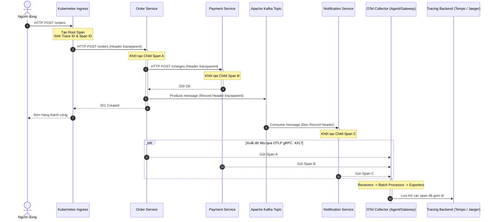

# 6_8_6 Tracing

> **Khóa học**: Cloud DevOps Basic — Containers & Kubernetes  
> **Phân nhóm**: 6 Domain 6 - Containers and Kubernetes › 6_8 Kubernetes Observability and Troubleshooting  
> **Chủ đề**: Phân tích phân tán (Distributed Tracing) với OpenTelemetry, context propagation và liên kết log-trace  
> **Trạng thái**: Bản nháp, chờ kiểm chứng  
> **Phạm vi**: [Topic README](./README.md#6_8_6-tracing-khái-niệm) · **Checklist đối chiếu**: [CHECKLIST](../../CHECKLIST.md)

---

## 1. Khái Niệm Cốt Lõi & Bản Chất Kỹ Thuật (Core Concepts & Technical Deep Dive)

### 1.1 Vấn Đề Bài Toán: Giới Hạn Của Log Và Metric Trong Hệ Thống Phân Tán

Trong mô hình kiến trúc nguyên khối trước đây, toàn bộ logic xử lý tập trung trong một tiến trình duy nhất. Việc chẩn đoán lỗi hay đo lường hiệu năng chỉ cần đọc file nhật ký tuần tự hoặc xem mức tiêu hao tài nguyên của máy chủ.

Khi chuyển đổi sang kiến trúc Microservices trên Kubernetes, một thao tác mua hàng của người dùng sẽ kích hoạt chuỗi lời gọi qua nhiều dịch vụ độc lập: từ Ingress Controller, qua API Gateway, dịch vụ xác thực, dịch vụ đơn hàng, dịch vụ thanh toán, rồi đẩy thông điệp vào hàng đợi tin nhắn trước khi dịch vụ kho vận xử lý. Trong mô hình phân tán nhiều chặng này, hai trụ cột quan sát truyền thống bộc lộ những hạn chế lớn:

- **Giới hạn của Metric (Số liệu đo lường)**: Metric tổng hợp từ Prometheus cho biết hệ thống đang chậm hoặc tỷ lệ lỗi gia tăng, nhưng không thể chỉ ra chính xác yêu cầu cụ thể nào bị nghẽn hay dịch vụ nào trong chuỗi là nguyên nhân gốc rễ.
- **Giới hạn của Log (Nhật ký sự kiện)**: Dù log từ các pod được gom về một nơi tập trung, các dòng nhật ký vẫn rời rạc giữa nhiều tiến trình. Khi thiếu một sợi dây liên kết xuyên suốt, kỹ sư không thể dựng lại toàn bộ hành trình của một giao dịch.

Để giải quyết bài toán truy vết hành trình yêu cầu qua hệ thống phân tán, dự án OpenTelemetry ra đời như một tiêu chuẩn mở chung cho toàn ngành công nghệ.
OpenTelemetry là dự án mã nguồn mở do Cloud Native Computing Foundation (CNCF) quản lý, được hình thành từ sự sáp nhập của hai dự án OpenTracing và OpenCensus để chuẩn hóa việc thu thập telemetry gồm traces, metrics và logs. <!-- ev: C6.1 -->

---

### 1.2 Cấu Trúc Cơ Bản Của Distributed Tracing: Trace Và Span

Distributed Tracing mô hình hóa đường đi của một yêu cầu xuyên qua các dịch vụ dưới dạng một đồ thị có hướng không chu trình.

Một Trace biểu diễn toàn bộ đường đi của một request qua toàn bộ hệ thống phân tán và được định danh bằng một chuỗi Trace ID duy nhất. <!-- ev: C6.2 -->

Span là đơn vị công việc cơ bản trong một trace, chứa tên thao tác (operation name), mốc thời gian bắt đầu (start time) và mốc thời gian kết thúc (end time). <!-- ev: C6.3 -->

Các span trong cùng một trace được liên kết với nhau theo cấu trúc cây phân cấp:

Root span là span gốc khởi tạo đầu tiên không có parent_id, còn các child span lưu giữ định danh parent_id để thiết lập cấu trúc cây có hướng không chu trình (DAG). <!-- ev: C6.4 -->

Mỗi span khi thực thi đều mang theo trạng thái hoàn thành và các thuộc tính ngữ cảnh:

Theo đặc tả của OpenTelemetry, Span Status có ba giá trị trạng thái chuẩn gồm Unset, Ok, và Error. <!-- ev: C6.5 -->

Span Attributes là tập hợp các cặp khóa-giá trị (key-value) gắn vào span để lưu trữ siêu dữ liệu ngữ cảnh như mã HTTP status hoặc câu truy vấn cơ sở dữ liệu. <!-- ev: C6.6 -->

---

### 1.3 Cơ Chế Lan Truyền Ngữ Cảnh (Context Propagation) Và Chuẩn W3C Trace Context

Để duy trì tính liên tục của một trace khi yêu cầu di chuyển qua ranh giới mạng giữa các container, các dịch vụ phải chuyển tiếp định danh truy vết cho nhau.

Context propagation là cơ chế đóng gói và truyền tải thông tin ngữ cảnh của trace (như Trace ID và Span ID) xuyên qua các ranh giới tiến trình và kết nối mạng. <!-- ev: C6.7 -->

Nhằm chấm dứt tình trạng phân mảnh định dạng tiêu đề giữa các nhà cung cấp công cụ khác nhau, World Wide Web Consortium đã ban hành chuẩn chung toàn cầu.

Đặc tả W3C Trace Context chuẩn hóa việc truyền ngữ cảnh qua HTTP header có tên traceparent gồm đúng 4 trường phân tách bởi dấu gạch nối. <!-- ev: C6.8 -->

Trường version trong header traceparent của W3C Trace Context hiện tại có độ dài 2 ký tự hex với giá trị quy định là 00. <!-- ev: C6.9 -->

Trường trace-id có độ dài cố định 32 ký tự hex (16 bytes) và trường parent-id có độ dài cố định 16 ký tự hex (8 bytes). <!-- ev: C6.10 -->

Trường trace-flags gồm 2 ký tự hex (8-bit bitmap), trong đó giá trị 01 biểu thị cờ sampled báo hiệu dữ liệu của trace này được thu thập. <!-- ev: C6.11 -->

Không chỉ truyền tải qua HTTP đồng bộ, ngữ cảnh truy vết còn được duy trì xuyên suốt qua các hàng đợi thông điệp bất đồng bộ:

Trong hệ thống xử lý bất đồng bộ như Apache Kafka, context propagation được thực hiện bằng cách inject trace context vào Record Headers của message. <!-- ev: C6.12 -->

---

### 1.4 Tương Quan Chéo (Correlation): Liên Kết Log Và Trace

Distributed Tracing và Centralized Logging bổ trợ trực tiếp cho nhau trong quá trình vận hành hệ thống. Tracing chỉ ra vị trí dịch vụ bị nghẽn, còn Log ghi lại chi tiết nội dung lỗi nội bộ.

Tương quan giữa Log và Trace (Correlation) được thực hiện bằng cách bổ sung đồng bộ trace_id và span_id vào bản ghi log có cấu trúc JSON. <!-- ev: C6.13 -->

Trong các dịch vụ backend, kỹ thuật Mapped Diagnostic Context (MDC) hoặc OTel Java Agent cho phép tự động nhúng trace_id vào bản ghi log mà không cần can thiệp mã nguồn nghiệp vụ. <!-- ev: C6.14 -->

Nhờ sự tương quan này, kỹ sư khi xem một span bị đánh dấu lỗi trên giao diện tracing có thể tra cứu tức thì toàn bộ các dòng log tương ứng trong kho nhật ký mà không cần lọc thủ công theo mốc thời gian.

---

### 1.5 Kiến Trúc Thành Phần OpenTelemetry: API, SDK, Collector Và Backend

Hệ sinh thái OpenTelemetry tách bạch giữa giao diện lập trình và hệ thống thu thập:

- **OpenTelemetry API**: Tập hợp các giao diện trừu tượng trong mã nguồn để tạo span và đo đạc chỉ số độc lập với nhà cung cấp.
- **OpenTelemetry SDK**: Bản cài đặt thực tế của API, quản lý bộ nhớ đệm, áp dụng chính sách lấy mẫu và xuất dữ liệu ra mạng.
- **OpenTelemetry Collector**: Thành phần trung gian độc lập xử lý và phân phối dữ liệu quan sát.

OTel Collector xử lý dữ liệu telemetry qua một pipeline gồm ba thành phần kế tiếp nhau là receivers, processors và exporters. <!-- ev: C6.15 -->

OTel Collector hỗ trợ hai mô hình triển khai chính gồm Agent (chạy dạng DaemonSet trên từng node hoặc Sidecar) và Gateway (cụm Collector tập trung). <!-- ev: C6.16 -->

Giao thức chuẩn OpenTelemetry Protocol (OTLP) hỗ trợ truyền tải telemetry qua cổng gRPC mặc định là 4317 và cổng HTTP mặc định là 4318. <!-- ev: C6.17 -->

Các backend lưu trữ và trực quan hóa trace phổ biến mã nguồn mở bao gồm Jaeger và Grafana Tempo. <!-- ev: C6.18 -->

---

## 2. Ví Dụ Đời Sống Thực Tế Dễ Hiểu (Intuitive Real-World Analogies)

### Mã Bưu Vận Theo Dõi Kiện Hàng Quốc Tế

Để hình dung bản chất của Distributed Tracing và Context Propagation, hãy liên tưởng tới quy trình chuyển phát một kiện hàng từ Hà Nội đi Tokyo:

1. **Mã vận đơn duy nhất (Trace ID)**: Khi bạn mang gói hàng đến bưu cục gửi, nhân viên dán một mã vạch vận đơn duy nhất. Dù gói hàng đi qua bao nhiêu phương tiện và trạm hải quan, mã số này giữ nguyên từ đầu đến cuối hành trình. Đây chính là **Trace ID**.
2. **Từng chặng trung chuyển (Span)**:
   - Chặng gom hàng từ bưu cục quận về trung tâm.
   - Chặng vận chuyển đường bộ ra sân bay.
   - Chặng bay chuyển phát hàng không.
   - Chặng kiểm tra và thông quan tại sân bay đích.
   - Chặng giao hàng chặng cuối tới tay người nhận.
   - Mỗi chặng là một đơn vị công việc riêng có thời gian bắt đầu, kết thúc và tên trạm xử lý. Trong tracing, mỗi chặng này là một **Span**, và chặng đầu tiên là **Root Span**.
3. **Đóng dấu phiếu chuyển tiếp (Context Propagation & W3C traceparent)**: Khi gói hàng chuyển từ xe tải sang kho hàng không, nhân viên quét mã vạch và dán nhãn ghi nhận trạm trước đó. Tờ phiếu này tương tự tiêu đề HTTP **`traceparent`** truyền qua các dịch vụ.
4. **Lưu kho chờ chuyến bay (Apache Kafka Queue)**: Khi kiện hàng nằm trong kho chờ chuyến bay đêm, hàng tạm nằm trong kho bất đồng bộ nhưng nhãn bưu vận vẫn gắn chặt trên kiện hàng. Khi máy bay xếp hàng lên khoang, nhân viên chỉ việc đọc nhãn để nối tiếp hành trình. Đây chính là việc truyền `traceparent` qua **Record Headers của thông điệp Kafka**.
5. **Truy tìm điểm nghẽn (Troubleshooting)**: Nếu kiện hàng bị trễ, người gửi chỉ cần tra cứu mã vận đơn. Hệ thống hiển thị biểu đồ từng chặng và chỉ rõ kiện hàng đang nằm yên tại trạm hải quan nào. Kỹ sư tìm ra ngay khâu nghẽn mà không cần phỏng đoán. Đó chính là giá trị cốt lõi của **Distributed Tracing**.

---

## 3. Kiến Trúc, Luồng Hoạt Động & Hình Ảnh Trực Quan (Architecture, Diagrams & Visual Media)

### 3.1 Sơ Đồ Tuần Tự Luồng Truy Vết Phân Tán End-to-End

Sơ đồ thể hiện chuỗi xử lý một giao dịch phân tán qua HTTP đồng bộ và Apache Kafka bất đồng bộ, kết hợp gửi dữ liệu truy vết về OpenTelemetry Collector:



### 3.2 Các Giai Đoạn Trong Vòng Đời Truy Vết

> 1. **Khởi tạo tại cửa ngõ**: Khi yêu cầu chưa có tiêu đề ngữ cảnh đi tới Ingress, Ingress tự động sinh ra một định danh vết duy nhất và đóng vai trò span gốc.  
> 2. **Lan truyền qua HTTP**: Ingress chèn tiêu đề chuẩn W3C vào yêu cầu gửi đến dịch vụ tiếp theo để dịch vụ này kế thừa ngữ cảnh và tạo span con.  
> 3. **Vượt biên giới bất đồng bộ**: Dịch vụ phát sinh sự kiện nhúng ngữ cảnh truy vết vào phần tiêu đề bản ghi của Kafka topic trước khi đẩy thông điệp đi.  
> 4. **Tái lập ngữ cảnh**: Dịch vụ nhận thông điệp từ Kafka đọc tiêu đề bản ghi, trích xuất mã vết và tiếp tục gắn nhánh con vào cây đồ thị.  
> 5. **Tập hợp dữ liệu**: Các pod gửi dữ liệu truy vết về OpenTelemetry Collector qua giao thức chuẩn OTLP để gom lô và lưu trữ tập trung.

---

## 4. Code Mẫu Trực Quan Hoặc Dòng Lệnh Thực Chiến (Runnable Sample Code / CLI)

### 4.1 Cấu Hình OpenTelemetry Collector Pipeline (`otel-collector-config.yaml`)

Tệp cấu hình chuẩn hóa của OpenTelemetry Collector triển khai trong Kubernetes tiếp nhận dữ liệu OTLP, gom lô và xuất về backend lưu trữ:

<!-- ev: C6.15 -->
```yaml
# otel-collector-config.yaml
# Cấu hình OpenTelemetry Collector v0.95+
apiVersion: v1
kind: ConfigMap
metadata:
  name: otel-collector-config
  namespace: monitoring
data:
  config.yaml: |
    receivers:
      otlp:
        protocols:
          grpc:
            endpoint: 0.0.0.0:4317
          http:
            endpoint: 0.0.0.0:4318

    processors:
      batch:
        send_batch_size: 1024
        timeout: 5s

    exporters:
      otlp/tempo:
        endpoint: tempo.monitoring.svc.cluster.local:4317
        tls:
          insecure: true
      debug:
        verbosity: detailed

    service:
      pipelines:
        traces:
          receivers: [otlp]
          processors: [batch]
          exporters: [otlp/tempo, debug]
```

### 4.2 Thử Nghiệm Lan Truyền Tiêu Đề W3C Bằng `curl`

Gửi yêu cầu HTTP mô phỏng việc đính kèm tiêu đề chuẩn W3C qua dòng lệnh:

<!-- ev: C6.8 -->
```bash
# Gửi yêu cầu HTTP kèm tiêu đề traceparent chuẩn W3C
# version: 00 | trace-id: 32 hex | parent-id: 16 hex | flags: 01 (sampled)
curl -v -X POST "http://order-service.default.svc.cluster.local:8080/api/v1/orders" \
  -H "Content-Type: application/json" \
  -H "traceparent: 00-4bf92f3577b34da6a3ce929d0e0e4736-00f067aa0ba902b7-01" \
  -d '{"item_id": "item-99", "quantity": 2}'
```

Dịch vụ backend ghi nhận và phản hồi:

<!-- ev: C6.10 -->
```text
< HTTP/1.1 201 Created
< Content-Type: application/json
<
{"status":"success","order_id":"ord-1002"}
```

> Dịch vụ nhận chuỗi định danh vết 32 ký tự hex làm mã truy vết chung và đặt chuỗi 16 ký tự hex làm định danh span cha của tiến trình xử lý.

### 4.3 Mẫu Bản Ghi Log JSON Đồng Bộ Tương Quan Trace

Bản ghi log định dạng JSON có tích hợp tự động mã định danh vết từ OpenTelemetry Agent:

<!-- ev: C6.13 -->
```json
{
  "timestamp": "2026-11-21T06:15:00.125Z",
  "level": "INFO",
  "service.name": "order-service",
  "message": "Successfully created order ord-1002 for customer cust-45",
  "trace_id": "4bf92f3577b34da6a3ce929d0e0e4736",
  "span_id": "5c3d2b1a8f9e0d1c",
  "trace_flags": "01"
}
```

---

## 5. Cạm Bẫy Thực Tế & Thực Tiễn Sản Xuất (Production Gotchas & Best Practices)

Trong môi trường sản xuất quy mô lớn, kỹ sư vận hành thường đối mặt với ba cạm bẫy quan trọng:

### 5.1 Cạm Bẫy Chi Phí Lưu Trữ: Lấy Mẫu Không Hợp Lý Khi Tải Cao

Trường trace-flags gồm 2 ký tự hex (8-bit bitmap), trong đó giá trị 01 biểu thị cờ sampled báo hiệu dữ liệu của trace này được thu thập. <!-- ev: C6.11 -->

> - **Head-based Sampling**: Lựa chọn thu thập hay bỏ qua được quyết định ngay tại Ingress. Phương thức này giảm tải mạng tức thì nhưng có nguy cơ bỏ sót các trace bị lỗi phát sinh ở tầng dịch vụ phía sau nếu yêu cầu đó không nằm trong mẫu chọn ngẫu nhiên.
> - **Tail-based Sampling**: Tất cả các dịch vụ tạm thời chuyển span về OpenTelemetry Collector Gateway. Bộ xử lý Collector chỉ lưu lại các trace có span bị lỗi hoặc thời gian phản hồi vượt ngưỡng trễ, giúp bắt trọn vẹn sự cố mà không lãng phí dung lượng lưu trữ.

### 5.2 Cạm Bẫy Đứt Đoạn Cây Truy Vết Trong Xử Lý Bất Đồng Bộ

Context propagation là cơ chế đóng gói và truyền tải thông tin ngữ cảnh của trace (như Trace ID và Span ID) xuyên qua các ranh giới tiến trình và kết nối mạng. <!-- ev: C6.7 -->

> Khi một dịch vụ chuyển giao tác vụ sang một nhóm luồng nền (Worker Thread Pool) mà quên sao chép đối tượng ngữ cảnh, luồng mới sẽ không đọc được mã vết của luồng gọi ban đầu. Các span con sinh ra trong luồng nền sẽ biến thành một span gốc mới hoàn toàn tách rời, khiến cây phân cấp truy vết bị đứt đoạn. Giải pháp là sử dụng các wrapper thực thi của OpenTelemetry SDK để tự động truyền tiếp ngữ cảnh sang luồng mới.

### 5.3 Cạm Bẫy Bảo Mật: Lộ Dữ Liệu Riêng Tư (PII) Trong Thuộc Tính Span

Span Attributes là tập hợp các cặp khóa-giá trị (key-value) gắn vào span để lưu trữ siêu dữ liệu ngữ cảnh như mã HTTP status hoặc câu truy vấn cơ sở dữ liệu. <!-- ev: C6.6 -->

> Nếu ứng dụng tự động đưa toàn bộ chuỗi truy vấn hoặc nội dung gói tin vào các thuộc tính của span, các thông tin nhạy cảm như mật khẩu hay số thẻ tín dụng sẽ hiển thị trực tiếp trên giao diện giám sát chung. Cần áp dụng bộ xử lý biến đổi hoặc che giấu dữ liệu nhạy cảm tại OpenTelemetry Collector trước khi xuất dữ liệu ra ngoài.

---

## 6. Câu Hỏi Củng Cố Kiến Thức (Active Recall Quiz)

### Câu Hỏi 1: Cấu Trúc Tiêu Đề W3C `traceparent`
Một kỹ sư kiểm tra gói tin HTTP chuyển tiếp giữa hai container và thấy tiêu đề sau:
`traceparent: 00-4bf92f3577b34da6a3ce929d0e0e4736-00f067aa0ba902b7-01`. Hãy phân tích ý nghĩa của từng thành phần trong chuỗi trên theo tiêu chuẩn W3C Trace Context.

<details>
<summary>Đáp án</summary>

Chuỗi tiêu đề `traceparent` gồm đúng 4 trường phân tách bởi dấu gạch nối:
1. `00`: Phiên bản tiêu chuẩn W3C Trace Context (hiện tại cố định 2 ký tự hex `00`).
2. `4bf92f3577b34da6a3ce929d0e0e4736`: Định danh của toàn bộ vết truy vết (`trace_id`), gồm đúng 32 ký tự hex (16 bytes), giữ nguyên qua mọi dịch vụ trong giao dịch.
3. `00f067aa0ba902b7`: Định danh span của tiến trình gọi trước đó (`parent_id` hoặc `span_id`), gồm đúng 16 ký tự hex (8 bytes).
4. `01`: Cờ điều khiển (`trace_flags`), gồm 2 ký tự hex. Giá trị `01` biểu thị cờ `sampled`, báo hiệu yêu cầu được chọn để lưu vết.
</details>

---

### Câu Hỏi 2: Lan Truyền Ngữ Cảnh Qua Hàng Đợi Bất Đồng Bộ
Tại sao khi dịch vụ Order Service xuất bản thông điệp vào Apache Kafka để dịch vụ Notification Service xử lý bất đồng bộ, đường dẫn Distributed Tracing vẫn có thể nối liền thay vì bị ngắt thành hai trace riêng biệt?

<details>
<summary>Đáp án</summary>

Đường dẫn truy vết duy trì liên tục nhờ cơ chế lan truyền ngữ cảnh qua tiêu đề thông điệp:
1. Khi Order Service gửi thông điệp, SDK tự động chèn chuỗi `traceparent` vào `Record Headers` của Kafka.
2. Khi Notification Service nhận thông điệp, SDK đọc chuỗi `traceparent` từ `Record Headers`.
3. Notification Service tạo span mới và gán `parent_id` trỏ về span của Order Service. Nhờ đó, cây phân cấp đồ thị (DAG) nối liền từ tạo đơn qua Kafka sang gửi thông báo.
</details>

---

### Câu Hỏi 3: So Sánh Head-Based Sampling Và Tail-Based Sampling
Trong hệ thống Kubernetes tải cao, vì sao kỹ thuật Tail-based Sampling tại Collector Gateway lại tối ưu hơn Head-based Sampling tại Ingress đối với việc phân tích sự cố?

<details>
<summary>Đáp án</summary>

1. **Head-based Sampling**: Quyết định lấy mẫu ngay tại Ingress khi chưa biết yêu cầu có lỗi hay chậm hay không. Nếu chỉ lấy mẫu 1%, phần lớn các giao dịch bị lỗi trong thực tế sẽ bị bỏ sót.
2. **Tail-based Sampling**: Collector Gateway lưu vết tạm thời trong bộ nhớ cho đến khi chuỗi span hoàn tất. Nếu trace có lỗi (`Error`) hoặc độ trễ cao, toàn bộ trace được giữ lại; các trace thành công được giảm bớt theo tỷ lệ. Nhờ đó giữ trọn vẹn 100% dữ liệu lỗi mà vẫn tiết kiệm chi phí lưu trữ.
</details>

---

## 7. 📚 Nguồn Tài Liệu Chính Thống (Tier-1 Official References)

- [W3C Recommendation: Trace Context Level 1](https://www.w3.org/TR/trace-context/) - Tiêu chuẩn khuyến nghị chính thức của W3C quy định chi tiết định dạng tiêu đề `traceparent` và `tracestate`.
- [OpenTelemetry Documentation: Traces Concepts](https://opentelemetry.io/docs/concepts/signals/traces/) - Tài liệu chính thức từ OpenTelemetry giải thích chi tiết về khái niệm Trace, Span, Span Hierarchy, Status và Attributes.
- [OpenTelemetry Documentation: Context Propagation](https://opentelemetry.io/docs/concepts/context-propagation/) - Hướng dẫn chính thức về nguyên lý đóng gói và truyền tải ngữ cảnh truy vết xuyên tiến trình và qua mạng.
- [OpenTelemetry Documentation: OpenTelemetry Collector Architecture](https://opentelemetry.io/docs/collector/) - Kiến trúc thành phần của OTel Collector bao gồm quy trình xử lý qua Receivers, Processors và Exporters.
