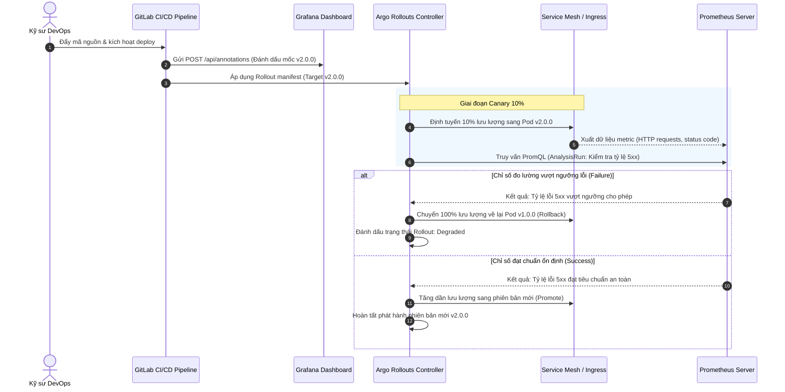

# 6_8_7 Quan Sát Khi Deploy

- **Khóa học**: Cloud & DevOps Basic
- **Phân nhóm**: Domain 6 - Containers and Kubernetes / 6_8 Kubernetes Observability and Troubleshooting
- **Chủ đề**: 6_8_7 Quan Sát Khi Deploy
- **Trạng thái**: Bản nháp, chờ kiểm chứng
- **Checklist đối chiếu**: [CHECKLIST](../../CHECKLIST.md)

---

## 1. Khái Niệm Cốt Lõi & Bản Chất Kỹ Thuật (Core Concepts & Technical Deep Dive)

Trong quy trình phát hành phần mềm hiện đại trên Kubernetes, một ngộ nhận phổ biến là xem đợt triển khai hoàn tất ngay khi các Pod chuyển sang trạng thái sẵn sàng ban đầu. Thực tế vận hành cho thấy nhiều lỗi nghiêm trọng như rò rỉ bộ nhớ, nghẽn luồng xử lý hoặc lỗi truy vấn cơ sở dữ liệu chỉ bộc lộ khi dịch vụ tiếp nhận lưu lượng người dùng thật. Kỹ thuật quan sát khi triển khai thiết lập cơ chế đo lường liên tục, đối chiếu dữ liệu vận hành giữa phiên bản mới và phiên bản hiện tại, từ đó quyết định thăng cấp phát hành hay kích hoạt cơ chế tự động khôi phục.

### 1.1 Thiết Lập và So Sánh Baseline Metrics

Để đánh giá phiên bản ứng dụng vừa triển khai có hoạt động ổn định hay không, hệ thống quan sát cần thu thập và đối chiếu các chỉ số vận hành tức thời với đường cơ sở của phiên bản ổn định trước đó:

- **Tỷ lệ lỗi máy chủ (HTTP 5xx Error Rate)**: Đo lường phần trăm yêu cầu kết thúc bằng mã lỗi 5xx trên tổng lưu lượng nhận được, giúp phát hiện ngay hiện tượng hồi quy tính năng so với mức cơ sở khi vừa triển khai. <!-- ev: C7.1 -->
- **Độ trễ phân vị cao và tài nguyên tiêu thụ**: Việc theo dõi độ trễ p95 hoặc p99 cùng mức tiêu thụ CPU và bộ nhớ giúp phát hiện sớm hiện tượng nghẽn luồng hoặc rò rỉ bộ nhớ trước khi container bị dừng. <!-- ev: C7.2 -->

### 1.2 Đánh Dấu Mốc Triển Khai (Deployment Annotations) Trên Grafana

Khi sự cố phát sinh đồng thời với quá trình phát hành, kỹ sư trực vận hành cần xác định ngay liệu sự biến động của biểu đồ có bắt nguồn từ thay đổi mã nguồn hay do hạ tầng bên ngoài:

- Grafana hỗ trợ hiển thị các đường đánh dấu thẳng đứng kèm chú thích ngữ cảnh trực tiếp trên các bảng điều khiển thời gian thực để đối chiếu trước và sau thời điểm cập nhật.
- **Grafana Annotations API**: Cung cấp giao diện HTTP với endpoint `POST /api/annotations` cho phép các công cụ tự động hóa đẩy thông tin sự kiện lên biểu đồ. <!-- ev: C7.6 -->
- **Cấu trúc bản tin sự kiện**: Yêu cầu định dạng JSON gửi tới API bao gồm trường `text` mô tả sự kiện, trường `time` chứa mốc thời gian Unix epoch tính theo mili-giây, cùng mảng `tags` để gắn nhãn phân loại. <!-- ev: C7.7 -->

### 1.3 Tự Động Hóa Đánh Giá và Rollback (Progressive Delivery)

Các bộ điều khiển triển khai lũy tiến như Argo Rollouts và Flagger mở rộng Kubernetes qua các tài nguyên tùy biến để tự động hóa việc phân tích chỉ số và điều phối lưu lượng. <!-- ev: C7.8 -->

- **Tài nguyên Rollout**: Thay thế trực tiếp tài nguyên Deployment tiêu chuẩn, cho phép điều khiển từng bước dịch chuyển lưu lượng theo chiến lược canary. <!-- ev: C7.9 -->
- **Tài nguyên AnalysisTemplate**: Bản thiết kế định nghĩa các chỉ số đo lường với câu truy vấn PromQL, khoảng thời gian kiểm tra lặp lại cùng ngưỡng đánh giá thành công hoặc giới hạn số lần thất bại. <!-- ev: C7.10 -->
- **Điều khiển lưu lượng Canary**: Thuộc tính `setWeight` chỉ định phần trăm lưu lượng mạng dẫn sang phiên bản mới, kết hợp thuộc tính `pause` để tạm dừng tiến trình chờ hoàn tất phân tích số liệu. <!-- ev: C7.11 -->
- **Cơ chế Automated Rollback**: Khi kết quả câu lệnh PromQL trả về giá trị vượt quá giới hạn lỗi cho phép, bộ điều khiển tự động đình chỉ phát hành và hoàn trả toàn bộ lưu lượng về phiên bản trước đó. <!-- ev: C7.12 -->

### 1.4 So Sánh Độ Trễ Phát Hiện Sự Cố: Rolling Update Thuần Túy vs Canary Evaluation

- **Hạn chế của Rolling Update thuần túy**: Bộ điều khiển mặc định chỉ kiểm tra tín hiệu sẵn sàng nội bộ của container mà không đo lường chất lượng phục vụ thực tế đối với yêu cầu của người dùng. <!-- ev: C7.3 -->
- **Độ trễ phát hiện sự cố kéo dài**: Khi áp dụng Rolling Update thông thường, sự cố tiềm ẩn chỉ được phát hiện sau khi toàn bộ lưu lượng đã chuyển sang phiên bản mới, khiến thời gian phát hiện lỗi bị kéo dài và toàn bộ hệ thống bị gián đoạn. <!-- ev: C7.4 -->
- **Ưu thế của Canary Release kết hợp quan sát**: Bằng cách chỉ định tuyến một phần nhỏ lưu lượng sang phiên bản mới và tự động đánh giá chỉ số, hệ thống giới hạn tối đa phạm vi ảnh hưởng và phát hiện lỗi chỉ trong vài phút. <!-- ev: C7.5 -->

---

## 2. Ví Dụ Đời Sống Thực Tế Dễ Hiểu (Intuitive Real-World Analogies)

Hãy hình dung quy trình tổ chức một bữa tiệc khánh thành sang trọng với hàng trăm thực khách danh dự:

Nhà hàng vừa nhập về một mẻ rượu vang cao cấp được ủ theo công thức mới. Nếu quản lý quyết định khui đồng loạt toàn bộ số chai rượu này và rót đầy ly của tất cả thực khách cùng một lúc (tương đương chiến lược Rolling Update truyền thống), rủi ro sẽ cực kỳ lớn. Nếu mẻ rượu bị chua hoặc có mùi vị lạ do lỗi bảo quản, toàn bộ khách mời trong khán phòng sẽ đồng loạt thất vọng trước khi nhà hàng kịp nhận ra sự cố.

Thay vào đó, người quản lý giàu kinh nghiệm áp dụng quy trình nếm thử tiêu chuẩn:

1. **Rót một ly nhỏ cho một vài khách thử nghiệm (Canary 5%)**: Người phục vụ chỉ rót rượu mới cho một vài vị khách am hiểu ẩm thực ở bàn đầu tiên, trong khi phần lớn thực khách còn lại vẫn thưởng thức loại rượu vang quen thuộc đang phục vụ ổn định.
2. **Quan sát phản ứng và đo lường biểu cảm (Metric Evaluation)**: Người quản lý kín đáo quan sát nét mặt của khách nếm thử. Nếu khách nhấp ngụm đầu tiên với vẻ hài lòng, đó là tín hiệu cho phép tăng dần số bàn được phục vụ loại rượu mới lên tiếp theo.
3. **Thu hồi lập tức khi phát hiện vị chua (Automated Rollback)**: Nếu người nếm thử nhăn mặt và đặt ly xuống bàn vì có mùi vị bất thường, người phục vụ ngay lập tức ngưng rót mẻ rượu mới, thu hồi ly rượu lỗi và thay thế bằng loại rượu tiêu chuẩn trước đó.

Nhờ quy trình kiểm chứng chủ động dựa trên quan sát thực tế này, sự cố tiềm ẩn được dập tắt ngay từ bàn tiệc thử nghiệm mà đại đa số thực khách trong phòng tiệc hoàn toàn không hề hay biết.

---

## 3. Kiến Trúc, Luồng Hoạt Động & Hình Ảnh Trực Quan (Architecture, Diagrams & Visual Media)

Quy trình phối hợp giữa pipeline tự động hóa, bộ điều khiển triển khai, máy chủ giám sát và bảng hiển thị diễn ra theo trình tự khép kín:



> [!NOTE]
> **Tóm tắt luồng hoạt động**: Sau khi pipeline CI/CD kích hoạt đợt phát hành và đánh dấu mốc thời gian lên bảng điều khiển, bộ điều khiển canary định tuyến một phần nhỏ lưu lượng sang phiên bản mới. Máy chủ giám sát thu thập số liệu vận hành và cung cấp dữ liệu cho tiến trình đánh giá tự động. Nếu chỉ số suy thoái vượt ngưỡng quy định, lưu lượng được chuyển đổi ngược về phiên bản cũ ngay lập tức; nếu đạt chuẩn, tỷ lệ lưu lượng được nâng dần cho đến khi hoàn tất.

---

## 4. Code Mẫu Trực Quan Hoặc Dòng Lệnh Thực Chiến (Runnable Sample Code / CLI)

### 4.1 Tạo Annotation Trên Grafana Bằng Lệnh curl Từ GitLab CI/CD

Đoạn kịch bản Bash dưới đây thực hiện gửi yêu cầu POST chứa mốc thời gian dạng số nguyên sang Grafana Annotations API trong giai đoạn phát hành của pipeline: <!-- ev: C7.13 -->

```bash
#!/usr/bin/env bash
set -euo pipefail

# Khai báo thông tin kết nối từ biến môi trường của hệ thống CI/CD
GRAFANA_URL="https://grafana.example.com"
GRAFANA_TOKEN="glsa_xxxxxx_example_token"
DEPLOY_ENV="production"
APP_NAME="payment-service"
APP_VERSION="v2.1.0"

# Lấy mốc thời gian Unix epoch tính theo mili-giây
CURRENT_TIME_MS=$(date +%s%3N)

# Gửi yêu cầu HTTP POST tới Grafana Annotations API
curl -s -f -X POST "${GRAFANA_URL}/api/annotations" \
  -H "Authorization: Bearer ${GRAFANA_TOKEN}" \
  -H "Content-Type: application/json" \
  -d '{
    "time": '"${CURRENT_TIME_MS}"',
    "text": "Triển khai ứng dụng '"${APP_NAME}"' phiên bản '"${APP_VERSION}"'",
    "tags": ["deployment", "'"${DEPLOY_ENV}"'", "'"${APP_NAME}"'"]
  }'
```

---

### 4.2 Cấu Hình Argo Rollouts và AnalysisTemplate Để Tự Động Rollback

Bản mẫu phân tích định nghĩa điều kiện đánh giá tỷ lệ lỗi máy chủ qua câu truy vấn Prometheus:

```yaml
apiVersion: argoproj.io/v1alpha1
kind: AnalysisTemplate
metadata:
  name: http-error-rate-check
  namespace: production
spec:
  metrics:
  - name: error-rate
    interval: 30s
    successCondition: result[0] < 0.01
    failureLimit: 3
    consecutiveErrorLimit: 2
    provider:
      prometheus:
        address: http://prometheus-k8s.monitoring.svc:9090
        query: |
          sum(rate(http_requests_total{job="payment-service", status=~"5.*"}[1m]))
          /
          sum(rate(http_requests_total{job="payment-service"}[1m]))
```

- Cấu hình `consecutiveErrorLimit` xác định số lần lỗi liên tiếp được phép xảy ra do mạng chập chờn trước khi tính là một lượt đánh giá thất bại. <!-- ev: C7.14 -->

Tài nguyên Rollout khai báo các bước dịch chuyển lưu lượng tăng dần:

```yaml
apiVersion: argoproj.io/v1alpha1
kind: Rollout
metadata:
  name: payment-service
  namespace: production
spec:
  replicas: 10
  strategy:
    canary:
      analysis:
        templates:
        - templateName: http-error-rate-check
      steps:
      - setWeight: 10
      - pause: {duration: 2m}
      - setWeight: 30
      - pause: {duration: 5m}
      - setWeight: 60
      - pause: {duration: 5m}
  selector:
    matchLabels:
      app: payment-service
  template:
    metadata:
      labels:
        app: payment-service
    spec:
      containers:
      - name: payment-service
        image: registry.example.com/payment-service:v2.1.0
        ports:
        - containerPort: 8080
```

---

## 5. Cạm Bẫy Thực Tế & Thực Tiễn Sản Xuất (Production Gotchas & Best Practices)

Trong quá trình ứng dụng hệ thống quan sát và tự động rollback vào môi trường thực tế, kỹ sư DevOps cần chú ý các đặc điểm vận hành sau:

### 5.1 Cạm Bẫy Dung Lượng Mẫu Nhỏ (Low-Traffic Sample Bias)

- Khi lưu lượng qua phiên bản mới quá nhỏ trong giờ thấp điểm, chỉ một vài yêu cầu hỏng ngẫu nhiên cũng khiến tỷ lệ lỗi phần trăm tăng vọt và kích hoạt rollback nhầm. <!-- ev: C7.16 -->

Khi mẫu số của phép chia quá nhỏ, một lỗi ngẫu nhiên duy nhất cũng có thể thổi phồng tỷ lệ lỗi và dẫn đến quyết định hủy bỏ phát hành không chính xác. Biểu thức truy vấn nên bổ sung điều kiện lọc ngưỡng lưu lượng tối thiểu:

```promql
(sum(rate(http_requests_total{status=~"5.."}[2m])) or vector(0))
/
(sum(rate(http_requests_total[2m])) > 10)
```

### 5.2 Yêu Cầu Nhãn Phân Biệt Giữa Nhóm Pod Canary và Baseline

- Ứng dụng xuất chỉ số bắt buộc phải gắn nhãn phiên bản cụ thể vào từng metric để PromQL có thể phân tách ranh giới giữa nhóm Pod mới và nhóm Pod cũ. <!-- ev: C7.15 -->

Nếu dữ liệu thiếu nhãn phân biệt, câu lệnh tính toán sẽ hòa lẫn số liệu của phiên bản cũ và mới, làm mất tính chính xác của phép đo lường độc lập.

### 5.3 Tránh Báo Động Giả Khi Khởi Động Nguội (Cold-Start Penalty)

Các ứng dụng chạy trên máy ảo Java hoặc cần nạp dữ liệu vào bộ nhớ đệm ban đầu thường có độ trễ phản hồi cao trong giai đoạn khởi động. Để tránh việc hệ thống đánh giá sai và hủy bỏ đợt phát hành khi ứng dụng chưa sẵn sàng phục vụ tối ưu, cần thiết lập khoảng thời gian làm ấm tài nguyên thích hợp trước khi kích hoạt quy trình phân tích chỉ số.

---

## 6. Câu Hỏi Củng Cố Kiến Thức (Active Recall Quiz)

Để kiểm tra mức độ nắm bắt kiến thức về quy trình quan sát khi triển khai, hãy suy nghĩ câu trả lời cho các tình huống thực tế sau trước khi mở phần giải đáp:

### Câu hỏi 1
Trong một đợt phát hành ứng dụng theo chiến lược Rolling Update tiêu chuẩn, toàn bộ các Pod mới đều vượt qua bài kiểm tra tính sẵn sàng ban đầu. Tuy nhiên, ngay sau đó tổng đài hỗ trợ nhận hàng loạt khiếu nại vì khách hàng gặp lỗi trắng trang. Nguyên nhân cốt lõi do đâu, và cơ chế quan sát khi deploy giải quyết bài toán này như thế nào?

<details>
<summary>Đáp án</summary>

- **Nguyên nhân cốt lõi**: Bài kiểm tra sẵn sàng của Kubernetes chỉ xác nhận tính sẵn sàng ở cấp độ nội bộ Pod đơn giản. Khi nhận lưu lượng thực tế với các truy vấn phức tạp hoặc phụ thuộc vào cơ sở dữ liệu mới chưa tương thích, ứng dụng mới phát sinh lỗi hệ thống hàng loạt. Do Kubernetes mặc định không quan sát chỉ số chất lượng dịch vụ của người dùng thật, hệ thống vẫn tiếp tục khai tử các Pod cũ và thay bằng Pod lỗi.
- **Giải pháp**: Cơ chế quan sát khi deploy kết hợp Canary Release chỉ định tuyến tỷ lệ lưu lượng nhỏ sang phiên bản mới và sử dụng các bộ điều khiển như Argo Rollouts để liên tục kiểm tra tỷ lệ lỗi thực tế qua Prometheus. Nếu phát hiện chỉ số lỗi tăng cao, hệ thống tự động hoàn tác về bản cũ trước khi sự cố lan rộng ra toàn bộ người dùng.

</details>

### Câu hỏi 2
Tại sao trong cấu hình của `AnalysisTemplate` cho việc kiểm tra chất lượng phiên bản mới, kỹ sư DevOps nên thiết lập tham số `failureLimit` lớn hơn 1 (ví dụ bằng 3) thay vì đặt bằng 0?

<details>
<summary>Đáp án</summary>

- Nếu đặt `failureLimit: 0` (chỉ cần 1 lần kiểm tra thất bại sẽ hủy đợt deploy ngay lập tức), hệ thống rất dễ rơi vào bẫy báo động giả do nhiễu mạng tạm thời hoặc các biến động tức thời khi người dùng gửi một vài yêu cầu sai định dạng.
- Đặt `failureLimit: 3` buộc bộ điều khiển phải xác nhận lỗi duy trì liên tục qua nhiều chu kỳ kế tiếp. Điều này đảm bảo quyết định rollback chỉ được đưa ra khi phiên bản mới thực sự có vấn đề nghiêm trọng, tránh làm gián đoạn tiến trình phát hành bởi những dao động ngẫu nhiên.

</details>

### Câu hỏi 3
Kỹ sư trực hệ thống quan sát thấy biểu đồ độ trễ phản hồi trên Grafana tăng đột biến ngay sau thời điểm cập nhật. Dựa vào đâu trên biểu đồ mà kỹ sư có thể kết luận ngay sự cố này có liên quan trực tiếp đến đợt phát hành mã nguồn mới hay không?

<details>
<summary>Đáp án</summary>

- Dựa vào **Grafana Deployment Annotation** (đường đánh dấu dọc trên bảng điều khiển). Khi pipeline CI/CD thực hiện lệnh gọi API `POST /api/annotations` ghi nhận mốc thời gian triển khai, một đường kẻ dọc kèm nhãn phiên bản sẽ xuất hiện trên toàn bộ các biểu đồ metric.
- Nếu đường cong biểu diễn độ trễ bắt đầu leo dốc dựng đứng ngay tại đúng vị trí mốc thời gian của đường annotation, kỹ sư có bằng chứng xác thực rằng sự cố xuất phát từ thay đổi phần mềm vừa được phát hành, từ đó nhanh chóng định hướng điều tra thay vì mất thời gian kiểm tra hạ tầng mạng hay máy chủ vật lý.

</details>

---

## 7. 📚 Nguồn Tài Liệu Chính Thống (Tier-1 Official References)

- [Kubernetes Documentation: Deployments](https://kubernetes.io/docs/concepts/workloads/controllers/deployment/) - Tài liệu chính thức từ Kubernetes về kiến trúc và cơ chế cập nhật trạng thái của workload controller.
- [Prometheus Documentation: Querying Basics](https://prometheus.io/docs/prometheus/latest/querying/basics/) - Hướng dẫn chính thức về cú pháp và phương pháp truy vấn chuỗi thời gian PromQL từ Prometheus.
- [Grafana Documentation: Annotate Visualizations](https://grafana.com/docs/grafana/latest/dashboards/build-dashboards/annotate-visualizations/) - Tài liệu chính thức từ Grafana về việc xây dựng và quản lý các mốc chú thích sự kiện trên bảng điều khiển.
- [Grafana Documentation: Annotations HTTP API](https://grafana.com/docs/grafana/latest/developers/http_api/annotations/) - Hướng dẫn chính thức về giao diện lập trình API tạo và tìm kiếm chú thích từ hệ thống CI/CD bên ngoài.
