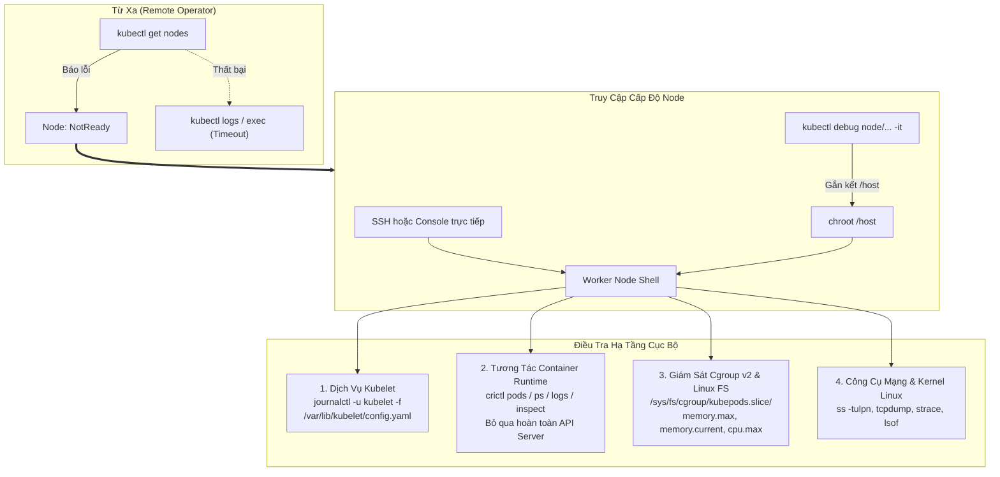

# 6_8_8 Debug Ở Mức Node

> **Khóa học**: Cloud DevOps Basic — Containers & Kubernetes  
> **Phân nhóm**: 6 Domain 6 - Containers and Kubernetes › 6_8 Kubernetes Observability and Troubleshooting  
> **Chủ đề**: Chẩn đoán sự cố hạ tầng ở cấp độ Node trong Kubernetes bằng crictl, kubelet logs, cgroup v2 và ephemeral debug tools  
> **Phiên bản áp dụng**: Kubernetes 1.30+ (cgroup v2 và Container Runtime Interface hiện đại containerd/CRI-O)  
> **Trạng thái**: Bản nháp, chờ kiểm chứng  
> **Phạm vi**: [Topic README](./README.md#6_8_8-debug-ở-mức-node) · **Checkpoint của người học**: [CHECKLIST](../../CHECKLIST.md#6_8-kubernetes-observability-and-troubleshooting)

---

## 1. Khái Niệm Cốt Lõi & Bản Chất Kỹ Thuật (Core Concepts & Technical Deep Dive)

Trong vận hành cụm phân tán hằng ngày, kỹ sư thường tương tác với hệ thống thông qua các công cụ dòng lệnh từ xa. Tuy nhiên, khi một máy chủ thành viên bị mất kết nối mạng, tiến trình quản trị bị treo hoặc ổ cứng cạn kiệt, các lệnh điều khiển từ xa sẽ hoàn toàn mất tác dụng. Để phục hồi hạ tầng, bạn bắt buộc phải truy cập trực tiếp vào máy chủ và sử dụng các công cụ chẩn đoán tầng sâu.

### 1.1 Tương Tác Trực Tiếp Với Container Runtime Bằng `crictl`

- `crictl` là công cụ giao diện dòng lệnh (CLI) được thiết kế riêng cho các container runtime tương thích với Container Runtime Interface (CRI), cho phép kỹ sư kiểm tra và gỡ lỗi trực tiếp trên worker node mà không cần thông qua Kubernetes API server. <!-- ev: C8.1 -->
- `crictl` kết nối và gửi lệnh tới container runtime thông qua UNIX domain socket được định nghĩa tại endpoint runtime, ví dụ `unix:///run/containerd/containerd.sock` cho containerd hoặc `unix:///run/crio/crio.sock` cho CRI-O. <!-- ev: C8.2 -->
- Lệnh `crictl pods` liệt kê danh sách các Pod sandbox trên node cục bộ, trong khi lệnh `crictl ps` hiển thị toàn bộ các container ứng dụng đang chạy được quản lý bởi runtime. <!-- ev: C8.3 -->
- Lệnh `crictl logs <container-id>` cho phép đọc trực tiếp các luồng xuất dữ liệu chuẩn stdout và stderr được lưu trữ trên ổ đĩa của node mà không phụ thuộc vào tình trạng sống còn của `kubelet`. <!-- ev: C8.4 -->
- Lệnh `crictl inspect <container-id>` trích xuất toàn bộ thông tin chi tiết cấp thấp về trạng thái tiến trình, điểm gắn kết volume (mounts) và giới hạn tài nguyên của container. <!-- ev: C8.5 -->

### 1.2 Nhật Ký Và Cấu Hình Tiến Trình Kubelet

- `kubelet` vận hành dưới dạng một dịch vụ hệ thống `systemd` trên các worker node Linux, đóng vai trò tiếp nhận đặc tả PodSpec được gán từ control plane và chỉ đạo container runtime duy trì trạng thái Pod mong muốn. <!-- ev: C8.6 -->
- Lệnh `journalctl -u kubelet -f` hiển thị luồng nhật ký thời gian thực của dịch vụ `kubelet` thông qua `systemd journal` để phát hiện lỗi giao tiếp mạng, lỗi nạp chứng chỉ hoặc xung đột cấu hình. <!-- ev: C8.7 -->
- Tệp tin cấu hình máy chủ chính của `kubelet` được lưu trữ mặc định tại đường dẫn `/var/lib/kubelet/config.yaml` chứa các tham số hoạt động (KubeletConfiguration). <!-- ev: C8.8 -->
- Khi tiến trình `kubelet` dừng chạy hoặc không thể gửi thông điệp nhịp tim (`NodeStatus`) về API server sau khoảng thời gian quy định, trạng thái của node trên cụm sẽ chuyển thành `NotReady`. <!-- ev: C8.9 -->

### 1.3 Cơ Chế Áp Lực Tài Nguyên (Node Conditions) Và Thu Hồi Pod

- Kubernetes đánh giá và theo dõi sức khỏe tổng thể của worker node thông qua bốn điều kiện cốt lõi (Node Conditions) bao gồm `Ready`, `DiskPressure`, `MemoryPressure`, và `PIDPressure`. <!-- ev: C8.10 -->
- Điều kiện `DiskPressure` được kích hoạt khi dung lượng trống trên phân vùng tệp gốc (root filesystem) hoặc phân vùng chứa ảnh container tụt xuống dưới ngưỡng thu hồi (eviction threshold) an toàn. <!-- ev: C8.11 -->
- Điều kiện `MemoryPressure` được kích hoạt khi dung lượng RAM khả dụng trên node thấp hơn ngưỡng thu hồi, buộc `kubelet` phải chủ động trục xuất (evict) các Pod để cứu sống hệ điều hành máy chủ theo thứ tự ưu tiên của QoS class. <!-- ev: C8.12 -->
- Điều kiện `PIDPressure` xảy ra khi số lượng định danh tiến trình (Process ID) còn lại trên kernel Linux rơi xuống dưới ngưỡng an toàn, đe dọa làm tê liệt khả năng tạo tiến trình mới của toàn node. <!-- ev: C8.13 -->

### 1.4 Kiểm Tra Giới Hạn Cgroup v2 Trực Tiếp Trên Filesystem

- Trên các bản phân phối Linux hiện đại sử dụng cgroup v2, Kubernetes nhóm và quản lý tài nguyên của các Pod theo cây phân cấp slice tại thư mục `/sys/fs/cgroup/kubepods.slice/`. <!-- ev: C8.14 -->
- Trong cơ chế cgroup v2, ngưỡng trần bộ nhớ (`limits.memory`) được điều khiển qua tệp tin `memory.max`, trong khi lượng RAM đang chiếm dụng thực tế được đọc trực tiếp từ tệp tin `memory.current`. <!-- ev: C8.15 -->
- Giới hạn vi xử lý (`limits.cpu`) trong cgroup v2 được kiểm soát qua tệp tin `cpu.max` dưới dạng cặp giá trị hạn ngạch và chu kỳ `<quota> <period>` (ví dụ giá trị `100000 100000` biểu thị tối đa 1 CPU core). <!-- ev: C8.16 -->

### 1.5 Phiên Chẩn Đoán Cấp Độ Node Bằng Ephemeral Container

- Lệnh `kubectl debug node/<node-name> -it --image=<image>` khởi tạo một Pod chẩn đoán đặc quyền tạm thời chạy trực tiếp trong không gian tên mạng, IPC và tiến trình của node chủ (`hostNetwork`, `hostIPC`, `hostPID`). <!-- ev: C8.17 -->
- Hệ thống tệp gốc của máy chủ node được tự động gắn kết vào thư mục `/host` bên trong Pod debug, cho phép kỹ sư dùng lệnh `chroot /host` để thao tác với toàn bộ công cụ quản trị Linux nguyên bản như `ss`, `tcpdump`, `strace`, `lsof`. <!-- ev: C8.18 -->

---

## 2. Ví Dụ Đời Sống Thực Tế Dễ Hiểu (Intuitive Real-World Analogies)

Hãy tưởng tượng một tòa nhà chung cư cao tầng hiện đại được quản lý bởi ban quản lý trung tâm. Ban quản lý ngồi ở phòng điều hành và theo dõi tình trạng của từng tầng thông qua hệ thống chuông báo và camera từ xa.

Khi đường dây camera của một tầng bị đứt, hoặc bảng công tắc điện tổng ở tầng đó bị chập, màn hình ở phòng ban quản lý chỉ hiện lên cảnh báo mất tín hiệu. Mọi nút bấm từ xa đều vô hiệu vì tín hiệu điều khiển không thể truyền tới phòng kỹ thuật của tầng.

Lúc này, người thợ điện máy lành nghề phải đích thân cầm hộp đồ nghề đi cầu thang bộ lên tận phòng máy của tầng gặp sự cố:
1. Mở tủ cầu dao tổng của tầng để kiểm tra xem nguồn cấp chính có bị ngắt hay bốc khói hay không.
2. Dùng đồng hồ đo trực tiếp điện áp trên từng đường dây phụ dẫn vào các căn hộ để biết chính xác thiết bị nào đang bị chập điện.
3. Quan sát các đồng hồ đo áp suất nước và nhiệt độ gắn trên đường ống tổng để xem đường ống có đang bị quá tải hoặc sắp vỡ hay không.
4. Mở vali đồ nghề chuyên dụng để cắm trực tiếp thiết bị đo kiểm vào từng mối nối, bỏ qua hoàn toàn mạng điều khiển từ xa của tòa nhà.

Chỉ khi người thợ xử lý xong sự cố kẹt van áp suất hoặc bật lại cầu dao tổng tại chỗ, tín hiệu mới được kết nối trở lại với ban quản lý trung tâm và toàn bộ tầng nhà hoạt động bình thường.

---

## 3. Kiến Trúc, Luồng Hoạt Động & Hình Ảnh Trực Quan (Architecture, Diagrams & Visual Media)

Sơ đồ dưới đây minh họa luồng chẩn đoán sự cố khi bảng điều khiển trung tâm mất liên lạc với worker node, chuyển dịch từ kiểm tra từ xa sang can thiệp tại chỗ:



Khi máy chủ điều khiển trung tâm không thể kết nối tới tác nhân quản trị cục bộ, chuỗi liên lạc từ xa bị cắt đứt. Việc nắm vững các công cụ tại chỗ giúp bạn cô lập xem lỗi xuất phát từ tiến trình quản lý máy chủ, tầng thực thi container, hay do cạn kiệt tài nguyên hệ điều hành.

---

## 4. Code Mẫu Trực Quan Hoặc Dòng Lệnh Thực Chiến (Runnable Sample Code / CLI)

Các ví dụ dưới đây tập trung vào môi trường Linux tiêu chuẩn sử dụng container runtime hiện đại.

### 4.1 Kiểm Tra Và Chẩn Đoán Trạng Thái Kubelet

Khi node chuyển sang trạng thái `NotReady`, bước đầu tiên là kiểm tra tình trạng dịch vụ hệ thống của `kubelet`: <!-- ev: C8.9 -->

```bash
# Kiểm tra trạng thái hoạt động của tiến trình kubelet
sudo systemctl status kubelet

# Xem luồng nhật ký thời gian thực để tìm nguyên nhân lỗi
sudo journalctl -u kubelet -f -n 50
```

<!-- ev: C8.7 -->
Ví dụ đầu ra của `journalctl -u kubelet -f` khi gặp lỗi áp lực ổ cứng:
```text
kubelet[12450]: E0520 10:15:30.123456 eviction_manager.go:250] "Eviction manager: disk pressure encountered"
kubelet[12450]: I0520 10:15:30.123789 kubelet_node_status.go:415] "Recording NodeCondition" condition="DiskPressure" status="True"
```

Đọc các tham số cấu hình ngưỡng thu hồi tài nguyên (eviction thresholds) tại tệp cấu hình của `kubelet`: <!-- ev: C8.8 -->

```bash
# Kiểm tra nội dung cấu hình ngưỡng eviction của kubelet
sudo grep -A 5 -i "evictionHard" /var/lib/kubelet/config.yaml
```

<!-- ev: C8.8 -->
Đầu ra mẫu định nghĩa các ngưỡng áp lực bộ nhớ và ổ đĩa:
```yaml
evictionHard:
  memory.available: "100Mi"
  nodefs.available: "10%"
  nodefs.inodesFree: "5%"
  imagefs.available: "15%"
```

### 4.2 Thao Tác Trực Tiếp Với CRI Bằng `crictl`

Thiết lập endpoint kết nối cho `crictl` nếu chưa được định cấu hình mặc định: <!-- ev: C8.2 -->

```bash
# Cấu hình endpoint runtime cho containerd
cat <<EOF | sudo tee /etc/crictl.yaml
runtime-endpoint: unix:///run/containerd/containerd.sock
image-endpoint: unix:///run/containerd/containerd.sock
timeout: 10
debug: false
EOF
```

Liệt kê danh sách các Pod và container đang chạy trên worker node mà không cần API server: <!-- ev: C8.3 -->

```bash
# Liệt kê toàn bộ Pod sandbox trên node
sudo crictl pods

# Liệt kê toàn bộ container ứng dụng đang chạy
sudo crictl ps
```

<!-- ev: C8.3 -->
Đầu ra hiển thị trực quan thông tin container ID, tên Pod và trạng thái:
```text
CONTAINER       IMAGE           CREATED         STATE    NAME         ATTEMPT  POD ID
a1b2c3d4e5f60   docker.io/...   10 minutes ago  Running  payment-api  0        9f8e7d6c5b4a1
```

Xem log và trích xuất cấu hình chi tiết của container khi `kubectl logs` không hoạt động: <!-- ev: C8.4 -->

```bash
# Đọc trực tiếp 30 dòng log gần nhất của container qua runtime
sudo crictl logs --tail=30 a1b2c3d4e5f60

# Trích xuất chi tiết trạng thái tiến trình và PID máy chủ
sudo crictl inspect a1b2c3d4e5f60 | grep -E '"pid"|"status"'
```

<!-- ev: C8.5 -->
Đầu ra mẫu của lệnh inspect hiển thị PID của tiến trình chạy trên máy chủ Linux:
```json
    "pid": 28451,
    "status": "CONTAINER_RUNNING",
```

### 4.3 Đọc Thông Số Cgroup v2 Của Pod Trên Filesystem

Tìm thư mục cgroup v2 của container dựa trên định danh Pod và kiểm tra tài nguyên: <!-- ev: C8.14 -->

```bash
# Di chuyển vào cây cgroup v2 của Kubernetes pods
cd /sys/fs/cgroup/kubepods.slice/

# Kiểm tra giới hạn bộ nhớ trần (memory.max) và mức dùng hiện tại (memory.current)
cat /sys/fs/cgroup/kubepods.slice/kubepods-burstable.slice/.../memory.max
cat /sys/fs/cgroup/kubepods.slice/kubepods-burstable.slice/.../memory.current
```

<!-- ev: C8.15 -->
Đầu ra mẫu cho thấy giới hạn bộ nhớ được ấn định theo đơn vị byte:
```text
536870912
482344960
```

Kiểm tra giới hạn thời gian CPU được cấp phát trong chu kỳ hoạt động của cgroup v2: <!-- ev: C8.16 -->

```bash
# Đọc quota và period của CPU
cat /sys/fs/cgroup/kubepods.slice/kubepods-burstable.slice/.../cpu.max
```

<!-- ev: C8.16 -->
Đầu ra định dạng `<quota> <period>`:
```text
100000 100000
```
Giá trị `100000 100000` biểu thị hạn ngạch 100000 microsecond trong chu kỳ 100000 microsecond, tức container được phép sử dụng tối đa tương đương 1 CPU core hoàn chỉnh.

### 4.4 Sử Dụng `kubectl debug node` Để Phân Tích Mạng Và Tiến Trình

Khi bạn có quyền kết nối tới API server nhưng worker node bị cô lập mạng hoặc thiếu công cụ debug, khởi tạo một phiên chẩn đoán đặc quyền: <!-- ev: C8.17 -->

```bash
# Mở phiên shell tương tác đặc quyền trên node worker-01 với image chẩn đoán
kubectl debug node/worker-01 -it --image=nicolaka/netshoot
```

<!-- ev: C8.18 -->
Bên trong container debug, chuyển đổi môi trường gốc để sử dụng công cụ của máy chủ:
```bash
# Chuyển root filesystem sang thư mục của host
chroot /host

# Kiểm tra các cổng mạng đang mở trên node bằng ss
ss -tulpn

# Kiểm tra tiến trình chiếm dụng nhiều mô tả tệp bằng lsof
lsof | head -n 20

# Theo dõi luồng gói tin mạng trên card mạng máy chủ eth0
tcpdump -i eth0 -n port 6443 -c 5
```

---

## 5. Cạm Bẫy Thực Tế & Thực Tiễn Sản Xuất (Production Gotchas & Best Practices)

Trong môi trường hạ tầng doanh nghiệp, việc gỡ lỗi ở cấp độ node đòi hỏi sự cẩn trọng cao độ để tránh làm gián đoạn các workload khác đang hoạt động trên cùng máy chủ.

### 5.1 Cạm Bẫy `crictl` Không Thể Kết Nối Tới Endpoint Mặc Định

Khi đăng nhập vào node mới thiết lập, việc chạy lệnh chẩn đoán runtime có thể gặp thông báo lỗi kết nối endpoint: <!-- ev: C8.2 -->
```text
rpc error: code = Unavailable desc = connection error: desc = "transport: Error while dialing dial unix /var/run/dockershim.sock: connect: no such file or directory"
```
- **Nguyên nhân**: Mặc định một số bản cài đặt `crictl` trỏ tới `/var/run/dockershim.sock` (vốn đã bị loại bỏ từ Kubernetes 1.24) thay vì socket của `containerd` hoặc `CRI-O`. <!-- ev: C8.2 -->
- **Khắc phục**: Luôn tạo sẵn tệp `/etc/crictl.yaml` với đường dẫn socket chuẩn của runtime đang chạy trên hệ thống. <!-- ev: C8.2 -->

### 5.2 Hiệu Ứng Sụp Đổ Dây Chuyền Do `DiskPressure`

Khi phân vùng `/var/lib/kubelet` hoặc `/var/lib/containerd` cạn dung lượng trống và kích hoạt `DiskPressure`, `kubelet` sẽ bắt đầu xóa các container đã dừng và thu hồi ảnh để giải phóng không gian: <!-- ev: C8.11 -->
- Can thiệp thủ công vội vã như xóa hàng loạt dữ liệu runtime có thể gây nghẽn I/O cục bộ, khiến tiến trình quản trị bị treo hoàn toàn. <!-- ev: C8.11 -->
- Hãy kiểm tra phân vùng `/var/log/pods` trước tiên vì log rác tích lũy từ các ứng dụng gặp lỗi lặp vô tận (crash loop) thường là thủ phạm chính gây đầy ổ đĩa. <!-- ev: C8.4 -->

### 5.3 Nguy Cơ Cạn Kiệt PID (`PIDPressure`) Từ Ứng Dụng Rò Rỉ Tiến Trình

Một lỗi nguy hiểm nhưng thường bị xem nhẹ là `PIDPressure`. Khi một ứng dụng bên trong container tạo ra hàng loạt tiến trình con hoặc tiến trình ma (zombie processes) mà không thu dọn, bảng định danh tiến trình của Linux kernel sẽ bị cạn kiệt: <!-- ev: C8.13 -->
- Khi cạn kiệt bảng tiến trình, hệ điều hành Linux sẽ từ chối phân bổ tiến trình mới cho mọi tác vụ quản trị cục bộ mặc dù bộ nhớ RAM vẫn còn dư thừa. <!-- ev: C8.13 -->
- Luôn cấu hình giới hạn `--pids-limit` trong cấu hình `kubelet` hoặc thiết lập thuộc tính `pids` trong cgroup để cô lập tiến trình rò rỉ trước khi làm tê liệt toàn node. <!-- ev: C8.13 -->

### 5.4 Cạm Bẫy Quên Thực Hiện `chroot /host` Khi Dùng `kubectl debug node`

Khi chạy `kubectl debug node/<node-name> -it`, nhiều người lầm tưởng rằng họ đã đứng ngay trên hệ điều hành máy chủ và chạy các lệnh điều tra. <!-- ev: C8.17 -->
- Khi chưa chuyển đổi môi trường, phiên chẩn đoán vẫn nằm trong hệ thống tệp tin riêng biệt của container tạm thời thay vì môi trường máy chủ gốc. <!-- ev: C8.18 -->
- Nếu không thực hiện `chroot /host`, các tệp cấu hình tại `/etc/` hay mã nhị phân tại `/usr/bin/` mà bạn kiểm tra chỉ là của image container debug chứ không phải cấu hình máy chủ thực tế. <!-- ev: C8.18 -->

---

## 6. Câu Hỏi Củng Cố Kiến Thức (Active Recall Quiz)

Dưới đây là các câu hỏi tình huống thực tế giúp bạn tự đánh giá khả năng xử lý sự cố hạ tầng ở cấp độ node.

### Câu hỏi 1: Sự cố Node NotReady do cạn kiệt tài nguyên
Một worker node trong cụm Kubernetes sản xuất đột ngột chuyển sang trạng thái `NotReady`. Khi dùng lệnh `kubectl describe node`, bạn thấy điều kiện `DiskPressure: True` và một loạt Pod quan trọng bị chuyển sang trạng thái `Evicted`. Nguyên nhân cốt lõi gây ra hành vi này là gì, và bạn sẽ sử dụng công cụ nào trực tiếp trên máy chủ để tìm ra thư mục chiếm dụng dung lượng bất thường?

<details>
<summary>Đáp án</summary>

- **Nguyên nhân**: Khi dung lượng trống trên hệ thống tệp gốc (root filesystem) hoặc phân vùng lưu trữ ảnh container tụt xuống dưới ngưỡng an toàn (`evictionHard` trong `/var/lib/kubelet/config.yaml`), `kubelet` sẽ kích hoạt điều kiện `DiskPressure`. Để tự bảo vệ node không bị sập kernel, `kubelet` tự động thu hồi (evict) các Pod nhằm giải phóng tài nguyên.
- **Cách điều tra trên node**: Đăng nhập trực tiếp vào máy chủ (hoặc qua `kubectl debug node` kết hợp `chroot /host`), chạy lệnh kiểm tra dung lượng ổ đĩa `df -h`, sau đó kiểm tra dung lượng các thư mục chứa dữ liệu runtime và log bằng `du -sh /var/lib/containerd /var/log/pods/*`. Sử dụng `journalctl -u kubelet -f` để đọc thông báo chi tiết từ Eviction Manager của kubelet.
</details>

### Câu hỏi 2: Truy xuất nhật ký khi API Server không phản hồi
Do sự cố nghẽn mạng giữa control plane và worker node, kỹ sư không thể thực hiện lệnh `kubectl logs` hoặc `kubectl exec` tới container ứng dụng đang xử lý giao dịch. Tuy nhiên, kỹ sư có quyền truy cập console máy chủ vật lý của node đó. Làm thế nào để xác định container đang chạy và đọc nhật ký lỗi của nó mà không phụ thuộc vào API server?

<details>
<summary>Đáp án</summary>

- Kỹ sư sử dụng công cụ `crictl` kết nối trực tiếp với socket của Container Runtime Interface (CRI) tại máy chủ cục bộ (ví dụ `/run/containerd/containerd.sock`).
- Chạy lệnh `sudo crictl ps` để tìm danh sách container đang hoạt động và lấy `CONTAINER ID`.
- Chạy lệnh `sudo crictl logs <CONTAINER_ID>` để đọc trực tiếp luồng xuất chuẩn stdout/stderr được runtime ghi nhận trên ổ cứng node.
- Nếu cần kiểm tra sâu hơn về trạng thái tiến trình và các mount point, sử dụng `sudo crictl inspect <CONTAINER_ID>`.
</details>

### Câu hỏi 3: Phân biệt OOMKilled bằng cgroup v2
Một ứng dụng Java liên tục bị khởi động lại với mã thoát 137 (`OOMKilled`). Bạn muốn xác minh xem container bị dừng do vượt ngưỡng giới hạn bộ nhớ (`limits.memory`) cấu hình trong Pod hay do toàn bộ máy chủ node bị cạn kiệt RAM. Trong hệ thống sử dụng cgroup v2, bạn sẽ kiểm tra tệp tin nào trên node?

<details>
<summary>Đáp án</summary>

- Trên Linux cgroup v2, điều hướng tới đường dẫn slice của Pod tại `/sys/fs/cgroup/kubepods.slice/kubepods-<qos>.slice/kubepods-...`.
- Kiểm tra tệp `memory.max`: Tệp này phản ánh chính xác giá trị `limits.memory` đã ấn định cho container (tính bằng byte).
- Kiểm tra tệp `memory.current`: Phản ánh dung lượng RAM thực tế container đang sử dụng trước thời điểm bị tiêu diệt.
- Kiểm tra tệp `memory.events`: Nếu chỉ số `oom_kill` hoặc `oom` trong tệp này tăng lên, chứng tỏ container bị kernel Linux tiêu diệt do vi phạm giới hạn riêng của cgroup (Container OOM) chứ không phải do thiếu RAM toàn hệ thống máy chủ (System OOM).
</details>

---

## 7. 📚 Nguồn Tài Liệu Chính Thống (Tier-1 Official References)

- [Debugging Kubernetes nodes with crictl](https://kubernetes.io/docs/tasks/debug/debug-cluster/crictl/) - Tài liệu chính thức từ Kubernetes hướng dẫn cấu hình và thao tác chẩn đoán container runtime bằng công cụ crictl.
- [Node Status and Conditions](https://kubernetes.io/docs/concepts/architecture/nodes/#node-status) - Đặc tả kiến trúc Kubernetes về trạng thái node, chu kỳ heartbeat và các điều kiện DiskPressure, MemoryPressure, PIDPressure.
- [Debugging with a node shell session](https://kubernetes.io/docs/tasks/debug/debug-application-cluster/debug-running-pod/#node-shell-session) - Hướng dẫn chính thức của Kubernetes về việc sử dụng ephemeral container để mở phiên gỡ lỗi cấp độ node với quyền host.
- [Monitor Node Health](https://kubernetes.io/docs/tasks/debug/debug-cluster/monitor-node-health/) - Hướng dẫn vận hành Kubernetes về theo dõi sức khỏe worker node, cấu hình daemon và phát hiện lỗi hệ thống.
