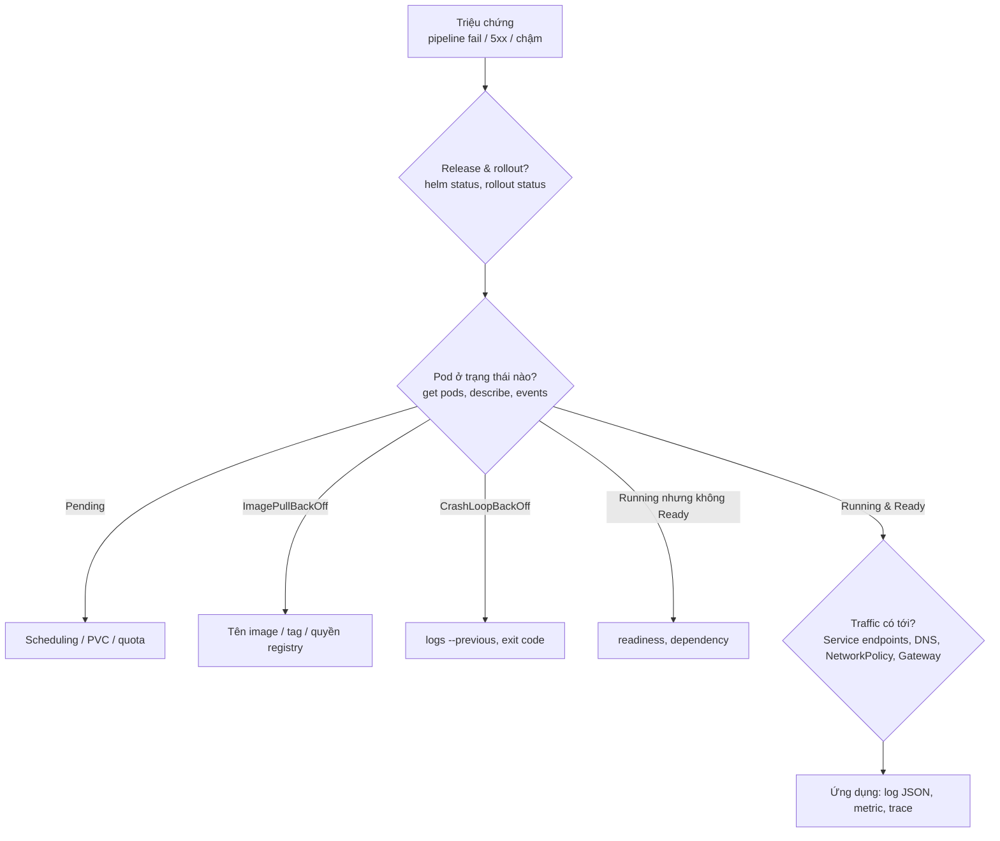

# 6_8 Kubernetes Observability and Troubleshooting

> **Khóa học**: Cloud DevOps Basic — Containers & Kubernetes
> **Phân nhóm**: 6 Domain 6 - Containers and Kubernetes › 6_8 Kubernetes Observability and Troubleshooting
> **Chủ đề**: Quy trình chẩn đoán có hệ thống, danh mục lỗi thường gặp, log tập trung, Prometheus/Grafana/Alertmanager, debug ở mức node
> **Trạng thái**: Định nghĩa (nội dung cần học + đề bài lab + checkpoint), chưa chạy thử, 15-11-2026
> **Lộ trình tổng**: [container/README.md](../../README.md) · **Checkpoint**: [CHECKLIST.md](../../CHECKLIST.md#6_8-kubernetes-observability-and-troubleshooting)

---

## 🎯 Mục Tiêu

Phân tích log và debug sự cố VM là điểm mạnh sẵn có của bạn. Topic này chuyển kỹ năng đó sang Kubernetes: **nhìn triệu chứng → khoanh vùng tầng nào hỏng → chứng minh nguyên nhân → sửa → ngăn tái diễn**, bằng `kubectl` trước, rồi bằng metric và log tập trung.

---

## 📚 Những Gì Cần Học

### 6_8_1 Quy Trình Chẩn Đoán Bằng `kubectl`
- [ ] Bộ lệnh lõi: `get -o wide`, `describe` (đọc phần **Events** và `Last State`), `get events --sort-by=.lastTimestamp`, `logs [-c] [--previous] [-l app=x --prefix]`, `exec`, `port-forward`, `top` (cần metrics-server).
- [ ] Đọc `status.conditions` và `containerStatuses[].lastState.terminated.{reason,exitCode}` bằng `-o yaml` / `jsonpath`.
- [ ] **`kubectl debug`**: ephemeral container cho image distroless (không có shell), `--copy-to` để tạo bản sao Pod, `kubectl debug node/<node> -it --image=...`.
- [ ] Đi từ trên xuống: pipeline → Helm release → Deployment/ReplicaSet → Pod → container → ứng dụng.

### 6_8_2 Danh Mục Lỗi Thường Gặp
- [ ] `Pending`: thiếu CPU/RAM theo requests, nodeSelector/affinity không khớp, taint, PVC chưa bind, vượt ResourceQuota.
- [ ] `ErrImagePull` / `ImagePullBackOff`: sai tên/tag, registry riêng thiếu `imagePullSecrets`, giới hạn pull rate, sai kiến trúc CPU.
- [ ] `CrashLoopBackOff`: app thoát ngay (sai config, thiếu biến), liveness giết app; đọc `logs --previous` và exit code (bảng exit code ở 6_1_8).
- [ ] `OOMKilled` (137), `CreateContainerConfigError` (thiếu ConfigMap/Secret/key), `RunContainerError`, `Evicted` (node thiếu bộ nhớ/ổ đĩa).
- [ ] Running nhưng không Ready → Service không có endpoint → client nhận 503 hoặc connection refused.
- [ ] Service selector sai, `targetPort` sai, DNS sai namespace, NetworkPolicy chặn.
- [ ] Pod kẹt `Terminating` (finalizer, node mất kết nối); namespace kẹt `Terminating`.
- [ ] Lỗi CI/CD: `Forbidden` (RBAC), Helm `another operation is in progress`, `--wait` timeout, rollout `ProgressDeadlineExceeded`.

### 6_8_3 Logging
- [ ] App ghi ra **stdout/stderr**; runtime ghi file dưới `/var/log/pods/` trên node; kubelet xoay vòng file (log cũ biến mất).
- [ ] Log có cấu trúc (JSON một dòng, như `hello-svc`), trường bắt buộc: thời gian, mức độ, service, version, request/trace id.
- [ ] Kiến trúc log tập trung: agent DaemonSet (Fluent Bit / Fluentd / OpenTelemetry Collector) → Elasticsearch/OpenSearch hoặc Loki → giao diện tìm kiếm (Kibana/Grafana).
- [ ] Tìm kiếm nhanh khi chưa có hệ thống tập trung: `kubectl logs -l app=x --prefix --since=10m | jq`.

### 6_8_4 Metric và Prometheus
- [ ] metrics-server (chỉ CPU/RAM hiện tại, cho `kubectl top` và HPA) **khác** Prometheus (lưu chuỗi thời gian, truy vấn, cảnh báo).
- [ ] Mô hình pull: Prometheus scrape endpoint `/metrics`; exporter: node-exporter (node), kube-state-metrics (trạng thái object), cAdvisor trong kubelet (container).
- [ ] Prometheus Operator: CRD `ServiceMonitor`, `PodMonitor`, `PrometheusRule`; Helm chart cộng đồng `kube-prometheus-stack`.
- [ ] PromQL cơ bản: counter vs gauge vs histogram; `rate()`, `increase()`, `sum by (...)`, `histogram_quantile()`.
- [ ] Phương pháp: **RED** (Rate, Errors, Duration) cho service; **USE** (Utilization, Saturation, Errors) cho tài nguyên; 4 golden signals.
- [ ] App Java xuất metric: Micrometer + Prometheus registry (Spring Boot Actuator), khái niệm.

### 6_8_5 Dashboard, Alert và SLO
- [ ] Grafana: data source, dashboard, biến dashboard (namespace, pod).
- [ ] Alertmanager: route, group, inhibit, silence; cảnh báo theo **triệu chứng người dùng thấy** trước, nguyên nhân sau.
- [ ] Alert mẫu: Pod restart nhiều (`kube_pod_container_status_restarts_total`), Deployment thiếu replica, CPU throttling cao, PVC sắp đầy.
- [ ] SLI / SLO / error budget ở mức khái niệm; dùng error budget để quyết định dừng release.

### 6_8_6 Tracing (Khái Niệm)
- [ ] OpenTelemetry: trace, span, context propagation qua HTTP header (`traceparent` của W3C Trace Context) và qua message Kafka.
- [ ] Liên kết log ↔ trace bằng trace id.

### 6_8_7 Quan Sát Khi Deploy
- [ ] So sánh metric bản mới và bản cũ (error rate, latency) sau deploy; annotation deploy trên dashboard.
- [ ] Tự động rollback dựa trên metric (Argo Rollouts / Flagger analysis, khái niệm) và nối với 6_6_8.

### 6_8_8 Debug Ở Mức Node
- [ ] `crictl ps / logs / inspect` trên node; `journalctl -u kubelet`; xem cgroup của Pod trong `/sys/fs/cgroup` (nối 6_1_3).
- [ ] Node `NotReady`: kubelet chết, hết ổ đĩa, `DiskPressure` / `MemoryPressure`.
- [ ] Bộ công cụ Linux ở Domain 3 và 5 (`ss`, `tcpdump`, `strace`) chạy trong ephemeral container hoặc trên node.

---

## 🧪 Labs

> **Bản định nghĩa**: chưa tạo thư mục `labs/`, chưa chạy thử. Lab 6_8_1 là lab quan trọng nhất cho phỏng vấn, nên làm lại cho tới khi chẩn đoán mỗi kịch bản dưới 3 phút.

| Lab | Nội dung | Thời gian | Trạng thái |
| :--- | :--- | :---: | :--- |
| lab-6_8_1-break-and-fix-catalog | 10 kịch bản hỏng, chẩn đoán chỉ bằng `kubectl` | 2–3 giờ | Định nghĩa |
| lab-6_8_2-log-analysis-json | Tìm request lỗi từ log JSON nhiều Pod bằng `jq` | 45 phút | Định nghĩa |
| lab-6_8_3-kube-prometheus-stack | Cài stack bằng Helm, PromQL, dashboard Grafana | 90 phút | Định nghĩa |
| lab-6_8_4-alert-on-restarts | `PrometheusRule` cảnh báo restart, xem trong Alertmanager | 45 phút | Định nghĩa |
| lab-6_8_5-debug-distroless-and-node | `kubectl debug` vào Pod không có shell và vào node | 45 phút | Định nghĩa |

### lab-6_8_1-break-and-fix-catalog
- **Cách làm**: mỗi kịch bản là một manifest/chart hỏng (sau này đặt trong `setup/scenario-XX/`). Người làm chỉ được dùng `kubectl` (và `helm`) để tìm nguyên nhân, ghi vào bảng: *triệu chứng → lệnh đã dùng → bằng chứng → nguyên nhân → cách sửa → cách ngăn tái diễn*.

| # | Kịch bản (người ra đề cài sẵn) | Triệu chứng người làm thấy |
| :---: | :--- | :--- |
| 01 | Tag image không tồn tại | `ImagePullBackOff` |
| 02 | `requests.memory: 64Gi` | `Pending` |
| 03 | `limits.memory: 128Mi`, `ALLOCATE_MB_ON_START=300` | Restart liên tục, `OOMKilled` |
| 04 | Liveness probe sai path | `RESTARTS` tăng, app vẫn khỏe nếu gọi tay |
| 05 | Readiness phụ thuộc biến bị thiếu → luôn 503 | Pod Running 0/1, Service không có endpoint |
| 06 | Service `selector` sai một nhãn | `curl` service: connection refused/timeout |
| 07 | `envFrom` tới ConfigMap không tồn tại | `CreateContainerConfigError` |
| 08 | `ENTRYPOINT` shell form (image naive của lab 6_2_1) + `terminationGracePeriodSeconds: 60` | Rollout chậm, Pod cũ thoát mã 137 |
| 09 | NetworkPolicy default-deny quên mở DNS | `wget` báo lỗi phân giải tên |
| 10 | Helm upgrade bị ngắt giữa chừng | `another operation (install/upgrade/rollback) is in progress` |

- **Checkpoint**:
  - [ ] Chẩn đoán đúng 10/10, mỗi kịch bản ≤ 3 phút, có bằng chứng từ output lệnh.
  - [ ] Viết được 1 trang "cheat sheet" lệnh theo từng triệu chứng.

### lab-6_8_2-log-analysis-json
- **Các bước chính**: 3 replica `hello-svc`; gửi 200 request `/order?id=1..200`; `kubectl logs -l app=hello-svc --prefix --since=10m` kết hợp `jq` để lọc mức `ERROR`, đếm lỗi theo Pod, tìm id gây lỗi và quy luật (chia hết cho 7).
- **Checkpoint**:
  - [ ] Từ log, tự suy ra quy luật lỗi mà không đọc mã nguồn.
  - [ ] Giải thích vì sao log biến mất sau khi Pod bị xóa và cần hệ thống log tập trung.

### lab-6_8_3-kube-prometheus-stack
- **Các bước chính**: `helm upgrade --install` chart `kube-prometheus-stack` (repo `prometheus-community`, cộng đồng) vào namespace `monitoring` với values nhỏ cho kind; port-forward Prometheus và Grafana; viết truy vấn: CPU theo Pod, số restart, CPU throttling (`container_cpu_cfs_throttled_periods_total`), bộ nhớ so với limit; tạo dashboard 4 panel cho `hello-svc`.
- **Checkpoint**:
  - [ ] Dashboard hiển thị đúng khi chạy lại kịch bản 03 (OOM) và tạo tải CPU.
  - [ ] Giải thích được `rate()` vs `increase()` và vì sao không dùng `rate()` trên gauge.

### lab-6_8_4-alert-on-restarts
- **Các bước chính**: viết `PrometheusRule` cảnh báo khi `increase(kube_pod_container_status_restarts_total{namespace="dev"}[10m]) > 3`; tái hiện kịch bản 04; xem alert chuyển `pending` → `firing` trong Prometheus và xuất hiện trong Alertmanager. (Mở rộng: thêm endpoint `/metrics` vào `hello-svc` để cảnh báo theo tỉ lệ lỗi 5xx.)
- **Checkpoint**:
  - [ ] Alert bắn trong khoảng thời gian dự đoán và giải thích được vai trò của `for:`.

### lab-6_8_5-debug-distroless-and-node
- **Các bước chính**: build `hello-svc` trên base image distroless Java (hoặc dùng bất kỳ image không có shell), thử `kubectl exec ... sh` → lỗi; `kubectl debug -it <pod> --image=docker.io/library/busybox:1.36 --target=<container>` rồi xem `/proc/1/`; `kubectl debug node/<node> -it --image=...`, `chroot /host`, `crictl ps`, tìm file cgroup `memory.max` của Pod.
- **Checkpoint**:
  - [ ] Đọc được giá trị `memory.max` trên node khớp với `limits.memory` của Pod.

---

## 📚 Nguồn Tài Liệu Chính Thống (Official References)
- [Troubleshooting Applications](https://kubernetes.io/docs/tasks/debug/debug-application/) - Debug Pod, Service, StatefulSet.
- [Debug Running Pods](https://kubernetes.io/docs/tasks/debug/debug-application/debug-running-pod/) - `kubectl debug`, ephemeral container, debug node.
- [Debug Services](https://kubernetes.io/docs/tasks/debug/debug-application/debug-service/) - Chẩn đoán Service từng bước.
- [Determine the Reason for Pod Failure](https://kubernetes.io/docs/tasks/debug/debug-application/determine-reason-pod-failure/) - Termination message, exit code.
- [Logging Architecture](https://kubernetes.io/docs/concepts/cluster-administration/logging/) - Log trên node, xoay vòng, kiến trúc log tập trung.
- [Resource metrics pipeline](https://kubernetes.io/docs/tasks/debug/debug-cluster/resource-metrics-pipeline/) - metrics-server.
- [Prometheus - Overview](https://prometheus.io/docs/introduction/overview/) và [Querying basics](https://prometheus.io/docs/prometheus/latest/querying/basics/) - Prometheus và PromQL.
- [Alerting rules](https://prometheus.io/docs/prometheus/latest/configuration/alerting_rules/) và [Alertmanager](https://prometheus.io/docs/alerting/latest/alertmanager/) - Cảnh báo.
- [kube-state-metrics](https://github.com/kubernetes/kube-state-metrics) - Metric trạng thái object (repo chính thức của dự án Kubernetes).
- [Grafana documentation](https://grafana.com/docs/grafana/latest/) - Dashboard.
- [OpenTelemetry - Concepts](https://opentelemetry.io/docs/concepts/) và [W3C Trace Context](https://www.w3.org/TR/trace-context/) - Tracing.
- [crictl](https://kubernetes.io/docs/tasks/debug/debug-cluster/crictl/) - Debug node bằng crictl.
