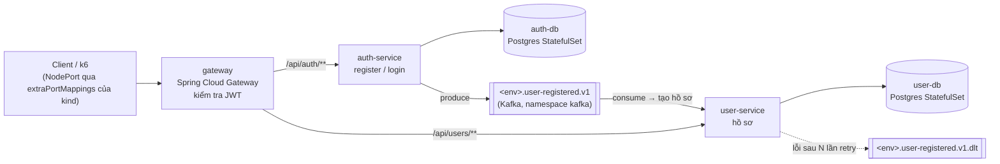
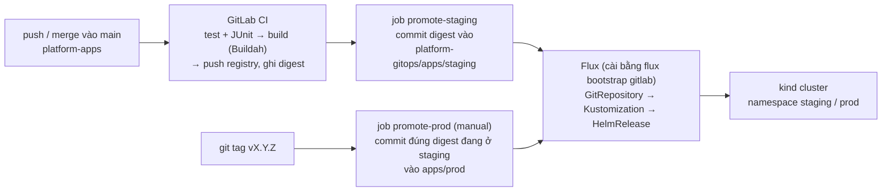
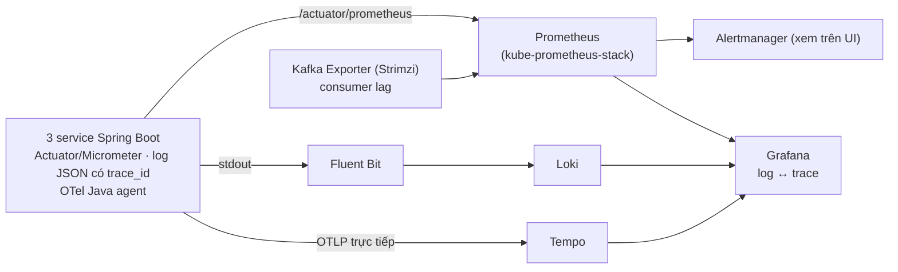

# 6_9 Capstone - End-to-End Release Pipeline

> **Khóa học**: Cloud DevOps Basic — Containers & Kubernetes
> **Phân nhóm**: 6 Domain 6 - Containers and Kubernetes › 6_9 Capstone - End-to-End Release Pipeline
> **Chủ đề**: 3 microservice Java (gateway, auth-service, user-service + PostgreSQL) giao tiếp qua **Kafka**, chạy trên kind ở máy local. `git push` → GitLab CI → image theo digest trong **GitLab Container Registry** → GitOps bằng **Flux** (staging tự động, prod theo tag) → observability đủ 3 trụ (metric, log, trace) → diễn tập sự cố → rollback bằng `git revert`
> **Trạng thái**: Định nghĩa v4 (**bản 24 giờ**), chưa chạy thử, 22-11-2026
> **Lộ trình tổng**: [container/README.md](../../README.md) · **Checkpoint**: [CHECKLIST.md](../../CHECKLIST.md#6_9-capstone---end-to-end-release-pipeline)

---

## 🎯 Mục Tiêu

Trong **24 giờ làm việc**, xây một hệ thống chạy thông từ đầu tới cuối và chứng minh được 4 việc:

1. **Delivery**: commit vào `main` tự lên staging; git tag + một cú bấm đưa **đúng digest đó** lên prod. Không ai `kubectl apply` hay `helm upgrade` tay.
2. **GitOps**: Flux kéo cấu hình từ Git; sửa tay trên cluster bị Flux đưa về; rollback = `git revert`.
3. **Observability**: từ một alert, lần tới log và trace của request lỗi (kể cả đoạn đi qua Kafka) trong ≤ 5 phút.
4. **Giải thích được**: vì sao chọn như vậy, và bản lab khác production ở đâu.

> **Nguyên tắc cắt giảm**: giữ những gì người phỏng vấn sẽ hỏi (CI/CD theo digest, GitOps, Kafka, observability, debug sự cố). Mọi thứ khác (NetworkPolicy, canary, Gateway API, SOPS, HPA/PDB, backup...) chuyển xuống mục ⭐ Mở Rộng để làm sau.

---

## 🍜 Ví Dụ Đời Sống: Chuỗi Nhà Hàng Có Bếp Trung Tâm

| Trong chuỗi nhà hàng | Trong capstone |
| :--- | :--- |
| Bếp trung tâm đóng hộp món ăn, dán **mã lô** không sửa được | GitLab CI build image, deploy theo **digest** `@sha256:` |
| **Kho lạnh** chung mà mọi cửa hàng lấy hàng | **GitLab Container Registry** |
| **Sổ thực đơn chuẩn** ở trụ sở | **Repo `platform-gitops`** |
| **Quản lý cửa hàng** đối chiếu bếp với sổ, ai tự ý đổi bị đưa về như cũ | **Flux** reconcile và sửa drift |
| **Bảng ghi phiếu** giữa quầy và bếp: quầy dán phiếu rồi đi tiếp, bếp tự lấy theo thứ tự | **Kafka** giữa auth-service và user-service |
| Camera, sổ đơn, phiếu theo dõi đơn | Metric, log, trace |

---

## 📦 GitLab Container Registry

Mỗi project GitLab có Container Registry riêng, tương tự GHCR: `registry.gitlab.com/<group>/<project>/<image>`. CI đăng nhập bằng biến có sẵn `CI_REGISTRY`, `CI_REGISTRY_USER`, `CI_REGISTRY_PASSWORD`; cluster kéo image bằng **deploy token `read_registry`** đóng thành `imagePullSecret`. Bật **cleanup policy** để không đầy hạn mức dung lượng của gói Free.

Capstone chỉ lưu **image** trong registry. Chart Helm nằm trong repo Git, Flux đọc trực tiếp (chart dạng OCI trên GitLab chưa có tài liệu chính thức rõ ràng, để ở phần mở rộng).

---

## 🏗️ Kiến Trúc

### 1. Runtime (mỗi namespace `staging` và `prod` có một bộ giống nhau)



**Quy tắc giao tiếp**: client → gateway → service bằng HTTP; **service ↔ service chỉ qua Kafka**. Gateway và auth-service dùng chung khóa ký JWT trong một Secret, nên gateway không cần gọi auth-service.

### 2. Delivery



### 3. Observability



---

## 🧭 Lựa Chọn Đã Chốt

**5 ADR bắt buộc** (mỗi ADR 5–10 dòng trong `docs/adr/`):

| # | Quyết định | Câu phải trả lời |
| :---: | :--- | :--- |
| 01 | **Pull-based GitOps bằng Flux + 2 repo** (`platform-apps`, `platform-gitops`) | Vì sao không để CI chạy `helm upgrade`? Vì sao tách 2 repo (6_6_10)? |
| 02 | **Promotion theo digest**: build một lần, staging và prod dùng cùng digest | Tag khác digest ở đâu (6_2_7)? Rollback làm thế nào? |
| 03 | **Giao tiếp qua Kafka, consumer idempotent + DLT** | Kafka giao "ít nhất một lần" thì làm sao không tạo hồ sơ trùng? Nếu lưu DB xong mà gửi Kafka lỗi thì sao (dual-write; giải pháp outbox để ở mở rộng)? |
| 04 | **Stack observability**: kube-prometheus-stack, Fluent Bit → Loki, OTel Java agent → Tempo | Vì sao `trace_id` không làm nhãn Loki (cardinality)? Vì sao không cần OTel Collector ở bản lab? |
| 05 | **Khác production ở đâu** | 1 cluster + namespace thay cho cluster riêng; Secret tạo bằng script thay vì SOPS/Vault; không NetworkPolicy, không canary; Kafka 1 node |

**Chốt sẵn, không cần ADR**:

| Hạng mục | Lựa chọn |
| :--- | :--- |
| Cluster | `kind`, **1 node**, CNI mặc định, `extraPortMappings` cho NodePort của gateway (staging, prod mỗi môi trường một cổng) |
| Cài Flux | `flux bootstrap gitlab --path=clusters/local`, thêm `--components-extra` nếu cần (đọc nhanh trang [Bootstrap for GitLab](https://fluxcd.io/flux/installation/bootstrap/gitlab/); bài 6_6_10_1 và lab-6_6_7 là không bắt buộc) |
| Chart | **1 chart chung** `spring-service` cho cả 3 service (khác nhau bằng values) + 1 chart `postgres-db`; Flux đọc chart từ `GitRepository` |
| Kafka | Strimzi, **1 cluster KRaft 1 node** trong namespace `kafka`, `KafkaTopic` tiền tố theo môi trường, không xác thực |
| Secret | Tạo bằng `kubectl` trong `bootstrap.sh` (khóa JWT, password DB, pull secret), **không commit vào Git** |
| CI → repo GitOps | Deploy key **có quyền ghi** trên `platform-gitops`, lưu thành biến CI kiểu File, protected (*đối chiếu tài liệu Deploy keys của GitLab*) |
| Runner | Project runner trên máy bạn, build bằng Buildah |

---

## 💻 Môi Trường

**Máy của bạn**: 31 GiB RAM, 16 CPU, ổ `/home` còn trống **25 GB**, kind v0.33.0, kubectl v1.37.2, Helm v3.19.0, Podman.

- Cần cài thêm: `flux` CLI, `k6` (tạo tải), `jq`.
- Helm 3 vẫn dùng được cho bản này (chỉ dùng `helm template`/`lint` để kiểm tra chart; Flux tự chạy Helm trong cluster).
- RAM ước lượng ~8–10 GiB: 6 JVM, 4 Postgres, Kafka 1 node, Prometheus/Grafana/Loki/Tempo, Flux. Đặt retention nhỏ (Prometheus 1 ngày, Loki/Tempo 24 giờ) vì ổ đĩa ít.

---

## 🧩 Đặc Tả Ứng Dụng (Giữ Tối Thiểu)

Java 21, Spring Boot (dòng còn hỗ trợ OSS, kiểm tra [Spring Boot Support](https://spring.io/projects/spring-boot#support)), Spring for Apache Kafka, Flyway, Maven.

| Service | API (qua gateway) | Kafka | DB |
| :--- | :--- | :--- | :--- |
| `gateway` | Route `/api/auth/**`, `/api/users/**`; kiểm tra JWT, chuyển `X-User-Id` | — | — |
| `auth-service` | `POST /api/auth/register` (202), `POST /api/auth/login` (trả JWT) | Produce `user-registered` (key = `userId`) | `credentials` |
| `user-service` | `GET /api/users/me`, `PUT /api/users/me` | Consume `user-registered`, tạo hồ sơ; bỏ qua nếu `userId` đã có; lỗi sau 3 lần → DLT | `profiles` |

**Mỗi service bắt buộc có** (đây là phần observability phụ thuộc vào):
- Actuator: `/actuator/health/liveness`, `/actuator/health/readiness`, `/actuator/prometheus`; bật histogram cho `http.server.requests`.
- Log JSON một dòng (structured logging của Spring Boot) có `trace_id`, `span_id`, `service`, `version` = git SHA. Không log password, token.
- OTel Java agent trong image, cấu hình qua biến `OTEL_SERVICE_NAME`, `OTEL_EXPORTER_OTLP_ENDPOINT` (trỏ thẳng tới Tempo).
- Biến tiêm lỗi, mặc định tắt: `FAULT_ERROR_RATE` (0–1, trả 500), `FAULT_CONSUMER_DELAY_MS` (consumer xử lý chậm).
- Image: multi-stage, non-root, exec form, ghim base image (6_2).
- Chart: probe, requests/limits, `securityContext` non-root (6_3).

---

## 📁 Cấu Trúc Repository

```text
platform-apps/                     # Repo 1: code + CI
├── .gitlab-ci.yml                 # test → build → promote-staging → promote-prod (manual, tag)
├── gateway/  auth-service/  user-service/   (pom.xml, Dockerfile, src/)
└── loadtest/k6.js                 # register → login → GET /me lặp lại

platform-gitops/                   # Repo 2: Flux theo dõi
├── bootstrap/
│   ├── kind-config.yaml
│   └── bootstrap.sh               # kind → namespace + Secret → flux bootstrap gitlab (chạy lại được)
├── clusters/local/
│   ├── flux-system/               # do bootstrap sinh ra, không sửa tay
│   ├── infrastructure.yaml        # Kustomization: strimzi, monitoring, logging, tracing
│   └── apps.yaml                  # Kustomization: apps/staging, apps/prod (dependsOn infrastructure)
├── infrastructure/                # HelmRepository + HelmRelease: strimzi, kube-prometheus-stack, loki, fluent-bit, tempo
│                                  # Kafka CR, KafkaTopic, PodMonitor Kafka, PrometheusRule, dashboard JSON
├── charts/
│   ├── spring-service/            # Deployment, Service, ServiceMonitor, ConfigMap (checksum annotation)
│   └── postgres-db/               # StatefulSet + headless Service + PVC
├── apps/
│   ├── staging/                   # HelmRelease × 5 (3 service + 2 DB); image.digest do CI ghi
│   └── prod/
└── docs/  (adr/, runbook-rollback.md, game-day.md, versions.md)
```

---

## 📦 Phạm Vi Bắt Buộc: Đã Học Gì Thì Dùng Ở Đâu

| Topic | Dùng trong bản 24 giờ | Để ở mở rộng |
| :--- | :--- | :--- |
| 6_1, 6_2 Container & Image | Multi-stage, non-root, exec form, digest, GitLab registry + pull secret; exit code 137 trong game day | Quét lỗ hổng, ký image |
| 6_3 Workloads | Deployment, probe, requests/limits, StatefulSet cho DB | HPA, CronJob backup |
| 6_4 Networking & Storage | Service, DNS khác namespace (gọi Kafka, Tempo), ConfigMap/Secret, PVC | Gateway API |
| 6_5 Helm | Chart chung + values theo môi trường, checksum annotation, `HelmRelease` của Flux, `helm lint/template` | Library chart, hook, chart OCI |
| 6_6 GitLab CI & GitOps | Rules theo nhánh/tag, `needs`, cache Maven, JUnit, Buildah, dotenv digest, job manual trên tag, 2 repo + Flux bootstrap | Agent, environments, parent-child, canary |
| 6_7 Security & Scaling | `securityContext` non-root, Secret ngoài Git | NetworkPolicy, PSA, VAP, PDB, drain |
| 6_8 Observability | Toàn bộ mục 🔭 dưới đây | Collector, blackbox, burn-rate alert, annotation deploy |

---

## 🔭 Observability (Bắt Buộc, Bản Gọn)

| Hạng mục | Yêu cầu |
| :--- | :--- |
| **Metric** | `ServiceMonitor` cho 3 service; Kafka Exporter của Strimzi (consumer lag); dashboard và rule có sẵn của kube-prometheus-stack cho Pod/node |
| **Log** | Fluent Bit → Loki; nhãn Loki chỉ `namespace`, `app`, `level`; `trace_id` nằm trong nội dung log |
| **Trace** | Request `register` cho thấy 1 trace đi gateway → auth-service → JDBC → Kafka produce → Kafka consume ở user-service → JDBC. Tự kiểm tra: span consume nối vào trace dạng cha-con hay span link |
| **Tương quan** | Loki derived field `trace_id` → mở trace trong Tempo |
| **Dashboard** | **1 dashboard tự làm** "Account Platform" (biến `namespace`): RPS, tỉ lệ 5xx, p95 latency theo service, consumer lag, số message vào DLT, panel log lỗi từ Loki. Lưu JSON trong Git |
| **SLO** | 1 SLO: ≥ 99% request qua gateway ở prod không trả 5xx; panel error budget còn lại |
| **Alert** (`PrometheusRule` trong Git) | `HighErrorRate` (5xx > 5% trong 5 phút), `HighLatencyP95`, `KafkaConsumerLagHigh`, `KafkaDLTMessages`; cộng các rule có sẵn như Pod crash looping. Mỗi alert có `summary` và dòng chỉ tới runbook |

**"Đường vàng" debug phải làm được**: alert → dashboard thấy service và thời điểm → panel log lọc `level=ERROR` → bấm `trace_id` → Tempo thấy span lỗi/chậm → nguyên nhân.

---

## 🧪 Kế Hoạch 24 Giờ

> **Walking skeleton**: tới giờ thứ 12 phải có luồng `register` chạy thông trên kind qua Flux, dù chưa đẹp. Sau đó mới thêm observability và prod.

| # | Giai đoạn | Việc | Giờ | Xong khi |
| :---: | :--- | :--- | :---: | :--- |
| 0 | capstone-0-setup | Tạo 2 project GitLab, runner, cài `flux`/`k6`, `versions.md`, kind 1 node | 1 | `kubectl get nodes` Ready; runner online |
| 1 | capstone-1-services | 3 service, Kafka producer/consumer, Flyway, JWT, Actuator, log JSON, OTel agent, Dockerfile; test nhanh bằng `podman compose` (tùy chọn) | 6 | register → hồ sơ xuất hiện → login → `/me` chạy local |
| 2 | capstone-2-platform | `flux bootstrap gitlab`; HelmRelease Strimzi + Kafka + topic, kube-prometheus-stack, Loki + Fluent Bit, Tempo | 4 | `flux get all -A` toàn Ready |
| 3 | capstone-3-gitops-apps | Chart `spring-service`, `postgres-db`; HelmRelease cho staging; Secret và pull secret trong `bootstrap.sh` | 3 | App chạy ở `staging`, gọi được qua NodePort |
| 4 | capstone-4-pipeline | `.gitlab-ci.yml`: test + JUnit, build + push + digest, `promote-staging`, `promote-prod` manual trên tag; thêm `apps/prod` | 4 | Commit tự lên staging; tag + bấm lên prod cùng digest |
| 5 | capstone-5-observability | ServiceMonitor, PodMonitor Kafka, datasource Loki↔Tempo, 1 dashboard, SLO, 4 alert | 3 | Làm được "đường vàng" |
| 6 | capstone-6-game-day | 4 kịch bản dưới đây, ghi bảng | 2 | Bảng MTTD/MTTR đủ 4 dòng |
| 7 | capstone-7-docs | README dự án + sơ đồ, 5 ADR, runbook rollback, tập demo 5 phút | 1 | Demo trơn tru một lần |
| | | **Tổng** | **24** | |

**Nếu bị trễ, cắt theo thứ tự này** (từ trên xuống): bỏ `podman compose` → bỏ DLT → bỏ namespace `staging` (main lên thẳng `prod`, tag chỉ để đánh version) → bỏ SLO panel → dùng dashboard có sẵn thay dashboard tự làm. **Không cắt**: digest, Flux, Kafka, log ↔ trace.

---

## 💥 Game Day: 4 Kịch Bản

Chạy `k6` nền trong lúc diễn tập. Mỗi kịch bản ghi: thời điểm tiêm lỗi → phát hiện (MTTD) → tín hiệu → lệnh chẩn đoán → hành động → khôi phục (MTTR).

| # | Tiêm lỗi | Tín hiệu phải thấy | Phản ứng đúng |
| :---: | :--- | :--- | :--- |
| 1 | Commit vào `apps/prod` đặt `FAULT_ERROR_RATE=0.3` cho user-service | `HighErrorRate`; log lỗi; trace có span lỗi | `git revert`, đo thời gian tới khi Flux áp xong |
| 2 | Đặt `FAULT_CONSUMER_DELAY_MS=2000` | `KafkaConsumerLagHigh`; trace thấy span consume dài; hồ sơ xuất hiện chậm | Revert; giải thích vì sao thêm replica quá số partition không giúp |
| 3 | Hạ `limits.memory` của user-service xuống 256Mi | Alert Pod crash looping; `OOMKilled`, exit code 137 | Tính lại heap/limit (6_3_6) |
| 4 | `kubectl scale` và `kubectl set image` tay ở `prod` | Flux đưa về trạng thái Git (`driftDetection` của HelmRelease) | Giải thích ai được phép sửa tay; khi nào dùng `flux suspend` |

---

## ✅ Tiêu Chí Hoàn Thành

- [ ] Commit vào `main` tự lên staging; tag + bấm job `promote-prod` đưa **đúng digest đó** lên prod (`kubectl get pods -n prod -o jsonpath='{..image}'` khớp digest trong log build).
- [ ] Không có `kubectl apply` / `helm upgrade` tay vào staging/prod; mọi thay đổi có commit trong `platform-gitops`.
- [ ] Xóa cluster, chạy `bootstrap.sh`, mọi thứ trở lại chạy được (đo thời gian).
- [ ] Đăng ký 100 user bằng k6 → đúng 100 hồ sơ, không trùng (kiểm tra bằng SQL).
- [ ] "Đường vàng" debug ≤ 5 phút, có một lần đi xuyên Kafka.
- [ ] Alert phát hiện ≥ 3/4 kịch bản game day; rollback prod bằng `git revert` < 5 phút.
- [ ] Demo 5 phút và trả lời "vì sao" cho 5 ADR, kể được bản lab khác production ở đâu.

---

## ⭐ Mở Rộng (Sau 24 Giờ, Theo Thứ Tự Đáng Làm)

| # | Mở rộng | Liên hệ |
| :---: | :--- | :--- |
| 1 | Transactional outbox cho auth-service (giải quyết dual-write) | 6_8_6, ADR 03 |
| 2 | Secret trong Git bằng SOPS + age, giải mã bởi Flux | 6_6_10_1, 6_4_5 |
| 3 | NetworkPolicy default-deny (cần tắt kindnet, cài Cilium/Calico) + PSA `restricted` | 6_7_2, 6_7_3 |
| 4 | Gateway API + canary bằng Flagger cho gateway | 6_4_4, 6_6_8, 6_8_7 |
| 5 | Kafka 3 node, `min.insync.replicas=2`, diễn tập mất broker; `KafkaUser` + ACL | 6_4_7, 6_7_9 |
| 6 | Push-based deploy cho dev qua GitLab agent + environments; parent-child pipeline | 6_6_2, 6_6_7 |
| 7 | OTel Collector (tail sampling), blackbox probe, burn-rate alert đa cửa sổ, annotation deploy | 6_8_5, 6_8_6, 6_8_7 |
| 8 | HPA, PDB, kind nhiều node + drain dưới tải; CronJob backup DB + restore | 6_3_8, 6_7_7, 6_7_8 |
| 9 | Library chart + chart OCI trên GitLab; Trivy; ValidatingAdmissionPolicy bắt buộc digest | 6_5_7, 6_5_9, 6_7_5 |
| 10 | Bootstrap bằng Terraform provider của Flux; tách cluster prod riêng | 6_6_10_1 |

---

## 🎤 Câu Chuyện Phỏng Vấn (STAR)

- **Situation / Task**: tự học để lấp khoảng trống Kubernetes / GitLab CI / GitOps / Kafka; làm trong 24 giờ trên kind ở máy cá nhân.
- **Action**: 3 quyết định (promotion theo digest + Flux; Kafka với consumer idempotent; log ↔ trace) và một lần debug từ game day theo "đường vàng".
- **Result**: số liệu đo thật: thời gian pipeline, thời gian dựng lại từ 0, MTTD/MTTR 4 kịch bản, thời gian rollback.
- **Nói thẳng giới hạn** (ADR 05) và việc sẽ làm tiếp (mục ⭐): cho thấy bạn biết production cần gì.

---

## 📚 Nguồn Tài Liệu Chính Thống (Official References)
- [GitLab - Container Registry](https://docs.gitlab.com/user/packages/container_registry/) và [Reduce container registry storage](https://docs.gitlab.com/user/packages/container_registry/reduce_container_registry_storage/) - Registry tích hợp, cleanup policy.
- [GitLab - Deploy tokens](https://docs.gitlab.com/user/project/deploy_tokens/) và [Deploy keys](https://docs.gitlab.com/user/project/deploy_keys/) - Pull secret cho cluster, quyền ghi vào repo GitOps.
- [GitLab - CI/CD YAML syntax reference](https://docs.gitlab.com/ci/yaml/) - `rules`, `needs`, `artifacts:reports:dotenv`, `when: manual`.
- [6_6_10 GitOps Concepts](<../6_6 GitLab CI-CD and Release Strategies/6_6_10 GitOps Concepts.md>) - Mô hình 2 repo, `GitRepository`, `Kustomization`, `flux reconcile`.
- [Flux - Bootstrap for GitLab](https://fluxcd.io/flux/installation/bootstrap/gitlab/) - `flux bootstrap gitlab`.
- [Flux - Manage Helm Releases](https://fluxcd.io/docs/guides/helmreleases/) và [Helm Releases API](https://fluxcd.io/docs/components/helm/helmreleases/) - `HelmRelease`, chart từ `GitRepository`, `driftDetection`.
- [Strimzi - Deploying and Managing](https://strimzi.io/docs/operators/latest/deploying) - `Kafka`, `KafkaNodePool`, `KafkaTopic`, Kafka Exporter.
- [Spring for Apache Kafka - Error handling and dead-letter publishing](https://docs.spring.io/spring-kafka/reference/kafka/annotation-error-handling.html) - Retry, DLT.
- [Spring Boot - Kubernetes Probes](https://docs.spring.io/spring-boot/reference/actuator/endpoints.html#actuator.endpoints.kubernetes-probes) và [Structured Logging](https://docs.spring.io/spring-boot/reference/features/logging.html#features.logging.structured) - Probe và log JSON.
- [Spring Cloud Gateway Reference](https://docs.spring.io/spring-cloud-gateway/reference/) - API gateway.
- [Kubernetes - Images](https://kubernetes.io/docs/concepts/containers/images/) và [StatefulSets](https://kubernetes.io/docs/concepts/workloads/controllers/statefulset/) - Digest, pull secret, Postgres.
- [kind - Configuration](https://kind.sigs.k8s.io/docs/user/configuration/) - `extraPortMappings`.
- [kube-prometheus-stack chart](https://github.com/prometheus-community/helm-charts/tree/main/charts/kube-prometheus-stack) và [Prometheus - Alerting rules](https://prometheus.io/docs/prometheus/latest/configuration/alerting_rules/) - Metric, rule, dashboard có sẵn.
- [Grafana Loki](https://grafana.com/docs/loki/latest/), [Grafana Tempo](https://grafana.com/docs/tempo/latest/), [Fluent Bit - Kubernetes](https://docs.fluentbit.io/manual/installation/kubernetes) - Log và trace.
- [OpenTelemetry - Java Agent](https://opentelemetry.io/docs/zero-code/java/agent/) - Trace không sửa code (HTTP, JDBC, Kafka client).
