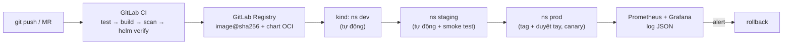

# 6_9 Capstone - End-to-End Release Pipeline

> **Khóa học**: Cloud DevOps Basic — Containers & Kubernetes
> **Phân nhóm**: 6 Domain 6 - Containers and Kubernetes › 6_9 Capstone - End-to-End Release Pipeline
> **Chủ đề**: Ghép 6_1 → 6_8 thành một hệ thống hoàn chỉnh: git push → GitLab CI → image theo digest → Helm chart OCI → dev/staging/prod trên Kubernetes → quan sát → diễn tập sự cố → rollback
> **Trạng thái**: Định nghĩa (đề bài + sản phẩm cần nộp + checkpoint), chưa chạy thử, 15-11-2026
> **Lộ trình tổng**: [container/README.md](../../README.md) · **Checkpoint**: [CHECKLIST.md](../../CHECKLIST.md#6_9-capstone---end-to-end-release-pipeline)

---

## 🎯 Mục Tiêu

Có **một dự án thật để kể trong phỏng vấn** và để đưa vào CV một cách trung thực ("tự xây pipeline GitLab CI + Helm deploy lên Kubernetes cho một service Java, có canary và rollback"). Capstone không dạy kiến thức mới; nó kiểm tra bạn ghép được các mảnh và **giải thích được mọi quyết định**.

---

## 📦 Phạm Vi Bắt Buộc

| Hạng mục | Yêu cầu tối thiểu | Topic liên quan |
| :--- | :--- | :--- |
| Ứng dụng | `hello-svc` (hoặc 2 service gọi nhau qua DNS), endpoint health/ready | 6_3, 6_4 |
| Image | Multi-stage, non-root, exec form, tag = commit SHA, deploy theo **digest** | 6_2 |
| Chart | 1 chart (hoặc library chart + 2 chart), `values-<env>.yaml`, probe, resources, `securityContext` restricted, PDB, HPA tùy chọn, checksum config | 6_5, 6_7 |
| Pipeline | `workflow:rules`, test + JUnit, build/push, scan, `helm lint/template`, deploy dev/staging/prod, `resource_group`, prod chỉ trên tag + manual | 6_6 |
| Kết nối cluster | GitLab agent (hoặc kubeconfig của ServiceAccount quyền hẹp), RBAC theo namespace | 6_6_7, 6_7_1 |
| Release | Rolling cho staging; **canary 10% → 100%** cho prod (Gateway API) | 6_4_4, 6_6_8 |
| Quan sát | Dashboard Grafana 4 panel, 1 alert restart, tìm lỗi bằng log JSON | 6_8 |
| Tài liệu | README dự án, sơ đồ kiến trúc, runbook rollback, bản ghi postmortem | — |

---

## 🧪 Các Giai Đoạn

| Giai đoạn | Nội dung | Thời gian | Trạng thái |
| :--- | :--- | :---: | :--- |
| capstone-1-foundation | Repo, chart, cluster kind 3 namespace, agent, RBAC | 1 ngày | Định nghĩa |
| capstone-2-pipeline | Pipeline đầy đủ từ MR tới prod | 1–2 ngày | Định nghĩa |
| capstone-3-observability | kube-prometheus-stack, dashboard, alert | 0.5 ngày | Định nghĩa |
| capstone-4-game-day | Diễn tập 4 sự cố, rollback, postmortem | 0.5–1 ngày | Định nghĩa |
| capstone-5-story | Viết câu chuyện phỏng vấn (STAR) và cập nhật CV trung thực | 2 giờ | Định nghĩa |

### capstone-4-game-day: Kịch Bản Diễn Tập
Nhờ người khác (hoặc tự viết script ngẫu nhiên) chọn kịch bản, bạn không biết trước:

1. Merge một commit làm `/ready` trả 503 → pipeline phải fail ở dev, prod không bị ảnh hưởng.
2. Bản mới qua được staging nhưng lỗi 5xx tăng khi canary ở prod → abort canary.
3. Ai đó `kubectl edit` tay replica ở prod → phát hiện drift, đưa về trạng thái trong Git.
4. Release Helm ở staging kẹt `pending-upgrade` sau khi hủy job → gỡ kẹt mà không xóa release.

Với mỗi sự cố ghi: thời điểm phát hiện, cách phát hiện (alert / pipeline / log), lệnh chẩn đoán, hành động, thời gian khôi phục, việc cần làm để không tái diễn.

### capstone-5-story: Câu Chuyện Phỏng Vấn
- Situation / Task: vì sao làm (lấp khoảng trống Kubernetes/Helm/GitLab, nói thẳng đây là dự án tự học).
- Action: 3 quyết định thiết kế đáng nói nhất (ví dụ: deploy theo digest, `resource_group`, deployer RBAC tối thiểu) và một lần debug khó.
- Result: số liệu đo được thật (thời gian pipeline trước/sau tối ưu cache, thời gian rollback, kích thước image).
- Liên hệ với kinh nghiệm thật: phân tích log VM fleet ↔ kịch bản break-and-fix; Azure DevOps ↔ GitLab CI.

---

## ✅ Tiêu Chí Hoàn Thành
- [ ] Một commit vào nhánh mặc định tự động tới staging; một git tag + một cú bấm đưa đúng **digest** đó lên prod.
- [ ] `kubectl get pods -n prod -o jsonpath='{..image}'` cho thấy image dạng `@sha256:` khớp digest trong log job build.
- [ ] Deploy hỏng không bao giờ làm prod mất phục vụ (chứng minh bằng vòng lặp `curl` khi diễn tập sự cố 1 và 2).
- [ ] Rollback prod trong < 5 phút theo runbook, do người khác làm theo runbook cũng được.
- [ ] ServiceAccount của pipeline không có quyền ngoài namespace của nó (`kubectl auth can-i --list`).
- [ ] Dashboard và alert phát hiện được ít nhất 2/4 sự cố trước khi bạn tự kiểm tra.
- [ ] Trình bày toàn bộ kiến trúc trong 5 phút và trả lời "vì sao" cho mọi lựa chọn.

---

## 📚 Nguồn Tài Liệu Chính Thống (Official References)
- [GitLab - Using GitLab CI/CD with a Kubernetes cluster](https://docs.gitlab.com/user/clusters/agent/ci_cd_workflow/) - Deploy từ pipeline qua agent.
- [GitLab - Environments](https://docs.gitlab.com/ci/environments/) - Môi trường và lịch sử deploy.
- [Helm - Use OCI-based registries](https://helm.sh/docs/topics/registries/) - Phân phối chart.
- [Kubernetes - Images](https://kubernetes.io/docs/concepts/containers/images/) - Tham chiếu image theo digest.
- [Gateway API - Traffic splitting](https://gateway-api.sigs.k8s.io/guides/traffic-splitting/) - Chia traffic cho canary.
- [Prometheus - Alerting rules](https://prometheus.io/docs/prometheus/latest/configuration/alerting_rules/) - Cảnh báo.
