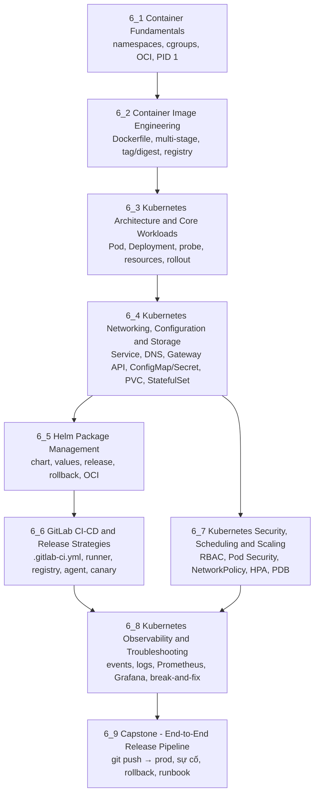

# 🐳 Containers, Kubernetes, Helm & GitLab CI — Lộ Trình Tổng

> **Khóa học**: Cloud DevOps Basic — Domain 6: Containers and Kubernetes
> **Mục đích**: Đi từ "container là process Linux" tới "tự xây pipeline GitLab CI build image → đóng gói Helm chart → deploy lên Kubernetes → quan sát → rollback".
> **Checklist tiến độ**: [CHECKLIST.md](./CHECKLIST.md)
> **Trạng thái**: 6_1, 6_2 có nội dung + lab; 6_3 → 6_9 mới **định nghĩa** (nội dung cần học + đề bài lab + checkpoint), chưa tạo thư mục lab, chưa chạy thử (15-11-2026).

---

## 🎯 Bạn Cần Đạt Gì Sau Lộ Trình Này

Có thể tự tin nói và làm được 4 việc mà một vị trí DevOps / CI/CD cho nền tảng microservices trên Kubernetes yêu cầu:

1. **Docker / container**: viết Dockerfile tốt cho service Java, hiểu container ở tầng kernel để debug (exit code 137, PID 1, quyền file).
2. **Kubernetes**: deploy, expose, cấu hình, scale, bảo mật một service; **chẩn đoán lỗi chỉ bằng `kubectl`** (Pending, CrashLoopBackOff, OOMKilled, ImagePullBackOff, readiness fail).
3. **Helm**: viết chart có values cho nhiều môi trường, `upgrade --install`, `rollback`, đẩy chart lên registry OCI.
4. **GitLab CI**: pipeline build → test → build image → scan → helm lint → deploy dev tự động → prod thủ công, có environment và rollback.

---

## 🗺️ Thứ Tự Học

| Topic | Trọng tâm | Ưu tiên (theo JD) | Thời gian gợi ý | Trạng thái |
| :--- | :--- | :---: | :---: | :--- |
| [6_1 Container Fundamentals](<./6 Domain 6 - Containers and Kubernetes/6_1 Container Fundamentals/README.md>) | Kernel: namespaces, cgroups v2, overlayfs, OCI, PID 1, tín hiệu | P1 | 2–3 ngày | Nội dung có, lab mới định nghĩa |
| [6_2 Container Image Engineering](<./6 Domain 6 - Containers and Kubernetes/6_2 Container Image Engineering/README.md>) | Dockerfile, cache, multi-stage Java, bảo mật image, tag/digest, registry | P0 | 2–3 ngày | Nội dung + 2 lab đã chạy thử |
| [6_3 Kubernetes Architecture and Core Workloads](<./6 Domain 6 - Containers and Kubernetes/6_3 Kubernetes Architecture and Core Workloads/README.md>) | Control plane, kubectl, Pod, Deployment, probe, requests/limits, rollout | **P0** | 4–5 ngày | Định nghĩa |
| [6_4 Kubernetes Networking, Configuration and Storage](<./6 Domain 6 - Containers and Kubernetes/6_4 Kubernetes Networking Configuration and Storage/README.md>) | Service, DNS, Gateway API/Ingress, ConfigMap/Secret, PV/PVC, StatefulSet | **P0** | 4–5 ngày | Định nghĩa |
| [6_5 Helm Package Management](<./6 Domain 6 - Containers and Kubernetes/6_5 Helm Package Management/README.md>) | Chart, template, values nhiều môi trường, release/rollback, OCI | **P0** | 3–4 ngày | Định nghĩa |
| [6_6 GitLab CI-CD and Release Strategies](<./6 Domain 6 - Containers and Kubernetes/6_6 GitLab CI-CD and Release Strategies/README.md>) | `.gitlab-ci.yml`, runner, build image trong CI, environment, agent, canary/blue-green | **P0** | 4–5 ngày | Định nghĩa |
| [6_7 Kubernetes Security, Scheduling and Scaling](<./6 Domain 6 - Containers and Kubernetes/6_7 Kubernetes Security Scheduling and Scaling/README.md>) | RBAC, ServiceAccount, Pod Security, NetworkPolicy, affinity/taint, HPA, PDB, CRD/Operator | P1 | 3–4 ngày | Định nghĩa |
| [6_8 Kubernetes Observability and Troubleshooting](<./6 Domain 6 - Containers and Kubernetes/6_8 Kubernetes Observability and Troubleshooting/README.md>) | Quy trình chẩn đoán, danh mục lỗi, log JSON, Prometheus, Grafana, alert | **P0** | 3–4 ngày | Định nghĩa |
| [6_9 Capstone - End-to-End Release Pipeline](<./6 Domain 6 - Containers and Kubernetes/6_9 Capstone - End-to-End Release Pipeline/README.md>) | Ghép tất cả: git push → prod, diễn tập sự cố, runbook, câu chuyện phỏng vấn | **P0** | 3–5 ngày | Định nghĩa |

> **Lối tắt khi gấp (chuẩn bị phỏng vấn)**: 6_2 → 6_3 → 6_5 → 6_6 → 6_8 (lab break-and-fix) → 6_9 (bản rút gọn). Học 6_4 và 6_7 ở mức "giải thích được" trước, làm lab sau.

---

## 🧰 Môi Trường Lab Chung

| Thành phần | Lựa chọn trong workspace | Ghi chú |
| :--- | :--- | :--- |
| Container engine | Podman 5.x (Fedora 43) hoặc Docker | Lệnh trong lab viết cho `podman`; với Docker đổi tên lệnh |
| Kubernetes cục bộ | `kind` (ưu tiên), có thể dùng `minikube`/`k3d` | Với Podman: `KIND_EXPERIMENTAL_PROVIDER=podman`; chạy rootless cần bật cgroup delegation (xem tài liệu "Rootless" của kind) |
| Phiên bản Kubernetes | Bản mới nhất được hỗ trợ là **1.37** (1.37.1 phát hành 15-09-2026 theo trang Releases) | Node image của kind đi theo từng bản kind, kiểm tra release notes của kind |
| Helm | **Helm 4** | Helm 3 đã ngừng sửa lỗi (bản cuối 09-09-2026), chỉ còn vá bảo mật tới 10-02-2027 theo blog Helm. *Cần đối chiếu trực tiếp trang helm.sh.* |
| GitLab | GitLab.com (free) + **project runner chạy trên máy bạn**, hoặc GitLab CE chạy trong container (tốn RAM) | Deploy vào cluster cục bộ cần runner hoặc GitLab agent nhìn thấy cluster |
| Ứng dụng mẫu | [shared/hello-svc](./shared/hello-svc/) (Java 21, chỉ dùng JDK) | `/health`, `/ready` (503 tới khi hết `STARTUP_DELAY_MS`), `/order?id=N` (500 khi N chia hết cho 7), `ALLOCATE_MB_ON_START` để gây OOM, log JSON |
| Script dùng chung | [build-images.sh](./shared/scripts/build-images.sh), [kind-load.sh](./shared/scripts/kind-load.sh) | Build `selflearn.invalid/hello-svc:1.0.0` và `2.0.0`, nạp vào kind |

---

## 📐 Quy Ước

- **Mã mục**: `6_<topic>_<item>` (ví dụ `6_3_5 Probes`). Checkbox trong README là **kiến thức cần học**; [CHECKLIST.md](./CHECKLIST.md) là **checkpoint chứng minh đã làm được**.
- **Lab**: `labs/lab-6_<topic>_<n>-<slug>/` theo skill [lab-builder](../../.agents/skills/lab-builder/SKILL.md): `README.md`, `setup/`, `solution/`, `scripts/verify.sh`, `scripts/cleanup.sh`.
- Lab đánh dấu **"Định nghĩa"** = mới có đề bài + checkpoint. Output và lệnh trong đề là **ví dụ minh họa**, phải chạy thật mới được đổi trạng thái sang "Đã chạy thử" kèm môi trường và ngày chạy.

---

## 📚 Nguồn Tài Liệu Chính Thống (Official References)
- [Kubernetes Documentation - Concepts](https://kubernetes.io/docs/concepts/) - Toàn bộ khái niệm Kubernetes.
- [Kubernetes Releases](https://kubernetes.io/releases/) - Phiên bản đang được hỗ trợ và ngày hết hạn.
- [kind - Quick Start](https://kind.sigs.k8s.io/docs/user/quick-start/) và [kind - Rootless](https://kind.sigs.k8s.io/docs/user/rootless/) - Chạy cluster cục bộ bằng Docker/Podman.
- [Helm Documentation](https://helm.sh/docs/) và [Helm 4 Overview](https://helm.sh/docs/overview/) - Thay đổi của Helm 4 (`--atomic` → `--rollback-on-failure`, server-side apply).
- [Helm 3 End of Life](https://helm.sh/blog/helm-v3-end-of-life) - Lịch ngừng hỗ trợ Helm 3.
- [GitLab CI/CD](https://docs.gitlab.com/ci/) - Tài liệu chính thức GitLab CI/CD.
- [Docker Docs - Build](https://docs.docker.com/build/) và [Podman documentation](https://docs.podman.io/en/latest/) - Build và chạy container.
