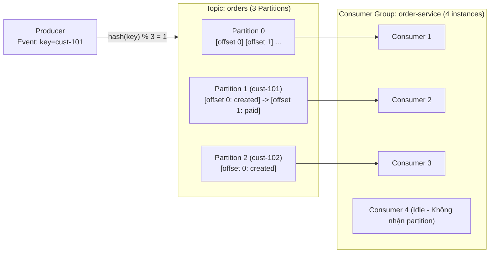

# 7_1_1 Mô Hình Dữ Liệu: Topic, Partition và Offset

- **Khóa học**: Cloud & DevOps Basic — Data Platform
- **Phân nhóm (Domain)**: 7. Apache Kafka
- **Chủ đề (Topic)**: 7.1 Kafka Core Concepts
- **Trạng thái**: Bản nháp (chưa kiểm chứng theo yêu cầu người dùng)
- **Checklist đối chiếu**: Không áp dụng

---

## 1. Khái Niệm Cốt Lõi & Bản Chất Kỹ Thuật

Trong các hệ thống hàng đợi truyền thống, dữ liệu sau khi được người nhận đọc xong thường bị xóa ngay lập tức. Apache Kafka giải quyết bài toán truyền và lưu trữ luồng sự kiện (event streaming) theo cách khác: lưu trữ dữ liệu như một cuốn nhật ký ghi nối thêm bất biến (append-only commit log) cho phép nhiều hệ thống cùng đọc độc lập tại các thời điểm khác nhau. <!-- ev: C1.8 C1.11 --> Nhờ tách biệt việc ghi và đọc theo mô hình nhật ký phân mảnh, Kafka vừa đạt thông lượng cao vừa giữ được tính bền vững của dữ liệu.

### 1.1 Record (Event) — Đơn vị dữ liệu nhỏ nhất

Mỗi thông điệp được gửi vào Kafka được gọi là một **event** (hoặc **record**). Về mặt khái niệm, một record trong Kafka gồm 4 thành phần: `key`, `value`, `timestamp` và các `headers` siêu dữ liệu tùy chọn. <!-- ev: C1.1 -->

- **`value` (Giá trị / Nội dung chính)**: Chứa dữ liệu nghiệp vụ thực tế (ví dụ chuỗi JSON của một đơn hàng). <!-- ev: C1.1 -->
- **`key` (Khóa — tùy chọn)**: Dùng để định danh đối tượng liên quan đến sự kiện (ví dụ `cust-101` cho mã khách hàng) nhằm nhóm các sự kiện liên quan về cùng một partition và giữ đúng thứ tự. <!-- ev: C1.1 C1.2 -->
- **`timestamp` (Dấu thời gian)**: Ghi lại thời điểm phát sinh của sự kiện. <!-- ev: C1.1 -->
- **`headers` (Tiêu đề siêu dữ liệu — tùy chọn)**: Các cặp khóa-giá trị bổ sung (như `trace-id`, phiên bản schema) giúp đính kèm thông tin điều khiển mà không làm thay đổi phần `value`. <!-- ev: C1.1 -->

### 1.2 Topic và Partition — Cách tổ chức và chia nhỏ dữ liệu

Các sự kiện cùng loại được tổ chức và lưu trữ bền vững trong các **topic** — tương tự như thư mục trong hệ thống tệp, còn các sự kiện bên trong là những tệp tin. <!-- ev: C1.3 --> Một topic trong Kafka luôn hỗ trợ đa nguồn ghi và đa nguồn đọc (multi-producer, multi-subscriber): có thể có không, một hoặc nhiều producer ghi vào topic, đồng thời không, một hoặc nhiều subscriber đọc từ topic đó. <!-- ev: C1.4 -->

Khác với hàng đợi truyền thống, sự kiện trong Kafka không bị xóa ngay sau khi có bên đọc xong; thay vào đó, quản trị viên cấu hình thời gian lưu giữ (retention) trên từng topic để quyết định dữ liệu tồn tại bao lâu trước khi bị loại bỏ. <!-- ev: C1.5 -->

Để không bị giới hạn bởi dung lượng và năng lực xử lý của một máy chủ đơn lẻ, Kafka chia mỗi topic thành nhiều **partition** (phân vùng) nằm rải rác trên các Kafka broker khác nhau. <!-- ev: C1.6 --> Khi một sự kiện mới được gửi tới topic, nó thực chất được ghi nối thêm vào cuối của **một** trong các partition thuộc topic đó. <!-- ev: C1.7 --> Mỗi partition là một chuỗi record có thứ tự và bất biến (immutable), luôn được ghi nối thêm vào cuối giống như một nhật ký ghi tuần tự (structured commit log). <!-- ev: C1.8 --> Nhờ chia thành nhiều partition, một topic có thể lưu trữ khối lượng dữ liệu lớn hơn sức chứa của một máy chủ duy nhất, miễn là mỗi partition đơn lẻ nằm vừa trên máy chủ lưu nó. <!-- ev: C1.9 -->

### 1.3 Offset — Số thứ tự cục bộ trong từng Partition

Mỗi record khi được ghi vào một partition sẽ được gán một số nguyên tăng dần tuần tự gọi là **offset**, dùng để định danh duy nhất record đó **bên trong partition ấy**. <!-- ev: C1.10 --> Offset không phải là mã định danh toàn cục (global ID) cho toàn bộ topic: hai partition khác nhau của cùng một topic đều bắt đầu đánh số offset từ `0` một cách độc lập, nên vị trí đầy đủ của một record được xác định theo từng `(topic, partition, offset)`. <!-- ev: C1.10 -->

Kafka lưu giữ toàn bộ record trong khoảng thời gian retention đã cấu hình bất kể dữ liệu đã được đọc hay chưa, còn ứng dụng đọc (consumer) chỉ cần tự theo dõi **offset hiện tại** — tức vị trí của record tiếp theo mà nó sẽ đọc trong từng partition. <!-- ev: C1.11 --> Thông thường consumer tăng offset tuyến tính sau mỗi lần đọc, nhưng vì offset do consumer kiểm soát nên nó có thể quay lại offset cũ hơn để xử lý lại dữ liệu lịch sử khi cần. <!-- ev: C1.12 -->

### 1.4 Đảm bảo thứ tự và đơn vị xử lý song song

Kafka chỉ đảm bảo thứ tự toàn phần (total order) của các record **bên trong một partition đơn lẻ**, hoàn toàn không đảm bảo thứ tự giữa các partition khác nhau trong cùng một topic. <!-- ev: C1.13 --> Bất kỳ consumer nào đọc từ một partition cụ thể đều nhận được các sự kiện theo đúng trình tự mà chúng đã được ghi vào partition đó. <!-- ev: C1.14 -->

Bên cạnh khả năng mở rộng lưu trữ, partition còn đóng vai trò là **đơn vị xử lý song song (unit of parallelism)** trong Kafka. <!-- ev: C1.15 --> Khi nhiều consumer cùng tham gia một **consumer group** để chia việc đọc một topic, tại một thời điểm mỗi partition chỉ được giao cho tối đa một consumer trong nhóm đó xử lý, nên số consumer làm việc hiệu quả không thể vượt quá số partition (consumer dư ra sẽ ở trạng thái nhàn rỗi). <!-- ev: C1.16 -->

### 1.5 Định tuyến theo Key và hệ quả khi đổi số Partition

> *Nâng cao: có thể bỏ qua ở lần đọc đầu nếu bạn chỉ mới làm quen với khái niệm topic và partition.*

Khi producer gửi một record có `key` (khác `null`) và không chỉ định sẵn số partition đích, bộ phân vùng mặc định của Kafka sẽ băm giá trị `key` rồi chia lấy dư cho tổng số partition (`hash(key) % numPartitions`) để chọn partition đích. <!-- ev: C1.17 --> Nhờ công thức tất định này, mọi sự kiện có cùng `key` (ví dụ cùng một mã khách hàng) luôn được ghi vào cùng một partition và do đó giữ được đúng thứ tự thời gian. <!-- ev: C1.2 C1.17 --> Nếu record không có `key`, Kafka sẽ phân phối dữ liệu sang các partition khác nhau để cân bằng tải ghi và đọc. <!-- ev: C1.18 -->

Chính vì công thức băm phụ thuộc vào tổng số partition hiện tại, việc tăng số partition của một topic đang hoạt động (ví dụ từ 3 lên 6) sẽ làm thay đổi kết quả `hash(key) % numPartitions` và khiến các sự kiện mới của cùng một `key` có thể rơi sang partition khác. <!-- ev: C1.19 --> Kafka không tự động di chuyển hay sắp xếp lại các record cũ đã lưu ở các partition trước đó khi bạn tăng số partition, nên thứ tự xử lý giữa sự kiện cũ và sự kiện mới của cùng một `key` có thể bị xáo trộn. <!-- ev: C1.20 --> Ngoài ra, Kafka không hỗ trợ giảm số lượng partition của một topic đã tồn tại. <!-- ev: C1.21 -->

---

## 2. Ví Dụ Đời Sống Thực Tế Dễ Hiểu

Hãy hình dung một **Topic** giống như một **bộ sổ nhật ký đơn hàng** của một cửa hàng lớn. Thay vì dùng một cuốn sổ dày vô tận khiến một người không thể ôm nổi, cửa hàng chia bộ sổ này thành 3 tập riêng biệt gọi là **Partition 0, Partition 1, Partition 2**.

- **Append-only & Offset**: Trên từng tập sổ, mỗi dòng ghi mới chỉ được viết nối tiếp vào trang trống cuối cùng, không bao giờ tẩy xóa hay chen vào giữa. Mỗi dòng được đánh số thứ tự `0, 1, 2...` gọi là **Offset**. Tập 0 có dòng số `0, 1, 2` và Tập 1 cũng có dòng số `0, 1, 2` riêng của nó — muốn tìm chính xác một dòng, bạn phải nói rõ *"Tập mấy, dòng số mấy"*.
- **Key & Thứ tự**: Nếu nhân viên thu ngân quy ước *cùng một mã khách hàng (Key)* thì luôn ghi vào cùng một tập sổ (ví dụ khách `cust-101` luôn vào Tập 1), thì lịch sử *"tạo đơn -> thanh toán -> giao hàng"* của khách hàng đó luôn nằm liền mạch theo đúng trình tự thời gian trong Tập 1. Ngược lại, bạn không thể nhìn giữa Tập 0 và Tập 1 để khẳng định dòng ở Tập 0 xảy ra trước hay sau dòng ở Tập 1 nếu không tự đối chiếu thời gian.
- **Song song (Parallelism)**: Nếu cửa hàng có 3 tập sổ và thuê một nhóm 3 nhân viên kiểm toán (Consumer Group), mỗi người sẽ cầm 1 tập để đọc song song cùng lúc. Nhưng nếu thuê tới 4 người cho 3 tập sổ, người thứ 4 đành ngồi chơi vì không thể xé đôi một tập sổ cho hai người cùng cầm.

---

## 3. Kiến Trúc, Luồng Hoạt Động & Hình Ảnh Trực Quan

Sơ đồ dưới đây minh họa luồng gửi và đọc dữ liệu qua các phân vùng:

<!-- ev: C1.15 C1.16 C1.17 -->


---

## 4. Code Mẫu Trực Quan Hoặc Dòng Lệnh Thực Chiến

Các lệnh dưới đây sử dụng bộ công cụ CLI của **Apache Kafka 3.x** (dùng cờ `--bootstrap-server`) trên một broker cục bộ đang chạy tại `localhost:9092`. <!-- ev: C1.22 --> Chúng ta sẽ theo dõi một ví dụ xuyên suốt với topic `orders` gồm 3 partition.

### Bước 1: Tạo topic và kiểm tra cấu trúc partition

<!-- ev: C1.22 -->
- `kafka-topics.sh --create`: Tạo một topic mới trên cụm Kafka.
  - `--topic orders`: Đặt tên topic là `orders`.
  - `--partitions 3`: Chia topic thành 3 partition (`0`, `1`, `2`).
  - `--replication-factor 1`: Lưu 1 bản sao (chỉ dùng cho môi trường học tập 1 broker cục bộ).
  - `--bootstrap-server localhost:9092`: Địa chỉ kết nối tới Kafka broker.
- `kafka-topics.sh --describe`: Kiểm tra thông tin chi tiết các partition đã tạo.

<!-- ev: C1.22 -->
```bash
# Tạo topic 'orders' với 3 partition
kafka-topics.sh --create \
  --topic orders \
  --partitions 3 \
  --replication-factor 1 \
  --bootstrap-server localhost:9092

# Kiểm tra thông tin phân vùng của topic vừa tạo
kafka-topics.sh --describe \
  --topic orders \
  --bootstrap-server localhost:9092
```

Kết quả quan sát (mỗi partition hiển thị trên một dòng riêng biệt):

```text
Topic: orders	TopicId: ...	PartitionCount: 3	ReplicationFactor: 1	Configs:
	Topic: orders	Partition: 0	Leader: 1	Replicas: 1	Isr: 1
	Topic: orders	Partition: 1	Leader: 1	Replicas: 1	Isr: 1
	Topic: orders	Partition: 2	Leader: 1	Replicas: 1	Isr: 1
```

### Bước 2: Gửi sự kiện có Key vào Topic

<!-- ev: C1.23 -->
- `kafka-console-producer.sh`: Công cụ gửi dòng văn bản từ terminal vào topic.
  - `--property parse.key=true`: Cho phép tách phần `key` và `value` từ mỗi dòng nhập vào.
  - `--property key.separator=:`: Dùng dấu hai chấm `:` để ngăn cách `key` (bên trái) và `value` (bên phải).

<!-- ev: C1.23 -->
```bash
# Gửi 3 sự kiện có key theo định dạng key:value
kafka-console-producer.sh \
  --topic orders \
  --bootstrap-server localhost:9092 \
  --property parse.key=true \
  --property key.separator=: << 'EOF'
cust-101:{"event":"order-created","amount":100}
cust-102:{"event":"order-created","amount":250}
cust-101:{"event":"order-paid","amount":100}
EOF
```

### Bước 3: Đọc sự kiện và quan sát Partition, Offset, Key

<!-- ev: C1.24 -->
- `kafka-console-consumer.sh`: Công cụ đọc dữ liệu từ topic để kiểm chứng phân vùng và offset.
  - `--from-beginning`: Đọc lại từ offset `0` của tất cả partition thay vì chỉ chờ sự kiện mới.
  - `--property print.partition=true`: In số hiệu partition chứa record.
  - `--property print.offset=true`: In giá trị offset của record trong partition đó.
  - `--property print.key=true`: In giá trị `key` đi kèm record.

<!-- ev: C1.24 -->
```bash
kafka-console-consumer.sh \
  --topic orders \
  --from-beginning \
  --bootstrap-server localhost:9092 \
  --property print.partition=true \
  --property print.offset=true \
  --property print.key=true
```

Kết quả minh họa (`cust-101` luôn vào cùng một partition với offset tăng tuần tự `0` rồi `1`, còn `cust-102` ở partition khác cũng bắt đầu từ `Offset:0`): <!-- ev: C1.10 C1.17 -->

```text
Partition:2	Offset:0	cust-102	{"event":"order-created","amount":250}
Partition:1	Offset:0	cust-101	{"event":"order-created","amount":100}
Partition:1	Offset:1	cust-101	{"event":"order-paid","amount":100}
```

---

## 5. Cạm Bẫy Thực Tế & Thực Tiễn Sản Xuất

1. **Tăng số Partition giữa chừng làm gãy thứ tự theo Key**: Khi lưu lượng tăng, việc chạy lệnh tăng partition cho topic đang nhận dữ liệu có `key` (như đơn hàng hay giao dịch) làm thay đổi kết quả hàm băm `hash(key) % numPartitions` trong khi dữ liệu cũ không được chuyển chỗ, khiến sự kiện mới của cùng một `key` có thể rơi sang partition khác và phá vỡ thứ tự với sự kiện cũ. <!-- ev: C1.19 C1.20 --> *Thực hành tốt*: Hãy dự trù số partition đủ rộng ngay từ đầu dựa trên mức song song mục tiêu, hoặc tạo topic mới và chuyển dần lưu lượng nếu bài toán bắt buộc giữ thứ tự theo key tuyệt đối.
2. **Tăng số Consumer vượt quá số Partition gây lãng phí tài nguyên**: Khi ứng dụng xử lý chậm, việc tự động nhân bản (autoscale) thêm instance consumer vượt quá số partition của topic sẽ không tăng thêm thông lượng vì các instance dư ra hoàn toàn không được gán partition nào. <!-- ev: C1.16 --> *Thực hành tốt*: Luôn cấu hình giới hạn tối đa (max replicas) của Consumer Group nhỏ hơn hoặc bằng số partition của topic.
3. **Lệch tải dữ liệu (Hot Partition) do chọn Key phân tán kém**: Nếu đa số sự kiện dùng chung một vài `key` phổ biến (ví dụ dùng mã quốc gia trong khi phần lớn người dùng ở một nước), toàn bộ lưu lượng đó sẽ dồn vào một partition duy nhất trong khi các partition khác gần như trống. <!-- ev: C1.2 C1.17 --> *Thực hành tốt*: Chọn `key` có độ phân giải đủ cao (high cardinality) như `userId` hoặc `orderId` chỉ ở mức cần thiết để giữ thứ tự nghiệp vụ.

---

## 6. Câu Hỏi Củng Cố Kiến Thức

**Câu 1:** Một hệ thống thương mại điện tử gửi hai sự kiện `order-created` (lúc 10:00:01) và `order-paid` (lúc 10:00:02) vào cùng một topic `orders` có 4 partition, nhưng **không gắn `key`** cho record. Consumer Group có thể nhận thấy `order-paid` trước `order-created` không? Vì sao?

<details>
<summary>Đáp án</summary>

Có. Khi không gắn `key`, hai sự kiện có thể được phân phối vào hai partition khác nhau (ví dụ `order-created` vào Partition 0 và `order-paid` vào Partition 2). Kafka chỉ đảm bảo thứ tự bên trong một partition đơn lẻ, không đảm bảo thứ tự giữa các partition khác nhau. Để hai sự kiện này luôn giữ đúng thứ tự, cần gắn cùng một `key` (ví dụ `orderId`).

</details>

**Câu 2:** Topic `payments` có 4 partition. Nhóm phát triển cấu hình Consumer Group `billing-workers` chạy 6 container giống hệt nhau để đọc topic này cho nhanh. Chuyện gì sẽ xảy ra với 6 container đó?

<details>
<summary>Đáp án</summary>

Chỉ có tối đa 4 container nhận được partition để xử lý dữ liệu (mỗi container giữ 1 partition). Hai container còn lại sẽ ở trạng thái nhàn rỗi (idle), không đọc được record nào cho tới khi một trong 4 container kia gặp sự cố hoặc số partition của topic được tăng lên ít nhất là 6.

</details>

**Câu 3:** Topic `user-events` đang có 3 partition và sử dụng `userId` làm `key`. Nếu bạn tăng lên 6 partition ngay trên topic đang chạy, điều gì xảy ra với các sự kiện cũ và mới của cùng một `userId`? Có thể thu gọn lại về 3 partition nếu thấy sai lầm không?

<details>
<summary>Đáp án</summary>

Các sự kiện cũ vẫn nằm nguyên ở partition ban đầu (Kafka không di chuyển dữ liệu cũ), trong khi các sự kiện mới với cùng `userId` có thể được hàm băm chuyển sang partition khác do mẫu số phép chia dư đổi từ 3 thành 6, gây mất thứ tự giữa dữ liệu cũ và mới. Ngoài ra, Kafka không hỗ trợ giảm số partition của topic đã tạo nên bạn không thể thu gọn lại về 3 partition.

</details>

---

## 7. 📚 Nguồn Tài Liệu Chính Thống

- [Apache Kafka Documentation — Main Concepts and Terminology](https://kafka.apache.org/documentation/#intro_concepts_and_terms) — Tài liệu chính thức về event (key, value, timestamp, headers), topic, partition và đảm bảo thứ tự trong partition.
- [Apache Kafka Documentation — Introduction](https://kafka.apache.org/documentation/#introduction) — Tổng quan kiến trúc, mô hình publish/subscribe và khái niệm cơ bản của Apache Kafka.
- [Apache Kafka Documentation — Topics and Logs](https://kafka.apache.org/documentation/#intro_topics) — Chi tiết cấu trúc append-only log của partition, cơ chế offset, consumer position và khả năng song song.
- [Apache Kafka Documentation — Design](https://kafka.apache.org/documentation/#design) — Phân tích thiết kế lưu trữ log, thứ tự trong partition và cơ chế phân chia consumer group.
