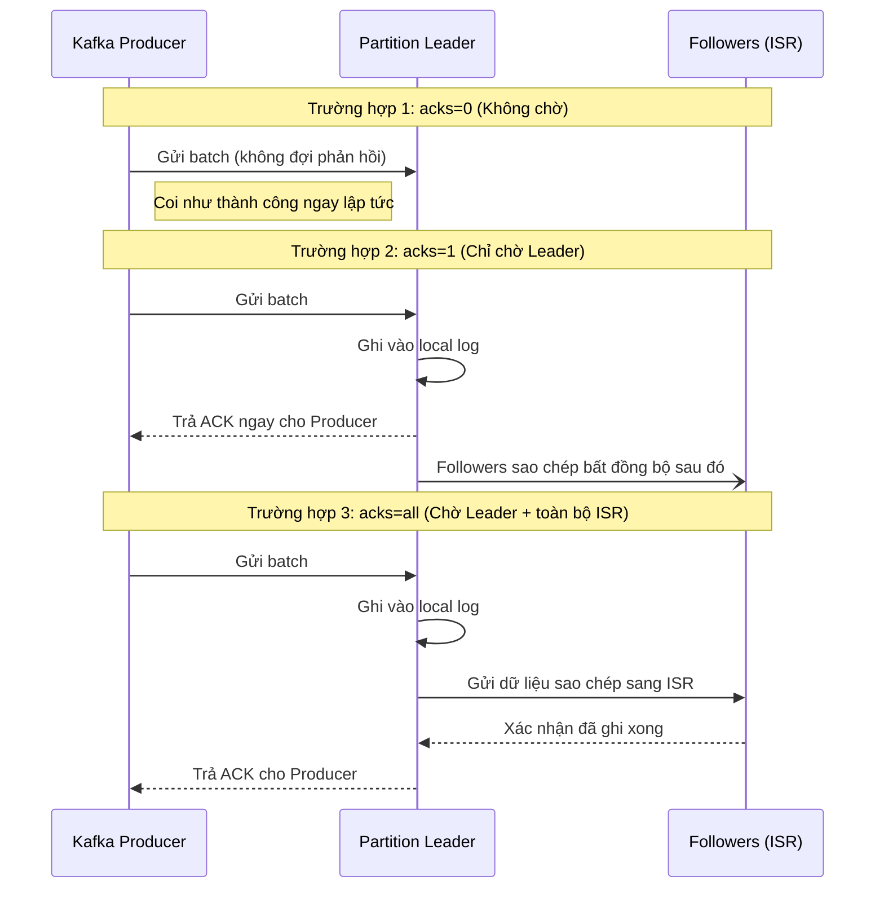

# 7_1_2 Producer

> **Khóa học**: Cloud DevOps Basic — Data Platform
> **Phân nhóm**: 7 Domain 7 - Apache Kafka › 7_1 Kafka Core Concepts
> **Chủ đề**: Producer `acks` (`0`, `1`, `all`), retry, idempotent producer, thứ tự khi retry, batching (`linger.ms`, `batch.size`), compression và so sánh với RabbitMQ publisher confirms
> **Trạng thái**: Bản nháp (chưa kiểm chứng theo yêu cầu người dùng)
> **Lộ trình chủ đề**: [README chủ đề](./README.md) | **Lộ trình tổng**: [data-platform/README.md](../../README.md)

---

## 1. Khái Niệm Cốt Lõi & Bản Chất Kỹ Thuật (Core Concepts & Technical Deep Dive)

Khi ứng dụng muốn đẩy sự kiện vào Apache Kafka, thành phần phía client thực hiện nhiệm vụ này gọi là **Producer**. Sau khi xác định partition đích (như đã học ở bài `7_1_1`), Producer không chỉ gửi dữ liệu qua mạng một cách đơn giản mà phải giải quyết bài toán cân bằng giữa ba yếu tố: **độ bền dữ liệu (durability)**, **độ trễ (latency)** và **thông lượng (throughput)**. Để điều khiển sự đánh đổi này, Kafka Producer dựa vào ba cơ chế trụ cột là xác nhận ghi, thử lại chống trùng lặp và gom lô kết hợp nén dữ liệu.

### 1.1 Cơ chế xác nhận `acks` (`0`, `1`, `all`) và đánh đổi Độ bền vs Độ trễ

Tham số `acks` quy định số lượng xác nhận (acknowledgments) mà partition leader phải nhận được trước khi coi một yêu cầu gửi từ Producer là hoàn tất <!-- ev: C2.1 -->.

- **`acks=0` (Không chờ xác nhận)** <!-- ev: C2.2 -->:
  - Producer không chờ bất kỳ phản hồi nào từ broker mà coi bản ghi đã gửi thành công ngay sau khi đưa vào socket buffer của client <!-- ev: C2.2 -->.
  - Cách này cho độ trễ thấp nhất và thông lượng cao nhất, nhưng hoàn toàn không bảo đảm độ bền dữ liệu nếu broker bị lỗi hoặc mất kết nối trước khi ghi được bản ghi xuống log <!-- ev: C2.3 -->.
  - *Khi nào dùng*: Phù hợp với dữ liệu log hoặc telemetry chấp nhận mất mát nhỏ để đổi lấy tốc độ tối đa.
- **`acks=1` (Chỉ chờ Leader ghi xong)** <!-- ev: C2.4 -->:
  - Partition leader ghi bản ghi vào local log của chính nó rồi trả về xác nhận thành công ngay cho Producer mà không chờ các follower sao chép xong <!-- ev: C2.4 -->.
  - Mức này cân bằng giữa độ trễ và an toàn, nhưng dữ liệu vẫn có thể bị mất nếu leader sập ngay sau khi trả xác nhận mà các follower trong cụm chưa kịp sao chép bản ghi đó <!-- ev: C2.5 -->.
- **`acks=all` (hoặc `acks=-1` — Chờ toàn bộ ISR)** <!-- ev: C2.6 -->:
  - Leader phải chờ toàn bộ tập in-sync replicas (ISR) xác nhận đã nhận bản ghi trước khi phản hồi thành công về cho Producer <!-- ev: C2.6 -->.
  - `acks=all` mang lại mức bảo đảm độ bền dữ liệu cao nhất trong các giá trị `acks`, đổi lại độ trễ mỗi yêu cầu cao hơn vì phải đợi quá trình đồng bộ sang các follower <!-- ev: C2.7 -->. *(Lưu ý: Độ bền thực tế trong production còn phụ thuộc vào tham số `min.insync.replicas` ở cấp topic/broker, sẽ được phân tích kỹ ở bài `7_1_4`.)*
- **Mặc định theo phiên bản**: Từ Apache Kafka 3.0 trở đi, giá trị mặc định của `acks` là `all` (thay cho mặc định `1` ở các phiên bản cũ hơn) <!-- ev: C2.8 -->.

| Giá trị `acks` | Ai phải xác nhận? | Độ trễ (Latency) | Độ bền dữ liệu (Durability) | Trường hợp sử dụng điển hình |
| :--- | :--- | :--- | :--- | :--- |
| `0` | Không ai (gửi xong là coi như hoàn tất) | Thấp nhất | Không bảo đảm (dễ mất tin) | Metrics, clickstream chấp nhận mất mát |
| `1` | Chỉ Partition Leader | Trung bình | Trung bình (mất nếu Leader chết trước khi replicate) | Log ứng dụng thông thường |
| `all` (`-1`) | Leader + toàn bộ ISR | Cao nhất | Cao nhất (an toàn khi Leader chết) | Giao dịch tài chính, đơn hàng, thanh toán |

### 1.2 Retry, Idempotent Producer (`enable.idempotence`) và Thứ tự khi Retry

Trong hệ thống phân tán, mạng có thể chập chờn hoặc leader đang trong quá trình chuyển giao khiến yêu cầu gửi bị lỗi tạm thời. Tham số `retries` cho phép Producer tự động gửi lại các batch bị lỗi tạm thời (transient errors) thay vì báo lỗi ngay cho ứng dụng <!-- ev: C2.9 -->.

Tuy nhiên, việc bật gửi lại một cách đơn thuần kéo theo hai vấn đề nghiêm trọng:
1. **Trùng lặp dữ liệu (Duplicates)**: Broker thực chất đã ghi bản ghi thành công nhưng gói tin xác nhận bị rớt trên đường truyền về client; khi Producer gửi lại, broker sẽ ghi thêm một bản sao nữa <!-- ev: C2.10 -->.
2. **Đảo lộn thứ tự (Out-of-order)**: Nếu Producer gửi nhiều batch nối tiếp nhau (pipelining), batch 1 gặp lỗi và phải gửi lại sau khi batch 2 đã ghi thành công, khiến thứ tự trong partition bị đảo ngược thành `batch 2 -> batch 1` <!-- ev: C2.10 -->.

Để giải quyết triệt để hai vấn đề này, Kafka cung cấp **Idempotent Producer**:
- Khi bật `enable.idempotence=true`, Producer được cấp một Producer ID (PID) và gắn số thứ tự (sequence number) tăng dần cho mỗi batch trên từng partition, giúp broker nhận biết và loại bỏ bản sao trùng lặp nếu nhận lại cùng một sequence number <!-- ev: C2.11 -->.
- Từ Apache Kafka 3.0 trở đi, `enable.idempotence` mặc định là `true` (yêu cầu đi kèm là `acks=all`, `retries > 0`, và `max.in.flight.requests.per.connection <= 5`) <!-- ev: C2.12 -->.
- Khi bật idempotence và giữ `max.in.flight.requests.per.connection` không vượt quá `5`, Kafka vẫn bảo toàn thứ tự bản ghi trong một partition ngay cả khi có nhiều request đang bay song song và xảy ra retry <!-- ev: C2.13 -->.

### 1.3 Batching (`linger.ms`, `batch.size`) và Nén dữ liệu (Compression)

Thay vì gửi từng bản ghi riêng lẻ qua mạng, Kafka Producer gom các bản ghi cùng đích partition thành các batch trong bộ nhớ đệm của client để giảm số lần gọi mạng và tối ưu I/O <!-- ev: C2.14 -->. Cơ chế này được điều khiển bởi hai tham số chính:

- **`batch.size`**: Quy định kích thước tối đa (tính bằng byte) cho một batch trên mỗi partition; khi lượng dữ liệu gom được đạt ngưỡng này, batch sẵn sàng được gửi đi ngay <!-- ev: C2.15 -->.
- **`linger.ms`**: Quy định khoảng thời gian tối đa (tính bằng mili-giây) mà Producer chủ động chờ để gom thêm bản ghi vào cùng một batch trước khi gửi đi, ngay cả khi batch chưa đầy <!-- ev: C2.16 -->.
- **Đánh đổi Throughput vs Latency**: Tăng `linger.ms` và `batch.size` giúp gom được nhiều bản ghi hơn trong mỗi lần truyền, qua đó tăng thông lượng tổng thể và giảm tải cho broker, nhưng đổi lại làm tăng độ trễ của từng bản ghi riêng lẻ so với khi đặt `linger.ms=0` (gửi ngay lập tức khi luồng gửi rảnh) <!-- ev: C2.17 -->.

Kết hợp với batching là cơ chế **nén dữ liệu**:
- Tham số `compression.type` cho phép Producer nén toàn bộ payload của một batch (hỗ trợ các thuật toán `none`, `gzip`, `snappy`, `lz4`, `zstd`) nhằm giảm băng thông mạng và dung lượng lưu trữ trên đĩa của broker <!-- ev: C2.18 -->.
- Khi batch càng lớn (nhờ `batch.size` và `linger.ms`), thuật toán nén càng phát huy hiệu quả cao hơn vì nén trên nhiều bản ghi cùng lúc loại bỏ được nhiều phần dư thừa lặp lại, chỉ đánh đổi một lượng nhỏ CPU ở phía Producer và Consumer <!-- ev: C2.18 -->.

### 1.4 Liên hệ với RabbitMQ: Publisher Confirms vs Kafka `acks`

Nếu bạn từng làm việc với RabbitMQ, khái niệm tương đương gần nhất với `acks` của Kafka ở phía gửi tin là **Publisher Confirms** <!-- ev: C2.20 -->.

- Trong RabbitMQ, cơ chế **Publisher Confirms** cho phép broker gửi xác nhận bất đồng bộ (`basic.ack` hoặc `basic.nack`) về cho publisher trên kênh (channel) sau khi message đã được xử lý an toàn (ghi xuống đĩa hoặc đồng bộ trên queue) <!-- ev: C2.19 -->.
- **Điểm giống nhau**: Cả Kafka `acks` và RabbitMQ Publisher Confirms đều sinh ra để giải quyết bài toán chống mất tin âm thầm giữa client và broker, đối lập với chế độ gửi không chờ phản hồi (`acks=0` ở Kafka hay `basic.publish` không bật confirm mode ở RabbitMQ) <!-- ev: C2.20 -->.
- **Điểm khác nhau**: Kafka `acks` vận hành trên mô hình gom batch ghi nối thêm vào partition và gắn trực tiếp với cơ chế sao chép ISR (`0`, `1`, `all`), trong khi RabbitMQ Publisher Confirms xác nhận theo từng message trên channel đi qua exchange để định tuyến vào queue <!-- ev: C2.21 -->.

---

## 2. Ví Dụ Đời Sống Thực Tế Dễ Hiểu (Intuitive Real-World Analogies)

Hãy tưởng tượng bạn đang gửi các lá thư bảo đảm qua **bưu điện**:

1. **`acks` giống như cách bạn lấy biên nhận tại quầy**:
   - **`acks=0`**: Bạn đi ngang qua thùng thư ngoài phố, thả phong bì vào khe rồi quay lưng đi thẳng. Nhanh nhất, không phải chờ ai, nhưng lỡ thùng thư bị kẹt hay mất trộm thì bạn cũng không hề hay biết.
   - **`acks=1`**: Bạn vào quầy đưa tận tay nhân viên bưu cục và đợi họ đóng dấu "Đã nhận" vào tay bạn rồi về. Chắc chắn bưu cục đã cầm thư, nhưng nếu đêm đó quầy giao dịch gặp hỏa hoạn trước khi kịp sao chép thông tin vào kho dự phòng thì lá thư vẫn mất.
   - **`acks=all`**: Bạn đứng đợi nhân viên quầy ghi vào sổ chính, gọi sang các kho phụ (ISR) để họ chép xong vào sổ dự phòng, rồi mới cầm biên lai đi về. Chờ lâu nhất nhưng an tâm tuyệt đối.

2. **`batch.size`, `linger.ms` và `compression` giống như xe tải gom kiện hàng**:
   - Thay vì mỗi lá thư thuê riêng một chuyến xe máy chạy ra sân bay (tốn công và nghẽn đường), bưu cục đặt một chiếc thùng hàng có sức chứa tối đa là **`batch.size`**.
   - Tài xế được dặn chờ thêm tối đa **`linger.ms`** phút xem có thư nào gửi cùng tuyến nữa không. Nếu thùng đầy trước khi hết giờ thì xe chạy luôn; nếu chưa đầy nhưng đã hết giờ chờ thì xe vẫn xuất bến để thư không bị trễ quá lâu.
   - **`compression`** giống như việc dùng túi hút chân không ép chặt cả thùng thư lại cho gọn trước khi chất lên xe, giúp một chuyến xe chở được nhiều hàng hơn.

3. **`enable.idempotence` giống như đóng dấu mã số thứ tự lên từng lá thư**:
   - Bạn đánh dấu mã người gửi (PID) và số thứ tự `1, 2, 3` lên góc phong bì. Nếu đường truyền trục trặc khiến bạn lỡ gửi lại lá thư số `2` lần thứ hai, nhân viên kho chỉ cần kiểm tra sổ: thấy đã có thư số `2` của bạn rồi thì bỏ qua bản trùng, bảo đảm sổ sách không bị ghi đúp và thứ tự `1 -> 2 -> 3` không bị xáo trộn.

---

## 3. Kiến Trúc, Luồng Hoạt Động & Hình Ảnh Trực Quan (Architecture, Diagrams & Visual Media)

### 3.1 Đường ống xử lý bên trong Kafka Producer

Sơ đồ dưới đây minh họa hành trình của một bản ghi từ lúc ứng dụng gọi hàm gửi cho tới khi được gom lô, nén và đẩy qua mạng tới Partition Leader:


### 3.2 So sánh luồng xác nhận `acks=0`, `acks=1` và `acks=all`



---

## 4. Code Mẫu Trực Quan Hoặc Dòng Lệnh Thực Chiến (Runnable Sample Code / CLI)

Dưới đây là ví dụ cấu hình thực tế cho Producer ưu tiên **an toàn dữ liệu kết hợp thông lượng tốt**.

### 4.1 Tạo file cấu hình `producer.properties`

<!-- ev: C2.6 C2.11 C2.15 C2.16 C2.18 -->
```properties
# Đảm bảo độ bền tối đa: chờ toàn bộ ISR xác nhận
acks=all

# Chống trùng lặp và giữ thứ tự khi retry
enable.idempotence=true

# Gom lô tối đa 32 KB hoặc chờ tối đa 10 ms trước khi gửi
batch.size=32768
linger.ms=10

# Nén toàn bộ batch bằng thuật toán lz4 để tiết kiệm băng thông
compression.type=lz4
```

### 4.2 Luồng Input → Command → Output với `kafka-console-producer.sh`

Giả sử bạn đã có cụm Kafka đang chạy và đã tạo sẵn topic đích để thử nghiệm.

**Bước 1 — Chạy lệnh Producer đọc cấu hình vừa tạo:**

```bash
kafka-console-producer.sh \
  --bootstrap-server localhost:9092 \
  --topic orders \
  --producer.config producer.properties
```

**Bước 2 — Input (nhập dữ liệu sự kiện vào terminal đang mở):**

```text
{"orderId":"ORD-101","amount":250000}
{"orderId":"ORD-102","amount":490000}
```

**Bước 3 — Quan sát hành vi & Output:**
- Khi bạn gõ hai dòng JSON liên tiếp trong khoảng 10 ms (`linger.ms=10`), Producer giữ chúng lại trong `RecordAccumulator` để gom chung vào một batch, nén bằng `lz4` rồi gửi qua mạng tới Partition Leader <!-- ev: C2.14 C2.16 C2.18 -->.
- Nếu kết nối thành công và toàn bộ ISR xác nhận (`acks=all`), con trỏ dòng lệnh `>` sẵn sàng nhận bản ghi tiếp theo mà không báo lỗi <!-- ev: C2.6 -->. Nhấn `Ctrl + C` để thoát.

---

## 5. Cạm Bẫy Thực Tế & Thực Tiễn Sản Xuất (Production Gotchas & Best Practices)

1. **Tưởng `acks=1` là đủ an toàn cho dữ liệu quan trọng**: Nhiều đội ngũ chọn `acks=1` để giảm vài mili-giây độ trễ, nhưng nếu leader bị lỗi phần cứng ngay sau khi trả ACK mà follower chưa kịp đồng bộ, bản ghi đó mất vĩnh viễn dù ứng dụng đã nhận báo thành công <!-- ev: C2.5 -->. Với dữ liệu không được phép mất (đơn hàng, thanh toán), luôn giữ `acks=all` <!-- ev: C2.7 -->.
2. **Tắt idempotence khi vẫn bật retry và gửi song song nhiều request**: Nếu đặt `enable.idempotence=false` trong khi vẫn cho phép `retries > 0` và gửi nhiều request đồng thời, mạng chập chờn có thể gây trùng lặp dữ liệu hoặc đảo lộn thứ tự bản ghi khi retry <!-- ev: C2.10 -->. Hãy giữ nguyên mặc định `enable.idempotence=true` (từ Kafka 3.0+) và không nâng `max.in.flight.requests.per.connection` vượt quá `5` <!-- ev: C2.12 C2.13 -->.
3. **Đặt `linger.ms` quá cao cho hệ thống nhạy độ trễ**: Tăng `linger.ms` giúp cải thiện thông lượng khi tải cao, nhưng ở những luồng ít tin nhắn hoặc yêu cầu phản hồi tức thì, mỗi bản ghi sẽ bị giữ lại chờ hết thời gian `linger.ms` rồi mới được gửi đi <!-- ev: C2.16 C2.17 -->.
4. **Hiểu nhầm `acks=all` khi topic chỉ có 1 replica**: `acks=all` chỉ chờ các replica đang nằm trong tập ISR <!-- ev: C2.6 -->. Nếu topic chỉ có 1 replica duy nhất (không có follower dự phòng), `acks=all` không thể tự bảo vệ bạn khi broker duy nhất đó sập — vì vậy ở môi trường production phải kết hợp `acks=all` với cấu hình replication và `min.insync.replicas` (học ở bài `7_1_4`).
5. **Nâng cao (có thể bỏ qua ở lần đọc đầu) — Kiểm soát tổng thời gian chờ bằng `delivery.timeout.ms`**: Tham số `delivery.timeout.ms` là giới hạn thời gian tối đa tính từ lúc hàm `send()` trả về cho tới khi Producer báo kết quả thành công hoặc thất bại, bao gồm cả thời gian chờ gom lô (`linger.ms`) lẫn thời gian thực hiện các lần `retries` <!-- ev: C2.22 -->. Nếu tăng `linger.ms` rất lớn hoặc mạng chậm kéo dài, hãy kiểm tra để bảo đảm `delivery.timeout.ms` đủ lớn cho tổng thời gian chờ và thử lại.

---

## 6. Câu Hỏi Củng Cố Kiến Thức (Active Recall Quiz)

**Câu hỏi 1**: Hệ thống xử lý thanh toán của bạn không được phép mất giao dịch và không được ghi đúp hóa đơn khi mạng chập chờn. Bạn cần cấu hình `acks` và `enable.idempotence` như thế nào? Vì sao `acks=1` không đáp ứng được yêu cầu này?

<details>
<summary>Đáp án</summary>

- Cấu hình `acks=all` và `enable.idempotence=true` (cùng `max.in.flight.requests.per.connection <= 5`).
- `acks=all` bảo đảm leader chỉ xác nhận thành công sau khi các replica trong ISR đều đã nhận bản ghi, tránh mất tin nếu leader sập đột ngột (điều mà `acks=1` vẫn có thể gặp phải).
- `enable.idempotence=true` giúp broker nhận biết và loại bỏ bản sao trùng lặp bằng PID và sequence number khi Producer thực hiện retry do rớt gói tin xác nhận.

</details>

**Câu hỏi 2**: Một service thu thập log có lưu lượng rất lớn đang gặp tình trạng nghẽn CPU/network do gửi quá nhiều request nhỏ lẻ. Bạn có thể tinh chỉnh các tham số batching và nén nào ở Producer, và cái giá phải trả là gì?

<details>
<summary>Đáp án</summary>

- Có thể tăng `batch.size` (ví dụ lên 32 KB hoặc 64 KB), đặt `linger.ms > 0` (ví dụ 5–20 ms) để Producer chủ động chờ gom nhiều bản ghi vào cùng một batch, đồng thời bật `compression.type` (như `lz4` hoặc `zstd`).
- Đánh đổi: độ trễ của từng bản ghi riêng lẻ sẽ tăng thêm một chút (tối đa theo `linger.ms`) và tốn thêm một phần nhỏ CPU để nén/giải nén, đổi lại giảm mạnh số lượng request mạng và băng thông truyền tải.

</details>

**Câu hỏi 3**: Một đồng nghiệp quen dùng RabbitMQ hỏi: *"Bên RabbitMQ tôi bật Publisher Confirms là xong, vậy bên Kafka cấu hình tương ứng là gì và cơ chế bên dưới khác nhau ra sao?"* Bạn sẽ trả lời ngắn gọn như thế nào?

<details>
<summary>Đáp án</summary>

- Tương ứng phía Kafka Producer là tham số `acks` (đặc biệt là `acks=all` để bảo đảm an toàn cao nhất).
- Điểm giống: cả hai đều giúp client nhận xác nhận từ broker thay vì gửi "mù" dễ mất dữ liệu.
- Điểm khác: RabbitMQ Publisher Confirms xác nhận bất đồng bộ theo từng message trên channel qua exchange vào queue; còn Kafka `acks` hoạt động theo mô hình gom batch bản ghi vào partition và mức độ xác nhận (`0`, `1`, `all`) gắn trực tiếp với leader và tập ISR của partition đó.

</details>

---

## 7. 📚 Nguồn Tài Liệu Chính Thống (Tier-1 Official References)

- [Apache Kafka Documentation - Producer Configs](https://kafka.apache.org/documentation/#producerconfigs) - Tài liệu chính thức về cấu hình Producer (`acks`, `enable.idempotence`, `retries`, `linger.ms`, `batch.size`, `compression.type`, `max.in.flight.requests.per.connection`, `delivery.timeout.ms`).
- [Apache Kafka Documentation - Design](https://kafka.apache.org/documentation/#design) - Tài liệu kiến trúc chính thức của Apache Kafka về cơ chế batching, compression và replication guarantees.
- [RabbitMQ Documentation - Publisher Confirms](https://www.rabbitmq.com/docs/confirms) - Tài liệu chính thức về cơ chế Publisher Confirms của RabbitMQ.
