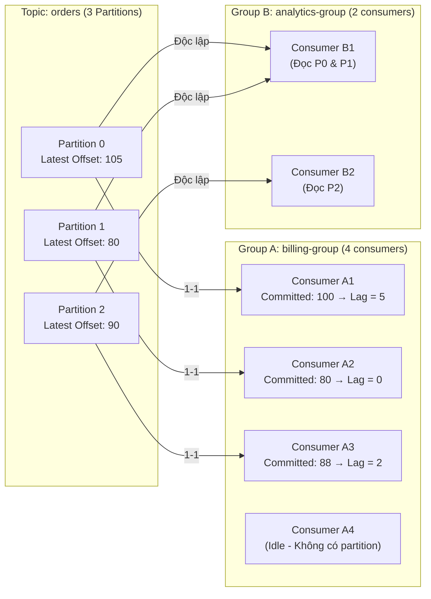
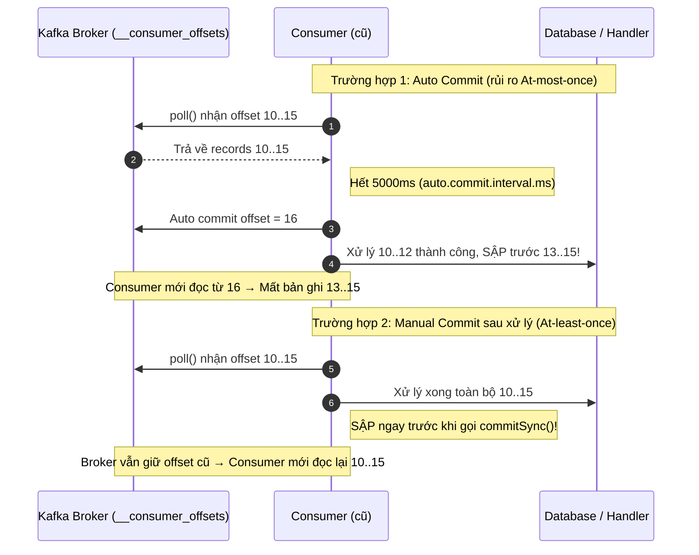

# 7_1_3 Consumer và Consumer Group

> **Khóa học**: Cloud DevOps Basic — Data Platform
> **Phân nhóm**: 7 Domain 7 - Apache Kafka › [7_1 Kafka Core Concepts](./README.md)
> **Chủ đề**: Consumer Group (`group.id`), phân chia Partition, Commit Offset (Auto/Manual), Rebalance, `auto.offset.reset`, Consumer Lag
> **Trạng thái**: Bản nháp (chưa kiểm chứng theo yêu cầu người dùng)
> **Checklist đối chiếu**: Chưa áp dụng (`CHECKLIST_FILE: none`; theo dõi mục 7_1_3 tại [7_1 README](./README.md))

---

## 1. Khái Niệm Cốt Lõi & Bản Chất Kỹ Thuật (Core Concepts & Technical Deep Dive)

Producer đẩy dữ liệu vào các partition của một topic, và Kafka không xóa tin nhắn ngay khi có người đọc. Điều này đặt ra hai bài toán: làm sao nhiều ứng dụng khác nhau cùng đọc trọn vẹn dữ liệu mà không giẫm chân nhau, và làm sao một ứng dụng chạy nhiều bản sao để chia tải xử lý song song? Apache Kafka giải quyết cả hai bài toán này bằng mô hình **Consumer** và **Consumer Group**.

Xuyên suốt bài học, ta lấy ví dụ một topic lưu sự kiện đơn hàng được chia thành nhiều partition để các ứng dụng xử lý.

### 1.1 Consumer và Consumer Group (`group.id`)

- **Consumer** là ứng dụng client kết nối tới Kafka broker để kéo (pull) bản ghi từ topic về xử lý.
- **Consumer Group** là nhóm logic gồm một hoặc nhiều consumer instance cùng chia sẻ công việc đọc dữ liệu, được định danh bằng cấu hình `group.id`. <!-- ev: C3.1 -->
- Mỗi bản ghi gửi vào topic sẽ được phân phối tới **đúng một consumer instance bên trong mỗi consumer group** đang đăng ký đọc topic đó. <!-- ev: C3.1 -->
- Nhiều consumer group có `group.id` khác nhau đọc cùng một topic một cách hoàn toàn độc lập: mỗi group đều nhận đủ toàn bộ bản ghi và tự theo dõi vị trí đọc (offset) riêng. <!-- ev: C3.4 -->

### 1.2 Quy Tắc Phân Chia Partition Trong Cùng Một Group

Bên trong cùng một `group.id`, Kafka áp dụng quy tắc phân chia nghiêm ngặt để giữ thứ tự theo partition: <!-- ev: C3.2 -->

- **Tối đa 1 consumer cho mỗi partition**: Tại một thời điểm, mỗi partition chỉ được gán cho **duy nhất một consumer** trong cùng một consumer group (một consumer có thể đọc nhiều partition, nhưng hai consumer cùng nhóm không bao giờ đọc chung một partition). <!-- ev: C3.2 -->
- **Giới hạn mở rộng theo số partition**: Nếu số consumer trong cùng group **vượt quá** số partition của topic (ví dụ 4 consumer đọc topic có 3 partition), các consumer dư thừa sẽ ở trạng thái **nhàn rỗi (idle)** và không nhận được bản ghi nào. <!-- ev: C3.3 -->

### 1.3 Offset Commit: Tự Động vs Thủ Công & Ngữ Nghĩa Giao Hàng

**Offset commit** là hành động consumer xác nhận đã xử lý tới vị trí offset nào trên từng partition để khi khởi động lại, group biết đọc tiếp từ đâu. Kafka lưu các offset đã commit này vào topic nội bộ `__consumer_offsets`. <!-- ev: C3.5 -->

Thời điểm commit offset quyết định trực tiếp đến **ngữ nghĩa giao hàng (delivery semantics)**:

1. **Tự động commit (`enable.auto.commit=true`)**: <!-- ev: C3.6 -->
   - Cấu hình `enable.auto.commit` mặc định là `true`, cho phép consumer tự động commit offset mới nhất nhận từ `poll()` ở chế độ nền. <!-- ev: C3.6 -->
   - Chu kỳ tự động commit do `auto.commit.interval.ms` quy định, với giá trị mặc định là `5000` ms (5 giây). <!-- ev: C3.7 -->
   - **Hệ quả At-most-once (Tối đa một lần)**: Nếu đồng hồ tự động commit offset `15` trong khi ứng dụng mới xử lý tới `12` rồi bị sập, consumer thay thế sẽ đọc tiếp từ `16` và bỏ sót `13..15` — tương tự việc cố tình commit *trước* khi xử lý xong. <!-- ev: C3.8 -->

2. **Commit thủ công (`enable.auto.commit=false`)**: <!-- ev: C3.9 -->
   - Bạn tắt tự động commit bằng `enable.auto.commit=false` và chủ động gọi commit *sau khi* logic nghiệp vụ đã thành công. <!-- ev: C3.9 -->
   - **Hệ quả At-least-once (Ít nhất một lần)**: Nếu consumer đã xử lý xong bản ghi nhưng sập ngay trước khi kịp commit offset, consumer thay thế sẽ đọc và xử lý lại từ offset đã commit gần nhất (không mất tin, nhưng cần xử lý idempotent để chịu trùng lặp). <!-- ev: C3.9 -->
   - `commitSync()` thực hiện commit đồng bộ (chặn luồng chờ broker xác nhận và tự thử lại lỗi tạm thời), còn `commitAsync()` gửi commit bất đồng bộ để không chặn luồng xử lý chính. <!-- ev: C3.10 -->

### 1.4 Rebalance: Nguyên Nhân Và Tác Động

**Rebalance** là quá trình Kafka phân công lại quyền sở hữu các partition cho các consumer trong cùng một `group.id`, xảy ra khi: <!-- ev: C3.11 -->

1. Một consumer mới tham gia hoặc chủ động rời khỏi group. <!-- ev: C3.11 -->
2. Một consumer bị coi là mất kết nối vì không gửi heartbeat kịp trong khoảng `session.timeout.ms`, hoặc xử lý lô tin quá lâu khiến lần gọi `poll()` tiếp theo vượt quá `max.poll.interval.ms`. <!-- ev: C3.11 -->

- **Vì sao rebalance liên tục làm consumer "đứng hình"?**: Trong quá trình rebalance (đặc biệt với giao thức eager rebalance truyền thống), các consumer phải tạm dừng đọc dữ liệu trên các partition bị thu hồi cho đến khi việc chia lại hoàn tất; nếu consumer liên tục bị timeout rồi kết nối lại, vòng lặp rebalance sẽ làm group chững lại không xử lý được dữ liệu. <!-- ev: C3.12 -->

### 1.5 `auto.offset.reset` (`earliest` / `latest`)

Khi một consumer group chưa từng có offset nào được commit trong `__consumer_offsets` hoặc offset cũ không còn tồn tại trên server (ví dụ do dữ liệu bị xóa theo retention), `auto.offset.reset` quyết định điểm bắt đầu đọc: <!-- ev: C3.13 -->

- `latest` (**mặc định**): Consumer nhảy tới cuối partition và chỉ đọc các bản ghi mới xuất hiện sau khi khởi động. <!-- ev: C3.14 -->
- `earliest`: Consumer đọc lại từ offset sớm nhất hiện còn lưu trong partition. <!-- ev: C3.14 -->
- `none`: Consumer ném ra ngoại lệ (exception) nếu không tìm thấy offset trước đó của group. <!-- ev: C3.15 -->

### 1.6 Consumer Lag

**Consumer lag** đo lường độ trễ tiêu thụ dữ liệu của group trên từng partition:

$$\text{Consumer Lag} = \text{Latest Partition Offset} - \text{Group Committed Offset}$$
<!-- ev: C3.16 -->

- **Latest Partition Offset** là offset mới nhất đã ghi vào partition, còn **Group Committed Offset** là offset cuối cùng group đã commit. <!-- ev: C3.16 -->
- Lag tăng dần báo hiệu tốc độ produce nhanh hơn tốc độ xử lý của consumer group; nếu độ trễ vượt quá thời gian `retention` của topic, các bản ghi chưa kịp đọc có thể bị xóa mất. <!-- ev: C3.17 -->

---

## 2. Ví Dụ Đời Sống Thực Tế Dễ Hiểu (Intuitive Real-World Analogies)

Hãy tưởng tượng một siêu thị có **3 quầy tính tiền** (tương ứng với **3 partition**), trên mỗi quầy có một băng chuyền chứa các giỏ hàng xếp hàng theo thứ tự.

- **Consumer Group là một đội nhân viên thu ngân**:
  - Đội thu ngân ca sáng cử **3 nhân viên** ra đứng 3 quầy: mỗi quầy chỉ có đúng **1 người** trực để không hai người cùng quét một giỏ hàng. Nếu điều thêm **người thứ 4** vào ca sáng mà chỉ có 3 quầy, người thứ 4 đành đứng chờ (consumer nhàn rỗi).
  - Trong khi đó, một đội kiểm kê chất lượng độc lập có thể quan sát hóa đơn của cả 3 quầy mà không ảnh hưởng tới đội thu ngân.
- **Rebalance là lúc đổi ca**: Khi có người nghỉ giữa giờ hoặc người mới vào ca, cả đội phải tạm dừng quét mã vài giây để quản lý chia lại quầy. Nếu nhân viên cứ liên tục ra vào, cả siêu thị sẽ tê liệt vì chia lại quầy mãi mà không tính tiền được.
- **Commit Offset & `auto.offset.reset`**: Đặt tờ giấy đánh dấu trên băng chuyền là commit offset: nếu tự động gạch sổ mỗi 5 phút bất kể đã thu tiền xong chưa, lỡ mất điện giữa chừng thì người sau tưởng đã tính rồi (mất đơn). Chỉ gạch sau khi bỏ tiền vào két thì an toàn hơn nhưng có thể kiểm tra lại giỏ hàng vừa thu nếu mất điện sát nút. Khi đội mới tinh chưa có sổ, bắt đầu từ đầu băng chuyền là `earliest`, chỉ tính khách mới đến từ lúc mở ca là `latest`.

---

## 3. Kiến Trúc, Luồng Hoạt Động & Hình Ảnh Trực Quan (Architecture, Diagrams & Visual Media)

Sơ đồ dưới đây minh họa cách hai consumer group đọc cùng một topic, kèm trường hợp consumer dư thừa và công thức Consumer Lag: <!-- ev: C3.2 C3.3 C3.4 C3.16 -->


<!-- ev: C3.2 C3.3 C3.4 C3.16 -->

Luồng thời gian dưới đây so sánh hậu quả khi consumer sập giữa Auto Commit và Manual Commit sau xử lý: <!-- ev: C3.8 C3.9 -->


<!-- ev: C3.5 C3.7 C3.8 C3.9 C3.10 -->

---

## 4. Code Mẫu Trực Quan Hoặc Dòng Lệnh Thực Chiến (Runnable Sample Code / CLI)

### 4.1 Thử Nghiệm Consumer Group Bằng Kafka CLI

Với cụm Kafka cục bộ đã khởi chạy sẵn topic `orders`, bạn dùng script đi kèm Apache Kafka để kiểm chứng cách chia partition và đọc độc lập theo group: <!-- ev: C3.18 -->

- **Bước 1 — Chạy 2 terminal thuộc cùng nhóm `billing-group`**: <!-- ev: C3.18 -->
<!-- ev: C3.18 -->
```bash
# Chạy lệnh giống nhau ở Terminal 1 và Terminal 2
kafka-console-consumer.sh \
  --bootstrap-server localhost:9092 \
  --topic orders \
  --group billing-group \
  --from-beginning
```

- **Đầu vào → Lệnh → Đầu ra**: Khi có 6 tin nhắn vào 3 partition của `orders`, mỗi terminal chỉ in tin từ tập partition được gán cho nó (không trùng nhau), nhờ quy tắc 1-1 trong cùng `group.id` và cờ `--from-beginning` (`auto.offset.reset=earliest`). <!-- ev: C3.2 C3.14 C3.18 -->

- **Bước 2 — Chạy Terminal 3 thuộc nhóm khác (`analytics-group`)**: <!-- ev: C3.18 -->
<!-- ev: C3.18 -->
```bash
kafka-console-consumer.sh \
  --bootstrap-server localhost:9092 \
  --topic orders \
  --group analytics-group \
  --from-beginning
```

- **Đầu ra quan sát**: Terminal 3 nhận lại **đầy đủ 6 tin nhắn** độc lập với tiến độ của `billing-group`. <!-- ev: C3.4 C3.18 -->

### 4.2 Cấu Hình Manual Commit (At-Least-Once) Trong Java Client

Đoạn mã dùng thư viện `org.apache.kafka:kafka-clients` (Java 17+ / Kafka 3.x+) minh họa tắt auto-commit và gọi `commitSync()` sau khi xử lý xong từng lô bản ghi: <!-- ev: C3.19 -->

<!-- ev: C3.19 -->
```java
Properties props = new Properties();
props.put(ConsumerConfig.BOOTSTRAP_SERVERS_CONFIG, "localhost:9092");
props.put(ConsumerConfig.GROUP_ID_CONFIG, "billing-group");
props.put(ConsumerConfig.KEY_DESERIALIZER_CLASS_CONFIG, StringDeserializer.class.getName());
props.put(ConsumerConfig.VALUE_DESERIALIZER_CLASS_CONFIG, StringDeserializer.class.getName());
props.put(ConsumerConfig.ENABLE_AUTO_COMMIT_CONFIG, "false"); // Manual commit -> at-least-once
props.put(ConsumerConfig.AUTO_OFFSET_RESET_CONFIG, "earliest");

try (KafkaConsumer<String, String> consumer = new KafkaConsumer<>(props)) {
    consumer.subscribe(List.of("orders"));
    while (true) {
        ConsumerRecords<String, String> records = consumer.poll(Duration.ofMillis(500));
        for (ConsumerRecord<String, String> record : records) {
            System.out.printf("partition=%d offset=%d value=%s%n",
                    record.partition(), record.offset(), record.value());
        }
        if (!records.isEmpty()) {
            consumer.commitSync(); // Commit sau khi xử lý xong
        }
    }
}
```

---

## 5. Cạm Bẫy Thực Tế & Thực Tiễn Sản Xuất (Production Gotchas & Best Practices)

1. **Cạm bẫy "bão rebalance" do xử lý lô tin quá `max.poll.interval.ms`**: <!-- ev: C3.11 -->
   - Nếu consumer xử lý một lô bản ghi quá lâu vượt ngưỡng `max.poll.interval.ms` trước lần `poll()` kế tiếp, broker sẽ loại consumer khỏi group và kích hoạt rebalance sang consumer khác — gây ra vòng lặp rebalance liên tục làm nghẽn toàn group. <!-- ev: C3.11 C3.12 -->
2. **Quên đổi `auto.offset.reset` cho service mới cần đọc dữ liệu cũ**: <!-- ev: C3.14 -->
   - Vì giá trị mặc định là `latest`, một `group.id` mới tạo sẽ bỏ qua toàn bộ bản ghi đã gửi trước thời điểm nó kết nối nếu không đặt `auto.offset.reset=earliest`. <!-- ev: C3.14 -->
3. **Nhầm `enable.auto.commit=false` là tự động đạt exactly-once**: <!-- ev: C3.9 -->
   - Commit thủ công sau xử lý chỉ đảm bảo *at-least-once*; nếu consumer sập ngay trước lúc commit, bản ghi sẽ được đọc lại, nên logic ghi vào Database/API phải thiết kế **idempotent**. <!-- ev: C3.9 -->

---

## 6. Câu Hỏi Củng Cố Kiến Thức (Active Recall Quiz)

**Câu 1**: Topic `orders` có 4 partition. Nhóm `payment-group` có 6 consumer instance, còn nhóm `audit-group` có 2 consumer instance. Có bao nhiêu consumer nhận được dữ liệu ở mỗi nhóm, và tổng số bản ghi nhóm `audit-group` nhận được là bao nhiêu phần trăm?

<details>
<summary>Đáp án</summary>

- Ở `payment-group`: Chỉ có **4 consumer** được gán mỗi người 1 partition; **2 consumer còn lại ở trạng thái idle** không đọc dữ liệu. <!-- ev: C3.2 C3.3 -->
- Ở `audit-group`: Cả **2 consumer** đều hoạt động (mỗi consumer đọc 2 partition) và nhóm này nhận **100% dữ liệu** của topic hoàn toàn độc lập với `payment-group`. <!-- ev: C3.2 C3.4 -->

</details>

**Câu 2**: Bạn đang cấu hình `enable.auto.commit=true` (`auto.commit.interval.ms=5000`). Tại giây thứ 5, Kafka tự động commit offset `200`, nhưng ở giây thứ 6 consumer sập khi mới xử lý tới offset `195`. Điều gì xảy ra với các bản ghi từ `196` đến `200`, và đây là ngữ nghĩa giao hàng nào?

<details>
<summary>Đáp án</summary>

- Khi consumer thay thế khởi động hoặc nhận lại partition sau rebalance, nó đọc từ offset đã commit (`200`), khiến các bản ghi `196..200` bị **bỏ sót (mất dữ liệu)**. Đây chính là ngữ nghĩa **at-most-once**. <!-- ev: C3.7 C3.8 -->

</details>

**Câu 3**: Một partition `P0` có offset mới nhất (Log End Offset) là `15.400`, trong khi consumer group `shipping-group` đang có committed offset là `15.000`. Consumer lag hiện tại là bao nhiêu? Nếu consumer group này tạm dừng hoạt động lâu hơn thời gian `retention` của topic, rủi ro gì sẽ xảy ra?

<details>
<summary>Đáp án</summary>

- $\text{Consumer Lag} = 15.400 - 15.000 = 400$ bản ghi. <!-- ev: C3.16 -->
- Nếu consumer dừng lâu hơn thời gian `retention`, các bản ghi cũ chưa kịp đọc có thể bị broker xóa mất trước khi consumer kịp đọc lại; khi chạy lại, tùy thuộc vào `auto.offset.reset` (`earliest`/`latest`), consumer sẽ nhảy tới offset còn tồn tại hoặc bỏ qua dữ liệu cũ. <!-- ev: C3.13 C3.17 -->

</details>

---

## 7. 📚 Nguồn Tài Liệu Chính Thống (Tier-1 Official References)

- [Apache Kafka Documentation — Design: The Consumer](https://kafka.apache.org/documentation/#theconsumer) - Mô tả chính thức về consumer group, phân chia partition trong cùng một nhóm và nhiều nhóm đọc độc lập.
- [Apache Kafka Documentation — Consumer Configs](https://kafka.apache.org/documentation/#consumerconfigs) - Danh mục tham số cấu hình chính thức: `group.id`, `enable.auto.commit`, `auto.commit.interval.ms`, `auto.offset.reset`, `session.timeout.ms`, `max.poll.interval.ms`, `max.poll.records`.
- [Apache Kafka Documentation — Design: Implementation & Offset Tracking](https://kafka.apache.org/documentation/#impl_offsettracking) - Cơ chế lưu trữ offset đã commit vào topic nội bộ `__consumer_offsets`.
- [Apache Kafka Documentation — Design: Message Delivery Semantics](https://kafka.apache.org/documentation/#semantics) - Phân tích chính thức về at-most-once, at-least-once và mối liên hệ với thời điểm commit offset.
