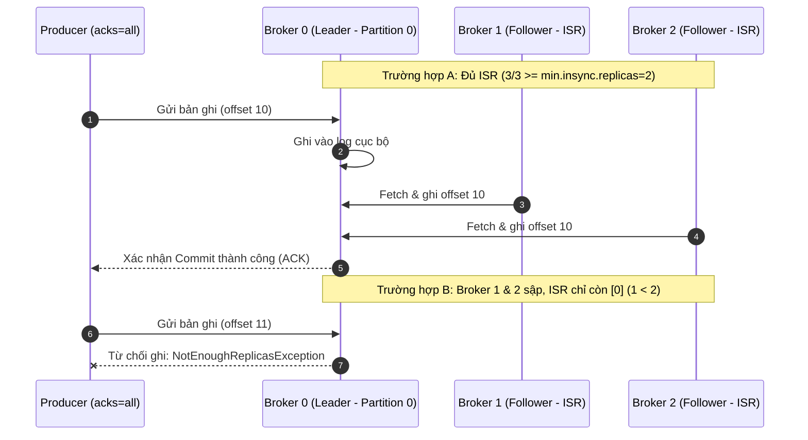
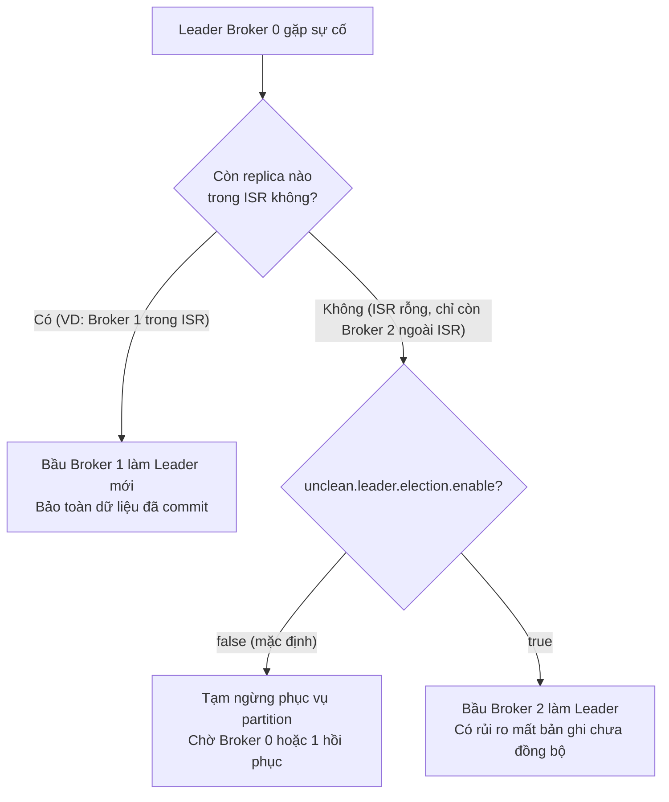

# 7_1_4 Broker, Replication, Leader và ISR

> **Khóa học**: Cloud DevOps Basic — Data Platform
> **Phân nhóm**: 7 Domain 7 - Apache Kafka › 7_1 Kafka Core Concepts
> **Chủ đề**: 7_1_4 Broker, Replication, Leader và ISR
> **Trạng thái**: Bản nháp (chưa kiểm chứng theo yêu cầu người dùng)
> **Checklist đối chiếu**: [7_1 Kafka Core Concepts](./README.md)

---

## 1. Khái Niệm Cốt Lõi & Bản Chất Kỹ Thuật (Core Concepts & Technical Deep Dive)

Nếu toàn bộ dữ liệu của một topic chỉ nằm trên một máy chủ (broker) duy nhất, hệ thống sẽ mất dữ liệu hoặc ngừng hoạt động ngay khi ổ cứng hay máy chủ đó gặp sự cố. Để chạy an toàn trong môi trường thực tế, Apache Kafka sao chép dữ liệu của từng partition sang nhiều broker khác nhau. Cơ chế này hoạt động dựa trên ba khái niệm cốt lõi: **Leader**, **Follower**, và tập **ISR (In-Sync Replicas)**.

### 1.1 Broker, Replication Factor, Leader và Follower

- **Broker** là một máy chủ (hoặc container/node) chạy tiến trình Kafka, chịu trách nhiệm lưu trữ các partition trên đĩa và phục vụ yêu cầu đọc/ghi từ client.
- **Replication factor (`replication.factor`)**: là số lượng bản sao (replica) của mỗi partition được tạo ra và phân bổ trên các broker khác nhau trong cluster. <!-- ev: C4.1 --> Với hệ số sao chép là `N`, Kafka có thể chịu được tối đa `N - 1` broker chứa bản sao bị lỗi mà vẫn không làm mất các bản ghi đã được xác nhận (committed). <!-- ev: C4.5 -->
- **Leader và Follower**: trong số các bản sao của một partition, Kafka chỉ định đúng một bản sao làm **leader** và các bản sao còn lại làm **follower**. <!-- ev: C4.2 -->
- **Luồng giao tiếp**: toàn bộ thao tác ghi từ producer và thao tác đọc mặc định từ consumer đều đi qua broker giữ vai trò **leader** của partition đó. <!-- ev: C4.3 --> Các **follower** không trực tiếp nhận ghi từ producer, mà sao chép dữ liệu một cách thụ động bằng cách gửi yêu cầu fetch định kỳ tới leader để giữ bản log giống hệt leader. <!-- ev: C4.4 -->

> **Ghi chú thuật ngữ**:
> - *Committed record* (bản ghi đã cam kết): là bản ghi đã được tất cả các replica đang đồng bộ ghi xuống log của mình, đảm bảo không bị mất khi đổi leader.
> - *Nâng cao (có thể bỏ qua ở lần đọc đầu)*: Từ các phiên bản Kafka 2.4 trở lên, hệ thống có hỗ trợ tùy chọn cho consumer đọc từ follower gần nhất về mặt vị trí mạng (rack-aware follower fetching), nhưng hành vi mặc định vẫn là đọc trực tiếp từ leader.

### 1.2 ISR (In-Sync Replicas) và Ngưỡng Tụt Hậu

**ISR (In-Sync Replicas)** là danh sách các replica (bao gồm leader và những follower đang theo kịp dữ liệu) hiện đang đồng bộ với leader của partition. <!-- ev: C4.6 -->

Nếu một follower bị nghẽn mạng, quá tải đĩa hoặc sập, nó sẽ không gửi yêu cầu fetch hoặc không theo kịp offset mới nhất của leader. Thời gian tối đa cho phép một follower tụt lại trước khi bị leader loại khỏi tập ISR được điều khiển bởi tham số `replica.lag.time.max.ms`. <!-- ev: C4.7 --> Khi follower đó phục hồi và bắt kịp log của leader trở lại, nó sẽ tự động được đưa vào lại tập ISR.

Một bản ghi chỉ được Kafka coi là **committed** sau khi tất cả các replica đang có mặt trong tập ISR đã ghi nhận bản ghi đó vào log của chúng. <!-- ev: C4.8 --> Consumer chỉ được phép đọc những bản ghi đã ở trạng thái committed để tránh trường hợp đọc nhầm dữ liệu chưa đồng bộ rồi dữ liệu đó biến mất khi leader sập. <!-- ev: C4.9 -->

### 1.3 Sự Kết Hợp Giữa `acks=all` và `min.insync.replicas`

Ở bài trước về Producer, bạn đã biết cấu hình `acks` quyết định mức độ xác nhận khi gửi tin. Khi producer đặt `acks=all` (tương đương `acks=-1`), leader sẽ đợi cho đến khi toàn bộ tập ISR hiện tại xác nhận đã ghi bản ghi thì mới báo thành công về cho producer. <!-- ev: C4.10 -->

Tuy nhiên, `acks=all` có một điểm mù nguy hiểm nếu dùng một mình: nếu tất cả follower đều sập, tập ISR lúc này thu hẹp lại chỉ còn 1 thành viên là chính leader. Khi đó, leader chỉ cần tự ghi cho chính mình là đã thỏa mãn "toàn bộ ISR hiện tại" và báo thành công về producer, nhưng bản ghi đó thực chất chỉ tồn tại trên đúng một máy chủ. <!-- ev: C4.10 C4.13 -->

Để bịt lỗ hổng này, Kafka cung cấp cấu hình `min.insync.replicas` (áp dụng ở cấp broker hoặc topic). Tham số này quy định số lượng replica tối thiểu phải nằm trong tập ISR thì leader mới chấp nhận lệnh ghi từ producer sử dụng `acks=all`. <!-- ev: C4.11 --> Nếu số lượng replica trong ISR giảm xuống nhỏ hơn `min.insync.replicas` và producer gửi tin với `acks=all`, broker sẽ từ chối lệnh ghi và ném ngoại lệ `NotEnoughReplicasException` (hoặc `NotEnoughReplicasAfterAppendException`). <!-- ev: C4.12 --> Giá trị mặc định của `min.insync.replicas` là `1`, vì vậy bạn cần chủ động nâng giá trị này lên nếu muốn đảm bảo dữ liệu luôn có ít nhất 2 bản sao khi ghi thành công. <!-- ev: C4.13 -->

### 1.4 Bầu Leader Mới: ISR Election vs Unclean Leader Election

Khi broker giữ vai trò leader bị sập hoặc mất kết nối, controller của Kafka sẽ chọn một replica đang nằm trong tập ISR để lên làm leader mới. <!-- ev: C4.14 --> Vì mọi thành viên trong ISR đều giữ đầy đủ các bản ghi đã commit, quá trình chuyển đổi này bảo toàn được dữ liệu đã xác nhận với producer.

Tình huống khó xảy ra khi **toàn bộ** các replica trong tập ISR đều sập cùng lúc, chỉ còn lại một follower nằm ngoài ISR (tức là bản sao cũ hơn, chưa kịp đồng bộ các tin mới nhất). Lúc này, cấu hình `unclean.leader.election.enable` buộc bạn phải chọn một trong hai hướng đánh đổi: <!-- ev: C4.15 -->

<!-- ev: C4.15 -->
| Giá trị `unclean.leader.election.enable` | Hành vi khi toàn bộ ISR sập | Đánh đổi (Tradeoff) |
| :--- | :--- | :--- |
| `false` | Không bầu replica ngoài ISR; partition tạm ngừng đọc/ghi cho đến khi một thành viên trong ISR cũ sống lại. | Ưu tiên **độ bền dữ liệu (Durability)**, chấp nhận gián đoạn dịch vụ (giảm Availability). |
| `true` | Cho phép bầu replica ngoài ISR lên làm leader mới để tiếp tục phục vụ ngay lập tức. | Ưu tiên **tính sẵn sàng (Availability)**, chấp nhận **mất các bản ghi** chưa kịp đồng bộ sang follower này. |

Từ phiên bản Kafka 0.11 trở đi, giá trị mặc định của `unclean.leader.election.enable` là `false` nhằm ưu tiên bảo toàn dữ liệu (trên các phiên bản cũ hơn trước 0.11, mặc định từng là `true`). <!-- ev: C4.16 -->

### 1.5 Mô Hình Phổ Biến: `replication.factor=3` + `min.insync.replicas=2`

Trong tài liệu và thực tế triển khai sản xuất, bộ ba `replication.factor=3`, `min.insync.replicas=2` và `acks=all` được xem là cấu hình tiêu chuẩn cho dữ liệu quan trọng. <!-- ev: C4.17 --> Lý do nằm ở khả năng chịu lỗi cân bằng:

1. **Khi cả 3 broker khỏe mạnh**: ISR có 3 thành viên (1 leader + 2 follower) và mỗi lần ghi với `acks=all`, leader đồng bộ sang 2 follower rồi trả về thành công. <!-- ev: C4.6 C4.10 -->
2. **Khi 1 broker sập**: ISR còn lại 2 thành viên (`2 >= min.insync.replicas`). Kafka tự động bầu 1 trong 2 thành viên còn lại làm leader mới nếu cần, và producer vẫn ghi bình thường với `acks=all`. <!-- ev: C4.17 --> Hệ thống chịu được 1 máy hỏng mà không gián đoạn và luôn có ít nhất 2 bản sao lưu giữ dữ liệu.
3. **Khi 2 broker sập (chỉ còn 1 replica trong ISR)**: ISR lúc này chỉ còn 1 thành viên (`1 < min.insync.replicas`). Consumer vẫn có thể đọc các bản ghi đã commit từ replica còn sống, nhưng mọi lệnh ghi từ producer có `acks=all` sẽ bị chặn và báo lỗi `NotEnoughReplicasException`. <!-- ev: C4.18 --> Điều này ngăn hệ thống ghi nhận dữ liệu mới lên một máy đơn lẻ đầy rủi ro, bảo vệ cam kết không mất dữ liệu đã xác nhận thành công.

---

## 2. Ví Dụ Đời Sống Thực Tế Dễ Hiểu (Intuitive Real-World Analogies)

Hãy tưởng tượng một phòng giao dịch ngân hàng có **3 quầy xử lý** cho cùng một cuốn sổ cái mang tên `orders` (`replication.factor=3`):

- **Quầy chính (Leader)** và **2 quầy sao lưu (Followers)**: Khách hàng gửi tiền (Producer) hoặc tra cứu số dư đã chốt (Consumer) chỉ làm việc trực tiếp tại **Quầy chính**. Hai quầy sao lưu không tiếp khách mà liên tục nhìn sang Quầy chính để chép lại từng dòng giao dịch vào sổ của mình.
- **Nhóm theo kịp tiến độ (ISR)**: Hai quầy sao lưu nào chép kịp sát nút với Quầy chính thì được xếp vào danh sách "đồng bộ" (ISR). Nếu một nhân viên ở quầy sao lưu đi pha cà phê quá lâu không chép kịp (`replica.lag.time.max.ms`), quản lý sẽ tạm gạch tên quầy đó khỏi nhóm ISR.
- **Quy tắc xác nhận kép (`acks=all` + `min.insync.replicas=2`)**: Khách hàng yêu cầu giao dịch phải được đóng dấu chắc chắn (`acks=all`), đồng thời quy định chi nhánh bắt buộc phải có ít nhất **2 quầy** trong nhóm đồng bộ ghi xong vào sổ mới được cấp biên lai (`min.insync.replicas=2`).
  - Nếu 1 quầy sao lưu bị cúp điện, vẫn còn Quầy chính + 1 quầy sao lưu đang chạy (2 >= 2) nên ngân hàng vẫn cấp biên lai bình thường.
  - Nếu cả 2 quầy sao lưu cùng cúp điện, chỉ còn đúng Quầy chính mở cửa (1 < 2). Lúc này ngân hàng tạm từ chối nhận thêm giao dịch gửi tiền mới để tránh rủi ro Quầy chính cũng cúp điện theo khiến tiền khách vừa nộp bị mất dấu hoàn toàn.

---

## 3. Kiến Trúc, Luồng Hoạt Động & Hình Ảnh Trực Quan (Architecture, Diagrams & Visual Media)

Sơ đồ dưới đây minh họa luồng ghi của một producer vào topic ví dụ `orders` trong hai trạng thái: đủ số bản sao đồng bộ và khi chỉ còn một replica trong tập đồng bộ.



Và luồng chuyển đổi leader khi Broker 0 gặp sự cố trong trường hợp chỉ có Broker 1 (trong ISR) và Broker 2 (tụt hậu, ngoài ISR):



---

## 4. Code Mẫu Trực Quan Hoặc Dòng Lệnh Thực Chiến (Runnable Sample Code / CLI)

Ví dụ xuyên suốt dưới đây thao tác trên cluster giả định gồm 3 broker (`localhost:9092`), sử dụng bộ công cụ CLI đi kèm Apache Kafka (phiên bản Apache Kafka 3.x+). <!-- ev: C4.19 C4.20 --> Lưu ý thay đường dẫn script theo môi trường cài đặt hoặc container của bạn.

### Bước 1: Tạo topic `orders` với 3 bản sao và `min.insync.replicas=2`

Lệnh dưới đây tạo topic `orders` có 1 partition, `replication-factor` bằng 3 và ép cấu hình `min.insync.replicas=2` ngay ở cấp topic: <!-- ev: C4.20 -->

<!-- ev: C4.20 -->
```bash
kafka-topics.sh --bootstrap-server localhost:9092 \
  --create \
  --topic orders \
  --partitions 1 \
  --replication-factor 3 \
  --config min.insync.replicas=2
```

- `--replication-factor 3`: yêu cầu Kafka đặt 3 bản sao của partition lên 3 broker khác nhau. <!-- ev: C4.1 C4.20 -->
- `--config min.insync.replicas=2`: ghi đè cấu hình ở cấp topic để yêu cầu tối thiểu 2 replica đồng bộ khi producer dùng `acks=all`. <!-- ev: C4.11 C4.20 -->

### Bước 2: Kiểm tra Leader, Replicas và tập ISR bằng `--describe`

Để xem broker nào đang làm leader và danh sách các broker đang nằm trong ISR, chạy lệnh `--describe`: <!-- ev: C4.19 -->

<!-- ev: C4.19 -->
```bash
kafka-topics.sh --bootstrap-server localhost:9092 \
  --describe \
  --topic orders
```

Kết quả đầu ra mẫu khi cả 3 broker (`0`, `1`, `2`) hoạt động bình thường: <!-- ev: C4.19 -->

```text
Topic: orders   TopicId: xYz123...   PartitionCount: 1   ReplicationFactor: 3   Configs: min.insync.replicas=2
    Partition: 0    Leader: 0    Replicas: 0,1,2    Isr: 0,1,2
```

Giải thích các cột quan trọng:
- `Leader: 0`: Broker `0` đang giữ vai trò leader xử lý đọc/ghi cho Partition `0`. <!-- ev: C4.2 C4.19 -->
- `Replicas: 0,1,2`: Danh sách tất cả các broker được phân công giữ bản sao của Partition `0`. <!-- ev: C4.19 -->
- `Isr: 0,1,2`: Danh sách các broker hiện đang đồng bộ với leader; khi Broker `2` bị tắt, cột này sẽ thu hẹp thành `Isr: 0,1`. <!-- ev: C4.6 C4.19 -->

### Bước 3: Điều chỉnh cấu hình trên topic đang chạy (tùy chọn)

Nếu bạn đã lỡ tạo topic trước đó mà quên đặt `min.insync.replicas=2`, bạn có thể cập nhật động mà không cần tạo lại topic bằng `kafka-configs.sh --alter`: <!-- ev: C4.20 -->

<!-- ev: C4.20 -->
```bash
kafka-configs.sh --bootstrap-server localhost:9092 \
  --entity-type topics \
  --entity-name orders \
  --alter \
  --add-config min.insync.replicas=2
```

---

## 5. Cạm Bẫy Thực Tế & Thực Tiễn Sản Xuất (Production Gotchas & Best Practices)

1. **Bẫy "Tưởng an toàn khi chỉ bật `acks=all`"**: Nhiều nhóm phát triển chỉ cấu hình `acks=all` ở code Producer mà quên kiểm tra `min.insync.replicas` trên Broker/Topic. Vì giá trị mặc định của `min.insync.replicas` là `1`, hệ thống vẫn cho phép ghi thành công khi chỉ còn một mình leader trong ISR, làm mất tác dụng chống mất dữ liệu của `acks=all`. <!-- ev: C4.13 -->
2. **Đặt `min.insync.replicas` bằng đúng `replication.factor`**: Nếu đặt `replication.factor=3` và `min.insync.replicas=3`, chỉ cần một broker khởi động lại để bảo trì hay vá lỗi hệ điều hành, toàn bộ luồng ghi với `acks=all` sẽ bị chặn lập tức (`NotEnoughReplicasException`). <!-- ev: C4.12 --> Trong thực tế, cần giữ `min.insync.replicas < replication.factor` (phổ biến nhất là `3` và `2`) để chịu được tối thiểu 1 node ngừng hoạt động.
3. **Bật `unclean.leader.election.enable=true` cho dữ liệu tài chính/đơn hàng**: Dù giúp hệ thống nhanh chóng có lại leader khi toàn bộ ISR sập, việc bầu một replica ngoài ISR sẽ làm mất các bản ghi chưa kịp sao chép và có thể gây sai lệch trạng thái nghiệp vụ. Chỉ nên cân nhắc bật `true` cho luồng log/metric chấp nhận mất mát nhỏ để ưu tiên tính sẵn sàng. <!-- ev: C4.15 -->
4. **Cân đối chi phí lưu trữ và mạng (Cost & Throughput Trap)**: Tăng `replication.factor` từ 1 lên 3 đồng nghĩa với dung lượng đĩa cần dùng và lưu lượng mạng sao chép nội bộ giữa các broker tăng theo số lượng bản sao. <!-- ev: C4.1 --> Hãy áp dụng `replication.factor=3` cho các topic nghiệp vụ quan trọng và cân nhắc mức thấp hơn cho dữ liệu tạm thời ít giá trị nếu cần tối ưu chi phí hạ tầng.

---

## 6. Câu Hỏi Củng Cố Kiến Thức (Active Recall Quiz)

**Câu 1**: Một topic có `replication.factor=3` và `min.insync.replicas=2`. Producer đang gửi tin với `acks=all`. Điều gì xảy ra nếu 2 trong 3 broker bị tắt cùng lúc (chỉ còn 1 replica sống)?

<details>
<summary>Đáp án</summary>

Tập ISR lúc này chỉ còn 1 replica, nhỏ hơn `min.insync.replicas=2`. Do đó, leader từ chối mọi yêu cầu ghi từ producer có `acks=all` và trả về lỗi `NotEnoughReplicasException` (hoặc `NotEnoughReplicasAfterAppendException`). Consumer vẫn có thể đọc các bản ghi đã commit trước đó từ replica còn sống.

</details>

**Câu 2**: Vì sao việc đặt `acks=all` nhưng giữ nguyên cấu hình mặc định `min.insync.replicas=1` lại tiềm ẩn rủi ro mất dữ liệu?

<details>
<summary>Đáp án</summary>

Vì `acks=all` chỉ yêu cầu tất cả các replica *đang có mặt trong tập ISR* xác nhận ghi. Nếu các follower bị tụt hậu hoặc sập hết, tập ISR chỉ còn 1 thành viên là chính leader. Khi `min.insync.replicas=1`, leader vẫn chấp nhận lệnh ghi chỉ trên một bản sao duy nhất rồi báo thành công cho producer; nếu leader đó sập ngay sau đó trước khi kịp sao chép sang follower, dữ liệu sẽ bị mất.

</details>

**Câu 3**: Trong sự cố toàn bộ thành viên trong tập ISR cùng sập và chỉ còn một follower tụt hậu ngoài ISR sống sót, cấu hình `unclean.leader.election.enable=false` (mặc định trên Kafka 0.11+) sẽ xử lý ra sao?

<details>
<summary>Đáp án</summary>

Kafka sẽ **không** bầu follower ngoài ISR lên làm leader mới. Partition đó sẽ tạm ngừng phục vụ đọc/ghi cho đến khi một trong các replica thuộc tập ISR cũ hoạt động trở lại, nhằm ưu tiên bảo toàn dữ liệu (durability) thay vì chấp nhận mất dữ liệu để duy trì tính sẵn sàng (availability).

</details>

---

## 7. 📚 Nguồn Tài Liệu Chính Thống (Tier-1 Official References)

- [Apache Kafka Documentation - Replication](https://kafka.apache.org/documentation/#replication) - Tài liệu chính thức về kiến trúc Leader, Follower, ISR, `acks=all` và Unclean Leader Election.
- [Apache Kafka Documentation - Topic Configs](https://kafka.apache.org/documentation/#topicconfigs) - Chi tiết cấu hình cấp topic như `min.insync.replicas` và `unclean.leader.election.enable`.
- [Apache Kafka Documentation - Broker Configs](https://kafka.apache.org/documentation/#brokerconfigs) - Chi tiết cấu hình cấp broker gồm `replica.lag.time.max.ms`, `min.insync.replicas`, `unclean.leader.election.enable`.
- [Apache Kafka Documentation - Producer Configs](https://kafka.apache.org/documentation/#producerconfigs) - Mô tả chính thức về tham số `acks` (`0`, `1`, `all`) và tương tác với `min.insync.replicas`.
- [Apache Kafka Documentation - Basic Topic Operations](https://kafka.apache.org/documentation/#basic_ops_add_topic) - Hướng dẫn sử dụng `kafka-topics.sh` để tạo, cấu hình và `--describe` topic.
