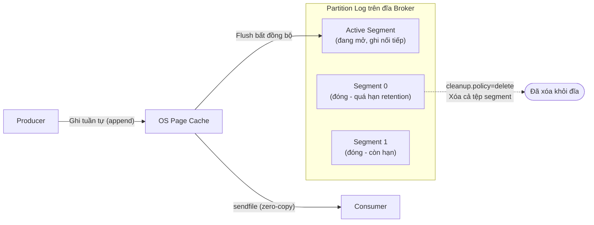
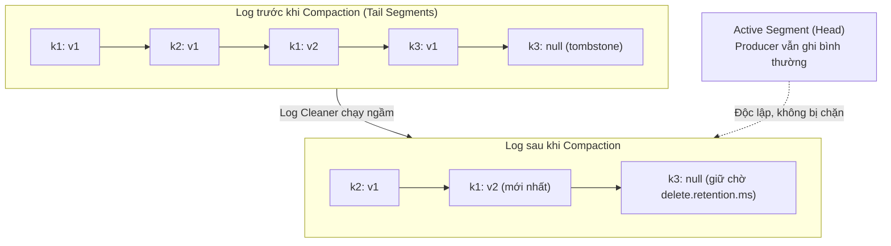

# 7_1_5 Lưu Trữ: Log Segment, Retention, Compaction

> **Khóa học**: Cloud DevOps Basic — Data Platform
> **Phân nhóm**: 7 Domain 7 - Apache Kafka › 7_1 Kafka Core Concepts
> **Chủ đề**: 7_1_5 Storage: Log Segment, Retention, and Compaction
> **Trạng thái**: Bản nháp (chưa kiểm chứng theo yêu cầu người dùng)
> **Tài liệu phân nhóm**: [7_1 Kafka Core Concepts](./README.md)

---

## 1. Khái Niệm Cốt Lõi & Bản Chất Kỹ Thuật (Core Concepts & Technical Deep Dive)

Trong các hệ thống truyền dữ liệu lớn, việc lưu hàng triệu thông điệp mỗi giây xuống đĩa cứng thường được xem là điểm nghẽn hiệu năng lớn nhất. Tuy nhiên, Apache Kafka lại chọn cách lưu mọi thông điệp trực tiếp xuống đĩa cứng mà vẫn đạt thông lượng rất cao và độ trễ thấp. Bí quyết nằm ở cách Kafka tổ chức mỗi **partition** thành các tệp nhật ký tuần tự (**log segment**), tận dụng bộ nhớ đệm của hệ điều hành (**OS page cache**), và quản lý vòng đời dữ liệu bằng **retention** hoặc **log compaction** thay vì xóa tin ngay khi có người đọc.

### 1.1. Partition được lưu thành các Log Segment trên đĩa

Mỗi partition trong Kafka là một nhật ký có thứ tự, bất biến và chỉ ghi nối thêm vào cuối (append-only commit log) được lưu trữ thành các tệp **segment** trên đĩa cứng của broker <!-- ev: C5.1 -->.

- **Active segment (phân đoạn đang hoạt động)**: Dữ liệu mới luôn được ghi nối thêm vào tệp active segment; khi segment này đạt ngưỡng dung lượng `segment.bytes` (mặc định `1073741824` byte, tức 1 GiB), Kafka đóng nó lại và mở một tệp segment mới <!-- ev: C5.2 -->.
- **Xoay vòng theo thời gian (`segment.ms`)**: Nếu một active segment chưa đầy dung lượng nhưng đã tồn tại lâu hơn ngưỡng `segment.ms` (mặc định `604800000` ms, tức 7 ngày), Kafka cũng thực hiện xoay vòng (roll) sang tệp segment mới <!-- ev: C5.3 -->.

Việc chia nhỏ partition thành nhiều segment giúp Kafka dễ dàng dọn dẹp hoặc nén dữ liệu cũ theo từng tệp hoàn chỉnh thay vì phải sửa đổi bên trong một tệp khổng lồ duy nhất.

### 1.2. Ghi tuần tự (Sequential I/O), OS Page Cache và Zero-Copy

Kafka đạt tốc độ đọc/ghi cao trên đĩa cứng nhờ ba cơ chế phối hợp chặt chẽ với hệ điều hành:

- **Ghi tuần tự (Sequential I/O)**: Thay vì ghi rải rác ở nhiều vị trí ngẫu nhiên trên đĩa, Kafka chỉ ghi nối tiếp vào cuối tệp log, giúp tận dụng tối đa khả năng tối ưu đọc/ghi tuyến tính của đĩa và hệ điều hành <!-- ev: C5.4 -->.
- **OS Page Cache thay cho JVM Heap**: Thay vì tự quản lý một bộ đệm lớn bên trong bộ nhớ JVM heap, Kafka ghi và đọc dữ liệu thông qua **OS page cache** (vùng nhớ đệm trang của nhân hệ điều hành) <!-- ev: C5.5 -->. Cách thiết kế này giúp Kafka tránh áp lực thu gom rác (Garbage Collection) của JVM và giữ nguyên được dữ liệu đệm trong RAM ngay cả khi tiến trình broker khởi động lại (miễn là hệ điều hành không tắt) <!-- ev: C5.6 -->.
- **Zero-copy (`sendfile`)**: Khi gửi dữ liệu từ đĩa qua mạng cho consumer, Kafka tận dụng lời gọi hệ thống `sendfile` để chuyển các byte trực tiếp từ page cache ra socket mạng mà không cần sao chép trung gian qua vùng nhớ ứng dụng (user-space) <!-- ev: C5.7 -->.

### 1.3. Chính sách Retention: Xóa theo thời gian (`retention.ms`) và dung lượng (`retention.bytes`)

Theo mặc định, Kafka sử dụng chính sách dọn dẹp `cleanup.policy=delete` để tự động loại bỏ các segment cũ khi vượt quá giới hạn lưu trữ đã cấu hình <!-- ev: C5.8 -->.

- **Retention theo thời gian (`retention.ms`)**: Quy định khoảng thời gian tối đa mà Kafka giữ lại log trước khi loại bỏ các segment cũ; giá trị mặc định là `604800000` ms (tương đương 7 ngày) <!-- ev: C5.9 -->.
- **Retention theo dung lượng (`retention.bytes`)**: Quy định kích thước tối đa mà một **partition** được phép phình to trước khi Kafka xóa các segment cũ để giải phóng chỗ trống; giá trị mặc định là `-1` (không giới hạn dung lượng) <!-- ev: C5.10 -->.
- **Xóa ở mức Segment**: Chính sách retention giải phóng không gian bằng cách xóa toàn bộ các tệp log segment cũ đã quá hạn, chứ không tìm và xóa từng bản ghi đơn lẻ <!-- ev: C5.11 -->.

### 1.4. Log Compaction (`cleanup.policy=compact`)

Khi không cần giữ toàn bộ lịch sử mọi thay đổi mà chỉ cần biết **trạng thái hiện tại** của từng đối tượng, bạn có thể chuyển topic sang chế độ **log compaction** bằng cấu hình `cleanup.policy=compact` <!-- ev: C5.12 -->.

- **Giữ bản ghi mới nhất theo Key**: Log compaction đảm bảo trong một partition, Kafka luôn giữ lại ít nhất giá trị mới nhất cho mỗi message **key** <!-- ev: C5.12 -->.
- **Ứng dụng trạng thái hiện tại**: Cơ chế này phù hợp cho các bài toán khôi phục trạng thái ứng dụng sau sự cố hoặc lưu trữ changelog (như bảng ánh xạ hồ sơ người dùng hoặc cấu hình hệ thống) <!-- ev: C5.13 -->.
- **Xóa key bằng Tombstone**: Khi cần xóa một key khỏi compacted topic, producer gửi một bản ghi có key đó với phần giá trị (payload) là `null` gọi là **tombstone**; dấu xóa này vẫn được giữ lại tối thiểu theo `delete.retention.ms` (mặc định `86400000` ms, tức 24 giờ) để các consumer kịp nhìn thấy trước khi bị dọn sạch hoàn toàn <!-- ev: C5.14 -->.
- **Chạy ngầm không chặn luồng chính**: Tiến trình dọn dẹp (log cleaner) nén các segment cũ ở phía sau (tail) trong khi producer và consumer vẫn ghi/đọc bình thường trên active segment ở phía đầu (head) <!-- ev: C5.15 -->.
- **Kết hợp cả hai chính sách**: Bạn có thể đặt `cleanup.policy=compact,delete` nếu muốn vừa nén dữ liệu theo key vừa tự động xóa các segment quá hạn thời gian hoặc dung lượng <!-- ev: C5.16 -->.

### 1.5. Vì sao Xóa Tin ≠ Consumer Đọc Xong & Rủi ro Consumer Chậm

Đây là điểm khác biệt cốt lõi giữa Kafka và các hệ thống hàng đợi (message queue) truyền thống:

- **Độc lập với hành vi đọc**: Kafka giữ lại bản ghi theo chính sách retention đã cấu hình chứ không xóa tin nhắn ngay sau khi consumer đọc xong <!-- ev: C5.17 -->.
- **Đọc lại và đọc song song**: Nhờ dữ liệu vẫn còn trên đĩa, nhiều consumer group độc lập có thể đọc cùng một dữ liệu theo tốc độ riêng, hoặc một consumer có thể tua lại offset để xử lý lại dữ liệu cũ <!-- ev: C5.18 -->.
- **Rủi ro mất dữ liệu khi consumer quá chậm**: Nếu một consumer bị đứng hoặc xử lý quá chậm khiến độ trễ (consumer lag) vượt quá ngưỡng `retention.ms` hoặc `retention.bytes`, các segment chứa tin nhắn chưa kịp đọc vẫn sẽ bị Kafka xóa bỏ, dẫn đến mất dữ liệu ở phía consumer đó <!-- ev: C5.19 -->.

---

## 2. Ví Dụ Đời Sống Thực Tế Dễ Hiểu (Intuitive Real-World Analogies)

Hãy tưởng tượng Kafka như một **kho lưu trữ hồ sơ kế toán** hoạt động theo từng cuốn sổ đoạn (**segment**):

- **Ghi tuần tự & OS Page Cache**: Nhân viên ghi sổ không bao giờ lật lại các trang cũ để chèn thêm chữ ở giữa, mà luôn viết nối tiếp vào dòng trống cuối cùng của cuốn sổ đang mở (**active segment**). Trước khi đóng tập và cất vào kho lạnh (đĩa cứng), những trang vừa viết còn nằm sẵn trên bàn làm việc lớn (**OS page cache**) nên ai cần xem tin mới đều đọc được ngay lập tức mà không cần lục tủ.
- **Đóng cuốn sổ và hủy theo lịch (Retention)**: Khi một cuốn sổ đầy 100 trang (`segment.bytes`) hoặc đã mở sang tuần mới (`segment.ms`), thủ thư đóng cuốn sổ đó lại và mở cuốn mới. Theo quy định lưu trữ 7 ngày (`retention.ms`) hoặc tối đa 10 cuốn mỗi ngăn (`retention.bytes`), cứ cuốn nào quá hạn thì thủ thư đem đi hủy nguyên cả cuốn chứ không xé lẻ từng tờ.
- **Nén hồ sơ (Log Compaction)**: Với cuốn sổ danh bạ địa chỉ khách hàng, thay vì giữ cả 50 tờ ghi lại lịch sử đổi nhà của cùng một người, nhân viên dọn kho thỉnh thoảng sẽ chép sang cuốn sổ mới và chỉ giữ lại **tờ cập nhật địa chỉ mới nhất** cho mỗi mã khách hàng. Nếu khách hàng hủy tài khoản, ta kẹp một tờ giấy trắng ghi mã khách đó (**tombstone**) để nhắc mọi người xóa tên khỏi danh bạ trước khi bỏ hẳn tờ giấy trắng đó đi.
- **Đọc xong không mất tin, nhưng chậm thì mất**: Khách đến đọc sổ chỉ tự kẹp một cái đánh dấu trang (**offset**) cho biết mình đọc tới đâu. Thủ thư không xé trang chỉ vì có một người vừa đọc xong. Nhưng nếu vị khách đó đi vắng suốt 10 ngày trong khi quy định lưu trữ chỉ là 7 ngày, khi quay lại thì những cuốn sổ chứa trang chưa đọc đã bị đem đi tiêu hủy mất rồi.

---

## 3. Kiến Trúc, Luồng Hoạt Động & Hình Ảnh Trực Quan (Architecture, Diagrams & Visual Media)

### 3.1. Luồng ghi tuần tự qua Page Cache, Zero-Copy và Retention theo Segment

Sơ đồ dưới đây minh họa một partition gồm các segment cũ (đóng băng, chờ xóa theo retention) và active segment đang nhận dữ liệu mới thông qua OS Page Cache:

<!-- ev: C5.1 C5.4 C5.5 C5.7 C5.8 -->


### 3.2. Cơ chế Log Compaction giữ lại giá trị mới nhất theo Key

Sơ đồ sau cho thấy cách tiến trình log cleaner nén các segment cũ (tail) để chỉ giữ lại giá trị mới nhất cho mỗi key, đồng thời không làm gián đoạn việc ghi mới ở phần đầu (head):

<!-- ev: C5.12 C5.14 C5.15 -->


---

## 4. Code Mẫu Trực Quan Hoặc Dòng Lệnh Thực Chiến (Runnable Sample Code / CLI)

Các lệnh dưới đây áp dụng cho **Apache Kafka 3.x / 4.x** (sử dụng tham số `--bootstrap-server` trỏ tới broker cục bộ đang chạy ở `localhost:9092`) <!-- ev: C5.20 -->.

### 4.1. Cấu hình Retention và kích thước Segment cho Topic `order-events`

Trong ví dụ này, ta tạo topic `order-events` với cấu hình `retention.ms` (24 giờ) và `segment.bytes` (100 MiB), sau đó cập nhật thêm giới hạn dung lượng mỗi partition qua `retention.bytes` (1 GiB) <!-- ev: C5.20 -->:

<!-- ev: C5.20 -->
```bash
# 1. Tạo topic với retention.ms (24 giờ) và segment.bytes (100 MiB)
kafka-topics.sh --bootstrap-server localhost:9092 \
  --create --topic order-events \
  --partitions 3 --replication-factor 1 \
  --config retention.ms=86400000 \
  --config segment.bytes=104857600

# 2. Bổ sung giới hạn dung lượng tối đa cho mỗi partition (1 GiB)
kafka-configs.sh --bootstrap-server localhost:9092 \
  --entity-type topics --entity-name order-events \
  --alter --add-config retention.bytes=1073741824

# 3. Kiểm tra lại cấu hình động đã áp dụng trên topic
kafka-configs.sh --bootstrap-server localhost:9092 \
  --entity-type topics --entity-name order-events \
  --describe
```

**Output quan sát được** (cấu hình mức topic hiển thị trên stdout):

```text
Dynamic configs for topic order-events are:
  segment.bytes=104857600 sensitive=false synonyms={DYNAMIC_TOPIC_CONFIG:segment.bytes=104857600}
  retention.ms=86400000 sensitive=false synonyms={DYNAMIC_TOPIC_CONFIG:retention.ms=86400000}
  retention.bytes=1073741824 sensitive=false synonyms={DYNAMIC_TOPIC_CONFIG:retention.bytes=1073741824}
```

### 4.2. Thực hành Log Compaction với Topic `user-profiles`

Ta tạo topic `user-profiles` dùng `cleanup.policy=compact` để lưu địa chỉ hiện tại của từng người dùng theo khóa (`user-101`, `user-102`) <!-- ev: C5.12 C5.20 -->.

**Bước 1 — Tạo compacted topic và gửi dữ liệu đầu vào (Input → Command):**

<!-- ev: C5.20 -->
```bash
# Tạo topic dùng chính sách nén log compaction
kafka-topics.sh --bootstrap-server localhost:9092 \
  --create --topic user-profiles \
  --partitions 1 --replication-factor 1 \
  --config cleanup.policy=compact

# Gửi 3 bản ghi có key (nhập lần lượt rồi nhấn Ctrl+D để thoát)
kafka-console-producer.sh --bootstrap-server localhost:9092 \
  --topic user-profiles \
  --property parse.key=true \
  --property key.separator=:
```

*Input mẫu gõ vào console producer:*

```text
user-101:HaNoi
user-102:DaNang
user-101:HCM
```

**Bước 2 — Đọc lại dữ liệu từ đầu bằng Console Consumer (Command → Output):**

<!-- ev: C5.20 -->
```bash
kafka-console-consumer.sh --bootstrap-server localhost:9092 \
  --topic user-profiles \
  --from-beginning \
  --property print.key=true \
  --property key.separator=:
```

*Output ban đầu khi active segment chưa được roll và nén:*

```text
user-101:HaNoi
user-102:DaNang
user-101:HCM
```

*Lưu ý*: Khi segment đầu tiên được đóng lại và tiến trình log cleaner chạy nén xong, bản ghi cũ `user-101:HaNoi` sẽ bị loại bỏ, consumer mới đọc `--from-beginning` sẽ chỉ còn thấy trạng thái mới nhất của từng key (`user-102:DaNang` và `user-101:HCM`) <!-- ev: C5.12 C5.15 -->.

---

## 5. Cạm Bẫy Thực Tế & Thực Tiễn Sản Xuất (Production Gotchas & Best Practices)

### Cạm bẫy thường gặp

1. **Nhầm lẫn `retention.bytes` là giới hạn cho cả Topic**: `retention.bytes` được áp dụng **trên từng partition**, không phải tổng của cả topic <!-- ev: C5.10 -->. Nếu một topic có 10 partition, hệ số sao lưu là 3 và bạn đặt `retention.bytes=1073741824` (1 GiB), tổng dung lượng đĩa tối đa mà cụm broker phải chứa cho topic đó có thể lên tới 30 GiB (chưa tính các tệp chỉ mục và ngưỡng xoay vòng segment).
2. **Đặt `retention.ms` quá ngắn gây mất tin khi có sự cố**: Nếu hệ thống consumer gặp lỗi và dừng xử lý lâu hơn `retention.ms`, các segment cũ sẽ bị xóa bất kể consumer đã đọc xong hay chưa, khiến dữ liệu bị mất vĩnh viễn ở phía consumer <!-- ev: C5.17 C5.19 -->.
3. **Kỳ vọng Log Compaction xóa bản ghi trùng ngay lập tức**: Log compaction chỉ nén các segment đã đóng ở phía sau (tail) và chạy định kỳ dưới nền, không nén ngay dữ liệu vừa ghi vào active segment <!-- ev: C5.15 -->. Ngoài ra, để log compaction có thể gom nhóm và giữ giá trị mới nhất theo từng đối tượng, các bản ghi gửi vào compacted topic cần có **key** <!-- ev: C5.12 -->.

### Thực hành tốt trong Production (Best Practices)

- **Dành đủ RAM cho OS Page Cache**: Không cấp toàn bộ RAM của máy chủ cho JVM heap (`-Xmx`) của Kafka broker; phần lớn RAM trống nên để hệ điều hành dùng làm OS page cache nhằm tối ưu tốc độ đọc/ghi <!-- ev: C5.5 C5.6 -->.
- **Giám sát Consumer Lag đối chiếu với Retention**: Luôn cấu hình `retention.ms` đủ rộng (ví dụ mặc định 7 ngày hoặc tối thiểu gấp nhiều lần thời gian khắc phục sự cố tối đa của đội vận hành) để đảm bảo consumer chậm vẫn kịp đọc trước khi segment bị xóa <!-- ev: C5.9 C5.19 -->.
- **Kết hợp `compact,delete` khi cần giới hạn kích thước**: Với các topic dùng compaction nhưng số lượng key tăng liên tục theo thời gian, cân nhắc dùng `cleanup.policy=compact,delete` nếu dữ liệu quá cũ không còn cần giữ lại mãi mãi <!-- ev: C5.16 -->.

---

## 6. Câu Hỏi Củng Cố Kiến Thức (Active Recall Quiz)

**Câu 1**: Một topic `payment-events` có cấu hình `retention.ms=86400000` (24 giờ) và `cleanup.policy=delete`. Dịch vụ consumer `billing-service` bị sập vào thứ Sáu và đến thứ Hai (sau 60 giờ) mới được khởi động lại. Khi chạy lại, liệu `billing-service` có đọc được các sự kiện thanh toán đã phát sinh vào thứ Sáu không? Vì sao?

<details>
<summary>Đáp án</summary>

**Không.** Kafka xóa dữ liệu dựa trên chính sách retention (`retention.ms=24 giờ`), không phụ thuộc vào việc consumer đã đọc tin nhắn hay chưa. Sau 60 giờ, các log segment chứa sự kiện ngày thứ Sáu đã vượt quá thời hạn 24 giờ và bị broker xóa khỏi đĩa, dẫn đến `billing-service` bị mất phần dữ liệu đó.

</details>

**Câu 2**: Topic `inventory-stock` có `6 partition`, bạn cấu hình `retention.bytes=5368709120` (5 GiB) với `replication.factor=1`. Tổng dung lượng dữ liệu tối đa của topic này xấp xỉ bao nhiêu (không tính các yếu tố phụ như index)?

<details>
<summary>Đáp án</summary>

Xấp xỉ **30 GiB** (`6 partition × 5 GiB`). Lý do là `retention.bytes` giới hạn dung lượng cho **mỗi partition**, không phải cho toàn bộ topic.

</details>

**Câu 3**: Bạn có một compacted topic (`cleanup.policy=compact`) lưu trạng thái tài khoản người dùng. Khi một người dùng xóa tài khoản (`user-99`), bạn cần gửi gì vào topic để hệ thống biết rằng key `user-99` cần bị xóa hoàn toàn thay vì giữ lại mãi mãi?

<details>
<summary>Đáp án</summary>

Producer cần gửi một bản ghi **tombstone**: có key là `user-99` và giá trị payload là `null`. Các consumer khi đọc được bản ghi này sẽ biết để xóa `user-99` khỏi trạng thái cục bộ, và sau khoảng thời gian `delete.retention.ms` (mặc định 24 giờ), Kafka sẽ dọn sạch luôn cả bản ghi tombstone đó.

</details>

---

## 7. 📚 Nguồn Tài Liệu Chính Thống (Tier-1 Official References)

- [Apache Kafka Documentation — Design (Persistence & Log Compaction)](https://kafka.apache.org/documentation/#design) — Tài liệu thiết kế chính thức của Apache Kafka giải thích về lưu trữ phân đoạn trên đĩa, ghi tuần tự, OS page cache, `sendfile` zero-copy và cơ chế log compaction.
- [Apache Kafka Documentation — Topic-Level Configs](https://kafka.apache.org/documentation/#topicconfigs) — Tài liệu tham chiếu chính thức các cấu hình `cleanup.policy`, `retention.ms`, `retention.bytes`, `segment.bytes`, `segment.ms` và `delete.retention.ms`.
