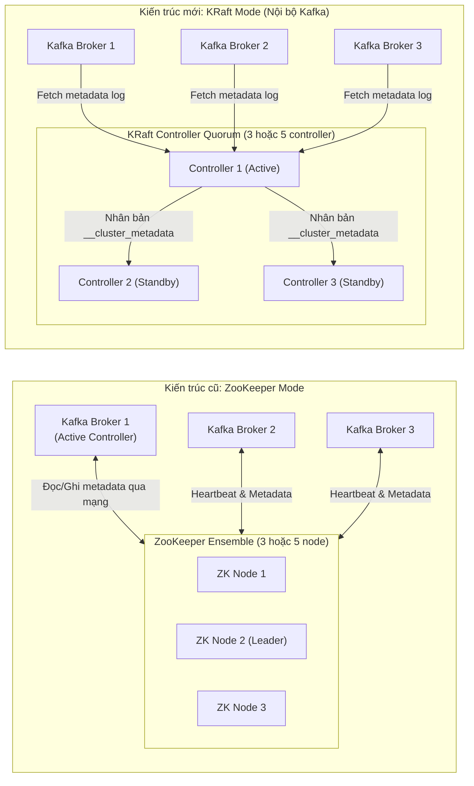

# 7_1_6 Quản Lý Metadata: ZooKeeper và KRaft

> **Khóa học**: Cloud DevOps Basic — Data Platform
> **Phân nhóm**: 7 Domain 7 - Apache Kafka › 7_1 Kafka Core Concepts
> **Chủ đề**: Vai trò metadata/controller, ZooKeeper ensemble (quorum số lẻ), KRaft controller quorum, và lộ trình chuyển đổi từ ZooKeeper sang KRaft
> **Trạng thái**: Bản nháp (chưa kiểm chứng theo yêu cầu người dùng)
> **Checklist đối chiếu**: Không có (`CHECKLIST_FILE: none`); xem lộ trình tại [7_1 Kafka Core Concepts](./README.md) và [Data Platform README](../../README.md)

---

## 1. Khái Niệm Cốt Lõi & Bản Chất Kỹ Thuật (Core Concepts & Technical Deep Dive)

Trong một cụm nhiều máy chủ (broker), làm thế nào các broker biết có những topic nào đang tồn tại, hay khi một broker bị tắt đột ngột thì ai sẽ đứng ra chỉ định leader mới cho các partition? Nếu không có một nơi lưu trữ "bản đồ" chung và một "nhạc trưởng" điều phối, các broker sẽ hoạt động rời rạc hoặc ghi đè dữ liệu của nhau. Trong Apache Kafka, nhiệm vụ này thuộc về lớp quản lý **metadata** và thành phần **Controller**. Trong nhiều năm, Kafka phải mượn một hệ thống bên ngoài là **Apache ZooKeeper** để làm việc này, trước khi tự xây dựng cơ chế nội bộ mang tên **KRaft**.

### 1.1 Metadata và Controller là gì?

- **Metadata** (dữ liệu mô tả cấu trúc cụm) là toàn bộ thông tin giúp Kafka vận hành đúng: danh sách các broker đang sống, danh sách topic, cách phân bố từng partition lên broker nào, tập replica/ISR của mỗi partition và các cấu hình của topic. <!-- ev: C6.1 -->
- **Controller** là một vai trò điều phối trung tâm trong cụm Kafka, chịu trách nhiệm theo dõi trạng thái sống của các broker, thực thi thay đổi metadata (tạo/xóa topic, tăng số partition) và điều phối bầu chọn leader mới khi broker giữ leader bị sập. <!-- ev: C6.2 -->
- Các cấu hình động ở cấp độ topic hoặc broker (chẳng hạn `retention.ms` hay `cleanup.policy`) cũng nằm trong metadata và được đồng bộ tới mọi broker để toàn cụm áp dụng nhất quán. <!-- ev: C6.3 -->

*(Bài học này tập trung vào lớp điều khiển và metadata; phần ghi/đọc dữ liệu chi tiết nằm ở bài 7_1_4).*

### 1.2 Kiến Trúc Truyền Thống: Apache ZooKeeper

- **ZooKeeper** là một dịch vụ phối hợp phân tán (distributed coordination service) độc lập mà kiến trúc Kafka truyền thống bắt buộc phải chạy kèm để lưu trữ metadata, theo dõi heartbeat của broker và bầu chọn Controller cho cụm. <!-- ev: C6.4 -->
- **Ensemble & Quorum số lẻ**: Cụm ZooKeeper được gọi là một **ZooKeeper ensemble** và thường triển khai với số lượng node **lẻ** (phổ biến là 3 hoặc 5 node) để đảm bảo cơ chế đồng thuận theo đa số (**quorum** — cần tối thiểu `(N / 2) + 1` node hoạt động) và phòng tránh tình trạng chia tách não (**split-brain**, khi hai nhóm node cô lập cùng tự nhận quyền điều phối). <!-- ev: C6.5 -->
- **Đánh đổi vận hành**: Khi dùng ZooKeeper, kỹ sư vận hành phải cài đặt, giám sát, bảo mật và nâng cấp hai hệ thống phân tán tách biệt nhau (cụm Kafka broker và cụm ZooKeeper ensemble), đồng thời Controller phải giao tiếp qua mạng với ZooKeeper để đọc/ghi trạng thái. <!-- ev: C6.6 -->
- **Giới hạn mở rộng**: Khi số lượng partition trong cụm tăng lên rất lớn, việc đồng bộ metadata qua các watcher của ZooKeeper và nạp lại toàn bộ trạng thái khi khởi động hoặc chuyển đổi Controller có thể làm chậm đáng kể thời gian phục hồi của cụm. <!-- ev: C6.7 -->

### 1.3 Kiến Trúc Hiện Đại: KRaft (Kafka Raft Metadata Mode)

- **KRaft** là chế độ quản lý metadata tích hợp thẳng vào bên trong Apache Kafka, sử dụng giao thức đồng thuận dựa trên thuật toán **Raft** để loại bỏ hoàn toàn sự phụ thuộc vào ZooKeeper. <!-- ev: C6.8 -->
- **Controller Quorum & Log nội bộ**: Trong chế độ KRaft, một nhóm các node đóng vai trò controller lập thành một **controller quorum** và ghi mọi thay đổi metadata dưới dạng sự kiện tuần tự vào một topic nội bộ mang tên `__cluster_metadata`. <!-- ev: C6.9 -->
- **Phân vai node (`process.roles`)**: Mỗi node Kafka trong cụm KRaft được gắn vai trò qua tham số `process.roles`, nhận giá trị `broker` (lưu và phục vụ dữ liệu), `controller` (quản lý metadata), hoặc gộp `broker,controller` (combined mode cho môi trường thử nghiệm/nhỏ). <!-- ev: C6.10 -->
- **Chuyển quyền nhanh (Fast Failover)**: Tham số `controller.quorum.voters` khai báo danh sách các node trong controller quorum; các controller dự phòng (standby) liên tục nhân bản sẵn log metadata trong bộ nhớ nên có thể tiếp quản quyền active controller gần như tức thì khi active controller gặp sự cố. <!-- ev: C6.11 -->
- **Quy tắc số lẻ cho KRaft**: Tương tự ZooKeeper ensemble, controller quorum của KRaft cũng cần số lượng controller **lẻ** (thường là 3 hoặc 5 node) để chịu được lỗi tối đa `(N - 1) / 2` node mà vẫn giữ được đa số đồng thuận. <!-- ev: C6.12 -->

| Tiêu chí so sánh | ZooKeeper Mode (Kiến trúc cũ) | KRaft Mode (Kiến trúc mới) |
| :--- | :--- | :--- |
| Thành phần lưu metadata | Cụm Apache ZooKeeper tách rời | Topic nội bộ `__cluster_metadata` trong Kafka |
| Số hệ thống cần vận hành | 2 hệ thống (Kafka + ZooKeeper) | 1 hệ thống duy nhất (Kafka) |
| Thuật toán / Cơ chế đồng thuận | ZAB (ZooKeeper Atomic Broadcast) trong ensemble | Giao thức đồng thuận dựa trên Raft trong controller quorum |
| Số lượng node điều phối | Số lẻ (3, 5...) | Số lẻ (3, 5...) |
| Tốc độ phục hồi khi đổi Controller | Chậm hơn do phải nạp lại toàn bộ trạng thái từ ZooKeeper | Nhanh hơn nhờ các standby controller đã đồng bộ sẵn log metadata |

*(Bảng tóm tắt đối chiếu hai chế độ từ mục 1.2 và 1.3)*

### 1.4 Quá Trình Chuyển Đổi Sang KRaft và Lưu Ý Phiên Bản

- **Lộ trình phát triển**: KRaft được giới thiệu ở mức thử nghiệm (early access) từ **Kafka 2.8**, đạt trạng thái sẵn sàng cho môi trường production từ **Kafka 3.3**, và chế độ ZooKeeper được đánh dấu lỗi thời (**deprecated**) từ **Kafka 3.5**. <!-- ev: C6.13 -->
- **Loại bỏ ZooKeeper ở phiên bản mới**: Kể từ **Apache Kafka 4.0**, chế độ ZooKeeper đã bị **loại bỏ hoàn toàn**, đồng nghĩa KRaft là kiến trúc quản lý metadata duy nhất được hỗ trợ. <!-- ev: C6.14 -->
- **Hệ thống cũ (Legacy) & Nâng cấp**: Các cụm doanh nghiệp đang vận hành phiên bản Kafka 2.x hoặc 3.x cũ vẫn có thể đang chạy ZooKeeper; để nâng cấp lên Kafka 4.0, quản trị viên bắt buộc phải thực hiện quá trình di chuyển (migration) từ ZooKeeper sang KRaft trên bản trung gian nhánh 3.x có hỗ trợ migration trước khi nâng cấp tiếp (cần đối chiếu release notes của đúng phiên bản bạn sử dụng). <!-- ev: C6.15 -->

> **Nâng cao (có thể bỏ qua ở lần đọc đầu)**: Khi thiết kế cụm KRaft có tải cao, ngoài việc tách riêng `process.roles=controller` và `process.roles=broker`, các bản Kafka 3.9+ còn bổ sung cơ chế dynamic quorum (`controller.quorum.bootstrap.servers`) giúp thêm/bớt controller mà không cần sửa cấu hình tĩnh trên toàn bộ broker.

---

## 2. Ví Dụ Đời Sống Thực Tế Dễ Hiểu (Intuitive Real-World Analogies)

Hãy tưởng tượng một **khu kho hàng khổng lồ** gồm nhiều nhà kho nhỏ (**broker**), nơi chứa hàng trăm kệ hàng (**partition**) cho các mặt hàng khác nhau (**topic**):

- **Metadata** chính là **cuốn sổ bản đồ tổng** ghi rõ: nhà kho nào đang mở cửa, kệ hàng số mấy nằm ở kho nào, kho nào đang giữ bản chính (leader), và quy định lưu kho bao lâu thì tiêu hủy.
- **Controller** là **Trưởng ban điều phối**: mỗi khi một nhà kho bị mất điện, Trưởng ban phải tra sổ bản đồ và chỉ định ngay một kho khác đang giữ bản sao lên làm kho chính để xe tải (Producer/Consumer) không giao nhầm chỗ.

**Sự khác biệt giữa ZooKeeper và KRaft**:
- **ZooKeeper (Kiến trúc cũ)**: Ban quản lý kho thuê một **công ty bảo vệ bên ngoài** giữ cuốn sổ bản đồ. Muốn xây thêm kệ mới hay đổi kho chính, Trưởng ban phải gọi điện sang văn phòng công ty bảo vệ để ghi sổ rồi báo lại cho các kho. Do phải nuôi cả công ty bảo vệ bên ngoài (cài thêm cụm ZooKeeper) với 3 hoặc 5 nhân viên trực để bỏ phiếu khi có tranh cãi, chi phí vận hành gấp đôi và khi kho có hàng chục nghìn kệ, việc đối chiếu sổ sách qua điện thoại trở nên chậm chạp.
- **KRaft (Kiến trúc mới)**: Ban quản lý giải thể hợp đồng thuê ngoài và **xây thẳng phòng điều phối ngay bên trong khu kho hàng**. Nhóm điều phối viên (3 hoặc 5 controller nội bộ) cùng nhau ghi mọi thay đổi bản đồ vào một cuốn nhật ký chung (`__cluster_metadata`). Nhờ mọi phó phòng điều phối đều cầm bản sao nhật ký được cập nhật từng giây, nếu Trưởng ban nghỉ đột xuất, một phó phòng lên thay ngay lập tức mà không cần đi đối chiếu sổ ở bên ngoài nữa.

---

## 3. Kiến Trúc, Luồng Hoạt Động & Hình Ảnh Trực Quan (Architecture, Diagrams & Visual Media)

Sơ đồ dưới đây minh họa sự thay đổi ranh giới hệ thống khi chuyển từ **ZooKeeper Mode** sang **KRaft Mode**:



*(Ghi chú: Trong môi trường lớn ở production, nhóm `Controller` và `Broker` nên tách riêng node vật lý/container như hình bên phải; ở môi trường thử nghiệm nhỏ có thể gộp cả hai vai trò trên cùng node).* <!-- ev: C6.10 C6.19 -->

---

## 4. Code Mẫu Trực Quan Hoặc Dòng Lệnh Thực Chiến (Runnable Sample Code / CLI)

Phần này minh họa cấu hình tối thiểu và các lệnh quản trị thực tế trên một node KRaft chạy tại máy cục bộ.

### 4.1 Cấu hình tối thiểu cho một node KRaft

Cấu hình mẫu dưới đây cho phép node khởi động với vai trò kết hợp để phục vụ học tập tại máy cục bộ:

<!-- ev: C6.10 C6.17 -->
```properties
# File: config/kraft/server.properties (Kafka 3.x) hoặc config/server.properties (Kafka 4.0+)
# Vai trò của node: vừa phục vụ dữ liệu (broker) vừa tham gia điều phối metadata (controller)
process.roles=broker,controller

# ID duy nhất (số nguyên) đại diện cho node này trong cụm
node.id=1

# Danh sách các node trong controller quorum theo định dạng <node.id>@<host>:<controller_port>
controller.quorum.voters=1@localhost:9093

# Khai báo các cổng lắng nghe cho luồng dữ liệu client (PLAINTEXT) và nội bộ controller (CONTROLLER)
listeners=PLAINTEXT://:9092,CONTROLLER://:9093
inter.broker.listener.name=PLAINTEXT
controller.listener.names=CONTROLLER
listener.security.protocol.map=CONTROLLER:PLAINTEXT,PLAINTEXT:PLAINTEXT

# Thư mục lưu trữ dữ liệu topic và log metadata (__cluster_metadata)
log.dirs=/tmp/kraft-combined-logs
```

### 4.2 Khởi tạo Cluster ID và Format Storage (Input → Command → Output)

Trước khi khởi động Kafka ở chế độ KRaft lần đầu tiên, quản trị viên cần sinh một `CLUSTER_ID` duy nhất rồi format thư mục lưu trữ bằng công cụ `kafka-storage.sh`: <!-- ev: C6.16 -->

<!-- ev: C6.16 -->
```bash
# Bước 1: Sinh Cluster ID ngẫu nhiên (đầu vào: không có -> đầu ra: chuỗi UUID chuẩn base64)
KAFKA_CLUSTER_ID="$(bin/kafka-storage.sh random-uuid)"
echo "$KAFKA_CLUSTER_ID"
# Ví dụ output:
# MkU3OEVBNTcwNTJENDM2Qk

# Bước 2: Format thư mục log bằng Cluster ID và file cấu hình KRaft
bin/kafka-storage.sh format --standalone -t "$KAFKA_CLUSTER_ID" -c config/server.properties
# Lưu ý phiên bản: ở Kafka 3.x dùng lệnh không có --standalone:
# bin/kafka-storage.sh format -t "$KAFKA_CLUSTER_ID" -c config/kraft/server.properties

# Ví dụ output khi format thành công:
# Formatting metadata directory /tmp/kraft-combined-logs with metadata.version 4.0-IV3.
```

> **Ý nghĩa tham số**:
> - `random-uuid`: Sinh định danh duy nhất cho cụm Kafka.
> - `format -t <id> -c <config>`: Tạo file `meta.properties` trong `log.dirs` để gắn cứng node vào đúng cụm đó (trên Kafka 4.0 khi chạy 1 node đơn lẻ có thể dùng thêm `--standalone` theo Quickstart).

### 4.3 Khởi động và Kiểm tra Trạng thái KRaft Quorum

Sau khi format xong, khởi động Kafka server và dùng `kafka-metadata-quorum.sh` để kiểm tra xem node nào đang là Active Controller Leader và trạng thái đồng bộ của quorum: <!-- ev: C6.18 -->

<!-- ev: C6.18 -->
```bash
# Khởi động tiến trình Kafka KRaft (chạy foreground để quan sát log, hoặc thêm -daemon)
bin/kafka-server-start.sh config/server.properties

# Kiểm tra trạng thái Controller Quorum từ một terminal khác
bin/kafka-metadata-quorum.sh --bootstrap-server localhost:9092 describe --status

# Ví dụ output mẫu:
# ClusterId:              MkU3OEVBNTcwNTJENDM2Qk
# LeaderId:               1
# LeaderEpoch:            1
# HighWatermark:          42
# MaxFollowerLag:         0
# MaxFollowerLagTimeMs:   0
# CurrentVoters:          [{"id": 1, "directoryId": "..."}]
# CurrentObservers:       []
```

> **Ý nghĩa output**: `LeaderId` cho biết node controller nào đang nắm quyền điều phối chính; `MaxFollowerLag: 0` xác nhận các controller standby (nếu có nhiều hơn 1 voter) đang đồng bộ kịp thời gian thực với leader.

---

## 5. Cạm Bẫy Thực Tế & Thực Tiễn Sản Xuất (Production Gotchas & Best Practices)

1. **Chạy gộp hai vai trò trên môi trường production**:
   - **Cạm bẫy**: Tiện lợi khi thử nghiệm bằng 1 hoặc 3 node gộp vai trò, nhưng khi lưu lượng ghi/đọc dữ liệu của broker tăng cao (disk I/O, network bão hòa), tiến trình controller dùng chung tài nguyên sẽ bị trễ heartbeat, dễ gây chuyển đổi controller liên tục.
   - **Thực hành chuẩn**: Trong production, tài liệu chính thức của Apache Kafka khuyến nghị tách riêng các node chỉ chạy `process.roles=controller` (thường 3 hoặc 5 node chuyên dụng) và các node chạy `process.roles=broker` độc lập. <!-- ev: C6.19 -->
2. **Triển khai số lượng node quorum chẵn (2 hoặc 4 node)**:
   - **Cạm bẫy**: Triển khai 2 controller (hoặc 2 ZooKeeper node) không giúp tăng khả năng chịu lỗi so với 1 node, vì mất 1 node chỉ còn 1/2 — không đạt đa số `(2/2)+1 = 2`, dẫn tới toàn cụm ngừng phục vụ thao tác metadata. <!-- ev: C6.5 C6.12 -->
   - **Thực hành chuẩn**: Luôn dùng **3 hoặc 5 node** (số lẻ) cho cả ZooKeeper ensemble lẫn KRaft controller quorum để chịu được 1 hoặc 2 node hỏng tương ứng. <!-- ev: C6.5 C6.12 -->
3. **Lệch mã định danh cụm hoặc format đè thư mục log**:
   - **Cạm bẫy**: Mỗi node trong cụm KRaft lưu `cluster.id` bên trong file `meta.properties` khi chạy `kafka-storage.sh format`. Nếu quản trị viên chạy nhầm `random-uuid` riêng trên từng máy thay vì dùng chung một ID cho toàn cụm, các node sẽ từ chối kết nối vào quorum. <!-- ev: C6.20 -->
   - **Thực hành chuẩn**: Sinh đúng **một** `KAFKA_CLUSTER_ID` duy nhất cho toàn bộ cụm và lưu lại trong hệ thống quản lý cấu hình/IaC khi khởi tạo các node. <!-- ev: C6.16 C6.20 -->
4. **Nâng cấp thẳng từ cụm ZooKeeper lên Kafka 4.0**:
   - **Cạm bẫy**: Cài đặt trực tiếp binary Kafka 4.0 lên cụm đang dùng ZooKeeper sẽ lỗi ngay khi khởi động vì mã nguồn ZooKeeper mode đã bị gỡ bỏ. <!-- ev: C6.14 C6.15 -->
   - **Thực hành chuẩn**: Thực hiện nâng cấp theo từng chặng qua phiên bản trung gian nhánh 3.x hỗ trợ migration ZK → KRaft, hoàn tất chuyển đổi và kiểm tra ổn định trước khi nâng lên 4.0. <!-- ev: C6.15 -->

---

## 6. Câu Hỏi Củng Cố Kiến Thức (Active Recall Quiz)

**Câu 1**: Một cụm Kafka production chạy KRaft có **3 node controller** chuyên dụng (`process.roles=controller`) và **6 node broker** (`process.roles=broker`). Nếu 1 node controller bị hỏng phần cứng, cụm có tiếp tục tạo mới topic hoặc bầu chọn leader partition được không? Nếu 2 node controller bị hỏng cùng lúc thì sao?

<details>
<summary>Đáp án</summary>

- Khi **1 node controller** hỏng: Còn lại 2/3 controller hoạt động, đạt đa số quorum (`(3 - 1) / 2 = 1` node được phép lỗi), nên cụm vẫn hoạt động bình thường cho mọi thao tác metadata và bầu leader. <!-- ev: C6.12 -->
- Khi **2 node controller** hỏng cùng lúc: Chỉ còn 1/3 controller, không đủ đa số đồng thuận nên cụm không thể thực hiện các thay đổi metadata (như tạo topic, bầu leader mới cho partition) cho tới khi khôi phục được ít nhất 2/3 controller. <!-- ev: C6.12 -->

</details>

**Câu 2**: Khi chuyển từ kiến trúc ZooKeeper sang KRaft, dữ liệu metadata (như cấu hình topic, danh sách partition, leader) được lưu ở đâu và vì sao thời gian tiếp quản quyền Active Controller lại nhanh hơn đáng kể?

<details>
<summary>Đáp án</summary>

- Trong KRaft, mọi thay đổi metadata được ghi dưới dạng luồng sự kiện tuần tự vào topic nội bộ `__cluster_metadata` và quản lý bởi controller quorum ngay bên trong Kafka, thay vì gọi qua cụm ZooKeeper rời bên ngoài. <!-- ev: C6.8 C6.9 -->
- Các controller standby liên tục nhân bản sẵn log `__cluster_metadata` trong bộ nhớ, nên khi Active Controller gặp sự cố, một standby có thể lên thay gần như tức thì mà không phải mất thời gian nạp lại toàn bộ trạng thái từ ZooKeeper. <!-- ev: C6.7 C6.11 -->

</details>

**Câu 3**: Hệ thống công ty bạn đang chạy Apache Kafka 3.4 sử dụng ZooKeeper và có kế hoạch nâng cấp thẳng lên Kafka 4.0. Với kiến trúc hiện tại, kế hoạch này có chạy thẳng được không? Tại sao?

<details>
<summary>Đáp án</summary>

- **Không thể nâng cấp thẳng lên Kafka 4.0** với cấu hình ZooKeeper, vì từ Apache Kafka 4.0 chế độ ZooKeeper đã bị loại bỏ hoàn toàn và chỉ hỗ trợ KRaft. <!-- ev: C6.14 -->
- Cụm cần được nâng cấp qua một phiên bản trung gian trong nhánh 3.x có hỗ trợ di chuyển (migration) từ ZooKeeper sang KRaft, hoàn tất chuyển sang KRaft rồi mới nâng cấp lên Kafka 4.0. <!-- ev: C6.15 -->

</details>

---

## 7. 📚 Nguồn Tài Liệu Chính Thống (Tier-1 Official References)

- [Apache Kafka Documentation — KRaft (Kafka Raft Metadata Mode)](https://kafka.apache.org/documentation/#kraft) - Tài liệu chính thức về kiến trúc KRaft, cấu hình `process.roles`, `controller.quorum.voters`, khởi tạo `kafka-storage.sh`, và lưu ý lộ trình bỏ ZooKeeper.
- [Apache Kafka Documentation — Introduction & In a Nutshell](https://kafka.apache.org/documentation/#intro_nutshell) - Tổng quan kiến trúc phân tán của Kafka: broker, topic, partition và điều phối cụm.
- [Apache Kafka Quickstart](https://kafka.apache.org/quickstart) - Hướng dẫn chính thức khởi chạy cụm Kafka ở chế độ KRaft bằng CLI (`kafka-storage.sh`, `kafka-server-start.sh`).
- [Apache Kafka Downloads & Release Notes](https://kafka.apache.org/downloads) - Thông tin phát hành chính thức của các phiên bản Kafka 3.x và Kafka 4.0 (deprecated/removal của ZooKeeper).
- [Apache ZooKeeper — Getting Started & Cluster Setup](https://zookeeper.apache.org/doc/current/zookeeperStarted.html) - Tài liệu chính thức giải thích cơ chế ensemble và yêu cầu quorum số node lẻ trong ZooKeeper.
