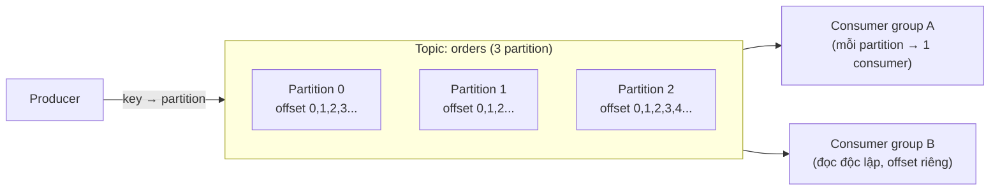

# 7_1 Kafka Core Concepts

> **Khóa học**: Cloud DevOps Basic — Data Platform
> **Phân nhóm**: 7 Domain 7 - Apache Kafka › 7_1 Kafka Core Concepts
> **Chủ đề**: Topic, partition, offset, producer `acks`, consumer group, replication (leader/ISR), retention và compaction, KRaft vs ZooKeeper
> **Trạng thái**: Định nghĩa (nội dung cần học + đề bài lab), chưa chạy thử, 16-11-2026
> **Lộ trình tổng**: [data-platform/README.md](../../README.md)

---

## 🎯 Mục Tiêu

Kafka là **log phân tán, chỉ ghi nối thêm (append-only)**, không phải hàng đợi xóa tin sau khi đọc. Nếu bạn đã biết RabbitMQ, hãy chú ý khác biệt gốc: Kafka **giữ tin theo chính sách retention** và mỗi consumer tự nhớ vị trí đọc (offset) của mình.

**Ví dụ đời thường**: Kafka giống một **cuốn sổ nhật ký có đánh số trang**. Người ghi chỉ viết thêm vào cuối. Mỗi người đọc (consumer group) kẹp một cái bookmark riêng (offset); đọc xong không làm trang biến mất, trang chỉ bị xé theo lịch lưu trữ (retention).

---

## 📚 Những Gì Cần Học

### 7_1_1 Mô Hình Dữ Liệu: Topic, Partition, Offset
- [ ] Record gồm key, value, timestamp, headers; **topic** chia thành nhiều **partition**.
- [ ] **Thứ tự chỉ được đảm bảo trong một partition**, không đảm bảo xuyên partition.
- [ ] **Offset** là số thứ tự trong một partition; Kafka không dùng nó như ID toàn cục.
- [ ] Vì sao partition là đơn vị song song: số consumer hữu ích trong một group không vượt quá số partition.
- [ ] Key → partition (cùng key cùng partition); hệ quả khi đổi số partition của topic đang chạy.

### 7_1_2 Producer
- [ ] `acks` (`0`, `1`, `all`) và đánh đổi giữa độ bền và độ trễ.
- [ ] Retry, **idempotent producer**, thứ tự khi retry (khái niệm).
- [ ] Batching (`linger.ms`, `batch.size`), nén; ảnh hưởng tới throughput và latency.
- [ ] Liên hệ với RabbitMQ: confirm của publisher so với `acks`.

### 7_1_3 Consumer và Consumer Group
- [ ] **Consumer group**: các consumer cùng `group.id` chia nhau partition; nhiều group đọc độc lập.
- [ ] Commit offset: tự động vs thủ công; hệ quả "at-most-once / at-least-once" tùy thời điểm commit.
- [ ] **Rebalance**: khi consumer vào/ra hoặc timeout; vì sao rebalance liên tục làm consumer đứng hình.
- [ ] `auto.offset.reset` (`earliest`/`latest`): áp dụng khi group chưa có offset.
- [ ] **Consumer lag** = offset mới nhất của partition − offset đã commit của group.

### 7_1_4 Broker, Replication, Leader và ISR
- [ ] Mỗi partition có **leader** và các **follower**; producer/consumer làm việc với leader.
- [ ] `replication.factor`, **ISR** (in-sync replicas), `min.insync.replicas` kết hợp `acks=all`.
- [ ] Khi leader chết: chọn leader mới từ ISR; *unclean leader election* đánh đổi mất dữ liệu lấy khả dụng (khái niệm, cần đối chiếu mặc định ở bản bạn dùng).
- [ ] Vì sao `replication.factor=3` + `min.insync.replicas=2` là cấu hình phổ biến trong tài liệu và blog; hệ quả khi chỉ còn 1 replica trong ISR.

### 7_1_5 Lưu Trữ: Log Segment, Retention, Compaction
- [ ] Partition lưu thành các **segment** file trên đĩa của broker; ghi tuần tự và dựa vào page cache của hệ điều hành (liên hệ [os 1_7_5](<../../../os/1 Domain 1 - Operating System Core Fundamentals/1_7 Memory Management and Virtual Memory/1_7_5 Virtual Memory and Demand Paging.md>)).
- [ ] Retention theo thời gian (`retention.ms`) và dung lượng (`retention.bytes`).
- [ ] **Log compaction** (`cleanup.policy=compact`): giữ bản ghi mới nhất theo key; dùng cho "trạng thái hiện tại".
- [ ] Vì sao xóa tin ≠ consumer đọc xong; hệ quả khi consumer chậm hơn retention (mất tin chưa đọc).

### 7_1_6 Quản Lý Metadata: ZooKeeper và KRaft
- [ ] Vai trò của lớp metadata/controller: danh sách topic, partition, leader, cấu hình.
- [ ] **ZooKeeper** (ensemble, quorum số node lẻ) và **KRaft** (controller quorum nằm trong Kafka).
- [ ] ⚠️ **Cần đối chiếu**: Kafka đã chuyển sang KRaft và các bản mới đã bỏ chế độ ZooKeeper (file interview prep ghi Kafka 4.0). Kiểm tra trang tài liệu KRaft và release notes của đúng phiên bản trước khi kết luận. Hệ thống cũ vẫn có thể còn ZooKeeper.

---

## 🧪 Labs

> **Bản định nghĩa**: chưa tạo thư mục `labs/`, chưa chạy thử. Lệnh trong đề là **ví dụ minh họa**; tên script (`kafka-topics.sh`...) và cách chạy phụ thuộc image/bản bạn dùng.

| Lab | Nội dung | Thời gian | Trạng thái |
| :--- | :--- | :---: | :--- |
| lab-7_1_1-single-broker-quickstart | Chạy 1 broker, tạo topic, producer/consumer console | 45 phút | Định nghĩa |
| lab-7_1_2-partitions-keys-and-groups | Quan sát key → partition và chia partition giữa consumer trong group | 60 phút | Định nghĩa |

### lab-7_1_1-single-broker-quickstart
- **Các bước chính**:
  1. Chạy Kafka một node theo Quickstart chính thức (container).
  2. Tạo topic `orders` 3 partition; `--describe` để xem leader, replicas, ISR.
  3. Gửi vài tin bằng console producer, đọc lại bằng console consumer `--from-beginning`.
  4. Chạy consumer thứ hai **không** dùng `--from-beginning` và so sánh.
- **Checkpoint**:
  - [ ] Giải thích được vì sao đọc xong tin vẫn còn trong topic.
  - [ ] Đọc được cột Leader / Replicas / Isr trong kết quả `--describe`.

### lab-7_1_2-partitions-keys-and-groups
- **Các bước chính**:
  1. Gửi tin có key (`user1`, `user2`...) và in ra partition + offset của từng tin.
  2. Chạy 2 consumer cùng `group.id`; xem mỗi consumer được gán partition nào.
  3. Thêm consumer thứ 4 (nhiều hơn số partition) → quan sát consumer nhàn rỗi.
  4. Dừng 1 consumer → quan sát rebalance.
- **Checkpoint**:
  - [ ] Giải thích được vì sao tăng số consumer quá số partition không tăng throughput.
  - [ ] Chứng minh bằng output rằng cùng key luôn vào cùng partition.

---

## 📚 Nguồn Tài Liệu Chính Thống (Official References)
- [Apache Kafka - Introduction](https://kafka.apache.org/documentation/#introduction) - Khái niệm event streaming, topic, partition.
- [Apache Kafka - Design](https://kafka.apache.org/documentation/#design) - Thiết kế: persistence, producer, consumer, replication, log compaction.
- [Apache Kafka - Producer Configs](https://kafka.apache.org/documentation/#producerconfigs) - `acks`, `linger.ms`, idempotence.
- [Apache Kafka - Consumer Configs](https://kafka.apache.org/documentation/#consumerconfigs) - `group.id`, `auto.offset.reset`, commit.
- [Apache Kafka - Topic Configs](https://kafka.apache.org/documentation/#topicconfigs) - `retention.ms`, `cleanup.policy`, `min.insync.replicas`.
- [Apache Kafka - KRaft](https://kafka.apache.org/documentation/#kraft) - Chế độ metadata KRaft; đối chiếu phiên bản hỗ trợ ZooKeeper.
