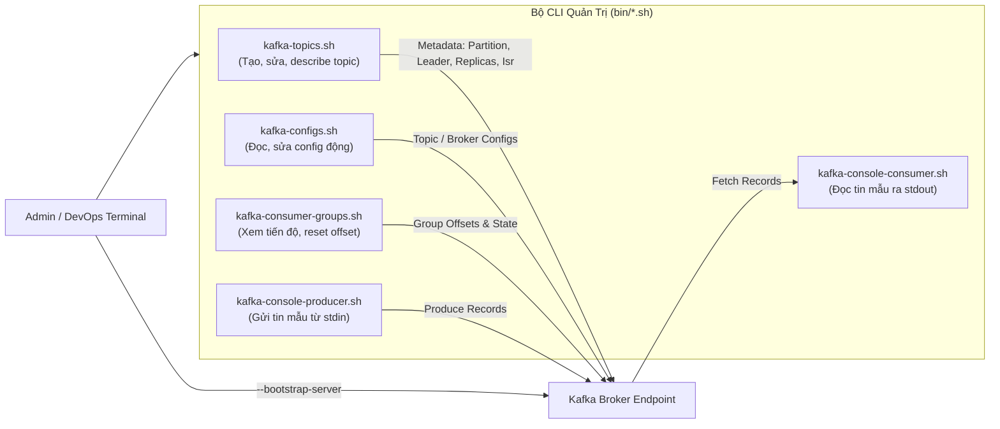
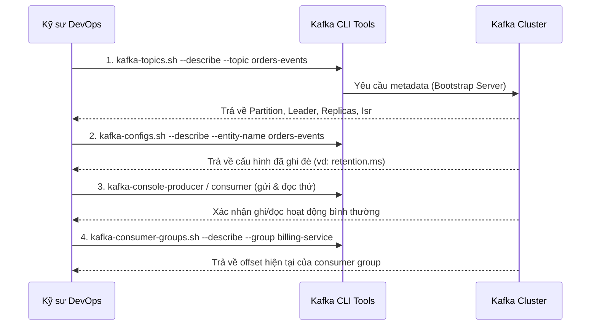

# 7_2_1 CLI Quản Trị (Admin CLI Tools)

> **Khóa học**: Cloud DevOps Basic — Data Platform
> **Phân nhóm**: 7 Domain 7 - Apache Kafka › [7_2 Kafka Operations and Troubleshooting](./README.md)
> **Chủ đề**: Bộ công cụ CLI quản trị đi kèm Kafka, đọc output `describe` của topic, kiểm chứng cờ lệnh theo phiên bản
> **Trạng thái**: Bản nháp (chưa kiểm chứng theo yêu cầu người dùng)
> **Lộ trình tổng**: [data-platform/README.md](../../README.md) · **Checklist đối chiếu**: [7_2 README](./README.md)

---

## 1. Khái Niệm Cốt Lõi & Bản Chất Kỹ Thuật (Core Concepts & Technical Deep Dive)

Khi vận hành một hệ thống truyền tải sự kiện (event streaming) như Apache Kafka, phần lớn công việc hằng ngày của kỹ sư DevOps không diễn ra trên giao diện đồ họa mà ngay trên dòng lệnh (terminal). Trước khi muốn chẩn đoán lỗi dữ liệu chậm hay mất đồng bộ, bạn cần biết cách hỏi trực tiếp cụm máy chủ Kafka (cluster) xem từng chủ đề dữ liệu (topic) đang được chia ra sao, máy chủ nào đang giữ vai trò chính, và ứng dụng đọc dữ liệu đang đứng ở đâu. Bộ công cụ CLI quản trị đi kèm sẵn với Apache Kafka giải quyết đúng bài toán đó: cho phép tạo, kiểm tra cấu trúc, chỉnh sửa cấu hình và thử nghiệm gửi/nhận tin nhắn mà không cần viết thêm code ứng dụng.

Trong bản phân phối chuẩn của Apache Kafka, các script dòng lệnh quản trị được đặt trong thư mục `bin/` (mang hậu tố `.sh` trên Linux/macOS; riêng trên Windows dùng file `.bat` trong thư mục `bin/windows/`). <!-- ev: C1.1 --> Khi triển khai qua container hoặc Kubernetes (chẳng hạn Strimzi), đường dẫn thư mục hoặc cách gọi lệnh có thể khác với gói cài đặt chuẩn — ví dụ gọi trực tiếp tên lệnh nếu đã gắn vào `PATH`, hoặc chạy thông qua `kubectl exec` vào pod Kafka. <!-- ev: C1.18 -->

Ở các phiên bản Kafka hiện đại (từ Kafka 3.0 trở đi), `kafka-topics.sh` kết nối trực tiếp tới broker thông qua tham số `--bootstrap-server`, vì cờ `--zookeeper` cũ đã bị loại bỏ từ Kafka 3.0. <!-- ev: C1.2 --> Cách tiếp cận qua `--bootstrap-server` giúp toàn bộ công cụ quản trị đi qua cùng một giao thức mạng của Kafka broker thay vì truy cập trực tiếp vào lớp lưu trữ điều phối cũ.

### 1.1 Năm công cụ CLI cốt lõi bạn cần nắm

#### 1. `kafka-topics.sh` — Quản lý topic và partition
- Công cụ này dùng để thực hiện vòng đời của topic gồm tạo mới (`--create`), liệt kê (`--list`), xem chi tiết (`--describe`), chỉnh sửa (`--alter`) và xóa (`--delete`). <!-- ev: C1.3 -->
- Khi tạo topic mới, bạn cần cung cấp tên topic (`--topic`), số lượng phân mảnh (`--partitions`) và hệ số sao lưu (`--replication-factor`). <!-- ev: C1.4 -->
- Khi cần mở rộng thông lượng, bạn có thể tăng số partition bằng `--alter --topic <tên> --partitions <số_mới>`, nhưng Kafka không hỗ trợ giảm số partition của một topic đã tồn tại. <!-- ev: C1.5 -->

#### 2. `kafka-configs.sh` — Đọc và cập nhật cấu hình động
- Công cụ này cho phép xem (`--describe`) và thay đổi động (`--alter` với `--add-config` hoặc `--delete-config`) cấu hình của các thực thể (`--entity-type`) như `topics` hoặc `brokers` mà không cần khởi động lại broker đối với các tham số hỗ trợ cập nhật động. <!-- ev: C1.11 -->
- Tình huống phổ biến là điều chỉnh thời gian giữ dữ liệu riêng cho một topic đang tăng dung lượng quá nhanh mà không ảnh hưởng các topic khác.

#### 3. `kafka-consumer-groups.sh` — Kiểm tra nhóm đọc dữ liệu
- Công cụ này dùng để liệt kê các nhóm consumer (`--list`), mô tả trạng thái và tiến độ đọc của một nhóm (`--describe --group <tên_group>`), xóa nhóm (`--delete`) hoặc đặt lại vị trí đọc (`--reset-offsets`). <!-- ev: C1.12 -->
- *Lưu ý phạm vi*: Bài này tập trung vào cú pháp và vai trò của lệnh; việc phân tích sâu từng nguyên nhân consumer lag sẽ học ở bài 7_2_2.

#### 4. `kafka-console-producer.sh` — Gửi tin nhắn thử từ bàn phím
- Công cụ này đọc từng dòng văn bản từ luồng nhập chuẩn (`stdin`) và gửi thành message vào topic chỉ định qua `--bootstrap-server` và `--topic`; khi cần gắn khóa phân vùng (key), bạn bật `--property parse.key=true` kèm `--property key.separator=<ký_tự>`. <!-- ev: C1.14 -->

#### 5. `kafka-console-consumer.sh` — Đọc tin nhắn thử ra màn hình
- Công cụ này mặc định chỉ đọc các message mới xuất hiện kể từ lúc lệnh bắt đầu chạy; thêm cờ `--from-beginning` để đọc lại từ vị trí sớm nhất hiện còn lưu trong topic. <!-- ev: C1.15 -->

### 1.2 Cách đọc kết quả `kafka-topics.sh --describe`

Khi chạy `kafka-topics.sh --describe --topic <tên>`, Kafka trả về một dòng tổng quan ở đầu và các dòng chi tiết cho từng partition ở bên dưới: <!-- ev: C1.6 -->

- **Dòng tổng quan**: Gồm `Topic`, `PartitionCount` (tổng số partition), `ReplicationFactor` (số bản sao mỗi partition) và `Configs` (các cấu hình topic đã được ghi đè khác mặc định). <!-- ev: C1.6 -->
- **`Partition`**: Chỉ số thứ tự của phân mảnh, đánh số bắt đầu từ `0`. <!-- ev: C1.7 -->
- **`Leader`**: Broker ID đang giữ vai trò chính, trực tiếp tiếp nhận mọi thao tác đọc và ghi cho partition đó (nếu hiển thị `none`, partition đang mất leader và tạm thời không phục vụ được). <!-- ev: C1.7 -->
- **`Replicas`**: Danh sách broker ID lưu giữ bản sao của partition đó, sắp xếp theo thứ tự mà broker đầu tiên chính là bản sao ưu tiên (preferred replica). <!-- ev: C1.8 -->
- **`Isr` (In-Sync Replicas)**: Tập con của `Replicas`, chỉ gồm các broker có bản sao đang bắt kịp trạng thái dữ liệu của leader. <!-- ev: C1.9 -->

Ngoài ra, `kafka-topics.sh --describe` còn hỗ trợ cờ `--under-replicated-partitions` để lọc nhanh các partition có số broker trong `Isr` ít hơn `Replicas`, và `--unavailable-partitions` để lọc các partition đang không có leader. <!-- ev: C1.10 --> (Quy trình xử lý sự cố replication không khỏe sẽ được phân tích kỹ ở bài 7_2_4).

### 1.3 Nâng cao: Xác thực bảo mật và kiểm chứng phiên bản (có thể bỏ qua ở lần đọc đầu)

Trong môi trường thực tế có bật mã hóa TLS hoặc xác thực SASL, bạn cần truyền tệp cấu hình kết nối cho CLI: nhóm lệnh `kafka-topics.sh`, `kafka-configs.sh` và `kafka-consumer-groups.sh` nhận cờ `--command-config <file.properties>`, còn console producer/consumer nhận lần lượt `--producer.config` và `--consumer.config`. <!-- ev: C1.16 -->

Một số tên cờ cũng thay đổi qua các thế hệ Kafka — chẳng hạn `kafka-console-producer.sh` ở các bản hiện đại dùng `--bootstrap-server` thay cho `--broker-list` cũ — vì vậy bạn luôn nên chạy `<script>.sh --help` trực tiếp trên binary đang dùng và đối chiếu với tài liệu Operations đúng phiên bản đó. <!-- ev: C1.17 -->

---

## 2. Ví Dụ Đời Sống Thực Tế Dễ Hiểu (Intuitive Real-World Analogies)

Hãy tưởng tượng cụm Kafka giống như một **kho trung chuyển hàng hóa có nhiều dãy kệ**, và bộ CLI quản trị giống như **bộ đồng hồ đo và tua-vít chuyên dụng của người thợ bảo trì kho**.

Thay vì phải tháo tung máy móc hay mở từng thùng hàng để đoán tình hình, người thợ chỉ cần cắm máy đo để xem ngay các thông số cốt lõi:

- **`kafka-topics.sh --describe`** giống như **bảng sơ đồ phân quầy trong kho**:
  - **Partition**: Mã số từng dãy kệ (`0`, `1`, `2`...).
  - **Leader**: Quầy chính đang trực tiếp nhận hàng nhập và xuất hàng cho khách.
  - **Replicas**: Danh sách tất cả các quầy giữ bản sao dự phòng cho dãy kệ đó.
  - **Isr**: Những quầy dự phòng hiện đã chép sổ sách kịp thời với quầy chính; nếu một quầy dự phòng bị kẹt xe chưa chép kịp, nó tạm thời rơi khỏi danh sách `Isr`.
- **`kafka-configs.sh`** giống như **núm chỉnh thời hạn lưu kho** cho riêng từng loại hàng (giữ 7 ngày hay rút xuống 1 ngày khi kho sắp đầy).
- **`kafka-console-producer.sh` và `kafka-console-consumer.sh`** giống như **tự tay bỏ thử một kiện hàng mẫu lên băng chuyền** rồi đứng ở đầu bên kia xem hàng có chạy ra đúng như mong đợi hay không.
- **`kafka-consumer-groups.sh`** giống như **máy kiểm tra hàng đợi ở cửa xuất**: xem đội ngũ bốc xếp nào đang đứng ở quầy nào và còn tồn bao nhiêu kiện chưa xử lý.

---

## 3. Kiến Trúc, Luồng Hoạt Động & Hình Ảnh Trực Quan (Architecture, Diagrams & Visual Media)

Sơ đồ dưới đây minh họa cách người vận hành dùng 5 công cụ CLI kết nối tới Kafka cluster để quan sát hoặc tác động lên từng thành phần bên trong:



Luồng kiểm tra nhanh một topic mới hoặc nghi ngờ sự cố thường đi theo trình tự 4 bước sau:



---

## 4. Code Mẫu Trực Quan Hoặc Dòng Lệnh Thực Chiến (Runnable Sample Code / CLI)

Ví dụ xuyên suốt dưới đây giả định bạn đang đứng trong thư mục cài đặt Apache Kafka (phiên bản tham chiếu **Apache Kafka 3.7+**) với cluster chạy tại `localhost:9092` gồm 3 broker (`1`, `2`, `3`). Nếu chạy trên container hoặc Strimzi, hãy thay phần gọi `./bin/*.sh` bằng đường dẫn script tương ứng trong container của bạn. <!-- ev: C1.1 C1.18 -->

Chúng ta sẽ thao tác trên một bài toán xuyên suốt: tạo một topic đơn hàng mẫu, kiểm tra metadata, chỉnh thời gian giữ dữ liệu, gửi/đọc tin nhắn thử và kiểm tra trạng thái nhóm đọc dữ liệu.

### Bước 1: Tạo và mô tả topic `orders-events`

Lệnh tạo topic với 3 partition và 3 bản sao: <!-- ev: C1.3 C1.4 -->

```bash
./bin/kafka-topics.sh --bootstrap-server localhost:9092 \
  --create --topic orders-events \
  --partitions 3 --replication-factor 3
```

Kiểm tra cấu trúc chi tiết bằng `--describe`: <!-- ev: C1.6 C1.7 C1.8 C1.9 -->

```bash
./bin/kafka-topics.sh --bootstrap-server localhost:9092 \
  --describe --topic orders-events
```

Output mẫu (input là tên topic `orders-events` → output là bảng phân bố partition): <!-- ev: C1.6 C1.7 C1.8 C1.9 -->

```text
Topic: orders-events    TopicId: xK9mP2vQ...    PartitionCount: 3       ReplicationFactor: 3    Configs:
        Topic: orders-events    Partition: 0    Leader: 1       Replicas: 1,2,3 Isr: 1,2,3
        Topic: orders-events    Partition: 1    Leader: 2       Replicas: 2,3,1 Isr: 2,3,1
        Topic: orders-events    Partition: 2    Leader: 3       Replicas: 3,1,2 Isr: 3,1,2
```

**Cách đọc kết quả**:
- Tại `Partition: 0`, broker `1` đang làm `Leader` phục vụ đọc/ghi; dữ liệu được nhân bản trên 3 broker `1,2,3` (`Replicas`), trong đó broker `1` là preferred replica; cả 3 broker đều đang bắt kịp dữ liệu (`Isr: 1,2,3`). <!-- ev: C1.7 C1.8 C1.9 -->
- Nếu muốn mở rộng lên 6 partition về sau, bạn dùng `--alter --partitions 6` (lưu ý không thể giảm từ 6 xuống 3). <!-- ev: C1.5 -->
- Khi cluster có dấu hiệu bất ổn, bạn có thể lọc nhanh partition thiếu bản sao đồng bộ hoặc mất leader: <!-- ev: C1.10 -->

```bash
./bin/kafka-topics.sh --bootstrap-server localhost:9092 --describe --under-replicated-partitions
./bin/kafka-topics.sh --bootstrap-server localhost:9092 --describe --unavailable-partitions
```

### Bước 2: Đọc và chỉnh cấu hình động với `kafka-configs.sh`

Xem các cấu hình đang được ghi đè trên topic `orders-events`, sau đó đặt `retention.ms` thành 24 giờ (`86400000` ms) mà không cần khởi động lại broker: <!-- ev: C1.11 -->

```bash
# Đọc cấu hình hiện tại của topic
./bin/kafka-configs.sh --bootstrap-server localhost:9092 \
  --entity-type topics --entity-name orders-events --describe

# Đặt thời gian giữ log riêng cho orders-events là 86400000 ms (24h)
./bin/kafka-configs.sh --bootstrap-server localhost:9092 \
  --entity-type topics --entity-name orders-events \
  --alter --add-config retention.ms=86400000
```

### Bước 3: Gửi và đọc message mẫu (Input → Command → Output)

Mở terminal thứ nhất để gửi 2 đơn hàng có gắn key (`ord-101`, `ord-102`) thông qua `kafka-console-producer.sh`: <!-- ev: C1.14 -->

```bash
./bin/kafka-console-producer.sh --bootstrap-server localhost:9092 \
  --topic orders-events \
  --property parse.key=true \
  --property key.separator=:
```

Nhập trực tiếp dữ liệu mẫu từ bàn phím: <!-- ev: C1.14 -->

```text
ord-101:{"status":"created","amount":250000}
ord-102:{"status":"paid","amount":490000}
```

Mở terminal thứ hai để đọc lại toàn bộ message đã gửi từ đầu topic bằng `--from-beginning` và gắn vào group `billing-service`: <!-- ev: C1.15 -->

```bash
./bin/kafka-console-consumer.sh --bootstrap-server localhost:9092 \
  --topic orders-events \
  --group billing-service \
  --from-beginning \
  --property print.key=true
```

Output nhận được trên màn hình:

```text
ord-101 {"status":"created","amount":250000}
ord-102 {"status":"paid","amount":490000}
```

### Bước 4: Kiểm tra consumer group `billing-service`

Nhấn `Ctrl+C` để dừng console consumer vừa chạy, sau đó kiểm tra thông tin group `billing-service`: <!-- ev: C1.12 -->

```bash
./bin/kafka-consumer-groups.sh --bootstrap-server localhost:9092 \
  --describe --group billing-service
```

*(Nếu cần reset lại vị trí đọc của `billing-service` về đầu topic, đảm bảo toàn bộ consumer trong group đã dừng hẳn để group rỗng rồi chạy thử với `--dry-run` trước khi dùng `--execute`)*: <!-- ev: C1.13 -->

```bash
# Nâng cao: xem trước kết quả reset offset (không ghi đè thực tế)
./bin/kafka-consumer-groups.sh --bootstrap-server localhost:9092 \
  --group billing-service --topic orders-events \
  --reset-offsets --to-earliest --dry-run
```

---

## 5. Cạm Bẫy Thực Tế & Thực Tiễn Sản Xuất (Production Gotchas & Best Practices)

### 1. Chạy xóa topic hoặc reset offset trực tiếp trên production không kiểm tra trước
- Xóa topic sẽ xóa toàn bộ dữ liệu phân mảnh của topic đó trên các broker; còn reset offset nhầm có thể khiến ứng dụng đọc lặp lại hàng triệu tin nhắn cũ hoặc bỏ sót dữ liệu mới.
- **Thực hành tốt**: Với `--reset-offsets`, luôn chạy `--dry-run` để kiểm tra offset dự kiến trước khi thay bằng `--execute`, và đảm bảo group đã dừng sạch consumer (`Empty`). <!-- ev: C1.13 -->

### 2. Tăng số partition quá tay để "chữa cháy" thông lượng
- Trong Kafka, bạn có thể tăng số partition bằng `--alter`, nhưng không thể giảm ngược lại nếu lỡ đặt quá lớn (nhiều partition thừa làm tăng file handle, bộ nhớ và thời gian bầu leader). <!-- ev: C1.5 -->
- Ngoài ra, tăng số partition của topic đang dùng key sẽ làm thay đổi hàm băm phân phối key mới vào partition khác so với dữ liệu cũ.

### 3. Copy nguyên cờ lệnh cũ từ bài viết trên mạng không kiểm tra phiên bản
- Các hướng dẫn cũ thường dùng `--zookeeper` cho `kafka-topics.sh` hoặc `--broker-list` cho `kafka-console-producer.sh`, vốn đã bị thay thế hoặc loại bỏ ở các bản Kafka 3.x hiện đại. <!-- ev: C1.2 C1.17 -->
- **Thực hành tốt**: Luôn kiểm tra bằng `<script>.sh --help` trực tiếp trong môi trường của bạn trước khi đưa lệnh vào runbook hoặc script tự động. <!-- ev: C1.17 -->

### 4. Quên tệp cấu hình bảo mật khi vận hành cluster có SASL/TLS
- Chạy CLI mà không truyền tệp cấu hình bảo mật trên cluster production thường gây lỗi timeout hoặc từ chối kết nối dù broker vẫn sống bình thường (nhóm admin dùng `--command-config`, còn console dùng `--producer.config` / `--consumer.config`). <!-- ev: C1.16 -->
- Hãy giữ một tệp cấu hình riêng chỉ có quyền đọc tối thiểu (least privilege) trên bastion/jump host để kiểm tra trạng thái an toàn.

### 5. Đọc nhầm `console-consumer` tưởng mất dữ liệu
- Chạy `kafka-console-consumer.sh` không kèm `--from-beginning` chỉ hiển thị tin nhắn mới phát sinh sau thời điểm chạy lệnh, dễ gây hiểu nhầm là topic trống rỗng. <!-- ev: C1.15 -->

---

## 6. Câu Hỏi Củng Cố Kiến Thức (Active Recall Quiz)

**Câu 1**: Khi chạy `kafka-topics.sh --describe --topic orders-events`, bạn thấy dòng sau:
`Partition: 2    Leader: 3    Replicas: 3,1,2    Isr: 3`
Điều này cho biết trạng thái gì của `Partition 2`?

<details>
<summary>Đáp án</summary>

- Broker `3` đang là `Leader` trực tiếp phục vụ đọc/ghi cho `Partition 2`.
- `Partition 2` được cấu hình có 3 bản sao nằm trên các broker `3`, `1`, `2` (`Replicas: 3,1,2`), trong đó broker `3` là preferred replica.
- Tuy nhiên, `Isr` hiện chỉ còn mỗi broker `3` — tức là broker `1` và `2` đang chưa bắt kịp dữ liệu của leader (partition này đang ở trạng thái under-replicated, cần kiểm tra tiếp theo quy trình ở bài 7_2_4).

</details>

**Câu 2**: Đồng nghiệp chạy lệnh `kafka-topics.sh --zookeeper localhost:2181 --list` trên cụm Apache Kafka 3.7 mới dựng và gặp lỗi không nhận diện tùy chọn. Nguyên nhân là gì và sửa thế nào?

<details>
<summary>Đáp án</summary>

- Từ Apache Kafka 3.0 trở đi, tùy chọn `--zookeeper` đã bị loại bỏ khỏi `kafka-topics.sh`.
- Cách sửa đúng là chuyển sang kết nối trực tiếp broker bằng `--bootstrap-server <broker_host:port>` (ví dụ `kafka-topics.sh --bootstrap-server localhost:9092 --list`), và luôn kiểm tra lại cú pháp bằng `kafka-topics.sh --help` trên đúng bản Kafka đang chạy.

</details>

**Câu 3**: Bạn muốn reset offset của consumer group `billing-service` về đầu topic (`--to-earliest`), nhưng lệnh báo lỗi từ chối thực thi. Trước khi dùng `--execute`, bạn cần kiểm tra và đảm bảo hai điều kiện nào?

<details>
<summary>Đáp án</summary>

1. Consumer group `billing-service` phải ở trạng thái không còn consumer nào đang chạy (`Empty` — cần dừng các pod/process consumer thuộc group đó trước).
2. Nên chạy kèm `--dry-run` trước để xem trước mức offset sẽ chuyển tới ở từng partition, sau đó mới thay `--dry-run` bằng `--execute`.

</details>

---

## 7. 📚 Nguồn Tài Liệu Chính Thống (Tier-1 Official References)

- [Apache Kafka Documentation — Operations](https://kafka.apache.org/documentation/#operations) — Tài liệu chính thức về các thao tác quản trị Kafka bằng CLI (`kafka-topics.sh`, `kafka-configs.sh`, `kafka-consumer-groups.sh`, kiểm tra trạng thái topic và partition).
- [Apache Kafka Quickstart](https://kafka.apache.org/quickstart) — Hướng dẫn chính thức sử dụng `kafka-topics.sh`, `kafka-console-producer.sh` và `kafka-console-consumer.sh` qua `--bootstrap-server`.
- [Apache Kafka Documentation — Topic Configs](https://kafka.apache.org/documentation/#topicconfigs) — Tham chiếu các cấu hình cấp topic (như `retention.ms`) dùng cùng `kafka-configs.sh`.
