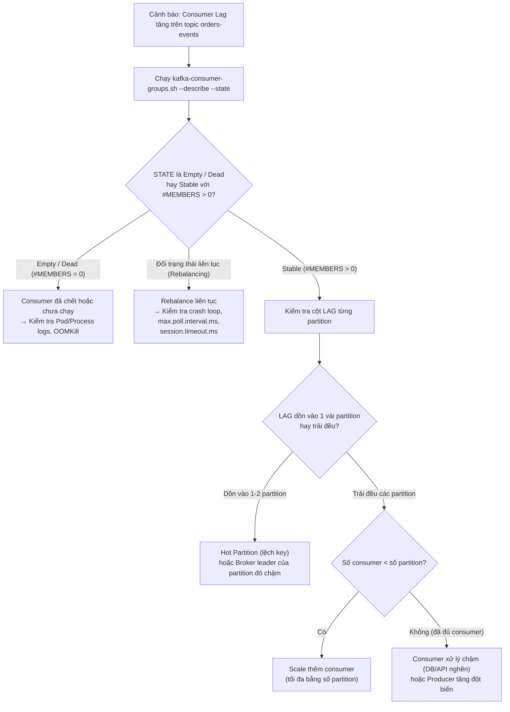

# 7_2_2 Consumer Lag

> **Khóa học**: Cloud DevOps Basic — Data Platform
> **Phân nhóm**: 7 Domain 7 - Apache Kafka › 7_2 Kafka Operations and Troubleshooting
> **Chủ đề**: Định nghĩa Consumer Lag, đọc cột `CURRENT-OFFSET`, `LOG-END-OFFSET`, `LAG`, nguyên nhân gây lag, trạng thái group `Empty`/`Dead`, và quy trình chẩn đoán thực chiến
> **Trạng thái**: Bản nháp (chưa kiểm chứng theo yêu cầu người dùng)
> **Checklist đối chiếu**: Không áp dụng (xem danh mục kỹ năng tại [7_2 Kafka Operations and Troubleshooting](README.md))
> **Lộ trình tổng**: [data-platform/README.md](../../README.md) · **Chủ đề**: [7_2 Kafka Operations and Troubleshooting](README.md)

---

## 1. Khái Niệm Cốt Lõi & Bản Chất Kỹ Thuật (Core Concepts & Technical Deep Dive)

Trong hệ thống streaming dữ liệu, producer liên tục đẩy các bản ghi (record) vào Kafka topic, còn consumer trong một consumer group sẽ lấy dần các bản ghi đó về để xử lý. Khi tốc độ xử lý của consumer không theo kịp tốc độ ghi của producer, một lượng bản ghi chưa được xử lý sẽ tích tụ lại trên broker. Khoảng cách tồn đọng này được gọi là **Consumer Lag** — chỉ số quan trọng bậc nhất để đánh giá sức khỏe của pipeline dữ liệu theo thời gian thực.

### 1.1. Định nghĩa Consumer Lag theo Partition và theo Group

Để hiểu consumer lag, trước hết cần nắm rõ khái niệm vị trí dữ liệu trong một partition (phân vùng lưu trữ dữ liệu theo thứ tự tuần tự của Kafka):

- **Offset**: Mỗi bản ghi khi được ghi vào một partition sẽ được Kafka gán một số thứ tự nguyên tăng dần duy nhất trong phạm vi partition đó, gọi là offset. <!-- ev: C2.1 -->
- **`LOG-END-OFFSET` (LEO)**: Đây là vị trí offset của bản ghi tiếp theo sẽ được ghi vào cuối partition trên broker leader, cho biết tổng độ dài dữ liệu hiện có của partition đó. <!-- ev: C2.2 -->
- **`CURRENT-OFFSET`**: Đây là vị trí offset gần nhất đã được consumer group xác nhận xử lý xong (commit) cho partition đó. <!-- ev: C2.3 -->
- **`LAG` theo từng partition**: Giá trị lag trên một partition chính là hiệu số giữa `LOG-END-OFFSET` và `CURRENT-OFFSET` (`LAG = LOG-END-OFFSET - CURRENT-OFFSET`), cho biết còn bao nhiêu bản ghi đang chờ consumer xử lý ở partition đó. <!-- ev: C2.4 -->
- **Lag theo toàn bộ Consumer Group**: Tổng consumer lag của một consumer group trên một topic (hoặc toàn group) được tính bằng tổng giá trị `LAG` cộng dồn từ tất cả các partition mà group đang tiêu thụ. <!-- ev: C2.5 -->

Ví dụ với bài toán xuyên suốt bài học: hệ thống thương mại điện tử có topic `orders-events` gồm 3 partition (`0`, `1`, `2`) và consumer group `order-processor` đang đọc dữ liệu. Nếu tại partition `0`, `LOG-END-OFFSET` là `1050` và `CURRENT-OFFSET` là `1000`, thì `LAG` của partition `0` là `50` bản ghi. <!-- ev: C2.4 --> Nếu partition `1` có `LAG = 10` và partition `2` có `LAG = 0`, tổng lag của group `order-processor` là `60` bản ghi. <!-- ev: C2.5 -->

### 1.2. Năm nguyên nhân phổ biến gây tăng Consumer Lag

Khi độ trễ tăng liên tục theo thời gian, kỹ sư DevOps cần phân biệt rõ năm nhóm nguyên nhân kỹ thuật sau:

1. **Consumer xử lý chậm hoặc bị lỗi (Slow / Failing Consumer)**:
   Mỗi consumer đọc từng lô bản ghi rồi thực hiện xử lý nghiệp vụ (như ghi database hoặc gọi API bên ngoài); nếu tác vụ chậm hoặc lỗi lặp lại khiến offset không được commit, `CURRENT-OFFSET` sẽ đứng yên trong khi `LOG-END-OFFSET` vẫn tăng đều. <!-- ev: C2.2 C2.3 -->
2. **Thiếu consumer so với số lượng partition (Insufficient Consumers)**:
   Trong cùng một consumer group, mỗi partition tại một thời điểm chỉ được gán cho tối đa một consumer instance. <!-- ev: C2.6 --> Khi số lượng consumer instance ít hơn số partition, một số consumer phải đảm nhận nhiều partition cùng lúc nên dễ bị quá tải nếu lưu lượng producer tăng cao. <!-- ev: C2.7 --> Ngược lại, nếu bạn scale số consumer vượt quá số partition của topic, các consumer thừa ra sẽ nằm chờ (idle) và không nhận thêm partition nào. <!-- ev: C2.8 -->
3. **Hot Partition do lệch Key (Skewed Key)**:
   Khi producer gắn cùng một partition key cho nhiều bản ghi, bộ chia mặc định của Kafka sẽ định tuyến các bản ghi có cùng key về cùng một partition để giữ đúng thứ tự. <!-- ev: C2.9 --> Nếu một key xuất hiện quá nhiều (ví dụ một khách hàng lớn chiếm 80% đơn hàng), partition chứa key đó sẽ có `LAG` tăng vọt trong khi các partition khác gần như bằng 0.
4. **Rebalance liên tục (Continuous Rebalance)**:
   Khi một consumer tham gia, rời group hoặc không phản hồi đúng hạn, consumer group bước vào quá trình phân chia lại partition (rebalance), khiến việc đọc dữ liệu bị gián đoạn tạm thời và làm lag tăng vọt. <!-- ev: C2.10 --> *(Lưu ý: Cơ chế chi tiết về timeout và vòng đời rebalance được phân tích sâu ở bài `7_2_3 Rebalance Liên Tục`, còn kiến trúc consumer group nền tảng nằm ở bài `7_1_3`).*
5. **Broker chậm hoặc gặp vấn đề hạ tầng (Slow Broker)**:
   Nếu broker giữ partition leader gặp nghẽn I/O đĩa, quá tải CPU hoặc nghẽn mạng, thời gian phản hồi yêu cầu fetch dữ liệu của consumer sẽ chậm lại đáng kể dù code ứng dụng consumer hoàn toàn bình thường. <!-- ev: C2.11 -->

### 1.3. Lag tăng nhưng không có Consumer hoạt động: Trạng thái `Empty` và `Dead`

Một tình huống rất hay gặp khi trực hệ thống là cảnh báo lag tăng cao nhưng kiểm tra danh sách thành viên lại không thấy consumer nào đang chạy. Lúc này, bạn cần kiểm tra trạng thái của consumer group để hiểu chuyện gì đang xảy ra với các offset đã lưu:

- **Trạng thái `Empty`**: Group hiện không có thành viên consumer nào đang kết nối, nhưng metadata và các offset đã commit trước đó vẫn còn được lưu trên broker. <!-- ev: C2.12 --> Vì vẫn còn `CURRENT-OFFSET` cũ để đối chiếu với `LOG-END-OFFSET` mới, hệ thống giám sát vẫn thấy `LAG` tăng lên từng giây khi producer tiếp tục ghi dữ liệu.
- **Trạng thái `Dead`**: Group không có thành viên nào và toàn bộ thông tin/offset của group đã bị xóa (hoặc đã hết hạn lưu giữ theo cấu hình `offsets.retention.minutes`), hoặc group chưa từng tồn tại. <!-- ev: C2.13 -->

### 1.4. Nâng cao: Các tham số Consumer ảnh hưởng trực tiếp đến nhịp đọc và Rebalance

*Nâng cao: có thể bỏ qua ở lần đọc đầu — phần này giúp bạn đối chiếu cấu hình khi nghi ngờ consumer bị rebalance ngầm do xử lý chậm.*

- **`max.poll.interval.ms`**: Quy định khoảng thời gian tối đa cho phép giữa hai lần consumer gọi hàm `poll()` liên tiếp; nếu code xử lý một lô bản ghi lâu hơn ngưỡng này, coordinator coi consumer bị treo và kích hoạt rebalance. <!-- ev: C2.14 -->
- **`max.poll.records`**: Giới hạn số lượng bản ghi tối đa mà consumer lấy về trong một lần gọi `poll()`, giúp thu nhỏ kích thước lô xử lý để kịp hoàn thành trước khi chạm ngưỡng `max.poll.interval.ms`. <!-- ev: C2.15 -->
- **`session.timeout.ms`**: Quy định thời gian tối đa group coordinator chờ tín hiệu heartbeat từ consumer; nếu quá hạn mà không nhận được heartbeat, consumer bị loại khỏi group và quá trình rebalance diễn ra. <!-- ev: C2.16 -->

---

## 2. Ví Dụ Đời Sống Thực Tế Dễ Hiểu (Intuitive Real-World Analogies)

Hãy tưởng tượng hệ thống Kafka như **khu vực thanh toán của một siêu thị lớn**:

- **Topic với các Partition** giống như **3 làn xếp hàng** (Làn 0, Làn 1, Làn 2) dẫn tới quầy thu ngân.
- **Producer** là luồng khách hàng mới liên tục đẩy xe hàng vào cuối các làn (`LOG-END-OFFSET` tăng lên mỗi khi có thêm khách đứng vào cuối hàng).
- **Consumer** là các nhân viên thu ngân đang quét mã vạch tính tiền cho từng khách (`CURRENT-OFFSET` là số thứ tự của vị khách tiếp theo sắp được quét).
- **Consumer Lag** chính là **số lượng khách đang đứng chờ giữa nhân viên thu ngân và cuối hàng**. Hàng càng dài nghĩa là khách chờ càng lâu.

Từ hình ảnh siêu thị này, 5 nguyên nhân gây lag trở nên cực kỳ dễ đoán:

1. **Thu ngân làm chậm (Slow Consumer)**: Máy quét mã vạch bị đơ hoặc thu ngân phải gọi điện hỏi giá liên tục → hàng người đứng chờ ngày càng dài dù khách vào bình thường.
2. **Thiếu quầy mở (Insufficient Consumers)**: Siêu thị có 3 làn xếp hàng nhưng chỉ mở 1 quầy thu ngân, nên 1 nhân viên phải chạy qua chạy lại quét cho cả 3 làn. Tuy nhiên, nếu chỉ có 3 làn mà bạn thuê tới 5 nhân viên thu ngân thì 2 người vẫn phải đứng không vì một làn chỉ đặt được một máy tính tiền.
3. **Một làn bị dồn khách (Hot Partition)**: Siêu thị quy định "khách mua theo đoàn VIP đều phải vào Làn 0". Hôm nay đoàn VIP đi siêu thị cực đông → Làn 0 tắc nghẽn dài hàng chục mét trong khi Làn 1 và Làn 2 trống trơn.
4. **Đổi ca liên tục (Continuous Rebalance)**: Cứ vài phút quản lý lại hô dừng thanh toán để đổi người đứng quầy. Trong lúc bàn giao quầy, không ai quét mã vạch nên khách ở cả 3 làn đều ùn lại.
5. **Quầy đóng cửa bỏ về (Empty / Dead Group)**: Tất cả nhân viên thu ngân đã nghỉ việc đóng quầy, nhưng hệ thống vẫn nhớ số thứ tự khách trước đó nên thấy hàng khách mới đến ngày càng dài (`Empty`). Nếu đóng quầy quá lâu tới mức bảng số thứ tự bị xóa sạch khỏi hệ thống, quầy đó coi như ngừng tồn tại (`Dead`).

---

## 3. Kiến Trúc, Luồng Hoạt Động & Hình Ảnh Trực Quan (Architecture, Diagrams & Visual Media)

Sơ đồ dưới đây mô tả trực tiếp **luồng chẩn đoán Consumer Lag** khi nhận cảnh báo trong vận hành (và cũng là khung trả lời chuẩn cho câu hỏi phỏng vấn DevOps):



Khi nhìn vào sơ đồ này, nguyên tắc vàng của người trực hệ thống là **không bao giờ đoán mò hay scale mù quáng**: luôn kiểm tra trạng thái group và phân bố độ trễ trên từng partition trước khi hành động.

---

## 4. Code Mẫu Trực Quan Hoặc Dòng Lệnh Thực Chiến (Runnable Sample Code / CLI)

Trong Apache Kafka, công cụ dòng lệnh tiêu chuẩn đi kèm bộ cài đặt để kiểm tra consumer lag là `kafka-consumer-groups.sh` (thuộc nhóm công cụ quản trị vận hành trong Kafka distribution). <!-- ev: C2.1 -->

### 4.1. Lệnh xem chi tiết Lag theo từng Partition

- **Lệnh dùng để làm gì**: Kết nối tới cụm Kafka và in ra bảng thông số offset cùng độ trễ `LAG` của từng partition mà consumer group đang phụ trách. <!-- ev: C2.17 -->
- **Các cờ chính**:
  - `--bootstrap-server`: Địa chỉ broker đầu vào của cụm Kafka (ví dụ `localhost:9092`). <!-- ev: C2.17 -->
  - `--describe`: Yêu cầu xuất thông tin chi tiết của group thay vì chỉ liệt kê tên. <!-- ev: C2.1 -->
  - `--group`: Tên định danh của consumer group cần kiểm tra (ví dụ `order-processor`). <!-- ev: C2.17 -->

<!-- ev: C2.17 -->
```bash
# Kiểm tra chi tiết từng partition của group order-processor
kafka-consumer-groups.sh \
  --bootstrap-server localhost:9092 \
  --describe \
  --group order-processor
```

**Kết quả minh họa (Output) — Tình huống bình thường vs Hot Partition:**

<!-- ev: C2.17 -->
```text
GROUP           TOPIC           PARTITION  CURRENT-OFFSET  LOG-END-OFFSET  LAG             CONSUMER-ID                                           HOST            CLIENT-ID
order-processor orders-events   0          1020            1520            500             consumer-order-processor-1-9a8b...                    /10.244.1.12    consumer-order-processor-1
order-processor orders-events   1          980             982             2               consumer-order-processor-2-4c1d...                    /10.244.1.15    consumer-order-processor-2
order-processor orders-events   2          1100            1100            0               consumer-order-processor-3-7e2f...                    /10.244.1.18    consumer-order-processor-3
```

**Cách đọc kết quả từ Input → Command → Output trên:**
- Cả 3 partition đều đã có `CONSUMER-ID` và `HOST` khác nhau đảm nhận (tức đã đủ 3 consumer cho 3 partition). <!-- ev: C2.17 -->
- Tuy nhiên, Partition `0` có `LOG-END-OFFSET = 1520` và `CURRENT-OFFSET = 1020`, dẫn đến `LAG = 500`, trong khi Partition `1` và `2` có `LAG` gần như bằng `0`. <!-- ev: C2.2 C2.3 C2.4 -->
- Kết luận nhanh: Đây là dấu hiệu điển hình của **Hot Partition** do lệch key (hoặc broker giữ leader của Partition `0` đang bị chậm), không phải do thiếu số lượng consumer instance. <!-- ev: C2.9 C2.11 -->

### 4.2. Lệnh kiểm tra trạng thái tổng quan của Group (`--state`)

- **Lệnh dùng để làm gì**: Xem trạng thái vòng đời (`STATE`), thuật toán phân chia partition (`ASSIGNMENT-STRATEGY`) và tổng số thành viên hiện tại (`#MEMBERS`) của consumer group. <!-- ev: C2.18 -->

<!-- ev: C2.18 -->
```bash
# Kiểm tra trạng thái group (Stable, Empty, Dead, PreparingRebalance...)
kafka-consumer-groups.sh \
  --bootstrap-server localhost:9092 \
  --describe \
  --group order-processor \
  --state
```

**Kết quả minh họa khi toàn bộ consumer đã bị tắt:**

<!-- ev: C2.18 -->
```text
GROUP                     COORDINATOR (ID)          ASSIGNMENT-STRATEGY  STATE           #MEMBERS
order-processor           kafka-broker-1:9092 (1)                        Empty           0
```

Khi chạy lại lệnh `--describe` (không có `--state`) trên group đang ở trạng thái `Empty`, cột `CONSUMER-ID`, `HOST`, `CLIENT-ID` sẽ hiển thị dấu `-`, nhưng các cột `CURRENT-OFFSET`, `LOG-END-OFFSET` và `LAG` vẫn tiếp tục được tính toán và tăng dần theo thời gian. <!-- ev: C2.12 -->

---

## 5. Cạm Bẫy Thực Tế & Thực Tiễn Sản Xuất (Production Gotchas & Best Practices)

1. **Cạm bẫy "Scale consumer vô tội vạ"**:
   Nhiều kỹ sư thấy lag tăng liền tăng số replicas của consumer Pod từ 3 lên 10 trên topic chỉ có 3 partition. Do giới hạn kiến trúc mỗi partition chỉ gán cho tối đa một consumer trong cùng group, 7 Pod tăng thêm sẽ hoàn toàn nhàn rỗi và gây lãng phí tài nguyên CPU/RAM mà không giảm được một đơn vị lag nào. <!-- ev: C2.6 C2.8 -->
2. **Cạm bẫy mất dữ liệu âm thầm khi lag vượt ngưỡng Retention**:
   Kafka lưu giữ dữ liệu trên đĩa theo thời gian hoặc dung lượng cấu hình (như `retention.ms` hoặc `retention.bytes`) chứ không xóa ngay sau khi consumer đọc, nên nếu lag kéo dài vượt quá thời gian retention này thì các bản ghi cũ chưa kịp đọc sẽ bị broker xóa bỏ và gây mất dữ liệu cho consumer. <!-- ev: C2.19 -->
3. **Nhầm lẫn giữa "Lag nhỏ tạm thời" và "Lag tăng đơn điệu"**:
   Khi lưu lượng gửi đến tăng đột biến trong thời gian ngắn, độ trễ có thể tăng tạm thời rồi nhanh chóng giảm về mức bình thường khi consumer tiêu thụ kịp; chỉ khi đồ thị độ trễ dốc lên liên tục theo thời gian mới là dấu hiệu sự cố cần can thiệp khẩn cấp.
4. **Thực hành tốt cho phỏng vấn DevOps ("Consumer lag là gì, xử lý thế nào?")**:
   Hãy trình bày có cấu trúc theo 4 bước: (1) Định nghĩa `LAG = LOG-END-OFFSET - CURRENT-OFFSET`; (2) Dùng `kafka-consumer-groups.sh --describe` kèm `--state` để xác định group còn sống hay `Empty`/`Dead` và xem lag dồn cục bộ hay trải đều; (3) Khoanh vùng 1 trong 5 nguyên nhân gốc (chậm xử lý, thiếu consumer so với partition, hot partition, rebalance liên tục, broker chậm); (4) Đưa giải pháp trúng đích thay vì đoán mò. <!-- ev: C2.4 C2.17 C2.18 -->

---

## 6. Câu Hỏi Củng Cố Kiến Thức (Active Recall Quiz)

**Câu 1**: Topic `orders-events` có 4 partition. Group `order-processor` đang có `LAG` tăng đều ở cả 4 partition, hiện chỉ có 2 consumer đang chạy. Nếu bạn scale lên 6 consumer thì có bao nhiêu consumer thực sự đọc dữ liệu?

<details>
<summary>Đáp án</summary>

Chỉ có **4 consumer** thực sự đọc dữ liệu (mỗi consumer phụ trách 1 partition), còn **2 consumer dư ra sẽ ở trạng thái nhàn rỗi (idle)** do mỗi partition chỉ được gán cho tối đa 1 consumer trong cùng một group. <!-- ev: C2.6 C2.8 -->

</details>

**Câu 2**: Khi chạy `kafka-consumer-groups.sh --describe --group order-processor --state`, bạn thấy `STATE = Empty` và `#MEMBERS = 0`, nhưng biểu đồ `LAG` vẫn tăng liên tục. Điều này có ý nghĩa gì và bạn cần kiểm tra gì tiếp theo?

<details>
<summary>Đáp án</summary>

`Empty` nghĩa là không còn consumer nào đang hoạt động trong group, nhưng các offset đã commit trước đó vẫn còn lưu trên broker nên `LAG` tiếp tục tăng khi producer ghi thêm dữ liệu mới. <!-- ev: C2.12 --> Bạn cần kiểm tra ngay lý do các consumer process/Pod bị tắt hoặc crash (xem log ứng dụng, trạng thái container/OOMKill) thay vì chỉ nhìn vào đồ thị lag.

</details>

**Câu 3**: Quan sát output `--describe`, bạn thấy Partition 0 có `LAG = 120.000`, trong khi Partition 1, 2, 3 đều có `LAG = 0`, cả 4 consumer đều đang ở trạng thái ổn định. Hai nguyên nhân nào có khả năng cao nhất gây ra tình trạng này?

<details>
<summary>Đáp án</summary>

(1) **Hot Partition do lệch Key**: Producer đang gán cùng một key cho phần lớn bản ghi khiến Kafka dồn toàn bộ lưu lượng đó về Partition 0. <!-- ev: C2.9 -->
(2) **Slow Broker**: Broker đang giữ vai trò leader của riêng Partition 0 gặp vấn đề I/O đĩa, CPU hoặc mạng nên phản hồi chậm hơn các broker còn lại. <!-- ev: C2.11 -->

</details>

---

## 7. 📚 Nguồn Tài Liệu Chính Thống (Tier-1 Official References)

- [Apache Kafka Documentation — Operations (Managing Consumer Groups)](https://kafka.apache.org/documentation/#operations) - Tài liệu chính thức về vận hành Kafka, công cụ `kafka-consumer-groups.sh`, đọc offset, lag và trạng thái consumer group.
- [Apache Kafka Documentation — Consumer Configurations](https://kafka.apache.org/documentation/#consumerconfigs) - Danh mục cấu hình chính thức của Kafka Consumer (`max.poll.interval.ms`, `max.poll.records`, `session.timeout.ms`).
- [Apache Kafka Documentation — Topic-Level Configs & Broker Configs](https://kafka.apache.org/documentation/#brokerconfigs) - Tài liệu chính thức về các tham số lưu giữ dữ liệu (`retention.ms`, `retention.bytes`, `offsets.retention.minutes`).
