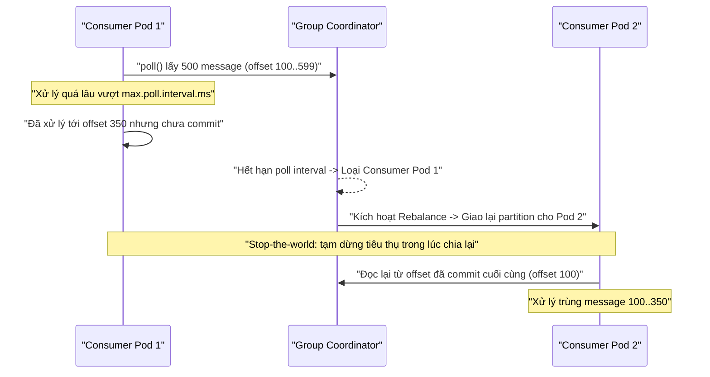
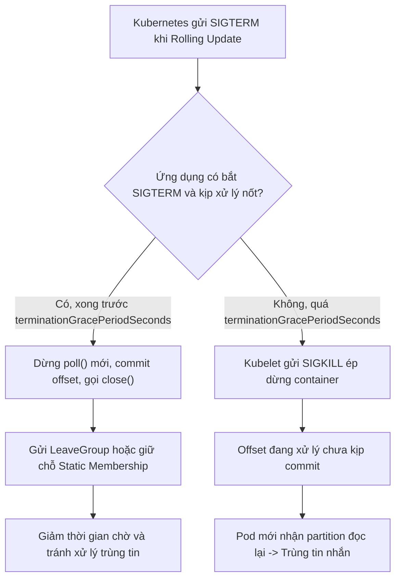

# 7_2_3 Rebalance Liên Tục (Continuous Rebalance)

> **Khóa học**: Cloud DevOps Basic — Data Platform
> **Phân nhóm**: 7 Domain 7 - Apache Kafka › 7_2 Kafka Operations and Troubleshooting
> **Chủ đề**: Rebalance liên tục — nguyên nhân (`max.poll.interval.ms`, `session.timeout.ms`, Pod restart), hệ quả (stop-the-world, xử lý trùng tin) và giảm thiểu bằng graceful shutdown trên Kubernetes
> **Trạng thái**: Bản nháp (chưa kiểm chứng theo yêu cầu người dùng)
> **Tiên quyết**: 7_1_3 Consumer Group (khái niệm cơ bản), 6_3_7 Graceful Shutdown trên Kubernetes
> **Lộ trình**: [7_2 Kafka Operations and Troubleshooting](./README.md) · [Data Platform](../../README.md)

---

## 1. Khái Niệm Cốt Lõi & Bản Chất Kỹ Thuật (Core Concepts & Technical Deep Dive)

**Rebalance** là quá trình các consumer trong cùng một consumer group phân chia lại quyền sở hữu các partition khi số thành viên trong group hoặc thông tin topic/partition thay đổi `<!-- ev: C3.1 -->`. Trong điều kiện bình thường, rebalance chỉ xảy ra khi bạn thêm, bớt hoặc nâng cấp consumer. Tuy nhiên, nếu một consumer liên tục bị **group coordinator** (broker chịu trách nhiệm điều phối consumer group) đánh dấu là "đã chết" hoặc thoát ra rồi tham gia lại, hệ thống sẽ rơi vào trạng thái **rebalance liên tục** (continuous rebalance). Khi đó, consumer group dành phần lớn thời gian để thu hồi và chia lại partition thay vì đọc dữ liệu, khiến consumer lag tăng nhanh và dịch vụ có nguy cơ xử lý trùng lặp tin nhắn.

### 1.1 Ba nguyên nhân gốc rễ gây Rebalance liên tục

#### 1) Xử lý message quá lâu vượt quá `max.poll.interval.ms`
Hàm `poll()` là lời gọi định kỳ mà ứng dụng consumer thực hiện để lấy một lô message mới từ Kafka và báo cho coordinator biết luồng xử lý chính vẫn đang hoạt động. Tham số `max.poll.interval.ms` quy định khoảng thời gian tối đa cho phép giữa hai lần gọi `poll()` liên tiếp khi sử dụng cơ chế quản lý consumer group `<!-- ev: C3.2 -->`. Nếu ứng dụng xử lý lô message quá chậm (ví dụ gọi API bên thứ ba bị nghẽn hoặc truy vấn database nặng) khiến thời gian giữa hai lần `poll()` vượt quá `max.poll.interval.ms`, group coordinator sẽ coi consumer đó đã gặp sự cố, loại nó khỏi group và kích hoạt rebalance để giao partition cho thành viên khác `<!-- ev: C3.3 -->`.

Để kiểm soát kích thước công việc cho mỗi vòng lặp, tham số `max.poll.records` giới hạn số lượng record tối đa mà một lần gọi `poll()` có thể trả về `<!-- ev: C3.4 -->`. Giảm `max.poll.records` giúp mỗi lần xử lý kết thúc nhanh hơn và gọi `poll()` kịp thời hạn.

#### 2) Mất heartbeat hoặc hết hạn `session.timeout.ms`
**Heartbeat** là tín hiệu định kỳ mà một luồng nền (background thread) của consumer gửi tới group coordinator để chứng minh kết nối phiên làm việc vẫn sống. Tham số `session.timeout.ms` quy định khoảng thời gian tối đa mà coordinator chờ heartbeat từ consumer trước khi đánh dấu consumer đã mất kết nối và bắt đầu rebalance `<!-- ev: C3.5 -->`. Tham số `heartbeat.interval.ms` xác định tần suất gửi heartbeat; giá trị này phải nhỏ hơn `session.timeout.ms` (thực tế khuyến nghị không vượt quá 1/3 `session.timeout.ms`) để consumer có nhiều cơ hội gửi lại trước khi hết phiên `<!-- ev: C3.6 -->`.

Nếu mạng bị gián đoạn tạm thời, container bị bóp CPU (CPU throttling), hoặc ứng dụng JVM bị dừng toàn cục để dọn rác (GC pause) kéo dài hơn `session.timeout.ms`, heartbeat không tới được coordinator đúng hạn và rebalance sẽ xảy ra dù tiến trình consumer chưa hề tắt `<!-- ev: C3.7 -->`.

#### 3) Pod restart liên tục trên Kubernetes
Khi Pod chạy consumer gặp sự cố như tràn bộ nhớ (`OOMKilled`), lỗi ứng dụng (`CrashLoopBackOff`), hoặc kiểm tra sức khỏe (`livenessProbe`) thất bại lặp đi lặp lại, container sẽ bị khởi động lại liên tiếp. Mỗi lần consumer mất phiên hoặc rời nhóm rồi Pod mới khởi động và tham gia lại vào consumer group, coordinator đều phải kích hoạt rebalance để điều chỉnh danh sách thành viên `<!-- ev: C3.8 -->`. Chuỗi restart không dứt dẫn đến vòng lặp rebalance liên hoàn.

### 1.2 Hai hệ quả nghiêm trọng của Rebalance liên tục

#### 1) Dừng tiêu thụ tạm thời (Stop-the-World Pause)
Với chiến lược gán partition truyền thống (eager rebalancing), toàn bộ consumer trong group phải thu hồi toàn bộ partition đang giữ và ngừng đọc dữ liệu cho tới khi vòng chia lại kết thúc `<!-- ev: C3.9 -->`. Khi rebalance lặp lại liên tục, thời gian consumer đứng hình cộng dồn làm consumer lag tăng vọt.

*(Nâng cao: có thể bỏ qua ở lần đọc đầu)*: Với chiến lược `CooperativeStickyAssignor` (cooperative rebalancing), consumer chỉ thu hồi và chuyển giao những partition thực sự cần đổi chủ, giúp các partition còn lại vẫn tiếp tục được xử lý trong lúc rebalance `<!-- ev: C3.10 -->`.

#### 2) Xử lý trùng tin (Duplicate Message Processing)
**Commit offset** là thao tác consumer ghi nhận lại vị trí message đã xử lý xong lên Kafka. Khi bật `enable.auto.commit=true`, consumer tự động commit offset định kỳ theo `auto.commit.interval.ms`; nếu tắt tự động, ứng dụng phải tự gọi lệnh commit sau khi xử lý xong `<!-- ev: C3.11 -->`. Nếu một consumer đã xử lý xong một phần hoặc toàn bộ lô message nhưng bị loại khỏi group trước khi kịp commit offset mới, thành viên khác nhận lại partition sẽ đọc lại từ offset đã commit gần nhất, khiến các message đó bị xử lý trùng lặp `<!-- ev: C3.12 -->`. Vì lý do này, ứng dụng tiêu thụ dữ liệu thường cần thiết kế **idempotent** (xử lý lặp lại cùng một tin nhắn vẫn cho kết quả an toàn như xử lý một lần).

### 1.3 Liên hệ Kubernetes: Rolling Update Deployment và Graceful Shutdown

Khi bạn cập nhật phiên bản mới cho một Kubernetes `Deployment` chạy consumer, controller thực hiện rolling update bằng cách tạo các Pod mới đồng thời yêu cầu kết thúc các Pod cũ theo từng đợt `<!-- ev: C3.13 -->`. Mỗi Pod cũ rời nhóm và Pod mới tham gia vào nhóm đều có thể kích hoạt rebalance nếu không được kiểm soát.

Cơ chế **Graceful Shutdown** (tắt ứng dụng có trật tự) giúp giảm tác động này:
- Khi Kubernetes dừng một Pod, kubelet gửi tín hiệu `SIGTERM` tới tiến trình trong container và chờ trong khoảng `terminationGracePeriodSeconds` (mặc định 30 giây) trước khi gửi `SIGKILL` để ép buộc dừng `<!-- ev: C3.14 -->`.
- Nếu ứng dụng consumer bắt tín hiệu `SIGTERM`, dừng vòng lặp `poll()` mới, hoàn tất xử lý lô message đang dở, commit offset rồi gọi `close()`, thì với dynamic membership (không đặt `group.instance.id`), consumer sẽ chủ động gửi yêu cầu `LeaveGroup` để coordinator chia lại partition ngay thay vì phải chờ hết `session.timeout.ms` `<!-- ev: C3.15 -->`.
- Ngoài ra, cấu hình `group.instance.id` (Static Membership) gán cho consumer một định danh cố định; nếu Pod hoặc tiến trình khởi động lại và kết nối lại trước khi hết `session.timeout.ms`, group coordinator giữ nguyên phần partition cũ cho nó mà không kích hoạt rebalance `<!-- ev: C3.16 -->`.
- Ngược lại, nếu ứng dụng không bắt `SIGTERM` hoặc thời gian xử lý nốt lô dữ liệu vượt quá `terminationGracePeriodSeconds`, Pod sẽ bị ngắt ngang bằng `SIGKILL`, làm offset chưa kịp commit và gây xử lý trùng tin khi Pod mới tiếp quản partition `<!-- ev: C3.17 -->`.

---

## 2. Ví Dụ Đời Sống Thực Tế Dễ Hiểu (Intuitive Real-World Analogies)

Hãy tưởng tượng một **đội thu ngân siêu thị**:

- Các **làn thanh toán** là các partition, còn mỗi **nhân viên thu ngân** là một consumer trong cùng một nhóm.
- Bình thường, mỗi thu ngân đứng phụ trách cố định một số làn và làm việc nhịp nhàng.
- Nhưng cứ khoảng vài phút lại có một thu ngân đi vệ sinh quá lâu không quay lại quét hàng, hoặc bộ đàm liên lạc với quản lý bị mất sóng, hoặc nhân viên cũ nghỉ ngang rồi người mới vào thay ca liên tục.
- Mỗi lần như vậy, người quản lý buộc phải **đóng hết tất cả các quầy**, yêu cầu toàn bộ thu ngân đứng xếp hàng để chia lại vị trí từ đầu. Trong thời gian xếp hàng chia quầy, không vị khách nào được tính tiền khiến hàng đợi kéo dài rất nhanh.
- Nguy hiểm hơn, nếu người thu ngân cũ vừa quét xong vài món cho khách nhưng chưa kịp bấm nút "Lưu hóa đơn", anh ta bị điều chuyển sang quầy khác. Người thu ngân mới nhận quầy nhìn thấy giỏ hàng chưa được lưu nên **quét lại toàn bộ món từ đầu**, dẫn đến hóa đơn bị tính trùng tiền.
- Khi siêu thị thực hiện đổi ca có kế hoạch, quản lý cần báo trước một khoảng thời gian đủ rộng để nhân viên hoàn tất hóa đơn đang quét, bấm lưu sổ sách rồi mới rời quầy bàn giao. Đó chính là ý nghĩa của **graceful shutdown**.

---

## 3. Kiến Trúc, Luồng Hoạt Động & Hình Ảnh Trực Quan (Architecture, Diagrams & Visual Media)

### Luồng Rebalance liên tục do xử lý chậm và hệ quả trùng tin



### So sánh kết thúc Pod khi Rolling Update trên Kubernetes



---

## 4. Cấu Hình & Lệnh Kiểm Tra Thực Chiến (Practical Configs & CLI)

Trong phần này, chúng ta sử dụng công cụ CLI đi kèm bản phân phối Apache Kafka và manifest Kubernetes chuẩn để quan sát và kiểm soát rebalance.

### Bước 1: Kiểm tra trạng thái consumer group bằng CLI

Dùng `kafka-consumer-groups.sh` với `--describe` để xem phân công partition hiện tại, độ trễ (`LAG`) và các thành viên trong group `<!-- ev: C3.18 -->`.

- **Input**: Địa chỉ Kafka bootstrap server (`localhost:9092`) và tên consumer group (`order-processor`) `<!-- ev: C3.18 -->`.
- **Command**:

<!-- ev: C3.18 -->
```bash
bin/kafka-consumer-groups.sh \
  --bootstrap-server localhost:9092 \
  --describe \
  --group order-processor
```

- **Output mẫu khi đang có dấu hiệu rebalance hoặc mất consumer**:

```text
GROUP            TOPIC    PARTITION  CURRENT-OFFSET  LOG-END-OFFSET  LAG   CONSUMER-ID                                           HOST            CLIENT-ID
order-processor  orders   0          1520            1980            460   -                                                     -               -
order-processor  orders   1          1490            1950            460   -                                                     -               -
```

Khi dấu `-` xuất hiện ở cột `CONSUMER-ID` trong lúc các Pod vẫn đang chạy hoặc `CONSUMER-ID` đổi liên tục giữa hai lần chạy lệnh, đồng thời `LAG` tăng nhanh, đây là dấu hiệu consumer group đang ở trạng thái không ổn định hoặc rebalance liên tục `<!-- ev: C3.18 -->`.

### Bước 2: Tinh chỉnh cấu hình Kafka Consumer

Bảng dưới đây tóm tắt các tham số phía client của Kafka consumer giúp kiểm soát thời gian xử lý và giảm gián đoạn khi rebalance:

<!-- ev: C3.2 C3.4 C3.5 C3.6 C3.10 C3.16 -->
| Tham số | Ý nghĩa & Mục đích | Lưu ý cấu hình thực tế |
| :--- | :--- | :--- |
| `max.poll.interval.ms` | Thời gian tối đa giữa hai lần gọi `poll()` | Đặt lớn hơn thời gian xử lý xấu nhất của một lô message |
| `max.poll.records` | Số record tối đa trả về trong một lần `poll()` | Giảm xuống (ví dụ từ lô lớn về lô nhỏ hơn) nếu mỗi record xử lý lâu |
| `session.timeout.ms` | Thời gian chờ heartbeat tối đa trước khi loại consumer | Cần đủ lớn để chịu được dao động mạng hoặc GC pause ngắn |
| `heartbeat.interval.ms` | Tần suất gửi heartbeat tới coordinator | Giữ nhỏ hơn `session.timeout.ms` (nên nhỏ hơn hoặc bằng 1/3) |
| `partition.assignment.strategy` | Thuật toán chia partition giữa các consumer | Dùng `CooperativeStickyAssignor` để tránh dừng toàn bộ group |
| `group.instance.id` | Định danh tĩnh cho Static Membership | Dùng khi Pod khởi động lại nhanh (ví dụ StatefulSet) để giữ partition |

### Bước 3: Cấu hình Graceful Shutdown trên Kubernetes Deployment

Trong manifest `Deployment`, đặt `spec.template.spec.terminationGracePeriodSeconds` đủ lớn để ứng dụng hoàn tất lô message đang chạy, commit offset và đóng consumer trước khi kubelet gửi `SIGKILL` `<!-- ev: C3.14 C3.19 -->`.

<!-- ev: C3.14 C3.15 C3.17 C3.19 -->
```yaml
apiVersion: apps/v1
kind: Deployment
metadata:
  name: order-consumer
spec:
  replicas: 3
  selector:
    matchLabels:
      app: order-consumer
  template:
    metadata:
      labels:
        app: order-consumer
    spec:
      # Chờ tối đa 60 giây sau SIGTERM trước khi gửi SIGKILL
      terminationGracePeriodSeconds: 60
      containers:
        - name: consumer
          image: example/order-consumer:1.0.0
          env:
            - name: MAX_POLL_RECORDS
              value: "50"
            - name: MAX_POLL_INTERVAL_MS
              value: "300000"
```

Trong mã nguồn ứng dụng, bạn cần đăng ký shutdown hook bắt tín hiệu `SIGTERM` để dừng vòng lặp `poll()`, xử lý hết phần còn lại trong bộ nhớ, commit offset và gọi `consumer.close()` trước mốc 60 giây trên `<!-- ev: C3.15 C3.17 -->`.

---

## 5. Cạm Bẫy Thực Tế & Thực Tiễn Sản Xuất (Production Gotchas & Best Practices)

### Cạm bẫy thường gặp
1. **Tăng `max.poll.interval.ms` quá lớn một cách mù quáng**: Khi consumer bị kẹt thật (deadlock hoặc treo kết nối ngoài), giá trị `max.poll.interval.ms` quá lớn khiến group coordinator phát hiện lỗi chậm, để lại các partition không ai đọc trong thời gian dài `<!-- ev: C3.3 -->`. Thay vì nới lỏng quá mức, nên giảm `max.poll.records` `<!-- ev: C3.4 -->` hoặc tối ưu tốc độ xử lý.
2. **Bỏ qua tính idempotent ở hệ thống đích**: Rebalance vẫn có thể xảy ra bất ngờ khi node Kubernetes gặp sự cố hoặc mạng chập chờn. Nếu consumer chưa kịp commit offset trước khi mất phiên, tin nhắn chắc chắn sẽ được giao lại cho thành viên khác xử lý trùng `<!-- ev: C3.12 -->`.
3. **Đặt `terminationGracePeriodSeconds` ngắn hơn thời gian xử lý một batch**: Khi thực hiện rolling update trên Kubernetes, nếu thời gian hoàn tất lô dữ liệu và commit offset lâu hơn `terminationGracePeriodSeconds`, container vẫn bị `SIGKILL` ép tắt giữa chừng `<!-- ev: C3.17 -->`.
4. **Thiếu giới hạn tài nguyên hoặc giới hạn CPU quá chặt**: Container bị `OOMKilled` gây restart liên tiếp `<!-- ev: C3.8 -->`, hoặc bị CPU throttling làm GC pause kéo dài quá `session.timeout.ms` gây rebalance giả `<!-- ev: C3.7 -->`.

### Thực tiễn tốt trong vận hành (Best Practices)
- Đảm bảo `max.poll.records` nhỏ gọn sao cho thời gian xử lý một lần `poll()` luôn thấp hơn nhiều so với `max.poll.interval.ms` `<!-- ev: C3.3 C3.4 -->`.
- Ưu tiên sử dụng `CooperativeStickyAssignor` để hạn chế hiệu ứng stop-the-world khi thay đổi số lượng consumer `<!-- ev: C3.10 -->`.
- Luôn cài đặt xử lý tín hiệu `SIGTERM` ở tầng ứng dụng kết hợp `terminationGracePeriodSeconds` hợp lý trên Kubernetes để quá trình rolling update không làm rớt offset `<!-- ev: C3.14 C3.15 C3.17 -->`.
- Cân nhắc sử dụng Static Membership (`group.instance.id`) cho những workload có định danh ổn định nhằm tránh rebalance khi một instance chỉ restart nhanh trong khoảng `session.timeout.ms` `<!-- ev: C3.16 -->`.

---

## 6. Câu Hỏi Củng Cố Kiến Thức (Active Recall Quiz)

**Câu 1:** Một consumer group liên tục bị rebalance mỗi vài phút. Bạn kiểm tra trên Kubernetes thấy Pod không bị restart, kết nối mạng tới broker ổn định, nhưng log ứng dụng cho thấy một lô message mất hơn 6 phút để xử lý xong (trong khi `max.poll.interval.ms` đang để thấp hơn mức đó). Nguyên nhân trực tiếp là gì và nên xử lý theo hướng nào?

<details>
<summary>Đáp án</summary>

Nguyên nhân trực tiếp là khoảng thời gian giữa hai lần gọi `poll()` đã vượt quá `max.poll.interval.ms`, khiến group coordinator coi consumer bị treo và kích hoạt rebalance. Hướng xử lý ưu tiên là giảm `max.poll.records` để mỗi lô nhỏ hơn và xử lý nhanh hơn, đồng thời tối ưu tác vụ chậm bên trong vòng lặp (hoặc chỉ tăng `max.poll.interval.ms` một mức hợp lý nếu nghiệp vụ bắt buộc phải mất thời gian đó).

</details>

**Câu 2:** Sau mỗi lần deploy phiên bản mới bằng `kubectl apply` lên một `Deployment` chạy Kafka consumer, đội vận hành phát hiện một số giao dịch bị xử lý hai lần. Hãy giải thích cơ chế gây ra hiện tượng này và hai việc cần làm để khắc phục.

<details>
<summary>Đáp án</summary>

Khi Deployment thực hiện rolling update, các Pod cũ nhận tín hiệu `SIGTERM`. Nếu ứng dụng không bắt `SIGTERM` để xử lý nốt batch hiện tại và commit offset trước khi hết `terminationGracePeriodSeconds`, Pod sẽ bị `SIGKILL` ngắt ngang. Offset chưa được commit khiến Pod mới nhận partition đọc lại từ offset đã commit trước đó và xử lý trùng tin. Cách khắc phục: (1) cài đặt graceful shutdown bắt `SIGTERM`, commit offset và gọi `close()` trong thời gian `terminationGracePeriodSeconds` đủ rộng; (2) thiết kế logic xử lý consumer theo hướng idempotent.

</details>

**Câu 3:** Một kỹ sư cấu hình `heartbeat.interval.ms` lớn hơn `session.timeout.ms`. Cấu hình này gây ra vấn đề gì cho consumer group?

<details>
<summary>Đáp án</summary>

Nếu khoảng cách giữa các lần gửi heartbeat lớn hơn thời gian chờ phiên tối đa của broker (`session.timeout.ms`), coordinator sẽ hết hạn phiên của consumer trước cả khi nhận được heartbeat tiếp theo, dẫn đến việc consumer bị đánh dấu là mất kết nối và gây rebalance liên tục. Thực tế `heartbeat.interval.ms` luôn phải nhỏ hơn `session.timeout.ms` (khuyến nghị không vượt quá 1/3 `session.timeout.ms`).

</details>

---

## 7. 📚 Nguồn Tài Liệu Chính Thống (Tier-1 Official References)

- [Apache Kafka Documentation - Consumer Configs](https://kafka.apache.org/documentation/#consumerconfigs) - Tài liệu chính thức về các tham số `max.poll.interval.ms`, `max.poll.records`, `session.timeout.ms`, `heartbeat.interval.ms`, `enable.auto.commit`, `group.instance.id` và `partition.assignment.strategy`.
- [Apache Kafka Documentation - Operations](https://kafka.apache.org/documentation/#operations) - Hướng dẫn quản trị consumer group bằng `kafka-consumer-groups.sh`.
- [Kubernetes Documentation - Pod Lifecycle](https://kubernetes.io/docs/concepts/workloads/pods/pod-lifecycle/#pod-termination) - Cơ chế kết thúc Pod với `SIGTERM`, `terminationGracePeriodSeconds` và `SIGKILL`.
- [Kubernetes Documentation - Deployments](https://kubernetes.io/docs/concepts/workloads/controllers/deployment/#updating-a-deployment) - Cơ chế cập nhật Rolling Update của Deployment trên Kubernetes.
