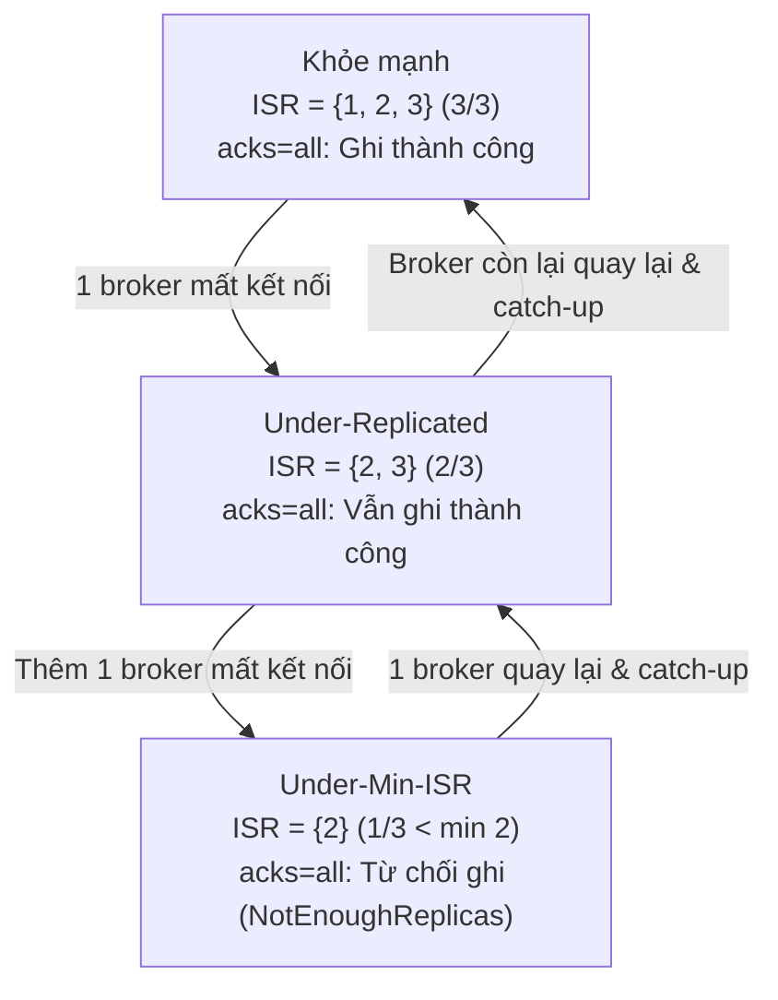
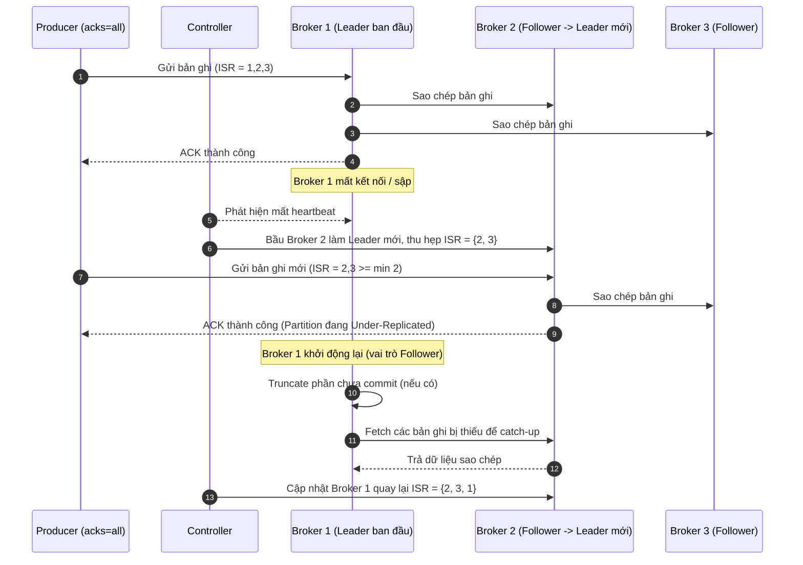

# 7_2_4 Replication Không Khỏe (Unhealthy Replication)

> **Khóa học**: Cloud DevOps Basic — Data Platform
> **Phân nhóm**: 7 Domain 7 - Apache Kafka › 7_2 Kafka Operations and Troubleshooting
> **Chủ đề**: Under-replicated partitions, under-min-ISR, `acks=all` + `min.insync.replicas`, vòng đời broker mất kết nối và phục hồi
> **Trạng thái**: Bản nháp (chưa kiểm chứng theo yêu cầu người dùng)
> **Checklist đối chiếu**: [7_2 Kafka Operations and Troubleshooting](./README.md#7_2_4-replication-không-khỏe)

---

## 1. Khái Niệm Cốt Lõi & Bản Chất Kỹ Thuật (Core Concepts & Technical Deep Dive)

Trong hệ thống phân tán, cơ chế nhân bản dữ liệu giữa nhiều máy chủ giúp hệ thống chịu lỗi tốt khi một máy chủ gặp sự cố. Tuy nhiên, khi các bản sao bị tụt lại phía sau hoặc mất kết nối, mức độ an toàn của dữ liệu lập tức suy giảm. Kỹ sư vận hành cần phân biệt rõ giữa việc hệ thống làm mất dữ liệu âm thầm và việc hệ thống chủ động báo lỗi từ chối ghi để bảo vệ tính toàn vẹn. Bài học này trình bày các trạng thái nhân bản không khỏe, nguyên nhân thường gặp, cơ chế từ chối ghi có chủ đích và vòng đời phục hồi khi máy chủ mất kết nối.

### 1.1 Under-Replicated Partitions và Under-Min-ISR là gì?

- **Under-Replicated Partition (URP)**: Là partition có số lượng replica đang đồng bộ trong tập **ISR (In-Sync Replicas)** nhỏ hơn tổng số replica được phân công (`replication.factor`), tức có ít nhất một follower không theo kịp leader <!-- ev: C4.1 -->.
- **Under-min-ISR**: Là trạng thái nghiêm trọng hơn khi số lượng replica trong tập ISR tụt xuống thấp hơn ngưỡng `min.insync.replicas` đã cấu hình <!-- ev: C4.2 -->.

### 1.2 Các nguyên nhân phổ biến gây mất đồng bộ replication

Tham số `replica.lag.time.max.ms` quy định thời gian tối đa một follower được phép chậm trễ (không gửi yêu cầu fetch hoặc không bắt kịp dữ liệu leader) trước khi bị leader loại khỏi tập ISR <!-- ev: C4.4 -->. Các nguyên nhân phổ biến gồm:

1. **Broker mất kết nối hoặc sập (Broker down / crash)**: Khi follower dừng hoạt động (lỗi phần cứng, crash hoặc rolling restart), nó ngừng gửi yêu cầu fetch tới leader và bị loại khỏi ISR <!-- ev: C4.3 -->.
2. **Broker chạy chậm (Slow broker)**: Follower vẫn chạy nhưng bị nghẽn CPU, tạm dừng kéo dài do Garbage Collection (GC pause) hoặc thiếu luồng xử lý, dẫn tới đồng bộ chậm quá ngưỡng `replica.lag.time.max.ms` và bị loại khỏi ISR <!-- ev: C4.5 -->.
3. **Sự cố mạng (Network issues)**: Mất gói tin, độ trễ mạng cao hoặc phân tách mạng giữa leader và follower làm gián đoạn luồng sao chép dữ liệu <!-- ev: C4.6 -->.
4. **Nghẽn hoặc lỗi đĩa (Disk I/O bottleneck / failure)**: Tốc độ ghi đĩa trên follower quá chậm hoặc ổ đĩa hỏng khiến broker không ghi nhận kịp các bản ghi sao chép <!-- ev: C4.7 -->. *(Cách xử lý khi đĩa đầy toàn bộ xem tại bài 7_2_5).*

### 1.3 Tại sao `acks=all` + `min.insync.replicas` trả lỗi thay vì mất dữ liệu âm thầm?

- Tham số `min.insync.replicas` xác định số replica tối thiểu (tính cả leader) phải xác nhận đã ghi dữ liệu thì yêu cầu ghi có `acks=all` (tương đương `acks=-1`) mới được coi là thành công <!-- ev: C4.8 -->.
- Tham số này có thể đặt mặc định ở cấp độ broker hoặc ghi đè riêng theo từng topic (ví dụ qua `--config min.insync.replicas=2` khi tạo topic bằng `kafka-topics.sh`) <!-- ev: C4.9 -->.
- Khi producer gửi với `acks=all` nhưng kích thước ISR hiện tại nhỏ hơn `min.insync.replicas`, broker sẽ từ chối yêu cầu ghi và trả về lỗi `NotEnoughReplicasException` (hoặc `NotEnoughReplicasAfterAppendException`) <!-- ev: C4.10 -->.

Việc trả lỗi này là **hành vi an toàn có chủ đích**: nếu Kafka cho phép ghi thành công khi chỉ còn ít bản sao hơn ngưỡng `min.insync.replicas` (ví dụ chỉ còn 1 replica duy nhất), dữ liệu sẽ bị mất âm thầm nếu broker cuối cùng đó sập ngay sau khi xác nhận <!-- ev: C4.11 -->. Ngược lại, nếu producer dùng `acks=1`, leader trả lời thành công ngay sau khi ghi vào log cục bộ mà không chờ follower và không áp dụng ràng buộc `min.insync.replicas` <!-- ev: C4.12 -->.

### 1.4 Vòng đời khi một Broker mất kết nối và phục hồi

Theo dõi kịch bản một cụm 3 máy chủ với 3 bản sao và ngưỡng tối thiểu 2 bản sao đồng bộ khi sự cố diễn ra theo từng bước:

1. **Phát hiện mất kết nối & Bầu leader mới**:
   - Thành phần **controller** trong cluster liên tục theo dõi trạng thái sống của các broker qua heartbeat/session timeout để phát hiện khi một broker ngắt kết nối <!-- ev: C4.13 -->.
   - Khi broker giữ vai trò leader ngắt kết nối, controller bầu một broker khác còn lại trong ISR làm leader mới cho partition đó <!-- ev: C4.14 -->.
   - Với cấu hình mặc định `unclean.leader.election.enable=false`, Kafka chỉ chọn leader mới từ tập ISR nhằm tránh mất các bản ghi đã commit <!-- ev: C4.15 -->.
2. **Co cụm ISR (ISR Shrinking)**:
   - Broker mất kết nối bị loại khỏi tập ISR, khiến tập ISR co lại (ví dụ từ 3 bản sao xuống còn 2) <!-- ev: C4.16 -->.
   - Nếu số bản sao còn lại trong ISR vẫn đạt tối thiểu `min.insync.replicas`, các producer dùng `acks=all` tiếp tục ghi thành công lên leader mới <!-- ev: C4.17 -->.
   - Dù ghi vẫn thành công, partition lúc này ở trạng thái **under-replicated** vì số bản sao đồng bộ ít hơn hệ số nhân bản ban đầu <!-- ev: C4.18 -->.
3. **Mất thêm bản sao dẫn tới suy giảm ngưỡng tối thiểu**:
   - Nếu thêm một broker nữa ngắt kết nối khiến kích thước ISR rơi xuống dưới `min.insync.replicas`, partition chuyển sang trạng thái **under-min-ISR** <!-- ev: C4.19 -->.
   - Trong trạng thái này, lệnh ghi `acks=all` bị từ chối, nhưng consumer vẫn đọc được các dữ liệu đã commit (đến mức high watermark) từ leader còn sống <!-- ev: C4.20 -->.
4. **Broker quay lại & Phục hồi ISR**:
   - Khi broker gặp sự cố khởi động lại với vai trò follower, nó cắt bỏ (truncate) phần dữ liệu chưa commit vượt quá high watermark (nếu có) và tải lại (fetch) các bản ghi bị thiếu từ leader hiện tại <!-- ev: C4.21 -->.
   - Khi bắt kịp log của leader, follower được đưa trở lại tập ISR và partition hết trạng thái under-replicated <!-- ev: C4.22 -->.
   - Broker vừa quay lại tiếp tục làm follower cho đến khi quá trình bầu leader ưu tiên (preferred leader election) chạy qua `auto.leader.rebalance.enable` (mặc định `true`) hoặc qua công cụ như `kafka-leader-election.sh` <!-- ev: C4.24 -->.

---

## 2. Ví Dụ Đời Sống Thực Tế Dễ Hiểu (Intuitive Real-World Analogies)

Hãy tưởng tượng một **két sắt ngân hàng** có 3 thủ quỹ cùng giữ 3 cuốn sổ cái giống hệt nhau để ghi chép tiền gửi. Quy định nội bộ của ngân hàng là: mỗi giao dịch nhận tiền mới bắt buộc phải có **ít nhất 2 thủ quỹ cùng ký xác nhận** vào sổ thì giao dịch mới hợp lệ.

- **Trạng thái khỏe mạnh (3/3 thủ quỹ có mặt)**: Khách mang tiền đến nộp, cả 3 thủ quỹ cùng ghi chép và ký xác nhận. Dù có một người đột ngột ốm, hai cuốn sổ còn lại vẫn khớp nhau hoàn toàn.
- **Trạng thái Under-replicated (1 thủ quỹ nghỉ ốm, còn 2 người)**: Số người làm việc ít hơn biên chế 3 người, tức chi nhánh đang ở mức cảnh báo thiếu nhân lực. Tuy vậy, vẫn còn đủ 2 người để cùng ký xác nhận nên quầy giao dịch vẫn nhận tiền gửi bình thường.
- **Trạng thái Under-min-ISR (thêm 1 người nữa nghỉ ốm, chỉ còn 1 người)**: Lúc này không còn đủ 2 chữ ký theo quy định. Thay vì liều lĩnh để 1 người tự ký rồi lỡ người đó cũng ngất xỉu thì ngân hàng mất trắng sổ sách (mất dữ liệu âm thầm), hệ thống **chủ động treo biển tạm ngừng nhận tiền gửi mới**. Khách hàng nhận thông báo từ chối rõ ràng để giữ tiền lại hoặc thử lại sau, còn khách muốn tra cứu số dư cũ (consumer đọc dữ liệu đã chốt) vẫn xem được bình thường.
- **Phục hồi**: Khi các thủ quỹ nghỉ ốm khỏe lại và quay về quầy, họ không được phép ký xác nhận giao dịch mới ngay lập tức. Họ phải mở sổ ra, gạch bỏ những dòng nháp chưa chốt (nếu có), rồi chép bù đầy đủ các trang giao dịch đã diễn ra trong lúc mình vắng mặt từ người đang trực. Chỉ khi sổ đã khớp hoàn toàn, họ mới được cấp lại quyền đồng ký xác nhận.

---

## 3. Kiến Trúc, Luồng Hoạt Động & Hình Ảnh Trực Quan (Architecture, Diagrams & Visual Media)

Sơ đồ dưới đây mô tả các mức chuyển trạng thái của một partition cấu hình 3 bản sao và ngưỡng tối thiểu 2 bản sao đồng bộ khi broker lần lượt gặp sự cố rồi phục hồi:



Sơ đồ tuần tự minh họa quá trình chuyển quyền lãnh đạo, thu hẹp tập đồng bộ và phục hồi khi máy chủ đầu tiên gặp sự cố rồi quay lại:



---

## 4. Code Mẫu Trực Quan Hoặc Dòng Lệnh Thực Chiến (Runnable Sample Code / CLI)

Ví dụ dưới đây minh họa trên **Apache Kafka 3.x+** với topic `orders-events` chạy trên cụm 3 máy chủ.

### Bước 1: Tạo topic chuẩn chịu lỗi và kiểm tra trạng thái ban đầu

Tạo topic `orders-events` với 1 partition, 3 bản sao và `min.insync.replicas=2` <!-- ev: C4.9 -->:

<!-- ev: C4.9 -->
```bash
kafka-topics.sh --bootstrap-server localhost:9092 \
  --create --topic orders-events \
  --partitions 1 --replication-factor 3 \
  --config min.insync.replicas=2
```

Kiểm tra `Leader`, `Replicas` và `Isr` bằng `--describe` <!-- ev: C4.23 -->:

<!-- ev: C4.23 -->
```bash
kafka-topics.sh --bootstrap-server localhost:9092 \
  --describe --topic orders-events
```

```text
Topic: orders-events	PartitionCount: 1	ReplicationFactor: 3	Configs: min.insync.replicas=2
	Topic: orders-events	Partition: 0	Leader: 1	Replicas: 1,2,3	Isr: 1,2,3
```

### Bước 2: Phát hiện partition bị Under-Replicated (1 máy chủ ngắt kết nối)

Khi máy chủ 1 dừng hoạt động, cờ `--under-replicated-partitions` liệt kê các partition có `Isr` nhỏ hơn `Replicas` <!-- ev: C4.23 -->:

<!-- ev: C4.23 -->
```bash
kafka-topics.sh --bootstrap-server localhost:9092 \
  --describe --under-replicated-partitions
```

Lúc này `Leader` đã chuyển sang máy chủ 2 và `Isr` co lại còn `2,3` <!-- ev: C4.14 C4.16 -->:

```text
Topic: orders-events	PartitionCount: 1	ReplicationFactor: 3	Configs: min.insync.replicas=2
	Topic: orders-events	Partition: 0	Leader: 2	Replicas: 1,2,3	Isr: 2,3
```

Dùng `kafka-console-producer.sh` với cờ `--producer-property acks=all` để kiểm tra khả năng ghi <!-- ev: C4.25 -->:

<!-- ev: C4.25 -->
```bash
echo "order-1001" | kafka-console-producer.sh \
  --bootstrap-server localhost:9092 \
  --topic orders-events \
  --producer-property acks=all
```

Lệnh hoàn tất thành công vì kích thước `Isr` là 2, vẫn đạt ngưỡng `min.insync.replicas=2` <!-- ev: C4.17 -->.

### Bước 3: Phát hiện partition bị Under-Min-ISR (thêm 1 máy chủ ngắt kết nối)

Khi máy chủ 3 tiếp tục dừng hoạt động, dùng cờ `--under-min-isr-partitions` để lọc riêng các partition tụt dưới `min.insync.replicas` <!-- ev: C4.23 -->:

<!-- ev: C4.23 -->
```bash
kafka-topics.sh --bootstrap-server localhost:9092 \
  --describe --under-min-isr-partitions
```

Kết quả cho thấy `Isr` chỉ còn `2` <!-- ev: C4.19 -->:

```text
Topic: orders-events	PartitionCount: 1	ReplicationFactor: 3	Configs: min.insync.replicas=2
	Topic: orders-events	Partition: 0	Leader: 2	Replicas: 1,2,3	Isr: 2
```

Thử ghi tiếp bằng `kafka-console-producer.sh` với `acks=all` <!-- ev: C4.25 -->:

```bash
echo "order-1002" | kafka-console-producer.sh \
  --bootstrap-server localhost:9092 \
  --topic orders-events \
  --producer-property acks=all
```

Hệ thống trả về `NotEnoughReplicasException` thay vì chấp nhận ghi thiếu an toàn <!-- ev: C4.10 -->:

```text
ERROR Error when sending message to topic orders-events with key: null, value: 10 bytes with error:
org.apache.kafka.common.errors.NotEnoughReplicasException: Messages are rejected since there are fewer in-sync replicas than required.
```

### Bước 4: Kiểm tra phục hồi khi các máy chủ quay lại

Sau khi máy chủ 1 và 3 khởi động lại và đồng bộ xong với leader, chúng gia nhập lại tập `Isr` <!-- ev: C4.22 -->:

<!-- ev: C4.23 -->
```bash
kafka-topics.sh --bootstrap-server localhost:9092 \
  --describe --under-replicated-partitions
# (Trả về rỗng khi mọi partition đã đồng bộ đủ)

kafka-topics.sh --bootstrap-server localhost:9092 \
  --describe --topic orders-events
```

```text
Topic: orders-events	PartitionCount: 1	ReplicationFactor: 3	Configs: min.insync.replicas=2
	Topic: orders-events	Partition: 0	Leader: 2	Replicas: 1,2,3	Isr: 2,3,1
```

---

## 5. Cạm Bẫy Thực Tế & Thực Tiễn Sản Xuất (Production Gotchas & Best Practices)

1. **Đặt ngưỡng bản sao đồng bộ tối thiểu bằng đúng hệ số nhân bản**:
   - *Cạm bẫy*: Nếu đặt `replication.factor=3` và `min.insync.replicas=3`, chỉ cần 1 broker restart bảo trì là ISR giảm còn 2 (`< 3`), khiến mọi producer `acks=all` nhận `NotEnoughReplicasException` <!-- ev: C4.10 -->.
   - *Thực tiễn chuẩn*: Thiết lập phổ biến là `replication.factor=3` đi kèm `min.insync.replicas=2` để chịu được lỗi 1 broker mà producer `acks=all` vẫn ghi bình thường <!-- ev: C4.17 -->.
2. **Cho phép bầu leader không đồng bộ để ép hệ thống luôn ghi được**:
   - *Cạm bẫy*: Bỏ mặc định `unclean.leader.election.enable=false` <!-- ev: C4.15 --> bằng cách đặt thành `true` sẽ cho phép bầu bản sao không nằm trong ISR làm leader, gây mất các bản ghi đã commit trước đó.
   - *Thực tiễn chuẩn*: Giữ `unclean.leader.election.enable=false` cho dữ liệu quan trọng để ưu tiên toàn vẹn dữ liệu hơn là ghi bằng mọi giá <!-- ev: C4.15 -->.
3. **Cấu hình bảo vệ ở phía cụm nhưng bỏ quên cấu hình phía client gửi tin**:
   - *Cạm bẫy*: Nếu producer giữ `acks=1`, leader trả lời thành công ngay sau khi ghi cục bộ mà không chờ follower và không kích hoạt kiểm tra `min.insync.replicas` <!-- ev: C4.12 -->.
   - *Thực tiễn chuẩn*: Rà soát cấu hình ứng dụng để đảm bảo `acks=all` được bật thống nhất cho các luồng dữ liệu quan trọng <!-- ev: C4.8 -->.
4. **Nâng cao (có thể bỏ qua ở lần đọc đầu) — Lệch tải Leader sau sự cố**:
   - Broker quay lại giữ vai trò follower nên quyền leader vẫn dồn vào các broker còn lại nếu thiếu cơ chế bầu leader ưu tiên qua `auto.leader.rebalance.enable` hoặc công cụ quản trị <!-- ev: C4.24 -->.

---

## 6. Câu Hỏi Củng Cố Kiến Thức (Active Recall Quiz)

**Câu 1**: Một topic có `replication.factor=3` và `min.insync.replicas=2`. Hiện tại 1 trong 3 broker bị sập, lệnh `describe` cho thấy `Isr: 2,3`. Hỏi:
a) Partition này có bị coi là under-replicated không?
b) Producer cấu hình `acks=all` có ghi được dữ liệu mới không?

<details>
<summary>Đáp án</summary>

a) **Có**. Partition đang bị under-replicated vì kích thước tập ISR (2) nhỏ hơn `replication.factor` (3).
b) **Vẫn ghi được bình thường**, vì kích thước tập ISR (2) vẫn lớn hơn hoặc bằng `min.insync.replicas` (2). Tuy nhiên hệ thống không còn dự phòng thêm: nếu mất thêm 1 broker nữa, việc ghi sẽ bị chặn.

</details>

**Câu 2**: Khi 2 trên 3 broker bị ngắt kết nối (cùng cấu hình `min.insync.replicas=2`), producer dùng `acks=all` liên tục nhận `NotEnoughReplicasException`. Một đồng nghiệp đề xuất đổi producer sang `acks=1` để "hết lỗi ngay lập tức". Theo bạn, đề xuất này giải quyết được gì và mang lại rủi ro gì?

<details>
<summary>Đáp án</summary>

- **Giải quyết được**: Producer không còn nhận `NotEnoughReplicasException` và tiếp tục ghi được vào leader duy nhất còn sống, vì `min.insync.replicas` không được áp dụng khi `acks=1`.
- **Rủi ro nghiêm trọng**: Phá vỡ cơ chế bảo vệ của Kafka. Dữ liệu được xác nhận thành công nhưng chỉ tồn tại trên đúng 1 broker; nếu broker đó gặp sự cố ổ đĩa hoặc sập trước khi các broker khác quay lại và đồng bộ xong, dữ liệu sẽ bị mất âm thầm (silent data loss). Hướng xử lý đúng là khôi phục các broker đang mất kết nối thay vì hạ `acks`.

</details>

**Câu 3**: Sau khi Broker 1 (từng là leader) bị sập rồi khởi động lại và kết nối thành công vào cluster, tại sao nó không ngay lập tức trở thành leader trở lại và cũng chưa xuất hiện ngay trong tập `Isr`?

<details>
<summary>Đáp án</summary>

1. Khi quay lại, Broker 1 khởi động với vai trò **follower**, phải kiểm tra và cắt bỏ (truncate) các bản ghi chưa commit vượt quá high watermark (nếu có) rồi tải (fetch) toàn bộ dữ liệu đã phát sinh trong thời gian vắng mặt từ leader hiện tại. Chỉ sau khi bắt kịp log của leader, nó mới được đưa lại vào tập `Isr`.
2. Quyền leader chỉ chuyển về Broker 1 (preferred leader) nếu có cơ chế bầu leader ưu tiên (`auto.leader.rebalance.enable=true` hoặc chạy công cụ quản trị bầu leader), chứ không tự động chuyển ngay tại thời điểm broker vừa kết nối lại.

</details>

---

## 7. 📚 Nguồn Tài Liệu Chính Thống (Tier-1 Official References)

- [Apache Kafka — Replication Design](https://kafka.apache.org/documentation/#replication) - Kiến trúc leader, follower, ISR, cơ chế đồng bộ khi broker sập và quay lại.
- [Apache Kafka — Operations](https://kafka.apache.org/documentation/#operations) - Hướng dẫn vận hành, kiểm tra topic và xử lý sự cố cluster bằng công cụ CLI.
- [Apache Kafka — Broker Configurations (`min.insync.replicas`, `replica.lag.time.max.ms`, `unclean.leader.election.enable`, `auto.leader.rebalance.enable`)](https://kafka.apache.org/documentation/#brokerconfigs) - Định nghĩa chính thức các tham số bảo vệ replication.
- [Apache Kafka — Producer Configurations (`acks`)](https://kafka.apache.org/documentation/#producerconfigs) - Cơ chế xác nhận ghi `acks=all` (`-1`) và `acks=1`.
- [Apache Kafka — Monitoring](https://kafka.apache.org/documentation/#monitoring) - Các chỉ số giám sát `UnderReplicatedPartitions` và `UnderMinIsrPartitionCount`.
