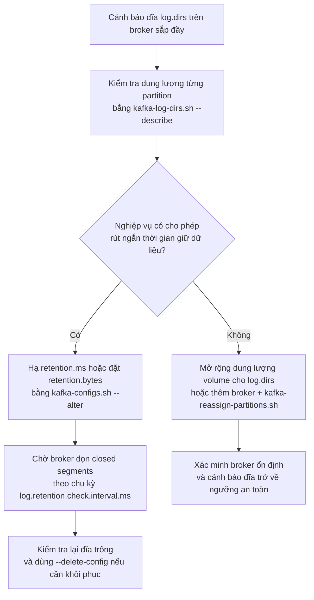

# 7_2_5 Đĩa, Retention và Dung Lượng

> **Khóa học**: Cloud DevOps Basic — Data Platform
> **Phân nhóm**: 7 Domain 7 - Apache Kafka › 7_2 Kafka Operations and Troubleshooting
> **Chủ đề**: Đĩa broker đầy, cấu hình retention (`retention.ms`, `retention.bytes`), an toàn file segment, công thức ước lượng dung lượng
> **Trạng thái**: Bản nháp (chưa kiểm chứng theo yêu cầu người dùng)
> **Checklist đối chiếu**: [7_2 README](./README.md) · [Lộ trình Data Platform](../../README.md)

---

## 1. Khái Niệm Cốt Lõi & Bản Chất Kỹ Thuật (Core Concepts & Technical Deep Dive)

Trong hệ thống vận hành thực tế, một trong những sự cố khẩn cấp phổ biến nhất với Apache Kafka là **đĩa của broker bị đầy**. Khác với hàng đợi truyền thống xóa tin nhắn ngay sau khi người nhận đọc xong, Kafka lưu dữ liệu nối tiếp lên ổ đĩa trong một khoảng thời gian cấu hình trước (gọi là **retention**). Khi lượng dữ liệu ghi vào vượt quá tốc độ dọn dẹp hoặc dung lượng đĩa được cấp phát, broker sẽ không thể tiếp tục ghi dữ liệu mới. Bài học này giải thích nguyên nhân đĩa đầy, quy trình xử lý an toàn bằng cấu hình hoặc mở rộng đĩa, lý do tuyệt đối không được xóa tay tệp trên đĩa, và cách tính trước dung lượng cần thiết.

### 1.1 Cách Kafka Lưu Trữ và Dọn Dẹp Dữ Liệu

- **Thư mục lưu log (`log.dirs`)**: Kafka lưu dữ liệu của các partition trên đĩa tại những thư mục được khai báo trong cấu hình broker `log.dirs` (hoặc `log.dir`). <!-- ev: C5.1 -->
- **Log segment**: Dữ liệu của mỗi partition được chia thành nhiều đoạn tệp nối tiếp nhau gọi là log segment, gồm tệp dữ liệu `.log` và các tệp chỉ mục đi kèm như `.index` và `.timeindex` (chi tiết cấu trúc bên trong segment và compaction thuộc bài 7_1_5). <!-- ev: C5.2 -->
- **Chính sách xóa mặc định (`cleanup.policy`)**: Với giá trị mặc định `cleanup.policy=delete`, broker xóa các log segment cũ khi chúng vượt quá giới hạn thời gian hoặc giới hạn dung lượng đã cấu hình. <!-- ev: C5.3 -->
- **Thời gian giữ mặc định ở mức broker**: Nếu không cấu hình riêng cho từng topic, broker sử dụng tham số như `log.retention.hours` (mặc định `168` giờ, tức 7 ngày), `log.retention.minutes` hoặc `log.retention.ms` để xác định thời hạn giữ dữ liệu. <!-- ev: C5.4 -->
- **Giới hạn thời gian ở mức topic (`retention.ms`)**: Tham số `retention.ms` quy định thời gian tối đa tính bằng mili-giây mà một log segment được giữ lại trên đĩa trước khi bị xóa, và giá trị này ghi đè cấu hình mặc định của broker. <!-- ev: C5.5 -->
- **Giới hạn dung lượng ở mức topic (`retention.bytes`)**: Tham số `retention.bytes` quy định kích thước tối đa tính bằng byte cho **mỗi partition** (không phải tổng cả topic) trước khi các segment cũ bị xóa, với giá trị mặc định là `-1` (không giới hạn dung lượng). <!-- ev: C5.6 -->
- **Độc lập với consumer**: Kafka không xóa bản ghi chỉ vì consumer đã đọc xong, mà chỉ dựa trên ngưỡng thời gian hoặc dung lượng của chính sách retention. <!-- ev: C5.7 -->

### 1.2 Nguyên Nhân Khiến Đĩa Broker Bị Đầy

Khi một thư mục trong `log.dirs` hết dung lượng trống, broker gặp lỗi ghi I/O, không thể nhận thêm bản ghi vào các partition nằm trên đĩa đó và có thể đánh dấu thư mục log ngoại tuyến hoặc ngừng phục vụ các partition liên quan. <!-- ev: C5.10 -->

Bốn nguyên nhân thường gặp nhất trong vận hành là:

1. **Retention quá dài hoặc không giới hạn dung lượng**: Giữ mặc định 7 ngày và `retention.bytes=-1` cho các topic lưu lượng lớn khiến dữ liệu tích lũy vượt quá kích thước ổ đĩa gắn vào broker. <!-- ev: C5.4 C5.6 -->
2. **Lưu lượng ghi hoặc số topic tăng đột biến**: Producer đẩy dữ liệu nhanh hơn dự toán (ví dụ sự cố retry, bật debug log, hoặc chiến dịch cao điểm), khiến tốc độ phình đĩa tăng gấp nhiều lần trong thời gian ngắn.
3. **Consumer chậm nhưng dữ liệu vẫn nằm trên đĩa theo retention**: Khi hệ thống gặp lỗi ở tầng ứng dụng, nhiều người nhầm rằng consumer đọc xong thì đĩa sẽ tự trống, nhưng thực tế dữ liệu vẫn ở lại đến hết hạn retention. <!-- ev: C5.7 -->
4. **Phân bố partition không đều**: Một vài partition nhận lượng lớn bản ghi (hot key) hoặc tập trung nhiều replica trên cùng một đĩa `log.dirs`, khiến đĩa đó đầy trước các đĩa khác. <!-- ev: C5.1 -->

### 1.3 Vì Sao Tuyệt Đối KHÔNG Xóa Tay Tệp Segment Trên Đĩa

Tuyệt đối không dùng lệnh `rm` xóa trực tiếp tệp `.log` trên đĩa khi broker đầy dung lượng vì hai lý do kỹ thuật cốt lõi: <!-- ev: C5.11 -->

- **Phá vỡ tính nhất quán giữa dữ liệu và metadata**: Kafka quản lý mỗi partition bằng bộ tệp dữ liệu (`.log`) và các tệp chỉ mục offset/thời gian (`.index`, `.timeindex`) đồng bộ với trạng thái offset trên broker, nên xóa tay tệp trên đĩa sẽ phá vỡ sự đồng bộ giữa dữ liệu, chỉ mục và trạng thái trong bộ nhớ broker. <!-- ev: C5.11 -->
- **Nguy cơ hỏng partition và lỗi khởi động**: Khi tính nhất quán của bộ tệp segment hoặc chỉ mục bị phá vỡ, broker có thể gặp lỗi đọc/ghi, làm hỏng trạng thái partition hoặc không thể khởi động lại bình thường. <!-- ev: C5.12 -->

### 1.4 Quy Trình Xử Lý An Toàn Khi Đĩa Sắp Đầy

Thay vì can thiệp trực tiếp vào hệ thống tệp, người vận hành phải để chính tiến trình nền của broker thực hiện việc dọn segment theo đúng quy trình:

1. **Đo đúng nơi chiếm dung lượng**: Dùng công cụ `kafka-log-dirs.sh --bootstrap-server <host:port> --describe` để kiểm tra dung lượng thực tế của từng partition trên từng broker và xác định topic đang phình to. <!-- ev: C5.13 -->
2. **Giảm retention tạm thời ở mức topic (khi nghiệp vụ cho phép bỏ dữ liệu cũ)**: Dùng `kafka-configs.sh --bootstrap-server <host:port> --entity-type topics --entity-name <topic> --alter --add-config ...` để hạ `retention.ms` hoặc đặt `retention.bytes` thấp hơn, không cần khởi động lại broker. <!-- ev: C5.14 -->
3. **Chờ broker tự xóa segment cũ**: Broker kiểm tra định kỳ các segment đủ điều kiện xóa theo chu kỳ `log.retention.check.interval.ms` (mặc định `300000` ms, tức 5 phút) và giải phóng đĩa an toàn. <!-- ev: C5.9 -->
4. **Khôi phục cấu hình sau sự cố (nếu vừa hạ tạm)**: Dùng tùy chọn `--delete-config` trong `kafka-configs.sh` để gỡ bỏ giá trị ghi đè và đưa topic về cấu hình mặc định của broker. <!-- ev: C5.15 -->
5. **Mở rộng hạ tầng (khi dữ liệu bắt buộc phải giữ đủ thời gian)**: Nếu không được phép cắt ngắn retention, hãy mở rộng dung lượng volume gắn cho `log.dirs` hoặc bổ sung broker mới rồi phân bố lại partition bằng `kafka-reassign-partitions.sh`. <!-- ev: C5.16 -->

### 1.5 Công Thức Ước Lượng Dung Lượng Đĩa

Để tránh sự cố đĩa đầy ngay từ giai đoạn thiết kế, bạn cần ước lượng dung lượng tối thiểu cho mỗi topic theo công thức:

<!-- ev: C5.17 -->
```text
Dung lượng tối thiểu = Tốc độ ghi (write rate) × Thời gian retention × Replication Factor
```

- **Tốc độ ghi (write rate)**: Lượng dữ liệu producer ghi vào topic trong một đơn vị thời gian (ví dụ `MB/giây` hoặc `GB/ngày`). <!-- ev: C5.17 -->
- **Thời gian retention**: Khoảng thời gian giữ dữ liệu quy đổi cùng đơn vị với tốc độ ghi (ví dụ `7 ngày = 604.800 giây`). <!-- ev: C5.17 -->
- **Replication Factor**: Số bản sao của mỗi partition phân bố trên các broker; toàn cluster lưu dung lượng nhân lên đúng bằng hệ số này, đồng thời cần cộng thêm dung lượng dự phòng (headroom) cho active segment, metadata và tăng trưởng đột biến. <!-- ev: C5.18 -->

**Ví dụ (`orders-events`)**: Topic `orders-events` có `6` partition, tốc độ ghi `10 MB/giây` (hệ thập phân `1 GB = 1.000 MB`, `1 TB = 1.000 GB`), giữ `7 ngày` (`604.800 giây`), `replication-factor = 3` trên `3` broker: <!-- ev: C5.17 C5.18 -->
- Dữ liệu gốc 7 ngày (1 bản sao): `10 MB/giây × 604.800 giây = 6.048.000 MB = 6,048 TB`. <!-- ev: C5.17 -->
- Tổng dung lượng toàn cluster (`replication-factor = 3`): `6,048 TB × 3 = 18,144 TB`. <!-- ev: C5.17 C5.18 -->
- Chia đều trên 3 broker: tối thiểu `6,048 TB/broker` cho riêng topic này (chưa tính headroom). <!-- ev: C5.18 -->

> **Nâng cao: có thể bỏ qua ở lần đọc đầu**
>
> Kafka không bao giờ xóa **active segment** (segment đang được ghi hiện tại) kể cả khi dữ liệu trong đó đã vượt ngưỡng `retention.ms`, mà chỉ xóa các segment đã đóng (closed segments). <!-- ev: C5.8 --> Vì vậy, trên các topic có lưu lượng cực thấp, nếu `segment.bytes` (kích thước tối đa của một segment) quá lớn khiến segment mãi chưa đầy để đóng lại, dung lượng có thể chưa giảm ngay dù bạn vừa hạ `retention.ms` xuống thấp.

---

## 2. Ví Dụ Đời Sống Thực Tế Dễ Hiểu (Intuitive Real-World Analogies)

Hãy tưởng tượng một broker Kafka giống như **một kho lưu trữ hồ sơ hành chính** của một công ty lớn:

- Mỗi topic là một ngăn hồ sơ theo chủ đề (ví dụ ngăn `orders-events`), bên trong chia thành nhiều dãy kệ đánh số thứ tự (partition).
- Nhân viên văn thư (producer) liên tục kẹp chứng từ mới vào cuốn sổ đang mở trên bàn (active segment). Khi cuốn sổ này đầy trang, nhân viên đóng sổ, dán nhãn ngày tháng rồi cất lên kệ (closed segment).
- Kho có quy định lưu trữ: sổ nào quá 7 ngày (`retention.ms`) hoặc vượt quá độ dày cho phép của mỗi dãy kệ (`retention.bytes`) sẽ được bộ phận lưu trữ tự động đưa vào máy hủy định kỳ sau mỗi 5 phút (`log.retention.check.interval.ms`).

Khi kho sắp tràn, **quản lý an toàn** chỉ làm một trong hai việc:
1. Rút ngắn thời hạn lưu trữ từ 7 ngày xuống còn 1 ngày (`retention.ms`) để hệ thống hủy sổ cũ đúng quy trình, có cập nhật sổ mục lục đàng hoàng.
2. Thuê thêm phòng kho rộng hơn (mở rộng volume) hoặc chuyển bớt dãy kệ sang chi nhánh mới (thêm broker và phân bố lại partition).

**Tuyệt đối không tự ý cầm kéo cắt xé tài liệu đang đánh số thứ tự**: Nếu một người hoảng loạn chạy vào kho xé bừa vài cuốn sổ trên kệ mà không báo cho thủ kho, bảng mục lục sẽ chỉ vào trang không còn tồn tại. Lần sau hệ thống tra cứu hoặc kiểm kê lại từ đầu, toàn bộ dây chuyền sẽ báo lỗi hỏng sổ sách và dừng hoạt động.

---

## 3. Kiến Trúc, Luồng Hoạt Động & Hình Ảnh Trực Quan (Architecture, Diagrams & Visual Media)

Sơ đồ dưới đây mô tả luồng xử lý chuẩn khi nhận cảnh báo đĩa trên broker sắp đầy:

<!-- ev: C5.13 C5.14 C5.15 C5.16 -->


Điểm mấu chốt trong kiến trúc xử lý là **mọi thao tác xóa tệp đều đi qua broker**, không bao giờ tác động trực tiếp vào thư mục `log.dirs` từ hệ điều hành. <!-- ev: C5.11 C5.12 -->

---

## 4. Code Mẫu Trực Quan Hoặc Dòng Lệnh Thực Chiến (Runnable Sample Code / CLI)

Các lệnh dưới đây dùng bộ công cụ CLI đi kèm Apache Kafka (`bin/`), minh họa trên topic `orders-events` tại cluster `localhost:9092`. <!-- ev: C5.13 C5.14 -->

### Bước 1: Kiểm tra topic và partition nào đang chiếm nhiều đĩa nhất

`kafka-log-dirs.sh` truy vấn dung lượng đĩa thực tế của các thư mục `log.dirs` trên từng broker; `--bootstrap-server` chỉ định địa chỉ cluster, `--describe` in thông tin dung lượng, và `--topic-list` lọc topic cần kiểm tra. <!-- ev: C5.13 -->

<!-- ev: C5.13 -->
```bash
# Input: kiểm tra dung lượng log trên đĩa của topic orders-events
bin/kafka-log-dirs.sh \
  --bootstrap-server localhost:9092 \
  --describe \
  --topic-list orders-events
```

Đầu ra trả về JSON liệt kê từng broker, đường dẫn `logDir` và kích thước (`size`) tính theo byte của mỗi partition. <!-- ev: C5.13 -->

### Bước 2: Xem cấu hình retention hiện tại của topic

`kafka-configs.sh` đọc hoặc chỉnh sửa cấu hình động của topic; `--entity-type topics` và `--entity-name orders-events` chọn topic mục tiêu, còn `--describe` hiển thị các giá trị đang ghi đè. <!-- ev: C5.14 -->

<!-- ev: C5.14 -->
```bash
bin/kafka-configs.sh \
  --bootstrap-server localhost:9092 \
  --entity-type topics \
  --entity-name orders-events \
  --describe
```

### Bước 3: Giảm `retention.ms` và đặt `retention.bytes` để giải phóng đĩa an toàn

Dùng `--alter` và `--add-config` để đặt `retention.ms=86400000` (1 ngày = 86.400.000 ms) và `retention.bytes=5368709120` (tối đa 5 GiB cho **mỗi partition**). <!-- ev: C5.5 C5.6 C5.14 -->

<!-- ev: C5.5 C5.6 C5.14 -->
```bash
# Input: ghi đè retention.ms = 1 ngày và retention.bytes = 5 GiB/partition
bin/kafka-configs.sh \
  --bootstrap-server localhost:9092 \
  --entity-type topics \
  --entity-name orders-events \
  --alter \
  --add-config retention.ms=86400000,retention.bytes=5368709120

# Output:
# Completed updating config for topic orders-events.
```

Sau khi cập nhật, broker sẽ tự động xóa các closed segment vượt ngưỡng ở lần quét tiếp theo (mặc định mỗi 5 phút theo `log.retention.check.interval.ms`), sau đó bạn chạy lại `kafka-log-dirs.sh --describe` để xác nhận `size` đã giảm. <!-- ev: C5.8 C5.9 C5.13 -->

### Bước 4: Khôi phục cấu hình mặc định của broker sau sự cố

Nếu việc hạ retention chỉ là giải pháp tạm thời trong lúc chờ mở rộng đĩa, dùng `--delete-config` để gỡ cấu hình ghi đè và đưa topic về mặc định của broker. <!-- ev: C5.15 -->

<!-- ev: C5.15 -->
```bash
# Input: xóa cấu hình ghi đè retention trên topic orders-events
bin/kafka-configs.sh \
  --bootstrap-server localhost:9092 \
  --entity-type topics \
  --entity-name orders-events \
  --alter \
  --delete-config retention.ms,retention.bytes

# Output:
# Completed updating config for topic orders-events.
```

### Bước 5: Minh họa Input → Công thức → Output cho bài toán ước lượng dung lượng

Đoạn shell dưới đây minh họa công thức ước lượng cho `orders-events` (`10 MB/giây`, giữ `7 ngày`, `replication-factor = 3`, cộng thêm `25%` headroom): <!-- ev: C5.17 C5.18 -->

<!-- ev: C5.17 C5.18 -->
```bash
# Input:
WRITE_MB_PER_SEC=10
RETENTION_DAYS=7
REPLICATION_FACTOR=3
HEADROOM_FACTOR=1.25

# Command (tính bằng awk theo hệ thập phân 1 GB = 1000 MB, 1 TB = 1000 GB):
awk -v w="$WRITE_MB_PER_SEC" -v d="$RETENTION_DAYS" -v rf="$REPLICATION_FACTOR" -v h="$HEADROOM_FACTOR" '
BEGIN {
  raw_gb = (w * d * 86400) / 1000
  cluster_tb = (raw_gb * rf) / 1000
  recommended_tb = cluster_tb * h
  printf "Raw (1 copy): %.2f TB | Cluster (RF=%d): %.3f TB | With 25%% headroom: %.3f TB\n",
         raw_gb/1000, rf, cluster_tb, recommended_tb
}'

# Output:
# Raw (1 copy): 6.05 TB | Cluster (RF=3): 18.144 TB | With 25% headroom: 22.680 TB
```

---

## 5. Cạm Bẫy Thực Tế & Thực Tiễn Sản Xuất (Production Gotchas & Best Practices)

### Các cạm bẫy thường gặp

1. **Cạm bẫy xóa tay file `.log` bằng `rm`**: Đây là nguyên nhân gây hỏng trạng thái partition và làm broker lỗi không phục hồi được; luôn để broker dọn dữ liệu thông qua cơ chế retention. <!-- ev: C5.11 C5.12 -->
2. **Hiểu nhầm `retention.bytes` là giới hạn cho toàn bộ topic**: `retention.bytes` tính trên **từng partition**; với topic `orders-events` có `6` partition và `replication-factor=3`, đặt `retention.bytes=5368709120` (5 GiB) nghĩa là tổng dung lượng tối đa toàn cluster có thể lên tới `6 × 3 × 5 GiB = 90 GiB` (cộng thêm phần active segment chưa đóng). <!-- ev: C5.6 C5.8 C5.18 -->
3. **Kỳ vọng consumer đọc xong sẽ làm trống đĩa**: Retention trong Kafka hoàn toàn không phụ thuộc vào consumer offset; ngay cả khi mọi consumer đều có lag bằng `0`, dữ liệu vẫn nằm trên đĩa cho tới khi quá hạn retention. <!-- ev: C5.7 -->
4. **Hạ `retention.ms` xong nhưng đĩa chưa giảm ngay**: Nguyên nhân thường gặp là broker chưa đến chu kỳ quét tiếp theo (`log.retention.check.interval.ms`, mặc định 5 phút), hoặc dữ liệu đang nằm trong **active segment** chưa được đóng. <!-- ev: C5.8 C5.9 -->

### Thực tiễn tốt trong môi trường Production

- **Đặt ngưỡng cảnh báo sớm**: Theo dõi dung lượng sử dụng của các thư mục `log.dirs` và kích hoạt cảnh báo trước khi chạm ngưỡng đầy (thường ở mức 75–85%) để có đủ thời gian giảm retention hoặc mở rộng volume trước khi broker dừng nhận ghi. <!-- ev: C5.1 C5.10 -->
- **Luôn tính đủ Replication Factor và Headroom**: Khi cấp phát ổ đĩa, luôn nhân `tốc độ ghi × retention × replication factor` và cộng thêm phần dự phòng cho active segment, file chỉ mục và lưu lượng tăng đột biến. <!-- ev: C5.17 C5.18 -->
- **Lên kế hoạch mở rộng song song**: Nếu dữ liệu mang tính tuân thủ hoặc kiểm toán không thể giảm retention, ưu tiên mở rộng volume đĩa hoặc thêm broker rồi phân bố lại partition bằng `kafka-reassign-partitions.sh`. <!-- ev: C5.16 -->

---

## 6. Câu Hỏi Củng Cố Kiến Thức (Active Recall Quiz)

**Câu 1**: Đĩa chứa `log.dirs` trên một broker báo đầy 97%. Đồng nghiệp đề xuất SSH vào máy chủ và chạy `rm -f` xóa các tệp `.log` cũ nhất của topic `orders-events` để cứu hệ thống ngay lập tức. Bạn phản hồi thế nào và đề xuất phương án đúng là gì?

<details>
<summary>Đáp án</summary>

- **Phản đối tuyệt đối việc xóa tay**: Tự ý xóa tệp `.log`, `.index` hay `.timeindex` bằng `rm` sẽ làm hỏng sự nhất quán giữa dữ liệu, chỉ mục và trạng thái offset của broker, có thể khiến partition hỏng hoặc broker không khởi động lại được. <!-- ev: C5.11 C5.12 -->
- **Phương án xử lý an toàn**:
  1. Dùng `kafka-log-dirs.sh --describe` xác định partition/topic chiếm đĩa nhiều nhất. <!-- ev: C5.13 -->
  2. Nếu nghiệp vụ cho phép bỏ dữ liệu cũ, dùng `kafka-configs.sh --alter --add-config` để giảm tạm `retention.ms` hoặc đặt `retention.bytes` cho topic đó và chờ broker tự dọn closed segments. <!-- ev: C5.8 C5.9 C5.14 -->
  3. Nếu không được phép rút ngắn retention, mở rộng volume cho `log.dirs` hoặc thêm broker và phân bố lại partition bằng `kafka-reassign-partitions.sh`. <!-- ev: C5.16 -->

</details>

**Câu 2**: Topic `orders-events` có `10` partition, `replication-factor = 3`, được cấu hình `retention.bytes = 10737418240` (10 GiB). Tổng dung lượng lưu trữ tối đa xấp xỉ trên toàn cluster cho topic này là bao nhiêu?

<details>
<summary>Đáp án</summary>

- Tham số `retention.bytes` áp dụng cho **mỗi partition**, không phải cho toàn bộ topic. <!-- ev: C5.6 -->
- Với `10` partition và `replication-factor = 3`, mỗi partition có `3` bản sao nằm trên các broker, nên tổng dung lượng dữ liệu có thể đạt `10 × 3 × 10 GiB = 300 GiB` (chưa tính phần dữ liệu đang nằm trong active segment chưa đóng). <!-- ev: C5.6 C5.8 C5.18 -->

</details>

**Câu 3**: Một dịch vụ mới ghi vào Kafka với tốc độ `20 MB/giây` (hệ thập phân), yêu cầu giữ dữ liệu `3 ngày` (`259.200 giây`) và `replication-factor = 3`. Dung lượng đĩa tối thiểu toàn cluster (chưa tính headroom) là bao nhiêu?

<details>
<summary>Đáp án</summary>

- Áp dụng công thức `Tốc độ ghi × Thời gian retention × Replication Factor`: <!-- ev: C5.17 -->
  - Dữ liệu gốc (1 bản sao): `20 MB/giây × 259.200 giây = 5.184.000 MB = 5.184 GB = 5,184 TB`.
  - Toàn cluster (`replication-factor = 3`): `5,184 TB × 3 = 15,552 TB`. <!-- ev: C5.17 C5.18 -->
- Trong thực tế cần cộng thêm dung lượng dự phòng (headroom) cho active segment, metadata và tăng trưởng lưu lượng đột biến. <!-- ev: C5.18 -->

</details>

---

## 7. 📚 Nguồn Tài Liệu Chính Thống (Tier-1 Official References)

- [Apache Kafka Documentation — Operations](https://kafka.apache.org/documentation/#operations) — Tài liệu chính thức về vận hành cluster Kafka, công cụ CLI quản trị (`kafka-configs.sh`, `kafka-log-dirs.sh`, `kafka-reassign-partitions.sh`) và xử lý mở rộng cluster.
- [Apache Kafka Documentation — Topic Configs](https://kafka.apache.org/documentation/#topicconfigs) — Tài liệu chính thức về cấu hình cấp topic bao gồm `cleanup.policy`, `retention.ms`, `retention.bytes` và cơ chế xử lý segment.
- [Apache Kafka Documentation — Broker Configs](https://kafka.apache.org/documentation/#brokerconfigs) — Tài liệu chính thức về cấu hình cấp broker bao gồm `log.dirs`, `log.retention.hours` và `log.retention.check.interval.ms`.
