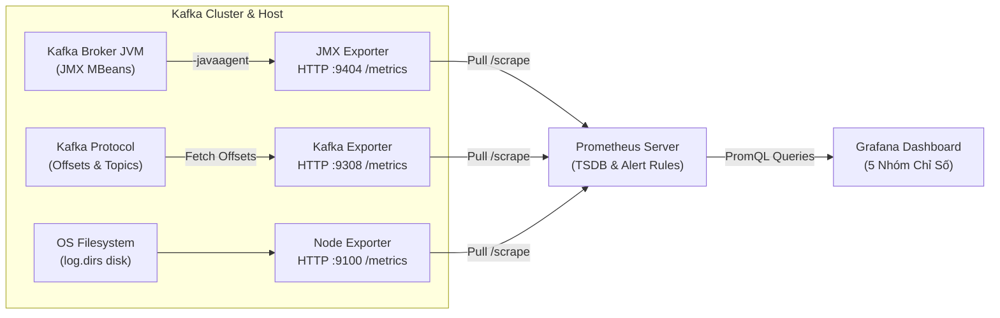

# 7_2_6 Giám Sát (Monitoring)

> **Khóa học**: Cloud DevOps Basic — Data Platform
> **Phân nhóm**: 7 Domain 7 - Apache Kafka › 7_2 Kafka Operations and Troubleshooting
> **Chủ đề**: Các nhóm chỉ số Kafka cốt lõi, xuất JMX metrics sang Prometheus và trực quan hóa trên Grafana
> **Trạng thái**: Bản nháp (chưa kiểm chứng theo yêu cầu người dùng)
> **Checklist đối chiếu**: [7_2 Kafka Operations and Troubleshooting](./README.md) · [Lộ trình tổng](../../README.md)

---

## 1. Khái Niệm Cốt Lõi & Bản Chất Kỹ Thuật (Core Concepts & Technical Deep Dive)

Apache Kafka là một hệ thống truyền dữ liệu phân tán chạy liên tục và xử lý khối lượng bản ghi lớn theo thời gian thực. Khi một broker gặp nghẽn đĩa, mất đồng bộ bản sao (replica), hoặc consumer xử lý không kịp, ứng dụng gửi tin nhắn có thể chưa báo lỗi ngay lập tức nhưng hệ thống đã bắt đầu tích tụ rủi ro mất dữ liệu hoặc trễ nghiệp vụ. Giám sát (Monitoring) là quá trình thu thập liên tục các chỉ số sức khỏe bên trong Kafka để phát hiện sớm dấu hiệu suy giảm trước khi sự cố bùng phát. Để làm được điều này, bạn cần nắm hai phần: **xem chỉ số nào** (5 nhóm metric sống còn) và **lấy chỉ số đó ra bằng cách nào** (từ JMX đưa vào Prometheus/Grafana).

### 1.1 Cơ chế xuất chỉ số gốc của Kafka (JMX & MBean)

Kafka viết bằng Java/Scala và chạy trên JVM. Theo thiết kế mặc định, Kafka dùng hệ thống đo lường nội bộ (Yammer Metrics / Kafka Metrics) để công bố các chỉ số qua giao thức **JMX (Java Management Extensions)** dưới dạng các đối tượng **MBean (Managed Bean)**. <!-- ev: C6.1 -->

**MBean** là một "ô đồng hồ đo" nằm trong bộ nhớ JVM, định danh bằng tên miền (`kafka.server`, `kafka.controller`...), kiểu (`type`) và tên chỉ số (`name`). Tuy nhiên, Kafka chỉ xuất qua JMX chứ không tự mở sẵn trang HTTP `/metrics` theo chuẩn Prometheus. <!-- ev: C6.13 -->

### 1.2 Năm nhóm chỉ số cốt lõi cần giám sát

Hãy dùng ví dụ xuyên suốt: hệ thống thương mại điện tử chạy topic đơn hàng và nhóm consumer xử lý thanh toán.

#### Nhóm 1: Under-Replicated Partitions & Độ khỏe Replication
Mỗi partition có một bản chính (leader) và các bản sao (follower); tập hợp các bản sao theo kịp leader gọi là **ISR (In-Sync Replicas)**.
- **Under-Replicated Partitions**: Chỉ số `kafka.server:type=ReplicaManager,name=UnderReplicatedPartitions` đếm số partition mà không phải mọi replica đều nằm trong ISR. <!-- ev: C6.2 --> Bình thường giá trị này phải bằng `0`; nếu lớn hơn `0` kéo dài, có replica đang bị tụt hậu do mạng chậm, đĩa nghẽn hoặc broker ngừng chạy. <!-- ev: C6.3 -->
- **Under-Min-ISR Partitions**: Chỉ số `kafka.server:type=ReplicaManager,name=UnderMinIsrPartitionCount` đếm số partition có số replica trong ISR thấp hơn ngưỡng `min.insync.replicas` (lúc này producer `acks=all` có thể bị từ chối ghi). <!-- ev: C6.4 -->

#### Nhóm 2: Trạng thái Controller & Leader
Trong cụm Kafka, một broker giữ vai trò điều phối trung tâm (**Active Controller**) để quản lý trạng thái broker và bầu leader.
- **Active Controller Count**: `kafka.controller:type=KafkaController,name=ActiveControllerCount` trả về `1` trên active controller và `0` trên các broker khác; toàn cụm khỏe mạnh chỉ có duy nhất một active controller tại mỗi thời điểm. <!-- ev: C6.6 --> Nếu tổng toàn cụm bằng `0` hoặc lớn hơn `1`, cụm đang gặp lỗi điều phối nghiêm trọng.
- **Offline Partitions Count**: `kafka.controller:type=KafkaController,name=OfflinePartitionsCount` (báo cáo trên active controller) đếm số partition không có leader hoạt động, làm gián đoạn hoàn toàn việc đọc và ghi vào chúng. <!-- ev: C6.5 -->
- **Unclean Leader Elections**: `kafka.controller:type=ControllerStats,name=UncleanLeaderElectionsPerSec` theo dõi tần suất bầu một replica ngoài ISR lên làm leader — có thể gây mất dữ liệu chưa kịp sao chép. <!-- ev: C6.7 -->

#### Nhóm 3: Consumer Lag (Độ trễ tiêu thụ)
**Consumer lag** là chênh lệch giữa offset bản ghi mới nhất ở đầu log trên broker và offset mà nhóm consumer đã xử lý xong. <!-- ev: C6.8 -->
- **Phía Consumer (Client-side JMX)**: Client consumer xuất nhóm `kafka.consumer:type=consumer-fetch-manager-metrics` gồm `records-lag-max` (độ trễ tối đa theo số bản ghi) và `records-lag` theo từng partition. <!-- ev: C6.8 -->
- **Phía Cluster (Exporter chuyên biệt)**: Vì broker JMX không tự xuất trực tiếp lag của từng consumer group khi consumer đã ngừng chạy, hệ thống vận hành thường dùng thêm một exporter đọc offset từ cluster (như **Kafka Exporter**) để giám sát lag tập trung. <!-- ev: C6.9 -->

#### Nhóm 4: Dung lượng đĩa (Disk Usage)
Kafka lưu dữ liệu theo các file log segment trên đĩa trong thư mục `log.dirs`. <!-- ev: C6.12 -->
- **Log Size**: MBean `kafka.log:type=Log,name=Size` ghi nhận dung lượng log của từng topic/partition; tuy nhiên vẫn phải kết hợp giám sát dung lượng trống ở tầng hệ điều hành (OS) để tránh các file khác chiếm đầy phân vùng đĩa làm broker sập. <!-- ev: C6.12 -->

#### Nhóm 5: Request Latency (Độ trễ xử lý yêu cầu)
Khi ứng dụng phản ánh "Kafka chậm", cần kiểm tra thời gian broker xử lý các loại request mạng (`Produce`, `FetchConsumer`, `FetchFollower`). <!-- ev: C6.10 -->
- **Total Time**: Nhóm `kafka.network:type=RequestMetrics,name=TotalTimeMs` (theo `request=Produce`, `FetchConsumer`, `FetchFollower`) đo tổng thời gian từ khi broker nhận request đến khi gửi xong phản hồi. <!-- ev: C6.10 -->

### 1.3 Đưa JMX Metrics vào Prometheus và Grafana

Vì Prometheus thu thập dữ liệu bằng cơ chế **pull (scrape)** định kỳ tới endpoint `/metrics` còn Kafka lại dùng JMX, ta cần cầu nối **Exporter**: <!-- ev: C6.13 --> <!-- ev: C6.17 -->

1. **Prometheus JMX Exporter**: Chạy như một **Java agent** (`-javaagent`) gắn vào tiến trình JVM của broker để đọc JMX MBean theo file YAML và mở cổng HTTP `/metrics` cho Prometheus scrape. <!-- ev: C6.14 -->
2. **Quy tắc lọc YAML (`rules`)**: Dùng biểu thức chính quy (`pattern`) chọn lọc MBean và đặt tên/nhãn Prometheus; nếu viết rule quá rộng sẽ tạo quá nhiều chuỗi thời gian, gây nặng CPU và tốn RAM. <!-- ev: C6.15 -->
3. **Kubernetes với Strimzi Operator**: Tài nguyên `Kafka` của Strimzi tích hợp sẵn `spec.kafka.metricsConfig` (loại `jmxPrometheusExporter`) và `spec.kafkaExporter` để bật xuất metric JMX lẫn consumer lag tự động. <!-- ev: C6.16 -->
4. **Grafana**: Kết nối nguồn dữ liệu Prometheus, dùng PromQL vẽ bảng điều khiển và thiết lập cảnh báo. <!-- ev: C6.17 -->

> ⚠️ **Lưu ý phiên bản**: Tên JMX MBean (như sự khác biệt ở controller giữa ZooKeeper và KRaft) và cấu hình `metricsConfig` phụ thuộc phiên bản Kafka/Strimzi — luôn đối chiếu tài liệu chính thức của đúng phiên bản bạn dùng. <!-- ev: C6.18 -->

#### Nâng cao: có thể bỏ qua ở lần đọc đầu
`TotalTimeMs` được chia nhỏ thành 5 chặng để định vị nút thắt: `RequestQueueTimeMs` (chờ hàng đợi vào), `LocalTimeMs` (xử lý/ghi đĩa cục bộ), `RemoteTimeMs` (chờ follower replicate), `ResponseQueueTimeMs` (chờ hàng đợi ra), và `ResponseSendTimeMs` (gửi qua mạng). <!-- ev: C6.11 -->

---

## 2. Ví Dụ Đời Sống Thực Tế Dễ Hiểu (Intuitive Real-World Analogies)

Giám sát Kafka giống như **nhìn bảng đồng hồ trên xe hơi khi chạy cao tốc**. Bạn không cần mở nắp ca-pô nhìn từng bánh răng động cơ; chỉ cần theo dõi 5 đèn báo sống còn trước vô-lăng:

1. **Kim báo mức xăng (Dung lượng đĩa)**: Hết xăng là xe tắt máy giữa đường — theo dõi đĩa trống giúp xử lý trước khi broker sập.
2. **Đồng hồ nhiệt độ máy (Request Latency)**: Máy nóng bất thường báo hiệu động cơ đang quá tải trước khi hỏng hẳn.
3. **Đèn báo lốp dự phòng (Under-Replicated Partitions)**: Một lốp xì hơi nghĩa là mất dự phòng; thủng thêm lốp nữa thì xe buộc phải dừng bên lề.
4. **Đèn người lái chính (Active Controller)**: Chỉ được có đúng một người cầm vô-lăng điều phối; không có ai hoặc hai người cùng giằng vô-lăng đều làm xe mất kiểm soát.
5. **Khoảng cách bám đuôi (Consumer Lag)**: Xe giao hàng chạy trước, xe nhận hàng chạy sau — khoảng cách tụt lại càng xa thì hàng hóa xử lý càng trễ.

Trong đó, **JMX Exporter** giống bộ chuyển đổi OBD-II dịch tín hiệu nội bộ của động cơ xe thành thông số chuẩn hiển thị lên **màn hình táp-lô (Prometheus + Grafana)**.

---

## 3. Kiến Trúc, Luồng Hoạt Động & Hình Ảnh Trực Quan (Architecture, Diagrams & Visual Media)

Sơ đồ dưới đây minh họa luồng đi của dữ liệu giám sát từ Kafka Broker (xử lý topic đơn hàng và nhóm consumer thanh toán) qua Exporter tới Prometheus và Grafana:



<!-- ev: C6.13 C6.14 C6.16 C6.17 -->

### Luồng chuyển đổi dữ liệu (Input → Cơ chế → Output)

| Đầu vào (Nguồn gốc bên trong hệ thống) | Thành phần xử lý (Cầu nối) | Đầu ra quan sát được (Trên Prometheus / Grafana) |
| :--- | :--- | :--- |
| JMX MBean `kafka.server:type=ReplicaManager,name=UnderReplicatedPartitions` | JMX Exporter (`-javaagent` + YAML rules) <!-- ev: C6.14 C6.15 --> | Chuỗi metric dạng văn bản trên `/metrics`, vẽ biểu đồ tổng số partition thiếu đồng bộ (mục tiêu `= 0`) <!-- ev: C6.2 C6.3 --> |
| Offset của topic `orders-events` và group `order-processor` trên broker | Kafka Exporter (hoặc `spec.kafkaExporter` trên Strimzi) <!-- ev: C6.9 C6.16 --> | Chỉ số consumer lag theo từng partition/group ngay cả khi consumer pod tắt <!-- ev: C6.9 --> |
| Dung lượng trống của ổ đĩa chứa `log.dirs` ở cấp OS + `Log Size` JMX | Node Exporter + JMX Exporter <!-- ev: C6.12 --> | Tỉ lệ phần trăm đĩa trống còn lại và tốc độ tăng trưởng dung lượng topic |

---

## 4. Code Mẫu Trực Quan Hoặc Dòng Lệnh Thực Chiến (Runnable Sample Code / CLI)

> **Lưu ý**: Cấu hình dưới đây mang tính minh họa cho Kafka 3.x và Strimzi; cần tải đúng bản `jmx_prometheus_javaagent` và đối chiếu tên MBean/trường YAML theo đúng phiên bản đang dùng. <!-- ev: C6.18 -->

### 4.1 Cấu hình JMX Exporter và gắn vào JVM của Kafka Broker

**1. File quy tắc lọc metric (`kafka-jmx-config.yml`)**: chọn lọc MBean cần xuất ra `/metrics` để tránh tạo quá nhiều chuỗi thời gian. <!-- ev: C6.15 -->

<!-- ev: C6.15 -->
```yaml
lowercaseOutputName: true
lowercaseOutputLabelNames: true
rules:
  - pattern: "kafka.server<type=ReplicaManager, name=(UnderReplicatedPartitions|UnderMinIsrPartitionCount)><>Value"
    name: "kafka_server_replicamanager_$1"
    type: GAUGE
  - pattern: "kafka.controller<type=KafkaController, name=(ActiveControllerCount|OfflinePartitionsCount)><>Value"
    name: "kafka_controller_kafkacontroller_$1"
    type: GAUGE
  - pattern: "kafka.network<type=RequestMetrics, name=TotalTimeMs, request=(Produce|FetchConsumer|FetchFollower)><>(Count|Mean|99thPercentile)"
    name: "kafka_network_requestmetrics_totaltimems_$2"
    labels:
      request: "$1"
    type: GAUGE
```

**2. Gắn Java agent khi khởi chạy broker**: nạp agent qua biến `KAFKA_OPTS` để mở endpoint HTTP cổng `9404`. <!-- ev: C6.14 -->

<!-- ev: C6.14 -->
```bash
export KAFKA_OPTS="-javaagent:/opt/prometheus/jmx_prometheus_javaagent.jar=9404:/opt/prometheus/kafka-jmx-config.yml"
bin/kafka-server-start.sh config/kraft/server.properties
```

### 4.2 Kiểm tra Output từ Endpoint `/metrics` (Input → Command → Output)

Kiểm tra nhanh dữ liệu thô do JMX Exporter xuất ra trước khi cấu hình Prometheus scrape: <!-- ev: C6.14 C6.17 -->

```bash
curl -s http://localhost:9404/metrics | grep -E "underreplicatedpartitions|activecontrollercount"
```

Kết quả mẫu khi cụm có 1 active controller và không có partition mất đồng bộ:

```text
# TYPE kafka_controller_kafkacontroller_activecontrollercount gauge
kafka_controller_kafkacontroller_activecontrollercount 1.0
# TYPE kafka_server_replicamanager_underreplicatedpartitions gauge
kafka_server_replicamanager_underreplicatedpartitions 0.0
```

### 4.3 Cấu hình trên Kubernetes bằng Strimzi Operator

Khai báo `metricsConfig` và `kafkaExporter` trực tiếp trong CRD `Kafka` của Strimzi: <!-- ev: C6.16 -->

<!-- ev: C6.16 -->
```yaml
apiVersion: kafka.strimzi.io/v1beta2
kind: Kafka
metadata:
  name: my-cluster
spec:
  kafka:
    metricsConfig:
      type: jmxPrometheusExporter
      valueFrom:
        configMapKeyRef:
          name: kafka-metrics
          key: kafka-metrics-config.yml
  kafkaExporter:
    topicRegex: ".*"
    groupRegex: ".*"
```

---

## 5. Cạm Bẫy Thực Tế & Thực Tiễn Sản Xuất (Production Gotchas & Best Practices)

1. **Bùng nổ cardinality từ JMX Exporter**: Dùng `pattern: ".*"` trên cluster nhiều partition sẽ xuất hàng chục nghìn metric, làm tăng CPU broker và quá tải Prometheus; cần luôn whitelist các MBean cốt lõi. <!-- ev: C6.15 -->
2. **Mù lag khi Consumer Group ngừng chạy**: Chỉ theo dõi `records-lag-max` từ JMX của consumer <!-- ev: C6.8 --> sẽ mất tín hiệu khi toàn bộ consumer pod bị crash; cần kết hợp **Kafka Exporter** (hoặc `spec.kafkaExporter` của Strimzi) để đo lag từ phía cluster. <!-- ev: C6.9 C6.16 -->
3. **Bỏ qua dung lượng đĩa tầng OS**: Chỉ theo dõi MBean `kafka.log:type=Log,name=Size` chưa đủ nếu file khác chiếm hết phân vùng `log.dirs`; cần đặt cảnh báo thêm trên dung lượng đĩa trống của hệ điều hành. <!-- ev: C6.12 -->
4. **Lệch tên MBean khi nâng cấp phiên bản**: Nâng cấp Kafka (đặc biệt chuyển ZooKeeper sang KRaft) hoặc Strimzi có thể đổi tên một số MBean/cấu hình; luôn đối chiếu tài liệu đúng phiên bản và kiểm tra lại `/metrics` trên staging. <!-- ev: C6.18 -->

---

## 6. Câu Hỏi Củng Cố Kiến Thức (Active Recall Quiz)

**Câu 1**: Trên Grafana của cụm Kafka 3 broker, bạn thấy chỉ số tổng `ActiveControllerCount` toàn cụm đột ngột nhảy từ `1` xuống `0`, đồng thời `OfflinePartitionsCount` tăng lớn hơn `0`. Điều này có ý nghĩa gì đối với hoạt động đọc/ghi của cluster?

<details>
<summary>Đáp án</summary>

Cluster đang ở trạng thái bất thường nghiêm trọng: không có broker nào đảm nhận vai trò active controller (`ActiveControllerCount` tổng = `0`) để điều phối thay đổi trạng thái hoặc bầu chọn leader mới. Đồng thời, `OfflinePartitionsCount > 0` cho biết đang có những partition hoàn toàn không có leader hoạt động, nên mọi yêu cầu đọc và ghi vào các partition đó đều sẽ thất bại cho đến khi một controller mới được bầu và khôi phục leader.

</details>

**Câu 2**: Nhóm consumer `order-processor` bị lỗi OOMKill và toàn bộ pod trên Kubernetes đều tắt. Vì sao hệ thống giám sát chỉ thu thập JMX từ ứng dụng consumer lại không báo động `records-lag-max` tăng vọt, và bạn nên bổ sung thành phần nào?

<details>
<summary>Đáp án</summary>

Vì metric `records-lag-max` được xuất ra từ chính JVM của các ứng dụng consumer. Khi tất cả pod consumer bị tắt, Prometheus không còn mục tiêu (target) nào để scrape chỉ số đó nữa nên biểu đồ bị ngắt quãng thay vì tăng lên. Để khắc phục, cần triển khai thêm **Kafka Exporter** (hoặc bật `spec.kafkaExporter` nếu dùng Strimzi) để kết nối trực tiếp vào Kafka broker và đọc chênh lệch offset của consumer group từ phía cluster.

</details>

**Câu 3**: Sau khi gắn JMX Exporter vào các broker của một cụm Kafka có hàng nghìn partition bằng một file cấu hình mẫu lấy toàn bộ MBean, đội vận hành thấy CPU của broker tăng cao và Prometheus scrape thường xuyên bị timeout. Nguyên nhân cốt lõi là gì và cách xử lý ra sao?

<details>
<summary>Đáp án</summary>

Nguyên nhân là file cấu hình YAML của JMX Exporter đặt rule quá rộng (như `pattern: ".*"`), khiến Java agent phải phản xạ (reflect) và xuất ra hàng chục nghìn metric chi tiết theo từng partition/client mỗi lần Prometheus scrape. Cách xử lý là thu hẹp khối `rules` theo nguyên tắc whitelist — chỉ giữ lại các MBean cốt lõi (như replication, controller, request latency, log size) và tổng hợp nhãn hợp lý để kiểm soát số lượng metric.

</details>

---

## 7. 📚 Nguồn Tài Liệu Chính Thống (Tier-1 Official References)

- [Apache Kafka Documentation — Monitoring](https://kafka.apache.org/documentation/#monitoring) — Tài liệu chính thức của Apache Kafka liệt kê các nhóm JMX MBean (Replication, Controller, RequestMetrics, Log, Consumer metrics).
- [Strimzi Documentation — Overview & Monitoring](https://strimzi.io/docs/operators/latest/overview) — Tài liệu chính thức về Strimzi Operator triển khai Kafka trên Kubernetes, bao gồm cơ chế tích hợp Prometheus JMX Exporter và Kafka Exporter.
- [Prometheus JMX Exporter (Official Repository)](https://github.com/prometheus/jmx_exporter) — Kho mã nguồn và hướng dẫn chính thức (Tier 2) về cách cấu hình `-javaagent` và viết `rules` YAML cho Java/Kafka.
