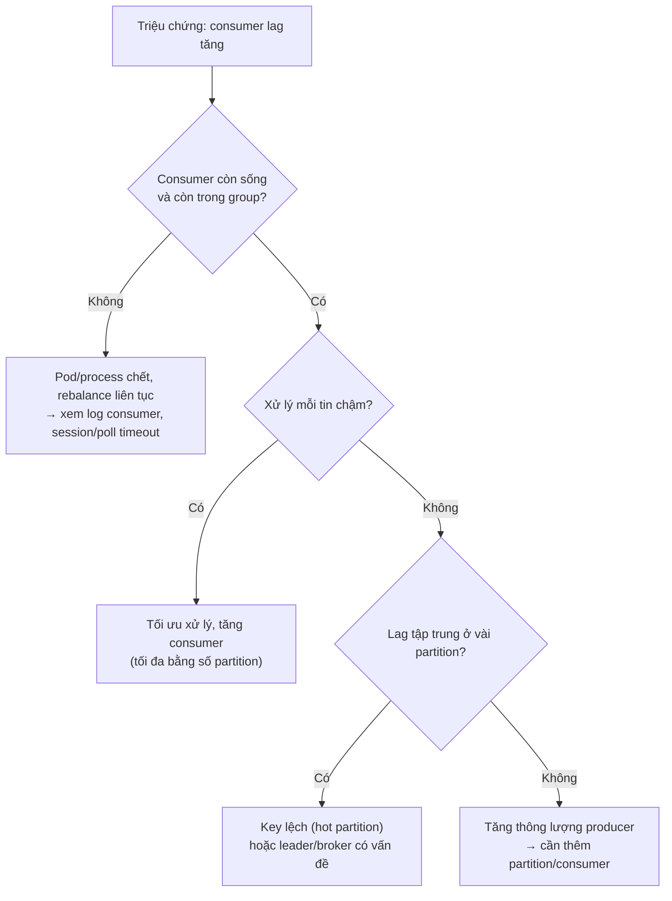

# 7_2 Kafka Operations and Troubleshooting

> **Khóa học**: Cloud DevOps Basic — Data Platform
> **Phân nhóm**: 7 Domain 7 - Apache Kafka › 7_2 Kafka Operations and Troubleshooting
> **Chủ đề**: CLI quản trị, consumer lag, under-replicated partitions, rebalance, broker mất kết nối, metric cần theo dõi
> **Trạng thái**: Định nghĩa (nội dung cần học + đề bài lab), chưa chạy thử, 16-11-2026
> **Lộ trình tổng**: [data-platform/README.md](../../README.md) · **Tiên quyết**: [7_1 Kafka Core Concepts](<../7_1 Kafka Core Concepts/README.md>)

---

## 🎯 Mục Tiêu

Với một DevOps/CI-CD, câu hỏi thực tế không phải "Kafka là gì" mà là **"consumer lag tăng, làm gì tiếp?"**. Topic này dạy quy trình chẩn đoán: *triệu chứng → lệnh kiểm tra → nguyên nhân thường gặp → hướng xử lý*. Đây cũng là chỗ phát huy kinh nghiệm troubleshooting từ log của bạn.

**Ví dụ đời thường**: consumer lag giống **hàng đợi ở quầy thu ngân**: nếu khách (tin) đến nhanh hơn tốc độ thu ngân (consumer) xử lý, hàng dài ra. Cách xử lý phụ thuộc vì sao: thu ngân chậm, thiếu quầy (partition), hay quầy đóng cửa (consumer chết).

---

## 📚 Những Gì Cần Học

### 7_2_1 CLI Quản Trị
- [ ] Công cụ đi kèm bản phân phối Kafka: tạo/mô tả/sửa topic, đọc config, mô tả consumer group, console producer/consumer.
- [ ] Đọc output `describe` của topic: partition, leader, replicas, ISR.
- [ ] Tìm đúng tên công cụ và cờ trong tài liệu của **đúng phiên bản** bạn dùng (*không điền cờ từ trí nhớ; cần đối chiếu trang Operations*).

### 7_2_2 Consumer Lag
- [ ] Định nghĩa lag theo từng partition và theo group; đọc `CURRENT-OFFSET`, `LOG-END-OFFSET`, `LAG` trong mô tả consumer group.
- [ ] Nguyên nhân thường gặp: consumer chậm/lỗi, thiếu consumer so với partition, hot partition do key lệch, rebalance liên tục, broker chậm.
- [ ] Lag tăng nhưng không có consumer: group rỗng hay `Dead`/`Empty` (khái niệm trạng thái group).
- [ ] Liên hệ [CLOUD_ENGINEER_INTERVIEW_PREP.md](../../../CLOUD_ENGINEER_INTERVIEW_PREP.md): câu hỏi "consumer lag là gì, xử lý thế nào".

### 7_2_3 Rebalance Liên Tục
- [ ] Nguyên nhân: consumer xử lý quá lâu giữa hai lần poll, session timeout, Pod restart liên tục.
- [ ] Hệ quả: dừng tiêu thụ tạm thời, xử lý trùng tin.
- [ ] Liên hệ Kubernetes: rolling update consumer Deployment gây rebalance (nối với 6_3_7 graceful shutdown).

### 7_2_4 Replication Không Khỏe
- [ ] **Under-replicated partitions** và **under-min-ISR**: ý nghĩa, nguyên nhân (broker chậm/chết, mạng, đĩa).
- [ ] Hệ quả với `acks=all` + `min.insync.replicas`: producer nhận lỗi thay vì mất dữ liệu im lặng.
- [ ] Broker mất kết nối: quan sát leader chuyển sang broker khác, ISR co lại rồi phục hồi.

### 7_2_5 Đĩa, Retention và Dung Lượng
- [ ] Đĩa đầy trên broker: nguyên nhân (retention quá dài, topic phình), cách xử lý an toàn (đổi `retention.ms`, mở rộng volume) — **không xóa tay file segment**.
- [ ] Ước lượng dung lượng: tốc độ ghi × thời gian retention × replication factor.

### 7_2_6 Giám Sát
- [ ] Nhóm chỉ số nên có: consumer lag, under-replicated partitions, trạng thái controller/leader, dung lượng đĩa, request latency.
- [ ] Cách đưa metric vào Prometheus/Grafana (JMX exporter hoặc exporter khác; *cần đối chiếu cách chính thức theo bản Kafka/Strimzi bạn dùng*), nối với 6_8_4.

---

## 🧪 Labs

> **Bản định nghĩa**: chưa tạo thư mục `labs/`, chưa chạy thử. Lab break-and-fix cần cluster nhiều broker (3 broker, có thể chạy bằng container).

| Lab | Nội dung | Thời gian | Trạng thái |
| :--- | :--- | :---: | :--- |
| lab-7_2_1-consumer-lag-diagnosis | Tạo lag, đọc lag bằng CLI, giảm lag | 60 phút | Định nghĩa |
| lab-7_2_2-broker-failure | Cluster 3 broker, dừng 1 broker, quan sát ISR và leader | 60–90 phút | Định nghĩa |

### lab-7_2_1-consumer-lag-diagnosis
- **Các bước chính**:
  1. Producer gửi liên tục; consumer cố ý xử lý chậm (sleep) → lag tăng.
  2. Mô tả consumer group, ghi lại LAG theo partition.
  3. Thêm consumer cùng group → quan sát lag giảm tới giới hạn số partition.
  4. Dừng toàn bộ consumer → xem trạng thái group và lag.
- **Checkpoint**:
  - [ ] Đọc output mô tả group và nói được "lag nằm ở đâu, vì sao".
  - [ ] Nêu 4 nguyên nhân lag và lệnh/log kiểm tra từng nguyên nhân.

### lab-7_2_2-broker-failure
- **Các bước chính**:
  1. Cluster 3 broker, topic `replication-factor=3`, `min.insync.replicas=2`.
  2. Dừng 1 broker → `describe` thấy ISR co lại, leader đổi; producer `acks=all` vẫn ghi được.
  3. Dừng thêm 1 broker → producer `acks=all` báo lỗi vì dưới `min.insync.replicas`.
  4. Bật lại broker → ISR phục hồi.
- **Checkpoint**:
  - [ ] Giải thích được tại sao bước 3 lỗi là **hành vi đúng**, không phải sự cố.
  - [ ] Nêu được hướng xử lý khi mất quá nửa broker trong production.

---

## 📚 Nguồn Tài Liệu Chính Thống (Official References)
- [Apache Kafka - Operations](https://kafka.apache.org/documentation/#operations) - Quản trị topic, consumer group, mở rộng, đĩa, vận hành cluster.
- [Apache Kafka - Monitoring](https://kafka.apache.org/documentation/#monitoring) - Danh sách metric JMX.
- [Apache Kafka - Replication (Design)](https://kafka.apache.org/documentation/#replication) - Leader, ISR, bầu leader.
- [Apache Kafka - Broker Configs](https://kafka.apache.org/documentation/#brokerconfigs) - Cấu hình broker, bao gồm giới hạn và timeout.
