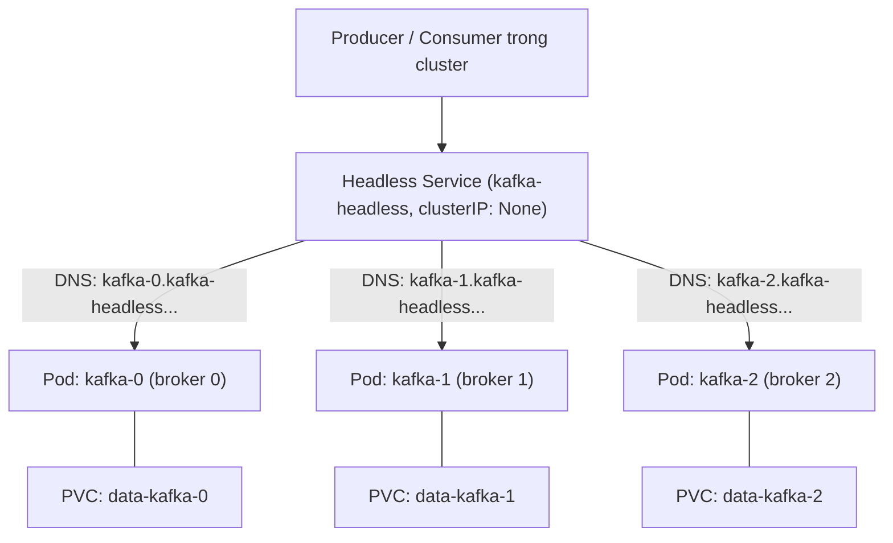

# 7_3_1 Vì Sao Kafka Cần StatefulSet

> **Khóa học**: Cloud DevOps Basic — Data Platform
> **Phân nhóm**: 7 Domain 7 - Apache Kafka › 7_3 Kafka on Kubernetes
> **Chủ đề**: 7_3_1 Why StatefulSet
> **Trạng thái**: Bản nháp (chưa kiểm chứng theo yêu cầu người dùng)
> **Tài liệu liên quan**: [Chủ đề 7_3](./README.md) | [Lộ trình Data Platform](../../README.md)

---

## 1. Khái Niệm Cốt Lõi & Bản Chất Kỹ Thuật (Core Concepts & Technical Deep Dive)

Khi chạy ứng dụng web thông thường trên Kubernetes, các Pod giống hệt nhau và có thể thay thế tự do vì dữ liệu nằm ở cơ sở dữ liệu bên ngoài. Với Apache Kafka thì khác: mỗi **broker** (máy chủ phục vụ và lưu trữ dữ liệu Kafka) tự lưu các **partition** (phân vùng dữ liệu của topic) trực tiếp trên ổ đĩa của riêng nó và mang một danh tính gắn chặt với ổ đĩa đó. Nếu broker khởi động lại mà bị đổi tên hoặc gắn nhầm ổ đĩa khác, cụm Kafka sẽ xem đó là máy mới hoặc từ chối ghép cụm. StatefulSet giải quyết bài toán này bằng cách giữ cố định tên Pod, địa chỉ mạng và ổ đĩa riêng cho từng broker suốt vòng đời cụm.

### 1.1 Danh tính Kafka broker gắn chặt với ổ đĩa dữ liệu

Mỗi Kafka broker có một mã định danh duy nhất (`broker.id` ở chế độ ZooKeeper hoặc `node.id` ở chế độ KRaft), được ghi vào file `meta.properties` ngay trên ổ đĩa dữ liệu để khớp broker với các partition mà nó phụ trách. <!-- ev: C1.1 -->

Do đó, nếu Pod của một broker bị sập và chuyển sang node khác, Pod thay thế bắt buộc phải giữ lại tên cũ và gắn lại đúng ổ đĩa cũ chứa file định danh đó. <!-- ev: C1.1 C1.7 -->

### 1.2 StatefulSet và ba trụ cột bảo vệ danh tính broker

**StatefulSet** là một workload API object trong Kubernetes dùng để quản lý các ứng dụng có trạng thái (stateful), đảm bảo tính duy nhất và thứ tự (ordering and uniqueness) cho tập hợp các Pod. <!-- ev: C1.2 -->

StatefulSet cung cấp ba cơ chế cốt lõi sau để bảo vệ danh tính broker:

1. **Tên Pod cố định theo chỉ số thứ tự (Stable Pod Identity)**:
   Mỗi Pod trong StatefulSet nhận một chỉ số thứ tự nguyên (ordinal index) từ `0` đến `N-1` và tên Pod cố định theo mẫu `<statefulset-name>-<ordinal>`, ví dụ `kafka-0`, `kafka-1`, `kafka-2`. <!-- ev: C1.3 -->
   Nhờ tên Pod cố định, chỉ số thứ tự ở cuối tên (`0`, `1`, `2`) có thể ánh xạ trực tiếp sang định danh broker tương ứng. <!-- ev: C1.1 C1.3 -->

2. **DNS ổn định qua Headless Service (Stable Network Identity)**:
   Service thông thường chia tải ngẫu nhiên sang mọi Pod, trong khi Kafka cần kết nối đích danh tới từng broker giữ leader partition.
   Vì vậy, StatefulSet sử dụng một **Headless Service** (Service cấu hình `clusterIP: None`) được khai báo qua trường `spec.serviceName` để quản lý danh tính mạng cho các Pod của mình. <!-- ev: C1.4 -->
   Nhờ Headless Service, mỗi Pod có một bản ghi DNS riêng ổn định theo định dạng `<pod-name>.<service-name>.<namespace>.svc.cluster.local`, ví dụ `kafka-0.kafka-headless.default.svc.cluster.local`. <!-- ev: C1.5 -->
   Dù Pod chuyển sang node khác và đổi IP, Kubernetes DNS vẫn tự động cập nhật bản ghi trỏ về đúng Pod có tên cố định đó. <!-- ev: C1.5 -->

3. **Ổ đĩa riêng cho từng Pod (Stable Storage)**:
   **PersistentVolumeClaim (PVC)** là yêu cầu cấp phát ổ đĩa bền vững trong Kubernetes để dữ liệu không mất khi container khởi động lại. <!-- ev: C1.6 -->
   Trường `spec.volumeClaimTemplates` của StatefulSet tự động tạo một PVC riêng biệt cho từng Pod (ví dụ `data-kafka-0` gắn với `kafka-0`, `data-kafka-1` gắn với `kafka-1`). <!-- ev: C1.6 -->
   Khi một Pod của StatefulSet bị xóa hoặc chuyển sang node khác, Pod thay thế giữ nguyên tên cũ và tự động gắn lại đúng PVC cũ tương ứng với ordinal của nó. <!-- ev: C1.7 -->

### 1.3 Chuyện gì xảy ra nếu cố dùng Deployment cho Kafka?

Bảng dưới đây đối chiếu sự khác biệt cốt lõi giữa hai loại workload khi chạy cụm nhiều broker: <!-- ev: C1.3 C1.5 C1.6 C1.8 C1.9 -->

| Tiêu chí | Deployment | StatefulSet |
| :--- | :--- | :--- |
| **Tên Pod** | Hậu tố ngẫu nhiên (`kafka-7d9f4b8c6-x2p9q`) | Cố định theo thứ tự (`kafka-0`, `kafka-1`, `kafka-2`) |
| **DNS riêng từng Pod** | Không tự cấp DNS định danh theo replica | Có DNS ổn định qua Headless Service |
| **Ổ đĩa cho nhiều replica** | Các Pod dùng chung template `volumes` | Tự tạo 1 PVC riêng mỗi Pod qua `volumeClaimTemplates` |
| **Khi Pod tạo lại** | Đổi tên và đổi IP mới | Giữ nguyên tên Pod, DNS và gắn lại đúng PVC cũ |

Nếu cố dùng Deployment cho cụm nhiều broker, hệ thống sẽ gặp ba vấn đề dây chuyền: <!-- ev: C1.8 C1.9 C1.10 -->

- **Mất định danh mạng ổn định**: Deployment gắn hậu tố ngẫu nhiên vào tên Pod (ví dụ `kafka-7d9f4b8c6-x2p9q`) và cấp IP mới mỗi lần Pod được tạo lại, không duy trì tên Pod hay DNS riêng cố định cho từng broker. <!-- ev: C1.8 -->
- **Không thể chia mỗi broker một PVC tự động**: Deployment không hỗ trợ trường `volumeClaimTemplates` để tự tạo PVC riêng cho từng replica, nên các Pod trong cùng một Deployment dùng chung cấu hình `volumes` của Pod template. <!-- ev: C1.9 -->
- **Xung đột ổ đĩa hoặc mất dữ liệu cục bộ**: Khi nhiều broker chạy trên Deployment dùng chung một PVC `ReadWriteOnce` (RWO), các Pod nằm trên các node khác nhau không thể cùng mount volume đó ở chế độ đọc-ghi, hoặc nếu tạo PVC trống mới thì broker mới mất dữ liệu partition cục bộ và buộc cluster phải đồng bộ lại qua mạng. <!-- ev: C1.10 -->

### 1.4 Điều khiển thứ tự khởi tạo, cập nhật và giữ lại PVC

*(Nâng cao: có thể bỏ qua phần tùy chọn ở lần đọc đầu nếu bạn mới làm quen Kubernetes).*

- **Chính sách tạo và xóa Pod**: <!-- ev: C1.11 C1.12 -->
  - Mặc định Kubernetes tạo từng Pod một để đảm bảo thứ tự cho các hệ thống stateful. <!-- ev: C1.11 -->
  - Mặc định `spec.podManagementPolicy` của StatefulSet là `OrderedReady`: tạo Pod tuần tự từ `0` đến `N-1` (chờ mỗi Pod đạt `Running` và `Ready` trước khi tạo Pod tiếp theo) và xóa theo thứ tự ngược lại (`N-1` về `0`). <!-- ev: C1.11 -->
  - Tùy chọn không bắt buộc `podManagementPolicy: Parallel` cho phép StatefulSet tạo hoặc xóa toàn bộ các Pod cùng lúc mà không phải chờ Pod trước đạt trạng thái `Ready`, giúp tăng tốc khởi tạo khi các broker không phụ thuộc thứ tự boot. <!-- ev: C1.12 -->

- **Chiến lược cập nhật và thử nghiệm canary**: <!-- ev: C1.13 C1.14 C1.15 -->
  - Chiến lược cập nhật mặc định `spec.updateStrategy.type: RollingUpdate` cập nhật lần lượt từng Pod theo thứ tự ordinal giảm dần (từ `N-1` về `0`), chỉ sang Pod tiếp theo khi Pod vừa cập nhật đã `Running` và `Ready`. <!-- ev: C1.13 -->
  - Tham số tùy chọn `spec.updateStrategy.rollingUpdate.partition` (mặc định là `0`) giới hạn cập nhật chỉ áp dụng cho các Pod có ordinal lớn hơn hoặc bằng giá trị `partition`, giúp thử nghiệm cấu hình mới theo kiểu canary trên một vài broker trước. <!-- ev: C1.14 -->
  - Chiến lược tùy chọn `spec.updateStrategy.type: OnDelete` giữ nguyên các Pod đang chạy khi StatefulSet template thay đổi; Pod chỉ nhận phiên bản mới khi bạn xóa thủ công từng Pod đó. <!-- ev: C1.15 -->

- **Giữ lại PVC khi xóa hoặc thu nhỏ StatefulSet**:
  - Theo hành vi mặc định của Kubernetes, việc xóa StatefulSet hoặc thu nhỏ (scale down) `replicas` không tự động xóa các PVC đã tạo từ `volumeClaimTemplates` nhằm tránh mất dữ liệu ngoài ý muốn. <!-- ev: C1.16 -->
  - Nếu muốn thay đổi hành vi giữ PVC mặc định (nâng cao, tùy chọn), Kubernetes cung cấp trường `spec.persistentVolumeClaimRetentionPolicy` với hai tùy chọn `whenDeleted` và `whenScaled` (mặc định đều là `Retain`, có thể đặt thành `Delete`). <!-- ev: C1.17 -->

---

## 2. Ví Dụ Đời Sống Thực Tế Dễ Hiểu (Intuitive Real-World Analogies)

Hãy hình dung sự khác biệt giữa **Deployment** và **StatefulSet** qua hai mô hình vận hành ngoài đời thực:

- **Deployment giống nhân viên ca làm việc thay phiên nhau ở quầy tiếp tân**: Quầy có 3 vị trí đứng, ai mặc đồng phục vào ca cũng xử lý công việc giống nhau. Nếu nhân viên A nghỉ giữa ca, quản lý gọi nhân viên D mang tên khác vào đứng thế chỗ, khách hàng không cần biết tên riêng của người đứng quầy vì mọi hồ sơ đều tra từ máy tính trung tâm.
- **StatefulSet giống đội ngũ thủ kho có đánh số thứ tự và chìa khóa riêng**:
  - Kho hàng có 3 phòng riêng biệt (`PVC-0`, `PVC-1`, `PVC-2`), mỗi phòng chứa một phần hàng hóa (partition) được ghi sổ theo đúng số phòng.
  - Thủ kho số 0 (`kafka-0`) luôn giữ chìa khóa mở đúng phòng `PVC-0`; thủ kho số 1 (`kafka-1`) giữ chìa khóa phòng `PVC-1`; thủ kho số 2 (`kafka-2`) giữ chìa khóa phòng `PVC-2`.
  - Nếu thủ kho số 1 bị ốm và phải nghỉ tạm (Pod `kafka-1` bị xóa hoặc node bảo trì), người thay thế **bắt buộc phải mang thẻ tên `kafka-1`** và nhận lại đúng chùm chìa khóa mở căn phòng `PVC-1` cũ.
  - Nếu làm theo kiểu Deployment — cấp một người tên ngẫu nhiên mở một phòng kho trống mới tinh — thì toàn bộ hàng hóa partition trong `PVC-1` coi như bị thất lạc khỏi sổ sách của người mới đó.

---

## 3. Kiến Trúc, Luồng Hoạt Động & Hình Ảnh Trực Quan (Architecture, Diagrams & Visual Media)

Sơ đồ dưới đây minh họa mối liên kết 1-1 giữa **Headless Service**, **Pod theo ordinal** của StatefulSet và **PVC riêng** cho cụm Kafka 3 broker:



---

## 4. Code Mẫu Thực Chiến & Kiểm Chứng Hành Vi (Runnable YAML & CLI Walkthrough)

Ví dụ dưới đây minh họa cấu trúc tối giản của một Headless Service kết hợp StatefulSet cho 3 Pod trên cụm Kubernetes có sẵn StorageClass mặc định (tập trung vào danh tính, DNS và PVC riêng; phần mạng listener và Operator sẽ học ở bài sau). <!-- ev: C1.4 C1.6 -->

### 4.1 Manifest Headless Service + StatefulSet (`kafka-sts.yaml`)

Trong manifest YAML của StatefulSet, tên trường `spec.serviceName` phải khớp với `metadata.name` của Headless Service, và `volumeMounts[].name` trong container phải khớp với `metadata.name` của phần tử trong `volumeClaimTemplates`. <!-- ev: C1.18 -->

```yaml
apiVersion: v1
kind: Service
metadata:
  name: kafka-headless
spec:
  clusterIP: None          # Bắt buộc None để thành Headless Service
  selector:
    app: kafka
  ports:
    - name: broker
      port: 9092
---
apiVersion: apps/v1
kind: StatefulSet
metadata:
  name: kafka
spec:
  serviceName: kafka-headless
  replicas: 3
  podManagementPolicy: OrderedReady
  updateStrategy:
    type: RollingUpdate
    rollingUpdate:
      partition: 0
  selector:
    matchLabels:
      app: kafka
  template:
    metadata:
      labels:
        app: kafka
    spec:
      containers:
        - name: kafka
          image: busybox:1.36    # Ảnh nhẹ mô phỏng cơ chế giữ tên Pod và file trên PVC
          command: ["sh", "-c", "hostname > /var/lib/kafka/data/pod-id.txt && sleep 3600"]
          volumeMounts:
            - name: data
              mountPath: /var/lib/kafka/data
  volumeClaimTemplates:
    - metadata:
        name: data
      spec:
        accessModes: ["ReadWriteOnce"]
        resources:
          requests:
            storage: 1Gi
```

### 4.2 Quy trình Input → Command → Output quan sát vòng đời Pod và PVC

**Bước 1 — Áp dụng manifest và quan sát Pod cùng PVC được tạo ra:**

- **Input**: File manifest YAML ở mục 4.1.
- **Command**: chạy `kubectl apply -f kafka-sts.yaml` để triển khai, sau đó kiểm tra tài nguyên bằng lệnh dưới đây: <!-- ev: C1.3 C1.6 C1.11 -->

```bash
kubectl apply -f kafka-sts.yaml
kubectl get pods,pvc -l app=kafka
```

- **Output kỳ vọng**:

```text
NAME          READY   STATUS    RESTARTS   AGE
pod/kafka-0   1/1     Running   0          45s
pod/kafka-1   1/1     Running   0          30s
pod/kafka-2   1/1     Running   0          15s

NAME                                 STATUS   VOLUME     CAPACITY   ACCESS MODES   AGE
persistentvolumeclaim/data-kafka-0   Bound    pvc-1111   1Gi        RWO            45s
persistentvolumeclaim/data-kafka-1   Bound    pvc-2222   1Gi        RWO            30s
persistentvolumeclaim/data-kafka-2   Bound    pvc-3333   1Gi        RWO            15s
```

Các Pod được tạo tuần tự theo chỉ số ordinal và mỗi Pod gắn với một PVC riêng đặt tên theo mẫu `data-<pod-name>`. <!-- ev: C1.3 C1.6 C1.11 -->

**Bước 2 — Giả lập xóa Pod và xác nhận gắn lại đúng PVC cũ:**

Khi chạy lệnh `kubectl delete pod kafka-1` trên một StatefulSet, controller sẽ tạo lại Pod mang đúng tên `kafka-1` và gắn lại đúng PVC `data-kafka-1` trước đó. <!-- ev: C1.19 -->

- **Input**: Cụm đang chạy 3 Pod từ Bước 1.
- **Command**:

```bash
kubectl delete pod kafka-1
kubectl get pods,pvc -l app=kafka
```

- **Output kỳ vọng**:

```text
NAME          READY   STATUS    RESTARTS   AGE
pod/kafka-0   1/1     Running   0          2m
pod/kafka-1   1/1     Running   0          10s
pod/kafka-2   1/1     Running   0          90s

NAME                                 STATUS   VOLUME     CAPACITY   ACCESS MODES   AGE
persistentvolumeclaim/data-kafka-0   Bound    pvc-1111   1Gi        RWO            2m
persistentvolumeclaim/data-kafka-1   Bound    pvc-2222   1Gi        RWO            105s
persistentvolumeclaim/data-kafka-2   Bound    pvc-3333   1Gi        RWO            90s
```

Pod mới tạo lại chỉ mới sống vài giây nhưng PVC tương ứng vẫn giữ nguyên tuổi cũ và cùng volume cũ, chứng tỏ ổ đĩa không bị thay thế. <!-- ev: C1.7 C1.19 -->

**Bước 3 — Dọn dẹp môi trường thử nghiệm:**

```bash
kubectl delete -f kafka-sts.yaml
kubectl delete pvc -l app=kafka
```

Vì xóa StatefulSet không tự xóa PVC, bạn cần chạy thêm lệnh xóa PVC nếu muốn dọn sạch hoàn toàn môi trường lab. <!-- ev: C1.16 -->

---

## 5. Cạm Bẫy Thực Tế & Thực Tiễn Sản Xuất (Production Gotchas & Best Practices)

1. **Cạm bẫy chi phí và dữ liệu cũ khi xóa StatefulSet**:
   - Vì PVC vẫn tồn tại sau khi xóa StatefulSet, nếu bạn không dọn PVC thủ công hoặc cấu hình retention policy phù hợp, ổ đĩa vẫn tiếp tục tính phí lưu trữ và một StatefulSet tạo lại cùng tên sau này sẽ gắn nhầm vào dữ liệu cũ. <!-- ev: C1.20 -->
   - *Thực tiễn tốt*: Trên production, nên giữ hành vi `Retain` mặc định để tránh mất dữ liệu khi thao tác nhầm, và chỉ xóa PVC sau khi đã xác nhận ngừng dùng hẳn cụm. <!-- ev: C1.16 C1.17 -->
2. **Đừng nhầm tạo Pod song song với cập nhật song song**:
   - `podManagementPolicy: Parallel` chỉ bỏ chờ `Ready` khi tạo mới hoặc xóa hàng loạt Pod, còn `RollingUpdate` vẫn cập nhật lần lượt từng Pod từ ordinal cao về thấp để giữ tính sẵn sàng cho cụm. <!-- ev: C1.12 C1.13 -->
3. **Thử nghiệm thay đổi rủi ro cao bằng `partition`**:
   - Với cụm 3 broker, bạn có thể đặt `spec.updateStrategy.rollingUpdate.partition` bằng `2` để cập nhật thử chỉ Pod cao nhất trước, sau đó mới hạ dần về `0` để hoàn tất nâng cấp toàn cụm. <!-- ev: C1.14 -->
4. **Dùng Operator thay vì tự quản lý StatefulSet thuần ở quy mô lớn**:
   - StatefulSet xử lý phần danh tính và ổ đĩa, còn các tác vụ chuyên sâu cho Kafka như cấu hình mạng listener, quản lý chứng chỉ hay điều phối nâng cấp an toàn thường được tự động hóa qua Strimzi Operator (học ở các bài tiếp theo của chủ đề này).

---

## 6. Câu Hỏi Củng Cố Kiến Thức (Active Recall Quiz)

**Câu 1 (Phỏng vấn kinh điển)**: Nếu một đồng nghiệp đề xuất dùng `Deployment` với `replicas: 3` và gắn một PVC chung để chạy Apache Kafka trên Kubernetes cho "đơn giản", phương án này sẽ gặp những vấn đề gì?

<details>
<summary>Đáp án</summary>

1. `Deployment` cấp tên Pod ngẫu nhiên và đổi IP mỗi lần Pod tạo lại, không tạo DNS định danh riêng cho từng broker như StatefulSet + Headless Service.
2. `Deployment` không có `volumeClaimTemplates` để tự cấp 1 PVC riêng cho mỗi replica. Nếu dùng chung 1 PVC `ReadWriteOnce`, các Pod chạy trên các node khác nhau không thể cùng gắn ổ đĩa ở chế độ đọc-ghi; còn nếu tạo PVC trống mới thì broker mất dữ liệu partition cũ và làm cluster phải đồng bộ lại dữ liệu qua mạng hoặc mất tính khả dụng.

</details>

**Câu 2 (Tình huống vận hành)**: Bạn tạo một StatefulSet `kafka` gồm 3 Pod (`kafka-0`, `kafka-1`, `kafka-2`). Sau khi thử nghiệm xong, bạn chạy `kubectl delete statefulset kafka`. Mười phút sau, bạn tạo lại StatefulSet tên `kafka` với cùng cấu hình. Điều gì xảy ra với các ổ đĩa dữ liệu?

<details>
<summary>Đáp án</summary>

Theo mặc định của Kubernetes, xóa StatefulSet **không xóa các PVC** được sinh ra từ `volumeClaimTemplates` (`data-kafka-0`, `data-kafka-1`, `data-kafka-2` vẫn còn nguyên). Khi bạn tạo lại StatefulSet tên `kafka`, các Pod mới sẽ tự động gắn lại đúng những PVC cũ đó cùng dữ liệu từ lần chạy trước (trừ khi trước đó bạn đã xóa thủ công các PVC hoặc đặt `persistentVolumeClaimRetentionPolicy.whenDeleted: Delete`).

</details>

**Câu 3 (Tình huống cập nhật)**: Cụm Kafka của bạn chạy trên StatefulSet với `replicas: 3` (`kafka-0`, `kafka-1`, `kafka-2`) và `updateStrategy.type: RollingUpdate`. Bạn muốn thay đổi một tham số trong Pod template và chỉ áp dụng thử nghiệm cho `kafka-2` trước, giữ nguyên `kafka-0` và `kafka-1`. Bạn cần đặt `partition` bằng bao nhiêu?

<details>
<summary>Đáp án</summary>

Đặt `spec.updateStrategy.rollingUpdate.partition: 2`. Chỉ các Pod có chỉ số ordinal `>= 2` (tức `kafka-2`) mới nhận template mới; `kafka-0` và `kafka-1` (ordinal `< 2`) vẫn giữ nguyên cấu hình cũ cho đến khi bạn giảm `partition`.

</details>

---

## 7. 📚 Nguồn Tài Liệu Chính Thống (Tier-1 Official References)

- [Kubernetes — StatefulSets](https://kubernetes.io/docs/concepts/workloads/controllers/statefulset/) - Tài liệu chính thức về danh tính Pod ổn định, `volumeClaimTemplates`, `podManagementPolicy`, `RollingUpdate`/`partition` và cơ chế giữ PVC.
- [Kubernetes — Headless Services](https://kubernetes.io/docs/concepts/services-networking/service/#headless-services) - Giải thích `clusterIP: None` và bản ghi DNS cho từng Pod khi kết hợp với StatefulSet.
- [Kubernetes — StatefulSet Basics](https://kubernetes.io/docs/tutorials/stateful-application/basic-stateful-set/) - Hướng dẫn thực hành vòng đời Pod, DNS và PVC của StatefulSet bằng `kubectl`.
- [Strimzi — Overview](https://strimzi.io/docs/operators/latest/overview) - Tổng quan cách Strimzi Operator triển khai và vận hành Apache Kafka trên Kubernetes.
- [Apache Kafka — Broker Configs](https://kafka.apache.org/documentation/#brokerconfigs) - Tài liệu chính thức về cấu hình broker (`broker.id`, `node.id`) của Apache Kafka.
