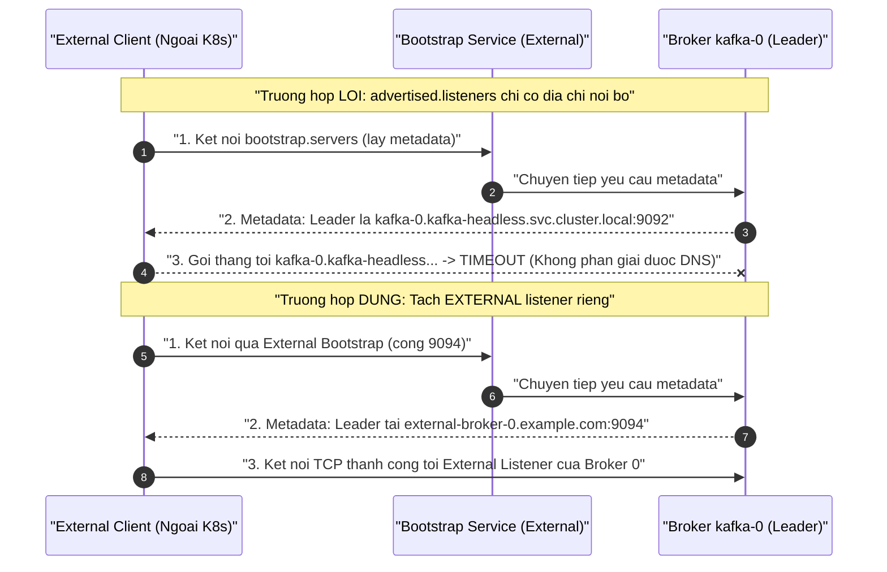
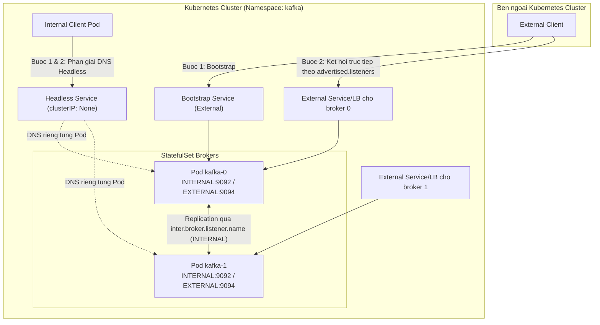

# 7_3_2 Networking: Advertised Listener

> **Khóa học**: Cloud DevOps Basic — Data Platform
> **Phân nhóm**: 7 Domain 7 - Apache Kafka › 7_3 Kafka on Kubernetes
> **Chủ đề**: 7_3_2 Networking: Advertised Listener
> **Trạng thái**: Bản nháp (chưa kiểm chứng theo yêu cầu người dùng)
> **Checklist đối chiếu**: Không có (xem lộ trình [7_3 Kafka on Kubernetes](./README.md))

---

## 1. Khái Niệm Cốt Lõi & Bản Chất Kỹ Thuật (Core Concepts & Technical Deep Dive)

Khi đưa Apache Kafka lên Kubernetes, bài toán phổ biến nhất không nằm ở việc khởi động Pod, mà ở việc client kết nối vào rồi bị timeout. Khác với ứng dụng web thông thường chỉ cần đi qua một Load Balancer chung, dữ liệu topic trong Kafka chia theo nhiều partition trên các broker khác nhau nên client phải kết nối trực tiếp tới đúng broker đang giữ partition leader. <!-- ev: C2.3 --> Vì địa chỉ bên trong và bên ngoài Kubernetes cluster khác nhau, chúng ta cần hiểu rõ cơ chế **bootstrap** và **`advertised.listeners`**. <!-- ev: C2.13 -->

### 1.1 Quy trình kết nối 2 bước của Kafka Client

Mọi Kafka client đều thực hiện kết nối qua hai bước thay vì một điểm kết nối cố định: <!-- ev: C2.1 C2.3 -->

1. **Bước 1 — Kết nối Bootstrap (Lấy bản đồ cluster)**: Client dùng `bootstrap.servers` làm điểm liên lạc ban đầu để gửi yêu cầu lấy metadata của cluster, chứ không gửi toàn bộ dữ liệu đọc/ghi qua địa chỉ này. <!-- ev: C2.1 --> Khi nhận yêu cầu metadata, broker trả về danh sách broker, thông tin partition leader của topic và địa chỉ được khai báo trong `advertised.listeners` của từng broker. <!-- ev: C2.2 -->
2. **Bước 2 — Kết nối trực tiếp tới Partition Leader**: Dựa vào metadata vừa nhận, client mở kết nối TCP trực tiếp tới địa chỉ `advertised.listeners` của broker đang giữ partition leader (hoặc replica phù hợp) để ghi và đọc dữ liệu. <!-- ev: C2.3 -->

Nói ngắn gọn: `bootstrap.servers` chỉ dùng để "hỏi đường" ở Bước 1, còn địa chỉ client kết nối thực sự ở Bước 2 do broker quyết định qua `advertised.listeners`. <!-- ev: C2.1 C2.2 C2.3 -->

### 1.2 Phân biệt `listeners`, `advertised.listeners` và các cấu hình liên quan

Trên mỗi broker Kafka (`server.properties`), bốn tham số mạng cốt lõi dưới đây quyết định cách broker lắng nghe và công bố địa chỉ: <!-- ev: C2.4 C2.5 C2.7 C2.8 -->

- **`listeners`** (cổng lắng nghe thực tế): Danh sách các địa chỉ mạng (tên listener, host/IP bind và cổng TCP) mà tiến trình broker thực sự mở socket để lắng nghe trên máy chủ hoặc container. <!-- ev: C2.4 --> Giá trị là các URI phân tách bằng dấu phẩy theo mẫu `LISTENER_NAME://host:port` (ví dụ `INTERNAL://0.0.0.0:9092,EXTERNAL://0.0.0.0:9094`). <!-- ev: C2.6 -->
- **`advertised.listeners`** (địa chỉ tự giới thiệu): Danh sách các địa chỉ mà broker công bố cho client và các broker khác trong metadata để kết nối tới nó; nếu bỏ trống, Kafka mặc định dùng giá trị của `listeners`. <!-- ev: C2.5 --> Định dạng cũng theo mẫu `LISTENER_NAME://host:port` (ví dụ `INTERNAL://kafka-0.kafka-headless.kafka.svc.cluster.local:9092`). <!-- ev: C2.6 -->
- **`listener.security.protocol.map`** (bản đồ giao thức bảo mật): Ánh xạ từng tên listener tùy chỉnh sang giao thức bảo mật tương ứng của Kafka như `PLAINTEXT`, `SSL`, `SASL_PLAINTEXT` hoặc `SASL_SSL` (ví dụ `INTERNAL:PLAINTEXT,EXTERNAL:SSL`). <!-- ev: C2.7 -->
- **`inter.broker.listener.name`** (listener nội bộ giữa các broker): Chỉ định tên listener mà các broker dùng để giao tiếp nội bộ với nhau (ví dụ replication), tách khỏi listener của client bên ngoài. <!-- ev: C2.8 -->

Trong `listeners`, broker có thể dùng `0.0.0.0` để lắng nghe trên mọi network interface, nhưng `advertised.listeners` phải khai báo hostname hoặc IP cụ thể mà client phân giải và kết nối tới được (không dùng `0.0.0.0`). <!-- ev: C2.9 -->

### 1.3 Lỗi kinh điển: Bootstrap thành công nhưng sau đó Timeout

Khi triển khai Kafka trên Kubernetes, lỗi hay gặp nhất là client vẫn kết nối được cổng bootstrap lúc đầu, nhưng ngay khi gửi hoặc nhận dữ liệu thì treo và báo `TimeoutException`. <!-- ev: C2.10 --> Nguyên nhân là client ngoài Kubernetes kết nối thành công tới địa chỉ bootstrap (như `kubectl port-forward`, `NodePort` hay `LoadBalancer`), nhận về metadata chứa địa chỉ nội bộ cluster từ `advertised.listeners`, rồi bị timeout ở Bước 2 vì mạng bên ngoài không phân giải hoặc không định tuyến được địa chỉ nội bộ đó. <!-- ev: C2.10 -->

### 1.4 Listener nội bộ (Headless Service DNS) vs Listener bên ngoài

Vì mạng bên trong và bên ngoài cluster tách biệt, Kafka trên Kubernetes cần cấu hình ít nhất hai listener: listener nội bộ quảng bá DNS trong cluster và listener bên ngoài quảng bá địa chỉ mà mạng ngoài chạm tới được. <!-- ev: C2.13 -->

#### Listener nội bộ với Headless Service DNS
Một Kubernetes Service thông thường (`ClusterIP`) cấp một IP ảo dùng chung và cân bằng tải ngẫu nhiên tới các Pod, nên không phù hợp cho Bước 2 khi client cần gọi thẳng đúng broker leader. <!-- ev: C2.11 --> Thay vào đó, **Headless Service** (`clusterIP: None`) không cấp phát IP ảo dùng chung mà cho phép DNS nội bộ trả về bản ghi trỏ thẳng tới từng Pod riêng lẻ khi kết hợp với StatefulSet. <!-- ev: C2.11 --> Nhờ vậy, với client cùng cluster, listener nội bộ quảng bá DNS ổn định của từng Pod (`<pod-name>.<service-name>.<namespace>.svc.cluster.local`) để kết nối thẳng tới đúng Pod giữ partition leader. <!-- ev: C2.12 -->

#### Listener bên ngoài (NodePort, LoadBalancer, Ingress)
Với client ngoài cluster, tên DNS `.svc.cluster.local` không thể phân giải được nên ta phải cấu hình thêm listener bên ngoài theo một trong ba mô hình: <!-- ev: C2.10 C2.13 -->

- **`NodePort`**: Kubernetes mở cổng tĩnh trên các Node, do đó `advertised.listeners` của mỗi broker phải quảng bá IP/hostname của Node kèm đúng cổng NodePort dẫn về broker đó. <!-- ev: C2.14 -->
- **`LoadBalancer`**: Phổ biến trên Cloud; mỗi broker cần một LoadBalancer Service riêng (bên cạnh bootstrap Service chung) để `advertised.listeners` quảng bá địa chỉ external độc lập trỏ đúng về Pod broker đó, tránh cân bằng tải nhầm broker ở Bước 2. <!-- ev: C2.15 -->
- **`Ingress` (hoặc Route trên OpenShift)**: Trong Strimzi, lưu lượng Kafka được định tuyến tới từng broker dựa trên TLS passthrough kết hợp SNI (Server Name Indication) trong TLS handshake, vì Kafka dùng giao thức TCP nhị phân chứ không dùng HTTP path routing. <!-- ev: C2.16 -->

*(Ghi chú: Cú pháp CRD chi tiết thuộc bài 7_3_4; trước khi triển khai với Strimzi Operator, luôn đối chiếu tài liệu Strimzi đúng phiên bản đang dùng để kiểm tra các loại listener được hỗ trợ như `internal`, `nodeport`, `loadbalancer`, `ingress`, `cluster-ip` và yêu cầu TLS/DNS đi kèm.)* <!-- ev: C2.18 -->

---

## 2. Ví Dụ Đời Sống Thực Tế Dễ Hiểu (Intuitive Real-World Analogies)

Hãy tưởng tượng bạn đang ở **bên ngoài đường** và muốn gọi điện nói chuyện trực tiếp với **Trưởng phòng Kinh doanh (Partition Leader)** của một công ty lớn:

1. **Bước 1 (Gọi tổng đài — Bootstrap)**: Bạn không biết số điện thoại riêng của vị trưởng phòng, nên bạn gọi vào **số tổng đài công khai của công ty** (`bootstrap.servers`). Tổng đài viên bắt máy rất nhanh và tra danh bạ giúp bạn.
2. **Bước 2 (Gọi số máy được chỉ dẫn — Advertised Listener)**:
   - **Kịch bản lỗi (Quảng bá nhầm địa chỉ nội bộ)**: Tổng đài viên quên mất bạn đang gọi từ ngoài đường, nên đọc cho bạn: *"Anh bấm số máy lẻ nội bộ **101** nhé!"*. Bạn cúp máy tổng đài, bấm `101` trên điện thoại di động của mình — tất nhiên cuộc gọi **treo rồi mất kết nối (timeout)** vì mạng viễn thông bên ngoài không hiểu "máy lẻ 101" là ai.
   - **Kịch bản đúng (Tách biệt nội bộ và bên ngoài)**: Tổng đài viên hỏi lại ngữ cảnh: nếu đồng nghiệp ở bàn bên cạnh hỏi (client trong cluster), tổng đài đọc số nội bộ `101`; còn nếu khách ở ngoài đường gọi vào (client ngoài cluster), tổng đài phải đọc **số điện thoại trực tiếp có mã vùng** `028-xxxx-0101` thì cuộc gọi thứ hai mới nối thông tới đúng vị trưởng phòng.

---

## 3. Kiến Trúc, Luồng Hoạt Động & Hình Ảnh Trực Quan (Architecture, Diagrams & Visual Media)

### 3.1 So sánh luồng kết nối lỗi vs luồng kết nối đúng (Sequence Diagram)

Sơ đồ dưới đây minh họa kịch bản lỗi kinh điển khi client bên ngoài gọi vào bootstrap nhưng nhận về địa chỉ nội bộ cluster, so với kịch bản cấu hình đúng listener bên ngoài:



### 3.2 Kiến trúc tách biệt Internal Listener và External Listener trên Kubernetes



---

## 4. Code Mẫu Trực Quan Hoặc Dòng Lệnh Thực Chiến (Runnable Sample Code / CLI)

### 4.1 Ví dụ cấu hình tách listener trên Broker Kafka (`server.properties`)

Dưới đây là cấu hình mẫu trên một broker Kafka (ID `0`) minh họa cách tách listener nội bộ (`INTERNAL`) và listener cho client bên ngoài (`EXTERNAL`): <!-- ev: C2.4 C2.5 C2.7 C2.8 -->

<!-- ev: C2.4 C2.5 C2.6 C2.7 C2.8 C2.9 C2.12 C2.13 -->
```properties
# 1. Socket thực tế mà broker mở để lắng nghe trên mọi interface của container
listeners=INTERNAL://0.0.0.0:9092,EXTERNAL://0.0.0.0:9094

# 2. Địa chỉ trả về cho client trong Metadata theo từng listener
advertised.listeners=INTERNAL://kafka-0.kafka-headless.kafka.svc.cluster.local:9092,EXTERNAL://203.0.113.10:9094

# 3. Ánh xạ tên listener sang giao thức bảo mật của Kafka
listener.security.protocol.map=INTERNAL:PLAINTEXT,EXTERNAL:SSL

# 4. Listener dùng cho giao tiếp replication nội bộ giữa các broker
inter.broker.listener.name=INTERNAL
```

**Giải thích cơ chế hoạt động**:
- Pod trong cluster gọi cổng `9092` sẽ nhận về `kafka-0.kafka-headless.kafka.svc.cluster.local:9092` trong metadata. <!-- ev: C2.2 C2.12 -->
- Client từ ngoài gọi cổng `9094` sẽ nhận về `203.0.113.10:9094`, còn replication giữa các broker luôn đi qua `INTERNAL`. <!-- ev: C2.2 C2.8 C2.13 -->

### 4.2 Kiểm chứng hành vi 2 bước qua Kafka CLI (Input → Command → Output)

Các công cụ CLI như `kafka-topics.sh --bootstrap-server <host>:<port> --list` cũng là một Kafka client thực hiện quy trình kết nối 2 bước. <!-- ev: C2.17 -->

- **Input**: Cluster Kafka trong namespace `kafka` đang forward cổng bootstrap về `localhost:9092`, nhưng broker quảng bá `advertised.listeners` là DNS nội bộ `kafka-0.kafka-headless.kafka.svc.cluster.local:9092`. <!-- ev: C2.10 -->
- **Command**:
<!-- ev: C2.17 -->
```bash
kafka-topics.sh --bootstrap-server localhost:9092 --list
```
- **Output (lỗi timeout ở Bước 2)**:
<!-- ev: C2.10 -->
```text
WARN [AdminClient clientId=adminclient-1] Connection to node 0 (kafka-0.kafka-headless.kafka.svc.cluster.local/...) could not be established. Broker may not be available.
Error while executing topic command : Timed out waiting for a node assignment. Call: listTopics
```

**Phân tích**: Lệnh đi qua được Bước 1 tại `localhost:9092`, nhận metadata chứa tên DNS nội bộ, rồi thất bại ở Bước 2 vì máy cá nhân không phân giải được `.svc.cluster.local`. <!-- ev: C2.10 -->

### 4.3 Bảng so sánh các kiểu Listener phổ biến trên Kubernetes

<!-- ev: C2.11 C2.12 C2.14 C2.15 C2.16 C2.18 -->
| Tiêu chí | Internal (Headless DNS) | External — NodePort | External — LoadBalancer | External — Ingress (Strimzi) |
| :--- | :--- | :--- | :--- | :--- |
| **Đối tượng** | Pod cùng cluster K8s | Client ngoài (dev/test, on-prem) | Client ngoài trên Cloud | Client ngoài qua 1 điểm vào TLS |
| **Địa chỉ quảng bá** | DNS Pod (`<pod>.<svc>.<ns>.svc.cluster.local`) | IP/Host Node + cổng NodePort từng broker | IP/DNS LoadBalancer riêng từng broker | Hostname riêng từng broker qua Ingress |
| **Cơ chế định tuyến** | DNS trỏ thẳng IP từng Pod | Cổng tĩnh trên Node về đúng broker | 1 LB bootstrap + 1 LB riêng cho mỗi broker | TLS passthrough đọc SNI trong TLS handshake |
| **Lưu ý** | `clusterIP: None` + StatefulSet | Phụ thuộc IP Node, quản lý nhiều cổng | Tốn chi phí nhiều LB khi nhiều broker | Bắt buộc bật TLS và Ingress hỗ trợ passthrough |

---

## 5. Cạm Bẫy Thực Tế & Thực Tiễn Sản Xuất (Production Gotchas & Best Practices)

1. **Dùng chung một LoadBalancer cho mọi broker**: Chỉ tạo một `LoadBalancer` Service dùng chung cho `advertised.listeners` khiến Bước 2 bị cân bằng tải ngẫu nhiên sang nhầm broker không giữ leader; mỗi broker cần một địa chỉ external riêng ngoài bootstrap chung. <!-- ev: C2.15 -->
2. **Dùng `kubectl port-forward` để test từ máy cá nhân**: `port-forward` chỉ chuyển tiếp TCP, không sửa metadata nên client vẫn timeout ở Bước 2 nếu broker quảng bá DNS nội bộ `.svc.cluster.local`. <!-- ev: C2.10 -->
3. **Dùng Ingress HTTP thông thường**: Kafka chạy giao thức TCP nhị phân, nên Ingress phải cấu hình TLS passthrough + SNI chứ không định tuyến theo HTTP path. <!-- ev: C2.16 -->
4. **Nhầm lẫn `0.0.0.0` và bỏ qua kiểm tra phiên bản Strimzi**: Dùng `0.0.0.0` cho `listeners` để bind mọi interface nhưng không bao giờ đặt vào `advertised.listeners`. <!-- ev: C2.9 --> Luôn tách `inter.broker.listener.name` khỏi listener ngoài và đối chiếu tài liệu Strimzi đúng phiên bản đang dùng trước khi cấu hình. <!-- ev: C2.8 C2.13 C2.18 -->

---

## 6. Câu Hỏi Củng Cố Kiến Thức (Active Recall Quiz)

**Câu 1**: Một ứng dụng Consumer chạy trên laptop của bạn kết nối tới Kafka trong Kubernetes thông qua `kubectl port-forward svc/my-kafka-bootstrap 9092:9092`. Ứng dụng không báo lỗi ngay lúc khởi tạo, nhưng ngay sau đó treo và văng `TimeoutException` kèm log tên host `my-kafka-0.my-kafka-brokers.kafka.svc.cluster.local:9092`. Nguyên nhân gốc rễ là gì?

<details>
<summary>Đáp án</summary>

Consumer đã hoàn thành **Bước 1 (Bootstrap)** qua đường hầm `port-forward` và nhận được metadata từ broker. Tuy nhiên, trong metadata đó, `advertised.listeners` của broker lại đang quảng bá tên DNS nội bộ cluster (`*.svc.cluster.local`). Ở **Bước 2**, laptop của bạn cố gắng mở kết nối TCP trực tiếp tới tên DNS nội bộ đó và bị **timeout** vì mạng bên ngoài cluster không thể phân giải hoặc định tuyến tới DNS nội bộ Kubernetes.

</details>

**Câu 2**: Tại sao Kubernetes `ClusterIP` Service thông thường không thể thay thế Headless Service (`clusterIP: None`) cho giao tiếp Bước 2 của Kafka client nội bộ?

<details>
<summary>Đáp án</summary>

`ClusterIP` Service thông thường cấp một địa chỉ IP ảo duy nhất và cân bằng tải ngẫu nhiên tới các Pod phía sau, nên client không kiểm soát được mình đang kết nối vào broker nào. Ngược lại, Kafka yêu cầu client ở Bước 2 phải kết nối trực tiếp tới **đúng broker đang giữ partition leader**. Headless Service (`clusterIP: None`) kết hợp StatefulSet cho phép DNS trả về tên miền riêng cho từng Pod (`<pod>.<service>.<ns>.svc.cluster.local`) để client gọi thẳng tới đúng broker cần thiết.

</details>

**Câu 3**: Khi dùng kiểu expose `Ingress` trong Strimzi cho Kafka, tại sao phải dùng **TLS passthrough + SNI** thay vì định tuyến theo HTTP path như `/broker-0`, `/broker-1`?

<details>
<summary>Đáp án</summary>

Vì Kafka sử dụng giao thức TCP nhị phân riêng chứ không sử dụng HTTP, nên Ingress không thể đọc HTTP path hay HTTP Host header theo kiểu ứng dụng web thông thường. Để phân biệt client đang muốn nối tới `broker-0` hay `broker-1` thông qua cùng một điểm vào Ingress, hệ thống phải bật TLS và dùng cơ chế **TLS passthrough** kết hợp đọc trường **SNI (Server Name Indication)** ngay trong bước TLS handshake để chuyển tiếp luồng TCP tới đúng Pod broker.

</details>

---

## 7. 📚 Nguồn Tài Liệu Chính Thống (Tier-1 Official References)

- [Apache Kafka Documentation — Broker Configs](https://kafka.apache.org/documentation/#brokerconfigs) - Tài liệu chính thức định nghĩa `listeners`, `advertised.listeners`, `listener.security.protocol.map` và `inter.broker.listener.name`.
- [Strimzi Overview](https://strimzi.io/docs/operators/latest/overview) - Tài liệu tổng quan chính thức về Strimzi Operator và cách triển khai Kafka trên Kubernetes.
- [Strimzi Documentation](https://strimzi.io/documentation/) - Cổng tài liệu theo phiên bản của Strimzi (tra cứu chi tiết cấu hình các loại listener và ma trận hỗ trợ).
- [Kubernetes Documentation — Service (Headless Services, NodePort, LoadBalancer)](https://kubernetes.io/docs/concepts/services-networking/service/) - Tài liệu chính thức về Headless Service (`clusterIP: None`), `NodePort` và `LoadBalancer`.
- [Kubernetes Documentation — StatefulSets](https://kubernetes.io/docs/concepts/workloads/controllers/statefulset/) - Tài liệu về danh tính mạng ổn định của Pod kết hợp Headless Service.
- [Kubernetes Documentation — Ingress](https://kubernetes.io/docs/concepts/services-networking/ingress/) - Tài liệu chính thức về Ingress trên Kubernetes.
