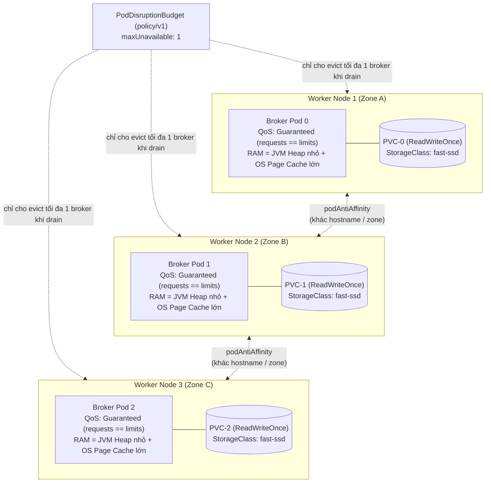

# 7_3_3 Storage and Resources (Lưu Trữ Và Tài Nguyên)

> **Khóa học**: Cloud DevOps Basic — Data Platform
> **Phân nhóm**: 7 Domain 7 - Apache Kafka › [7_3 Kafka on Kubernetes](./README.md)
> **Chủ đề**: StorageClass & ReadWriteOnce, Pod requests/limits & JVM Heap vs OS Page Cache, PodDisruptionBudget (PDB), Pod Anti-Affinity
> **Trạng thái**: Bản nháp (chưa kiểm chứng theo yêu cầu người dùng)
> **Lộ trình tổng**: [data-platform/README.md](../../README.md)

---

## 1. Khái Niệm Cốt Lõi & Bản Chất Kỹ Thuật (Core Concepts & Technical Deep Dive)

Chạy được một cụm Kafka trên Kubernetes chỉ là bước khởi đầu; để cụm chạy **nhanh** và **không mất dữ liệu khi bảo trì hay hỏng máy chủ**, bạn phải kiểm soát đúng bốn yếu tố hạ tầng: ổ đĩa, RAM, luật bảo trì và vị trí đặt Pod. Nếu thiếu cấu hình lưu trữ và tài nguyên hợp lý, Kafka có thể ghi chậm, bị Kubernetes giết tiến trình vì tràn RAM, hoặc sập cả cụm chỉ vì một đợt nâng cấp node định kỳ. Bài học này giải thích bản chất của từng cơ chế và cách phối hợp chúng cho Kafka broker trên Kubernetes.

### 1.1 Lưu trữ cho Broker: `StorageClass` hiệu năng cao và `ReadWriteOnce`

Mỗi Kafka broker lưu dữ liệu các partition trực tiếp xuống hệ thống tệp trên đĩa dưới dạng các tệp log ghi nối đuôi tuần tự (sequential append), nên tốc độ I/O của ổ đĩa quyết định trực tiếp độ trễ ghi và thông lượng của broker. <!-- ev: C3.4 -->

Trong Kubernetes, **`StorageClass`** là tài nguyên giúp quản trị viên định nghĩa các "hạng" lưu trữ khác nhau (ví dụ ổ đĩa SSD/NVMe IOPS cao so với ổ HDD tiêu chuẩn), mỗi hạng tương ứng với một mức chất lượng dịch vụ hoặc chính sách cấp phát riêng. <!-- ev: C3.1 --> Khi khai báo yêu cầu ổ đĩa (`PersistentVolumeClaim` — gọi tắt là **PVC**) cho từng broker, bạn chỉ định tên `StorageClass` mong muốn vào trường `storageClassName`; nếu bỏ trống trường này, Kubernetes sẽ dùng `StorageClass` mặc định của cluster (nếu cluster có một `StorageClass` mang annotation `storageclass.kubernetes.io/is-default-class: "true"`). <!-- ev: C3.3 -->

Mỗi broker cần một PVC riêng biệt với chế độ truy cập **`ReadWriteOnce`** (`RWO`). Chế độ `ReadWriteOnce` quy định rằng volume đó chỉ có thể được mount ở chế độ đọc-ghi bởi **một Kubernetes node duy nhất tại một thời điểm**. <!-- ev: C3.2 --> Vì hai Kafka broker không bao giờ chia sẻ chung một thư mục dữ liệu log của nhau, mỗi broker sở hữu một volume `RWO` độc lập giúp tránh xung đột khóa tệp (file lock) và giữ hiệu năng I/O tách biệt.

### 1.2 Tài nguyên Pod (`requests`/`limits`) và Bài toán JVM Heap vs OS Page Cache

Trong cấu hình container của Kubernetes Pod, **`resources.requests`** khai báo lượng CPU và RAM tối thiểu mà `kube-scheduler` dùng để tìm node còn đủ chỗ trống khi xếp lịch Pod, còn **`resources.limits`** đặt trần tài nguyên tối đa mà container được phép sử dụng. <!-- ev: C3.5 --> Nếu một tiến trình trong container dùng vượt quá ngưỡng `limits.memory`, Linux kernel (OOM killer) có thể chấm dứt container đó ngay lập tức với lý do `OOMKilled`. <!-- ev: C3.6 -->

Điểm đặc biệt nhất khi cấp RAM cho Kafka là cách Kafka sử dụng bộ nhớ khác với hầu hết ứng dụng Java thông thường:

- **JVM Heap** là vùng nhớ bên trong máy ảo Java dùng cho các đối tượng quản lý kết nối, metadata và bộ đệm xử lý của broker.
- **OS Page Cache** (bộ nhớ đệm trang của hệ điều hành, xem nền tảng tại [1_7_5 Virtual Memory and Demand Paging](<../../../os/1 Domain 1 - Operating System Core Fundamentals/1_7 Memory Management and Virtual Memory/1_7_5 Virtual Memory and Demand Paging.md>)) là phần RAM trống được nhân Linux tự động dùng để giữ tạm các khối dữ liệu tệp vừa ghi hoặc hay đọc.

Theo tài liệu chính thức của Apache Kafka, Kafka phụ thuộc rất mạnh vào **OS page cache** để đệm và phục vụ dữ liệu message trực tiếp qua hệ thống tệp thay vì tự giữ dữ liệu message trong JVM heap. <!-- ev: C3.7 --> Việc cố tình cấp JVM heap quá lớn sẽ gây tác dụng ngược: vừa làm thu hẹp lượng RAM còn lại cho OS page cache, vừa làm tăng thời gian tạm dừng khi bộ thu gom rác (Garbage Collection) của JVM quét heap. <!-- ev: C3.8 --> Do đó, Kafka khuyến nghị giữ kích thước JVM heap ở mức khiêm tốn (chỉ vừa đủ cho các cấu trúc điều phối của broker) để dành phần lớn RAM cho OS page cache. <!-- ev: C3.9 -->

Khi cấu hình Pod cho broker sản xuất, bạn nên đặt `requests` lớn hơn nhiều so với giá trị `-Xmx` của JVM (ví dụ: JVM heap 4 GiB nhưng container có `requests.memory` từ 12–16 GiB trở lên tùy tải) để phần RAM dư ra phục vụ page cache và bộ nhớ native của JVM. Ngoài ra, nếu mọi container trong Pod đều đặt `requests` bằng đúng `limits` cho cả CPU và memory, Kubernetes sẽ gán cho Pod lớp chất lượng dịch vụ **`Guaranteed`**, giúp Pod có độ ưu tiên giữ lại cao nhất và tránh bị thu hồi (evict) khi node thiếu tài nguyên. <!-- ev: C3.10 -->

### 1.3 Bảo vệ cụm khi bảo trì Node: `PodDisruptionBudget` (`PDB`)

Khi nâng cấp hoặc bảo trì hệ điều hành trên node, quản trị viên chạy lệnh `kubectl drain` để đẩy toàn bộ Pod ra khỏi node đó trước khi tắt máy. <!-- ev: C3.11 --> Nếu nhiều node bị drain cùng lúc, nhiều broker bị tắt đồng thời sẽ làm cụm mất bản sao đồng bộ và gián đoạn dịch vụ.

**`PodDisruptionBudget`** (**PDB**, thuộc nhóm API `policy/v1`) giới hạn số lượng Pod của ứng dụng được phép ngừng hoạt động cùng lúc do các gián đoạn tự nguyện (voluntary disruptions) như `kubectl drain`. <!-- ev: C3.11 --> Khi chạy `kubectl drain`, Kubernetes Eviction API kiểm tra PDB và từ chối trục xuất (evict) Pod nếu làm vi phạm ngưỡng đã đặt. <!-- ev: C3.14 -->

Trong mỗi PDB, bạn chỉ được chọn **một trong hai** trường sau: <!-- ev: C3.13 -->
- `maxUnavailable`: số lượng (hoặc phần trăm) Pod tối đa được phép không sẵn sàng cùng lúc (ví dụ `maxUnavailable: 1`). <!-- ev: C3.13 -->
- `minAvailable`: số lượng (hoặc phần trăm) Pod tối thiểu phải luôn sẵn sàng. <!-- ev: C3.13 -->

**Lưu ý quan trọng**: PDB chỉ kiểm soát các gián đoạn tự nguyện; PDB không ngăn được các gián đoạn ngoài ý muốn (involuntary disruptions) như sập nguồn phần cứng hoặc lỗi kernel panic. <!-- ev: C3.12 -->

### 1.4 Chống dồn Broker vào một Node: `PodAntiAffinity`

Nếu nhiều broker vô tình chạy trên cùng một node vật lý, chỉ một sự cố mất điện ở node đó sẽ khiến nhiều bản sao dữ liệu biến mất cùng lúc.

**`podAntiAffinity`** (`spec.affinity.podAntiAffinity`) hướng dẫn `kube-scheduler` không đặt Pod mới lên cùng miền topology (ví dụ cùng node qua `topologyKey: kubernetes.io/hostname`) với các Pod đang chạy khớp `labelSelector`. <!-- ev: C3.15 -->

Hai mức độ ràng buộc chính gồm:
1. **`requiredDuringSchedulingIgnoredDuringExecution`** (ràng buộc cứng): nếu không còn node nào trống broker khác, Pod mới sẽ giữ trạng thái `Pending` thay vì chạy chung node. <!-- ev: C3.16 -->
2. **`preferredDuringSchedulingIgnoredDuringExecution`** (ràng buộc mềm, có `weight` từ `1` đến `100`): scheduler ưu tiên tách các broker ra node riêng nhưng vẫn cho phép đặt chung node nếu thiếu node trống. <!-- ev: C3.17 -->

Ngoài mức node, đặt `topologyKey: topology.kubernetes.io/zone` trong `podAntiAffinity` giúp phân tán các broker sang các Availability Zone (AZ) khác nhau để chịu lỗi ở mức zone. <!-- ev: C3.18 -->

---

## 2. Ví Dụ Đời Sống Thực Tế Dễ Hiểu (Intuitive Real-World Analogies)

Hãy tưởng tượng một công ty giao nhận hàng hóa vận hành 3 kho dữ liệu song song:

1. **StorageClass nhanh & ReadWriteOnce**: Mỗi thủ kho (broker) phải được cấp một **nhà kho riêng có cửa cuốn tốc độ cao** (`StorageClass` SSD/NVMe) và chỉ một thủ kho tại một node giữ chìa khóa đọc-ghi tại một thời điểm (`ReadWriteOnce`). Nếu bắt 3 thủ kho dùng chung một ổ khóa chậm chạp hoặc đường hẹp, xe chở hàng vào xuất/nhập sẽ ùn tắc ngay lập tức.
2. **JVM Heap vs OS Page Cache**: Trong nhà kho đó, ngân sách không gian (RAM) được chia làm hai phần: **bàn làm việc của thủ kho** (JVM Heap) và **kệ hàng chờ ngay sát cửa xuất** (OS Page Cache). Nếu bạn dồn toàn bộ tiền để mua một chiếc bàn làm việc khổng lồ cho thủ kho nhưng chẳng chừa chỗ cho kệ hàng chờ, mỗi lần khách hỏi lấy hàng, thủ kho lại phải chạy tuốt ra sân sau (ổ đĩa) để lục tìm — vừa chậm chạp vừa mất công dọn dẹp bàn (Garbage Collection).
3. **PodAntiAffinity**: Dù có 3 thủ kho giữ bản sao giống hệt nhau để dự phòng rủi ro, bạn tuyệt đối **không được thuê cả 3 kho trong cùng một tòa nhà** (`podAntiAffinity` theo node hoặc zone). Nếu tòa nhà đó cúp điện, cả 3 kho dự phòng đều tê liệt cùng lúc.
4. **PodDisruptionBudget (PDB)**: Khi đội kỹ thuật đến bảo trì tòa nhà, ban quản lý đặt ra nội quy cứng (**PDB `maxUnavailable: 1`**): *"Tại một thời điểm chỉ được phép đóng cửa bảo trì tối đa 1 kho; hai kho còn lại phải mở cửa bình thường rồi mới được bảo trì kho tiếp theo"*. Tuy nhiên, nội quy này chỉ chặn được thợ sửa chữa chủ động đến đóng cửa (voluntary disruption), chứ không chặn được hỏa hoạn bất ngờ (involuntary disruption).

---

## 3. Kiến Trúc, Luồng Hoạt Động & Hình Ảnh Trực Quan (Architecture, Diagrams & Visual Media)

Sơ đồ dưới đây minh họa cách bốn lớp bảo vệ và hiệu năng phối hợp trên cụm Kubernetes 3 node:



---

## 4. Code Mẫu Trực Quan Hoặc Dòng Lệnh Thực Chiến (Runnable Sample Code / CLI)

Các manifest dưới đây sử dụng chuẩn Kubernetes API `apps/v1` và `policy/v1`. <!-- ev: C3.11 -->

### 4.1 Cấu hình `resources`, `podAntiAffinity` và `volumeClaimTemplates` cho Broker Pod

Đoạn YAML minh họa cấu hình StatefulSet cho cụm Kafka 3 broker: chừa phần lớn RAM cho OS page cache với QoS `Guaranteed`, tách node bằng `podAntiAffinity`, và dùng PVC `ReadWriteOnce`: <!-- ev: C3.2 C3.10 C3.15 C3.16 -->

<!-- ev: C3.2 C3.10 C3.15 C3.16 -->
```yaml
apiVersion: apps/v1
kind: StatefulSet
metadata:
  name: kafka
  namespace: kafka
spec:
  serviceName: kafka-headless
  replicas: 3
  selector:
    matchLabels:
      app: kafka
  template:
    metadata:
      labels:
        app: kafka
    spec:
      affinity:
        podAntiAffinity:
          requiredDuringSchedulingIgnoredDuringExecution:
            - labelSelector:
                matchExpressions:
                  - key: app
                    operator: In
                    values:
                      - kafka
              topologyKey: kubernetes.io/hostname
      containers:
        - name: kafka
          image: apache/kafka:3.8.0
          env:
            # Giữ JVM Heap khiêm tốn (4 GiB) trong tổng 16 GiB RAM của container,
            # phần RAM còn lại (~11-12 GiB) dành cho OS Page Cache và native memory.
            - name: KAFKA_HEAP_OPTS
              value: "-Xms4g -Xmx4g"
          resources:
            requests:
              cpu: "2"
              memory: "16Gi"
            limits:
              cpu: "2"
              memory: "16Gi"
          volumeMounts:
            - name: data
              mountPath: /var/lib/kafka/data
  volumeClaimTemplates:
    - metadata:
        name: data
      spec:
        accessModes: ["ReadWriteOnce"]
        storageClassName: fast-ssd
        resources:
          requests:
            storage: 100Gi
```

### 4.2 Cấu hình `PodDisruptionBudget` (`PDB`) chống drain nhiều Broker cùng lúc

Tạo PDB khớp với nhãn `app: kafka` và giới hạn `maxUnavailable: 1` để mỗi lần bảo trì node tối đa chỉ một broker được phép vắng mặt: <!-- ev: C3.11 C3.13 -->

<!-- ev: C3.11 C3.13 -->
```yaml
apiVersion: policy/v1
kind: PodDisruptionBudget
metadata:
  name: kafka-pdb
  namespace: kafka
spec:
  maxUnavailable: 1
  selector:
    matchLabels:
      app: kafka
```

### 4.3 Kiểm tra trạng thái tài nguyên, QoS, phân bố Node và PDB bằng `kubectl`

Sau khi áp dụng manifest, dùng các lệnh sau để xác minh phân bố node, lớp QoS, PVC và ngân sách gián đoạn của PDB: <!-- ev: C3.10 C3.14 -->

<!-- ev: C3.10 C3.14 -->
```bash
# 1. Kiểm tra phân bố Pod trên các node khác nhau và QoS class
kubectl get pods -n kafka -l app=kafka -o custom-columns=\
NAME:.metadata.name,NODE:.spec.nodeName,QOS:.status.qosClass,STATUS:.status.phase
```

Kết quả mong đợi cho thấy mỗi broker nằm trên một node riêng và mang lớp `Guaranteed`: <!-- ev: C3.10 C3.15 -->

```text
NAME      NODE           QOS          STATUS
kafka-0   worker-node-1  Guaranteed   Running
kafka-1   worker-node-2  Guaranteed   Running
kafka-2   worker-node-3  Guaranteed   Running
```

Kiểm tra PVC đang dùng đúng `StorageClass` và chế độ `RWO`, đồng thời xem trạng thái của `PDB`: <!-- ev: C3.1 C3.2 C3.14 -->

```bash
kubectl get pvc -n kafka
kubectl get pdb -n kafka
```

Kết quả quan sát:

```text
NAME           STATUS   VOLUME      CAPACITY   ACCESS MODES   STORAGECLASS   AGE
data-kafka-0   Bound    pvc-0...    100Gi      RWO            fast-ssd       5m
data-kafka-1   Bound    pvc-1...    100Gi      RWO            fast-ssd       5m
data-kafka-2   Bound    pvc-2...    100Gi      RWO            fast-ssd       5m

NAME        MIN AVAILABLE   MAX UNAVAILABLE   ALLOWED DISRUPTIONS   AGE
kafka-pdb   N/A             1                 1                     5m
```

---

## 5. Cạm Bẫy Thực Tế & Thực Tiễn Sản Xuất (Production Gotchas & Best Practices)

1. **Dồn toàn bộ `limits.memory` vào JVM `-Xmx`**: Nếu container có `limits.memory: 8Gi` nhưng cấu hình `-Xmx8g`, hệ điều hành không còn RAM cho OS page cache (làm tụt tốc độ đọc) và bộ nhớ native cộng thêm sẽ đẩy tổng RAM vượt 8 GiB, gây `OOMKilled`. <!-- ev: C3.6 C3.8 C3.9 -->
2. **Dùng `requiredDuringSchedulingIgnoredDuringExecution` khi số Node ít hơn số Broker**: Ràng buộc cứng ép mỗi node tối đa 1 broker sẽ khiến Pod thứ 3 bị treo ở trạng thái `Pending` trên cụm chỉ có 2 node; với cụm nhỏ ít node, hãy cân nhắc dùng `preferredDuringSchedulingIgnoredDuringExecution`. <!-- ev: C3.16 C3.17 -->
3. **Tin rằng PDB bảo vệ được cả lỗi phần cứng hoặc đặt `maxUnavailable: 0`**: PDB không chặn được gián đoạn ngoài ý muốn khi node sập nguồn đột ngột, và nếu đặt `maxUnavailable: 0` thì mọi lệnh `kubectl drain` sẽ bị chặn vĩnh viễn. <!-- ev: C3.12 C3.14 -->
4. **Dùng nhầm `StorageClass` mặc định chậm hoặc chế độ `ReadWriteMany` (RWX)**: Bỏ trống `storageClassName` có thể khiến PVC gắn vào `StorageClass` mặc định có IOPS thấp, làm chậm thao tác ghi log tuần tự; luôn chỉ định tường minh `StorageClass` nhanh và dùng `ReadWriteOnce` riêng cho từng broker. <!-- ev: C3.1 C3.2 C3.3 C3.4 -->

---

## 6. Câu Hỏi Củng Cố Kiến Thức (Active Recall Quiz)

**Câu 1**: Một đồng nghiệp cấu hình Kafka Pod với `limits.memory: 16Gi` và đặt `KAFKA_HEAP_OPTS="-Xms14g -Xmx14g"` vì nghĩ *"càng nhiều heap cho Java thì Kafka chạy càng nhanh"*. Điều gì sẽ xảy ra trong thực tế?

<details>
<summary>Đáp án</summary>

Hiệu năng Kafka sẽ giảm và Pod có nguy cơ bị `OOMKilled`. <!-- ev: C3.6 --> Kafka không lưu đệm message trong JVM heap mà dựa chủ yếu vào **OS page cache** của Linux. <!-- ev: C3.7 --> Khi JVM heap chiếm tới 14 GiB trên tổng 16 GiB RAM, hệ điều hành gần như không còn RAM trống cho page cache (buộc broker phải đọc từ đĩa chậm hơn) và thời gian tạm dừng Garbage Collection của JVM tăng lên; đồng thời tổng `heap + native memory` rất dễ vượt trần 16 GiB và kích hoạt OOM killer. <!-- ev: C3.8 C3.9 -->

</details>

**Câu 2**: Cụm Kubernetes có 3 worker node chạy 3 Kafka broker với `PodDisruptionBudget` cấu hình `maxUnavailable: 1` và `podAntiAffinity` mức cứng (`requiredDuringSchedulingIgnoredDuringExecution`). Nếu node-1 và node-2 bị lệnh `kubectl drain` chạy song song cùng lúc, điều gì xảy ra?

<details>
<summary>Đáp án</summary>

Lệnh `kubectl drain` đầu tiên được phép trục xuất một broker (ví dụ trên node-1), lúc này số broker sẵn sàng giảm từ 3 xuống 2 và PDB không còn hạn mức gián đoạn (`ALLOWED DISRUPTIONS = 0`). <!-- ev: C3.11 C3.14 --> Lệnh `kubectl drain` thứ hai trên node-2 sẽ bị Kubernetes Eviction API từ chối tạm thời cho tới khi broker bị trục xuất trước đó được lên lịch lại và đạt trạng thái `Ready`. <!-- ev: C3.14 --> Ngoài ra, vì cụm chỉ có 3 node và đang dùng `podAntiAffinity` mức cứng, broker bị evict sẽ ở trạng thái `Pending` nếu node-1 chưa sẵn sàng nhận lại Pod và không còn node trống thứ 4 nào khác. <!-- ev: C3.16 -->

</details>

**Câu 3**: Nếu một node chứa Kafka broker bị mất điện đột ngột (lỗi phần cứng), `PodDisruptionBudget` có giữ Pod đó sống hoặc chặn node đó tắt được không? Tại sao?

<details>
<summary>Đáp án</summary>

Không. `PodDisruptionBudget` chỉ kiểm soát các **gián đoạn tự nguyện (voluntary disruptions)** thông qua Kubernetes Eviction API (như `kubectl drain`, nâng cấp node chủ động). <!-- ev: C3.11 C3.14 --> PDB hoàn toàn không ngăn chặn được các **gián đoạn ngoài ý muốn (involuntary disruptions)** như sập nguồn phần cứng, hỏng đĩa hoặc lỗi kernel. <!-- ev: C3.12 --> Để chịu được lỗi mất cả node hoặc mất cả zone, cụm cần kết hợp replication của Kafka với `podAntiAffinity` phân tán các broker sang các node hoặc Availability Zone khác nhau. <!-- ev: C3.15 C3.18 -->

</details>

---

## 7. 📚 Nguồn Tài Liệu Chính Thống (Tier-1 Official References)

- [Persistent Volumes — Kubernetes Documentation](https://kubernetes.io/docs/concepts/storage/persistent-volumes/) — Tài liệu chính thức về `PersistentVolume`, `PersistentVolumeClaim` và chế độ truy cập `ReadWriteOnce`.
- [Storage Classes — Kubernetes Documentation](https://kubernetes.io/docs/concepts/storage/storage-classes/) — Tài liệu chính thức về `StorageClass`, cấp phát động và `StorageClass` mặc định.
- [Resource Management for Pods and Containers — Kubernetes Documentation](https://kubernetes.io/docs/concepts/configuration/manage-resources-containers/) — Tài liệu chính thức về `requests`, `limits` và hành vi OOM killer khi vượt `limits.memory`.
- [Pod Quality of Service Classes — Kubernetes Documentation](https://kubernetes.io/docs/concepts/workloads/pods/pod-qos/) — Tài liệu chính thức về phân lớp QoS (`Guaranteed`, `Burstable`, `BestEffort`).
- [Disruptions & PodDisruptionBudget — Kubernetes Documentation](https://kubernetes.io/docs/concepts/workloads/pods/disruptions/) — Tài liệu chính thức về voluntary vs involuntary disruptions và `PodDisruptionBudget` (`minAvailable` / `maxUnavailable`).
- [Assigning Pods to Nodes (Affinity & Anti-Affinity) — Kubernetes Documentation](https://kubernetes.io/docs/concepts/scheduling-eviction/assign-pod-node/) — Tài liệu chính thức về `podAntiAffinity`, `requiredDuringSchedulingIgnoredDuringExecution` và `preferredDuringSchedulingIgnoredDuringExecution`.
- [Apache Kafka Documentation — OS Configuration & Filesystem/Page Cache](https://kafka.apache.org/documentation/#os) — Tài liệu chính thức của Apache Kafka về việc tận dụng OS page cache và giữ JVM heap ở mức khiêm tốn.
