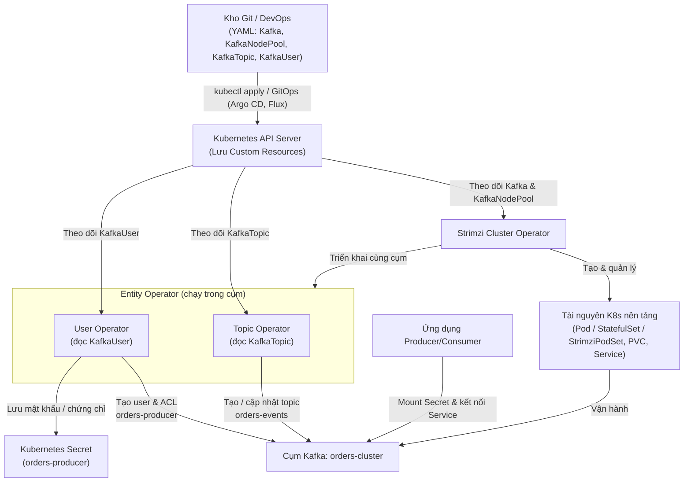

# 7_3_4 Strimzi Operator

> **Khóa học**: Cloud DevOps Basic — Data Platform
> **Phân nhóm**: 7 Domain 7 - Apache Kafka › 7_3 Kafka on Kubernetes
> **Chủ đề**: Strimzi Operator
> **Trạng thái**: Bản nháp (chưa kiểm chứng theo yêu cầu người dùng)
> **Checklist đối chiếu**: [7_3 Kafka on Kubernetes](./README.md) | [Lộ trình tổng](../../README.md)

---

## 1. Khái Niệm Cốt Lõi & Bản Chất Kỹ Thuật (Core Concepts & Technical Deep Dive)

Chạy Apache Kafka trên Kubernetes bằng cách tự viết tay từng file cấu hình riêng lẻ và thao tác dòng lệnh thủ công để tạo topic rất dễ sai sót và khó đồng bộ khi nâng cấp. Thay vì tự quản lý từng mảnh rời rạc đó, các đội vận hành dùng Strimzi Operator để giao toàn bộ vòng đời của cụm Kafka cho Kubernetes tự động điều phối. Bạn chỉ cần mô tả cụm Kafka mong muốn bằng các file cấu hình ngắn gọn, phần phức tạp bên dưới do hệ thống tự xử lý.

### 1.1. Mô hình Operator trong Kubernetes (CRD + Controller)

- **Kubernetes Operator** là một mẫu thiết kế mở rộng Kubernetes, kết hợp **Custom Resource Definition (CRD)** với một **custom controller** chạy vòng lặp đối chiếu (reconciliation loop) để tự động hóa việc triển khai và vận hành các ứng dụng phức tạp có trạng thái. <!-- ev: C4.1 -->
- **Custom Resource Definition (CRD)** là cơ chế giúp bạn đăng ký thêm các "loại đối tượng mới" vào Kubernetes API, để người dùng có thể khai báo trạng thái mong muốn bằng YAML giống như `Pod` hay `Deployment`. <!-- ev: C4.2 -->
- **Custom controller** là một tiến trình chạy bên trong cluster, liên tục theo dõi trạng thái thực tế và tự động điều chỉnh các tài nguyên Kubernetes để khớp với trạng thái mong muốn đã khai báo. <!-- ev: C4.3 -->

### 1.2. Strimzi Operator là gì và quản lý những gì?

- **Strimzi** là một dự án mã nguồn mở cung cấp Kubernetes Operator chuyên dụng để triển khai, cấu hình và vận hành Apache Kafka trên Kubernetes. <!-- ev: C4.4 -->
- Trong Strimzi, **Cluster Operator** là bộ não điều phối chính: nó theo dõi các tài nguyên khai báo cụm và tự động tạo, cập nhật hoặc xóa các thành phần Kubernetes bên dưới. <!-- ev: C4.5 -->

Để dựng một cụm cho ví dụ hệ thống đặt hàng, bạn sẽ làm việc với các tài nguyên dưới đây:

- **`Kafka`**: Tài nguyên trung tâm dùng để khai báo cấu hình cốt lõi của cụm Kafka như phiên bản Kafka, cấu hình listener (cổng kết nối) và các thành phần vận hành đi kèm. <!-- ev: C4.6 -->
- Từ bản khai báo `Kafka`, Strimzi Cluster Operator tự động tạo và quản lý các tài nguyên nền tảng gồm Pod lưu trạng thái (thông qua `StatefulSet` hoặc `StrimziPodSet` tùy phiên bản Strimzi), `PersistentVolumeClaim` (PVC) và `Service`. <!-- ev: C4.7 -->
- Strimzi đồng thời tự động thiết lập các **listener** cho kết nối nội bộ lẫn bên ngoài cluster và hỗ trợ cấu hình mã hóa TLS dựa trên khai báo trong tài nguyên `Kafka`. <!-- ev: C4.8 -->
- Khi bạn sửa cấu hình hoặc nâng cấp phiên bản trong YAML của cụm `Kafka`, Strimzi tự động điều phối nâng cấp cuốn chiếu (rolling update) từng broker một thay vì khởi động lại đồng loạt gây gián đoạn toàn cụm. <!-- ev: C4.9 -->

### 1.3. Quản lý Topic và User theo kiểu khai báo (GitOps-friendly)

Nếu chỉ có cụm Kafka chạy lên thì ứng dụng vẫn chưa thể gửi hay nhận dữ liệu nếu thiếu topic và tài khoản truy cập. Thay vì phải đăng nhập vào từng máy chủ để tạo thủ công, Strimzi cung cấp **Entity Operator** gồm hai bộ điều khiển con là **Topic Operator** và **User Operator**: <!-- ev: C4.21 -->

- **`KafkaTopic`**: Custom resource dùng để khai báo một Kafka topic (tên topic, số partition, số replica, cấu hình lưu giữ như `retention.ms`) bằng YAML. <!-- ev: C4.11 -->
- **Topic Operator** theo dõi các tài nguyên `KafkaTopic` trên Kubernetes và tự động đồng bộ (tạo, sửa, xóa) topic tương ứng vào cụm Kafka. <!-- ev: C4.12 -->
- **`KafkaUser`**: Custom resource dùng để khai báo danh tính người dùng Kafka, phương thức xác thực (như TLS hoặc SCRAM-SHA-512) và danh sách quyền truy cập (ACL — Access Control List). <!-- ev: C4.13 -->
- **User Operator** xử lý các tài nguyên `KafkaUser` bằng cách thiết lập thông tin xác thực và quyền trên Kafka, đồng thời lưu mật khẩu hoặc chứng chỉ vào một **Kubernetes Secret** để Pod ứng dụng mount vào sử dụng. <!-- ev: C4.14 -->
- Để chỉ định một `KafkaTopic`, `KafkaUser` (hoặc `KafkaNodePool`) thuộc về cụm Kafka nào, bạn gắn nhãn `strimzi.io/cluster: <tên-cụm>` trong phần `metadata.labels`. <!-- ev: C4.15 -->
- Nhờ toàn bộ hạ tầng từ cụm Kafka, topic đến user đều nằm trong các file YAML khai báo chuẩn Kubernetes, bạn có thể lưu tất cả vào kho mã nguồn Git, rà soát qua Pull Request và triển khai tự động bằng các công cụ **GitOps** (như Argo CD hoặc Flux). <!-- ev: C4.16 -->

### 1.4. Lưu ý quan trọng về Ma trận Phiên bản (KRaft vs ZooKeeper & `apiVersion`)

> [!WARNING]
> **Không dùng mù quáng một file YAML cũ trên mạng!** Phiên bản Strimzi thay đổi rất nhanh và ảnh hưởng trực tiếp đến cú pháp YAML lẫn kiến trúc cụm.

- Tên **`apiVersion`** của các CRD Strimzi (ví dụ `kafka.strimzi.io/v1beta2` hay `v1`) có thể khác nhau tùy thuộc vào phiên bản Strimzi bạn cài đặt. <!-- ev: C4.17 -->
- Khả năng hỗ trợ chế độ điều phối metadata bằng **KRaft** hay **ZooKeeper** phụ thuộc trực tiếp vào phiên bản Strimzi và phiên bản Kafka tương ứng (các bản Strimzi mới chuyển hẳn sang KRaft và loại bỏ ZooKeeper). <!-- ev: C4.18 -->
- Mỗi phiên bản Strimzi chỉ hỗ trợ một danh sách giới hạn các phiên bản Apache Kafka cụ thể, được công bố rõ trong **Support Matrix (ma trận phiên bản)** trên trang tài liệu chính thức của Strimzi. <!-- ev: C4.19 -->

*Nâng cao (có thể bỏ qua ở lần đọc đầu)*: Trong các phiên bản Strimzi hiện đại hỗ trợ KRaft, tài nguyên **`KafkaNodePool`** được giới thiệu để tách riêng cấu hình các nhóm node — cho phép định nghĩa rõ vai trò (`broker`, `controller`), số lượng replica, tài nguyên CPU/RAM và cấu hình ổ đĩa cho từng nhóm thay vì gộp chung trong tài nguyên `Kafka`. <!-- ev: C4.10 -->

---

## 2. Ví Dụ Đời Sống Thực Tế Dễ Hiểu (Intuitive Real-World Analogies)

Hãy tưởng tượng bạn muốn mở một trung tâm kho vận hàng hóa (cụm **Kafka**).

- **Cách làm thủ công (viết StatefulSet + chạy CLI bằng tay)**: Giống như việc bạn tự viết hàng trăm trang hướng dẫn chi tiết từng viên gạch đặt ở đâu, tự đi kéo từng sợi dây điện (Service/listener), rồi mỗi khi có đối tác mới cần gian hàng (topic) hay thẻ ra vào (user), bạn lại phải chạy xuống tận nhà kho mở sổ ghi chép bằng tay. Khi cần nâng cấp hệ thống điện, bạn phải tự canh tắt từng khu vực để không làm hỏng hàng hóa.
- **Cách dùng Strimzi Operator**: Thay vì tự làm mọi việc lặt vặt, bạn thuê một **tổng thầu chuyên nghiệp (Strimzi Operator)** đã hiểu rất rõ quy chuẩn vận hành nhà kho Kafka:
  - Bạn chỉ cần đưa cho tổng thầu một **bản thiết kế yêu cầu (file YAML `Kafka`)**: *"Tôi muốn một kho 3 khu, có cổng nội bộ và bảo mật"*. Tổng thầu tự biết cách dựng khung nhà (`StatefulSet`/`StrimziPodSet`), gắn khóa kho riêng cho từng khu (`PVC`), kéo bảng chỉ dẫn cổng (`Service`/`Listener`) và bảo dưỡng cuốn chiếu từng khu khi có thay đổi.
  - Khi cần mở thêm gian hàng mới (`KafkaTopic`) hay cấp thẻ từ cho nhân viên giao hàng (`KafkaUser`), bạn chỉ việc nộp thêm **phiếu yêu cầu chuẩn hóa (YAML)** vào hòm thư chung (Git / Kubernetes API). Thư ký của tổng thầu (Topic Operator / User Operator) sẽ tự động đọc phiếu, mở gian hàng và phát thẻ từ (`Kubernetes Secret`) cho nhân viên.

---

## 3. Kiến Trúc, Luồng Hoạt Động & Hình Ảnh Trực Quan (Architecture, Diagrams & Visual Media)

Sơ đồ dưới đây minh họa luồng từ bản khai báo YAML đến các tài nguyên thực tế mà cụm đặt hàng cần có:



---

## 4. Code Mẫu Trực Quan Hoặc Dòng Lệnh Thực Chiến (Runnable Sample Code / CLI)

Phần này minh họa qua ví dụ xuyên suốt cho hệ thống đặt hàng: dựng cụm Kafka, tạo topic chứa sự kiện đơn hàng và cấp quyền ghi cho dịch vụ đặt hàng.

> [!NOTE]
> **Lưu ý về phiên bản**: Trước khi chạy thực tế, hãy kiểm tra **Support Matrix** và hướng dẫn cài đặt Strimzi Operator trên trang chính thức `strimzi.io` để dùng đúng `apiVersion`, cấu trúc `KafkaNodePool` (cho chế độ KRaft) và phiên bản Kafka tương ứng với bản Strimzi bạn cài. Các đoạn YAML dưới đây mang tính minh họa luồng khai báo chuẩn.

### Bước 1: Khai báo cụm Kafka (Input YAML)

Lưu file `orders-cluster.yaml` khai báo cụm `orders-cluster` dùng `KafkaNodePool` (vai trò gộp `controller` + `broker`) và bật `entityOperator` để quản lý topic và user: <!-- ev: C4.6 C4.10 C4.21 -->

```yaml
# orders-cluster.yaml (Ví dụ minh họa — đối chiếu apiVersion theo bản Strimzi đang dùng)
apiVersion: kafka.strimzi.io/v1beta2
kind: KafkaNodePool
metadata:
  name: dual-role
  labels:
    strimzi.io/cluster: orders-cluster
spec:
  replicas: 3
  roles:
    - controller
    - broker
  storage:
    type: jbod
    volumes:
      - id: 0
        type: persistent-claim
        size: 10Gi
        deleteClaim: false
---
apiVersion: kafka.strimzi.io/v1beta2
kind: Kafka
metadata:
  name: orders-cluster
spec:
  kafka:
    listeners:
      - name: plain
        port: 9092
        type: internal
        tls: false
  entityOperator:
    topicOperator: {}
    userOperator: {}
```

### Bước 2: Khai báo Topic và User bằng YAML (GitOps-friendly)

Lưu file `orders-resources.yaml` định nghĩa topic `orders-events` (3 partition, 3 replica) và user `orders-producer` xác thực bằng `scram-sha-512` chỉ có quyền `Write` và `Describe` trên topic đó: <!-- ev: C4.11 C4.13 -->

```yaml
# orders-resources.yaml
apiVersion: kafka.strimzi.io/v1beta2
kind: KafkaTopic
metadata:
  name: orders-events
  labels:
    strimzi.io/cluster: orders-cluster
spec:
  partitions: 3
  replicas: 3
  config:
    retention.ms: 604800000
---
apiVersion: kafka.strimzi.io/v1beta2
kind: KafkaUser
metadata:
  name: orders-producer
  labels:
    strimzi.io/cluster: orders-cluster
spec:
  authentication:
    type: scram-sha-512
  authorization:
    type: simple
    acls:
      - resource:
          type: topic
          name: orders-events
        operations:
          - Write
          - Describe
```

### Bước 3: Áp dụng khai báo và quan sát đầu ra (Command → Output)

Dùng lệnh `kubectl apply -f` để gửi các bản khai báo custom resource lên Kubernetes API Server cho Strimzi Operator đối chiếu trạng thái. <!-- ev: C4.20 -->

```bash
# Áp dụng cấu hình cụm, topic và user vào namespace kafka
kubectl apply -n kafka -f orders-cluster.yaml
kubectl apply -n kafka -f orders-resources.yaml

# Kiểm tra trạng thái các Custom Resource do Strimzi quản lý
kubectl get -n kafka kafka,kafkatopic,kafkauser
```

**Đầu ra minh họa khi các tài nguyên đã sẵn sàng**:

```text
NAME                                  READY
kafka.kafka.strimzi.io/orders-cluster True

NAME                                         CLUSTER          PARTITIONS   REPLICATION FACTOR   READY
kafkatopic.kafka.strimzi.io/orders-events    orders-cluster   3            3                    True

NAME                                         CLUSTER          AUTHENTICATION   AUTHORIZATION   READY
kafkauser.kafka.strimzi.io/orders-producer   orders-cluster   scram-sha-512    simple          True
```

Lúc này, User Operator cũng đã tự động tạo Secret tên `orders-producer` trong namespace `kafka` chứa mật khẩu kết nối để ứng dụng Producer sử dụng. <!-- ev: C4.14 -->

---

## 5. Cạm Bẫy Thực Tế & Thực Tiễn Sản Xuất (Production Gotchas & Best Practices)

1. **Dùng nhầm cấu hình cũ không tương thích phiên bản Strimzi**
   - **Cạm bẫy**: Sao chép tài liệu cũ dùng khối `zookeeper:` hoặc `apiVersion` cũ khi cài bản Strimzi mới nhất dẫn đến lỗi kiểm tra cấu hình ngay lúc áp dụng. <!-- ev: C4.17 C4.18 -->
   - **Khuyến nghị**: Luôn đối chiếu ma trận phiên bản (**Support Matrix**) và ghi chú phát hành (Release Notes) của đúng phiên bản Strimzi đang cài trước khi viết hoặc nâng cấp YAML.

2. **Chỉnh sửa thủ công tài nguyên con hoặc chạy CLI phá vỡ trạng thái GitOps**
   - **Cạm bẫy**: Dùng công cụ dòng lệnh tạo/sửa topic bằng tay hoặc sửa trực tiếp `ConfigMap`/`Service` do Operator sinh ra khiến vòng lặp đối chiếu của Strimzi hoặc công cụ GitOps ghi đè lại và gây lệch trạng thái với Git. <!-- ev: C4.3 C4.16 -->
   - **Khuyến nghị**: Quản lý nhất quán theo một nguồn chân lý duy nhất (Single Source of Truth) là file YAML trong Git cho cả cụm, topic và user.

3. **Rủi ro mất dữ liệu khi xóa cụm nếu cấu hình thu hồi PVC sai**
   - **Cạm bẫy**: Đặt thuộc tính `deleteClaim: true` trong cấu hình lưu trữ sẽ khiến Strimzi tự động xóa luôn PVC chứa dữ liệu khi tài nguyên cụm bị xóa. <!-- ev: C4.22 -->
   - **Khuyến nghị**: Ở môi trường Production, luôn đặt `deleteClaim: false` để bảo toàn PVC ngay cả khi tài nguyên cụm bị xóa nhầm. <!-- ev: C4.22 -->

4. **Cấp quyền quá rộng cho tài khoản Kafka (Vi phạm Least Privilege)**
   - **Cạm bẫy**: Tắt kiểm tra quyền hoặc cấp quyền cho mọi topic (`*`) trong `KafkaUser` khiến một dịch vụ bị lộ thông tin đăng nhập có thể đọc hoặc ghi đè dữ liệu của toàn bộ hệ thống. <!-- ev: C4.13 -->
   - **Khuyến nghị**: Bật `authorization` trên cụm và khai báo ACL chi tiết trong từng `KafkaUser` theo nguyên tắc tối thiểu (ví dụ service producer chỉ có quyền `Write` trên đúng topic của nó). <!-- ev: C4.13 -->

---

## 6. Câu Hỏi Củng Cố Kiến Thức (Active Recall Quiz)

**Câu 1**: Vì sao đội vận hành thích dùng Strimzi Operator thay vì tự viết file `StatefulSet` và chạy lệnh CLI tạo topic bằng tay trên Kubernetes?

<details>
<summary>Đáp án</summary>

Vì Operator (CRD + Controller) tự động hóa toàn bộ vòng đời cụm Kafka: tự tạo và duy trì `StatefulSet`/`StrimziPodSet`, `PVC`, `Service`, cấu hình listener, nâng cấp cuốn chiếu từng broker một, đồng thời cho phép khai báo cả `KafkaTopic` và `KafkaUser` bằng YAML nên dễ đưa vào quy trình GitOps, tránh thao tác tay dễ lỗi và lệch cấu hình.

</details>

**Câu 2**: Khi bạn áp dụng một file YAML `KafkaUser` với `authentication.type: scram-sha-512`, User Operator làm gì để ứng dụng Producer của bạn có thể đăng nhập vào Kafka?

<details>
<summary>Đáp án</summary>

User Operator đọc tài nguyên `KafkaUser`, tạo thông tin xác thực và quyền (ACL) tương ứng trên cụm Kafka, sau đó tạo một **Kubernetes Secret** (cùng tên với `KafkaUser`) chứa mật khẩu/thông tin đăng nhập để Pod ứng dụng mount vào sử dụng.

</details>

**Câu 3**: Bạn tìm thấy một bài blog năm 2022 hướng dẫn tạo cụm Kafka bằng Strimzi với khối cấu hình `spec.zookeeper` và `version: 3.2.0`, nhưng khi `kubectl apply` lên bản Strimzi mới nhất lại bị báo lỗi. Nguyên nhân là gì và bạn cần kiểm tra ở đâu?

<details>
<summary>Đáp án</summary>

Nguyên nhân là phiên bản Kafka được hỗ trợ, chế độ điều phối metadata (KRaft thay thế ZooKeeper) và `apiVersion`/schema của CRD phụ thuộc trực tiếp vào phiên bản Strimzi. Cần kiểm tra **Support Matrix (ma trận hỗ trợ phiên bản)** và tài liệu chính thức của đúng phiên bản Strimzi đang dùng tại `strimzi.io`.

</details>

---

## 7. 📚 Nguồn Tài Liệu Chính Thống (Tier-1 Official References)

- [Strimzi Operator Overview](https://strimzi.io/docs/operators/latest/overview) - Tài liệu chính thức Strimzi về kiến trúc Operator (Cluster Operator, Topic Operator, User Operator) và các Custom Resource (`Kafka`, `KafkaNodePool`, `KafkaTopic`, `KafkaUser`).
- [Strimzi Documentation](https://strimzi.io/documentation/) - Danh mục tài liệu chính thức theo từng phiên bản Strimzi, bao gồm Support Matrix (Kafka versions, KRaft vs ZooKeeper).
- [Kubernetes - Operator pattern](https://kubernetes.io/docs/concepts/extend-kubernetes/operator/) - Khái niệm mẫu thiết kế Operator (CRD + Controller) trong tài liệu chính thức Kubernetes.
- [Kubernetes - Custom Resources](https://kubernetes.io/docs/concepts/extend-kubernetes/api-extension/custom-resources/) - Giải thích Custom Resource Definition (CRD) và cách mở rộng Kubernetes API.
