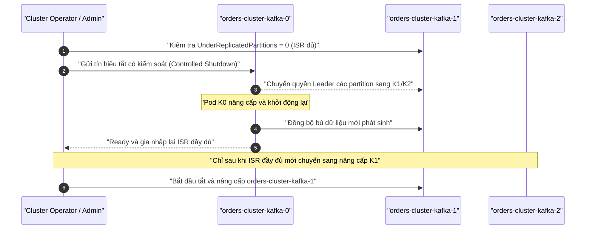
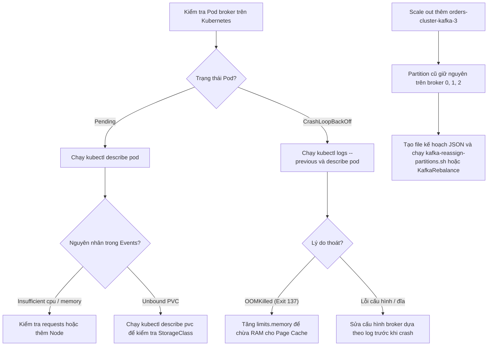

# 7_3_5 Vận Hành Trên Kubernetes (Operations on Kubernetes)

> **Khóa học**: Cloud DevOps Basic — Data Platform
> **Phân nhóm**: 7 Domain 7 - Apache Kafka › 7_3 Kafka on Kubernetes
> **Chủ đề**: Nâng cấp tuần tự theo ISR, chẩn đoán Pod `Pending` / `CrashLoopBackOff`, và tái phân bổ partition khi mở rộng broker
> **Trạng thái**: Bản nháp (chưa kiểm chứng theo yêu cầu người dùng)
> **Lộ trình chủ đề**: [7_3 Kafka on Kubernetes](./README.md) · [Tổng quan Data Platform](../../README.md)

---

## 1. Khái Niệm Cốt Lõi & Bản Chất Kỹ Thuật (Core Concepts & Technical Deep Dive)

Chạy được cụm Kafka lên Kubernetes mới chỉ là bước khởi đầu, còn vận hành ổn định qua những lần nâng cấp, sự cố tài nguyên và mở rộng quy mô mới là bài toán thực tế hàng ngày. Khác với các ứng dụng stateless có thể tắt mở tự do, mỗi Kafka broker gắn chặt với dữ liệu trên ổ đĩa bền vững và cùng chia sẻ trách nhiệm sao lưu dữ liệu với các broker khác. Nếu bạn khởi động lại nhiều broker cùng lúc, cấp thiếu RAM cho hệ điều hành, hoặc thêm broker mới rồi kỳ vọng tải tự chia đều, hệ thống có thể từ chối ghi dữ liệu hoặc lệch tải nghiêm trọng. Bài học này đi qua ba trụ cột vận hành Kafka trên Kubernetes: nâng cấp tuần tự chờ đồng bộ đủ, chẩn đoán Pod lỗi và tái phân bổ partition khi mở rộng cụm.

### 1.1 Nâng cấp tuần tự từng broker và trạng thái ISR

* **In-Sync Replicas (ISR)**: là danh sách các bản sao (replica) của một partition đang bắt kịp dữ liệu mới nhất từ leader.
* Trong quá trình nâng cấp hoặc khởi động lại một cụm Kafka, các broker phải được dừng và nâng cấp tuần tự từng node một thay vì dừng đồng thời nhiều broker cùng lúc. <!-- ev: C5.1 -->
* Trước khi tắt một broker để chuyển sang phiên bản mới hoặc áp dụng cấu hình mới, quản trị viên cần đảm bảo không còn partition nào ở trạng thái under-replicated, tức là mọi bản sao đều đã nằm trong tập ISR. <!-- ev: C5.2 -->
* Ví dụ với một topic có hệ số sao chép (`replication.factor`) bằng 3 và ngưỡng đồng bộ tối thiểu (`min.insync.replicas`) bằng 2, việc mất cùng lúc 2 broker sẽ khiến số replica đồng bộ giảm xuống còn 1 và làm các producer cấu hình `acks=all` không thể ghi dữ liệu mới. <!-- ev: C5.3 -->
* Khi một broker dừng lại một cách có kiểm soát, quyền leader của các partition nằm trên broker đó được chuyển sang một follower đang nằm trong ISR, và broker sẽ đồng bộ bù phần dữ liệu còn thiếu ngay sau khi khởi động lại. <!-- ev: C5.4 -->
* Thiết lập `controlled.shutdown.enable=true` (được bật mặc định trong Kafka) cho phép broker chủ động thông báo trước khi tắt để chuyển giao vai trò leader sang các broker còn lại, giúp giảm thiểu gián đoạn cho ứng dụng client. <!-- ev: C5.5 -->
* Khi dùng Strimzi Operator trên Kubernetes, Cluster Operator tự động điều phối quá trình rolling update tuần tự từng Pod broker và kiểm tra trạng thái sẵn sàng của broker trước khi tiến hành khởi động lại Pod kế tiếp. <!-- ev: C5.6 -->

### 1.2 Chẩn đoán Pod broker `Pending` và `CrashLoopBackOff`

* Khi một Pod broker ở trạng thái `Pending`, Kubernetes scheduler chưa thể xếp Pod đó lên bất kỳ Node nào vì cụm không đủ tài nguyên đáp ứng `resources.requests` (CPU/RAM) hoặc PersistentVolumeClaim (PVC) chưa chuyển sang trạng thái `Bound`. <!-- ev: C5.7 -->
* Lệnh `kubectl describe pod <pod-name> -n <namespace>` hiển thị mục `Events` ở cuối kết quả để xác định nguyên nhân Pod bị `Pending`, chẳng hạn thông báo `Insufficient cpu`, `Insufficient memory` hoặc lỗi gắn volume. <!-- ev: C5.8 -->
* Nếu sự cố xuất phát từ ổ đĩa, lệnh `kubectl describe pvc <pvc-name> -n <namespace>` cho phép kiểm tra xem `StorageClass` có tồn tại hay bộ cấp phát (provisioner) có tạo được PersistentVolume tương ứng hay không. <!-- ev: C5.9 -->
* Trạng thái `CrashLoopBackOff` xảy ra khi container bên trong Pod khởi chạy rồi thoát với mã lỗi, khiến kubelet liên tục khởi động lại container theo chu kỳ thời gian chờ tăng dần theo cấp số nhân (exponential backoff). <!-- ev: C5.10 -->
* Để đọc nhật ký lỗi của lần chạy vừa bị sập ngay trước đó trên một Pod đang ở trạng thái `CrashLoopBackOff`, quản trị viên dùng lệnh `kubectl logs <pod-name> -n <namespace> --previous`. <!-- ev: C5.11 -->
* Khi container tiêu thụ bộ nhớ vượt quá giới hạn khai báo trong `resources.limits.memory`, nhân Linux sẽ chấm dứt tiến trình và `kubectl describe pod` sẽ ghi nhận lý do `OOMKilled` (mã thoát `137`). <!-- ev: C5.12 -->
* Do Kafka chỉ dùng một phần bộ nhớ cho JVM Heap và phụ thuộc lớn vào Page Cache của hệ điều hành để đệm đọc/ghi đĩa, việc đặt `limits.memory` quá sát với kích thước JVM Heap (`-Xmx`) rất dễ dẫn đến tình trạng `OOMKilled` khi lưu lượng tăng cao. <!-- ev: C5.13 -->

### 1.3 Mở rộng broker không tự động cân bằng lại partition cũ

* Khi bạn tăng thêm số lượng broker cho một cụm Kafka đang hoạt động (scale out), Kafka không tự động di chuyển hay cân bằng lại các partition đã được tạo trước đó sang các broker mới. <!-- ev: C5.14 -->
* Các broker mới thêm vào chỉ tự động nhận các partition của những topic được tạo mới sau thời điểm mở rộng cụm. <!-- ev: C5.15 -->
* Để phân phối lại dữ liệu của các topic hiện có sang broker mới nhằm giảm tải đĩa và mạng cho các broker cũ, quản trị viên cụm Kafka cần dùng công cụ `kafka-reassign-partitions.sh` kèm tệp JSON kế hoạch phân bổ qua các bước `--generate`, `--execute` và `--verify`. <!-- ev: C5.16 -->
* *(Nâng cao: có thể bỏ qua ở lần đọc đầu)* Khi sử dụng Strimzi trên Kubernetes, bạn có thể tích hợp Cruise Control để tự động tính toán đề xuất phân bổ lại và thực thi cân bằng partition thông qua tài nguyên `KafkaRebalance`. <!-- ev: C5.17 -->
* *(Nâng cao: có thể bỏ qua ở lần đọc đầu)* Quá trình di chuyển dữ liệu partition tạo ra lưu lượng sao chép rất lớn qua mạng và ổ đĩa giữa các broker, do đó cần cấu hình giới hạn băng thông (throttling) để tránh làm nghẽn producer và consumer đang chạy. <!-- ev: C5.18 -->

---

## 2. Ví Dụ Đời Sống Thực Tế Dễ Hiểu (Intuitive Real-World Analogies)

Hãy tưởng tượng cụm Kafka của bạn là một **đội xe tải chở hàng** gồm 3 xe mang biển số `0`, `1` và `2`. Mỗi kiện hàng quan trọng đều được sao chép lên cả 3 xe để nhỡ một xe hỏng dọc đường thì hàng vẫn còn nguyên.

1. **Nâng cấp tuần tự chờ ISR đầy đủ**: Khi cần bảo dưỡng định kỳ cả 3 xe tải, bạn không thể cho cả 3 xe vào xưởng cùng một lúc vì khách hàng sẽ không còn xe nào để giao nhận hàng. Bạn chỉ đưa xe `0` vào xưởng, đợi xe `0` bảo dưỡng xong, quay lại đội hình và chép đầy đủ toàn bộ các kiện hàng mới phát sinh trong lúc vắng mặt (ISR đầy đủ) rồi mới được phép gọi xe `1` vào xưởng.
2. **Pod `Pending` và `CrashLoopBackOff`**:
   * Xe `2` bị `Pending` giống như xe đã xuất xưởng nhưng chưa tìm được bãi đỗ đủ rộng (thiếu CPU/RAM trên Node) hoặc chưa được cấp thẻ kho chứa hàng (PVC chưa `Bound`).
   * Xe `2` bị `CrashLoopBackOff` giống như xe vừa nổ máy lăn bánh vài mét thì chết máy, tài xế cố đề lại liên tục nhưng cứ vài giây lại tắt ngúm — thường do chở quá tải trọng thùng xe cho phép (`OOMKilled`) hoặc cấu hình sai bộ máy.
3. **Mua thêm xe tải mới không tự san hàng cũ**: Khi đơn hàng quá nhiều và bạn mua thêm xe tải số `3`, những kiện hàng đang nằm trên thùng xe `0`, `1` và `2` sẽ không tự mọc chân nhảy sang xe `3`. Xe `3` chỉ nhận các đơn hàng mới phát sinh từ hôm nay trở đi, còn muốn giảm tải cho 3 xe cũ thì điều phối viên phải phát lệnh bốc dỡ và chuyển hàng thủ công (hoặc dùng hệ thống điều phối tự động như Cruise Control).

---

## 3. Kiến Trúc, Luồng Hoạt Động & Hình Ảnh Trực Quan (Architecture, Diagrams & Visual Media)

### Luồng nâng cấp tuần tự từng broker theo trạng thái ISR



### Cây chẩn đoán Pod lỗi và quy trình xử lý khi mở rộng broker



---

## 4. Code Mẫu Trực Quan Hoặc Dòng Lệnh Thực Chiến (Runnable Sample Code / CLI)

Xuyên suốt các ví dụ dưới đây, chúng ta sử dụng một tình huống thống nhất: cụm Kafka tên orders-cluster đặt trong namespace kafka, ban đầu có ba broker Pod, phục vụ một topic đơn hàng mẫu rồi mở rộng thêm broker thứ tư. Các câu lệnh minh họa áp dụng cho công cụ dòng lệnh Kubernetes và Apache Kafka thế hệ hiện hành.

### 4.1 Kiểm tra partition chưa đồng bộ (Under-Replicated) trước khi nâng cấp

Lệnh `kafka-topics.sh` với cờ `--under-replicated-partitions` dùng để liệt kê các partition có số bản sao trong ISR nhỏ hơn `replication.factor`, giúp xác nhận cụm đã an toàn trước khi dừng một broker. <!-- ev: C5.2 -->

**Input**: Địa chỉ bootstrap nội bộ của cụm đang chạy và một Pod có sẵn bộ công cụ dòng lệnh Kafka.

<!-- ev: C5.2 -->
```bash
# Chạy kiểm tra từ bên trong Pod broker đầu tiên
kubectl exec -n kafka orders-cluster-kafka-0 -- \
  bin/kafka-topics.sh \
  --bootstrap-server orders-cluster-kafka-bootstrap:9092 \
  --describe \
  --under-replicated-partitions
```

**Output kỳ vọng (an toàn để nâng cấp broker tiếp theo)**:

```text
(Không có dòng nào được in ra — nghĩa là mọi partition đều đã đồng bộ đủ ISR)
```

Nếu kết quả vẫn liệt kê topic `orders` với danh sách `Isr` thiếu broker id, bạn phải chờ đồng bộ xong trước khi khởi động lại broker kế tiếp. <!-- ev: C5.2 -->

### 4.2 Chẩn đoán Pod `Pending` do thiếu tài nguyên hoặc PVC chưa `Bound`

Hai lệnh `kubectl describe pod` và `kubectl describe pvc` dùng để đọc trực tiếp nhật ký sự kiện (`Events`) từ control plane Kubernetes nhằm tìm ra nút thắt khiến Pod không thể lên lịch hoặc không gắn được ổ đĩa. <!-- ev: C5.8 C5.9 -->

**Input**: Pod broker thứ ba đang bị kẹt ở trạng thái chờ cấp phát trong namespace của cụm.

<!-- ev: C5.7 C5.8 C5.9 -->
```bash
# 1. Xem trạng thái tổng quan của Pod và PVC
kubectl get pods,pvc -n kafka

# 2. Đọc Events của Pod bị Pending
kubectl describe pod orders-cluster-kafka-2 -n kafka

# 3. Kiểm tra chi tiết PVC tương ứng nếu Events báo lỗi volume
kubectl describe pvc data-0-orders-cluster-kafka-2 -n kafka
```

**Output minh họa (trường hợp thiếu tài nguyên hoặc PVC chưa bind)**:

<!-- ev: C5.7 C5.8 C5.9 -->
```text
Events:
  Type     Reason            Age   From               Message
  ----     ------            ----  ----               -------
  Warning  FailedScheduling  2m    default-scheduler  0/3 nodes are available: 3 Insufficient memory.
```

Hoặc nếu vướng ở PVC chưa `Bound`, lệnh `kubectl describe pvc` sẽ hiển thị cảnh báo từ provisioner (ví dụ không tìm thấy `StorageClass` khai báo). <!-- ev: C5.9 -->

### 4.3 Chẩn đoán Pod `CrashLoopBackOff` và lỗi `OOMKilled`

Lệnh `kubectl logs` kèm cờ `--previous` dùng để lấy log của container đã chết ngay trước lần khởi động lại hiện tại, kết hợp cùng `kubectl describe pod` để xem mã thoát (`Exit Code`) và nguyên nhân (`Reason`). <!-- ev: C5.11 C5.12 -->

**Input**: Pod broker thứ hai liên tục khởi động lại sau khi lưu lượng ghi tăng đột biến.

<!-- ev: C5.11 C5.12 -->
```bash
# 1. Xem nguyên nhân container bị chấm dứt và Exit Code
kubectl describe pod orders-cluster-kafka-1 -n kafka

# 2. Xem log của container Kafka ở lần chạy bị sập trước đó
kubectl logs orders-cluster-kafka-1 -n kafka -c kafka --previous
```

**Output minh họa khi container bị kernel chấm dứt vì tràn giới hạn bộ nhớ**:

<!-- ev: C5.12 -->
```text
    State:          Waiting
      Reason:       CrashLoopBackOff
    Last State:     Terminated
      Reason:       OOMKilled
      Exit Code:    137
```

Khi gặp `OOMKilled`, bạn cần kiểm tra lại mức `resources.limits.memory` so với cấu hình JVM Heap (`-Xmx`) để đảm bảo hệ điều hành vẫn còn đủ RAM cho Page Cache. <!-- ev: C5.13 -->

### 4.4 Tái phân bổ partition sau khi thêm broker mới (`broker 3`)

Công cụ `kafka-reassign-partitions.sh` giúp tạo kế hoạch (`--generate`), thực thi di chuyển (`--execute`) kèm giới hạn băng thông (`--throttle`) và kiểm tra tiến độ (`--verify`) cho các topic cũ sang broker mới `3`. <!-- ev: C5.16 C5.18 -->

**Input**: Tệp danh sách topic cần phân bổ lại sang toàn bộ bốn broker hiện có của cụm.

<!-- ev: C5.16 C5.18 -->
```bash
# Bước 1: Tạo file danh sách topic cần cân bằng lại
cat << 'EOF' > /tmp/topics-to-move.json
{
  "topics": [{"topic": "orders"}],
  "version": 1
}
EOF

# Bước 2: Sinh kế hoạch phân bổ mới cho 4 broker (0,1,2,3)
kubectl exec -n kafka orders-cluster-kafka-0 -- \
  bin/kafka-reassign-partitions.sh \
  --bootstrap-server orders-cluster-kafka-bootstrap:9092 \
  --topics-to-move-json-file /tmp/topics-to-move.json \
  --broker-list "0,1,2,3" \
  --generate
```

Sau khi lưu phần JSON kế hoạch đề xuất vào tệp `/tmp/reassignment.json`, bạn chạy thực thi với giới hạn băng thông và xác minh hoàn tất: <!-- ev: C5.16 C5.18 -->

<!-- ev: C5.16 C5.18 -->
```bash
# Bước 3: Thực thi di chuyển kèm giới hạn băng thông (bytes/sec)
kubectl exec -n kafka orders-cluster-kafka-0 -- \
  bin/kafka-reassign-partitions.sh \
  --bootstrap-server orders-cluster-kafka-bootstrap:9092 \
  --reassignment-json-file /tmp/reassignment.json \
  --execute \
  --throttle 50000000

# Bước 4: Kiểm tra trạng thái hoàn tất và gỡ throttle tự động khi xong
kubectl exec -n kafka orders-cluster-kafka-0 -- \
  bin/kafka-reassign-partitions.sh \
  --bootstrap-server orders-cluster-kafka-bootstrap:9092 \
  --reassignment-json-file /tmp/reassignment.json \
  --verify
```

**Output minh họa khi hoàn tất bước kiểm tra**:

<!-- ev: C5.16 -->
```text
Status of partition reassignment:
Reassignment of partition orders-0 is completed.
Reassignment of partition orders-1 is completed.
...
Clearing broker-level throttles on brokers 0,1,2,3
```

---

## 5. Cạm Bẫy Thực Tế & Thực Tiễn Sản Xuất (Production Gotchas & Best Practices)

1. **Xóa nhiều Pod broker cùng lúc hoặc bảo trì node bất cẩn**: Dùng `kubectl delete pod` hàng loạt khi nâng cấp thủ công dễ làm số ISR rớt xuống dưới `min.insync.replicas` và gây lỗi ghi toàn hệ thống. <!-- ev: C5.1 C5.3 --> Hãy luôn nâng cấp tuần tự từng broker sau khi xác nhận không còn partition under-replicated. <!-- ev: C5.2 -->
2. **Đặt `limits.memory` bằng đúng JVM Heap**: Nhiều kỹ sư đặt `-Xmx4G` và `limits.memory: 4Gi`, khiến nhân Linux `OOMKilled` Pod ngay khi hệ điều hành cấp thêm RAM cho Page Cache hoặc bộ nhớ ngoài heap. <!-- ev: C5.12 C5.13 -->
3. **Bỏ quên bước tái phân bổ sau khi mở rộng cụm**: Mở rộng từ 3 lên 6 broker rồi không chạy công cụ phân bổ lại khiến 3 broker mới gần như rỗi việc trong khi 3 broker cũ vẫn cạn dần dung lượng đĩa. <!-- ev: C5.14 C5.15 -->
4. **Di chuyển partition không giới hạn băng thông (unthrottled reassignment)**: Thực thi `kafka-reassign-partitions.sh --execute` mà không kèm `--throttle` vào giờ cao điểm có thể bão hòa băng thông mạng và IOPS đĩa của các broker đang phục vụ client. <!-- ev: C5.18 -->
5. **Nguyên tắc phân quyền tối thiểu (Least Privilege)**: Khi kiểm tra nhật ký hay mô tả trạng thái Pod, chỉ nên cấp quyền đọc giới hạn trong namespace riêng của cụm thay vì dùng tài khoản quản trị toàn cụm để tránh thao tác xóa nhầm ổ đĩa hoặc tài nguyên đang chạy.

---

## 6. Câu Hỏi Củng Cố Kiến Thức (Active Recall Quiz)

**Câu 1**: Một topic `orders` có `replication.factor=3` và `min.insync.replicas=2`. Trong lúc bảo trì, quản trị viên tắt đồng thời 2 Pod broker để nâng cấp nhanh hơn. Điều gì sẽ xảy ra với các producer cấu hình `acks=all`?

<details>
<summary>Đáp án</summary>

Các producer cấu hình `acks=all` sẽ bị từ chối ghi dữ liệu và nhận lỗi thiếu replica đồng bộ. Lý do là khi 2 trên 3 broker tắt cùng lúc, mỗi partition chỉ còn tối đa 1 replica nằm trong ISR, thấp hơn mức `min.insync.replicas=2` bắt buộc. <!-- ev: C5.3 --> Vì vậy, broker luôn phải được nâng cấp tuần tự từng node một và đợi ISR đầy đủ trước khi sang node kế tiếp. <!-- ev: C5.1 C5.2 -->

</details>

**Câu 2**: Pod `orders-cluster-kafka-2` chuyển sang `CrashLoopBackOff` với `Reason: OOMKilled` và `Exit Code: 137` trong `kubectl describe pod`. Nguyên nhân phổ biến nhất trên Kafka là gì và bạn cần điều chỉnh gì?

<details>
<summary>Đáp án</summary>

`OOMKilled` (mã thoát `137`) nghĩa là tiến trình bên trong Pod đã dùng vượt mức `resources.limits.memory` và bị nhân Linux chấm dứt. <!-- ev: C5.12 --> Với Kafka, nguyên nhân thường gặp là `limits.memory` bị đặt quá sát với cấu hình JVM Heap (`-Xmx`), không chừa đủ khoảng trống cho hệ điều hành sử dụng Page Cache. <!-- ev: C5.13 --> Bạn cần tăng `limits.memory` (và kiểm tra lại log trước khi sập bằng `kubectl logs ... --previous` nếu cần đối chiếu thêm). <!-- ev: C5.11 -->

</details>

**Câu 3**: Sau khi mở rộng cụm từ 3 broker lên 5 broker, bạn nhận thấy ổ đĩa của 3 broker cũ vẫn đầy 85% còn 2 broker mới gần như trống rỗng. Tại sao hiện tượng này xảy ra và xử lý thế nào?

<details>
<summary>Đáp án</summary>

Khi thêm broker mới vào cụm đang chạy, Kafka không tự động di chuyển các partition cũ sang broker mới mà chỉ gán cho chúng các partition của những topic được tạo sau đó. <!-- ev: C5.14 C5.15 --> Để cân bằng dữ liệu cũ, bạn cần chạy công cụ `kafka-reassign-partitions.sh` (kèm `--throttle` để bảo vệ lưu lượng production) hoặc dùng Strimzi Cruise Control với tài nguyên `KafkaRebalance`. <!-- ev: C5.16 C5.17 C5.18 -->

</details>

---

## 7. 📚 Nguồn Tài Liệu Chính Thống (Tier-1 Official References)

* [Apache Kafka Documentation — Operations](https://kafka.apache.org/documentation/#operations) — Tài liệu chính thức về vận hành cụm Kafka, nâng cấp tuần tự và công cụ quản trị.
* [Apache Kafka Documentation — Expanding Your Cluster](https://kafka.apache.org/documentation/#basic_ops_cluster_expansion) — Hướng dẫn chính thức về mở rộng broker và tái phân bổ partition bằng `kafka-reassign-partitions.sh`.
* [Strimzi Documentation — Overview](https://strimzi.io/docs/operators/latest/overview) — Tài liệu chính thức giới thiệu kiến trúc và cơ chế vận hành Kafka trên Kubernetes của Strimzi Operator.
* [Strimzi Documentation — Deploying and Upgrading](https://strimzi.io/docs/operators/latest/deploying) — Hướng dẫn chính thức về triển khai, nâng cấp tuần tự và tích hợp Cruise Control (`KafkaRebalance`) trên Strimzi.
* [Kubernetes Documentation — Debug Pods](https://kubernetes.io/docs/tasks/debug/debug-application/debug-pods/) — Tài liệu chính thức hướng dẫn chẩn đoán Pod `Pending`, `CrashLoopBackOff`, `kubectl describe` và `kubectl logs --previous`.
* [Kubernetes Documentation — Persistent Volumes](https://kubernetes.io/docs/concepts/storage/persistent-volumes/) — Tài liệu chính thức về cơ chế PVC, `StorageClass` và trạng thái `Bound`/`Pending`.
* [Kubernetes Documentation — Resource Management for Pods and Containers](https://kubernetes.io/docs/concepts/configuration/manage-resources-containers/) — Tài liệu chính thức về `requests`, `limits` và xử lý `OOMKilled`.
