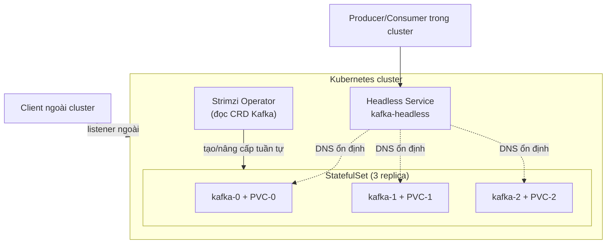

# 7_3 Kafka on Kubernetes

> **Khóa học**: Cloud DevOps Basic — Data Platform
> **Phân nhóm**: 7 Domain 7 - Apache Kafka › 7_3 Kafka on Kubernetes
> **Chủ đề**: Vì sao Kafka cần StatefulSet, headless Service, listener trong/ngoài cluster, Strimzi Operator, nâng cấp tuần tự
> **Trạng thái**: Định nghĩa (nội dung cần học + đề bài lab), chưa chạy thử, 16-11-2026
> **Lộ trình tổng**: [data-platform/README.md](../../README.md)
> **Tiên quyết**: [7_1](<../7_1 Kafka Core Concepts/README.md>), [7_2](<../7_2 Kafka Operations and Troubleshooting/README.md>), và ở Domain 6: [6_4 StatefulSet/PVC](<../../../container/6 Domain 6 - Containers and Kubernetes/6_4 Kubernetes Networking Configuration and Storage/README.md>), [6_7 CRD/Operator](<../../../container/6 Domain 6 - Containers and Kubernetes/6_7 Kubernetes Security Scheduling and Scaling/README.md>)

---

## 🎯 Mục Tiêu

Trả lời được câu phỏng vấn kinh điển: **"Deployment khác StatefulSet thế nào? Bạn dùng cái nào cho Kafka và vì sao?"** và nói được vì sao thực tế người ta thường dùng **Operator** thay vì tự viết YAML.

**Ví dụ đời thường**: Deployment giống **nhân viên ca làm việc thay phiên**, ai đứng quầy cũng được. StatefulSet giống **các thủ kho có tên và chìa khóa riêng**: kho số 1 phải luôn do "thủ kho 1" giữ và luôn là cùng căn phòng (PVC), nếu không hàng hóa (dữ liệu partition) sẽ lạc.

---

## 📚 Những Gì Cần Học

### 7_3_1 Vì Sao StatefulSet
- [ ] Broker có **danh tính** (broker id) gắn với dữ liệu trên đĩa của nó; Pod mới thay thế phải mang **cùng tên và cùng ổ đĩa**.
- [ ] Tên Pod ổn định (`kafka-0`), DNS ổn định qua headless Service, PVC riêng qua `volumeClaimTemplates` (nền tảng ở 6_4_3, 6_4_7).
- [ ] Chuyện gì xảy ra nếu dùng Deployment: Pod đổi tên/IP và có thể mất liên kết với dữ liệu.
- [ ] `podManagementPolicy`, `RollingUpdate`/`partition`; xóa StatefulSet không xóa PVC.

### 7_3_2 Mạng: Advertised Listener
- [ ] Client kết nối bootstrap rồi nhận **địa chỉ broker được quảng bá (advertised)** từ metadata; địa chỉ đó phải truy cập được từ phía client.
- [ ] Lỗi kinh điển: kết nối bootstrap được nhưng sau đó timeout vì advertised address chỉ có trong cluster.
- [ ] Listener nội bộ (DNS headless) vs listener cho client ngoài cluster (NodePort/LoadBalancer/Ingress theo từng cách; *cần đối chiếu tài liệu Strimzi về các loại listener*).
- [ ] Liên hệ [network 2_5 Ports and Sockets](<../../../network/2 Domain 2 - Computer Networking Core Fundamentals/2_5 Transport Layer TCP and UDP/2_5_1 Ports and Sockets.md>).

### 7_3_3 Lưu Trữ Và Tài Nguyên
- [ ] StorageClass phù hợp (hiệu năng đĩa ảnh hưởng độ trễ ghi); `ReadWriteOnce` cho mỗi broker.
- [ ] `requests`/`limits` cho Pod broker; JVM heap vs page cache (nối 6_3_6 và [os 1_7_5](<../../../os/1 Domain 1 - Operating System Core Fundamentals/1_7 Memory Management and Virtual Memory/1_7_5 Virtual Memory and Demand Paging.md>)).
- [ ] `PodDisruptionBudget` để drain node không hạ nhiều broker cùng lúc (nối 6_7).
- [ ] Anti-affinity để các broker không nằm cùng một node.

### 7_3_4 Strimzi Operator
- [ ] Operator = CRD + controller; Strimzi cung cấp các tài nguyên như `Kafka`, `KafkaTopic`, `KafkaUser` (*cần đối chiếu danh sách CRD và `apiVersion` theo bản Strimzi bạn dùng*).
- [ ] Khai báo cluster bằng YAML; Operator lo tạo StatefulSet/PVC/Service, cấu hình listener, nâng cấp tuần tự (rolling).
- [ ] Quản lý topic và user theo kiểu declarative (GitOps-friendly).
- [ ] ⚠️ Mô hình điều khiển metadata (KRaft hay ZooKeeper) và phiên bản Kafka được Strimzi hỗ trợ thay đổi theo bản: **cần đối chiếu ma trận phiên bản trên trang chính thức Strimzi trước khi dùng**.

### 7_3_5 Vận Hành Trên Kubernetes
- [ ] Nâng cấp: tuần tự từng broker, chờ ISR đầy đủ trước khi sang broker tiếp theo.
- [ ] Pod broker `CrashLoopBackOff` / `Pending` (PVC không bind, thiếu tài nguyên): áp dụng quy trình chẩn đoán ở 6_8.
- [ ] Mở rộng số broker không tự động cân bằng lại partition (khái niệm; cần công cụ/Operator hỗ trợ, *cần đối chiếu tài liệu*).

---

## 🧪 Labs

> **Bản định nghĩa**: chưa tạo thư mục `labs/`, chưa chạy thử. Cần cluster `kind` từ Domain 6 và RAM đủ.

| Lab | Nội dung | Thời gian | Trạng thái |
| :--- | :--- | :---: | :--- |
| lab-7_3_1-strimzi-kafka-on-kind | Cài Strimzi, tạo cluster Kafka 3 broker, tạo topic bằng CRD | 90 phút | Định nghĩa |
| lab-7_3_2-broker-pod-failure | Xóa Pod broker, quan sát cùng tên/cùng PVC và ISR phục hồi | 45 phút | Định nghĩa |

### lab-7_3_1-strimzi-kafka-on-kind
- **Các bước chính**:
  1. Cài Strimzi Operator theo trang hướng dẫn chính thức của Strimzi (*phiên bản và cách cài cần đối chiếu*).
  2. Áp dụng custom resource `Kafka` nhỏ (3 broker, PVC trên StorageClass của kind).
  3. `kubectl get pods,pvc,svc` để liệt kê Operator đã tạo gì; tạo topic bằng `KafkaTopic`.
  4. Chạy producer/consumer từ một Pod khác trong cluster qua bootstrap Service.
- **Checkpoint**:
  - [ ] Liệt kê được StatefulSet/Service/PVC do Operator tạo ra.
  - [ ] Giải thích được địa chỉ bootstrap và advertised listener trong lab này.

### lab-7_3_2-broker-pod-failure
- **Các bước chính**:
  1. Ghi lại tên Pod, PVC của một broker.
  2. `kubectl delete pod` broker đó trong khi producer vẫn chạy.
  3. Quan sát Pod mới giữ cùng tên và cùng PVC; theo dõi ISR trở lại đầy đủ.
- **Checkpoint**:
  - [ ] Giải thích được vì sao không mất dữ liệu và vì sao Deployment không làm được điều tương tự.

---

## 📚 Nguồn Tài Liệu Chính Thống (Official References)
- [Strimzi Overview](https://strimzi.io/docs/operators/latest/overview) - Tổng quan Operator, các custom resource, cách triển khai.
- [Strimzi Documentation](https://strimzi.io/documentation/) - Danh mục tài liệu theo phiên bản, gồm ma trận phiên bản Kafka được hỗ trợ.
- [Kubernetes - StatefulSets](https://kubernetes.io/docs/concepts/workloads/controllers/statefulset/) - Danh tính ổn định, PVC theo Pod.
- [Kubernetes - Custom Resources](https://kubernetes.io/docs/concepts/extend-kubernetes/api-extension/custom-resources/) và [Operator pattern](https://kubernetes.io/docs/concepts/extend-kubernetes/operator/) - CRD và Operator.
- [Apache Kafka - Security: listeners (Broker Configs)](https://kafka.apache.org/documentation/#brokerconfigs) - `listeners` và `advertised.listeners`.
