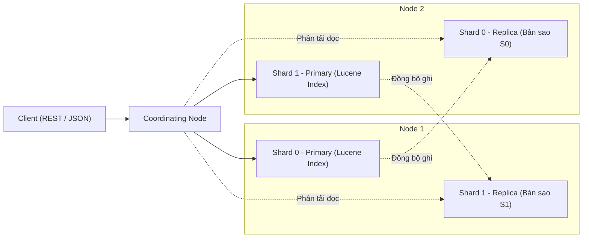
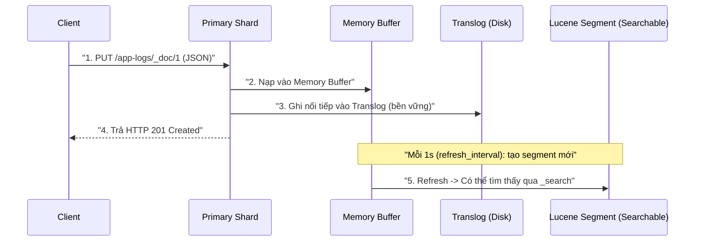

# 8_1_1 Elasticsearch Core Concepts

> **Khóa học**: Cloud DevOps Basic — Data Platform
> **Phân nhóm**: 8 Domain 8 - Elasticsearch › 8_1 Elasticsearch Core Concepts
> **Chủ đề**: 8_1_1 Elasticsearch Core Concepts
> **Trạng thái**: Bản nháp (chưa kiểm chứng verifier)
> **Lộ trình tổng**: [data-platform/README.md](../../README.md) · **Chủ đề**: [8_1 README](./README.md)

---

## 1. Khái Niệm Cốt Lõi & Bản Chất Kỹ Thuật (Core Concepts & Technical Deep Dive)

Khi hệ thống phát sinh hàng triệu dòng log mỗi ngày, việc tìm kiếm chuỗi văn bản trên bảng dữ liệu quan hệ thông thường trở nên rất chậm vì phải quét qua từng dòng. **Elasticsearch** giải quyết bài toán này bằng cách lưu dữ liệu dạng JSON và đánh chỉ mục nội dung ngay lúc ghi, giúp tìm kiếm và thống kê hoàn tất chỉ trong vài mili-giây. Thay vì lưu dữ liệu trên một máy chủ đơn lẻ, Elasticsearch chia nhỏ dữ liệu thành nhiều phần chạy song song trên nhiều máy chủ (node). Nắm vững các khái niệm từ document, inverted index, mapping, shard đến near real-time sẽ giúp bạn thiết kế dữ liệu đúng và chẩn đoán sự cố ở các bài học sau.

### 1.1 Mô hình dữ liệu: Document, Index, Field và khác biệt với CSDL quan hệ

- **Document & Field**: Đơn vị dữ liệu cơ bản nhất là **document** — một đối tượng **JSON** chứa các cặp khóa–giá trị gọi là **field**, được định danh duy nhất trong index bằng trường metadata `_id`. <!-- ev: C1.1 -->
- **Index**: Là tập hợp logic các document có đặc điểm tương đồng (ví dụ `app-logs`), đóng vai trò không gian tên để lưu trữ, cấu hình và tìm kiếm dữ liệu. <!-- ev: C1.2 -->
- **Khác biệt với CSDL quan hệ**: Elasticsearch không hỗ trợ phép `JOIN` kiểu SQL xuyên suốt các index ở thời điểm truy vấn thông thường; dữ liệu thường được **phi chuẩn hóa (denormalize)** ngay trong từng document để tối ưu tốc độ tìm kiếm. <!-- ev: C1.3 -->
- **Ghi và ghi đè document**: Bạn có thể tạo mới hoặc ghi đè toàn bộ document với `_id` xác định bằng `PUT /<index>/_doc/<id>`, hoặc gửi `POST /<index>/_doc` để hệ thống tự sinh `_id` (áp dụng trong Elasticsearch 8.x). <!-- ev: C1.4 -->

### 1.2 Inverted Index và Phân tích văn bản (`text` vs `keyword`)

- **Inverted index (Chỉ mục ngược)**: Ở tầng lưu trữ bên dưới, mỗi shard là một **Apache Lucene** index sử dụng cấu trúc **inverted index**, ánh xạ từng thuật ngữ (**term**) tới danh sách các document chứa thuật ngữ đó. <!-- ev: C1.5 -->
- **Analyzer**: Khi lập chỉ mục trường kiểu `text`, **Analyzer** tách chuỗi qua **tokenizer** (chia thành từng từ/token) rồi chuẩn hóa qua các **token filter** (như chuyển về chữ thường lowercase) trước khi ghi vào inverted index. <!-- ev: C1.6 -->
- **Tìm kiếm không phân biệt hoa/thường**: Chuỗi tìm kiếm trên trường `text` cũng đi qua bước phân tích tương tự, nên tìm `"Error"` vẫn khớp với document chứa `"error"`. <!-- ev: C1.7 -->
- **`text` vs `keyword`**: Kiểu `text` dùng cho văn bản tự do để tìm full-text theo từ khóa trong câu; ngược lại, kiểu `keyword` không qua analyzer tách từ mà lưu nguyên vẹn toàn bộ chuỗi, phù hợp cho khớp chính xác (exact match), sắp xếp (`sort`) và gom nhóm (`aggregation`). <!-- ev: C1.6 C1.8 -->

### 1.3 Mapping và Rủi ro của Dynamic Mapping

- **Mapping**: Là bản thiết kế schema quy định danh sách các field và kiểu dữ liệu (`text`, `keyword`, `date`, `long`, `boolean`...) trong một index. <!-- ev: C1.9 -->
- **Dynamic mapping**: Khi ghi một field chưa khai báo trước, **dynamic mapping** tự động suy đoán và gán kiểu dữ liệu dựa trên giá trị JSON đầu tiên nhận được. <!-- ev: C1.10 -->
- **Rủi ro của dynamic mapping**: Có thể gán sai kiểu (ví dụ số cổng gửi dưới dạng chuỗi `"8080"` bị cố định thành `text` thay vì số) hoặc gây **mapping explosion** — số field tăng không kiểm soát vượt ngưỡng mặc định `index.mapping.total_fields.limit` (1.000 field mỗi index), làm tăng mạnh bộ nhớ heap và chi phí đồng bộ cluster state. <!-- ev: C1.11 -->
- **Nguyên tắc đổi kiểu field**: Không thể sửa trực tiếp kiểu dữ liệu của field đã tồn tại trên index có dữ liệu; cần tạo index mới với mapping đúng rồi sao chép dữ liệu sang bằng API `_reindex`. <!-- ev: C1.12 -->

### 1.4 Shard, Replica và Kiến trúc phân tán

- **Primary shard**: Một index được chia ngang thành một hoặc nhiều **primary shard** (mặc định **1 primary shard** khi tạo index từ Elasticsearch 7.x/8.x), mỗi primary là một Lucene index độc lập có thể nằm trên một node khác nhau. <!-- ev: C1.13 -->
- **Replica shard**: Mỗi primary có thể có từ 0 trở lên **replica shard** (mặc định **1 replica**); replica là bản sao hoàn chỉnh giúp tăng **độ sẵn sàng** khi node gặp sự cố và **tăng năng lực đọc** nhờ phục vụ song song truy vấn tìm kiếm. <!-- ev: C1.14 -->
- **Quy tắc phân bổ node**: Elasticsearch không bao giờ đặt replica trên cùng node với primary tương ứng; vì vậy cluster chỉ có **1 node** với `number_of_replicas: 1` sẽ không có chỗ đặt replica (trạng thái `unassigned`), khiến sức khỏe cluster ở mức **yellow**. <!-- ev: C1.15 -->
- **Thay đổi số shard**: Số primary shard (`number_of_shards`) được cố định lúc tạo index (muốn đổi trên dữ liệu có sẵn phải dùng thao tác chuyên biệt như `_split`, `_shrink` hoặc `_reindex`), còn số replica (`number_of_replicas`) đổi được bất kỳ lúc nào qua `_settings`. <!-- ev: C1.16 -->
- **Oversharding**: Chia quá nhiều shard nhỏ cho ít dữ liệu gây lãng phí bộ nhớ heap, file descriptor và chi phí điều phối vì mỗi shard tiêu tốn tài nguyên quản lý riêng. <!-- ev: C1.17 -->

### 1.5 Query DSL cơ bản, Aggregation và Phân trang

- **Query DSL cốt lõi (`_search`)**: Hỗ trợ `match` (phân tích chuỗi tìm full-text trên `text`), `term` (khớp chính xác giá trị chưa phân tích trên `keyword`), và `range` (lọc theo khoảng số hoặc thời gian). <!-- ev: C1.18 -->
- **Truy vấn `bool`**: Kết hợp nhiều điều kiện qua bốn mệnh đề: `must` (bắt buộc khớp, tính điểm), `filter` (bắt buộc khớp, không tính điểm), `should` (nên khớp để tăng điểm) và `must_not` (loại trừ, không tính điểm). <!-- ev: C1.19 -->
- **Query context vs Filter context**: **Query context** (`must`, `should`) đánh giá mức độ liên quan để tính `_score`; **filter context** (`filter`, `must_not`) chỉ kiểm tra đúng/sai, bỏ qua tính `_score` và được Elasticsearch tự động **cache** để tăng tốc bộ lọc lặp lại. <!-- ev: C1.20 -->
- **Aggregation (`aggs`)**: Cho phép thống kê, đếm và gom nhóm dữ liệu ngay trong `_search`, như dùng `terms` để đếm log theo `level` hoặc `date_histogram` để gom theo mốc thời gian. <!-- ev: C1.21 -->
- **Phân trang**: Cặp `from`/`size` bị giới hạn mặc định bởi `index.max_result_window` là **10.000** kết quả để tránh quá tải bộ nhớ; khi duyệt sâu dữ liệu lớn, cần dùng `search_after` dựa trên giá trị `sort` của bản ghi cuối trang trước. <!-- ev: C1.22 -->

### 1.6 Near Real-Time (Refresh) và Độ bền dữ liệu (Translog)

- **Near Real-Time & Refresh**: Document vừa ghi nằm trong memory buffer và chưa tìm thấy ngay; chỉ sau thao tác **refresh** tạo Lucene segment mới (mặc định mỗi **1 giây** — `index.refresh_interval: 1s`), dữ liệu mới xuất hiện trong kết quả `_search`. <!-- ev: C1.23 -->
- **Translog**: Vì segment sau refresh chưa chắc đã ghi bền vững xuống đĩa (flush), mọi thao tác ghi đều được ghi nối tiếp vào **translog** nhằm tránh mất dữ liệu khi node sập nguồn và phục hồi thay đổi chưa flush lúc khởi động lại. <!-- ev: C1.24 -->

---

## 2. Ví Dụ Đời Sống Thực Tế Dễ Hiểu (Intuitive Real-World Analogies)

Hãy tưởng tượng bạn đang vận hành một **thư viện kỹ thuật khổng lồ**:

- **Document & Index**: Mỗi **trang hồ sơ sự cố** là một **document JSON** (ghi rõ thời gian, tên dịch vụ, mức độ lỗi, nội dung). Tập hợp tất cả các trang hồ sơ sự cố được xếp chung vào một bộ hồ sơ mang tên `app-logs` chính là **index**.
- **Inverted Index**: Nếu muốn tìm mọi trang có nhắc đến từ `"timeout"` trong một cuốn sách dày 10.000 trang, bạn sẽ không lật từng trang đọc từ đầu đến cuối. Bạn lật ngay ra phần **mục lục tra cứu từ khóa ở cuối sách**: chữ `"timeout"` trỏ thẳng tới trang 12, 45, 809. Mục lục tra cứu đó chính là **inverted index**.
- **Primary Shard & Replica Shard**: Vì bộ hồ sơ `app-logs` quá dày để nhét vào một ngăn kéo, bạn chia đều nó thành 2 ngăn tủ đặt ở 2 phòng khác nhau (**2 primary shard** trên 2 node). Để đề phòng một phòng bị mất điện hoặc khóa cửa không vào được, bạn photo toàn bộ từng ngăn thành bản sao (**replica shard**) và đặt ở phòng còn lại — tuyệt đối không cất bản sao vào cùng một ngăn với bản chính, vì nếu căn phòng đó mất điện thì cả bản chính lẫn bản sao đều không đọc được!
- **Refresh & Translog**: Khi nhân viên vừa viết một tờ phiếu sự cố mới, họ ghi nhanh vào **sổ trực nhật ngoài quầy (translog)** để lỡ cúp điện không bị mất thông tin, đồng thời bỏ tờ phiếu vào khay chờ; cứ **1 giây một lần (refresh)**, thủ thư mới kẹp xấp phiếu ở khay chờ vào mục lục tra cứu để người khác có thể tìm thấy.

---

## 3. Kiến Trúc, Luồng Hoạt Động & Hình Ảnh Trực Quan (Architecture, Diagrams & Visual Media)

### 3.1 Phân bố Primary Shard và Replica Shard trên Cluster 2 Node

Sơ đồ dưới đây minh họa index `app-logs` có 2 primary shard (`P0`, `P1`) và 1 replica cho mỗi shard (`R0`, `R1`), trong đó primary và replica của cùng một shard luôn nằm trên các node khác nhau. <!-- ev: C1.14 C1.15 -->



### 3.2 Luồng ghi Near Real-Time: Memory Buffer, Refresh và Translog

Sơ đồ trình tự bên dưới mô tả hành trình từ lúc client gửi lệnh ghi document vào memory buffer và translog cho tới khi refresh tạo segment tìm kiếm được. <!-- ev: C1.23 C1.24 -->



---

## 4. Code Mẫu Trực Quan Hoặc Dòng Lệnh Thực Chiến (Runnable Sample Code / CLI)

Ví dụ dưới đây minh họa qua `curl` trên cụm cục bộ (điều chỉnh giao thức và thông tin xác thực theo môi trường lab của bạn), xuyên suốt bằng index nhật ký `app-logs` trên Elasticsearch 8.x. <!-- ev: C1.4 -->

### 4.1 Tạo Index với Mapping tường minh và Shard/Replica

Khai báo rõ `level` và `service` là `keyword`, `message` là `text`, kèm 1 primary và 1 replica. <!-- ev: C1.9 C1.13 C1.14 -->

```bash
curl -k -u elastic:<password> -X PUT "https://localhost:9200/app-logs" \
  -H "Content-Type: application/json" -d '{
  "settings": { "number_of_shards": 1, "number_of_replicas": 1 },
  "mappings": {
    "properties": {
      "@timestamp": { "type": "date" },
      "service":    { "type": "keyword" },
      "level":      { "type": "keyword" },
      "status_code":{ "type": "integer" },
      "message":    { "type": "text" }
    }
  }
}'
```

Đầu ra mẫu: `{"acknowledged":true,"shards_acknowledged":true,"index":"app-logs"}`.

### 4.2 Ghi Document JSON vào Index (`PUT /_doc/<id>`)

Ghi một bản ghi log với `_id = "log-101"`; chạy lại cùng `_id` sẽ ghi đè toàn bộ document cũ. <!-- ev: C1.1 C1.4 -->

```bash
curl -k -u elastic:<password> -X PUT "https://localhost:9200/app-logs/_doc/log-101" \
  -H "Content-Type: application/json" -d '{
  "@timestamp": "2026-11-22T10:15:00Z",
  "service": "payment-api",
  "level": "ERROR",
  "status_code": 504,
  "message": "Upstream gateway Timeout while calling bank"
}'
```

Đầu ra mẫu (trên cluster 1 node với 1 replica chưa gán, `successful` là 1 thay vì 2): <!-- ev: C1.15 -->

```json
{ "_index": "app-logs", "_id": "log-101", "_version": 1, "result": "created",
  "_shards": { "total": 2, "successful": 1, "failed": 0 } }
```

### 4.3 Truy vấn Query DSL (`bool`, `match`, `term`, `range`) và Aggregation

Tìm log chứa `"timeout"` (không phân biệt hoa/thường), lọc `payment-api`, `ERROR`, `status_code >= 500`, đồng thời đếm log theo `service`. <!-- ev: C1.7 C1.18 C1.19 C1.20 C1.21 -->

```bash
curl -k -u elastic:<password> -X POST "https://localhost:9200/app-logs/_search" \
  -H "Content-Type: application/json" -d '{
  "size": 5,
  "query": {
    "bool": {
      "must":   [{ "match": { "message": "timeout" } }],
      "filter": [
        { "term": { "level": "ERROR" } },
        { "term": { "service": "payment-api" } },
        { "range": { "status_code": { "gte": 500 } } }
      ]
    }
  },
  "aggs": { "by_service": { "terms": { "field": "service" } } }
}'
```

Đầu ra mẫu (rút gọn):

```json
{
  "hits": { "total": { "value": 1, "relation": "eq" },
    "hits": [{ "_id": "log-101", "_score": 0.2876821, "_source": { "service": "payment-api", "level": "ERROR" } }] },
  "aggregations": { "by_service": { "buckets": [{ "key": "payment-api", "doc_count": 1 }] } }
}
```

### 4.4 Phân trang `search_after`, đổi Replica và Reindex

Dùng `search_after` dựa trên `sort` để phân trang sâu vượt mốc 10.000, đổi `number_of_replicas` động qua `_settings`, hoặc sao chép sang index mới bằng `_reindex` khi cần đổi mapping. <!-- ev: C1.12 C1.16 C1.22 -->

```bash
# Phân trang sâu với search_after
curl -k -u elastic:<password> -X POST "https://localhost:9200/app-logs/_search" \
  -H "Content-Type: application/json" -d '{
  "size": 2, "sort": [{ "@timestamp": "asc" }, { "_id": "asc" }],
  "search_after": ["2026-11-22T10:15:00Z", "log-101"]
}'

# Hạ replica về 0 trên lab 1 node
curl -k -u elastic:<password> -X PUT "https://localhost:9200/app-logs/_settings" \
  -H "Content-Type: application/json" -d '{ "index": { "number_of_replicas": 0 } }'

# Reindex sang index mới khi đổi kiểu field
curl -k -u elastic:<password> -X POST "https://localhost:9200/_reindex" \
  -H "Content-Type: application/json" -d '{
  "source": { "index": "app-logs" }, "dest": { "index": "app-logs-v2" }
}'
```

---

## 5. Cạm Bẫy Thực Tế & Thực Tiễn Sản Xuất (Production Gotchas & Best Practices)

1. **Dynamic mapping cho log JSON tự do → Mapping explosion**: Khóa động (như `meta.<request_uuid>`) dễ đẩy số field vượt ngưỡng 1.000, làm tê liệt việc index mới; nên khai báo mapping tường minh cho các trường quan trọng. <!-- ev: C1.11 -->
2. **Dùng `text` cho trường lọc chính xác**: Truy vấn `term` trên trường `text` thường trả về rỗng vì term đã bị lowercase hoặc tách nhỏ; mọi mã lỗi, ID, tên service và level cần đặt kiểu `keyword`. <!-- ev: C1.6 C1.8 -->
3. **Oversharding**: Tạo nhiều primary shard nhỏ cho index ít dữ liệu gây tốn bộ nhớ heap và file descriptor; với index vừa và nhỏ, mặc định 1 primary shard thường đã đủ. <!-- ev: C1.13 C1.17 -->
4. **Chạy 1 node nhưng giữ replica = 1**: Cluster sẽ luôn ở trạng thái `yellow`; hãy đặt `number_of_replicas: 0` trên lab 1 node, còn production đa node cần tối thiểu 1 replica để chịu lỗi. <!-- ev: C1.14 C1.15 C1.16 -->
5. **Đưa điều kiện lọc vào `must` thay vì `filter`**: Ép tính `_score` không cần thiết và bỏ lỡ cache; hãy đặt điều kiện đúng/sai (thời gian, service) vào `filter`. <!-- ev: C1.19 C1.20 -->
6. **Phân trang sâu bằng `from`/`size`**: Vượt trần mặc định 10.000 của `index.max_result_window` sẽ gây lỗi; dùng `search_after` kết hợp trường `sort` duy nhất. <!-- ev: C1.22 -->

---

## 6. Câu Hỏi Củng Cố Kiến Thức (Active Recall Quiz)

**Câu 1**: Bạn vừa tạo index `orders` bằng cách gửi thẳng một document chứa `"status": "COMPLETED"` mà không khai báo mapping trước. Sau đó bạn chạy truy vấn `{"term": {"status": "COMPLETED"}}` nhưng kết quả trả về 0 document. Vì sao hiện tượng này xảy ra và xử lý thế nào?

<details>
<summary>Đáp án</summary>

1. **Nguyên nhân**: Dynamic mapping mặc định gán cho chuỗi JSON kiểu `text` (kèm trường phụ `.keyword`). Khi bạn truy vấn `term` trực tiếp trên trường `status` (đang là `text`), giá trị `"COMPLETED"` trong inverted index đã bị analyzer chuyển thành `"completed"`, nên tìm chuỗi hoa `"COMPLETED"` bằng `term` (không phân tích) sẽ không khớp.
2. **Cách xử lý**: Truy vấn trên trường phụ `status.keyword`, hoặc tạo index mới với mapping tường minh đặt `status` là `keyword` rồi dùng `_reindex` chuyển dữ liệu sang.

</details>

**Câu 2**: Trên môi trường Docker/Podman chạy 1 node duy nhất, bạn tạo index `app-logs` với `number_of_shards: 2` và `number_of_replicas: 1`. Cluster báo trạng thái **yellow**. Dữ liệu có đang bị mất không và vì sao replica không được gán?

<details>
<summary>Đáp án</summary>

1. **Có mất dữ liệu không?**: Không. Cả 2 primary shard đều đang hoạt động và lưu đủ dữ liệu.
2. **Vì sao trạng thái yellow?**: Elasticsearch không cho phép đặt replica shard trên cùng node với primary shard của nó. Vì cluster chỉ có 1 node, 2 replica shard không có node thứ hai để phân bổ nên nằm ở trạng thái `unassigned`.
3. **Khắc phục**: Trong môi trường lab 1 node, chạy `PUT /app-logs/_settings` để đặt `number_of_replicas: 0`; trên production, thêm node thứ 2 để cluster tự phân bổ replica và đạt trạng thái `green`.

</details>

**Câu 3**: Một hệ thống dashboard cần tìm tất cả log chứa từ `"connection refused"` trong `message`, thuộc `service: "auth"` và trong 1 giờ gần nhất. Để tối ưu hiệu năng truy vấn, bạn nên đặt các điều kiện này vào những mệnh đề nào của `bool` query?

<details>
<summary>Đáp án</summary>

- Đặt `match: { "message": "connection refused" }` vào **`must`** (query context — cần phân tích full-text và xếp hạng mức độ liên quan `_score`).
- Đặt `term: { "service": "auth" }` và `range: { "@timestamp": ... }` vào **`filter`** (filter context — chỉ kiểm tra đúng/sai, bỏ qua bước tính `_score` và được Elasticsearch cache tự động).

</details>

---

## 7. 📚 Nguồn Tài Liệu Chính Thống (Tier-1 Official References)

- [Elasticsearch Reference — Documents and indices](https://www.elastic.co/guide/en/elasticsearch/reference/current/documents-indices.html) — Document, index, shard và replica.
- [Elasticsearch Reference — Index API](https://www.elastic.co/guide/en/elasticsearch/reference/current/docs-index_.html) — Cú pháp `PUT /<index>/_doc/<id>` và `POST /<index>/_doc`.
- [Elasticsearch Reference — Text analysis](https://www.elastic.co/guide/en/elasticsearch/reference/current/analysis.html) — Analyzer, tokenizer và token filter.
- [Elasticsearch Reference — Mapping & Reindex API](https://www.elastic.co/guide/en/elasticsearch/reference/current/mapping.html) — Dynamic mapping, giới hạn field và [Reindex API](https://www.elastic.co/guide/en/elasticsearch/reference/current/docs-reindex.html).
- [Elasticsearch Reference — Query DSL](https://www.elastic.co/guide/en/elasticsearch/reference/current/query-dsl.html) — `match`, `term`, `range`, `bool` và [Query and filter context](https://www.elastic.co/guide/en/elasticsearch/reference/current/query-filter-context.html).
- [Elasticsearch Reference — Paginate search results](https://www.elastic.co/guide/en/elasticsearch/reference/current/paginate-search-results.html) — `from`/`size` và `search_after`.
- [Elasticsearch Reference — Near real-time search](https://www.elastic.co/guide/en/elasticsearch/reference/current/near-real-time.html) — Cơ chế refresh và `index.refresh_interval`.
- [Elasticsearch Reference — Translog](https://www.elastic.co/guide/en/elasticsearch/reference/current/index-modules-translog.html) — Vai trò của transaction log đối với độ bền dữ liệu.
