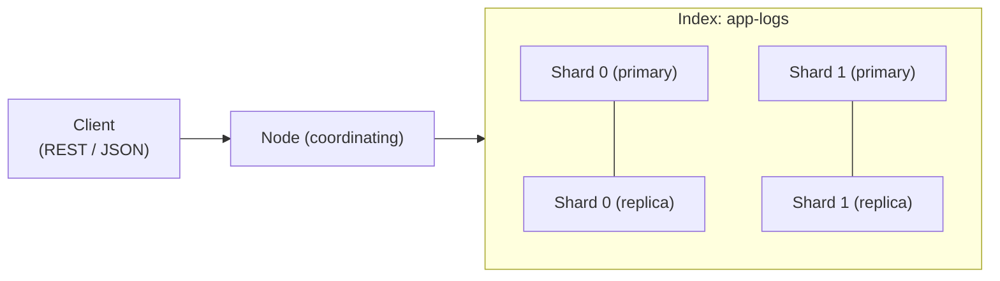

# 8_1 Elasticsearch Core Concepts

> **Khóa học**: Cloud DevOps Basic — Data Platform
> **Phân nhóm**: 8 Domain 8 - Elasticsearch › 8_1 Elasticsearch Core Concepts
> **Chủ đề**: Document, index, shard primary/replica, mapping, inverted index, REST API và truy vấn cơ bản
> **Trạng thái**: Định nghĩa (nội dung cần học + đề bài lab), chưa chạy thử, 16-11-2026
> **Lộ trình tổng**: [data-platform/README.md](../../README.md)

---

## 🎯 Mục Tiêu

Elasticsearch là công cụ **tìm kiếm và phân tích phân tán**, lưu dữ liệu dạng **document JSON** và truy cập qua **REST API**. Trong nền tảng của bạn nó thường đóng vai **kho log tập trung**. Nếu quen Loki: Loki chỉ lập chỉ mục **nhãn (label)** còn nội dung log để dạng nén; Elasticsearch lập chỉ mục **nội dung** nên tìm kiếm full-text mạnh hơn nhưng tốn tài nguyên hơn (*đây là so sánh khái niệm, cần đối chiếu tài liệu từng hệ thống*).

**Ví dụ đời thường**: **mục lục tra cứu ở cuối sách**. Thay vì đọc cả cuốn để tìm từ "kafka", bạn tra mục lục để biết từ đó nằm ở trang nào. Inverted index chính là cuốn mục lục đó: *từ → danh sách document chứa từ*.

---

## 📚 Những Gì Cần Học

### 8_1_1 Mô Hình Dữ Liệu
- [ ] **Document** (JSON), **index** (tập document cùng loại), **field**.
- [ ] Sự khác nhau giữa Elasticsearch và CSDL quan hệ: không có join kiểu SQL, dữ liệu thường được phi chuẩn hóa (denormalize).
- [ ] Index document: tạo/ghi đè bằng `_id`; ví dụ gọi REST với `curl`.

### 8_1_2 Inverted Index Và Phân Tích Văn Bản
- [ ] **Inverted index**: ánh xạ term → danh sách document; nền tảng của tìm kiếm full-text (Lucene).
- [ ] **Analyzer**: tokenizer + filter; vì sao tìm "Error" vẫn ra "error" với field `text`.
- [ ] `text` vs `keyword`: tìm full-text vs khớp chính xác/sắp xếp/aggregation.

### 8_1_3 Mapping
- [ ] **Mapping** định nghĩa kiểu dữ liệu từng field; **dynamic mapping** tự suy ra kiểu.
- [ ] Rủi ro của dynamic mapping: field bị gán sai kiểu, **mapping explosion** khi có quá nhiều field (khái niệm; *giới hạn mặc định cần đối chiếu tài liệu*).
- [ ] Không đổi kiểu field của index đã có dữ liệu: phải tạo index mới và reindex (khái niệm).

### 8_1_4 Shard, Replica Và Phân Tán
- [ ] Index chia thành **primary shard**; mỗi primary có thể có **replica shard**.
- [ ] Replica phục vụ **độ sẵn sàng** (node chết vẫn còn bản sao) và **tăng khả năng đọc**.
- [ ] Replica không nằm cùng node với primary của nó (vì thế cluster 1 node với `number_of_replicas: 1` sẽ không đủ chỗ đặt replica; liên hệ trạng thái **yellow** ở 8_2).
- [ ] Số primary shard **cố định lúc tạo index**; số replica đổi được bất kỳ lúc nào (*cần đối chiếu tài liệu phiên bản bạn dùng, có cơ chế split/shrink*).
- [ ] Quá nhiều shard nhỏ gây tốn tài nguyên (khái niệm "oversharding").

### 8_1_5 Truy Vấn Cơ Bản
- [ ] `_search` với Query DSL: `match`, `term`, `bool` (`must`, `filter`, `should`, `must_not`), `range`.
- [ ] Query context (tính điểm `_score`) vs filter context (không tính điểm, có thể cache).
- [ ] Aggregation cơ bản: đếm lỗi theo service, theo khoảng thời gian.
- [ ] Phân trang: `from`/`size` và giới hạn của nó với dữ liệu lớn (khái niệm `search_after`; *cần đối chiếu*).

### 8_1_6 Gần Thời Gian Thực Và Độ Bền
- [ ] Ghi xong chưa chắc tìm thấy ngay: **refresh** làm dữ liệu mới có thể tìm kiếm (*near real-time*).
- [ ] Vai trò của **translog** với độ bền dữ liệu (khái niệm; cần đối chiếu tài liệu).

---

## 🧪 Labs

> **Bản định nghĩa**: chưa tạo thư mục `labs/`, chưa chạy thử. Lab chạy **một node** bằng container. Cách chạy, mật khẩu và TLS mặc định thay đổi theo phiên bản: **làm theo trang cài đặt của Elastic cho đúng bản bạn chọn**.

| Lab | Nội dung | Thời gian | Trạng thái |
| :--- | :--- | :---: | :--- |
| lab-8_1_1-index-and-search | Chạy 1 node, index vài document, mapping, `_search` và aggregation | 60 phút | Định nghĩa |
| lab-8_1_2-shards-and-replicas | Tạo index nhiều shard/replica, xem phân bố shard | 45 phút | Định nghĩa |

### lab-8_1_1-index-and-search
- **Các bước chính**:
  1. Chạy Elasticsearch 1 node trong container theo tài liệu cài đặt chính thức.
  2. Tạo index với mapping tường minh cho log (`@timestamp` kiểu date, `level` kiểu keyword, `message` kiểu text).
  3. Index ~20 document log mẫu; truy vấn `match` trên `message` và `term` trên `level`.
  4. Dùng aggregation đếm số log theo `level`.
  5. Thử index một document sai kiểu và đọc lỗi trả về.
- **Checkpoint**:
  - [ ] Giải thích được khác biệt `text` và `keyword` bằng kết quả truy vấn thật.
  - [ ] Viết được `bool` query kết hợp `must` + `filter`.

### lab-8_1_2-shards-and-replicas
- **Các bước chính**:
  1. Tạo index `demo` với 3 primary, 1 replica trên cluster 1 node.
  2. Liệt kê shard của index, ghi lại shard nào ở trạng thái chưa được gán (unassigned).
  3. Đặt `number_of_replicas` về 0 và quan sát thay đổi.
- **Checkpoint**:
  - [ ] Giải thích được vì sao replica không thể gán trên cluster 1 node.

---

## 📚 Nguồn Tài Liệu Chính Thống (Official References)
- [Elasticsearch Reference - Index basics (Documents and indices)](https://www.elastic.co/guide/en/elasticsearch/reference/current/documents-indices.html) - Document, index, shard, replica.
- [Elasticsearch Reference - Mapping](https://www.elastic.co/guide/en/elasticsearch/reference/current/mapping.html) - Mapping và kiểu dữ liệu field.
- [Elasticsearch Reference - Text analysis](https://www.elastic.co/guide/en/elasticsearch/reference/current/analysis.html) - Analyzer, tokenizer, filter.
- [Elasticsearch Reference - Query DSL](https://www.elastic.co/guide/en/elasticsearch/reference/current/query-dsl.html) - Query DSL, `bool`, query vs filter context.
- [Elasticsearch Reference - Install with Docker](https://www.elastic.co/guide/en/elasticsearch/reference/current/docker.html) - Chạy Elasticsearch trong container (đối chiếu theo phiên bản).
