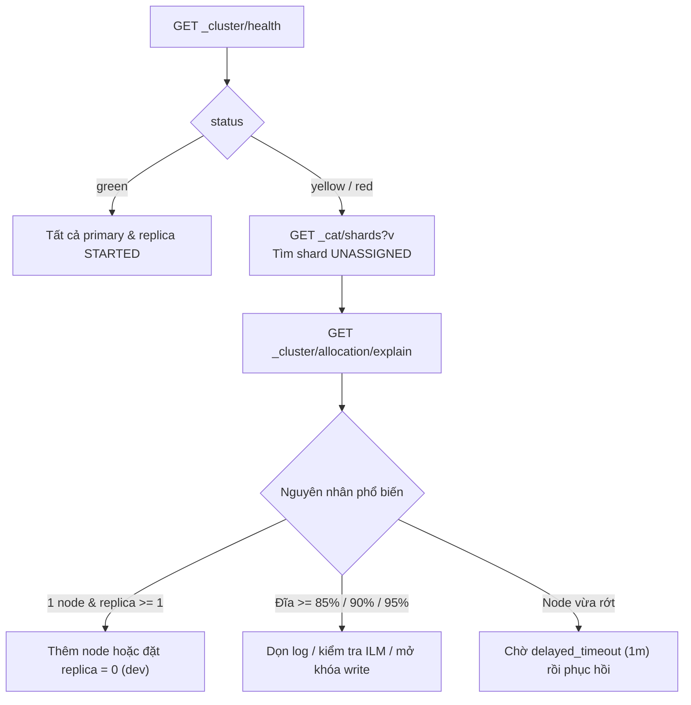
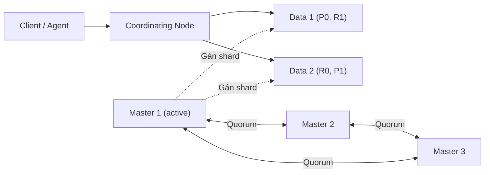

# 8_2_1 Elasticsearch Cluster Operations

> **Khóa học**: Cloud DevOps Basic — Data Platform
> **Phân nhóm**: 8 Domain 8 - Elasticsearch › 8_2 Elasticsearch Cluster Operations
> **Chủ đề**: 8_2_1 Elasticsearch Cluster Operations
> **Trạng thái**: Bản nháp (chưa kiểm chứng verifier)
> **Checklist đối chiếu**: [8_2 README](./README.md) · [Lộ trình Data Platform](../../README.md)

---

## 1. Khái Niệm Cốt Lõi & Bản Chất Kỹ Thuật (Core Concepts & Technical Deep Dive)

Vận hành một cụm máy chủ tìm kiếm phân tán đòi hỏi hiểu cách các máy chủ phối hợp lưu trữ dữ liệu, phát hiện lỗi và tự cân bằng lại hệ thống khi có sự cố phần cứng hay đầy ổ đĩa. Nếu bài [8_1 Elasticsearch Core Concepts](<../8_1 Elasticsearch Core Concepts/README.md>) giải thích cấu trúc bên trong một **index** với bản gốc và bản sao, thì bài này tập trung vào góc nhìn của kỹ sư vận hành. Bạn sẽ học cách đọc tình trạng cụm, tìm nguyên nhân mảnh dữ liệu bị treo, quản lý vòng đời log tự động, tối ưu bộ nhớ và sao lưu nâng cấp an toàn.

### 1.1 Kiến Trúc Cluster và Vai Trò Node (Node Roles)

Một cluster gồm một hoặc nhiều **node** chia sẻ `cluster.name` và đảm nhận các vai trò cấu hình qua `node.roles` trong `elasticsearch.yml` (Elasticsearch 8.x): <!-- ev: C2.1 -->

- **Master-eligible node (`master`)**: Có quyền bầu chọn **active master** (node trưởng) để quản lý **cluster state** (danh sách node, thiết lập index, bản đồ vị trí shard). <!-- ev: C2.1 -->
- **Data node (`data`)**: Lưu trữ shard trên đĩa và xử lý các tác vụ CRUD, tìm kiếm và tổng hợp dữ liệu. <!-- ev: C2.2 -->
- **Ingest node (`ingest`)**: Chạy **ingest pipeline** để biến đổi, chuẩn hóa document trước khi đánh chỉ mục. <!-- ev: C2.3 -->
- **Coordinating role**: Mặc định mọi node đều làm nhiệm vụ điều phối (nhận request HTTP, chuyển tới data node và gom kết quả); cấu hình `node.roles: []` để tạo **coordinating-only node** chuyên biệt. <!-- ev: C2.4 -->

Để tránh **split-brain** (hai nhóm node tách mạng cùng tự nhận là master), cụm cần đạt **quorum** (quá bán `floor(N / 2) + 1` số node có quyền bầu chọn) mới được bầu active master và sửa cluster state. <!-- ev: C2.5 --> Vì vậy, nên chọn số master-eligible node là **số lẻ** (thường là 3): cụm 3 node chịu được 1 node lỗi (quorum = 2), còn cụm 4 node cũng chỉ chịu được 1 node lỗi (quorum = 3) mà không tăng độ an toàn. <!-- ev: C2.6 -->

Trên production, cần tách riêng **dedicated master node** (chỉ role `master`) khỏi **data node** để tác vụ tìm kiếm nặng hay dừng GC trên data node không làm gián đoạn quá trình điều phối của active master. <!-- ev: C2.7 -->

### 1.2 Cluster Health: Green, Yellow và Red

Endpoint `GET _cluster/health` báo trạng thái cụm (bằng trạng thái tệ nhất trong các index) và hỗ trợ `?level=indices` để xem chi tiết từng index. <!-- ev: C2.8 -->

Ba màu sức khỏe có ý nghĩa chuẩn như sau: <!-- ev: C2.9 -->

| Trạng thái | Ý nghĩa ở cấp Index & Cluster | Tác động thực tế |
| :--- | :--- | :--- |
| **`green`** | Mọi **primary shard** và **replica shard** đều đã gán (`STARTED`). | Dữ liệu đầy đủ, có bản sao dự phòng khi 1 node lỗi. |
| **`yellow`** | Mọi **primary shard** đã gán, nhưng còn ít nhất 1 **replica shard** chưa gán. | Đọc/ghi vẫn đủ dữ liệu, nhưng mất dự phòng ở shard thiếu replica. |
| **`red`** | Có ít nhất 1 **primary shard** chưa gán (`UNASSIGNED`). | Một phần dữ liệu không thể truy cập; kết quả tìm kiếm bị thiếu. |

Hai chỉ số cần đọc kèm là `unassigned_shards` (tổng số shard chưa được gán) và `active_shards_percent` (tỷ lệ phần trăm shard đang hoạt động trên tổng shard cấu hình). <!-- ev: C2.10 -->

**Vì sao cluster 1 node hay bị `yellow`?** Mặc định khi tạo index mới, Elasticsearch đặt `index.number_of_replicas` là `1` và cấm đặt replica trên cùng node giữ primary của nó. <!-- ev: C2.11 --> Do chỉ có 1 node, replica không có chỗ chứa nên nằm ở trạng thái `UNASSIGNED`, làm cụm mang màu `yellow`.

### 1.3 Shard Allocation, Disk Watermark và Phục Hồi Shard

Nhóm API `_cat` xuất thông tin dạng bảng (thêm `?v` để hiện tên cột): <!-- ev: C2.12 -->
- `_cat/nodes?v`: Liệt kê các node, tài nguyên và vai trò trong cụm. <!-- ev: C2.12 -->
- `_cat/indices?v`: Liệt kê từng index kèm màu sức khỏe, số shard và dung lượng. <!-- ev: C2.12 -->
- `_cat/shards?v`: Hiển thị vị trí shard và trạng thái: `STARTED` (đang chạy), `INITIALIZING` (đang tạo/phục hồi), `RELOCATING` (đang chuyển node) và `UNASSIGNED` (chưa gán). <!-- ev: C2.12 -->

Khi có shard `UNASSIGNED`, gọi `GET _cluster/allocation/explain` để xem lý do chi tiết từng node bị từ chối nhận shard. <!-- ev: C2.13 -->

Nguyên nhân phổ biến khiến shard không thể gán là chạm ngưỡng **disk watermark** (mặc định trong Elasticsearch 8.x): <!-- ev: C2.14 -->
1. **Low (`85%` đĩa đã dùng)**: Ngừng gán shard mới vào node này. <!-- ev: C2.14 -->
2. **High (`90%` đĩa đã dùng)**: Chủ động chuyển bớt shard sang node khác trống hơn. <!-- ev: C2.14 -->
3. **Flood stage (`95%` đĩa đã dùng)**: Khóa `index.blocks.read_only_allow_delete: true` lên các index liên quan để chặn ghi mới, tránh tràn đĩa. <!-- ev: C2.14 -->

Khi một node data rời cụm (như khởi động lại), Elasticsearch chờ hết `index.unassigned.node_left.delayed_timeout` (mặc định `1m`) trước khi sao chép lại replica sang node khác, giúp tiết kiệm mạng và I/O nếu node cũ quay lại sớm. <!-- ev: C2.15 -->

### 1.4 Vòng Đời Dữ Liệu Log và ILM (Index Lifecycle Management)

Log tăng liên tục nên không dùng một index khổng lồ (xóa từng document rất tốn I/O); thay vào đó Elasticsearch dùng **data stream** hoặc các index theo thời gian để khi hết hạn chỉ cần xóa nguyên backing index. <!-- ev: C2.16 -->

**ILM** tự động hóa vòng đời qua các pha sau: <!-- ev: C2.17 -->
- **`hot`**: Đang ghi và truy vấn nhiều; dùng **`rollover`** tạo index mới khi đạt ngưỡng kích thước, số document hoặc tuổi. <!-- ev: C2.17 -->
- **`warm`**: Ngừng ghi mới, ít truy vấn; có thể đặt read-only, thu gọn shard (`shrink`) hoặc gộp segment (`force merge`). <!-- ev: C2.17 -->
- **`cold`**: Hiếm khi truy vấn, lưu chỉ đọc hoặc gắn kết qua searchable snapshot. <!-- ev: C2.17 -->
- **`frozen`** *(tùy chọn)*: Lưu trên object storage và truy vấn trực tiếp qua searchable snapshot. <!-- ev: C2.17 -->
- **`delete`**: Xóa hẳn index khi hết hạn lưu giữ (**retention**), tương đồng mục tiêu kiểm soát đĩa với `retention` của Kafka. <!-- ev: C2.17 -->

### 1.5 Tài Nguyên: JVM Heap, OS Page Cache, `mmap` và Bootstrap Checks

- **JVM Heap và Page Cache**: Đặt `-Xms` bằng `-Xmx` tối đa **50% RAM vật lý** và dưới ngưỡng **compressed OOPs** (~32 GB, thường giữ 26–30 GB), nhường phần RAM còn lại cho **OS page cache** của Lucene để đọc/đệm tệp chỉ mục nhanh. <!-- ev: C2.18 -->
- **`mmap` và `vm.max_map_count`**: Lucene dùng `mmap` ánh xạ tệp chỉ mục nên Linux cần `vm.max_map_count` tối thiểu **`262144`**. <!-- ev: C2.19 -->
- **Swap và Bootstrap Checks**: Cần tắt swap (hoặc bật `bootstrap.memory_lock: true`) để tránh chậm GC; ở chế độ production (bind IP ngoài loopback), **bootstrap checks** kiểm tra `vm.max_map_count`, heap, file descriptor, memory lock và chặn khởi động nếu không đạt. <!-- ev: C2.20 -->

### 1.6 Backup Bằng Snapshot và Nâng Cấp Tuần Tự (Rolling Upgrade)

- **Snapshot**: Sao lưu nhất quán theo thời điểm và tăng dần (incremental) qua Snapshot API tới kho ngoài (S3, GCS, Azure Blob, shared FS); copy trực tiếp thư mục `data/` khi node đang chạy sẽ gây hỏng bản sao do segment Lucene và translog liên tục thay đổi. <!-- ev: C2.21 -->
- **Rolling upgrade**: Nâng cấp từng node một để giữ cụm chạy liên tục: đặt `"cluster.routing.allocation.enable": "primaries"`, dừng và nâng cấp 1 node, khởi động lại, đặt lại allocation về `"all"` và đợi cụm về `green` rồi mới làm node tiếp theo. <!-- ev: C2.22 -->

---

## 2. Ví Dụ Đời Sống Thực Tế Dễ Hiểu (Intuitive Real-World Analogies)

Hãy tưởng tượng hệ thống này giống **một chuỗi kho lưu trữ hồ sơ đa chi nhánh** được điều hành bởi **ban giám đốc 3 người**.

1. **Quorum & Số lẻ**: Với 3 giám đốc, chỉ cần 2 người đồng ý (đa số) là ra được quyết định. Nếu thuê 4 người thì phải có 3 người đồng ý mới đạt đa số — nghĩa là hễ vắng 2 người là đình trệ y như đội 3 người, tốn thêm chi phí mà không thêm an toàn.
2. **Đèn tín hiệu sức khỏe (`green`, `yellow`, `red`)**:
   - **Xanh**: Đủ hồ sơ gốc và bản sao dự phòng nằm ở các chi nhánh khác nhau.
   - **Vàng**: Đủ hồ sơ gốc, nhưng thiếu bản sao dự phòng (ví dụ chỉ mở đúng 1 chi nhánh nên không có nơi gửi bản sao).
   - **Đỏ**: Có hồ sơ gốc bị thất lạc hoặc chi nhánh giữ nó đóng cửa mà chưa có bản thay thế.
3. **Bảng điều độ và Thanh tra**: Bảng theo dõi cho biết ngăn tủ nào đang mở cửa phục vụ, ngăn nào đang dọn dẹp hoặc còn bỏ trống ngoài hành lang; còn vị thanh tra sẽ chỉ rõ từng chi nhánh từ chối nhận thùng hồ sơ vì lý do gì (chẳng hạn sàn kho đã chật quá 85%).
4. **Bàn làm việc vs Kệ lấy nhanh**: Bàn làm việc càng rộng thì sắp giấy tờ càng dễ, nhưng bàn quá lớn lại mất rất nhiều thời gian dọn dẹp; chia nửa căn phòng cho bàn làm việc và nửa kia cho kệ lấy nhanh của tòa nhà sẽ giúp kho vận hành mượt nhất.

---

## 3. Kiến Trúc, Luồng Hoạt Động & Hình Ảnh Trực Quan (Architecture, Diagrams & Visual Media)

Sơ đồ dưới đây minh họa luồng chẩn đoán khi đèn sức khỏe cụm báo vàng hoặc đỏ, cùng kiến trúc phân tách vai trò node:





---

## 4. Thực Hành API/curl (Hands-on Elasticsearch REST API)

> **Lưu ý môi trường**: Lệnh áp dụng cho **Elasticsearch 8.x** (mặc định bật TLS và xác thực; nếu lab cục bộ tắt bảo mật, bỏ `-k -u elastic:<password>` và đổi sang `http://`).

Ví dụ xuyên suốt dưới đây thao tác trên một cụm 1 node để tái hiện và xử lý sự cố với index thử nghiệm.

### Bước 1: Tạo index mặc định và kiểm tra health

<!-- ev: C2.8 C2.11 -->
```bash
curl -k -u elastic:<password> -X PUT "https://localhost:9200/logs-app"
curl -k -u elastic:<password> -s "https://localhost:9200/_cluster/health?pretty"
```

Đầu ra cho thấy cụm ở trạng thái `yellow` với `unassigned_shards: 1` và `active_shards_percent_as_number: 50.0`: <!-- ev: C2.9 C2.10 -->
```json
{
  "cluster_name" : "docker-cluster",
  "status" : "yellow",
  "number_of_nodes" : 1,
  "active_primary_shards" : 1,
  "active_shards" : 1,
  "unassigned_shards" : 1,
  "active_shards_percent_as_number" : 50.0
}
```

### Bước 2: Dùng `_cat` API xác định shard bị kẹt

<!-- ev: C2.12 -->
```bash
curl -k -u elastic:<password> "https://localhost:9200/_cat/nodes?v"
curl -k -u elastic:<password> "https://localhost:9200/_cat/indices?v"
curl -k -u elastic:<password> "https://localhost:9200/_cat/shards/logs-app?v"
```

Kết quả bảng shard cho thấy bản gốc đã chạy còn bản sao chưa được gán: <!-- ev: C2.12 -->
```text
index    shard prirep state      docs store ip         node
logs-app 0     p      STARTED       0  225b 172.17.0.2 es-node-1
logs-app 0     r      UNASSIGNED
```

### Bước 3: Chẩn đoán bằng `_cluster/allocation/explain` và khắc phục

<!-- ev: C2.13 -->
```bash
curl -k -u elastic:<password> -s -X GET "https://localhost:9200/_cluster/allocation/explain?pretty" \
  -H "Content-Type: application/json" -d '{"index":"logs-app","shard":0,"primary":false}'
```

Đầu ra trả về quyết định từ chối `same_shard` vì node duy nhất đã giữ bản gốc: <!-- ev: C2.11 C2.13 -->
```json
{
  "index" : "logs-app",
  "shard" : 0,
  "primary" : false,
  "current_state" : "unassigned",
  "can_allocate" : "no",
  "node_allocation_decisions" : [
    {
      "node_name" : "es-node-1",
      "deciders" : [{ "decider" : "same_shard", "decision" : "NO" }]
    }
  ]
}
```

Trên môi trường dev 1 node, hạ `number_of_replicas` về `0` để cụm về `green` (production cần thêm data node): <!-- ev: C2.11 -->
```bash
curl -k -u elastic:<password> -X PUT "https://localhost:9200/logs-app/_settings" \
  -H "Content-Type: application/json" -d '{"index":{"number_of_replicas":0}}'
```

### Bước 4: Mẫu chính sách ILM (Hot → Warm → Delete)

*(Nâng cao: có thể bỏ qua bước JSON này ở lần đọc đầu)*

<!-- ev: C2.17 -->
```bash
curl -k -u elastic:<password> -X PUT "https://localhost:9200/_ilm/policy/logs-app-policy" \
  -H "Content-Type: application/json" -d '{
  "policy": {
    "phases": {
      "hot": { "actions": { "rollover": { "max_primary_shard_size": "30gb", "max_age": "1d" } } },
      "warm": { "min_age": "7d", "actions": { "forcemerge": { "max_num_segments": 1 } } },
      "delete": { "min_age": "30d", "actions": { "delete": {} } }
    }
  }
}'
```

---

## 5. Cạm Bẫy Thực Tế & Thực Tiễn Sản Xuất (Production Gotchas & Best Practices)

1. **Cấp JVM Heap vượt 32 GB**: Vượt ngưỡng compressed OOPs (~32 GB) làm mất không gian **OS page cache** cho Lucene và khiến thời gian GC pause tăng vọt. <!-- ev: C2.18 -->
2. **Quên trạng thái khóa khi chạm Flood Stage (`95%`)**: Khi ổ đĩa chạm `95%`, index bị gắn `read_only_allow_delete: true`; cần giải phóng dung lượng và kiểm tra quyền ghi đã mở lại trước khi tiếp tục đẩy log. <!-- ev: C2.14 -->
3. **Chạy số lượng master-eligible node chẵn (2 hoặc 4)**: Cụm 2 node sẽ mất quorum ngay khi 1 node rớt mạng; luôn dùng tối thiểu 3 master-eligible node cho production. <!-- ev: C2.5 C2.6 -->
4. **Backup bằng copy thư mục `data/`**: Sao chép file trực tiếp khi node đang chạy sẽ tạo bản sao hỏng; luôn dùng **Snapshot API**. <!-- ev: C2.21 -->
5. **Nâng cấp không tắt allocation**: Không đặt `cluster.routing.allocation.enable: primaries` khi rolling upgrade dễ khiến master kích hoạt sao chép dữ liệu không cần thiết sau `delayed_timeout`. <!-- ev: C2.15 C2.22 -->

---

## 6. Câu Hỏi Củng Cố Kiến Thức (Active Recall Quiz)

**Câu 1**: Cụm có 4 master-eligible node và 2 node bị sập cùng lúc. Cụm có bầu được active master mới không? Vì sao?

<details>
<summary>Đáp án</summary>

**Không.** Quorum của 4 node là `floor(4 / 2) + 1 = 3`; còn lại 2 node không đủ phiếu nên không thể bầu active master hay cập nhật cluster state. <!-- ev: C2.5 C2.6 -->

</details>

**Câu 2**: `_cluster/health` báo `yellow`. Dùng hai lệnh nào để xác định shard kẹt và biết nguyên nhân từ chối?

<details>
<summary>Đáp án</summary>

1. `GET _cat/shards?v` để tìm shard `UNASSIGNED`. <!-- ev: C2.12 -->
2. `GET _cluster/allocation/explain` để xem lý do từng node từ chối (ví dụ `same_shard` hoặc vượt ngưỡng disk watermark `85%`). <!-- ev: C2.13 C2.14 -->

</details>

**Câu 3**: Khi chạy Elasticsearch 8.x trên Linux ở chế độ production, tiến trình thoát sớm với lỗi `vm.max_map_count`. Cơ chế nào đã chặn và cần đặt giá trị tối thiểu bao nhiêu?

<details>
<summary>Đáp án</summary>

Cơ chế **bootstrap checks** đã chặn khởi động; cần đặt `vm.max_map_count` tối thiểu **`262144`** để đáp ứng `mmap` của Lucene. <!-- ev: C2.19 C2.20 -->

</details>

---

## 7. 📚 Nguồn Tài Liệu Chính Thống (Official References)

- [Elasticsearch Reference - Node roles](https://www.elastic.co/guide/en/elasticsearch/reference/current/modules-node.html) - Vai trò `master`, `data`, `ingest` và `node.roles`.
- [Elasticsearch Reference - Cluster health API](https://www.elastic.co/guide/en/elasticsearch/reference/current/cluster-health.html) - Định nghĩa `green`, `yellow`, `red`, `unassigned_shards`.
- [Elasticsearch Reference - cat APIs](https://www.elastic.co/guide/en/elasticsearch/reference/current/cat.html) - Sử dụng `_cat/shards`, `_cat/nodes`, `_cat/indices`.
- [Elasticsearch Reference - Cluster allocation explain API](https://www.elastic.co/guide/en/elasticsearch/reference/current/cluster-allocation-explain.html) - Chẩn đoán shard `UNASSIGNED`.
- [Elasticsearch Reference - Disk-based shard allocation](https://www.elastic.co/guide/en/elasticsearch/reference/current/modules-cluster.html#disk-based-shard-allocation) - Ngưỡng disk watermark (`85%`, `90%`, `95%`).
- [Elasticsearch Reference - Index lifecycle management (ILM)](https://www.elastic.co/guide/en/elasticsearch/reference/current/index-lifecycle-management.html) - Các pha `hot`, `warm`, `cold`, `frozen`, `delete` và `rollover`.
- [Elasticsearch Reference - Data streams](https://www.elastic.co/guide/en/elasticsearch/reference/current/data-streams.html) - Lưu trữ dữ liệu log theo chuỗi thời gian.
- [Elasticsearch Reference - Advanced configuration (Heap size)](https://www.elastic.co/guide/en/elasticsearch/reference/current/advanced-configuration.html) - Cấu hình JVM heap và OS page cache.
- [Elasticsearch Reference - Important system configuration](https://www.elastic.co/guide/en/elasticsearch/reference/current/system-config.html) - `vm.max_map_count`, swap, `bootstrap.memory_lock` và bootstrap checks.
- [Elasticsearch Reference - Snapshot and restore](https://www.elastic.co/guide/en/elasticsearch/reference/current/snapshot-restore.html) - Backup bằng Snapshot API.
- [Elasticsearch Reference - Rolling upgrades](https://www.elastic.co/guide/en/elasticsearch/reference/current/rolling-upgrades.html) - Quy trình nâng cấp từng node.
