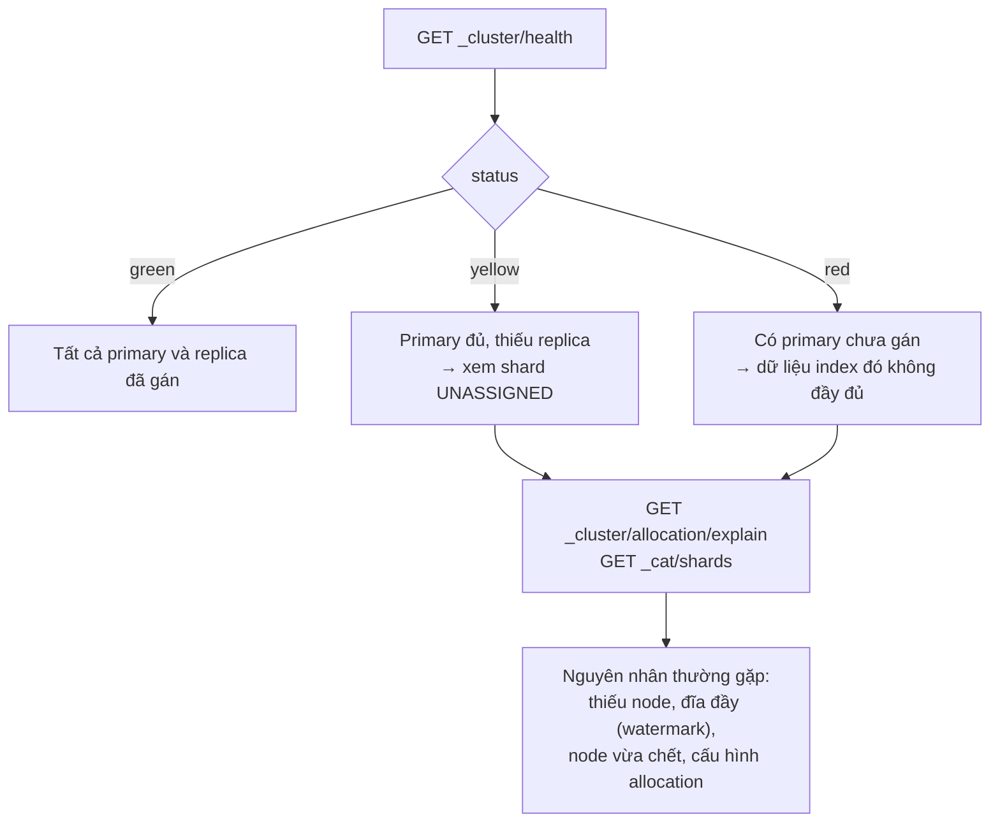

# 8_2 Elasticsearch Cluster Operations

> **Khóa học**: Cloud DevOps Basic — Data Platform
> **Phân nhóm**: 8 Domain 8 - Elasticsearch › 8_2 Elasticsearch Cluster Operations
> **Chủ đề**: Node role, cluster health green/yellow/red, shard allocation, `_cat` API, ILM và retention, heap và đĩa
> **Trạng thái**: Định nghĩa (nội dung cần học + đề bài lab), chưa chạy thử, 16-11-2026
> **Lộ trình tổng**: [data-platform/README.md](../../README.md) · **Tiên quyết**: [8_1 Elasticsearch Core Concepts](<../8_1 Elasticsearch Core Concepts/README.md>)

---

## 🎯 Mục Tiêu

Trả lời được câu phỏng vấn: **"Cluster Elasticsearch đang `yellow`, nghĩa là gì và làm gì?"** và biết quy trình đi từ triệu chứng tới nguyên nhân chỉ bằng API.

**Ví dụ đời thường**: cluster health giống **đèn tín hiệu của một kho hàng có hai bản sao hồ sơ**. Xanh: mọi hồ sơ gốc và bản sao đều có chỗ. Vàng: hồ sơ gốc đủ nhưng thiếu bản sao dự phòng. Đỏ: có hồ sơ gốc **không tìm thấy** (dữ liệu của shard đó đang không truy cập được).

---

## 📚 Những Gì Cần Học

### 8_2_1 Kiến Trúc Cluster Và Vai Trò Node
- [ ] Cluster = nhiều **node**; vai trò node: master-eligible, data, ingest, coordinating... (*danh sách role và tên cần đối chiếu theo phiên bản*).
- [ ] **Master node** quản lý trạng thái cluster (metadata, vị trí shard); quorum master-eligible và vì sao nên dùng số node lẻ (khái niệm, cần đối chiếu cơ chế bầu master ở bản bạn dùng).
- [ ] Phân biệt node chuyên master với node data trong cluster production (khái niệm).

### 8_2_2 Cluster Health
- [ ] **green / yellow / red** và ý nghĩa chính xác theo tài liệu `cluster health`.
- [ ] Health ở cấp cluster và cấp index; `unassigned_shards`, `active_shards_percent`.
- [ ] Vì sao cluster 1 node dễ ở trạng thái yellow (liên hệ 8_1_4).

### 8_2_3 Shard Allocation Và Chẩn Đoán
- [ ] `_cat/shards`, `_cat/nodes`, `_cat/indices`: đọc trạng thái `STARTED`, `INITIALIZING`, `RELOCATING`, `UNASSIGNED`.
- [ ] **`_cluster/allocation/explain`**: công cụ chính để biết vì sao shard không được gán.
- [ ] **Disk watermark**: khi đĩa node đầy tới ngưỡng, Elasticsearch ngừng gán/ chuyển shard tới node đó và có thể chặn ghi vào index (*tên ngưỡng và giá trị mặc định cần đối chiếu tài liệu*).
- [ ] Node rời cluster rồi quay lại: shard recovery, thời gian chờ trước khi gán lại (*cần đối chiếu*).

### 8_2_4 Vòng Đời Dữ Liệu: Index Lifecycle Và Retention
- [ ] Log tăng liên tục: dùng index theo thời gian (hoặc data stream) thay vì một index khổng lồ.
- [ ] **ILM** (index lifecycle management): các pha (hot/warm/cold/delete), rollover, xóa theo tuổi (*tên pha và hành động cần đối chiếu tài liệu bản bạn dùng*).
- [ ] Liên hệ retention của Kafka (7_1_5): cả hai đều cần chính sách giữ dữ liệu để không đầy đĩa.

### 8_2_5 Tài Nguyên: Heap, Đĩa, Bộ Nhớ Hệ Điều Hành
- [ ] **JVM heap** và vì sao không nên đặt quá lớn so với RAM (phần RAM còn lại cho page cache của Lucene; *khuyến nghị cụ thể cần đối chiếu tài liệu*).
- [ ] Elasticsearch dùng `mmap`: cần `vm.max_map_count` đủ lớn; **bootstrap checks** có thể chặn khởi động ở chế độ production (liên hệ [os 1_7_5](<../../../os/1 Domain 1 - Operating System Core Fundamentals/1_7 Memory Management and Virtual Memory/1_7_5 Virtual Memory and Demand Paging.md>)).
- [ ] Tắt swap hoặc khóa bộ nhớ (khái niệm; *cần đối chiếu mục "important system configuration"*).

### 8_2_6 Backup Và Nâng Cấp (Khái Niệm)
- [ ] **Snapshot** tới kho lưu trữ ngoài; vì sao sao chép thư mục dữ liệu không phải là backup đúng cách.
- [ ] Nâng cấp tuần tự (rolling upgrade): từng node một, giữ cluster khả dụng; *quy trình và đường nâng cấp giữa các phiên bản cần đối chiếu tài liệu upgrade của đúng bản*.

---

## 🧪 Labs

> **Bản định nghĩa**: chưa tạo thư mục `labs/`, chưa chạy thử. Lab 8_2_2 cần cluster 3 node (container).

| Lab | Nội dung | Thời gian | Trạng thái |
| :--- | :--- | :---: | :--- |
| lab-8_2_1-yellow-cluster-diagnosis | Tạo cluster yellow có chủ đích, chẩn đoán bằng API, sửa | 45 phút | Định nghĩa |
| lab-8_2_2-node-failure | Cluster 3 node, dừng 1 node, quan sát health và shard recovery | 60–90 phút | Định nghĩa |

### lab-8_2_1-yellow-cluster-diagnosis
- **Các bước chính**:
  1. Cluster 1 node, tạo index với 1 replica → `_cluster/health` ra yellow.
  2. `_cat/shards` thấy replica `UNASSIGNED`; `_cluster/allocation/explain` đọc lý do.
  3. Sửa theo 2 cách: đặt `number_of_replicas` về 0 hoặc thêm node.
  4. Xác nhận health về green.
- **Checkpoint**:
  - [ ] Dùng đúng 2 lệnh để chứng minh nguyên nhân yellow.
  - [ ] Nêu được khi nào yellow là bình thường (dev 1 node) và khi nào là cảnh báo (production).

### lab-8_2_2-node-failure
- **Các bước chính**:
  1. Cluster 3 node, index có 3 primary + 1 replica, health green.
  2. Dừng 1 node data → quan sát health (yellow hoặc red tùy shard) và shard `UNASSIGNED`.
  3. Bật lại node, theo dõi recovery tới green.
  4. (Tùy chọn) Dừng 2 node để tạo tình huống red và đọc `allocation/explain`.
- **Checkpoint**:
  - [ ] Dự đoán trước được health sau mỗi thao tác và giải thích khi kết quả khác dự đoán.

---

## 📚 Nguồn Tài Liệu Chính Thống (Official References)
- [Elasticsearch Reference - Cluster health API](https://www.elastic.co/guide/en/elasticsearch/reference/current/cluster-health.html) - Định nghĩa green/yellow/red.
- [Elasticsearch Reference - Cluster allocation explain API](https://www.elastic.co/guide/en/elasticsearch/reference/current/cluster-allocation-explain.html) - Giải thích vì sao shard không được gán.
- [Elasticsearch Reference - cat APIs](https://www.elastic.co/guide/en/elasticsearch/reference/current/cat.html) - `_cat/shards`, `_cat/nodes`, `_cat/indices`.
- [Elasticsearch Reference - Index lifecycle management](https://www.elastic.co/guide/en/elasticsearch/reference/current/index-lifecycle-management.html) - ILM, rollover, retention.
- [Elasticsearch Reference - Important system configuration](https://www.elastic.co/guide/en/elasticsearch/reference/current/system-config.html) - `vm.max_map_count`, swap, file descriptors, bootstrap checks.
- [Elasticsearch Reference - Snapshot and restore](https://www.elastic.co/guide/en/elasticsearch/reference/current/snapshot-restore.html) - Backup bằng snapshot.
