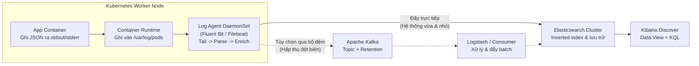

# 8_3_1 Log Pipeline and Centralized Logging

> **Khóa học**: Cloud DevOps Basic — Data Platform
> **Phân nhóm**: 8 Domain 8 - Elasticsearch › [8_3 Log Pipeline and Centralized Logging](./README.md)
> **Chủ đề**: Log container/Kubernetes, log JSON có cấu trúc, Agent thu log, back-pressure, Kafka làm bộ đệm, Kibana và so sánh Loki vs Elasticsearch
> **Trạng thái**: Bản nháp (chưa kiểm chứng verifier)
> **Checklist đối chiếu**: Không có (`CHECKLIST.md` chưa được tạo cho khóa học này; xem lộ trình tại [Data Platform README](../../README.md))

---

## 1. Khái Niệm Cốt Lõi & Bản Chất Kỹ Thuật (Core Concepts & Technical Deep Dive)

Khi vận hành hàng trăm container trên Kubernetes, Pod có thể khởi động lại, chuyển node hoặc bị xóa bất cứ lúc nào, khiến việc đăng nhập từng máy đọc file log trở nên bất khả thi. Hệ thống cần một **log pipeline** chuẩn hóa: ứng dụng xuất log, agent thu gom trên từng node, đẩy về kho tập trung và truy vấn qua giao diện thống nhất.

### 1.1 Log Trong Container và Kubernetes

Trên Kubernetes, ứng dụng được khuyến nghị ghi toàn bộ nhật ký ra hai luồng chuẩn của hệ điều hành là `stdout` (luồng đầu ra chuẩn) và `stderr` (luồng lỗi chuẩn) thay vì tự quản lý file log bên trong container. <!-- ev: C3.1 -->

Container runtime trên node (như `containerd` hoặc `CRI-O`) tự động chuyển hướng `stdout`/`stderr` thành các tệp log trên ổ đĩa của node tại `/var/log/pods` (liên kết tại `/var/log/containers`). <!-- ev: C3.2 -->

Khi chạy `kubectl logs <pod-name>`, Kubernetes API server chuyển yêu cầu tới **kubelet** để đọc trực tiếp từ tệp log do container runtime lưu trên node đó. <!-- ev: C3.3 -->

Tuy nhiên, kubelet và container runtime thực hiện xoay vòng (log rotation) và xóa bỏ tệp log cũ khi container bị xóa, Pod bị thu hồi (evict) hoặc bị thay thế. <!-- ev: C3.4 --> Vì vậy, hệ thống sản xuất cần thu thập và đẩy log về kho tập trung ngay khi log vừa sinh ra.

Để đọc tệp log cục bộ trên mọi node, agent thu log thường chạy dạng **DaemonSet** — workload của Kubernetes bảo đảm chạy đúng một Pod agent trên mỗi node. <!-- ev: C3.5 --> Pod agent gắn thư mục log của node ở chế độ chỉ đọc để gom log cho toàn bộ container trên node đó.

### 1.2 Log JSON Có Cấu Trúc (Structured Logging)

Thay vì xuất chuỗi văn bản tự do khó tách trường, **log có cấu trúc (structured logging)** định dạng mỗi sự kiện thành một đối tượng JSON với các khóa cố định như `@timestamp`, `level`, `service`, `trace_id` và `message`. <!-- ev: C3.6 --> Nhờ đó, pipeline lọc và thống kê chính xác theo từng trường mà không cần regex phức tạp.

Trong Elasticsearch, tên khóa JSON mặc định được ánh xạ thành các field trong mapping của index; nếu ứng dụng sinh ra quá nhiều tên khóa động (như dùng ID ngẫu nhiên làm tên khóa), số lượng trường sẽ tăng mất kiểm soát gây **mapping explosion**, làm tốn bộ nhớ và gây áp lực lên cluster state. <!-- ev: C3.7 -->

Với **log đa dòng (multiline log)** như Java stack trace (dòng đầu báo lỗi, các dòng sau thụt lề `at ...`), agent cần cấu hình bộ lọc **multiline** để gộp các dòng nối tiếp thành một log event duy nhất trước khi gửi đi. <!-- ev: C3.8 -->

### 1.3 Agent Thu Log, Pipeline Xử Lý và Back-pressure

Các công cụ thu thập và xử lý log phổ biến gồm:
- **Fluent Bit**: bộ thu thập và chuyển tiếp viết bằng C, tiêu thụ ít RAM/CPU, rất phù hợp làm DaemonSet trên Kubernetes. <!-- ev: C3.9 -->
- **Filebeat / Elastic Agent**: agent thuộc hệ sinh thái Elastic, theo dõi tệp log trên host và gửi tới Elasticsearch, Logstash hoặc Kafka. <!-- ev: C3.10 -->
- **Fluentd** và **Logstash**: mạnh về plugin và biến đổi dữ liệu phức tạp; riêng Logstash chạy trên JVM nên tốn nhiều tài nguyên hơn, thường làm bộ xử lý tập trung. <!-- ev: C3.10 -->

Một pipeline thu log Kubernetes tiêu chuẩn gồm 4 bước: <!-- ev: C3.11 -->
1. **Input**: theo dõi tệp log mới sinh và ghi nhớ vị trí dòng đã đọc. <!-- ev: C3.11 -->
2. **Parser**: tách vỏ CRI của runtime, gộp log đa dòng và giải mã chuỗi JSON. <!-- ev: C3.11 -->
3. **Filter / Enrich**: dùng Kubernetes filter gắn thêm `namespace`, `pod_name`, `labels` vào từng bản ghi. <!-- ev: C3.11 -->
4. **Output**: nén theo lô (batch) và gửi tới Elasticsearch hoặc bộ đệm Kafka. <!-- ev: C3.11 -->

Khi đích nhận (Elasticsearch) xử lý chậm hoặc gián đoạn, hiện tượng **back-pressure (áp lực ngược)** xảy ra: bộ đệm RAM/đĩa của agent đầy dần, buộc agent phải hãm tốc độ đọc tệp nguồn (và có thể mất log nếu log gốc trên node bị xoay vòng trước khi kịp đọc). <!-- ev: C3.12 -->

### 1.4 Kafka Làm Bộ Đệm Trung Gian (Tùy Chọn Cho Hệ Thống Lớn)

*Thành phần tùy chọn này đặc biệt hữu ích khi lưu lượng log biến động mạnh.* Đặt **Apache Kafka** giữa agent và tầng ghi Elasticsearch giúp tách rời producer với consumer, hấp thụ đột biến lưu lượng và giữ log theo thời gian retention để đọc lại (replay) khi Elasticsearch bảo trì hoặc quá tải. <!-- ev: C3.13 --> Đánh đổi là đội ngũ phải vận hành, giám sát thêm cụm Kafka (topic, partition, consumer lag).

### 1.5 Kibana và Quy Trình Chẩn Đoán Sự Cố

Trên **Kibana**, người dùng khai báo **Data View** (trước đây gọi là *Index Pattern*) để chỉ định mẫu tên các index hoặc data stream cần truy vấn cùng trường thời gian chuẩn. <!-- ev: C3.14 -->

Tại màn hình **Discover**, bạn chọn khung thời gian (Time Picker) và nhập truy vấn **KQL (Kibana Query Language)** để lọc theo từng trường như `service`, `level` hoặc `trace_id`. <!-- ev: C3.15 --> *(Tên menu Kibana có thể thay đổi nhẹ giữa các bản Elastic Stack 8.x).*

Quy trình chẩn đoán sự cố thường gồm 4 bước:
1. Nhận cảnh báo tăng lỗi bất thường và mở Kibana Discover theo đúng khung thời gian sự cố.
2. Lọc các bản ghi lỗi để lấy ra mã `trace_id` đại diện của request thất bại. <!-- ev: C3.15 -->
3. Xóa bộ lọc mức lỗi và tìm theo `trace_id` đó để xem toàn bộ chuỗi log đi qua các service liên quan. <!-- ev: C3.15 -->
4. Khoanh vùng service phát sinh lỗi đầu tiên và xác định nguyên nhân gốc.

### 1.6 So Sánh Mô Hình Index: Grafana Loki vs Elasticsearch

Điểm khác biệt nền tảng giữa hai hệ thống nằm ở chiến lược lập chỉ mục:
- **Grafana Loki**: chỉ lập chỉ mục cho tập **nhãn (labels)** gắn với luồng log (như `namespace`, `pod`, `app`); phần nội dung log được nén và lưu thành các khối (chunks). <!-- ev: C3.16 -->
- **Elasticsearch**: lập chỉ mục toàn bộ nội dung văn bản và các trường JSON (dùng **inverted index** cho trường text và doc values cho lọc, thống kê). <!-- ev: C3.17 -->

<!-- ev: C3.18 -->
| Tiêu chí | Grafana Loki | Elasticsearch |
| :--- | :--- | :--- |
| **Đối tượng index** | Chỉ lập chỉ mục nhãn (labels). | Lập chỉ mục nội dung văn bản và các trường JSON. |
| **Chi phí tài nguyên** | Index nhỏ, ít tốn RAM/đĩa khi lưu lượng lớn. | Tốn nhiều RAM, CPU, đĩa hơn cho phân tích và lưu index. |
| **Tìm full-text** | Quét và giải nén các chunk khớp nhãn (chậm hơn nếu khoảng thời gian rộng). | Tìm full-text và aggregation trên mọi trường rất nhanh. |
| **Rủi ro cấu hình** | Nhãn có quá nhiều giá trị độc nhất (như `trace_id`) làm phình stream. | Quá nhiều tên khóa JSON động gây *mapping explosion*. |

Chọn Loki khi ưu tiên chi phí lưu trữ thấp và truy vấn theo ngữ cảnh dịch vụ trong khung thời gian ngắn; chọn Elasticsearch khi cần tìm kiếm full-text nhanh và thống kê linh hoạt trên nhiều trường. <!-- ev: C3.18 -->

---

## 2. Ví Dụ Đời Sống Thực Tế Dễ Hiểu (Intuitive Real-World Analogies)

Hãy ví hệ thống log trên cụm máy chủ như **hệ thống thư tín nội bộ của một tập đoàn**:

- **Ghi log ra luồng chuẩn**: Mỗi phòng ban không tự tích trữ giấy tờ trong phòng vì phòng có thể giải thể bất cứ lúc nào; nhân viên chỉ thả thư vào khe gửi thư ngoài hành lang.
- **Thư JSON có cấu trúc**: Thay vì viết tay tự do, mọi người dùng **mẫu phong bì in sẵn ô cố định** (Thời gian, Phòng ban, Mức độ, Mã hồ sơ) để máy phân loại đọc ngay lập tức.
- **Agent chạy dạng DaemonSet**: Mỗi tòa nhà bố trí đúng một nhân viên bưu điện gom thư từ mọi phòng trong tòa nhà đó, đóng dấu tên tòa nhà rồi chuyển về trung tâm.
- **Back-pressure và bộ đệm Kafka**: Ngày cao điểm, kho trung tâm quá tải khiến nhân viên bưu điện bị ứ đọng túi thư trên tay. Đặt thêm **trạm trung chuyển có kho tạm (Kafka)** giúp nhân viên giao nhanh rồi quay lại gom tiếp mà không lo mất thư.
- **Elasticsearch vs Loki**: Elasticsearch là **thư viện lập mục lục từng từ khóa** — tìm câu chữ bất kỳ cực nhanh nhưng sổ mục lục rất dày và tốn tủ; Loki là **tủ hồ sơ chỉ dán nhãn ngoài bìa** — nhẹ nhàng, ít tốn chỗ, nhưng muốn tìm một từ bên trong phải mở từng tập hồ sơ khớp nhãn ra đọc lướt.

---

## 3. Kiến Trúc, Luồng Hoạt Động & Hình Ảnh Trực Quan (Architecture, Diagrams & Visual Media)

Sơ đồ dưới đây mô tả đường đi của log từ container trên Kubernetes node qua agent, tùy chọn bộ đệm Kafka, tới Elasticsearch và giao diện Kibana:



Khi lưu lượng ổn định, agent đẩy trực tiếp theo lô về Elasticsearch; khi lưu lượng biến động lớn hoặc cần khả năng phát lại dữ liệu, Kafka đóng vai trò tầng đệm trung gian bền vững.

---

## 4. Thực Hành Cấu Hình & Truy Vấn Mẫu (Sample Configuration & Queries)

Ví dụ dưới đây minh họa luồng log của dịch vụ giả định `order-svc` khi gặp lỗi trên yêu cầu `/order?id=7`.

### Bước 1: Input — Ứng Dụng In Log JSON Ra `stdout`

Ứng dụng xuất một dòng JSON cố định khóa gồm `@timestamp`, `level`, `service`, `trace_id` và `message`: <!-- ev: C3.19 -->

<!-- ev: C3.19 -->
```json
{"@timestamp":"2026-11-22T10:15:30.120Z","level":"error","service":"order-svc","trace_id":"tr-9f82a1","http_path":"/order?id=7","status":500,"message":"Database timeout when querying order 7"}
```

### Bước 2: Transform — Cấu Hình Pipeline Của Fluent Bit

Cấu hình Fluent Bit dưới đây gồm đọc tệp log container (`tail`), lọc làm giàu metadata Kubernetes (`kubernetes`) và giải mã JSON (`Merge_Log On`), rồi gửi tới dịch vụ Elasticsearch nội bộ (`es`): <!-- ev: C3.20 -->

<!-- ev: C3.20 -->
```ini
[SERVICE]
    Flush         5
    Log_Level     info
    Parsers_File  parsers.conf

[INPUT]
    Name              tail
    Tag               kube.*
    Path              /var/log/containers/*.log
    Parser            cri
    Mem_Buf_Limit     50MB
    Skip_Long_Lines   On

[FILTER]
    Name                kubernetes
    Match               kube.*
    Merge_Log           On
    Keep_Log            Off

[OUTPUT]
    Name            es
    Match           kube.*
    Host            elasticsearch.logging.svc.cluster.local
    Port            9200
    Logstash_Format On
    Logstash_Prefix k8s-logs
```

*(Lưu ý: tham số `Mem_Buf_Limit` giới hạn RAM đệm đầu vào khi gặp back-pressure; nếu cụm Elasticsearch bật TLS/xác thực ở bản 8.x, cần cấu hình thêm thông số TLS và tài khoản theo tài liệu chính thức).* <!-- ev: C3.20 -->

### Bước 3: Output & Query — Truy Vấn Trên Kibana (KQL) vs Grafana Loki (LogQL)

Trên Kibana Discover (sau khi tạo Data View `k8s-logs-*`), kỹ sư lọc lỗi của dịch vụ rồi lần theo mã truy vết bằng KQL: <!-- ev: C3.21 -->

<!-- ev: C3.21 -->
```text
# 1. Tìm log lỗi của dịch vụ order-svc
service: "order-svc" and level: "error"

# 2. Lần theo toàn bộ chuỗi log của request qua mọi service
trace_id: "tr-9f82a1"
```

Nếu dùng Grafana Loki, truy vấn LogQL chọn bộ nhãn dịch vụ trước rồi mới dùng toán tử lọc dòng (`|=`) để tìm chuỗi bên trong nội dung các chunk tương ứng: <!-- ev: C3.22 -->

<!-- ev: C3.22 -->
```logql
{namespace="prod", app="order-svc"} |= "tr-9f82a1"
```

---

## 5. Cạm Bẫy Thực Tế & Thực Tiễn Sản Xuất (Production Gotchas & Best Practices)

1. **Đặt giá trị động sai vị trí**:
   - Với **Elasticsearch**, không biến giá trị động (`user_id`, `request_id`) thành **tên khóa JSON** vì sẽ gây *mapping explosion*; hãy đặt chúng làm giá trị của một khóa cố định. <!-- ev: C3.7 -->
   - Với **Loki**, không đưa giá trị có độ phân tán cao (`trace_id`, `user_id`) làm **label** vì sẽ tạo quá nhiều stream làm quá tải bộ nhớ và index. <!-- ev: C3.18 -->
2. **Quên giới hạn bộ đệm agent khi xảy ra back-pressure**:
   - Nếu Elasticsearch chậm kéo dài mà agent không đặt giới hạn bộ đệm RAM (như `Mem_Buf_Limit`), Pod agent có thể ngốn hết bộ nhớ và bị tắt (`OOMKilled`). <!-- ev: C3.12 -->
   - Hệ thống lưu lượng cao nên cân nhắc thêm Kafka làm tầng đệm và theo dõi chỉ số consumer lag. <!-- ev: C3.13 -->
3. **Thiếu cấu hình multiline cho stack trace**:
   - Lỗi Java/Python in nhiều dòng sẽ bị tách thành nhiều sự kiện rời rạc nếu thiếu quy tắc gộp dòng tại agent, làm mất thông tin nguyên nhân lỗi khi lọc. <!-- ev: C3.8 -->
4. **Nguyên tắc quyền tối thiểu cho Agent**:
   - Chỉ gắn thư mục log trên node ở chế độ chỉ đọc (read-only) cho Pod DaemonSet và chỉ cấp quyền đọc metadata Pod/Namespace qua Kubernetes RBAC. <!-- ev: C3.5 -->

---

## 6. Câu Hỏi Củng Cố Kiến Thức (Active Recall Quiz)

**Câu 1**: Một Pod bị xóa và tạo lại trên node khác. Vì sao `kubectl logs` không còn xem được log cũ, và kiến trúc nào giải quyết vấn đề này?

<details>
<summary>Đáp án</summary>

`kubectl logs` đọc tệp log cục bộ trên node của Pod thông qua kubelet (`C3.3`). Khi Pod bị xóa hoặc chuyển node, tệp log cũ trên node sẽ bị xoay vòng và dọn dẹp (`C3.4`). Giải pháp là chạy agent thu log dạng `DaemonSet` trên mỗi node (`C3.5`) để thu thập và đẩy liên tục về kho lưu trữ tập trung như Elasticsearch.

</details>

**Câu 2**: Ứng dụng xuất log JSON dạng `{"tx_99182": "success"}` (tên khóa chứa mã giao dịch). Điều gì xảy ra với Elasticsearch và cách sửa?

<details>
<summary>Đáp án</summary>

Tên khóa sinh liên tục làm Elasticsearch phải cập nhật mapping liên tục, gây hiện tượng **mapping explosion** tốn bộ nhớ và ảnh hưởng cluster state (`C3.7`). Cần chuẩn hóa thành khóa cố định như `{"tx_id": "tx_99182", "status": "success"}` (`C3.6`).

</details>

**Câu 3**: Vì sao Elasticsearch thường tốn nhiều RAM và dung lượng index hơn Grafana Loki cho cùng lượng log thô, nhưng lại tìm kiếm full-text nhanh hơn?

<details>
<summary>Đáp án</summary>

Loki chỉ lập chỉ mục cho tập nhãn (labels) và nén nội dung log thành chunk (`C3.16`), nên rất gọn nhẹ nhưng phải quét nội dung chunk khi lọc chuỗi văn bản. Ngược lại, Elasticsearch lập chỉ mục nội dung văn bản và từng trường JSON bằng inverted index (`C3.17`), tốn nhiều tài nguyên hơn nhưng tìm full-text và chạy aggregation trên mọi trường nhanh hơn (`C3.18`).

</details>

---

## 7. 📚 Nguồn Tài Liệu Chính Thống (Tier-1 Official References)

- [Kubernetes - Logging Architecture](https://kubernetes.io/docs/concepts/cluster-administration/logging/) - Kiến trúc log trên Kubernetes: `stdout`/`stderr`, node-level agent (DaemonSet) và log rotation.
- [Elasticsearch Reference - Mapping](https://www.elastic.co/guide/en/elasticsearch/reference/current/mapping.html) - Mapping trường trong document và cảnh báo về mapping explosion.
- [Elasticsearch Reference - Text analysis & Inverted index](https://www.elastic.co/guide/en/elasticsearch/reference/current/analysis.html) - Cơ chế phân tích văn bản và lập chỉ mục full-text.
- [Kibana User Guide - Discover & Data Views](https://www.elastic.co/guide/en/kibana/current/discover.html) - Dùng Data View, Time Picker và KQL trong Kibana.
- [Fluent Bit Official Manual - Buffering & Storage](https://docs.fluentbit.io/manual/administration/buffering-and-storage) - Bộ đệm bộ nhớ/đĩa và xử lý back-pressure.
- [Fluent Bit Official Manual - Kubernetes Filter](https://docs.fluentbit.io/manual/pipeline/filters/kubernetes) - Làm giàu log với metadata Pod/namespace.
- [Grafana Loki Documentation - Labels](https://grafana.com/docs/loki/latest/get-started/labels/) - Mô hình chỉ lập chỉ mục nhãn (labels) của Loki.
