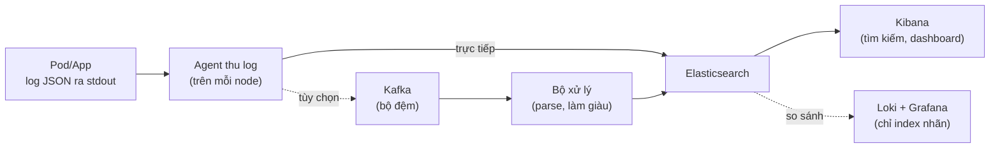

# 8_3 Log Pipeline and Centralized Logging

> **Khóa học**: Cloud DevOps Basic — Data Platform
> **Phân nhóm**: 8 Domain 8 - Elasticsearch › 8_3 Log Pipeline and Centralized Logging
> **Chủ đề**: Agent thu log → Elasticsearch → Kibana, log JSON có cấu trúc, so sánh với Loki/Grafana, vai trò Kafka làm bộ đệm
> **Trạng thái**: Định nghĩa (nội dung cần học + đề bài lab), chưa chạy thử, 16-11-2026
> **Lộ trình tổng**: [data-platform/README.md](../../README.md)
> **Tiên quyết**: [8_2](<../8_2 Elasticsearch Cluster Operations/README.md>); nên đọc [6_8 Observability](<../../../container/6 Domain 6 - Containers and Kubernetes/6_8 Kubernetes Observability and Troubleshooting/README.md>)

---

## 🎯 Mục Tiêu

Hiểu cách log từ hàng trăm Pod đi tới một nơi tìm kiếm được, và **tại sao log phải có cấu trúc**. Topic này cũng là cầu nối từ kinh nghiệm **Loki + Grafana** của bạn sang **Elasticsearch + Kibana**.

**Ví dụ đời thường**: **hệ thống thư tín công ty**. Mỗi phòng (Pod) bỏ thư (log) vào hòm thư. Nhân viên bưu điện (agent) gom thư đi qua bộ phận phân loại (parse/enrich), rồi cất vào kho lưu trữ có mục lục (Elasticsearch). Kibana là quầy tra cứu cho người dùng.

---

## 📚 Những Gì Cần Học

### 8_3_1 Log Trong Container Và Kubernetes
- [ ] Ứng dụng ghi ra **stdout/stderr**; runtime lưu thành file trên node; `kubectl logs` đọc từ đó (nối 6_8).
- [ ] Vì sao agent thường chạy dạng **DaemonSet** (một Pod mỗi node; nối 6_3_8).
- [ ] Log mất khi Pod bị xóa nếu chỉ dựa vào node; đó là lý do cần log tập trung.

### 8_3_2 Log Có Cấu Trúc
- [ ] Log **JSON** thay cho chuỗi tự do: field cố định (`@timestamp`, `level`, `service`, `trace_id`...).
- [ ] Ứng dụng mẫu `hello-svc` đã ghi log JSON (xem [container/README.md](../../../container/README.md)); dùng nó làm nguồn log cho lab.
- [ ] Liên hệ mapping ở 8_1_3: field nhất quán giúp tránh mapping explosion.
- [ ] Log đa dòng (stack trace Java) và cách gom thành một event (khái niệm).

### 8_3_3 Agent Thu Log Và Bộ Xử Lý
- [ ] Các lựa chọn phổ biến: Elastic Agent/Beats (Filebeat), Fluent Bit, Fluentd, Logstash (*mỗi công cụ có vai trò và mức tài nguyên khác nhau, cần đối chiếu tài liệu chính thức khi chọn*).
- [ ] Các bước xử lý: thu → parse → làm giàu (metadata Pod/namespace) → gửi.
- [ ] Back-pressure và hàng đợi: điều gì xảy ra khi Elasticsearch chậm hoặc tạm ngừng.

### 8_3_4 Kafka Làm Bộ Đệm (Khái Niệm)
- [ ] Vì sao nhiều nền tảng đặt Kafka giữa agent và Elasticsearch: hấp thụ đột biến, tách người gửi và người nhận, có thể phát lại.
- [ ] Đánh đổi: thêm một hệ thống phải vận hành; liên hệ 7_1 và 7_2.

### 8_3_5 Kibana Và Truy Vấn Log
- [ ] Khái niệm data view/index pattern và khung thời gian; tìm kiếm theo field; lọc theo `level`/`service`.
- [ ] Quy trình chẩn đoán: từ cảnh báo → tìm log theo `trace_id`/thời điểm → khoanh vùng service.
- [ ] *Tên menu và tính năng của Kibana thay đổi theo phiên bản; cần đối chiếu tài liệu Kibana của bản bạn dùng.*

### 8_3_6 So Sánh Loki Và Elasticsearch
- [ ] Mô hình index: Loki chủ yếu lập chỉ mục nhãn, Elasticsearch lập chỉ mục nội dung.
- [ ] Đánh đổi: chi phí lưu trữ/tài nguyên, tốc độ tìm full-text, độ phức tạp vận hành (*cần đối chiếu tài liệu chính thức của cả hai trước khi kết luận cụ thể*).
- [ ] Cách kể kinh nghiệm Loki + Grafana của bạn khi được hỏi về Elasticsearch ([CLOUD_ENGINEER_INTERVIEW_PREP.md](../../../CLOUD_ENGINEER_INTERVIEW_PREP.md)).

---

## 🧪 Labs

> **Bản định nghĩa**: chưa tạo thư mục `labs/`, chưa chạy thử. Chọn **một** agent (ví dụ Fluent Bit hoặc Filebeat) và làm theo hướng dẫn chính thức của nó.

| Lab | Nội dung | Thời gian | Trạng thái |
| :--- | :--- | :---: | :--- |
| lab-8_3_1-json-logs-to-elasticsearch | Log JSON của `hello-svc` → agent → Elasticsearch, tìm lỗi `/order?id=7` | 90 phút | Định nghĩa |

### lab-8_3_1-json-logs-to-elasticsearch
- **Các bước chính**:
  1. Chạy Elasticsearch 1 node (kết quả 8_1) và `hello-svc` (từ Domain 6).
  2. Cấu hình agent đọc log container và gửi vào index theo ngày (hoặc data stream).
  3. Gọi `/order?id=7` nhiều lần để sinh lỗi 500 (theo hành vi mô tả trong [container/README.md](../../../container/README.md)).
  4. Truy vấn Elasticsearch để đếm log lỗi theo phút bằng aggregation.
  5. (Tùy chọn) Dựng cùng pipeline với Loki và so sánh trải nghiệm truy vấn.
- **Checkpoint**:
  - [ ] Từ một lỗi, tìm ra toàn bộ log liên quan bằng truy vấn trong < 3 phút.
  - [ ] Giải thích được chọn Elasticsearch hay Loki cho một yêu cầu cụ thể và vì sao.

---

## 📚 Nguồn Tài Liệu Chính Thống (Official References)
- [Kubernetes - Logging Architecture](https://kubernetes.io/docs/concepts/cluster-administration/logging/) - Cách log container được lưu và thu thập trên node.
- [Elasticsearch Reference - Index lifecycle management](https://www.elastic.co/guide/en/elasticsearch/reference/current/index-lifecycle-management.html) - Retention cho index log.
- [Elasticsearch Reference - Data streams](https://www.elastic.co/guide/en/elasticsearch/reference/current/data-streams.html) - Lưu dữ liệu theo thời gian append-only.
- [Fluent Bit Documentation](https://docs.fluentbit.io/manual) - Tài liệu chính thức Fluent Bit.
- [Grafana Loki Documentation](https://grafana.com/docs/loki/latest/) - Tài liệu chính thức Loki, dùng để đối chiếu mô hình index.
