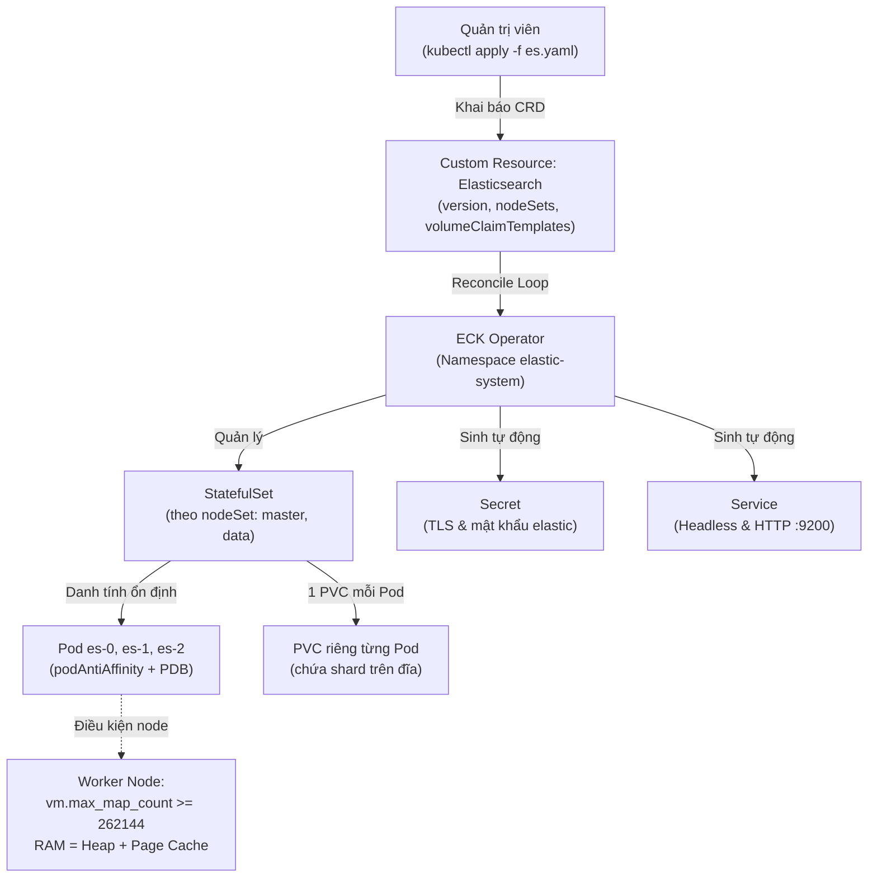
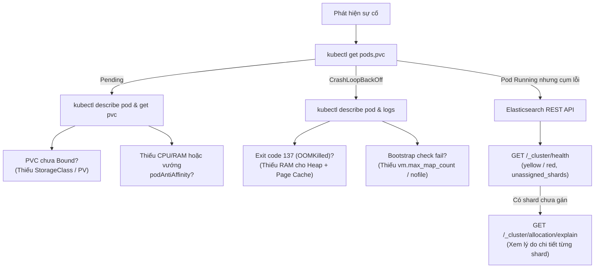

# 8_4_1 Elasticsearch on Kubernetes

> **Khóa học**: Cloud DevOps Basic — Data Platform
> **Phân nhóm**: 8 Domain 8 - Elasticsearch › 8_4 Elasticsearch on Kubernetes
> **Chủ đề**: Vì sao Elasticsearch cần StatefulSet, điều kiện kernel `vm.max_map_count` & init container, ECK Operator, chẩn đoán trên Kubernetes và lựa chọn cách triển khai
> **Trạng thái**: Bản nháp (chưa kiểm chứng verifier)
> **Lộ trình tổng**: [data-platform/README.md](../../README.md) · [Chủ đề 8_4](./README.md)
> **Tiên quyết**: [8_2 Elasticsearch Cluster Operations](<../8_2 Elasticsearch Cluster Operations/README.md>) · [Kubernetes StatefulSet & PVC](<../../../container/6 Domain 6 - Containers and Kubernetes/6_4 Kubernetes Networking Configuration and Storage/README.md>) · [CRD & Operator](<../../../container/6 Domain 6 - Containers and Kubernetes/6_7 Kubernetes Security Scheduling and Scaling/README.md>)

---

## 1. Khái Niệm Cốt Lõi & Bản Chất Kỹ Thuật (Core Concepts & Technical Deep Dive)

Chạy một ứng dụng web không lưu trạng thái trên Kubernetes rất đơn giản: bất kỳ Pod nào gặp sự cố đều có thể bị xóa và thay bằng một Pod mới với tên ngẫu nhiên. Ngược lại, hệ thống tìm kiếm phân tán này lưu các mảnh dữ liệu (shard) trên ổ đĩa cục bộ của từng node và các node phải phối hợp bầu chọn node điều phối chính (master). Vì vậy, việc đưa nó lên Kubernetes đòi hỏi cơ chế giữ nguyên danh tính và ổ đĩa qua mỗi lần khởi động lại, cấu hình nhân hệ điều hành phù hợp, tính toán bộ nhớ cẩn thận và thường dùng một Operator để tự động hóa vận hành.

### 1.1 Vì Sao Elasticsearch Bắt Buộc Dùng StatefulSet Thay Vì Deployment

- **Danh tính mạng ổn định và PVC gắn cố định**: Khác với `Deployment` tạo Pod tên ngẫu nhiên dùng một lần, `StatefulSet` gán cho mỗi Pod một tên cố định theo chỉ số thứ tự (như `es-0`, `es-1`, `es-2`) kèm bản ghi DNS riêng thông qua **Headless Service** (Service không có ClusterIP riêng, trả thẳng IP của từng Pod). <!-- ev: C4.1 --> Nhờ `volumeClaimTemplates` trong `StatefulSet`, mỗi Pod giữ vai trò `data` tự động sở hữu một `PersistentVolumeClaim` (PVC — yêu cầu cấp phát ổ đĩa bền vững) riêng chứa các shard trên đĩa, nên khi Pod bị xóa hoặc lập lịch lại sang node khác, Pod mới vẫn gắn đúng PVC cũ và giữ nguyên dữ liệu. <!-- ev: C4.2 -->
- **Quorum của master-eligible node và cập nhật tuần tự**: Một cụm đa node dùng các node `master-eligible` (đủ điều kiện bầu master) để duy trì **quorum** (số phiếu tối thiểu quá bán) nhằm bầu một master duy nhất và tránh "split-brain" (hai nửa cụm tự bầu hai master riêng gây xung đột dữ liệu). <!-- ev: C4.3 --> Vì tắt đồng thời nhiều node dễ làm mất quorum hoặc mất bản sao shard, `StatefulSet` mặc định dùng chiến lược `RollingUpdate` cập nhật tuần tự ngược từ chỉ số cao nhất về `0`, chờ Pod hiện tại đạt `Ready` rồi mới sang Pod kế tiếp. <!-- ev: C4.4 -->
- **Anti-affinity và PodDisruptionBudget (PDB)**: Quy tắc `podAntiAffinity` dùng khóa `topologyKey: kubernetes.io/hostname` yêu cầu scheduler đặt các Pod cùng cụm lên các worker node vật lý khác nhau để tránh một máy chủ hỏng làm sập nhiều node cùng lúc. <!-- ev: C4.5 --> Đồng thời, `PodDisruptionBudget` (PDB) dùng `maxUnavailable` hoặc `minAvailable` để chặn lệnh `kubectl drain` trục xuất quá nhiều Pod cùng lúc khi bảo trì node. <!-- ev: C4.6 -->

### 1.2 Điều Kiện Hệ Điều Hành Của Node & Bộ Nhớ Pod

- **Tham số kernel `vm.max_map_count` và `nofile`**: Công cụ Lucene bên dưới dùng lệnh gọi `mmap` ánh xạ tệp chỉ mục vào bộ nhớ ảo, nên Elastic yêu cầu tham số nhân Linux `vm.max_map_count` tối thiểu là `262144` trên môi trường production. <!-- ev: C4.7 --> Vì đây là tham số cấp kernel của worker node (không tự chỉnh trong container thường), người vận hành phải cấu hình sẵn trên node hoặc dùng một `initContainer` đặc quyền (`privileged: true`) chạy `sysctl -w vm.max_map_count=262144` trước khi container chính khởi chạy. <!-- ev: C4.8 --> Ngoài ra, Lucene mở rất nhiều tệp segment đồng thời nên yêu cầu giới hạn file descriptor (`nofile`) đạt tối thiểu `65535`. <!-- ev: C4.10 -->
- **Bài toán bộ nhớ Pod (`JVM Heap + OS Page Cache`)**: Tổng `resources.limits.memory` của Pod phải đủ chứa **JVM Heap** (thường chỉ nên đặt tối đa khoảng 50% RAM khả dụng), bộ nhớ **off-heap** của JVM và **OS page cache** của nhân Linux cho `mmap`; nếu vượt trần cgroup này, Linux kernel sẽ chấm dứt container với trạng thái `OOMKilled` và mã thoát **exit code `137`**. <!-- ev: C4.11 -->

### 1.3 ECK Operator (Elastic Cloud on Kubernetes)

Giải pháp tự viết bộ YAML thủ công gặp nhiều khó khăn ở vận hành ngày thứ 2, nên Elastic cung cấp bộ điều khiển chính thức chạy ngay trên cụm theo mô hình tự động hóa:

- **Custom Resource Definition (CRD)**: ECK mở rộng Kubernetes API với các CRD như `Elasticsearch` (`elasticsearch.k8s.elastic.co/v1`) và `Kibana` (`kibana.k8s.elastic.co/v1`), cho phép khai báo cả một cụm chỉ trong một tệp YAML gọn nhẹ. <!-- ev: C4.12 -->
- **Tự động sinh tài nguyên**: Từ đối tượng `Elasticsearch`, ECK Operator liên tục đối chiếu trạng thái và tự tạo `StatefulSet`, `Pod`, `PVC`, `Service` (headless và HTTP) cùng `Secret` chứa chứng chỉ TLS và mật khẩu tài khoản mặc định `elastic`. <!-- ev: C4.13 -->
- **Phân tách vai trò qua `spec.nodeSets`**: Trường `nodeSets` trong CRD `Elasticsearch` cho phép tách nhiều nhóm Pod với cấu hình tài nguyên, lưu trữ và vai trò (`node.roles` như `master`, `data`, `ingest`) riêng biệt trong cùng một cluster. <!-- ev: C4.14 -->
- **Nâng cấp luân phiên an toàn**: Khi cập nhật `spec.version` hoặc cấu hình node, ECK tự động điều phối quá trình rolling upgrade tuần tự từng Pod và kiểm tra sức khỏe cluster giữa các bước để tránh gián đoạn hay mất shard. <!-- ev: C4.15 -->

### 1.4 Chẩn Đoán Sự Cố Trên Kubernetes

Quy trình điều tra lỗi cần phối hợp theo dõi từ lớp hạ tầng điều phối xuống đến lớp giao diện quản trị bên trong cụm tìm kiếm:

- **Pod kẹt `Pending`**: Thường do node thiếu CPU/RAM theo `requests`, vướng `podAntiAffinity` không đủ node trống, hoặc `PVC` chưa đạt `Bound` (thiếu `StorageClass`/dung lượng); kiểm tra bằng `kubectl describe pod <tên-pod>` và `kubectl get pvc`. <!-- ev: C4.16 -->
- **Pod lặp `CrashLoopBackOff`**: Hai nguyên nhân hay gặp nhất là `OOMKilled` (exit code `137` do thiếu bộ nhớ) hoặc lỗi **bootstrap checks** khi chạy nhiều node (`vm.max_map_count` dưới `262144` hoặc `nofile` dưới `65535`), phát hiện qua `kubectl describe pod` và `kubectl logs`. <!-- ev: C4.17 -->
- **Kết hợp `kubectl` với Elasticsearch API**: Khi Pod đã `Running` nhưng cụm bất thường, cần kết hợp `kubectl` (`get pods`, `describe`, `logs`, `get events`) với `GET /_cluster/health` (kiểm tra màu `green`/`yellow`/`red`, số `unassigned_shards`) và `GET /_cluster/allocation/explain` (xem lý do cụ thể khiến shard chưa được phân bổ). <!-- ev: C4.18 -->

### 1.5 So Sánh Các Cách Triển Khai

| Tiêu chí | Tự viết `StatefulSet` | Helm chart cộng đồng | ECK Operator | Dịch vụ quản lý ngoài cluster |
| :--- | :--- | :--- | :--- | :--- |
| **Triển khai Day-1** | Thấp: tự viết toàn bộ YAML | Trung bình–Cao: có sẵn template | Cao: khai báo gọn bằng CRD | Rất cao: tạo qua giao diện/API |
| **Vận hành Day-2** | Thủ công toàn bộ (TLS, thứ tự nâng cấp) | Hạn chế: thiếu đối chiếu trạng thái liên tục | Tự động hóa liên tục (TLS, `nodeSets`, rolling upgrade) | Nhà cung cấp lo nâng cấp, vá lỗi, sao lưu |
| **Quản trị hạ tầng K8s** | Tự lo kernel node, `StorageClass`, đĩa | Tự lo kernel node, `StorageClass`, đĩa | Tự lo kernel node, `StorageClass`, đĩa | Không phải vận hành Pod/PVC |
| **Phù hợp khi nào** | Học tập cơ chế nền tảng | Quen Helm, cụm đơn giản | Chạy ngay trên K8s với độ tin cậy cao | Đội ngũ nhỏ, giảm rủi ro vận hành stateful |

<!-- ev: C4.20 C4.21 -->

> **Nâng cao (có thể bỏ qua ở lần đọc đầu)**: Chọn dịch vụ quản lý ngoài cluster giúp loại bỏ gánh nặng vận hành hệ thống lưu trạng thái và cấu hình kernel node, nhưng đánh đổi bằng chi phí dịch vụ cao hơn, ít tùy biến hạ tầng và lưu lượng phải đi qua ranh giới mạng giữa Kubernetes với dịch vụ ngoài. <!-- ev: C4.21 -->

---

## 2. Ví Dụ Đời Sống Thực Tế Dễ Hiểu (Intuitive Real-World Analogies)

Hãy hình dung việc chạy hệ thống tìm kiếm này giống như **mở chuỗi chi nhánh ngân hàng theo mẫu chuẩn**:

- **Danh tính cố định & Két sắt riêng**: Khác với quầy bán vé dùng chung kho trung tâm, mỗi quầy ngân hàng giữ một **két sắt hồ sơ riêng** và mang số cố định (Quầy 0, Quầy 1, Quầy 2). Khi người mới vào thay đúng Quầy 1, họ mở lại đúng chiếc két sắt cũ thay vì nhận két trống.
- **Đồng thuận, Phân tán & Bảo trì tuần tự**: Chi nhánh chỉ mở cửa khi quá nửa quản lý đồng thuận. Các quầy đặt ở nhiều tầng để tránh mất điện cục bộ làm sập toàn bộ, và khi bảo trì chỉ đóng từng quầy một rồi chờ mở lại ổn định mới sang quầy kế tiếp.
- **Nền móng tòa nhà & Diện tích làm việc**: Nền móng phải đủ chịu lực trước khi đặt két nặng; nếu quy định tòa nhà cấm mang máy khoan vào trước giờ mở cửa, chủ nhà phải gia cố sẵn từ lúc xây. Mỗi quầy cũng cần chia diện tích hợp lý giữa bàn làm việc và giá tra cứu nhanh; chất chật quá mức thuê sẽ bị bảo vệ mời ra ngoài.
- **Ban quản lý chuyên nghiệp**: Thay vì tự thuê thợ và canh sửa từng quầy, bạn giao cho một tổng công ty quản lý. Bạn chỉ gửi yêu cầu số quầy và cỡ két, họ tự dựng quầy, đúc chìa khóa, mở lối đi và tự nâng cấp từng quầy an toàn.

---

## 3. Kiến Trúc, Luồng Hoạt Động & Hình Ảnh Trực Quan (Architecture & Mermaid Diagrams)

### 3.1 Cách ECK Operator Tạo & Vận Hành Cluster

Sơ đồ dưới đây mô tả luồng điều phối khi quản trị viên tạo một tài nguyên tùy chỉnh trong Kubernetes:



### 3.2 Luồng Chẩn Đoán Sự Cố Hai Tầng

Quy trình điều tra đi từ trạng thái tài nguyên điều phối xuống nguyên nhân ở nhân hệ điều hành hoặc trạng thái phân bổ dữ liệu:



---

## 4. Thực Hành YAML & Lệnh `kubectl` Mẫu (Sample Manifests & CLI)

Bài thực hành chạy xuyên suốt trên một cụm thử nghiệm cục bộ tối giản đã cài sẵn ECK Operator (cần đối chiếu phiên bản tương thích trên trang chủ Elastic trước khi áp dụng thật).

### 4.1 Manifest CRD `Elasticsearch`

Tệp cấu hình bên dưới định nghĩa cụm 1 node gồm vai trò và dung lượng ổ đĩa bền vững riêng: <!-- ev: C4.12 C4.14 -->

```yaml
# quickstart-es.yaml
apiVersion: elasticsearch.k8s.elastic.co/v1
kind: Elasticsearch
metadata:
  name: quickstart
spec:
  version: 8.15.0 # Đối chiếu phiên bản tương thích với bản ECK đã cài
  nodeSets:
    - name: default
      count: 1 # Môi trường thật nên tách riêng nodeSet master (count: 3) và data
      config:
        node.roles: ["master", "data", "ingest"]
      podTemplate:
        spec:
          containers:
            - name: elasticsearch
              resources:
                requests:
                  memory: 2Gi
                  cpu: 500m
                limits:
                  memory: 2Gi # Chia sẻ cho JVM Heap (~1Gi) + OS Page Cache
      volumeClaimTemplates:
        - metadata:
            name: elasticsearch-data
          spec:
            accessModes:
              - ReadWriteOnce
            resources:
              requests:
                storage: 10Gi
```

### 4.2 Áp Dụng Manifest, Kiểm Tra Tài Nguyên & Lấy Mật Khẩu

Thực hiện theo mô hình **Input → Command → Output** để quan sát các đối tượng được Operator tự tạo: <!-- ev: C4.13 -->

```bash
# Input: tệp quickstart-es.yaml
kubectl apply -f quickstart-es.yaml

# Kiểm tra các tài nguyên Operator tự sinh ra cho cụm quickstart
kubectl get elasticsearch,statefulset,pod,pvc,service -l elasticsearch.k8s.elastic.co/cluster-name=quickstart
```

Kết quả đầu ra mẫu khi cụm khởi tạo thành công:

```text
NAME                                                    HEALTH   NODES   VERSION   PHASE   AGE
elasticsearch.elasticsearch.k8s.elastic.co/quickstart   green    1       8.15.0    Ready   2m

NAME                                     READY   AGE
statefulset.apps/quickstart-es-default   1/1     2m

NAME                          READY   STATUS    RESTARTS   AGE
pod/quickstart-es-default-0   1/1     Running   0          2m

NAME                                                         STATUS   VOLUME         CAPACITY   ACCESS MODES
persistentvolumeclaim/elasticsearch-data-quickstart-es-default-0   Bound    pvc-a1b2c3d4   10Gi       RWO

NAME                            TYPE        CLUSTER-IP    PORT(S)
service/quickstart-es-default   ClusterIP   None          9200/TCP
service/quickstart-es-http      ClusterIP   10.96.45.12   9200/TCP
```

Lệnh dưới đây giải mã mật khẩu người dùng `elastic` từ đối tượng Secret do ECK tự sinh có định dạng tên `<tên-cluster>-es-elastic-user` tại khóa `elastic`: <!-- ev: C4.22 -->

```bash
PASSWORD=$(kubectl get secret quickstart-es-elastic-user -o go-template='{{.data.elastic | base64decode}}')
```

### 4.3 Chẩn Đoán Kết Hợp `kubectl` Và REST API

Khi cần kiểm tra sức khỏe cụm từ máy cá nhân, bạn mở chuyển tiếp cổng tới Service HTTP (bật HTTPS mặc định) và gọi API sức khỏe cùng API giải thích phân bổ shard: <!-- ev: C4.18 C4.23 -->

```bash
kubectl port-forward service/quickstart-es-http 9200:9200 &
curl -k -u "elastic:${PASSWORD}" "https://localhost:9200/_cluster/health?pretty"
curl -k -u "elastic:${PASSWORD}" "https://localhost:9200/_cluster/allocation/explain?pretty"
```

Kết quả trả về khi cụm khỏe mạnh:

```json
{
  "cluster_name" : "quickstart",
  "status" : "green",
  "number_of_nodes" : 1,
  "active_primary_shards" : 2,
  "active_shards" : 2,
  "unassigned_shards" : 0
}
```

Nếu Pod gặp sự cố khởi chạy, dùng ba lệnh sau để kiểm tra nguyên nhân từ lớp hạ tầng đến nhật ký container: <!-- ev: C4.16 C4.17 -->

```bash
kubectl describe pod quickstart-es-default-0   # Kiểm tra Events (Pending) hoặc Exit Code 137 (OOMKilled)
kubectl logs quickstart-es-default-0 -c elasticsearch
kubectl get pvc,pv                             # Kiểm tra trạng thái Bound và Reclaim Policy
```

---

## 5. Cạm Bẫy Thực Tế & Thực Tiễn Sản Xuất (Production Gotchas & Best Practices)

- **Init container đặc quyền bị chặn bởi Pod Security Standards (`restricted`)**: Chuẩn bảo mật **Pod Security Standards** ở mức `restricted` của Kubernetes cấm container chạy với `privileged: true` và bắt buộc `allowPrivilegeEscalation: false`. <!-- ev: C4.9 --> Nếu namespace áp dụng mức `restricted`, mọi init container đặc quyền dùng để chạy `sysctl -w vm.max_map_count=262144` sẽ bị từ chối; khi đó phải cấu hình sẵn `vm.max_map_count` trên worker node ở tầng hệ điều hành và tắt init container đặc quyền trong cấu hình Pod. <!-- ev: C4.8 C4.9 -->
- **Gán toàn bộ `limits.memory` cho JVM Heap gây `OOMKilled` (exit code `137`)**: Đặt `-Xmx` bằng 100% giới hạn bộ nhớ Pod khiến bộ nhớ off-heap và OS page cache không còn chỗ, làm cgroup kernel giết container với mã thoát `137`; luôn giữ JVM Heap tối đa khoảng 50% RAM khả dụng của Pod và chừa phần còn lại cho page cache. <!-- ev: C4.11 -->
- **Mất sạch dữ liệu khi xóa nhầm PVC (`reclaimPolicy: Delete`) và thiếu Snapshot**: Nếu `PersistentVolume` dùng `persistentVolumeReclaimPolicy: Delete`, việc xóa PVC (ví dụ xóa nhầm cả đối tượng `Elasticsearch` hay namespace) sẽ kéo theo xóa luôn đĩa vật lý chứa shard; đặt `Retain` giúp giữ lại ổ đĩa vật lý để cứu dữ liệu thủ công, nhưng vẫn bắt buộc phải cấu hình **Snapshot** định kỳ lên kho đối tượng ngoài cluster (như S3, GCS hoặc Azure Blob) qua Snapshot Lifecycle Management (SLM) để phục hồi trước lỗi logic hoặc hỏng phần cứng. <!-- ev: C4.19 -->
- **Không cấu hình `podAntiAffinity` và `PodDisruptionBudget`**: Thiếu `podAntiAffinity` khiến nhiều Pod cùng cụm dồn vào một node vật lý và chết chùm khi node hỏng, còn thiếu PDB khiến lệnh `kubectl drain` khi bảo trì node có thể hạ đồng thời nhiều node làm mất quorum. <!-- ev: C4.5 C4.6 -->

---

## 6. Câu Hỏi Củng Cố Kiến Thức (Active Recall Quiz)

1. **Tình huống 1**: Một cụm 3 node chạy bằng `StatefulSet` có một Pod data bị xóa do worker node gặp sự cố phần cứng. Vì sao Pod thay thế sau khi được lập lịch sang node khác vẫn khôi phục được đúng dữ liệu shard trước đó thay vì trở thành một node trống?

<details>
<summary>Đáp án</summary>

`StatefulSet` giữ nguyên danh tính Pod theo chỉ số thứ tự (ví dụ `es-1`) và giữ nguyên liên kết tới `PVC` riêng biệt được tạo từ `volumeClaimTemplates` cho chỉ số đó, nên Pod mới vẫn gắn lại đúng ổ đĩa bền vững chứa các shard cũ mà không mất dữ liệu. <!-- ev: C4.1 C4.2 -->

</details>

2. **Tình huống 2**: Sau khi triển khai lên Kubernetes, Pod `quickstart-es-default-0` liên tục rơi vào `CrashLoopBackOff` với thông báo `Exit Code: 137` trong `kubectl describe pod`. Nguyên nhân gốc rễ phổ biến nhất là gì và bạn cần điều chỉnh cấu hình nào?

<details>
<summary>Đáp án</summary>

Exit code `137` tương ứng với `OOMKilled` do tiến trình vượt quá `resources.limits.memory` của cgroup container. <!-- ev: C4.11 C4.17 --> Cần tăng `limits.memory` hoặc giảm kích thước JVM Heap sao cho Heap chỉ chiếm khoảng tối đa 50% RAM khả dụng của Pod, chừa đủ bộ nhớ cho off-heap và OS page cache dùng bởi `mmap`. <!-- ev: C4.11 -->

</details>

3. **Tình huống 3**: Một nhóm vận hành đang áp dụng Pod Security Standards mức `restricted` cho namespace ứng dụng. Khi triển khai cụm mới dùng init container đặc quyền để cấu hình `vm.max_map_count`, Pod không thể khởi tạo. Họ cần xử lý thế nào?

<details>
<summary>Đáp án</summary>

Mức `restricted` cấm `privileged: true` và yêu cầu `allowPrivilegeEscalation: false`, nên init container đặc quyền sẽ bị API server từ chối. <!-- ev: C4.9 --> Giải pháp là cấu hình sẵn `vm.max_map_count` tối thiểu `262144` ở tầng hệ điều hành của worker node (hoặc qua DaemonSet ở namespace có quyền) rồi tắt init container đặc quyền trong cấu hình Pod. <!-- ev: C4.7 C4.8 C4.9 -->

</details>

---

## 7. 📚 Nguồn Tài Liệu Chính Thống (Tier-1 Official References)

- [Elastic Cloud on Kubernetes (ECK) - Deploy an Elasticsearch cluster](https://www.elastic.co/guide/en/cloud-on-k8s/current/k8s-deploy-elasticsearch.html) - Hướng dẫn triển khai cluster `Elasticsearch`, lấy mật khẩu Secret và kiểm tra kết nối qua Service HTTP.
- [ECK - Virtual memory (`vm.max_map_count`)](https://www.elastic.co/guide/en/cloud-on-k8s/current/k8s-virtual-memory.html) - Cách ECK xử lý `vm.max_map_count`, init container và tùy chọn cho môi trường bảo mật.
- [ECK - Node configuration & `nodeSets`](https://www.elastic.co/guide/en/cloud-on-k8s/current/k8s-node-configuration.html) - Cấu hình `nodeSets`, vai trò node, bộ nhớ và `volumeClaimTemplates`.
- [ECK - Upgrades](https://www.elastic.co/guide/en/cloud-on-k8s/current/k8s-upgrades.html) - Cơ chế nâng cấp luân phiên (rolling upgrade) an toàn của ECK Operator.
- [Elasticsearch Reference - Important system configuration](https://www.elastic.co/guide/en/elasticsearch/reference/current/system-config.html) - Yêu cầu `vm.max_map_count`, giới hạn `nofile` và bootstrap checks.
- [Elasticsearch Reference - Cluster allocation explain API](https://www.elastic.co/guide/en/elasticsearch/reference/current/cluster-allocation-explain.html) - Sử dụng API `_cluster/allocation/explain` để chẩn đoán shard chưa phân bổ.
- [Kubernetes - StatefulSets](https://kubernetes.io/docs/concepts/workloads/controllers/statefulset/) - Danh tính Pod ổn định, Headless Service, `volumeClaimTemplates` và thứ tự `RollingUpdate`.
- [Kubernetes - Pod Security Standards](https://kubernetes.io/docs/concepts/security/pod-security-standards/) - Các yêu cầu của mức `restricted` đối với container đặc quyền.
- [Kubernetes - Disruptions & PodDisruptionBudget](https://kubernetes.io/docs/concepts/workloads/pods/disruptions/) - Bảo vệ workload phân tán bằng `PodDisruptionBudget` khi drain node.
