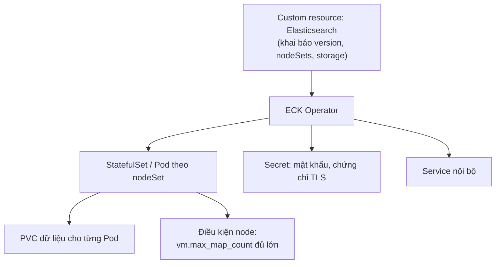

# 8_4 Elasticsearch on Kubernetes

> **Khóa học**: Cloud DevOps Basic — Data Platform
> **Phân nhóm**: 8 Domain 8 - Elasticsearch › 8_4 Elasticsearch on Kubernetes
> **Chủ đề**: Vì sao Elasticsearch cần StatefulSet, `vm.max_map_count` và init container, ECK Operator, nâng cấp tuần tự
> **Trạng thái**: Định nghĩa (nội dung cần học + đề bài lab), chưa chạy thử, 16-11-2026
> **Lộ trình tổng**: [data-platform/README.md](../../README.md)
> **Tiên quyết**: [8_2](<../8_2 Elasticsearch Cluster Operations/README.md>), và ở Domain 6: [6_4 StatefulSet/PVC](<../../../container/6 Domain 6 - Containers and Kubernetes/6_4 Kubernetes Networking Configuration and Storage/README.md>), [6_7 CRD/Operator](<../../../container/6 Domain 6 - Containers and Kubernetes/6_7 Kubernetes Security Scheduling and Scaling/README.md>)

---

## 🎯 Mục Tiêu

Giải thích được vì sao một hệ thống có trạng thái, phụ thuộc vào cấu hình **nhân hệ điều hành của node**, lại khó chạy trên Kubernetes hơn một ứng dụng web, và vì sao Operator giúp ích. Phần lớn bài này ráp các kiến thức đã học: StatefulSet (6_4), resources (6_3_6), Operator (6_7_9), `vm.max_map_count` ([os 1_7_5](<../../../os/1 Domain 1 - Operating System Core Fundamentals/1_7 Memory Management and Virtual Memory/1_7_5 Virtual Memory and Demand Paging.md>)).

**Ví dụ đời thường**: **mở chi nhánh ngân hàng mới theo mẫu**. Operator giống **ban quản lý chi nhánh chuyên nghiệp**: bạn chỉ khai "cần 3 quầy giao dịch, mỗi quầy 1 két riêng", nó tự dựng quầy, cấp két, và khi sửa chữa thì đóng từng quầy một để chi nhánh vẫn phục vụ khách.

---

## 📚 Những Gì Cần Học

### 8_4_1 Vì Sao StatefulSet
- [ ] Mỗi node data giữ shard trên đĩa riêng: cần tên Pod ổn định và PVC riêng (nối 6_4_7).
- [ ] Quorum master-eligible: cập nhật phải **tuần tự**, chờ cluster ổn định (khái niệm; cần đối chiếu).
- [ ] Anti-affinity và `PodDisruptionBudget` để drain node không hạ nhiều node cùng lúc.

### 8_4_2 Điều Kiện Hệ Điều Hành Của Node
- [ ] `vm.max_map_count` là cấu hình **cấp kernel của node**, không đặt được từ trong container thường; thường xử lý bằng init container có quyền hoặc cấu hình node (*cần đối chiếu cách ECK xử lý và yêu cầu quyền theo tài liệu*).
- [ ] Hệ quả bảo mật: init container đặc quyền xung đột với Pod Security `restricted` (nối 6_7).
- [ ] Giới hạn file descriptor và bộ nhớ: `limits` bộ nhớ của Pod phải tính cả heap JVM và page cache (nối 6_3_6); `OOMKilled` (exit code 137) là triệu chứng hay gặp.

### 8_4_3 ECK Operator
- [ ] ECK dùng CRD (ví dụ tài nguyên `Elasticsearch`, `Kibana`) để khai báo cả cluster (*tên CRD, `apiVersion`, cách cài cần đối chiếu theo phiên bản ECK*).
- [ ] Operator tạo Secret chứa mật khẩu/chứng chỉ, Service, StatefulSet; cách lấy mật khẩu người dùng mặc định theo tài liệu ECK.
- [ ] `nodeSets`: nhiều nhóm node với role khác nhau (master, data...) trong một cluster.
- [ ] Nâng cấp phiên bản: Operator thực hiện rolling theo thứ tự an toàn; kiểm chứng bằng cluster health (8_2_2).

### 8_4_4 Chẩn Đoán Trên Kubernetes
- [ ] Pod `Pending`: PVC không bind hoặc thiếu tài nguyên; Pod `CrashLoopBackOff`: bootstrap check thất bại (thiếu `vm.max_map_count`), thiếu bộ nhớ.
- [ ] Kết hợp `kubectl describe/logs/events` (6_8) với `_cluster/health` và `_cluster/allocation/explain` (8_2).
- [ ] Mất PVC nghĩa là mất shard: vì sao `reclaimPolicy` và snapshot quan trọng (nối 6_4_6, 8_2_6).

### 8_4_5 Chọn Cách Triển Khai
- [ ] So sánh: tự viết StatefulSet vs Helm chart cộng đồng vs ECK. Đánh đổi công sức vận hành và độ kiểm soát.
- [ ] Khi nào nên dùng dịch vụ quản lý (ngoài cluster) thay vì tự chạy trên Kubernetes (khái niệm; *không có khẳng định về từng nhà cung cấp trong phạm vi bài này*).

---

## 🧪 Labs

> **Bản định nghĩa**: chưa tạo thư mục `labs/`, chưa chạy thử. Cần cluster `kind` và RAM đủ; chạy **một** cluster Elasticsearch nhỏ.

| Lab | Nội dung | Thời gian | Trạng thái |
| :--- | :--- | :---: | :--- |
| lab-8_4_1-eck-on-kind | Cài ECK, tạo cluster Elasticsearch nhỏ, kiểm tra health | 90 phút | Định nghĩa |
| lab-8_4_2-pod-failure-and-pvc | Xóa Pod data, quan sát cùng tên/cùng PVC và shard recovery | 45 phút | Định nghĩa |

### lab-8_4_1-eck-on-kind
- **Các bước chính**:
  1. Cài ECK Operator theo trang hướng dẫn chính thức (*phiên bản và cách cài cần đối chiếu*).
  2. Áp dụng custom resource `Elasticsearch` nhỏ; theo dõi Pod/PVC/Secret/Service được tạo.
  3. Lấy mật khẩu từ Secret, gọi `_cluster/health` từ trong cluster.
  4. Ghi lại vấn đề gặp phải (ví dụ `vm.max_map_count`, bộ nhớ) và cách xử lý.
- **Checkpoint**:
  - [ ] Liệt kê được các tài nguyên do Operator tạo ra.
  - [ ] Giải thích được cách Operator xử lý (hoặc không xử lý) điều kiện `vm.max_map_count` trong môi trường của bạn.

### lab-8_4_2-pod-failure-and-pvc
- **Các bước chính**:
  1. Index một ít dữ liệu, ghi lại tên Pod data và PVC.
  2. Xóa Pod đó → quan sát Pod mới cùng tên, cùng PVC, cluster trở lại green.
  3. Kiểm chứng dữ liệu vẫn còn bằng `_search`.
- **Checkpoint**:
  - [ ] Giải thích được vì sao không mất dữ liệu và điều gì sẽ xảy ra nếu PVC bị xóa.

---

## 📚 Nguồn Tài Liệu Chính Thống (Official References)
- [Elastic Cloud on Kubernetes (ECK)](https://www.elastic.co/guide/en/cloud-on-k8s/current/index.html) - Tài liệu chính thức ECK: cài đặt, custom resource, nâng cấp.
- [Elasticsearch Reference - Important system configuration](https://www.elastic.co/guide/en/elasticsearch/reference/current/system-config.html) - `vm.max_map_count`, file descriptors, bootstrap checks.
- [Kubernetes - StatefulSets](https://kubernetes.io/docs/concepts/workloads/controllers/statefulset/) - Danh tính ổn định, PVC theo Pod.
- [Kubernetes - Operator pattern](https://kubernetes.io/docs/concepts/extend-kubernetes/operator/) - Operator và CRD.
- [Kubernetes - Pod Security Standards](https://kubernetes.io/docs/concepts/security/pod-security-standards/) - Mức `restricted` và hệ quả với init container đặc quyền.
