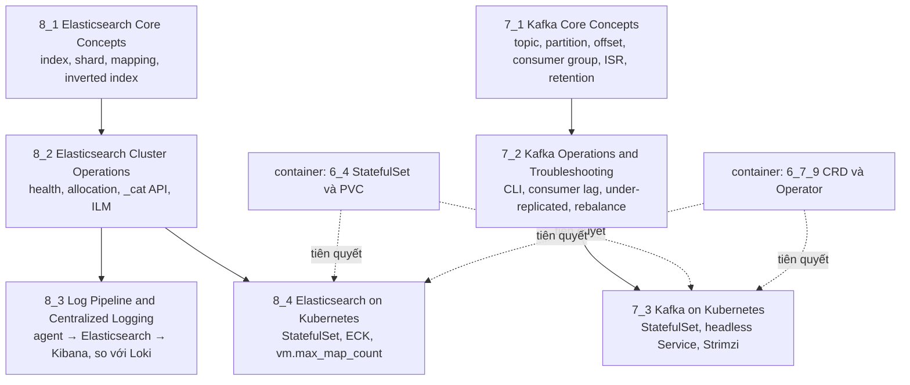

# 🗄️ Data Platform — Apache Kafka & Elasticsearch — Lộ Trình Tổng

> **Khóa học**: Cloud DevOps Basic — Domain 7 (Apache Kafka) và Domain 8 (Elasticsearch)
> **Mục đích**: Hiểu **Kafka** và **Elasticsearch** ở mức "khái niệm + vận hành cơ bản": chúng là gì, vận hành và chẩn đoán thế nào, chạy trên Kubernetes ra sao. Không nhằm thành chuyên gia thiết kế cluster.
> **Mức ưu tiên**: **P2** theo [CLOUD_ENGINEER_INTERVIEW_PREP.md](../CLOUD_ENGINEER_INTERVIEW_PREP.md) (mục "Các Thành Phần Mã Nguồn Mở Trong Nền Tảng").
> **Trạng thái**: Mới có **khung + README định nghĩa** (16-11-2026). Chưa có file bài giảng 3 tầng, chưa có lab, chưa chạy thử, chưa có CHECKLIST.md.

---

## 🎯 Bạn Cần Đạt Gì Sau Lộ Trình Này

1. **Kafka**: giải thích topic, partition, offset, consumer group, replication (leader/ISR), retention; chẩn đoán **consumer lag**, rebalance liên tục, broker mất kết nối chỉ bằng CLI.
2. **Elasticsearch**: giải thích index, document, shard primary/replica; đọc **cluster health** (green/yellow/red) và tìm nguyên nhân bằng API; mô tả pipeline log tập trung.
3. **Chạy trên Kubernetes**: giải thích vì sao cả hai dùng **StatefulSet + PVC** hoặc **Operator** (Strimzi, ECK), và vì sao nâng cấp phải tuần tự.

---

## 🗺️ Thứ Tự Học

| Topic | Trọng tâm | Thời gian gợi ý | Trạng thái |
| :--- | :--- | :---: | :--- |
| [7_1 Kafka Core Concepts](<./7 Domain 7 - Apache Kafka/7_1 Kafka Core Concepts/README.md>) | Topic, partition, offset, producer `acks`, consumer group, leader/ISR, retention/compaction, KRaft vs ZooKeeper | 2 ngày | Định nghĩa |
| [7_2 Kafka Operations and Troubleshooting](<./7 Domain 7 - Apache Kafka/7_2 Kafka Operations and Troubleshooting/README.md>) | CLI quản trị, consumer lag, under-replicated partitions, rebalance, broker down | 2 ngày | Định nghĩa |
| [7_3 Kafka on Kubernetes](<./7 Domain 7 - Apache Kafka/7_3 Kafka on Kubernetes/README.md>) | StatefulSet, headless Service, listener nội/ngoại cluster, Strimzi Operator | 2 ngày | Định nghĩa |
| [8_1 Elasticsearch Core Concepts](<./8 Domain 8 - Elasticsearch/8_1 Elasticsearch Core Concepts/README.md>) | Index, document, shard primary/replica, mapping, inverted index, truy vấn cơ bản | 2 ngày | Định nghĩa |
| [8_2 Elasticsearch Cluster Operations](<./8 Domain 8 - Elasticsearch/8_2 Elasticsearch Cluster Operations/README.md>) | Node role, cluster health, shard allocation, `_cat` API, ILM, heap | 2 ngày | Định nghĩa |
| [8_3 Log Pipeline and Centralized Logging](<./8 Domain 8 - Elasticsearch/8_3 Log Pipeline and Centralized Logging/README.md>) | Agent thu log → Elasticsearch → Kibana; cầu nối từ Loki/Grafana | 1–2 ngày | Định nghĩa |
| [8_4 Elasticsearch on Kubernetes](<./8 Domain 8 - Elasticsearch/8_4 Elasticsearch on Kubernetes/README.md>) | StatefulSet, ECK, `vm.max_map_count`, nâng cấp tuần tự | 1–2 ngày | Định nghĩa |

> **Lối tắt khi gấp (phỏng vấn)**: 7_1 → 8_1 → 8_2 (đọc cluster health) → phần "vì sao StatefulSet" của 7_3 và 8_4. Làm lab sau.

---

## 🔗 Liên Kết Với Phần Đã Có

| Chủ đề ở đây | Nền tảng cần có | Vị trí |
| :--- | :--- | :--- |
| Kafka/ES dùng StatefulSet, headless Service, PVC | 6_4_3, 6_4_6, 6_4_7 | [container 6_4](<../container/6 Domain 6 - Containers and Kubernetes/6_4 Kubernetes Networking Configuration and Storage/README.md>) |
| Operator (Strimzi, ECK) | 6_7_9 CRD và Operator | [container 6_7](<../container/6 Domain 6 - Containers and Kubernetes/6_7 Kubernetes Security Scheduling and Scaling/README.md>) |
| Log tập trung, metric, trace qua Kafka | 6_8 Observability | [container 6_8](<../container/6 Domain 6 - Containers and Kubernetes/6_8 Kubernetes Observability and Troubleshooting/README.md>) |
| Elasticsearch/Kafka dùng `mmap` và page cache | 1_7_5 Virtual Memory | [os 1_7_5](<../os/1 Domain 1 - Operating System Core Fundamentals/1_7 Memory Management and Virtual Memory/1_7_5 Virtual Memory and Demand Paging.md>) |
| Kafka dựa trên TCP, kết nối dài | 2_5 Transport Layer | [network 2_5](<../network/2 Domain 2 - Computer Networking Core Fundamentals/2_5 Transport Layer TCP and UDP/>) |

---

## 🧰 Môi Trường Lab Chung

| Thành phần | Lựa chọn | Ghi chú |
| :--- | :--- | :--- |
| Container engine | Podman 5.x (Fedora 43) hoặc Docker | Cùng quy ước với [container/README.md](../container/README.md) |
| Kafka cục bộ | Image Kafka chính thức theo Quickstart của Apache Kafka | Chọn phiên bản theo trang Downloads/Quickstart; *cần đối chiếu cách chạy KRaft ở bản bạn dùng* |
| Elasticsearch cục bộ | Image từ registry của Elastic, **một node** cho lab | Chọn phiên bản theo tài liệu Elastic; *bảo mật (TLS, mật khẩu `elastic`) bật mặc định ở các bản gần đây, cần đối chiếu trang cài đặt của bản bạn dùng* |
| Kubernetes | `kind` như ở Domain 6 | Dùng cho 7_3 và 8_4; cần RAM đủ cho Kafka + Elasticsearch (không chạy cùng lúc trên máy yếu) |

---

## 📐 Quy Ước

- **Mã mục**: `7_<topic>_<item>` và `8_<topic>_<item>`. Checkbox trong README topic là **kiến thức cần học**.
- **Lab**: `labs/lab-<mã>-<slug>/` theo skill [lab-builder](../../.agents/skills/lab-builder/SKILL.md). Lab "Định nghĩa" nghĩa là mới có đề bài, lệnh trong đề là **ví dụ minh họa** và phải chạy thật mới đổi trạng thái.
- **Phiên bản**: mọi chi tiết phụ thuộc phiên bản Kafka, Elasticsearch, Strimzi, ECK đều gắn dòng *"cần đối chiếu"* tới tài liệu chính thức. Không điền số phiên bản khi chưa kiểm chứng.
- **Bước tiếp theo**: tạo `CHECKLIST.md`, plan trong `.agents/plans/`, rồi chạy quy trình researcher → writer → verifier cho từng lesson (xem [05-verification-gates.md](../../.agents/rules/05-verification-gates.md)).

---

## 📚 Nguồn Tài Liệu Chính Thống (Official References)
- [Apache Kafka Documentation](https://kafka.apache.org/documentation/) - Tài liệu chính thức Kafka: khái niệm, thiết kế, vận hành.
- [Apache Kafka Quickstart](https://kafka.apache.org/quickstart) - Chạy Kafka cục bộ, tạo topic, producer/consumer.
- [Strimzi Overview](https://strimzi.io/docs/operators/latest/overview) - Operator chạy Kafka trên Kubernetes.
- [Elasticsearch Reference](https://www.elastic.co/guide/en/elasticsearch/reference/current/index.html) - Tài liệu chính thức Elasticsearch.
- [Elastic Cloud on Kubernetes (ECK)](https://www.elastic.co/guide/en/cloud-on-k8s/current/index.html) - Operator chạy Elastic Stack trên Kubernetes.
- [Kubernetes - StatefulSets](https://kubernetes.io/docs/concepts/workloads/controllers/statefulset/) - Workload có trạng thái.
