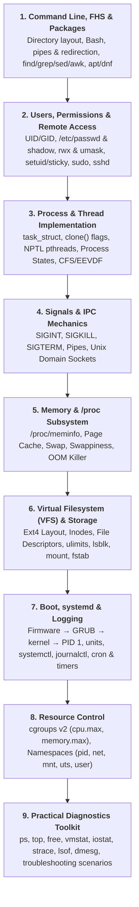

# 🐧 Linux Systems Realization: Architecture & Diagnostics Roadmap

> **Domain**: Linux Kernel Internals & Practical Systems Engineering  
> **Tracker Link**: [Return to Master Checklist](../CHECKLIST.md#domain-3-operating-system-realization-linux-deep-dive-32-items)  
> **Authoritative References**: [Linux Kernel Documentation](https://docs.kernel.org/) | [Linux Manual Pages (man7.org)](https://man7.org/linux/man-pages/) | [systemd Manual Pages](https://www.freedesktop.org/software/systemd/man/latest/systemd.unit.html) | [roadmap.sh/linux](https://roadmap.sh/linux)

> **Scope note**: Modules 1, 2, 7 and 8 are the day-to-day administration skills a DevOps engineer uses on every Linux server. Modules 3 to 6 show how the theory from [os/README.md](../os/README.md) is implemented in the Linux kernel. Module 9 ties everything together for troubleshooting. Network configuration and the SSH protocol itself are taught in [network/README.md](../network/README.md); this course covers only the server-side administration of `sshd`.

---

## 🗺️ Visual Curriculum Roadmap

---

## 📚 Detailed Study Modules

### Module 1: Linux Command-Line Foundations, Filesystem Hierarchy and Packages
1. **Filesystem Hierarchy Standard (FHS) & "Everything is a File"**:
   - The FHS (version 3.0, published by the Linux Foundation) defines where things live: `/etc` (host-specific configuration), `/var` (variable data such as `/var/log` and `/var/lib`), `/home` and `/root` (user homes), `/tmp` (temporary files), `/usr` (shareable read-only programs and libraries), `/opt` (add-on software), `/boot` (kernel and bootloader files), `/dev` (device files), `/run` (runtime data since boot).
   - `/proc` and `/sys` are virtual filesystems generated by the kernel (see Module 5).
   - Devices, pipes and sockets are exposed through the same file API. `ls -l` shows the file type in the first column: `-` regular file, `d` directory, `l` symbolic link, `c` character device, `b` block device, `p` FIFO/pipe, `s` socket.
2. **Shell Fundamentals (Bash)**:
   - Standard streams: stdin (`0`), stdout (`1`), stderr (`2`).
   - Redirection: `>` (overwrite), `>>` (append), `<` (input), `2>` (stderr), `2>&1` (send stderr to wherever stdout goes).
   - Pipelines (`cmd1 | cmd2`) connect stdout of one command to stdin of the next. `set -o pipefail` makes a pipeline fail if any command in it fails.
   - Exit status: `0` means success, non-zero means failure; read it with `$?`; chain with `&&` (run if success) and `||` (run if failure).
   - Variables and environment: `export`, `env`, `PATH`; single quotes vs double quotes; the shebang line (`#!/usr/bin/env bash`) and `chmod +x` to run a script.
3. **Text Search & Processing**:
   - `find` (search by name, type, size, modification time; `-exec` to act on results).
   - `grep` (search text by pattern: `-r`, `-i`, `-n`, `-v`, `-E`).
   - `sed` (stream editor, for example `s/old/new/g`; `-i` edits in place).
   - `awk` (field-based processing: `$1`, `-F`).
   - Composing them: `sort`, `uniq -c`, `head`, `tail -f`, `wc -l`, `cut`, `xargs` to answer real questions from log files.
4. **Software Package Management**:
   - Debian/Ubuntu: `apt` on top of `dpkg` (`.deb` packages; repository lists in `/etc/apt/sources.list.d/`). `apt update` refreshes package indexes; `apt upgrade` installs newer versions.
   - RHEL/Fedora: `dnf` on top of `rpm` (`.rpm` packages; repositories in `/etc/yum.repos.d/`).
   - Repositories are signed with GPG keys; query installed packages (`dpkg -l`, `rpm -qa`) and which package owns a file (`dpkg -S`, `rpm -qf`).

---

### Module 2: Users, Permissions and Remote Access
1. **Users, Groups & Identity**:
   - Every user has a numeric UID and a primary GID; `root` is UID `0`. Processes carry real and effective user and group IDs (see `credentials(7)`).
   - `/etc/passwd` (one line per account: name, UID, GID, comment, home directory, login shell), `/etc/shadow` (password hashes, readable only by root), `/etc/group` (group membership).
   - Primary vs supplementary groups; system accounts vs regular users (UID ranges are distribution-specific, set in `/etc/login.defs`).
   - Commands: `id`, `whoami`, `groups`, `useradd`, `usermod -aG`, `passwd`.
2. **File Permissions, Ownership & umask**:
   - Three permission sets (user/owner, group, other) of `r`, `w`, `x`. On a directory, `r` lists entries, `w` creates/deletes entries, `x` allows entering (traversing) it.
   - Octal notation (`r=4`, `w=2`, `x=1`, for example `755`, `644`); `chmod` (symbolic and octal), `chown user:group`, `chgrp`.
   - `umask` removes permission bits from the mode of newly created files and directories.
3. **Special Permission Bits & `sudo`**:
   - **setuid** (`4000`): an executable runs with the file owner's effective UID (example: `passwd`).
   - **setgid** (`2000`): on an executable, runs with the file's group; on a directory, new files inherit the directory's group.
   - **sticky bit** (`1000`): on a directory such as `/tmp`, only a file's owner can delete or rename it.
   - Auditing: `find / -perm -4000 -type f`.
   - `sudo`: privilege escalation controlled by `/etc/sudoers` and `/etc/sudoers.d/` (always edit with `visudo`); `sudo -l` lists what a user may run; least privilege instead of logging in as root.
4. **Remote Access with OpenSSH (Server Side)**:
   - The `sshd` daemon and `/etc/ssh/sshd_config`: `PermitRootLogin`, `PasswordAuthentication`, `PubkeyAuthentication`, `AllowUsers`/`AllowGroups`; validate config with `sshd -t` before restarting.
   - Key-based login: `ssh-keygen -t ed25519`, `ssh-copy-id`, `~/.ssh/authorized_keys`, and why wrong permissions on `~/.ssh` make `sshd` refuse keys (`StrictModes`).
   - Server host keys in `/etc/ssh/ssh_host_*`. The protocol (key exchange, channels, port forwarding) is covered in the network course.

---

### Module 3: Process & Thread Implementation in the Linux Kernel
1. **The Unified Task Representation (`task_struct`)**:
   - In the Linux kernel, there is no separate data structure for a "thread" vs a "process". Both are represented by the unified `task_struct` structure (defined in `include/linux/sched.h`).
   - Every `task_struct` possesses its own unique Thread ID (`pid_t pid` in kernel terminology, which matches `TID` in user-space).
   - A traditional process is simply a thread group where all member tasks share the same Thread Group ID (`tgid`), which corresponds to the process PID exposed to user space.
2. **Process and Thread Creation via `clone()`**:
   - Both `fork()` and `pthread_create()` are wrappers around the underlying `clone()` system call (`sys_clone`), differentiated by bit flags passed in `clone_flags`:
     - **Process Creation (`fork`)**: `clone(SIGCHLD, ...)` without shared memory flags. Triggers Copy-on-Write (CoW).
     - **Thread Creation (`pthread_create`)**: `clone(CLONE_VM | CLONE_FS | CLONE_FILES | CLONE_SIGHAND | CLONE_THREAD, ...)`. Shares virtual address space (`CLONE_VM`), filesystem root (`CLONE_FS`), file descriptor table (`CLONE_FILES`), and signal handlers (`CLONE_SIGHAND`).
3. **Deciphering Linux Process States in `ps` and `top`**:
   - **`R` (Running / Runnable)**: Process is executing on a CPU core or sitting in the run queue ready to execute.
   - **`S` (Interruptible Sleep)**: Waiting for an event or signal (e.g., waiting for network socket data or timer). Can be interrupted by any signal.
   - **`D` (Uninterruptible Sleep - Disk Sleep)**: Blocked waiting directly on hardware I/O (typically disk I/O, paging, or hung NFS shares). **Cannot be killed by any signal, including `SIGKILL` (kill -9)**. Process will only wake up when the hardware controller returns an interrupt.
   - **`Z` (Zombie)**: Process finished execution, but its parent hasn't reaped its return code via `waitpid()`. Consumes no RAM or CPU, only a slot in the kernel PID table.
   - **`T` (Stopped / Traced)**: Suspended by a job control signal (`SIGSTOP`, `Ctrl+Z`) or attached to by a debugger (`ptrace`).
4. **The Linux Fair Scheduler (CFS → EEVDF)**:
   - The Completely Fair Scheduler (CFS) tracks each task's virtual runtime (`vruntime`) and keeps runnable tasks in a red-black tree.
   - Per `docs.kernel.org`, the kernel began transitioning to the Earliest Eligible Virtual Deadline First (EEVDF) scheduler in version 6.6. Always state the kernel version (`uname -r`) when describing scheduler behaviour.
   - Nice values (`-20` highest priority to `+19` lowest) set a task's weight; `nice` and `renice` change them.

---

### Module 4: Linux Signals & Inter-Process Communication (IPC)
1. **Linux Signals Architecture**:
   - Asynchronous software notifications delivered by the kernel to a process.
   - **Key Standard Signals**:
     - `SIGHUP` (1): Hangup; traditionally sent when terminal disconnects; commonly used by daemons to trigger configuration reloads without restarting.
     - `SIGINT` (2): Interrupt from keyboard (`Ctrl+C`); graceful cancel request.
     - `SIGQUIT` (3): Quit from keyboard (`Ctrl+\`); terminates process and generates core dump.
     - `SIGKILL` (9): Unconditional immediate termination. Handled directly by kernel; **cannot be caught, blocked, or ignored** by the process.
     - `SIGTERM` (15): Polite termination request (default signal for `kill <PID>`). Can be caught by the process to execute cleanup routines and flush buffers.
     - `SIGCHLD` (17): Sent to parent process whenever a child process terminates or stops.
2. **Inter-Process Communication (IPC) Primitives**:
   - **Pipes (`|`)**: Unidirectional byte stream connecting stdout of one process to stdin of another. Implemented as a circular ring buffer in kernel memory.
   - **Named FIFOs (`mkfifo`)**: Persistent filesystem entry functioning as an IPC pipe accessible across unrelated processes.
   - **Unix Domain Sockets (`AF_UNIX` / `AF_LOCAL`)**: High-performance bidirectional byte or datagram stream. Bypasses the network stack (no IP headers, no TCP checksums, no routing logic), achieving 2x throughput of loopback TCP.
   - **POSIX Shared Memory (`shm_open`, `mmap`)**: Fastest IPC mechanism; maps the same physical RAM pages into the virtual address spaces of two different processes. Requires mutex/semaphore synchronization to prevent race conditions.

---

### Module 5: Linux Virtual Memory & The `/proc` Subsystem
1. **The `/proc` Virtual Pseudo-Filesystem**:
   - `/proc` does not exist on disk; it is an in-memory pseudo-filesystem generated dynamically by the kernel to expose runtime kernel and process state.
   - **System Memory (`/proc/meminfo`)**:
     - `MemTotal`: Total usable physical RAM.
     - `MemFree`: Memory completely untouched and empty.
     - `MemAvailable`: Estimated amount of RAM available for starting new applications without swapping (includes reclaimable Page Cache).
     - `Buffers`: In-memory storage for raw disk blocks.
     - `Cached (Page Cache)`: In-memory copy of recently read/written files. Can be dropped immediately if user applications request more RAM.
   - **Per-Process Memory Maps (`/proc/[pid]/maps` and `smaps`)**:
     - Displays virtual memory address ranges, permissions (`r-xp`, `rw-p`), offset, device, and backing file (shared libraries, heap, stack).
2. **Swap Mechanics & Swappiness**:
   - Swapping moves inactive anonymous pages from physical RAM to a dedicated disk partition or swapfile.
   - `vm.swappiness` (range 0–200, default 60): Dictates the kernel's aggressiveness in swapping out anonymous memory vs reclaiming file-backed Page Cache.
   - Inspecting and managing swap: `swapon --show`, `free -h`, `sysctl vm.swappiness`.
3. **Memory Overcommit & The OOM Killer**:
   - Linux lets processes allocate more virtual memory than physically exists; the policy is `vm.overcommit_memory` (`0` heuristic, `1` always overcommit, `2` strict accounting).
   - When memory cannot be reclaimed, the Out-Of-Memory (OOM) killer selects a victim by its `oom_score` and kills it with `SIGKILL`; administrators bias the choice with `/proc/[pid]/oom_score_adj` (`-1000` to `1000`).
   - Evidence of an OOM kill appears in the kernel log (`dmesg`, `journalctl -k`).

---

### Module 6: Virtual Filesystem (VFS) & Storage Internals
1. **Virtual Filesystem (VFS) Abstraction**:
   - Kernel software layer that provides standard POSIX filesystem system calls (`read`, `write`, `open`) across heterogeneous filesystem formats (Ext4, XFS, Btrfs, NFS, procfs).
2. **Ext4 Filesystem Layout**:
   - **Superblock**: Stores global filesystem metadata (total blocks, free blocks, block size, filesystem state, mount count).
   - **Inode Table**: Stores fixed-size Inode structures (typically 256 bytes each).
   - **Data Blocks**: Physical storage blocks holding actual file contents.
3. **Inodes & Links**:
   - An **Inode (Index Node)** stores everything about a file *except* its name and file contents:
     - File type, permissions, owner UID, group GID, file size, timestamps (atime, mtime, ctime), link count, and pointers to data blocks.
   - **Hard Links**: A directory entry pointing directly to an existing Inode number. Deleting one hard link decrements the Inode's link count; data is only deleted when link count reaches zero. Cannot cross filesystem boundaries.
   - **Soft / Symbolic Links**: A distinct file with its own Inode containing a path string pointing to another file. If the target file is moved or deleted, the symlink breaks ("dangling link").
4. **File Descriptors & Resource Limits**:
   - File descriptors (`FD`) are non-negative integers referencing entries in the process's open file table.
   - Inspecting open FDs: `ls -l /proc/[pid]/fd/`.
   - Managing limits: `ulimit -n` (per-shell limit) and `/proc/sys/fs/file-max` (system-wide kernel limit).
5. **Block Devices, Mounting & `/etc/fstab`**:
   - Discovering disks and partitions: `lsblk`, `blkid`; partition tables (GPT vs MBR) with `fdisk` / `parted`; creating filesystems with `mkfs.ext4` / `mkfs.xfs`.
   - Attaching a filesystem to the tree: `mount`, `umount`, `findmnt`.
   - Persistent mounts in `/etc/fstab` (fields: device, mount point, type, options, dump, pass); prefer `UUID=` over `/dev/sdX` names; test with `mount -a` before rebooting; the `nofail` option for disks that may be absent (common with cloud data disks).

---

### Module 7: Boot Process, systemd and Logging
1. **The Linux Boot Sequence**:
   - Firmware (UEFI or legacy BIOS) → bootloader (commonly GRUB 2) loads the kernel and the initramfs → the kernel initializes hardware and uses the initramfs to find and mount the real root filesystem → the kernel starts PID 1 (systemd on most current distributions) → systemd starts units until the default target is reached.
   - Inspection: `cat /proc/cmdline`, `systemctl get-default`, `systemd-analyze blame`, `journalctl -b`.
2. **systemd Units & `systemctl`**:
   - Unit types: `.service`, `.socket`, `.target`, `.timer`, `.mount`, `.path`, `.slice`, `.scope`, `.device`, `.swap`, `.automount`.
   - Vendor unit files vs administrator overrides in `/etc/systemd/system/`; drop-ins with `systemctl edit`; `systemctl daemon-reload` after changes.
   - Unit file sections: `[Unit]` (`Description`, `After`, `Wants`, `Requires`), `[Service]` (`Type`, `ExecStart`, `Restart`, `User`), `[Install]` (`WantedBy`).
   - Lifecycle: `start`/`stop`/`restart`/`reload`/`status`; `enable` (start at boot) vs `start` (start now); how `stop` sends `SIGTERM` and then `SIGKILL` after a timeout (link to Module 4).
3. **Logging with journald**:
   - The systemd journal stores structured log entries; query with `journalctl -u <unit>`, `-f` (follow), `-b` (this boot), `-p err` (priority), `--since "1 hour ago"`, `-k` (kernel messages).
   - Persistent vs volatile storage (`/var/log/journal` vs `/run/log/journal`); classic text logs in `/var/log/` and `logrotate`.
4. **Scheduled Jobs: cron & systemd Timers**:
   - crontab syntax (minute, hour, day of month, month, day of week); `crontab -e` / `crontab -l`; system crontabs in `/etc/crontab` and `/etc/cron.d/`; the minimal environment cron jobs run with.
   - systemd timers: `OnCalendar=`, `Persistent=`, a timer activates a matching service; `systemctl list-timers`.

---

### Module 8: Resource Control with cgroups v2 and Namespaces
1. **Control Groups v2 (cgroups)**:
   - A unified hierarchy mounted at `/sys/fs/cgroup` that groups processes and applies resource limits through controllers (`cpu`, `memory`, `io`, `pids`).
   - Interface files: `memory.max`, `memory.current`, `memory.events`, `cpu.max`, `cpu.weight`, `pids.max`.
   - systemd places every service in a cgroup under slices (`system.slice`, `user.slice`); inspect with `systemd-cgls` and `systemd-cgtop`; set limits with unit directives such as `MemoryMax=` and `CPUQuota=`.
2. **Linux Namespaces**:
   - Namespaces limit what a process can *see*: mount, PID, network, UTS (hostname), IPC, user, cgroup and time namespaces (`namespaces(7)`).
   - Inspect with `lsns` and `/proc/[pid]/ns/`; experiment with `unshare` and enter an existing namespace with `nsenter`.
   - Bridge to the cloud: container runtimes combine namespaces (isolation of view) with cgroups (limits on usage). This course stops at the kernel primitives; container tooling is out of scope.

---

### Module 9: Practical Linux Diagnostics & Performance Toolkit

| Tool | Essential Command | Key Metrics / Diagnostic Purpose |
| :--- | :--- | :--- |
| **`ps`** | `ps aux --sort=-%cpu` | Displays active processes, PIDs, terminal, CPU/memory percentage, and state codes (`R`, `S`, `D`, `Z`). |
| **`top` / `htop`** | `top -b -n 1 \| head -n 20` | Real-time CPU utilization breakdown: `%us` (user), `%sy` (kernel), `%wa` (disk I/O wait), `%si` (softirq); load averages over 1, 5, 15 min. |
| **`kill` / `pkill`** | `kill -TERM <PID>` / `pkill -HUP nginx` | Sends a signal to a process by PID or by name (graceful stop, reload, or forced kill). |
| **`free`** | `free -h` | Summarizes physical RAM and Swap; distinguish between `free` (completely unallocated) and `available` (truly usable memory). |
| **`vmstat`** | `vmstat 1 5` | Reports run queue processes (`r`), blocked processes (`b`), swap in/out rates (`si`/`so`), context switches (`cs`), and interrupts (`in`). |
| **`df` / `du`** | `df -h` / `df -i` / `du -sh *` | Filesystem space usage, inode usage, and per-directory space accounting. |
| **`iostat`** | `iostat -xz 1 5` | Measures disk I/O performance: `%util` (disk saturation percentage) and `await` (average I/O response time in milliseconds). |
| **`strace`** | `strace -p <PID> -c -T` | Traces and profiles system calls; identifies which syscalls are failing or consuming excessive latency. |
| **`lsof`** | `lsof -p <PID>` / `lsof -i :80` | Lists open file handles, established sockets, and mapped libraries for a given process or port. |
| **`dmesg`** | `dmesg -T \| grep -i oom` | Inspects kernel ring buffer logs for hardware errors, device detection, and Kernel OOM Killer invocations. |

**Troubleshooting Scenarios (combining the tools above)**:
- High load average but idle CPU → look for tasks in `D` state and high `%wa` (`ps`, `vmstat`, `iostat`).
- A process disappeared → check for an OOM kill (`dmesg -T`, `journalctl -k`, the cgroup's `memory.events`).
- "No space left on device" while `df -h` shows free space → inode exhaustion (`df -i`) or a deleted file still held open (`lsof +L1`).
- "Address already in use" → find the owner of the port (`ss -tulpn`, `lsof -i :<port>`).
- A service will not start → `systemctl status <unit>` and `journalctl -u <unit>`.
- "Permission denied" → walk the path permissions (`namei -l <path>`) and the user's groups (`id`).

---

## 📚 Tier-1 Canonical References
- [Linux Kernel Documentation](https://docs.kernel.org/) - Official source documentation for scheduler, VFS, and memory.
- [Linux Manual Pages (man7.org)](https://man7.org/linux/man-pages/) - Canonical POSIX standards (`clone(2)`, `fork(2)`, `signal(7)`, `sched(7)`).
- [Filesystem Hierarchy Standard 3.0](https://refspecs.linuxfoundation.org/FHS_3.0/fhs/index.html) - Linux Foundation specification of the directory layout.
- [GNU Bash Reference Manual: Redirections](https://www.gnu.org/software/bash/manual/html_node/Redirections.html) - Official description of stream redirection.
- [credentials(7)](https://man7.org/linux/man-pages/man7/credentials.7.html) - Process user and group identifiers.
- [inode(7)](https://man7.org/linux/man-pages/man7/inode.7.html) - File type and permission bits, including setuid, setgid, and sticky.
- [sshd_config(5)](https://man.openbsd.org/sshd_config) - OpenSSH server configuration directives.
- [bootup(7)](https://man7.org/linux/man-pages/man7/bootup.7.html) - The systemd system boot process.
- [systemd.unit(5)](https://www.freedesktop.org/software/systemd/man/latest/systemd.unit.html) - Unit file syntax and unit types.
- [journalctl(1)](https://www.freedesktop.org/software/systemd/man/latest/journalctl.html) - Querying the systemd journal.
- [Control Group v2](https://docs.kernel.org/admin-guide/cgroup-v2.html) - Kernel documentation for the unified cgroup hierarchy.
- [namespaces(7)](https://man7.org/linux/man-pages/man7/namespaces.7.html) - Overview of Linux namespaces.
- [EEVDF Scheduler](https://docs.kernel.org/scheduler/sched-eevdf.html) - Kernel documentation of the transition from CFS.
- [Documentation for /proc/sys/vm](https://docs.kernel.org/admin-guide/sysctl/vm.html) - `swappiness`, `overcommit_memory`, and OOM tunables.
- [Roadmap.sh Linux Roadmap](https://roadmap.sh/linux) - Interactive learning guide for Linux systems engineering.
- *Understanding the Linux Kernel* (3rd Edition) - Daniel P. Bovet, Marco Cesati (O'Reilly).
