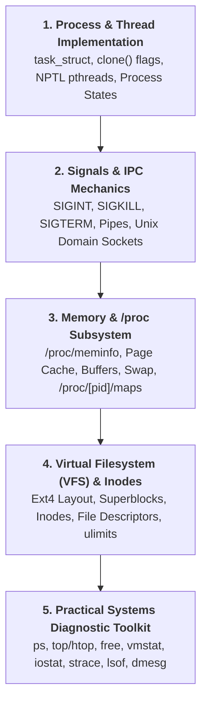

# 🐧 Linux Systems Realization: Architecture & Diagnostics Roadmap

> **Domain**: Linux Kernel Internals & Practical Systems Engineering  
> **Tracker Link**: [Return to Master Checklist](../CHECKLIST.md#domain-3-operating-system-realization-linux-deep-dive-15-items)  
> **Authoritative References**: [Linux Kernel Documentation](https://docs.kernel.org/) | [Linux Manual Pages (man7.org)](https://man7.org/linux/man-pages/) | [roadmap.sh/linux](https://roadmap.sh/linux)

---

## 🗺️ Visual Curriculum Roadmap

---

## 📚 Detailed Study Modules

### Module 1: Process & Thread Implementation in the Linux Kernel
1. **The Unified Task Representation (`task_struct`)**:
   - In the Linux kernel, there is no separate data structure for a "thread" vs a "process". Both are represented by the unified `task_struct` structure (defined in `include/linux/sched.h`).
   - Every `task_struct` possesses its own unique Thread ID (`pid_t pid` in kernel terminology, which matches `TID` in user-space).
   - A traditional process is simply a thread group where all member tasks share the same Thread Group ID (`tgid`), which corresponds to the process PID exposed to user space.
2. **Process and Thread Creation via `clone()`**:
   - Both `fork()` and `pthread_create()` are wrappers around the underlying `clone()` system call (`sys_clone`), differentiated by bit flags passed in `clone_flags`:
     - **Process Creation (`fork`)**: `clone(SIGCHLD, ...)` without shared memory flags. Triggers Copy-on-Write (CoW).
     - **Thread Creation (`pthread_create`)**: `clone(CLONE_VM | CLONE_FS | CLONE_FILES | CLONE_SIGHAND | CLONE_THREAD, ...)`. Shares virtual address space (`CLONE_VM`), filesystem root (`CLONE_FS`), file descriptor table (`CLONE_FILES`), and signal handlers (`CLONE_SIGHAND`).
3. **Deciphering Linux Process States in `ps` and `top`**:
   - **`R` (Running / Runnable)**: Process is executing on a CPU core or sitting in the run queue ready to execute.
   - **`S` (Interruptible Sleep)**: Waiting for an event or signal (e.g., waiting for network socket data or timer). Can be interrupted by any signal.
   - **`D` (Uninterruptible Sleep - Disk Sleep)**: Blocked waiting directly on hardware I/O (typically disk I/O, paging, or hung NFS shares). **Cannot be killed by any signal, including `SIGKILL` (kill -9)**. Process will only wake up when the hardware controller returns an interrupt.
   - **`Z` (Zombie)**: Process finished execution, but its parent hasn't reaped its return code via `waitpid()`. Consumes no RAM or CPU, only a slot in the kernel PID table.
   - **`T` (Stopped / Traced)**: Suspended by a job control signal (`SIGSTOP`, `Ctrl+Z`) or attached to by a debugger (`ptrace`).

---

### Module 2: Linux Signals & Inter-Process Communication (IPC)
1. **Linux Signals Architecture**:
   - Asynchronous software notifications delivered by the kernel to a process.
   - **Key Standard Signals**:
     - `SIGHUP` (1): Hangup; traditionally sent when terminal disconnects; commonly used by daemons to trigger configuration reloads without restarting.
     - `SIGINT` (2): Interrupt from keyboard (`Ctrl+C`); graceful cancel request.
     - `SIGQUIT` (3): Quit from keyboard (`Ctrl+\`); terminates process and generates core dump.
     - `SIGKILL` (9): Unconditional immediate termination. Handled directly by kernel; **cannot be caught, blocked, or ignored** by the process.
     - `SIGTERM` (15): Polite termination request (default signal for `kill <PID>`). Can be caught by the process to execute cleanup routines and flush buffers.
     - `SIGCHLD` (17): Sent to parent process whenever a child process terminates or stops.
2. **Inter-Process Communication (IPC) Primitives**:
   - **Pipes (`|`)**: Unidirectional byte stream connecting stdout of one process to stdin of another. Implemented as a circular ring buffer in kernel memory.
   - **Named FIFOs (`mkfifo`)**: Persistent filesystem entry functioning as an IPC pipe accessible across unrelated processes.
   - **Unix Domain Sockets (`AF_UNIX` / `AF_LOCAL`)**: High-performance bidirectional byte or datagram stream. Bypasses the network stack (no IP headers, no TCP checksums, no routing logic), achieving 2x throughput of loopback TCP.
   - **POSIX Shared Memory (`shm_open`, `mmap`)**: Fastest IPC mechanism; maps the same physical RAM pages into the virtual address spaces of two different processes. Requires mutex/semaphore synchronization to prevent race conditions.

---

### Module 3: Linux Virtual Memory & The `/proc` Subsystem
1. **The `/proc` Virtual Pseudo-Filesystem**:
   - `/proc` does not exist on disk; it is an in-memory pseudo-filesystem generated dynamically by the kernel to expose runtime kernel and process state.
   - **System Memory (`/proc/meminfo`)**:
     - `MemTotal`: Total usable physical RAM.
     - `MemFree`: Memory completely untouched and empty.
     - `MemAvailable`: Estimated amount of RAM available for starting new applications without swapping (includes reclaimable Page Cache).
     - `Buffers`: In-memory storage for raw disk blocks.
     - `Cached (Page Cache)`: In-memory copy of recently read/written files. Can be dropped immediately if user applications request more RAM.
   - **Per-Process Memory Maps (`/proc/[pid]/maps` and `smaps`)**:
     - Displays virtual memory address ranges, permissions (`r-xp`, `rw-p`), offset, device, and backing file (shared libraries, heap, stack).
2. **Swap Mechanics & Swappiness**:
   - Swapping moves inactive anonymous pages from physical RAM to a dedicated disk partition or swapfile.
   - `vm.swappiness` (range 0–200, default 60): Dictates the kernel's aggressiveness in swapping out anonymous memory vs reclaiming file-backed Page Cache.

---

### Module 4: Virtual Filesystem (VFS) & Storage Internals
1. **Virtual Filesystem (VFS) Abstraction**:
   - Kernel software layer that provides standard POSIX filesystem system calls (`read`, `write`, `open`) across heterogeneous filesystem formats (Ext4, XFS, Btrfs, NFS, procfs).
2. **Ext4 Filesystem Layout**:
   - **Superblock**: Stores global filesystem metadata (total blocks, free blocks, block size, filesystem state, mount count).
   - **Inode Table**: Stores fixed-size Inode structures (typically 256 bytes each).
   - **Data Blocks**: Physical storage blocks holding actual file contents.
3. **Inodes & Links**:
   - An **Inode (Index Node)** stores everything about a file *except* its name and file contents:
     - File type, permissions, owner UID, group GID, file size, timestamps (atime, mtime, ctime), link count, and pointers to data blocks.
   - **Hard Links**: A directory entry pointing directly to an existing Inode number. Deleting one hard link decrements the Inode's link count; data is only deleted when link count reaches zero. Cannot cross filesystem boundaries.
   - **Soft / Symbolic Links**: A distinct file with its own Inode containing a path string pointing to another file. If the target file is moved or deleted, the symlink breaks ("dangling link").
4. **File Descriptors & Resource Limits**:
   - File descriptors (`FD`) are non-negative integers referencing entries in the process's open file table.
   - Inspecting open FDs: `ls -l /proc/[pid]/fd/`.
   - Managing limits: `ulimit -n` (per-shell limit) and `/proc/sys/fs/file-max` (system-wide kernel limit).

---

### Module 5: Practical Linux Diagnostics & Performance Toolkit

| Tool | Essential Command | Key Metrics / Diagnostic Purpose |
| :--- | :--- | :--- |
| **`ps`** | `ps aux --sort=-%cpu` | Displays active processes, PIDs, terminal, CPU/memory percentage, and state codes (`R`, `S`, `D`, `Z`). |
| **`top` / `htop`** | `top -b -n 1 \| head -n 20` | Real-time CPU utilization breakdown: `%us` (user), `%sy` (kernel), `%wa` (disk I/O wait), `%si` (softirq); load averages over 1, 5, 15 min. |
| **`free`** | `free -h` | Summarizes physical RAM and Swap; distinguish between `free` (completely unallocated) and `available` (truly usable memory). |
| **`vmstat`** | `vmstat 1 5` | Reports run queue processes (`r`), blocked processes (`b`), swap in/out rates (`si`/`so`), context switches (`cs`), and interrupts (`in`). |
| **`iostat`** | `iostat -xz 1 5` | Measures disk I/O performance: `%util` (disk saturation percentage) and `await` (average I/O response time in milliseconds). |
| **`strace`** | `strace -p <PID> -c -T` | Traces and profiles system calls; identifies which syscalls are failing or consuming excessive latency. |
| **`lsof`** | `lsof -p <PID>` / `lsof -i :80` | Lists open file handles, established sockets, and mapped libraries for a given process or port. |
| **`dmesg`** | `dmesg -T \| grep -i oom` | Inspects kernel ring buffer logs for hardware errors, device detection, and Kernel OOM Killer invocations. |

---

## 📚 Tier-1 Canonical References
- [Linux Kernel Documentation](https://docs.kernel.org/) - Official source documentation for scheduler, VFS, and memory.
- [Linux Manual Pages (man7.org)](https://man7.org/linux/man-pages/) - Canonical POSIX standards (`clone(2)`, `fork(2)`, `signal(7)`, `sched(7)`).
- [Roadmap.sh Linux Roadmap](https://roadmap.sh/linux) - Interactive learning guide for Linux systems engineering.
- *Understanding the Linux Kernel* (3rd Edition) - Daniel P. Bovet, Marco Cesati (O'Reilly).
