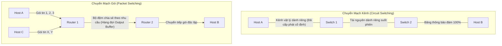
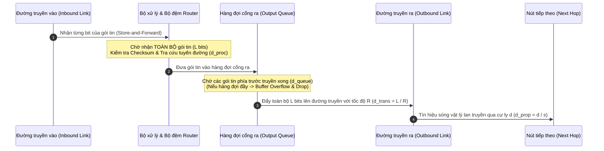
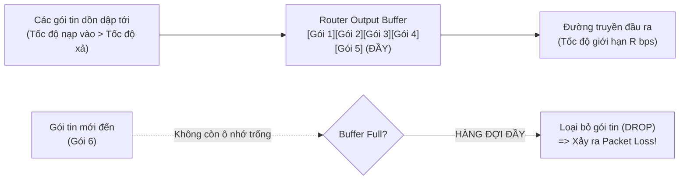

# 2_1_1 How Networks Transfer Data

> **Khóa học**: Cloud DevOps Basic — Networking Core  
> **Phân nhóm**: 2 Domain 2 - Computer Networking Core Fundamentals › 2_1 Network Fundamentals and Models  
> **Chủ đề**: Cơ chế truyền dữ liệu trong mạng máy tính: Chuyển mạch gói, Store-and-Forward và Phân rã 4 thành phần trễ mạng  
> **Trạng thái**: Draft (WRITE-CDB-2_1_1, 14-11-2026)  
> **Checklist đối chiếu**: [2_1_1](../../../CHECKLIST.md#domain-2-computer-networking-core-fundamentals-43-items)  

---

## 1. Khái Niệm Cốt Lõi & Bản Chất Kỹ Thuật (Core Concepts & Technical Deep Dive)

Trong kiến trúc mạng máy tính hiện đại, việc chuyển tải dữ liệu giữa các máy chủ không đơn thuần là đẩy các tín hiệu điện hoặc quang qua dây dẫn. Bản chất của Internet được xây dựng dựa trên sự đánh đổi kỹ thuật giữa hai triết lý chuyển mạch hoàn toàn trái ngược: **Chuyển mạch kênh (Circuit Switching)** và **Chuyển mạch gói (Packet Switching)**.

---

### 1.1 Hai mô hình chuyển mạch cốt lõi: Circuit Switching vs. Packet Switching

Theo đặc tả kinh điển trong giáo trình mạng máy tính của Kurose & Ross (Mục 1.2.1–1.2.2) và chuẩn [RFC 1812 Section 2.2.1](https://datatracker.ietf.org/doc/html/rfc1812#section-2.2.1):

| Tiêu chí kỹ thuật | Chuyển mạch kênh (Circuit Switching) | Chuyển mạch gói (Packet Switching) |
| :--- | :--- | :--- |
| **Cơ chế cấp phát tài nguyên** | **Cấp phát dành riêng (Reserved / Dedicated)**: Mọi tài nguyên dọc tuyến truyền (bộ đệm, tốc độ truyền dẫn liên kết) được giữ riêng cho phiên truyền suốt thời gian kết nối. | **Cấp phát theo nhu cầu (On-Demand / Statistical Multiplexing)**: Tài nguyên không hề được cấp phát trước; các gói tin dùng chung tài nguyên đường truyền khi phát sinh dữ liệu. |
| **Đơn vị truyền dữ liệu** | Luồng bit liên tục truyền qua kênh vật lý/logic cố định đã thiết lập sẵn. | Dữ liệu được chia nhỏ thành các khối độc lập gọi là **Gói tin (Packets)** mang theo thông tin địa chỉ nguồn và đích. |
| **Trạng thái khi không có dữ liệu (Idleness)** | **Lãng phí tài nguyên**: Dù hai bên hoàn toàn im lặng, kênh truyền vẫn bị chiếm dụng, các máy trạm khác không thể sử dụng. | **Tối ưu hóa hiệu suất**: Khi một nút không gửi dữ liệu, băng thông đường truyền lập tức sẵn sàng phục vụ các gói tin của nút khác. |
| **Hiện tượng xếp hàng (Queuing)** | Không có hiện tượng xếp hàng dọc tuyến; một khi kênh đã thiết lập, dữ liệu đi xuyên suốt với tốc độ cố định. | **Các gói tin phải xếp hàng (Queue)** tại bộ đệm của bộ chuyển mạch/router nếu đường truyền đầu ra đang bận. |
| **Ứng dụng tiêu biểu** | Mạng điện thoại viễn thông truyền thống (PSTN - Public Switched Telephone Network). | Mạng Internet toàn cầu và các mạng IP doanh nghiệp/Cloud hiện đại. |

---

### 1.2 Nguyên lý chuyển mạch Lưu trữ và Chuyển tiếp (Store-and-Forward Transmission)

Trong mạng chuyển mạch gói, thiết bị định tuyến trung gian (Packet Switch / Router) xử lý các gói tin theo một nguyên lý bắt buộc:

> *"Store-and-forward transmission means that the packet switch must receive the entire packet before it can begin to transmit the first bit of the packet onto the outbound link."*  
> *(Nguyên lý truyền dẫn Store-and-Forward quy định rằng thiết bị chuyển mạch gói bắt buộc phải nhận toàn bộ gói tin trước khi có thể bắt đầu truyền bit đầu tiên của gói tin đó lên đường truyền ra).*  
> — **Kurose & Ross (Computer Networking: A Top-Down Approach, 8th Edition)**; [RFC 1112](https://datatracker.ietf.org/doc/html/rfc1112)

**Tại sao Router phải đợi nhận đủ toàn bộ gói tin thay vì đẩy từng bit đi ngay khi nhận được?**
1. **Kiểm tra tính toàn vẹn (Integrity Verification)**: Router cần đọc toàn bộ gói tin để tính toán và đối chiếu mã kiểm tra lỗi (Frame Check Sequence / Checksum). Nếu một bit bị lỗi trên đường truyền, router lập tức hủy gói tin hỏng thay vì tiếp tục lãng phí băng thông chuyển tiếp dữ liệu rác đi xa.
2. **Xử lý phần đầu gói tin (Header Processing & Routing)**: Router cần trích xuất thông tin địa chỉ IP đích từ Header để tra cứu bảng định tuyến (FIB - Forwarding Information Base) nhằm xác định cổng giao tiếp đầu ra (outbound interface) thích hợp.
3. **Thích ứng chênh lệch tốc độ (Speed Matching)**: Giao diện mạng nhận dữ liệu có thể có tốc độ khác với giao diện mạng gửi đi (ví dụ: nhận từ liên kết 10 Gbps nhưng gửi ra liên kết 1 Gbps). Cơ chế Store-and-Forward cho phép lưu tạm gói tin vào bộ nhớ đệm (buffer) trước khi phát ra.

---

### 1.3 Phân rã 4 thành phần trễ tại nút mạng (Nodal Delay Components)

Khi một gói tin di chuyển từ một nút (máy trạm hoặc router) qua một liên kết vật lý tới nút tiếp theo, tổng thời gian trễ tại nút mạng ($d_{\text{nodal}}$) được cấu thành từ 4 thành phần vật lý và logic hoàn toàn độc lập theo công thức chuẩn:

$$d_{\text{nodal}} = d_{\text{proc}} + d_{\text{queue}} + d_{\text{trans}} + d_{\text{prop}}$$

Trong đó:

1. **Trễ xử lý nút ($d_{\text{proc}}$ — Processing Delay)**:
   - Thời gian router đọc phần đầu gói tin (header), kiểm tra mã checksum bit để phát hiện lỗi, và tra cứu bảng định tuyến để tìm cổng đầu ra.
   - Thường rất nhỏ, nằm trong khoảng micro-giây ($\mu\text{s}$) hoặc nano-giây trên các router phần cứng chuyên dụng (ASIC).

2. **Trễ hàng đợi ($d_{\text{queue}}$ — Queuing Delay)**:
   - Thời gian gói tin phải nằm chờ trong hàng đợi/bộ đệm (output buffer) tại cổng đầu ra trước khi đến lượt được truyền đi.
   - **Đặc điểm cốt lõi**: Đây là thành phần trễ **biến thiên mạnh nhất** (dynamic delay). Nếu đường truyền rảnh rỗi và không có gói tin nào xếp hàng trước, $d_{\text{queue}} = 0$. Nếu mạng bị nghẽn và hàng loạt gói tin đến dồn dập, trễ hàng đợi có thể tăng vọt lên hàng chục hoặc hàng trăm mili-giây.

3. **Trễ truyền phát ($d_{\text{trans}}$ — Transmission Delay)**:
   - Thời gian cần thiết để bộ chuyển mạch/router đẩy toàn bộ các bit của gói tin lên đường truyền vật lý:
     $$d_{\text{trans}} = \frac{L}{R}$$
   - Trong đó:
     - $L$: Chiều dài của gói tin (đo bằng **bits**).
     - $R$: Tốc độ truyền dẫn / băng thông của đường truyền (đo bằng **bps** — bits per second).

4. **Trễ lan truyền ($d_{\text{prop}}$ — Propagation Delay)**:
   - Thời gian để một bit tín hiệu vật lý (sóng điện từ, xung quang học) di chuyển qua môi trường vật lý (cáp đồng, cáp quang, không gian vô tuyến) từ nút phát đến nút thu:
     $$d_{\text{prop}} = \frac{d}{s}$$
   - Trong đó:
     - $d$: Khoảng cách vật lý giữa hai nút mạng (đo bằng **mét**).
     - $s$: Vận tốc lan truyền của sóng trong môi trường vật lý (trong cáp đồng và cáp quang, $s \approx 2 \times 10^8 \text{ m/s}$, xấp xỉ $2/3$ vận tốc ánh sáng trong chân không).

---

### 1.4 Phân biệt rạch ròi: Transmission Delay vs. Propagation Delay

Một trong những sai lầm phổ biến nhất của kỹ sư hệ thống là nhầm lẫn giữa **Trễ truyền phát ($d_{\text{trans}}$)** và **Trễ lan truyền ($d_{\text{prop}}$)**.

Theo phân tích của Kurose & Ross:
- **Transmission Delay ($L/R$)**: Là thời gian router cần để "đẩy" gói tin ra đường truyền. Nó là hàm số phụ thuộc vào **độ dài gói tin $L$** và **tốc độ đường truyền $R$**, hoàn toàn **không phụ thuộc** vào khoảng cách địa lý giữa hai router.
- **Propagation Delay ($d/s$)**: Là thời gian một bit đơn lẻ di chuyển dọc theo sợi cáp từ router A sang router B. Nó là hàm số phụ thuộc vào **khoảng cách địa lý $d$** và **vận tốc truyền sóng $s$**, hoàn toàn **không phụ thuộc** vào độ dài gói tin $L$ hay tốc độ truyền dẫn $R$.

| Tiêu chí | Trễ truyền phát ($d_{\text{trans}}$) | Trễ lan truyền ($d_{\text{prop}}$) |
| :--- | :--- | :--- |
| **Công thức xác định** | $d_{\text{trans}} = \frac{L}{R}$ | $d_{\text{prop}} = \frac{d}{s}$ |
| **Phụ thuộc vào** | Kích thước gói tin $L$ (bits) và Băng thông $R$ (bps). | Khoảng cách $d$ (mét) và Môi trường vật lý $s$ (m/s). |
| **Độc lập với** | Hoàn toàn không phụ thuộc khoảng cách $d$. | Hoàn toàn không phụ thuộc kích thước $L$ hay tốc độ $R$. |
| **Cách tối ưu hóa** | Nâng cấp băng thông cổng mạng (ví dụ: từ 1 Gbps lên 10 Gbps). | Rút ngắn khoảng cách vật lý (đặt máy chủ gần người dùng, dùng CDN/Edge). |

---

### 1.5 Cơ chế mất gói (Packet Loss & Buffer Overflow)

Theo đặc tả của Kurose & Ross (Mục 1.4.2) và tiêu chuẩn bộ định tuyến [RFC 1812 Section 5.3.6](https://datatracker.ietf.org/doc/html/rfc1812#section-5.3.6):
- Bộ đệm hàng đợi (queue/buffer) của router có **dung lượng lưu trữ hữu hạn (finite capacity)**.
- Khi lưu lượng các gói tin đi tới cổng mạng vượt quá tốc độ phát của đường truyền ra trong một khoảng thời gian nhất định, hàng đợi sẽ dần tích lũy và bị lấp đầy.
- Khi hàng đợi đã đầy hoàn toàn: một gói tin mới đến sẽ phát hiện không còn bất kỳ ô nhớ trống nào trong bộ đệm. Khi đó, hiện tượng **tràn bộ đệm (Buffer Overflow)** xảy ra. Router buộc phải hủy bỏ gói tin đó (gói tin bị drop / mất gói - **Packet Loss**).
- Hiện tượng mất gói làm gián đoạn luồng dữ liệu, kích hoạt cơ chế phát hiện mất mát và truyền lại của các giao thức tầng trên (như TCP Retransmission), làm suy giảm băng thông khả dụng thực tế của kết nối.

---

## 2. Ví Dụ Đời Sống Thực Tế Dễ Hiểu (Intuitive Real-World Analogies)

### Ẩn dụ 1: Tuyến Tàu Hỏa Độc Quyền vs. Hệ Thống Xe Tải Bưu Chính

Để hình dung sự khác biệt giữa Chuyển mạch kênh (Circuit Switching) và Chuyển mạch gói (Packet Switching):

1. **Chuyển mạch kênh (Circuit Switching) — Thuê bao trọn gói đoàn tàu hỏa riêng**:
   - Bạn muốn vận chuyển hàng hóa từ Hà Nội vào TP. Hồ Chí Minh. Thay vì gửi từng kiện hàng, bạn ký hợp đồng giữ riêng toàn bộ tuyến đường sắt Bắc - Nam cho đoàn tàu của riêng bạn trong suốt 2 tiếng đồng hồ.
   - Dù trong suốt 2 tiếng đó tàu của bạn chạy rỗng hoặc chỉ chở một kiện hàng nhỏ, toàn bộ đường ray vẫn bị khóa cứng. Không một đoàn tàu nào khác của người dân được phép lăn bánh trên tuyến đường này. Đây là mô hình lãng phí tài nguyên khi lưu lượng không liên tục, nhưng đảm bảo không bao giờ bị tắc đường.
2. **Chuyển mạch gói (Packet Switching) — Bưu điện chuyển phát bưu kiện**:
   - Bạn có một bức thư dài 100 trang. Bạn chia bức thư ra làm 10 phong bì nhỏ (packets), dán tem ghi rõ địa chỉ nguồn và địa chỉ đích lên từng phong bì rồi bỏ vào hòm thư bưu điện.
   - Bưu điện gom chung các phong bì của bạn cùng với bưu kiện của hàng nghìn khách hàng khác lên các chuyến xe tải bưu chính dùng chung (chia sẻ tài nguyên đường bộ).
   - Tại các trạm trung chuyển bưu cục (routers), xe tải dỡ hàng xuống và các kiện hàng phải **xếp hàng trên băng chuyền (queuing)** chờ nhân viên phân loại. Nếu bưu cục bị quá tải và kho hàng chật cứng, bưu kiện có thể bị từ chối hoặc thất lạc (**packet loss**).

---

### Ẩn dụ 2: Ném Thư Lên Thùng Xe vs. Xe Chạy Trên Cao Tốc

Để không bao giờ nhầm lẫn giữa Trễ truyền phát ($d_{\text{trans}}$) và Trễ lan truyền ($d_{\text{prop}}$):

1. **Trễ truyền phát ($d_{\text{trans}} = L/R$) — Thời gian bốc hàng lên xe**:
   - Hãy tưởng tượng một nhân viên bưu tá đứng ở cửa kho và bốc từng thùng hàng ném lên thùng xe tải.
   - Nếu kiện hàng có 1000 kiện ($L$) và tay nhân viên ném được 100 kiện/phút ($R$), anh ta mất đúng 10 phút để chất toàn bộ hàng lên xe.
   - Thời gian 10 phút này chỉ phụ thuộc vào số lượng hàng cần bốc ($L$) và tốc độ đôi tay của nhân viên ($R$). Khoảng cách từ kho hàng này đến kho hàng tiếp theo là 10 mét hay 1,000 km hoàn toàn không ảnh hưởng đến thời gian bốc hàng này.
2. **Trễ lan truyền ($d_{\text{prop}} = d/s$) — Thời gian chiếc xe lăn bánh trên cao tốc**:
   - Khi thùng hàng cuối cùng vừa được ném lên xe, tài xế đóng cửa thùng và nhấn ga cho xe chạy trên đường cao tốc nối giữa hai thành phố.
   - Thời gian chiếc xe di chuyển từ kho A đến kho B chỉ phụ thuộc vào chiều dài quãng đường cao tốc ($d$) và tốc độ tối đa cho phép của xe ($s$).
   - Dù trên xe chở 1 phong thư nhỏ hay chở 10 tấn hàng, chiếc xe vẫn mất chừng đó thời gian để chạy qua hết quãng đường.

> 💡 **Thông điệp cốt lõi (Core Message)**:  
> **Internet là mạng chuyển mạch gói (packet switching) hoạt động theo nguyên lý Store-and-Forward với tài nguyên chia sẻ theo nhu cầu (statistical multiplexing). Tổng thời gian trễ một chặng gồm 4 thành phần ($d_{\text{proc}} + d_{\text{queue}} + d_{\text{trans}} + d_{\text{prop}}$), trong đó hàng đợi buffer là nơi gây trễ biến thiên và mất gói (packet loss) khi quá tải.**

---

## 3. Kiến Trúc, Luồng Hoạt Động & Hình Ảnh Trực Quan (Architecture, Diagrams & Visual Media)

### 3.1 Minh họa trực quan từ tài liệu chính thức

Dưới đây là hình ảnh mô phỏng quá trình truyền gói tin trên một liên kết vật lý kết nối giữa hai nút mạng:

[](https://gaia.cs.umass.edu/kurose_ross/interactive/single_link_transmission_time.png)  
*Hình 1: Trực quan hóa trễ truyền phát ($d_{\text{trans}}$ - đẩy các bit của gói ra dây) và trễ lan truyền ($d_{\text{prop}}$ - các bit di chuyển dọc theo liên kết truyền thông) (Nguồn: Kurose & Ross Interactive Learning Resources).*

---

### 3.2 Sơ đồ so sánh kiến trúc Circuit Switching vs. Packet Switching



---

### 3.3 Luồng xử lý Store-and-Forward và các thành phần trễ tại Router



---

### 3.4 Cơ chế tràn hàng đợi (Buffer Overflow & Packet Drop)



---

## 4. Bài Toán Tính Toán Chi Tiết & Khảo Sát Mạng Bằng Linux CLI (Worked Calculations & Hands-on Linux CLI)

### 4.1 Bài toán tính toán chi tiết các thành phần trễ nút mạng (Step-by-step Worked Exercise)

**Đề bài kịch bản thực tế**:  
Một gói tin IP có kích thước chuẩn Ethernet $L = 1500 \text{ bytes}$ được truyền qua một đường truyền cáp quang diện rộng kết nối giữa hai thành phố có cự ly $d = 1000 \text{ km}$.
- Băng thông đường truyền: $R = 1 \text{ Gbps}$ ($10^9 \text{ bits/giây}$).
- Vận tốc lan truyền của ánh sáng trong sợi cáp quang: $s = 2 \times 10^8 \text{ m/s}$.
- Trễ xử lý tại router: $d_{\text{proc}} = 10 \ \mu\text{s}$ ($0.01 \text{ ms}$).
- Giả định đường truyền thông thoáng, không có gói tin nào xếp hàng trước: $d_{\text{queue}} = 0$.

Hãy tính toán chi tiết:
1. Trễ truyền phát ($d_{\text{trans}}$).
2. Trễ lan truyền ($d_{\text{prop}}$).
3. Tổng trễ nút mạng ($d_{\text{nodal}}$).
4. So sánh tỷ lệ giữa $d_{\text{prop}}$ và $d_{\text{trans}}$ và rút ra kết luận thực tiễn.

---

#### Lời giải chi tiết:

**Bước 1: Quy đổi đơn vị tiêu chuẩn**
- Đổi kích thước gói tin từ byte sang bit:
  $$L = 1500 \text{ bytes} \times 8 \text{ bits/byte} = 12000 \text{ bits}$$
- Đổi khoảng cách từ kilômét sang mét:
  $$d = 1000 \text{ km} = 1000 \times 10^3 \text{ m} = 10^6 \text{ m}$$
- Tốc độ truyền dẫn:
  $$R = 1 \text{ Gbps} = 10^9 \text{ bps}$$

---

**Bước 2: Tính trễ truyền phát ($d_{\text{trans}}$)**
Áp dụng công thức theo Claim 1.3 và Claim 1.4:
$$d_{\text{trans}} = \frac{L}{R} = \frac{12000 \text{ bits}}{10^9 \text{ bits/s}} = 0.000012 \text{ giây} = 12 \ \mu\text{s} = 0.012 \text{ ms}$$

*Ý nghĩa*: Card mạng chỉ mất đúng 12 micro-giây ($0.012 \text{ ms}$) để đẩy toàn bộ 1500 bytes lên đường truyền cáp quang.

---

**Bước 3: Tính trễ lan truyền ($d_{\text{prop}}$)**
Áp dụng công thức:
$$d_{\text{prop}} = \frac{d}{s} = \frac{10^6 \text{ m}}{2 \times 10^8 \text{ m/s}} = \frac{1}{200} \text{ giây} = 0.005 \text{ giây} = 5 \text{ ms} = 5000 \ \mu\text{s}$$

*Ý nghĩa*: Xung photon ánh sáng mất đúng 5 mili-giây ($5000 \ \mu\text{s}$) để bay qua quãng đường cáp quang 1000 km.

---

**Bước 4: Tính tổng trễ nút mạng ($d_{\text{nodal}}$)**
Tổng trễ tại nút mạng là:
$$d_{\text{nodal}} = d_{\text{proc}} + d_{\text{queue}} + d_{\text{trans}} + d_{\text{prop}}$$
$$d_{\text{nodal}} = 0.01 \text{ ms} + 0 \text{ ms} + 0.012 \text{ ms} + 5 \text{ ms} = 5.022 \text{ ms}$$

---

**Bước 5: So sánh và rút ra kết luận cốt lõi**
Xét tỷ số giữa trễ lan truyền và trễ truyền phát:
$$\frac{d_{\text{prop}}}{d_{\text{trans}}} = \frac{5 \text{ ms}}{0.012 \text{ ms}} \approx 416.7 \text{ lần}$$

> 📌 **Bài học kiến trúc**:
> Trên các liên kết mạng diện rộng (WAN), **trễ lan truyền vật lý ($d_{\text{prop}}$) áp đảo hoàn toàn trễ truyền phát ($d_{\text{trans}}$)**.
> Dù doanh nghiệp có chi rất nhiều tiền nâng cấp băng thông từ 1 Gbps lên 10 Gbps (giảm $d_{\text{trans}}$ từ $12 \ \mu\text{s}$ xuống $1.2 \ \mu\text{s}$), tổng thời gian truyền gói tin vẫn xấp xỉ 5 ms do bị giới hạn bởi vận tốc ánh sáng và khoảng cách địa lý.

---

### 4.2 Khảo sát trễ khứ hồi RTT và mất gói với `ping -c <count> <target>`

Trên hệ điều hành Linux, tiện ích `ping` (thuộc gói `iputils`, theo [man7 ping(8)](https://man7.org/linux/man-pages/man8/ping.8.html)) gửi các gói tin ICMP ECHO_REQUEST để đo lường thời gian khứ hồi (Round-Trip Time - RTT) và tỷ lệ mất gói (packet loss).

```bash
# Gửi 4 gói tin ICMP tới DNS máy chủ Google và dừng lại
ping -c 4 8.8.8.8
```

> 💡 **Minh họa thực thi (Illustrative Output)**:
```text
PING 8.8.8.8 (8.8.8.8) 56(84) bytes of data.
64 bytes from 8.8.8.8: icmp_seq=1 ttl=116 time=14.2 ms
64 bytes from 8.8.8.8: icmp_seq=2 ttl=116 time=13.8 ms
64 bytes from 8.8.8.8: icmp_seq=3 ttl=116 time=14.5 ms
64 bytes from 8.8.8.8: icmp_seq=4 ttl=116 time=13.9 ms

--- 8.8.8.8 ping statistics ---
4 packets transmitted, 4 received, 0% packet loss, time 3004ms
rtt min/avg/max/mdev = 13.812/14.105/14.502/0.268 ms
```

**Phân tích kỹ thuật các trường đầu ra**:
1. `time=... ms`: Thời gian trễ khứ hồi (RTT) cho từng gói tin riêng biệt. RTT bao gồm tổng trễ nodal theo chiều đi và chiều về ($d_{\text{nodal\_forward}} + d_{\text{nodal\_return}}$).
2. `0% packet loss`: Tỷ lệ phần trăm số gói bị mất dọc đường. Nếu giá trị này lớn hơn 0%, điều đó biểu thị một hoặc nhiều router trên đường truyền đã gặp hiện tượng đầy hàng đợi (Buffer Overflow) và loại bỏ gói tin theo RFC 1812.
3. `rtt min/avg/max/mdev`:
   - `min` ($13.812 \text{ ms}$): Thời gian RTT ngắn nhất ghi nhận được khi hàng đợi trên các router gần như bằng 0 ($d_{\text{queue}} \approx 0$).
   - `avg` ($14.105 \text{ ms}$): Thời gian RTT trung bình của các gói thử nghiệm.
   - `max` ($14.502 \text{ ms}$): Thời gian RTT lớn nhất, phản ánh thời điểm các router trung gian đang có hàng đợi cần xả ($d_{\text{queue}} > 0$).
   - `mdev` ($0.268 \text{ ms}$ — mean deviation): Độ lệch chuẩn dân số (population standard deviation), đại diện cho mức độ biến thiên trễ (Jitter) của hàng đợi mạng. Giá trị `mdev` càng cao chứng tỏ hàng đợi mạng đang biến động rất bất ổn.

---

### 4.3 Khảo sát tốc độ đường truyền $R$ và chế độ Duplex với `ethtool <interface>`

Để xác định chính xác tham số tốc độ truyền dẫn $R$ được card mạng sử dụng trong công thức tính trễ truyền phát ($d_{\text{trans}} = L/R$), kỹ sư sử dụng công cụ [ethtool(8)](https://man7.org/linux/man-pages/man8/ethtool.8.html):

```bash
# Kiểm tra thông số phần cứng và cấu hình tốc độ của card mạng eth0
ethtool eth0
```

> 💡 **Minh họa thực thi (Illustrative Output)**:
```text
Settings for eth0:
	Supported ports: [ TP ]
	Supported link modes:   10baseT/Half 10baseT/Full
	                        100baseT/Half 100baseT/Full
	                        1000baseT/Full
	Supported pause frame use: No
	Supports auto-negotiation: Yes
	Speed: 1000Mb/s
	Duplex: Full
	Auto-negotiation: on
	Port: Twisted Pair
	Link detected: yes
```

**Phân tích kỹ thuật**:
- `Speed: 1000Mb/s`: Tốc độ truyền dẫn thực tế của liên kết vật lý hiện tại ($R = 1000 \text{ Mbps} = 1 \text{ Gbps}$). Đây chính là giá trị mẫu số $R$ trong công thức $d_{\text{trans}} = L/R$.
- `Duplex: Full`: Chế độ song công toàn phần (Full Duplex), cho phép card mạng truyền và nhận bit đồng thời trên hai kênh riêng biệt mà không gây xung đột tín hiệu.
- `Auto-negotiation: on`: Card mạng tự động bắt tay với Switch đầu đối diện để chọn tốc độ truyền dẫn cao nhất mà cả hai bên cùng hỗ trợ.

---

## 5. Cạm Bẫy Thực Tế & Thực Tiễn Sản Xuất (Production Gotchas & Best Practices)

Trong thiết kế hạ tầng Cloud, DevOps và vận hành hệ thống mạng phân tán, việc hiểu rõ các thành phần trễ giúp tránh các sai lầm tốn kém:

1. **Cạm bẫy "Băng thông cao tương đương độ trễ thấp" (The Bandwidth vs. Latency Fallacy)**:
   - *Sai lầm*: Nhiều tổ chức khi thấy ứng dụng gọi API đa vùng (Multi-Region Cloud) bị chậm đã chi trả số tiền lớn để nâng cấp đường truyền mạng từ 1 Gbps lên 10 Gbps với kỳ vọng giảm độ trễ phản hồi.
   - *Bản chất*: Nâng cấp băng thông chỉ làm giảm $d_{\text{trans}}$ (vốn chỉ chiếm vài micro-giây). Độ trễ của cuộc gọi qua khoảng cách 10,000 km giữa Tokyo và US-East bị chi phối hoàn toàn bởi $d_{\text{prop}}$ (vận tốc ánh sáng qua sợi quang mất tối thiểu ~50–70 ms).
   - *Giải pháp*: Không thể đánh bại định luật vật lý về $d_{\text{prop}}$ bằng tiền mua băng thông. Giải pháp kiến trúc bắt buộc là đưa dữ liệu và dịch vụ đến gần người dùng nhất thông qua CDN, Edge Caching, hoặc triển khai ứng dụng đa vùng (Multi-Region Active-Active).

2. **Hiện tượng Bufferbloat (Bộ đệm phình to) gây trễ hàng đợi kinh hoàng**:
   - *Bản chất*: Một số thiết bị mạng được cấu hình bộ đệm hàng đợi (buffer) quá lớn với hy vọng tránh mất gói tin ($0\% \text{ packet loss}$).
   - *Hậu quả*: Khi xảy ra nghẽn mạng, hàng nghìn gói tin bị "ngâm" trong bộ đệm hàng trăm mili-giây thay vì bị drop sớm. Hậu quả là kết nối không hề mất gói nhưng độ trễ tăng vọt lên hàng nghìn ms ($d_{\text{queue}}$ bùng nổ), khiến giao thức TCP không thể nhận biết sớm tình trạng nghẽn để giảm tốc độ truyền, làm tê liệt các ứng dụng thời gian thực như VoIP, video call hay interactive SSH session.

3. **Phân biệt Packet Loss do Lỗi Cáp Vật Lý vs. Tràn Hàng Đợi (Buffer Overflow)**:
   - Khi quan sát thấy `packet loss` qua `ping`:
     - Nếu lỗi do suy hao cáp hoặc nhiễu vật lý: Khung tin bị hỏng bit, card mạng sẽ ghi nhận tăng giá trị `rx_crc_errors` hoặc `rx_frame_errors` trong `ethtool -S <interface>`.
     - Nếu lỗi do quá tải hàng đợi (Buffer Overflow theo RFC 1812 Sec 5.3.6): Các bộ đếm `rx_discards` hoặc `rx_missed_errors` / `dropped` sẽ tăng lên trong khi các bộ đếm lỗi CRC hoàn toàn bằng 0. Điều này xác nhận card mạng hoặc router đã chủ động vứt bỏ gói tin vì không còn ô nhớ trống.

---

## 6. Câu Hỏi Củng Cố Kiến Thức (Active Recall Quiz)

<details>
<summary><b>Câu hỏi 1:</b> Phân tích sự khác biệt cốt lõi về cơ chế cấp phát tài nguyên giữa Chuyển mạch kênh (Circuit Switching) và Chuyển mạch gói (Packet Switching). Tại sao trong mạng chuyển mạch gói lại xảy ra hiện tượng trễ hàng đợi và mất gói?</summary>

**Đáp án:**
Theo Kurose & Ross (Mục 1.2.1–1.2.2) và RFC 1812 (Section 2.2.1):
- **Chuyển mạch kênh (Circuit Switching)**: Cấp phát tài nguyên chuyên dụng (dedicated, reserved) dọc theo toàn bộ tuyến đường cho phiên truyền. Tài nguyên bị chiếm giữ độc quyền suốt phiên, không chia sẻ cho người khác, nên không có hàng đợi nhưng gây lãng phí khi không có dữ liệu truyền.
- **Chuyển mạch gói (Packet Switching)**: Tài nguyên không hề được cấp phát trước; các gói tin dùng chung tài nguyên đường truyền theo nhu cầu (on-demand / statistical multiplexing).
- **Nguyên nhân trễ hàng đợi và mất gói**: Do tài nguyên không được giữ trước, các gói tin độc lập của nhiều nguồn có thể cùng đến một router tại một thời điểm. Nếu tốc độ đến tạm thời vượt quá tốc độ phát của đường truyền ra, các gói tin bắt buộc phải xếp hàng chờ trong bộ đệm ($d_{\text{queue}}$). Khi bộ đệm hữu hạn của router bị đầy hoàn toàn (buffer overflow), router buộc phải loại bỏ gói tin mới đến hoặc gói đang chờ, dẫn tới hiện tượng mất gói (**packet loss**).
</details>

<details>
<summary><b>Câu hỏi 2:</b> Một kỹ sư DevOps nhận thấy ứng dụng gửi gói tin giữa hai trung tâm dữ liệu cách nhau 3000 km mất thời gian trễ một chiều là khoảng 15 ms. Nhóm phát triển đề xuất nâng cấp card mạng từ 1 Gbps lên 10 Gbps để giảm thời gian trễ này xuống dưới 2 ms. Đề xuất này có khả thi về mặt kỹ thuật không? Tại sao?</summary>

**Đáp án:**
Đề xuất này **hoàn toàn không khả thi**.
- Nâng cấp tốc độ card mạng từ 1 Gbps lên 10 Gbps chỉ làm giảm **Trễ truyền phát ($d_{\text{trans}} = L/R$)**, ví dụ từ $12 \ \mu\text{s}$ xuống $1.2 \ \mu\text{s}$ đối với gói tin 1500 bytes.
- Trong khi đó, **Trễ lan truyền ($d_{\text{prop}} = d/s$)** cho khoảng cách 3000 km trong sợi cáp quang ($s \approx 2 \times 10^8 \text{ m/s}$) tối thiểu đã là:
  $$d_{\text{prop}} = \frac{3000 \times 10^3 \text{ m}}{2 \times 10^8 \text{ m/s}} = 0.015 \text{ giây} = 15 \text{ ms}$$
- Trễ lan truyền phụ thuộc vào khoảng cách địa lý và vận tốc ánh sáng, hoàn toàn độc lập với băng thông $R$. Do đó, dù băng thông có nâng lên 10 Gbps hay 100 Gbps, độ trễ vật lý 15 ms vẫn không thể giảm xuống dưới 2 ms nếu không rút ngắn khoảng cách địa lý.
</details>

<details>
<summary><b>Câu hỏi 3:</b> Trình bày nguyên lý Store-and-Forward của bộ chuyển mạch gói. Nếu một gói tin kích thước $L = 8000 \text{ bits}$ được truyền từ Host A đến Host B qua một Router trung gian R, hai đường truyền đều có tốc độ $R = 2 \text{ Mbps}$ ($2 \times 10^6 \text{ bps}$), bỏ qua trễ xử lý, hàng đợi và lan truyền, hãy tính tổng thời gian từ khi bit đầu tiên rời Host A đến khi bit cuối cùng của gói tin đến được Host B.</summary>

**Đáp án:**
Theo nguyên lý Store-and-Forward (Kurose & Ross Mục 1.2.1; RFC 1112):
- Router R bắt buộc phải nhận đủ toàn bộ $L$ bits của gói tin trước khi có thể bắt đầu truyền bit đầu tiên lên đường truyền ra tới Host B.
- Thời gian Host A truyền phát toàn bộ gói tin tới Router R:
  $$d_{\text{trans1}} = \frac{L}{R} = \frac{8000 \text{ bits}}{2 \times 10^6 \text{ bps}} = 0.004 \text{ s} = 4 \text{ ms}$$
- Tại thời điểm $t = 4 \text{ ms}$, Router R mới nhận đủ gói tin và bắt đầu đẩy bit đầu tiên sang liên kết tới Host B.
- Thời gian Router R truyền phát toàn bộ gói tin tới Host B:
  $$d_{\text{trans2}} = \frac{L}{R} = \frac{8000 \text{ bits}}{2 \times 10^6 \text{ bps}} = 4 \text{ ms}$$
- Tổng thời gian để Host B nhận trọn vẹn gói tin là:
  $$\text{Tổng thời gian} = d_{\text{trans1}} + d_{\text{trans2}} = 4 \text{ ms} + 4 \text{ ms} = 8 \text{ ms}$$
*(Lưu ý: Nếu không có Store-and-Forward mà là Cut-Through, thời gian sẽ xấp xỉ 4 ms, nhưng router IP hiện đại áp dụng Store-and-Forward để kiểm tra toàn vẹn và định tuyến gói tin).*
</details>

---

## 7. 📚 Nguồn Tài Liệu Chính Thống (Tier-1 Official References)

- [RFC 1812: Requirements for IP Version 4 Routers](https://datatracker.ietf.org/doc/html/rfc1812) - Tiêu chuẩn kỹ thuật IETF cho bộ định tuyến IPv4; Mục 2.2.1 định nghĩa mô hình mạng chuyển mạch gói và dịch vụ không kết nối; Mục 5.3.6 quy định cơ chế quản lý hàng đợi và loại bỏ gói tin khi tràn bộ đệm.
- [RFC 1112: Host Extensions for IP Multicasting](https://datatracker.ietf.org/doc/html/rfc1112) - Chuẩn Internet định nghĩa nguyên lý truyền dẫn và chuyển mạch gói Store-and-Forward.
- [RFC 2679: A One-way Delay Metric for IPPM](https://datatracker.ietf.org/doc/html/rfc2679) - Tiêu chuẩn IETF về phương pháp đo lường và định lượng trễ truyền dẫn một chiều trong mạng IP.
- [Linux Manual Pages: ping(8)](https://man7.org/linux/man-pages/man8/ping.8.html) - Tài liệu hướng dẫn chính thức của Linux iputils về lệnh ping, cấu hình đếm gói (`-c`), và phân tích các chỉ số thống kê RTT (`min/avg/max/mdev`) cùng tỷ lệ mất gói.
- [Linux Manual Pages: ethtool(8)](https://man7.org/linux/man-pages/man8/ethtool.8.html) - Hướng dẫn chính thức của Linux về tiện ích ethtool để truy vấn và điều khiển thông số phần cứng card mạng, tốc độ truyền dẫn liên kết (`Speed`), chế độ song công (`Duplex`) và tự động thương lượng (`Auto-negotiation`).
- [Kurose & Ross: Single-link Transmission Time Simulation](https://gaia.cs.umass.edu/kurose_ross/interactive/single_link_transmission_time.png) - Minh họa trực quan và tài liệu tương tác về các thành phần trễ nút mạng từ nhóm tác giả *Computer Networking: A Top-Down Approach*.
