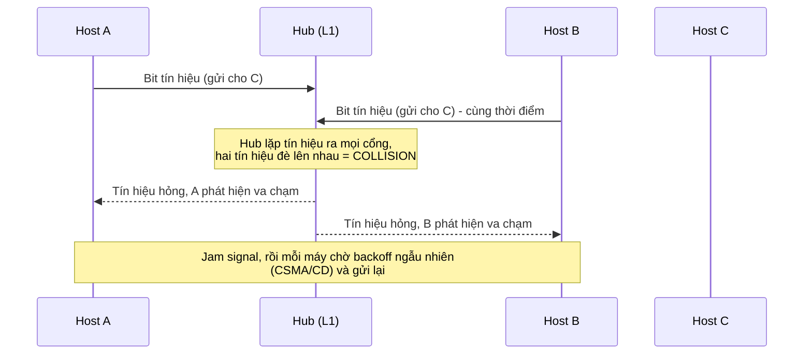
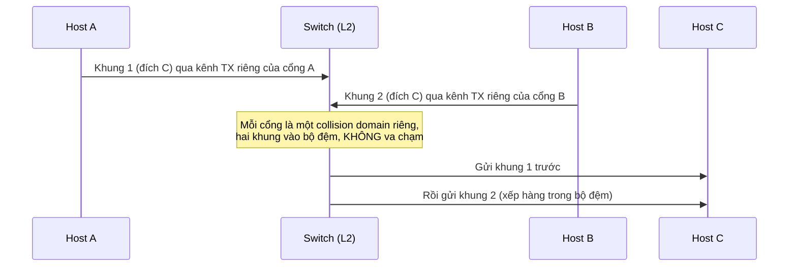
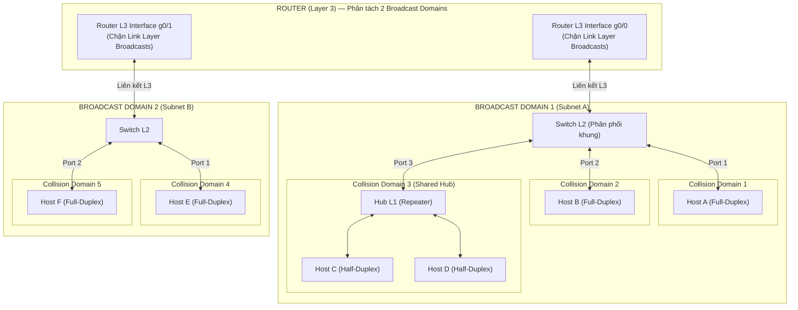

# 2_1_2 Collision Domains vs Broadcast Domains

> **Khóa học**: Cloud DevOps Basic — Networking Core  
> **Phân nhóm**: 2 Domain 2 - Computer Networking Core Fundamentals › 2_1 Network Fundamentals and Models  
> **Chủ đề**: Phân biệt Miền xung đột (Collision Domain) và Miền quảng bá (Broadcast Domain): Vai trò của Hub, Switch và Router  
> **Trạng thái**: Draft (WRITE-CDB-2_1_2, 14-11-2026)  
> **Checklist đối chiếu**: [2_1_2](../../../CHECKLIST.md#domain-2-computer-networking-core-fundamentals-43-items)  

---

## 1. Khái Niệm Cốt Lõi & Bản Chất Kỹ Thuật (Core Concepts & Technical Deep Dive)

Trong kiến trúc mạng máy tính, việc phân định ranh giới truyền dẫn và phạm vi lan tỏa của tín hiệu là yếu tố quyết định hiệu năng, độ tin cậy và khả năng mở rộng của toàn bộ hệ thống. Hai khái niệm nền tảng chi phối hành vi truyền thông ở Tầng Vật lý (Layer 1), Tầng Liên kết Dữ liệu (Layer 2) và Tầng Mạng (Layer 3) chính là **Miền Xung Đột (Collision Domain)** và **Miền Quảng Bá (Broadcast Domain)**.

---

### 1.1 Bản chất của Miền Xung Đột (Collision Domain) & Môi trường Half-Duplex

Theo chuẩn IEEE Std 802.3 và giáo trình *Computer Networking: A Top-Down Approach* (Kurose & Ross, Sec 6.3.2):
- **Định nghĩa**: **Miền xung đột (Collision Domain)** là một phân đoạn mạng vật lý dùng chung môi trường truyền dẫn (shared transmission medium), nơi mà nếu hai hoặc nhiều thiết bị phát tín hiệu đồng thời, các xung điện từ trên đường truyền sẽ giao thoa và triệt tiêu lẫn nhau, dẫn đến hiện tượng **xung đột tín hiệu vật lý (collision)**.
- **Môi trường Bán song công (Half-Duplex)**:
  - Khi một liên kết Ethernet hoạt động ở chế độ half-duplex, thiết bị chỉ có thể gửi hoặc nhận tín hiệu tại một thời điểm, không thể thực hiện đồng thời cả hai thao tác trên cùng một kênh truyền.
  - Để chia sẻ đường truyền, Ethernet half-duplex bắt buộc phải áp dụng thuật toán truy nhập đa kênh cảm ứng sóng mang có phát hiện va chạm: **CSMA/CD (Carrier Sense Multiple Access with Collision Detection)**.
  - Khi va chạm xảy ra, các trạm phát hiện xung đột tín hiệu sẽ lập tức hủy khung tin đang truyền, phát một tín hiệu cảnh báo va chạm (jam signal) để toàn bộ mạng nhận biết, sau đó mỗi nút sẽ chờ một khoảng thời gian ngẫu nhiên (exponential backoff) trước khi thử truyền lại.
  - Số lượng thiết bị trong một collision domain càng lớn thì xác suất xung đột càng cao, dẫn đến băng thông hữu dụng của đường truyền suy giảm nghiêm trọng.

---

### 1.2 Vai trò của Hub (Layer 1): Kéo dài và Gộp chung một Collision Domain Duy Nhất

Theo chuẩn IEEE 802.3 Clause 9 và Kurose & Ross (Sec 6.4.1):
- **Bản chất của Hub (Bộ lặp đa cổng - Multiport Repeater)**:
  - Hub là thiết bị hoạt động hoàn toàn ở **Tầng Vật lý (Layer 1)**. Hub chỉ nhận diện và xử lý các bit tín hiệu điện/quang riêng lẻ, hoàn toàn không có bộ nhớ đệm (no buffering) và không hiểu bất kỳ cấu trúc khung tin Ethernet nào (không phân tích địa chỉ MAC hay kiểm tra tính toàn vẹn FCS).
  - Khi một bit đến từ một cổng (interface), Hub đơn giản khuếch đại biên độ tín hiệu và phát lặp lại bit đó ra **tất cả các cổng còn lại**.
- **Tác động đến Collision Domain**:
  - Vì Hub không thể lưu đệm khung tin, nếu hai thiết bị gắn vào hai cổng khác nhau của Hub phát tín hiệu cùng lúc, các xung điện sẽ va chạm ngay tại bảng mạch trung tâm của Hub.
  - Do đó, **tất cả các cổng của một Hub nằm chung trong một Collision Domain duy nhất**. Hub chỉ mở rộng phạm vi khoảng cách vật lý của mạng chứ không phân tách hay thu hẹp miền xung đột.

---

### 1.3 Vai trò của Switch (Layer 2): Triệt tiêu va chạm bằng Vi phân đoạn (Microsegmentation) & Full-Duplex

Theo chuẩn IEEE 802.1D và Kurose & Ross (Sec 6.4.2):
- **Bản chất của Switch (Bộ chuyển mạch Layer 2)**:
  - Switch là thiết bị thông minh hoạt động tại **Tầng Liên kết Dữ liệu (Layer 2)**. Switch nhận trọn vẹn khung tin vào bộ nhớ đệm (frame buffering), kiểm tra mã kiểm tra khung (FCS / CRC-32), đọc địa chỉ MAC nguồn để học vị trí cổng vào bảng CAM, và đọc địa chỉ MAC đích để chuyển tiếp khung một cách có chọn lọc.
  - Nhờ cơ chế lưu đệm, Switch không bao giờ truyền đồng thời nhiều hơn một khung tin trên cùng một phân đoạn cáp tại một thời điểm.
- **Chế độ Toàn song công (Full-Duplex - IEEE 802.3 Clause 4)**:
  - Trên các liên kết hiện đại giữa Switch và card mạng (NIC), đường truyền được thiết lập ở chế độ **Full-Duplex**, cung cấp hai kênh truyền dẫn độc lập: một kênh dành riêng cho chiều truyền (TX) và một kênh dành riêng cho chiều nhận (RX).
  - Ở chế độ Full-Duplex, thuật toán CSMA/CD được vô hiệu hóa hoàn toàn vì tín hiệu gửi và nhận không đi chung một dây dẫn.
- **Tác động đến Collision Domain**:
  - **Mỗi cổng của Switch tạo thành một Collision Domain độc lập**.
  - Trong một mạng LAN thuần Switch (không có Hub) chạy Full-Duplex, khái niệm va chạm hoàn toàn bị triệt tiêu ($0$ collisions). Kỹ thuật phân tách này được gọi là **vi phân đoạn mạng (microsegmentation)**.

---

### 1.3.1 Đào sâu: Hub và Switch xử lý khi hai đầu cùng gửi

Phần này trả lời câu hỏi thường gặp: *"Nếu hai máy cùng gửi tại một thời điểm thì chuyện gì xảy ra?"* Câu trả lời phụ thuộc vào việc thiết bị ở giữa là Hub hay Switch.

**Điểm khác biệt cốt lõi**: Hub **không lưu giữ** khung tin (chỉ lặp lại tín hiệu điện), còn Switch **nhận trọn khung tin vào bộ nhớ đệm** rồi mới quyết định chuyển ra cổng nào, vào lúc nào.

#### a) Hub: hai máy cùng gửi thì va chạm



- Hub chỉ khuếch đại và phát lại bit ra **mọi cổng khác**, nên mọi máy (kể cả máy không phải đích) đều nhận tín hiệu.
- Cả mạng chỉ có **một "đường truyền"**: tại một thời điểm chỉ một máy được nói thành công. Càng nhiều máy thì băng thông mỗi máy càng thấp.

#### b) Switch: hai máy cùng gửi thì không va chạm



- Mỗi cổng có kênh TX và RX riêng (Full-Duplex) nên tín hiệu của A và B **không bao giờ chung một dây dẫn**.
- Khi hai khung cùng muốn ra **một cổng đích** (cổng của C), Switch **xếp hàng (queue)** trong bộ đệm và gửi lần lượt. Đây là hiện tượng **nghẽn hàng đợi (congestion)**, không phải collision. Nếu bộ đệm đầy, Switch sẽ **hủy bớt khung (drop)**, và các giao thức tầng trên như TCP sẽ phát hiện mất gói rồi gửi lại.

#### c) Switch biết gửi khung ra cổng nào bằng cách nào?

Switch học vị trí các máy bằng **bảng MAC (CAM table)**:

1. **Học (learning)**: khi nhận khung từ cổng X, Switch đọc **MAC nguồn** và ghi nhớ "MAC này nằm sau cổng X".
2. **Chuyển tiếp có chọn lọc (forwarding)**: nếu **MAC đích** đã có trong bảng, Switch chỉ gửi ra đúng cổng đó. Các máy khác **không nhận** khung này.
3. **Flood**: nếu MAC đích **chưa biết** (unknown unicast) hoặc là broadcast, Switch gửi ra mọi cổng khác trừ cổng nhận vào.

Vì vậy Switch vừa giảm va chạm, vừa giảm lưu lượng thừa so với Hub (Hub luôn lặp ra mọi cổng). Chi tiết cơ chế MAC learning xem tại bài [2_2_3 Switches vs Hubs and MAC Learning](../2_2%20Data%20Link%20Layer%20and%20Physical%20Addressing/2_2_3%20Switches%20vs%20Hubs%20and%20MAC%20Learning.md).

#### d) Bảng so sánh theo tình huống

| Tình huống | Hub | Switch (Full-Duplex) |
| :--- | :--- | :--- |
| A và B cùng gửi tại một thời điểm | **Collision**, CSMA/CD chạy | Không collision, cả hai gửi song song |
| A và B cùng gửi cho C | Collision | Không collision; khung xếp hàng ở cổng ra của C |
| A gửi cho B (đích đã biết) | Mọi máy khác cũng nhận được | Chỉ B nhận (sau khi Switch đã học MAC của B) |
| A gửi broadcast | Lặp ra mọi cổng | Flood ra mọi cổng khác (cùng broadcast domain) |
| Thêm máy vào mạng | Tăng xác suất va chạm, giảm băng thông mỗi máy | Mỗi máy có đường riêng đến Switch |

> ⚠️ **Lưu ý về tầng**: "Hai đầu của một session TCP cùng gửi dữ liệu" là chuyện bình thường ở Layer 4 và **không** đồng nghĩa với collision. Collision chỉ xảy ra ở Layer 1/2 khi hai tín hiệu cùng đi trên một đường vật lý half-duplex dùng chung.

---

### 1.4 Bản chất của Miền Quảng Bá (Broadcast Domain) & Khung tin Broadcast L2/L3

Theo đặc tả trong RFC 919 (Section 3), RFC 1122 (Section 3.2.1.3), RFC 894 (Page 2) và Kurose & Ross (Sec 6.4.4):
- **Định nghĩa**: **Miền quảng bá (Broadcast Domain)** là vùng mạng mà khi một thiết bị gửi đi một khung tin quảng bá (broadcast frame), tất cả các thiết bị khác nằm trong cùng vùng mạng đó đều nhận được bản sao và bắt buộc phải ngắt CPU để đọc và xử lý khung tin.
- **Định dạng địa chỉ Broadcast chuẩn hóa**:
  - **Địa chỉ MAC Broadcast (Layer 2)**: Là địa chỉ phần cứng 48-bit gồm toàn bộ bit 1, biểu diễn dưới dạng số thập lục phân là `FF:FF:FF:FF:FF:FF` (RFC 894).
  - **Địa chỉ IPv4 Limited Broadcast (Layer 3)**: Là địa chỉ logic 32-bit gồm toàn bộ bit 1: `{ -1, -1 }` hay `255.255.255.255` (RFC 919, RFC 1122 Section 3.2.1.3). Khi gói tin Limited Broadcast này được phát ra cáp Ethernet, trình điều khiển mạng sẽ tự động ánh xạ gói tin này vào khung tin Ethernet có địa chỉ MAC đích là `FF:FF:FF:FF:FF:FF`.
- **Mục đích của Broadcast**: Phục vụ các giao thức khởi tạo và khám phá cấu hình mạng cục bộ, nơi máy gửi chưa biết trước địa chỉ cụ thể của đối phương (ví dụ: ARP Request để tìm địa chỉ MAC tương ứng với một IP, hoặc DHCP Discover để xin cấp phát địa chỉ IP).

---

### 1.5 Switch và sự bảo toàn Broadcast Domain

- Mặc dù Switch phân tách các cổng thành từng Collision Domain độc lập, Switch **không tự động phân tách Broadcast Domain**.
- Theo chuẩn chuyển mạch IEEE 802.1D và cơ chế chuyển tiếp trên nhân Linux bridge (`bcast_flood on` trong [bridge(8)](https://man7.org/linux/man-pages/man8/bridge.8.html)):
  - Khi một khung tin có địa chỉ MAC đích là `FF:FF:FF:FF:FF:FF` đến một cổng của Switch, Switch bắt buộc phải nhân bản và chuyển tiếp (flood) khung tin đó ra **tất cả các cổng đang hoạt động còn lại** (ngoại trừ cổng đã nhận vào khung tin đó).
  - Vì vậy, một mạng cục bộ gồm nhiều Switch liên kết với nhau vẫn chỉ cấu thành **một Broadcast Domain duy nhất** (trừ trường hợp mạng được cấu hình chia tách logic bằng Virtual LAN - VLAN).

---

### 1.6 Vai trò của Router (Layer 3): Chặn đứng Broadcast & Thiết lập Ranh giới Mạng

Theo đặc tả chuẩn trong [RFC 1812 Section 5.3.4](https://datatracker.ietf.org/doc/html/rfc1812#section-5.3.4) và [RFC 919 Section 6](https://datatracker.ietf.org/doc/html/rfc919):
- **Nguyên tắc chuyển tiếp của Router IPv4**:
  - *"A router MUST NOT forward any packet that the router received as a Link Layer broadcast, unless it is directed to an IP Multicast address... A router SHOULD silently discard a packet that is received via a Link Layer broadcast."*
  - (Router **tuyệt đối không được chuyển tiếp** bất kỳ gói tin nào mà Router nhận được dưới dạng Link Layer broadcast, trừ khi gói tin đó hướng tới một địa chỉ IP Multicast cụ thể. Router phải âm thầm hủy bỏ gói tin nhận được qua Link Layer broadcast).
- **Tác động đến Broadcast Domain**:
  - Mỗi giao diện mạng (network interface) của một Router là điểm kết thúc của một Broadcast Domain.
  - Router là thiết bị Layer 3 định hình ranh giới ngăn cách giữa các mạng con logic (subnets). Khi các host trong một mạng con phát bão bản tin broadcast (như ARP Request), lưu lượng này chỉ tuần hoàn bên trong mạng cục bộ của cổng router đó và bị chặn đứng hoàn toàn, không thể tràn qua các phân đoạn mạng khác.

---

## 2. Ví Dụ Đời Sống Thực Tế Dễ Hiểu (Intuitive Real-World Analogies)

Để nắm bắt trực quan sự khác biệt cốt lõi giữa hai loại miền mạng này, hãy liên tưởng tới mô hình giao tiếp thực tế trong đời sống:

### Ẩn dụ 1: Collision Domain — Phòng họp chung không micro vs Buồng làm việc cách âm riêng
- **Mạng dùng Hub (Layer 1 - Một Collision Domain chung)**: Giống như một nhóm người ngồi chung trong một phòng họp lớn không có micro và không có người chủ tọa. Mọi người đều lắng nghe trên cùng một môi trường không khí. Nếu hai người cất tiếng nói cùng một lúc, sóng âm thanh va chạm và đè lên nhau thành tiếng ồn hỗn loạn (collision). Cả hai đều không hiểu người kia nói gì, phải lập tức im lặng, nhìn nhau và chờ đợi một khoảng thời gian ngẫu nhiên trước khi thử cất lời lại (thuật toán CSMA/CD).
- **Mạng dùng Switch (Layer 2 - Mỗi cổng một Collision Domain riêng)**: Giống như việc chia phòng họp lớn thành từng buồng kính cách âm độc lập cho mỗi cá nhân. Mỗi buồng được trang bị một đường dây điện thoại hai chiều (Full-Duplex) kết nối trực tiếp đến tổng đài viên trung tâm (Switch). Một người có thể vừa nói vào ống nghe vừa lắng nghe phản hồi cùng lúc mà không lo âm thanh của mình bị va chạm hay nhiễu loạn với bất kỳ ai khác trong tòa nhà.

---

### Ẩn dụ 2: Broadcast Domain — Loa truyền thanh của tòa nhà vs Bức tường ngăn cách giữa hai khu phố
- **Mạng chuyển mạch L2 (Một Broadcast Domain chung)**: Giống như hệ thống loa truyền thanh gắn trên trần của tòa nhà. Khi ban quản trị cầm micro phát một thông báo khẩn cấp (địa chỉ broadcast `FF:FF:FF:FF:FF:FF` hoặc `255.255.255.255`), âm thanh từ loa sẽ vang dội vào tất cả mọi căn phòng và mọi buồng làm việc. Cho dù các buồng có cách âm với nhau (các collision domain độc lập của Switch), hệ thống loa vẫn tiếp sóng tới tất cả các phòng, buộc mọi người đều phải tạm dừng công việc để lắng nghe và kiểm tra xem thông báo có dành cho mình không.
- **Router (Layer 3 - Ranh giới ngăn cách Broadcast Domain)**: Giống như bức tường cách âm kiên cố ngăn giữa hai tòa nhà độc lập. Khi loa phát thanh của tòa nhà A phát thông báo, sóng âm truyền đi khắp các phòng trong tòa nhà A nhưng va phải bức tường ranh giới (Router / Gateway) và bị chặn lại hoàn toàn. Cư dân ở tòa nhà B bên cạnh không hề bị làm phiền bởi tiếng ồn thông báo của tòa nhà A.

---

## 3. Kiến Trúc, Luồng Hoạt Động & Hình Ảnh Trực Quan (Architecture, Diagrams & Visual Media)

### 3.1 Sơ đồ phân định ranh giới Collision Domain và Broadcast Domain

Dưới đây là sơ đồ kiến trúc mô tả rõ ranh giới xử lý của Hub (Layer 1), Switch (Layer 2) và Router (Layer 3):



---

### 3.2 Bảng đối chiếu kỹ thuật tổng hợp: Hub vs Switch vs Router

| Đặc tính kỹ thuật | Hub (Bộ lặp đa cổng) | Switch (Bộ chuyển mạch) | Router (Bộ định tuyến) |
| :--- | :--- | :--- | :--- |
| **Tầng OSI chủ đạo** | Layer 1 (Physical Layer) | Layer 2 (Data Link Layer) | Layer 3 (Network Layer) |
| **Đơn vị dữ liệu (PDU)** | Bits (Xung điện/quang) | Frames (Khung tin MAC) | Packets (Gói tin IP) |
| **Số lượng Collision Domains** | **1 miền duy nhất** cho toàn bộ thiết bị gắn vào Hub | **1 miền độc lập trên mỗi cổng** (Mỗi port là 1 collision domain) | **1 miền độc lập trên mỗi cổng** |
| **Chế độ Duplex điển hình** | Bán song công (Half-Duplex, phụ thuộc CSMA/CD) | Toàn song công (Full-Duplex, không xảy ra collision) | Toàn song công (Full-Duplex) |
| **Bộ đệm khung (Buffering)** | Không có (Lặp lại tức thì mọi bit nhận được) | Có bộ nhớ đệm (Lưu trữ và phân tích khung tin) | Có bộ nhớ đệm (Lưu trữ và phân tích gói tin) |
| **Số lượng Broadcast Domains** | **1 miền duy nhất** (Khuếch đại mọi tín hiệu) | **1 miền duy nhất** (Mặc định flood broadcast ra mọi cổng) | **Mỗi cổng tạo thành 1 Broadcast Domain riêng** |
| **Hành vi xử lý Broadcast** | Lặp lại xung điện ra tất cả các cổng | Chuyển tiếp (flood) ra tất cả các cổng trừ cổng nhận | **Chặn đứng và hủy bỏ** (RFC 1812 silently discard) |

---

## 4. Code Mẫu Trực Quan Hoặc Dòng Lệnh Thực Chiến (Runnable Sample Code / CLI)

Trên hệ điều hành Linux, người quản trị và kỹ sư DevOps có thể kiểm tra trạng thái song công, bộ đếm va chạm mạng và mô phỏng cơ chế chuyển tiếp quảng bá thông qua bộ công cụ `iproute2`, `ethtool` và Linux Bridge.

---

### 4.1 Kiểm tra bộ đếm va chạm (Collisions) và thống kê lỗi gói tin với `ip -s link`

Lệnh `ip -s link show` từ bộ công cụ [ip-link(8)](https://man7.org/linux/man-pages/man8/ip-link.8.html) cung cấp số liệu thống kê chi tiết của tầng liên kết dữ liệu, bao gồm các trường lỗi truyền nhận và bộ đếm va chạm:

```bash
# Hiển thị thống kê lưu lượng và lỗi mạng trên giao diện eth0
ip -s link show eth0
```

> 💡 **Minh họa thực thi (Illustrative Output)**:
```text
2: eth0: <BROADCAST,MULTICAST,UP,LOWER_UP> mtu 1500 qdisc fq_codel state UP mode DEFAULT group default qlen 1000
    link/ether 52:54:00:12:34:56 brd ff:ff:ff:ff:ff:ff
    RX:  bytes packets errors dropped  missed   mcast
      12849202   14205      0       0       0     312
    TX:  bytes packets errors dropped carrier collsns
       8921401    9840      0       0       0       0
```

*Phân tích các trường kỹ thuật*:
1. `collsns` (Collisions): Số lượng vụ va chạm phát hiện được trong quá trình truyền dữ liệu (TX).
   - Trong môi trường Full-Duplex kết nối với Switch hiện đại, giá trị này **bắt buộc phải bằng 0**.
   - Nếu `collsns > 0` và liên tục tăng, đây là bằng chứng phần cứng mạng đang hoạt động ở chế độ Half-Duplex (CSMA/CD) hoặc liên kết đang gặp lỗi nghiêm trọng về cấu hình lệch chế độ song công (Duplex Mismatch).
2. `dropped` & `errors`: Thể hiện số khung tin bị hủy hoặc gặp lỗi tính toán CRC/FCS tại tầng liên kết.
3. `brd ff:ff:ff:ff:ff:ff`: Địa chỉ MAC broadcast chuẩn hóa của mạng Ethernet được Linux Kernel tự động cấu hình cho card mạng.

---

### 4.2 Kiểm tra chế độ Song công (Duplex Mode) và tốc độ liên kết với `ethtool`

Công cụ [ethtool(8)](https://man7.org/linux/man-pages/man8/ethtool.8.html) truy vấn trực tiếp trình điều khiển card mạng (NIC driver) và phần cứng PHY thông qua giao tiếp netlink của nhân Linux ([ethtool-netlink](https://docs.kernel.org/networking/ethtool-netlink.html)):

```bash
# Kiểm tra thông số phần cứng và trạng thái Duplex của card mạng eth0
ethtool eth0
```

> 💡 **Minh họa thực thi (Illustrative Output)**:
```text
Settings for eth0:
	Supported ports: [ TP ]
	Supported link modes:   10baseT/Half 10baseT/Full
	                        100baseT/Half 100baseT/Full
	                        1000baseT/Full
	Speed: 1000Mb/s
	Duplex: Full
	Port: Twisted Pair
	PHYAD: 0
	Transceiver: internal
	Auto-negotiation: on
	Link detected: yes
```

*Phân tích kỹ thuật*:
- `Duplex: Full`: Card mạng hoạt động ở chế độ toàn song công (Full-Duplex), kích hoạt hai kênh thu/phát độc lập và vô hiệu hóa cơ chế CSMA/CD. Toàn bộ đường truyền giữa Host và Switch trở thành một Collision Domain vi phân đoạn độc lập, ngăn ngừa mọi khả năng va chạm.
- `Duplex: Half`: Nếu hiển thị giá trị này, card mạng đang dùng chung môi trường truyền và buộc phải tham gia cơ chế giải quyết va chạm CSMA/CD.

---

### 4.3 Mô phỏng chuyển mạch Layer 2 và xác minh cơ chế Broadcast Flooding trên Linux Bridge

Nhân Linux cung cấp module phần mềm giả lập bộ chuyển mạch Layer 2 thông qua giao diện Bridge ([bridge(8)](https://man7.org/linux/man-pages/man8/bridge.8.html)). Người quản trị có thể tạo một bridge ảo và gán các giao diện mạng vào bridge để quan sát hành vi chuyển tiếp broadcast:

```bash
# 1. Tạo một thiết bị bridge ảo Layer 2 tên là br0
sudo ip link add br0 type bridge

# 2. Gán các giao diện mạng eth1 và eth2 làm các cổng thành viên (slaves) của bridge br0
sudo ip link set dev eth1 master br0
sudo ip link set dev eth2 master br0

# 3. Kích hoạt bridge và các cổng mạng
sudo ip link set dev br0 up
sudo ip link set dev eth1 up
sudo ip link set dev eth2 up

# 4. Kiểm tra cấu hình chuyển tiếp tầng liên kết trên cổng eth1 của bridge
bridge link show dev eth1
```

> 💡 **Minh họa thực thi (Illustrative Output)**:
```text
3: eth1: <BROADCAST,MULTICAST,UP,LOWER_UP> mtu 1500 master br0 state forwarding priority 32 cost 4
    hairpin off guard off root_block off fastleave off learning on flood on mcast_flood on bcast_flood on
```

*Phân tích cờ kỹ thuật*:
- `bcast_flood on`: Cờ này được bật (`on`) theo mặc định trên tất cả các cổng của Linux Bridge. Cờ này thể hiện đúng nguyên lý chuẩn của IEEE 802.1D: khi một khung tin broadcast (`FF:FF:FF:FF:FF:FF`) đến một cổng, bridge sẽ tự động nhân bản và chuyển tiếp (flood) khung tin đó ra tất cả các cổng còn lại của bridge.
- Điều này chứng minh bằng thực nghiệm: **Một bộ chuyển mạch Layer 2 luôn duy trì và quảng bá toàn bộ lưu lượng broadcast trên tất cả các cổng của nó**, hợp nhất toàn bộ các thiết bị gắn vào thành một Broadcast Domain duy nhất.

---

## 5. Cạm Bẫy Thực Tế & Thực Tiễn Sản Xuất (Production Gotchas & Best Practices)

Trong vận hành hạ tầng Cloud, mạng Trung tâm Dữ liệu (Data Center) và môi trường DevOps thực tế, việc nắm vững ranh giới giữa Collision Domain và Broadcast Domain giúp phòng ngừa các sự cố hệ thống nghiêm trọng:

---

### 5.1 Cạm bẫy Bão Quảng Bá (Broadcast Storm) trong mạng phẳng L2 quy mô lớn
- **Bản chất sự cố**: Vì Switch luôn chuyển tiếp khung broadcast (`FF:FF:FF:FF:FF:FF`) ra tất cả các cổng, nếu một mạng doanh nghiệp hoặc trung tâm dữ liệu được thiết kế theo mô hình mạng phẳng (flat Layer 2 network) chứa hàng nghìn máy chủ trong cùng một broadcast domain:
  - Mỗi bản tin ARP Request, DHCP Discover hoặc NetBIOS broadcast của một máy tính bất kỳ sẽ buộc hàng nghìn máy chủ khác phải tiếp nhận và ngắt CPU để phân tích gói tin.
  - Lượng lưu lượng broadcast tăng theo cấp số nhân ($O(N^2)$). Khi xảy ra vòng lặp cáp vật lý (Switching Loop không bật STP) hoặc một card mạng bị lỗi liên tục phát broadcast, toàn bộ băng thông của switch sẽ bị chiếm dụng, gây tràn bộ đệm (buffer overflow) và làm tê liệt toàn bộ mạng nội bộ.
- **Thực tiễn sản xuất**:
  - Giới hạn quy mô Broadcast Domain bằng cách phân chia mạng thành các **VLAN (Virtual LAN - IEEE 802.1Q)** nhỏ (thường không quá 250 đến 500 host mỗi VLAN).
  - Trong các trung tâm dữ liệu hiện đại, áp dụng mô hình kiến trúc **Routed Access / Top-of-Rack L3 Routing**: đưa ranh giới Layer 3 lên thẳng Switch đỉnh tủ rack (ToR switch) để chặn đứng lưu lượng broadcast ngay tại từng tủ rack máy chủ.

---

### 5.2 Cạm bẫy Lệch Chế độ Song công (Duplex Mismatch)
- **Bản chất sự cố**: Xảy ra khi một đầu của liên kết cáp (ví dụ card mạng máy chủ) được quản trị viên cấu hình cưỡng bức ở chế độ `Full-Duplex`, trong khi đầu còn lại (cổng Switch) được bật tính năng đàm phán tự động (`Auto-Negotiation`).
  - Theo chuẩn IEEE 802.3, khi một bên không gửi tín hiệu thương lượng auto-negotiation, bên còn lại sẽ rơi vào trạng thái an toàn mặc định là **Half-Duplex**.
- **Hậu quả**:
  - Phía máy chủ (Full-Duplex) tự do truyền dữ liệu bất kỳ lúc nào mà không kiểm tra trạng thái đường truyền và không theo dõi tín hiệu xung đột CSMA/CD.
  - Phía Switch (Half-Duplex) khi đang truyền dữ liệu mà thấy tín hiệu từ máy chủ gửi tới sẽ coi đó là một vụ va chạm (collision), lập tức hủy khung tin và phát tín hiệu cảnh báo va chạm (jam signal).
  - Kết quả: Khi kiểm tra bằng lệnh `ip -s link show`, bộ đếm `collsns` và `errors` tăng liên tục. Tốc độ truyền tải mạng suy giảm nghiêm trọng (từ 1 Gbps xuống còn vài Kbps) và tỷ lệ mất gói tin (packet loss) tăng vọt.
- **Thực tiễn sản xuất**: Luôn đảm bảo cả hai đầu liên kết đều được bật `Auto-Negotiation`, hoặc nếu cấu hình thủ công (hardcode) thì bắt buộc phải cấu hình `Full-Duplex` đồng bộ trên cả card mạng và cổng switch.

---

### 5.3 Cạm bẫy Cấu hình nhầm Địa chỉ IP trùng với Địa chỉ Broadcast
- **Bản chất sự cố**: Theo RFC 1122 (Section 3.2.1.3) và RFC 919, địa chỉ có phần host gồm toàn bộ bit 1 là địa chỉ Directed Broadcast của mạng con (ví dụ: trong subnet `192.168.1.0/24`, địa chỉ broadcast là `192.168.1.255`).
  - Nếu kỹ sư cấu hình tĩnh địa chỉ IP này cho một máy chủ, máy chủ đó sẽ không thể giao tiếp hai chiều bình thường qua các kết nối unicast.
  - Hơn nữa, theo RFC 1812, các router sẽ không bao giờ định tuyến các gói tin có địa chỉ nguồn là broadcast, khiến các dịch vụ chạy trên máy chủ này hoàn toàn bị cô lập khỏi mạng bên ngoài.

---

## 6. Câu Hỏi Củng Cố Kiến Thức (Active Recall Quiz)

<details>
<summary><b>Câu hỏi 1:</b> Phân biệt Miền Xung Đột (Collision Domain) và Miền Quảng Bá (Broadcast Domain) về mặt định nghĩa, tầng hoạt động trong mô hình OSI và thiết bị mạng đóng vai trò thiết lập ranh giới phân tách?</summary>

**Đáp án:**
- **Miền Xung Đột (Collision Domain)**:
  - *Định nghĩa*: Phân đoạn mạng dùng chung môi trường truyền dẫn mà nếu hai hoặc nhiều thiết bị phát tín hiệu đồng thời sẽ gây xung đột tín hiệu vật lý (IEEE 802.3 half-duplex).
  - *Tầng hoạt động*: Tầng Vật lý (Layer 1) và Tầng Liên kết Dữ liệu (Layer 2).
  - *Thiết bị phân tách*: **Switch (Layer 2)** và **Router (Layer 3)**. Mỗi cổng của Switch và Router là một Collision Domain độc lập. (Hub L1 duy trì tất cả các cổng trong cùng 1 collision domain duy nhất).
- **Miền Quảng Bá (Broadcast Domain)**:
  - *Định nghĩa*: Vùng mạng mà khi một thiết bị gửi đi một khung broadcast (MAC `FF:FF:FF:FF:FF:FF` hoặc IPv4 `255.255.255.255`), tất cả các thiết bị khác trong vùng đó đều nhận và phải xử lý khung tin (RFC 919, RFC 1122).
  - *Tầng hoạt động*: Tầng Mạng (Layer 3).
  - *Thiết bị phân tách*: **Router (Layer 3)** hoặc chia tách logic bằng **VLAN (Layer 2)**. (Switch và Hub mặc định giữ nguyên tất cả các cổng trong cùng 1 broadcast domain duy nhất).
</details>

---

<details>
<summary><b>Câu hỏi 2:</b> Khi một quản trị viên thay thế một Hub 8 cổng bằng một Switch 8 cổng trong một mạng LAN cục bộ, số lượng Collision Domain và số lượng Broadcast Domain của mạng đó sẽ thay đổi như thế nào? Giải thích bản chất kỹ thuật.</summary>

**Đáp án:**
- **Số lượng Collision Domain thay đổi từ 1 thành 8**:
  - Hub L1 chỉ lặp lại xung điện ra tất cả các cổng mà không có bộ nhớ đệm, khiến toàn bộ 8 thiết bị dùng chung một môi trường truyền dẫn (1 Collision Domain duy nhất).
  - Switch L2 có bộ đệm khung và cung cấp liên kết riêng biệt cho từng cổng (Full-Duplex), thực hiện vi phân đoạn (microsegmentation) biến mỗi cổng thành một miền xung đột độc lập (8 Collision Domains độc lập).
- **Số lượng Broadcast Domain giữ nguyên là 1**:
  - Cả Hub và Switch (khi chưa cấu hình VLAN) đều không phân tách broadcast domain.
  - Theo chuẩn IEEE 802.1D (và cờ `bcast_flood on`), khi Switch nhận một khung tin có MAC đích là `FF:FF:FF:FF:FF:FF`, nó sẽ chuyển tiếp khung tin này ra tất cả các cổng còn lại, do đó toàn bộ 8 cổng vẫn nằm chung trong một Broadcast Domain duy nhất.
</details>

---

<details>
<summary><b>Câu hỏi 3:</b> Dựa trên đặc tả chuẩn trong RFC 1812 (Section 5.3.4), Router xử lý như thế nào đối với một gói tin nhận được dưới dạng Link Layer Broadcast (MAC `FF:FF:FF:FF:FF:FF`)? Ý nghĩa kiến trúc của cơ chế này là gì?</summary>

**Đáp án:**
- Theo RFC 1812 (Section 5.3.4):
  - *"A router MUST NOT forward any packet that the router received as a Link Layer broadcast, unless it is directed to an IP Multicast address... A router SHOULD silently discard a packet that is received via a Link Layer broadcast."*
  - Router bắt buộc **không được chuyển tiếp** gói tin nhận được dưới dạng Link Layer broadcast (trừ trường hợp gói tin multicast hợp lệ) và phải âm thầm tiêu hủy (silently discard) gói tin đó.
- **Ý nghĩa kiến trúc**:
  - Router chấm dứt sự lan truyền của khung broadcast tại chính giao diện nhận của nó, biến giao diện của Router thành ranh giới kết thúc của một Broadcast Domain.
  - Cơ chế này cô lập lưu lượng quảng bá bên trong từng mạng con nội bộ, ngăn chặn hiện tượng bão quảng bá (broadcast storm) lan rộng ra toàn bộ hạ tầng liên mạng.
</details>

---

## 7. 📚 Nguồn Tài Liệu Chính Thống (Tier-1 Official References)

- [RFC 1812: Requirements for IP Version 4 Routers](https://datatracker.ietf.org/doc/html/rfc1812#section-5.3.4) - Đặc tả kỹ thuật chính thức của IETF về yêu cầu đối với Router IPv4, Mục 5.3.4 quy định Router không được chuyển tiếp Link Layer Broadcasts và phải âm thầm hủy gói tin.
- [RFC 1122: Requirements for Internet Hosts -- Communication Layers](https://datatracker.ietf.org/doc/html/rfc1122#section-3.2.1.3) - Tiêu chuẩn Internet cho tầng giao tiếp máy chủ, Mục 3.2.1.3 định nghĩa địa chỉ Limited Broadcast `{ -1, -1 }` (`255.255.255.255`).
- [RFC 919: Broadcasting Internet Datagrams](https://datatracker.ietf.org/doc/html/rfc919) - Đặc tả gốc của IETF về cơ chế quảng bá datagram trong mạng Internet, nguyên lý phát tán gói tin trong mạng cục bộ và ranh giới không chuyển tiếp của gateway.
- [RFC 894: A Standard for the Transmission of IP Datagrams over Ethernet Networks](https://datatracker.ietf.org/doc/html/rfc894) - Tiêu chuẩn truyền dẫn gói tin IP trên mạng Ethernet, định nghĩa địa chỉ broadcast Ethernet 48-bit `FF-FF-FF-FF-FF-FF`.
- [Linux Manual Pages: bridge(8)](https://man7.org/linux/man-pages/man8/bridge.8.html) - Tài liệu hướng dẫn chính thức của Linux về quản lý thiết bị bridge Ethernet, cấu hình chuyển tiếp và cơ chế `bcast_flood`.
- [Linux Manual Pages: ip-link(8)](https://man7.org/linux/man-pages/man8/ip-link.8.html) - Hướng dẫn quản trị cấu hình thiết bị mạng trong Linux, các tùy chọn thống kê lỗi và bộ đếm va chạm mạng (`collsns`).
- [Linux Manual Pages: ethtool(8)](https://man7.org/linux/man-pages/man8/ethtool.8.html) - Tài liệu hướng dẫn truy vấn và thiết lập các thông số phần cứng card mạng, chế độ song công (Duplex: Full / Half) và tốc độ liên kết.
- [Linux Kernel Documentation: ethtool-netlink](https://docs.kernel.org/networking/ethtool-netlink.html) - Tài liệu kỹ thuật của Linux Kernel về giao tiếp Netlink của ethtool và các chế độ liên kết song công.
