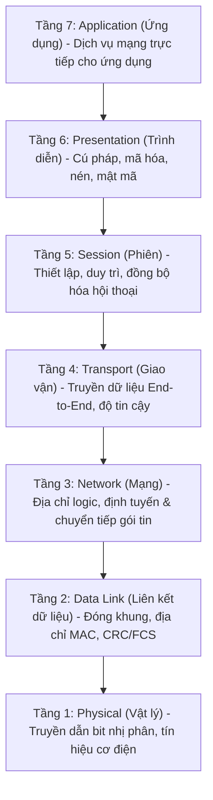
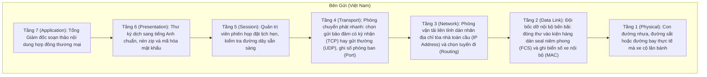
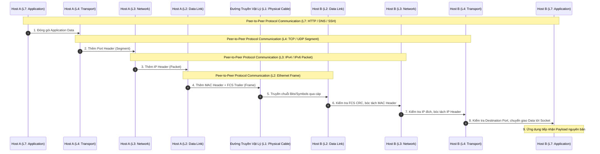

# 2_1_3 The OSI 7-Layer Model

> **Khóa học**: Cloud DevOps Basic — Networking Core  
> **Phân nhóm**: 2 Domain 2 - Computer Networking Core Fundamentals › 2_1 Network Fundamentals and Models  
> **Chủ đề**: Mô hình tham chiếu kết nối các hệ thống mở OSI 7 tầng (Open Systems Interconnection 7-Layer Reference Model)  
> **Trạng thái**: Draft (WRITE-CDB-2_1_3, 14-11-2026)  
> **Checklist đối chiếu**: [2_1_3](../../../CHECKLIST.md#domain-2-computer-networking-core-fundamentals-43-items)  

---

## 1. Khái Niệm Cốt Lõi & Bản Chất Kỹ Thuật (Core Concepts & Technical Deep Dive)

Trong lịch sử phát triển của mạng máy tính, việc kết nối các hệ thống phần cứng và phần mềm từ các nhà sản xuất độc quyền khác nhau từng là một thách thức khổng lồ. Để thiết lập tiếng nói chung trên quy mô toàn cầu, Tổ chức Tiêu chuẩn hóa Quốc tế (ISO) phối hợp cùng ITU-T đã phát triển **Mô hình Tham chiếu Kết nối các Hệ thống Mở (Open Systems Interconnection Reference Model - OSI)**, được chuẩn hóa chính thức trong tài liệu **ITU-T Rec. X.200 (07/1994) / ISO/IEC 7498-1:1994**.

Mô hình OSI phân chia toàn bộ quá trình truyền thông mạng phức tạp thành **7 tầng chức năng (7 layers)** riêng biệt, được sắp xếp từ phần cứng vật lý bên dưới (Layer 1) lên đến ứng dụng người dùng ở đỉnh (Layer 7).

---

### 1.1 Ba Nguyên Lý Kiến Trúc Cốt Lõi Của Mô Hình OSI

Theo đặc tả tại **ITU-T Rec. X.200, Điều khoản 5.2.2.7 và 6.2.1**, kiến trúc phân tầng OSI được xây dựng dựa trên 3 nguyên lý nền tảng:

1. **Phân tách trách nhiệm (Separation of Concerns)**:
   - *"Create separate layers to handle functions that are manifestly different"* (Tạo ra các tầng tách biệt để xử lý các chức năng có tính chất khác biệt rõ rệt).
   - Mỗi tầng chỉ đảm nhận một tập hợp chức năng chuyên biệt. Sự thay đổi, tối ưu hóa hoặc nâng cấp công nghệ bên trong một tầng hoàn toàn không làm xáo trộn hoặc đòi hỏi thiết kế lại các tầng khác.
2. **Giao tiếp logic giữa các thực thể đồng tầng (Peer-to-Peer Logical Communication)**:
   - *"Cooperation between (N)-entities is governed by one or more (N)-protocols"* (Sự phối hợp giữa các thực thể tại tầng N được chi phối bởi một hoặc nhiều giao thức tầng N).
   - Mặc dù dữ liệu thực tế phải truyền xuôi xuống tầng vật lý để phát tín hiệu qua môi trường truyền dẫn, về mặt logic, tầng $N$ của thiết bị gửi chỉ tương tác và trao đổi thông điệp với tầng $N$ của thiết bị nhận thông qua một giao thức đồng tầng xác định.
3. **Trừu tượng hóa dịch vụ (Service Abstraction)**:
   - Mỗi tầng $(N)$ cung cấp một tập hợp dịch vụ được xác định rõ ràng cho tầng ngay phía trên nó là $(N+1)$, đồng thời tiêu thụ dịch vụ được cung cấp bởi tầng ngay phía dưới nó là $(N-1)$.
   - Ranh giới giữa hai tầng kề nhau được định nghĩa qua Điểm Truy cập Dịch vụ (SAP - Service Access Point) và Giao diện Dịch vụ, ẩn giấu toàn bộ chi tiết triển khai bên dưới.

---

### 1.2 Phân Tích Chức Năng Chi Tiết 7 Tầng Theo Tiêu Chuẩn ITU-T Rec. X.200



#### Tầng 1 — Tầng Vật Lý (Physical Layer - Layer 1)
- **Đặc tả chuẩn (Clause 7.7.2)**: *"The Physical Layer provides the mechanical, electrical, functional and procedural means to activate, maintain, and de-activate physical-connections for bit transmission between data-link-entities."*
- **Bản chất kỹ thuật**:
  - Chịu trách nhiệm truyền tải các luồng bit nhị phân thô (`0` và `1`) hoặc các ký hiệu (symbols) qua môi trường truyền dẫn vật lý.
  - Định nghĩa các đặc tính cơ điện: điện áp, bước sóng photon quang, tần số sóng vô tuyến (RF), cấu trúc đầu nối cáp (RJ45, SFP), tốc độ xung clock và chuẩn truyền dẫn (cáp đồng xoắn đôi, cáp quang, sóng radio).
  - Tầng 1 không phân tích hay quan tâm đến ý nghĩa nội dung của dữ liệu; nó chỉ nhìn thấy các tín hiệu biến thiên cơ điện.

#### Tầng 2 — Tầng Liên Kết Dữ Liệu (Data Link Layer - Layer 2)
- **Đặc tả chuẩn (Clause 7.6.2)**: *"The Data Link Layer provides functional and procedural means to establish, maintain and release data-link-connections between network-entities and for the transfer of data-link-service-data-units... detects and possibly corrects errors which may occur in the Physical Layer."*
- **Bản chất kỹ thuật**:
  - **Đóng khung (Framing)**: Gom nhóm chuỗi bit từ tầng vật lý thành các đơn vị khung dữ liệu hoàn chỉnh (**Frame**), phân định rõ ràng ranh giới bắt đầu và kết thúc của khung.
  - **Định địa chỉ vật lý (Physical Addressing)**: Gán địa chỉ phần cứng (địa chỉ MAC 48-bit) của nút gửi (Source MAC) và nút nhận kề cận (Destination MAC) trên cùng một môi trường mạng chia sẻ.
  - **Kiểm soát lỗi liên kết (Error Detection & Correction)**: Tính toán mã kiểm tra dư thừa chu kỳ (**CRC - Cyclic Redundancy Check**) và đính kèm vào trường kiểm tra khung (**FCS - Frame Check Sequence**) ở cuối khung để phát hiện các bit bị méo mó do suy hao tín hiệu trên đường truyền.

#### Tầng 3 — Tầng Mạng (Network Layer - Layer 3)
- **Đặc tả chuẩn (Clause 7.5.2)**: *"The Network Layer provides the functional and procedural means for the exchange of network-service-data-units between transport-entities over network-connections... independence of routing and relay considerations."*
- **Bản chất kỹ thuật**:
  - **Định địa chỉ logic (Logical Addressing)**: Cung cấp sơ đồ địa chỉ logic toàn cầu (IP Address: IPv4/IPv6) độc lập với vị trí phần cứng, cho phép định danh duy nhất mọi nút mạng trên quy mô liên mạng toàn cầu.
  - **Định tuyến và Chuyển tiếp (Routing & Relay)**: Xác định đường đi tối ưu cho gói tin (**Packet / Datagram**) qua nhiều trạm trung chuyển (hop) và mạng trung gian để đến được đích cuối cùng.

#### Tầng 4 — Tầng Giao Vận (Transport Layer - Layer 4)
- **Đặc tả chuẩn (Clause 7.4.2.1)**: *"The transport-service provides transparent transfer of data between session-entities... All protocols defined in the Transport Layer have end-to-end significance, where the ends are defined as the transport entities having the transport connection."*
- **Bản chất kỹ thuật**:
  - Cung cấp cơ chế truyền thông đầu cuối tới đầu cuối (**End-to-End**) thực sự giữa hai tiến trình ứng dụng chạy trên hai máy chủ độc lập.
  - **Định danh tiến trình qua Cổng (Port Multiplexing)**: Sử dụng số hiệu cổng (Port Numbers) để phân biệt dữ liệu thuộc về tiến trình ứng dụng cụ thể nào trên hệ điều hành.
  - **Độ tin cậy và điều khiển luồng (Reliability & Flow Control)**: Tùy thuộc vào giao thức được chọn:
    - Cung cấp dịch vụ hướng kết nối, tin cậy, có xác nhận bắt tay, truyền lại gói tin mất và kiểm soát tốc độ gửi để không làm tràn bộ đệm máy nhận (TCP).
    - Cung cấp dịch vụ phi kết nối, truyền tải nhanh, không cam kết độ tin cậy (UDP).

#### Tầng 5 — Tầng Phiên (Session Layer - Layer 5)
- **Đặc tả chuẩn (Clause 7.3.2.1)**: *"The purpose of the Session Layer is to provide the means necessary for cooperating presentation-entities to organize and to synchronize their dialogue and to manage their data exchange."*
- **Bản chất kỹ thuật**:
  - Thiết lập, quản lý và giải phóng các phiên đối thoại (dialogue) giữa hai tiến trình ứng dụng.
  - Quản lý chế độ hội thoại: song công toàn phần (Full-Duplex) hoặc bán song công (Half-Duplex).
  - Cung cấp các điểm đồng bộ hóa (**Synchronization Checkpoints**): Đánh dấu các mốc dữ liệu đã truyền thành công. Nếu đường truyền gặp sự cố giữa chừng, hai bên chỉ cần khôi phục và truyền lại từ checkpoint gần nhất thay vì truyền lại toàn bộ từ đầu.

#### Tầng 6 — Tầng Trình Diễn (Presentation Layer - Layer 6)
- **Đặc tả chuẩn (Clause 7.2.2.1)**: *"The Presentation Layer provides for the representation of information that application-entities either even communicate or refer to in their dialogue... covers two aspects: the syntax of data... and the transfer syntax."*
- **Bản chất kỹ thuật**:
  - Chịu trách nhiệm về mặt cú pháp và ngữ nghĩa của dữ liệu được trao đổi giữa các hệ thống.
  - **Chuyển đổi cú pháp và mã hóa ký tự (Character Encoding)**: Chuyển đổi giữa các bảng mã ký tự khác nhau (ví dụ: ASCII, UTF-8, EBCDIC).
  - **Nén dữ liệu (Data Compression)**: Giảm kích thước dữ liệu để tối ưu băng thông truyền dẫn.
  - **Mật mã hóa và giải mã (Data Encryption & Decryption)**: Bảo vệ tính bí mật của dữ liệu (TLS/SSL encryption primitives).

#### Tầng 7 — Tầng Ứng Dụng (Application Layer - Layer 7)
- **Đặc tả chuẩn (Clause 7.1.2.1)**: *"As the highest layer in the Reference Model... the Application Layer provides the sole means for the application process to access the OSIE (OSI Environment)."*
- **Bản chất kỹ thuật**:
  - Là tầng cao nhất, tiếp xúc trực tiếp với các tiến trình ứng dụng phần mềm mà người dùng tương tác.
  - Cung cấp các giao diện dịch vụ mạng chuẩn hóa cho các tác vụ phổ biến: duyệt web (HTTP), phân giải tên miền (DNS), quản trị từ xa an toàn (SSH), gửi nhận thư điện tử (SMTP).

---

### 1.3 Đơn Vị Dữ Liệu Giao Thức (PDU - Protocol Data Unit) Theo Chuẩn

Theo đặc tả của **RFC 1122 (Section 1.3.3)** và tài liệu chuẩn **ITU-T Rec. X.200**, mỗi tầng trong kiến trúc phân tầng xử lý và đóng gói dữ liệu dưới một danh xưng kỹ thuật chuẩn hóa riêng biệt, gọi là **PDU (Protocol Data Unit)**:

| Tầng OSI | Số thứ tự | Tên PDU Chuẩn | Ý nghĩa kỹ thuật |
| :--- | :---: | :--- | :--- |
| **Application / Presentation / Session** | Tầng 7, 6, 5 | **Application Data / Payload** | Dữ liệu thuần túy của ứng dụng người dùng chưa qua đóng gói transport hoặc đã được decapsulate hoàn chỉnh. |
| **Transport** | Tầng 4 | **Segment (TCP) / Datagram (UDP)** | Dữ liệu ứng dụng được chia nhỏ và đính kèm phần đầu Transport Header (chứa Source Port, Destination Port, Sequence Number). |
| **Network** | Tầng 3 | **Packet (IP Datagram)** | Segment được bao bọc thêm phần đầu Network Header (chứa Source IP, Destination IP, TTL). |
| **Data Link** | Tầng 2 | **Frame** | Packet được bao bọc phần đầu MAC Header (chứa Source MAC, Destination MAC, EtherType) và phần đuôi FCS Trailer (CRC-32). |
| **Physical** | Tầng 1 | **Bits / Symbols** | Các chuỗi xung điện áp, photon ánh sáng hoặc sóng vô tuyến đại diện cho chuỗi bit nhị phân vật lý trên dây truyền dẫn. |

---

## 2. Ví Dụ Đời Sống Thực Tế Dễ Hiểu (Intuitive Real-World Analogies)

### Ẩn dụ: "Công Ty Xuất Nhập Khẩu & Dịch Thuật Đa Quốc Gia 7 Bộ Phận"

Để hiểu rõ vì sao kiến trúc mạng phải chia thành 7 tầng riêng biệt và mỗi tầng giải quyết bài toán gì, hãy tưởng tượng quy trình một bức thư thương mại mật được gửi từ Tổng Giám đốc Tập đoàn tại Việt Nam sang đối tác tại Nhật Bản:



1. **Tầng 7 (Application) — Tổng Giám đốc soạn thảo hợp đồng**:
   - Vị Giám đốc ngồi tại bàn làm việc và chỉ tập trung vào nội dung kinh doanh cốt lõi (báo giá, điều khoản mua bán). Giám đốc không cần bận tâm thư sẽ được dịch thế nào, xe nào chở, hay sóng vô tuyến nào truyền đi.
2. **Tầng 6 (Presentation) — Thư ký dịch thuật và mật mã**:
   - Thư ký tiếp nhận bản thảo, dịch từ tiếng Việt sang tiếng Anh thương mại chuẩn (chuyển đổi cú pháp / character encoding), nén bản tài liệu cho gọn gàng (compression), và đặt mật mã bảo vệ tập tin (encryption) để chống lộ lọt thông tin.
3. **Tầng 5 (Session) — Quản trị viên phiên liên lạc**:
   - Nhân viên điều phối liên hệ với văn phòng đối tác tại Tokyo để mở phiên làm việc chính thức. Họ thống nhất thời gian bắt đầu, duy trì kênh đàm thoại mở và đánh dấu các trang hợp đồng đã duyệt qua (checkpoints). Nếu đường truyền điện thoại bị gián đoạn ở trang 5, hai bên kết nối lại và đọc tiếp từ trang 5 mà không cần đọc lại từ đầu.
4. **Tầng 4 (Transport) — Phòng bưu cục chuyển phát nhanh**:
   - Bưu cục quyết định hình thức vận chuyển: Gửi bảo đảm có ký nhận từng kiện và cam kết hoàn tiền nếu mất (TCP) hoặc gửi thư thường nhanh gọn không bảo đảm (UDP).
   - Đồng thời, bưu cục dán thêm nhãn **Số hiệu phòng ban nhận (Port number)**: ví dụ "Phòng Pháp chế số 443" để khi thư đến nơi, nó được giao đúng phòng ban chứ không bị lẫn sang phòng Nhân sự.
5. **Tầng 3 (Network) — Phòng kế hoạch vận tải đường dài**:
   - Nhân viên dán nhãn **Địa chỉ bưu chính toàn cầu (IP Address)**: ghi rõ Quốc gia, Thành phố, Quận, Số nhà của trụ sở Tokyo.
   - Nhân viên lên sơ đồ hành trình (Routing): chuyển qua trạm trung chuyển Hà Nội $\rightarrow$ Hồng Kông $\rightarrow$ Tokyo, đảm bảo bưu phẩm tìm được đường đi xuyên qua nhiều quốc gia độc lập.
6. **Tầng 2 (Data Link) — Đội bốc dỡ nội bộ bến bãi**:
   - Kiện hàng được đóng vào thùng kim loại có khóa niêm phong chống cạy phá hoặc rách nát (FCS/CRC).
   - Đội bốc dỡ dán **Biển số xe tải nội bộ (MAC Address)** để chuyển thùng hàng từ kho A sang kho B kề nhau. Khi xe tới kho tiếp theo, seal niêm phong được kiểm tra; nếu bị rách, kiện hàng lập tức bị hủy bỏ hoặc yêu cầu gửi lại.
7. **Tầng 1 (Physical) — Mặt đường giao thông & Phương tiện thực tế**:
   - Đây chính là con đường cao tốc, đường ray xe lửa hoặc đường bay mà phương tiện vật lý di chuyển. Tương ứng trong thế giới số, đó là các xung điện tích trên sợi cáp đồng, photon ánh sáng trong sợi thủy tinh cáp quang, hoặc sóng điện từ lan truyền trong không gian.

---

## 3. Kiến Trúc, Luồng Hoạt Động & Hình Ảnh Trực Quan (Architecture, Diagrams & Visual Media)

### 3.1 Bảng So Sánh Tổng Quan 7 Tầng Kiến Trúc OSI

| Tầng | Tên Tầng (OSI Layer) | Chức năng kỹ thuật chủ chốt (ITU-T Rec. X.200) | Đơn vị PDU | Giao thức / Công nghệ tiêu biểu | Thiết bị / Phạm vi phần mềm |
| :---: | :--- | :--- | :---: | :--- | :--- |
| **7** | **Application** (Ứng dụng) | Cung cấp giao diện dịch vụ mạng trực tiếp cho ứng dụng phần mềm người dùng. | Data / Payload | HTTP, DNS, SSH, SMTP, NTP | Ứng dụng người dùng (Browser, Nginx, SSH Client) |
| **6** | **Presentation** (Trình diễn) | Chuyển đổi định dạng dữ liệu, mã hóa ký tự, nén dữ liệu, mật mã hóa/giải mã. | Data / Payload | ASCII, UTF-8, TLS/SSL crypto primitives | Thư viện ứng dụng, OS runtime |
| **5** | **Session** (Phiên) | Thiết lập, duy trì, điều phối hội thoại (dialogue), tạo điểm kiểm tra (checkpoint). | Data / Payload | RPC, gRPC session logic, NetBIOS | OS Socket API, Session Management Logic |
| **4** | **Transport** (Giao vận) | Truyền tải dữ liệu End-to-End giữa các tiến trình, điều khiển luồng, định danh cổng. | Segment (TCP) / Datagram (UDP) | TCP, UDP | Kernel Network Stack (L4 Sockets) |
| **3** | **Network** (Mạng) | Định vị địa chỉ logic toàn cầu (IP), định tuyến và chuyển tiếp gói tin xuyên mạng. | Packet (IP Datagram) | IPv4, IPv6, ICMP, OSPF, BGP | Router, Layer 3 Switch, Kernel IP Route |
| **2** | **Data Link** (Liên kết DL) | Đóng khung (framing), định địa chỉ vật lý (MAC), phát hiện lỗi truyền dẫn (CRC/FCS). | Frame | Ethernet (IEEE 802.3), Wi-Fi (802.11), ARP | Switch L2, NIC Driver, Network Interface Card |
| **1** | **Physical** (Vật lý) | Truyền dẫn chuỗi bit nhị phân thô qua tín hiệu điện, quang, hoặc sóng vô tuyến. | Bits / Symbols | 1000BASE-T, Cáp quang single-mode/multi-mode | Dây cáp, SFP Transceiver, Hub L1, Repeater |

---

### 3.2 Luồng Hoạt Động: Giao Tiếp Logic Giữa Các Thực Thể Đồng Tầng (Peer-to-Peer)

Theo nguyên lý của mô hình OSI, một thực thể tại tầng $N$ của Host A giao tiếp logic trực tiếp với thực thể tầng $N$ của Host B thông qua giao thức tầng $N$. Tuy nhiên, về mặt vật lý, thông tin bắt buộc phải đi xuôi từ tầng 7 xuống tầng 1 tại Host A, truyền qua cáp mạng, rồi đi ngược từ tầng 1 lên tầng 7 tại Host B:



---

## 4. Code Mẫu Trực Quan Hoặc Dòng Lệnh Thực Chiến (Runnable Sample Code / CLI)

Ở tầng Transport (Layer 4), hệ điều hành sử dụng các **Số hiệu Cổng (Port Numbers)** để phân phối lưu lượng mạng đến đúng tiến trình ứng dụng người dùng ở tầng Application (Layer 7).

### 4.1 Phân Vùng Dải Cổng Dịch Vụ Theo Chuẩn IANA (RFC 6335)

Theo đặc tả của **RFC 6335 (Section 6)** do Tổ chức Cấp phát Số hiệu Internet (IANA) quản lý, không gian cổng 16-bit ($0$ đến $65535$) được phân chia thành 3 phân vùng nghiêm ngặt:

| Phân vùng Cổng (Port Range) | Khoảng giá trị | Cơ quan phê chuẩn & Mục đích sử dụng | Dịch vụ tiêu biểu đã xác nhận |
| :--- | :--- | :--- | :--- |
| **System Ports (Well-Known Ports)** | `0` đến `1023` | Do IANA chỉ định và gán cho các dịch vụ mạng chuẩn hóa nền tảng toàn cầu. Yêu cầu quyền quản trị viên (`root`/`administrator`) để mở socket lắng nghe. | • **SSH**: Cổng 22<br/>• **SMTP**: Cổng 25<br/>• **DNS**: Cổng 53<br/>• **HTTP**: Cổng 80<br/>• **NTP**: Cổng 123<br/>• **HTTPS**: Cổng 443 |
| **User Ports (Registered Ports)** | `1024` đến `49151` | IANA đăng ký cho các ứng dụng và dịch vụ của bên thứ ba phổ biến nhằm tránh xung đột cổng. Tiến trình người dùng thông thường có thể bind. | Các dịch vụ cơ sở dữ liệu, message queue, web proxy phổ biến. |
| **Dynamic Ports (Ephemeral Ports)** | `49152` đến `65535` | Cổng động, tạm thời (ephemeral ports) được hệ điều hành tự động cấp phát cho các kết nối outbound từ client khi mở phiên socket. | Client web browser, client API mở kết nối outbound. |

---

### 4.2 Linux CLI Thực Chiến: Kiểm Tra Socket State & Ánh Xạ L4 ➔ L7 Bằng `ss`

Công cụ `ss` (Socket Statistics) thuộc bộ công cụ chuẩn `iproute2` trên Linux là phương tiện hàng đầu để khảo sát trạng thái các socket L4 và tiến trình L7 đang liên kết.

Theo hướng dẫn từ trang hướng dẫn chuẩn của Linux **man7.org (`ss(8)`)**:
- `-t` (`--tcp`): Hiển thị các socket TCP.
- `-u` (`--udp`): Hiển thị các socket UDP.
- `-l` (`--listening`): Chỉ lọc và hiển thị các socket đang ở trạng thái lắng nghe kết nối (Listening).
- `-p` (`--processes`): Hiển thị thông tin tiến trình người dùng (Process Name và PID) đang sở hữu socket.
- `-n` (`--numeric`): Không giải quyết tên miền/tên cổng qua DNS/services, hiển thị trực tiếp số hiệu IP và Port dạng số để tránh độ trễ phân giải.

```bash
# Thực thi khảo sát toàn bộ socket TCP và UDP đang lắng nghe kèm PID tiến trình
sudo ss -tulpn
```

> 💡 **Minh họa thực thi (Illustrative Output)**:

```text
Netid  State   Recv-Q  Send-Q     Local Address:Port      Peer Address:Port  Process                                                                               
udp    UNCONN  0       0          127.0.0.53%lo:53             0.0.0.0:*      users:(("systemd-resolve",pid=812,fd=13))                                             
udp    UNCONN  0       0                0.0.0.0:123            0.0.0.0:*      users:(("chronyd",pid=945,fd=5))                                                      
tcp    LISTEN  0       128              0.0.0.0:22             0.0.0.0:*      users:(("sshd",pid=1042,fd=3))                                                        
tcp    LISTEN  0       511              0.0.0.0:80             0.0.0.0:*      users:(("nginx",pid=1456,fd=6),("nginx",pid=1455,fd=6))                              
tcp    LISTEN  0       511              0.0.0.0:443            0.0.0.0:*      users:(("nginx",pid=1456,fd=7),("nginx",pid=1455,fd=7))                              
tcp    LISTEN  0       128                 [::]:22                [::]:*      users:(("sshd",pid=1042,fd=4))                                                        
```

#### Phân Tích Kỹ Thuật Từng Cột Dữ Liệu:
1. **`Netid`**: Giao thức tầng Transport (Layer 4) được socket sử dụng (`tcp` hoặc `udp`).
2. **`State`**: Trạng thái máy hữu hạn trạng thái (FSM) của socket:
   - `LISTEN`: Socket TCP đang sẵn sàng tiếp nhận bắt tay 3 bước từ client.
   - `UNCONN`: Socket UDP phi kết nối (Unconnected) đang đợi datagram gửi tới.
3. **`Recv-Q` / `Send-Q`**: Kích thước bộ đệm nhận/gửi trong nhân hệ điều hành. Đối với trạng thái `LISTEN` trên TCP, `Send-Q` thể hiện tham số backlog tối đa của socket, `Recv-Q` thể hiện số kết nối đang chờ trong hàng đợi hoàn tất bắt tay.
4. **`Local Address:Port`**: Địa chỉ IP Layer 3 và Cổng Layer 4 mà tiến trình đang gắn kết (bind). Ví dụ: `0.0.0.0:22` nghĩa là lắng nghe trên cổng 22 của mọi giao diện mạng IPv4; `127.0.0.53:53` nghĩa là dịch vụ DNS stub resolver chỉ lắng nghe cục bộ trên loopback.
5. **`Peer Address:Port`**: Địa chỉ đầu xa. Ở trạng thái listening, đầu xa mang giá trị đại diện `0.0.0.0:*` hoặc `[::]:*` (bất kỳ client nào).
6. **`Process`**: Tiến trình tầng Application (Layer 7) đang nắm giữ File Descriptor của socket này (ví dụ: tiến trình `sshd` với PID `1042` đang quản lý cổng 22, tiến trình `nginx` với PID `1455/1456` đang quản lý cổng 80 và 443).

---

## 5. Cạm Bẫy Thực Tế & Thực Tiễn Sản Xuất (Production Gotchas & Best Practices)

### 5.1 Cạm Bẫy: Nhầm Lẫn Giữa Mô Hình Tham Chiếu (OSI) Và Giao Thức Triển Khai Thực Tế (TCP/IP)
- **Bản chất**: Mô hình OSI 7 tầng (ITU-T X.200 / ISO 7498-1) là một **mô hình tham chiếu lý thuyết (Theoretical Reference Model)** mang tính chuẩn mực để tư duy kiến trúc và phân tách trách nhiệm. Trong thực tế triển khai của Internet toàn cầu, bộ giao thức **TCP/IP** (thường chia thành 4 hoặc 5 tầng) mới là kiến trúc thực tế được cài đặt trong nhân hệ điều hành Linux/Windows.
- **Biểu hiện**: Ba tầng trên cùng của OSI (Session, Presentation, Application) trong thực tế không được tách thành 3 tầng riêng biệt trong nhân OS, mà toàn bộ được tích hợp vào chính tiến trình ứng dụng không gian người dùng (User-space Application). Ví dụ, mã hóa TLS và giải nén HTTP gzip thường do thư viện ứng dụng (OpenSSL, Zlib) xử lý chứ không có một "Tầng Presentation" độc lập trong hệ điều hành.

### 5.2 Phương Pháp Cô Lập Sự Cố Mạng: Tiếp Cận Từ Dưới Lên (Bottom-Up Troubleshooting)
Một kỹ sư vận hành hệ thống (DevOps/SRE) chuyên nghiệp luôn dựa vào cấu trúc 7 tầng của OSI để khoanh vùng và xử lý sự cố mạng một cách có phương pháp, tránh đoán mò:
1. **Kiểm tra Tầng 1 (Physical)**: Đèn cổng mạng trên card mạng/switch có sáng không? Cáp mạng có bị lỏng, đứt hoặc gập khúc không?
2. **Kiểm tra Tầng 2 (Data Link)**: Giao diện mạng có ở trạng thái `UP` không? Bảng MAC của switch có học được địa chỉ card mạng không? VLAN cấu hình trên switch port có bị sai không?
3. **Kiểm tra Tầng 3 (Network)**: Máy chủ có nhận đúng địa chỉ IP và Subnet Mask không? Có ping được Default Gateway cục bộ không? Bảng định tuyến (`ip route`) có chỉ đúng gateway không?
4. **Kiểm tra Tầng 4 (Transport)**: Tiến trình mục tiêu có thực sự đang mở socket `LISTEN` trên cổng dịch vụ không (kiểm tra qua `ss -tulpn`)? Firewall (iptables/nftables) hoặc Security Group có chặn cổng không?
5. **Kiểm tra Tầng 7 (Application)**: Dịch vụ ứng dụng có trả về mã lỗi HTTP 500, lỗi cấu hình DNS resolver, hay chứng chỉ TLS hết hạn không?

### 5.3 Cạm Bẫy Cạn Kiệt Cổng Động (Ephemeral Port Exhaustion)
- **Vấn đề**: Khi một máy chủ đóng vai trò Reverse Proxy (hoặc các microservice gọi nhau liên tục) tạo ra hàng chục nghìn kết nối outbound đến máy chủ cơ sở dữ liệu trong thời gian rất ngắn, hệ điều hành sẽ sử dụng dải **Dynamic Ports (49152 - 65535)** theo chuẩn RFC 6335 (chỉ có khoảng 16.384 cổng khả dụng).
- **Hậu quả**: Khi dải cổng này bị chiếm dụng hết bởi các socket ở trạng thái `TIME_WAIT`, ứng dụng sẽ gặp lỗi `Cannot assign requested address` (hoặc `EADDRNOTAVAIL`), khiến toàn bộ kết nối mạng mới bị từ chối dù CPU và RAM của máy chủ vẫn còn rất nhiều tài nguyên.
- **Thực tiễn tốt nhất**: Kích hoạt tái sử dụng socket (`SO_REUSEADDR`), sử dụng kết nối bền bỉ (HTTP Keep-Alive / Connection Pooling), hoặc mở rộng dải cổng cấp phát cục bộ qua sysctl của Linux.

---

## 6. Câu Hỏi Củng Cố Kiến Thức (Active Recall Quiz)

### Câu hỏi 1:
Một kỹ sư DevOps triển khai một ứng dụng web trên máy chủ Linux. Người dùng bên ngoài phản ánh không thể truy cập website qua trình duyệt (báo lỗi `Connection Refused`), nhưng kỹ sư khi SSH trực tiếp vào máy chủ chạy lệnh `curl http://localhost:80` thì trang web vẫn phản hồi bình thường. Khi chạy `ss -tulpn`, kết quả hiển thị dòng sau:
```text
Netid  State   Recv-Q  Send-Q  Local Address:Port  Peer Address:Port  Process
tcp    LISTEN  0       511      127.0.0.1:80              0.0.0.0:*  users:(("nginx",pid=1200,fd=6))
```
Dựa trên kiến thức về mô hình OSI và cơ chế socket, hãy giải thích nguyên nhân gốc rễ của sự cố và chỉ rõ lỗi đang nằm ở tầng nào?

<details>
<summary>👉 Xem đáp án & giải thích chi tiết</summary>

**Đáp án & Phân tích**:
1. **Nguyên nhân gốc rễ**: 
   - Tiến trình Nginx (tầng 7) đang mở socket lắng nghe (tầng 4) tại địa chỉ `Local Address` là `127.0.0.1:80`.
   - Địa chỉ `127.0.0.1` là địa chỉ loopback cục bộ, chỉ chấp nhận các gói tin nội bộ phát sinh từ chính máy chủ đó. Do đó, yêu cầu qua `curl http://localhost:80` thành công.
   - Khi người dùng bên ngoài gửi gói tin đến địa chỉ IP công khai hoặc IP mạng LAN của máy chủ, nhân hệ điều hành kiểm tra bảng socket và thấy không có tiến trình nào lắng nghe trên cổng 80 của giao diện mạng bên ngoài, dẫn tới việc hệ điều hành trả về gói tin TCP RST (khiến client báo lỗi `Connection Refused`).
2. **Khắc phục**: Sửa cấu hình Nginx để lắng nghe trên `0.0.0.0:80` (mọi giao diện mạng IPv4) hoặc IP mạng cụ thể thay vì chỉ lắng nghe trên `127.0.0.1`.
3. **Phân loại tầng**: Vấn đề nằm ở cấu hình liên kết giữa **Layer 3 (Địa chỉ IP bind)** và **Layer 4 (Port socket listen)** của ứng dụng.
</details>

---

### Câu hỏi 2:
Trong một mạng nội bộ doanh nghiệp, hai máy chủ được cắm vào cùng một thiết bị Switch Layer 2. Máy chủ A có địa chỉ IP `192.168.1.10/24`, Máy chủ B có địa chỉ IP `192.168.1.20/24`. Khi máy chủ A gửi dữ liệu tới máy chủ B:
- (a) Gói tin có cần đi qua Router Layer 3 để định tuyến không?
- (b) Đơn vị dữ liệu PDU mà Switch Layer 2 tiếp nhận và xử lý để chuyển tiếp là gì? Thiết bị này sử dụng thông tin định danh nào trong phần đầu của PDU đó?

<details>
<summary>👉 Xem đáp án & giải thích chi tiết</summary>

**Đáp án & Phân tích**:
- (a) **Không cần qua Router Layer 3**: Vì cả hai máy chủ đều thuộc cùng một subnet logic `192.168.1.0/24` (khi áp mặt nạ `/24`, phần tiền tố mạng của cả hai máy trùng khớp hoàn toàn). Gói tin được chuyển giao trực tiếp trong mạng cục bộ mà không cần chuyển tới Default Gateway.
- (b) **PDU là Frame (Khung tin)**: Switch hoạt động tại Tầng 2 (Data Link Layer), do đó đơn vị dữ liệu nó tiếp nhận và xử lý là **Frame**.
- **Thông tin định danh**: Switch inspect thông tin **Địa chỉ MAC đích (Destination MAC Address)** trong phần đầu MAC Header của khung tin để tra cứu bảng CAM (bảng ánh xạ Port-to-MAC) và chuyển tiếp khung tin đến đúng cổng vật lý kết nối với Máy chủ B.
</details>

---

## 7. 📚 Nguồn Tài Liệu Chính Thống (Tier-1 Official References)

- [ITU-T Recommendation X.200 (07/1994) / ISO/IEC 7498-1:1994](https://www.itu.int/rec/T-REC-X.200-199407-I/en) - Tiêu chuẩn quốc tế chính thức về Kiến trúc Mô hình Tham chiếu Kết nối các Hệ thống Mở (Open Systems Interconnection - Basic Reference Model).
- [RFC 1122 - Requirements for Internet Hosts -- Communication Layers](https://datatracker.ietf.org/doc/html/rfc1122) - Chuẩn Internet IETF quy định chi tiết về kiến trúc phân tầng giao tiếp mạng, định nghĩa Segment, Packet, Frame.
- [RFC 6335 - Internet Assigned Numbers Authority (IANA) Procedures for the Management of the Service Name and Transport Protocol Port Number Registry](https://datatracker.ietf.org/doc/html/rfc6335) - Tiêu chuẩn BCP 165 quy định việc phân bổ không gian cổng (System Ports 0-1023, User Ports 1024-49151, Dynamic Ports 49152-65535).
- [Linux Manual Page: ss(8) - Socket Statistics](https://man7.org/linux/man-pages/man8/ss.8.html) - Tài liệu hướng dẫn chính thức từ man7.org về tiện ích điều tra trạng thái socket mạng trên Linux (`-t`, `-u`, `-l`, `-p`, `-n`).
- [IANA Service Name and Transport Protocol Port Number Registry](https://www.iana.org/assignments/service-names-port-numbers/service-names-port-numbers.xhtml) - Bảng danh bạ chính thức toàn cầu về phân bổ số hiệu cổng dịch vụ mạng của IANA.
