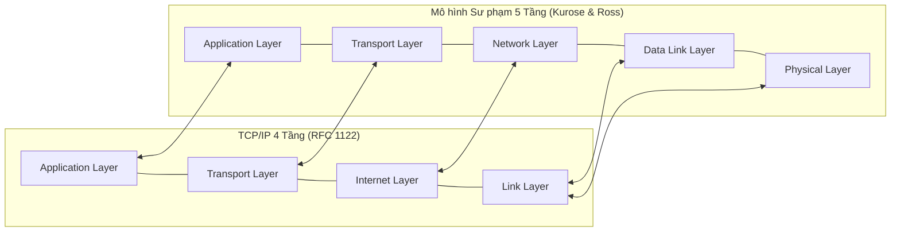
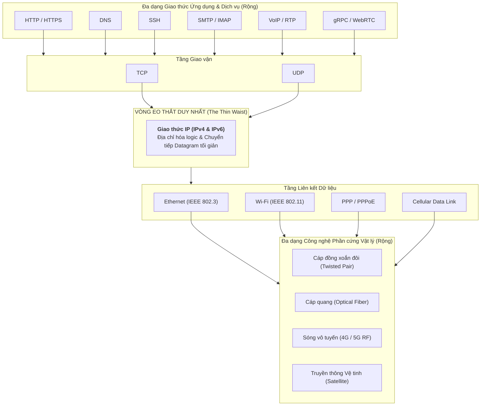
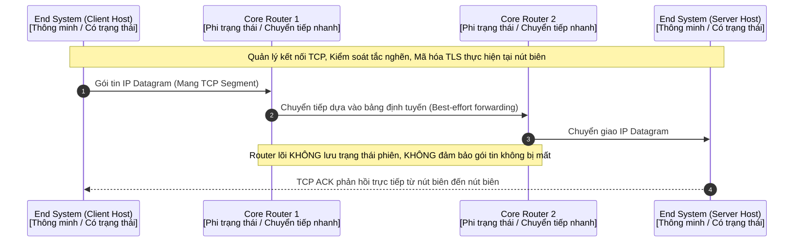
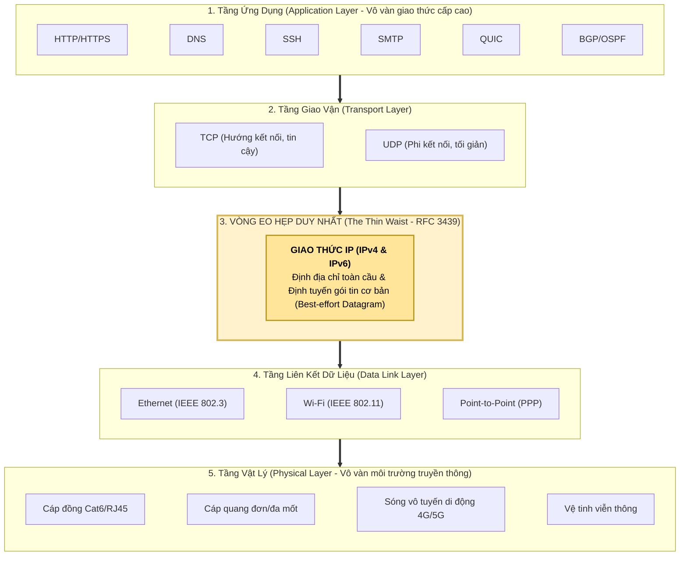

# 2_1_4 The TCP-IP Layer Model

> **Khóa học**: Cloud DevOps Basic — Networking Core  
> **Phân nhóm**: 2 Domain 2 - Computer Networking Core Fundamentals › 2_1 Network Fundamentals and Models  
> **Chủ đề**: Mô hình kiến trúc giao thức TCP/IP (RFC 1122): So sánh với OSI 7 tầng và Mô hình Eo đồng hồ cát (Hourglass)  
> **Trạng thái**: Draft (WRITE-CDB-2_1_4, 14-11-2026)  
> **Checklist đối chiếu**: [2_1_4](../../../CHECKLIST.md#domain-2-computer-networking-core-fundamentals-43-items)  

---

## 1. Khái Niệm Cốt Lõi & Bản Chất Kỹ Thuật (Core Concepts & Technical Deep Dive)

Trong khi mô hình OSI 7 tầng được xây dựng bởi các ủy ban tiêu chuẩn quốc tế như một khuôn mẫu lý thuyết tham chiếu lý tưởng, thì **Bộ giao thức TCP/IP (Internet Protocol Suite)** chính là hiện thực kỹ thuật vận hành toàn bộ mạng Internet toàn cầu ngày nay. Ra đời từ mạng thử nghiệm ARPANET của Bộ Quốc phòng Hoa Kỳ và được chuẩn hóa chính thức bởi IETF (Internet Engineering Task Force), kiến trúc TCP/IP phản ánh tư duy thực dụng, tối giản và khả năng mở rộng quy mô phi thường.

---

### 1.1 Kiến trúc TCP/IP 4 tầng theo RFC 1122 vs Mô hình Sư phạm 5 tầng

Khác với sự phân chia nghiêm ngặt của mô hình OSI, tài liệu chuẩn nền tảng của IETF là **[RFC 1122: Requirements for Internet Hosts -- Communication Layers](https://datatracker.ietf.org/doc/html/rfc1122#section-1.1.3)** định nghĩa cấu trúc ngăn xếp giao thức của một máy chủ Internet gồm đúng **4 tầng chức năng**:

1. **Tầng Ứng dụng (Application Layer)**:
   - Tầng cao nhất nơi các tiến trình ứng dụng người dùng và các dịch vụ mạng tương tác trực tiếp.
   - Chứa các giao thức ứng dụng phổ biến như HTTP/HTTPS, DNS, SSH, SMTP, FTP.
   - Về mặt kiến trúc, tầng Ứng dụng trong TCP/IP gộp toàn bộ trách nhiệm mà mô hình OSI phân bổ cho 3 tầng: Phiên (Session), Trình diễn (Presentation) và Ứng dụng (Application). Nếu một ứng dụng cần quản lý phiên làm việc, định dạng ký tự, nén dữ liệu hoặc mã hóa mật mã (như TLS/SSL), các chức năng này được hiện thực trực tiếp bên trong tiến trình ứng dụng hoặc thông qua các thư viện phần mềm tầng ứng dụng.

2. **Tầng Giao vận (Transport Layer)**:
   - Cung cấp dịch vụ truyền thông điểm-tới-điểm (end-to-end communication) giữa các tiến trình ứng dụng đang chạy trên các host khác nhau.
   - Hai giao thức cốt lõi tại tầng này là:
     - **TCP (Transmission Control Protocol - RFC 793 / RFC 9293)**: Hướng kết nối (connection-oriented), đảm bảo truyền dữ liệu tin cậy, bảo toàn thứ tự byte, có cơ chế điều khiển luồng (flow control) và kiểm soát tắc nghẽn (congestion control).
     - **UDP (User Datagram Protocol - RFC 768)**: Phi kết nối (connectionless), truyền tải tối giản không bảo đảm (best-effort), không sắp xếp lại thứ tự gói, tối ưu độ trễ cho các dịch vụ thời gian thực như DNS, VoIP, livestream.

3. **Tầng Internet (Internet Layer)**:
   - Trọng tâm sống còn của toàn bộ kiến trúc Internet, chịu trách nhiệm đóng gói dữ liệu thành các **IP datagram**, quản lý định địa chỉ logic và thực hiện định tuyến (routing) gói tin qua các mạng liên kết khác nhau.
   - Giao thức trung tâm là **IP (Internet Protocol - RFC 791 cho IPv4 và RFC 8200 cho IPv6)**, hoạt động theo cơ chế phi kết nối và chuyển phát không tin cậy (best-effort datagram delivery).
   - Tầng này cũng bao gồm giao thức điều khiển và báo cáo lỗi **ICMP (Internet Control Message Protocol - RFC 792)**.

4. **Tầng Liên kết (Link Layer / Network Access Layer)**:
   - Chịu trách nhiệm giao tiếp trực tiếp với môi trường phần cứng và card mạng (NIC).
   - Đóng gói IP datagram vào các khung tin liên kết (frames) phù hợp với công nghệ truyền dẫn cục bộ (như Ethernet IEEE 802.3, Wi-Fi IEEE 802.11) và chuyển đổi thành tín hiệu vật lý để truyền dẫn qua cáp đồng, cáp quang hoặc sóng vô tuyến.
   - RFC 1122 xem toàn bộ phần cứng vật lý và trình điều khiển liên kết cục bộ là một thể thống nhất thuộc tầng Link.



#### Mô hình Sư phạm 5 tầng (Five-Layer Internet Protocol Stack):
Trong công tác giảng dạy khoa học máy tính hiện đại, giáo trình chuẩn quốc tế *Computer Networking: A Top-Down Approach* (Kurose & Ross) sử dụng **Mô hình 5 tầng**: `Application` $\rightarrow$ `Transport` $\rightarrow$ `Network` $\rightarrow$ `Link` $\rightarrow$ `Physical`. 
- **Lý do sư phạm**: Việc tách tầng Link của RFC 1122 thành hai tầng riêng biệt gồm **Tầng Liên kết dữ liệu (Data Link Layer)** (quản lý MAC, khung tin, switch L2, phát hiện lỗi) và **Tầng Vật lý (Physical Layer)** (tín hiệu điện, quang, modulation, bit truyền dẫn) giúp sinh viên và kỹ sư hiểu sâu sắc sự khác biệt ranh giới giữa phần mềm trình điều khiển (driver) và phần cứng vật lý vi mạch (transceiver/cable).

---

### 1.2 Ánh Xạ Đối Chiếu Giữa OSI 7 Tầng và TCP/IP

Mối quan hệ ánh xạ giữa mô hình tham chiếu OSI và kiến trúc TCP/IP thể hiện sự tối ưu hóa thực tiễn của kỹ nghệ mạng:

| Tầng trong OSI 7 Tầng | Chức năng theo ISO/IEC 7498-1 | Tương ứng trong TCP/IP 4 Tầng (RFC 1122) | Tương ứng trong Mô hình 5 Tầng | Đơn vị Dữ liệu (PDU) |
| :--- | :--- | :--- | :--- | :--- |
| **Layer 7: Application** | Giao diện cho ứng dụng người dùng | **Application Layer** (L5-L7 gộp chung) | **Application Layer** | Application Data / Message |
| **Layer 6: Presentation** | Biểu diễn dữ liệu, nén, mã hóa | *(Tích hợp vào chính ứng dụng)* | *(Tích hợp vào chính ứng dụng)* | Application Data |
| **Layer 5: Session** | Quản lý phiên đối thoại, đồng bộ | *(Tích hợp vào chính ứng dụng)* | *(Tích hợp vào chính ứng dụng)* | Application Data |
| **Layer 4: Transport** | Truyền thông end-to-end, điều khiển luồng | **Transport Layer** | **Transport Layer** | Segment (TCP) / Datagram (UDP) |
| **Layer 3: Network** | Định địa chỉ logic, chọn đường (routing) | **Internet Layer** | **Network Layer** | Packet / IP Datagram |
| **Layer 2: Data Link** | Đóng khung (frame), MAC, kiểm lỗi CRC | **Link Layer** (L1-L2 gộp chung) | **Data Link Layer** | Frame |
| **Layer 1: Physical** | Truyền dẫn chuỗi bit nhị phân vật lý | *(Tích hợp vào tầng Link)* | **Physical Layer** | Bits / Symbols |

Theo đặc tả tại [RFC 1122 Section 1.1.3](https://datatracker.ietf.org/doc/html/rfc1122#section-1.1.3):  
> *"The application layer of the Internet suite essentially combines the functions of the top two layers -- Presentation and Application -- of the OSI reference model. The functionality of the presentation and session layers (if needed) are built into the application layer."*

Sự kết hợp này mang lại tính linh hoạt cao: các ứng dụng không bị ép buộc phải chi trả chi phí tài nguyên (overhead) cho các tầng trung gian không cần thiết. Một giao thức như DNS không cần phiên làm việc phức tạp hay mã hóa nén dữ liệu có thể gửi truy vấn trực tiếp qua UDP mà không phải đi qua các thủ tục bắt tay cồng kềnh của L5/L6.

---

### 1.3 Kiến Trúc "Eo Đồng Hồ Cát" (The Internet Hourglass Model - RFC 3439)

Tại sao một kiến trúc mạng được phát triển từ thập niên 1970 lại có thể thích ứng hoàn hảo với sự bùng nổ của World Wide Web, điện toán đám mây, mạng di động 5G và thiết bị IoT hàng tỷ kết nối? Câu trả lời nằm ở nguyên lý kiến trúc mang tính biểu tượng: **Mô hình Eo đồng hồ cát (The Hourglass Model)** được phân tích trong chuẩn **[RFC 3439 Section 3](https://datatracker.ietf.org/doc/html/rfc3439#section-3)**.



#### Bản chất kỹ thuật của "Vòng eo hẹp" (The Thin Waist):
- **IP là điểm hội tụ duy nhất**: Ở trung tâm của mô hình kiến trúc, tầng Internet chỉ duy trì một giao thức tối giản duy nhất là **IP (IPv4/IPv6)**. Mọi luồng thông tin truyền qua Internet đều bắt buộc phải đóng gói thành IP datagram.
- **Tối giản hóa tối đa (The Simplicity Principle)**: RFC 3439 trích dẫn nguyên lý thiết kế:
  > *"In this model, the thin waist of the hourglass is envisioned as the (minimalist) IP layer, and any additional complexity is added above the IP layer."*  
  (Trong mô hình này, vòng eo hẹp của chiếc đồng hồ cát được hình dung là tầng IP tối giản, và bất kỳ độ phức tạp bổ sung nào cũng được đẩy lên phía trên tầng IP).
- **Tính độc lập hai chiều (Bidirectional Decoupling)**:
  - **Hướng xuống dưới**: Các nhà sản xuất phần cứng và nhà mạng có thể tự do phát minh các phương tiện truyền dẫn mới (cáp quang 400 Gbps, sóng Wi-Fi 7, mạng vệ tinh vệ tinh tầm thấp Starlink) mà không cần quan tâm ứng dụng phía trên là gì. Chỉ cần phần cứng đó cung cấp một giao diện mạng có thể chuyên chở được gói tin IP.
  - **Hướng lên trên**: Các kỹ sư phần mềm có thể tự do sáng tạo ra hàng loạt giao thức ứng dụng mới (HTTP/2, HTTP/3, QUIC, WebSocket, gRPC) mà không cần phải thay đổi các router mạng hay đào đường để thay thế cáp quang dưới đất. Chỉ cần ứng dụng đó đóng gói được vào gói IP.

---

### 1.4 Triết Lý Thiết Kế Nút Biên (The End-to-End Argument - RFC 1958)

Một nguyên lý nền tảng song hành cùng mô hình Hourglass định hình toàn bộ sự ổn định của Internet là **Nguyên lý End-to-End (End-to-End Principle)**, được tổng kết chính thức trong **[RFC 1958: Architectural Principles of the Internet](https://datatracker.ietf.org/doc/html/rfc1958#section-2.1)** (dựa trên công trình nghiên cứu kinh điển của Saltzer, Reed và Clark năm 1984):

> *"The fundamental design principle is the end-to-end principle... Functions that can be performed at the end points shouldn't be performed by the network itself."*  
> (Nguyên tắc thiết kế cơ bản là nguyên tắc đầu-cuối... Các chức năng có thể được thực hiện tại các nút đầu cuối thì không nên được thực hiện bởi chính bản thân mạng lõi).



#### Phân bổ trách nhiệm theo nguyên lý End-to-End:
1. **Nút biên thông minh (Smart Edges / End Systems)**:
   - Các máy chủ (hosts/servers/clients) chịu trách nhiệm về toàn bộ các tác vụ phức tạp: thiết lập phiên kết nối, kiểm tra tính toàn vẹn dữ liệu, sắp xếp lại thứ tự gói tin, truyền lại gói bị mất (TCP retransmission), điều khiển tắc nghẽn thuật toán (BBR, CUBIC) và mã hóa mật mã (TLS).
2. **Lõi mạng đơn giản, phi trạng thái (Dumb/Fast Stateless Core)**:
   - Các thiết bị định tuyến (routers) trong lõi Internet được thiết kế tối giản: chúng không duy trì thông tin trạng thái của các kết nối ứng dụng (per-connection state), không kiểm tra tính toàn vẹn payload của dữ liệu người dùng. Nhiệm vụ duy nhất của router là đọc địa chỉ IP đích trong header và chuyển tiếp (forwarding) gói tin đi chặng tiếp theo với tốc độ dây (wire speed) cao nhất có thể.
   - Nhờ lõi mạng phi trạng thái, nếu một router trung gian gặp sự cố khởi động lại, các gói tin chỉ đơn giản được định tuyến qua một đường khác mà không làm sập kết nối TCP của các host ở hai đầu. Điều này mang lại khả năng chịu lỗi (fault tolerance) và khả năng mở rộng vô hạn cho mạng Internet.

---

### 1.5 Cơ Chế Định Danh Tầng Giao Vận: Trường Protocol 8-bit Trong IPv4 Header

Khi một gói tin IP đi qua lõi mạng và đến được máy chủ đích, làm thế nào tầng Internet biết phải chuyển giao phần dữ liệu tải trọng (payload) bên trong cho module xử lý giao thức nào ở tầng trên?

Theo chuẩn kỹ thuật **[RFC 791 Section 3.1](https://datatracker.ietf.org/doc/html/rfc791#section-3.1)**:
- Phần đầu gói tin IPv4 chứa một trường có kích thước **8 bits** mang tên **Protocol**:
  > *"Protocol: 8 bits. This field indicates the next level protocol used in the data portion of the internet datagram."*  
  (Trường này chỉ định giao thức của tầng tiếp theo được sử dụng trong phần dữ liệu của internet datagram).
- Trường này đóng vai trò như một bộ giải ghép kênh (demultiplexer) tại Tầng 3. 

Các giá trị số hiệu giao thức chuẩn được chỉ định bởi **[IANA (Internet Assigned Numbers Authority) Protocol Numbers](https://www.iana.org/assignments/protocol-numbers/protocol-numbers.xhtml)**:

| Giá trị Protocol (Thập phân) | Định danh giao thức | Tên đầy đủ chuẩn hóa (RFC) | Mục đích sử dụng |
| :---: | :--- | :--- | :--- |
| **`1`** | **ICMP** | Internet Control Message Protocol ([RFC 792](https://datatracker.ietf.org/doc/html/rfc792)) | Báo cáo lỗi mạng, kiểm tra kết nối (`ping`, `traceroute`) |
| **`6`** | **TCP** | Transmission Control Protocol ([RFC 793](https://datatracker.ietf.org/doc/html/rfc793) / [RFC 9293](https://datatracker.ietf.org/doc/html/rfc9293)) | Truyền tải dữ liệu tin cậy hướng kết nối (HTTP, SSH, MySQL) |
| **`17`** | **UDP** | User Datagram Protocol ([RFC 768](https://datatracker.ietf.org/doc/html/rfc768)) | Truyền tải nhanh không kết nối (DNS, DHCP, QUIC/HTTP3, Streaming) |

Khi nhân hệ điều hành (kernel) xử lý một IPv4 datagram đến:
- Nếu trường `Protocol == 6`, kernel bóc tách IP header và chuyển phần tải trọng vào ngăn xếp **TCP buffer**.
- Nếu trường `Protocol == 17`, kernel chuyển giao payload vào ngăn xếp **UDP buffer**.
- Nếu trường `Protocol == 1`, kernel chuyển giao trực tiếp cho module **ICMP handler** nội bộ của hệ điều hành.

---

## 2. Ví Dụ Đời Sống Thực Tế Dễ Hiểu (Intuitive Real-World Analogies)

Để khắc sâu bản chất kiến trúc và các nguyên lý cốt lõi của TCP/IP, hãy xem xét hai hình tượng so sánh thực tế:

---

### Ẩn Dụ 1: "Bản Thiết Kế Viện Hàn Lâm (OSI) vs Đội Thợ Xây Thực Chiến ARPANET (TCP/IP)"

Hãy hình dung bài toán xây dựng hệ thống hành chính cho một thành phố mới:
- **Mô hình OSI** giống như một hội đồng các nhà khoa học viện hàn lâm ngồi vẽ ra một quy trình lý tưởng gồm 7 sở ban ngành hoàn toàn tách biệt: Sở Vật lý (L1), Sở Giao tiếp Cáp (L2), Sở Bản đồ Địa chỉ (L3), Sở Vận chuyển Đảm bảo (L4), Sở Quản lý Phòng họp Hội đàm (L5 - Session), Sở Biên dịch & Dịch thuật Ngôn ngữ (L6 - Presentation), và Văn phòng Tiếp dân (L7 - Application). Quy trình trên giấy rất đẹp đẽ và quy củ. Tuy nhiên khi triển khai thực tế, việc một người dân gửi một bức thư đơn giản phải đóng dấu qua cả 7 sở ban ngành làm thủ tục trở nên vô cùng cồng kềnh, quan liêu và tiêu tốn quá nhiều giấy tờ (overhead).
- **Mô hình TCP/IP** đại diện cho những người kỹ sư thợ xây thực chiến xuất thân từ dự án ARPANET. Họ nhìn vào thực tế và tuyên bố phương châm nổi tiếng của IETF: *"Rough consensus and running code"* (Đồng thuận tương đối và mã chạy được). Họ lập luận:
  - Nếu hai người dân nói chuyện với nhau cần mật mã hóa hoặc dịch thuật ngôn ngữ (Presentation) hay duy trì lịch hẹn (Session), hãy để chính hai người dân đó (Application) tự thỏa thuận với nhau trong bức thư! Bộ máy nhà nước không cần lập hẳn hai sở ban ngành tốn kém chỉ để làm việc đó.
  - Về phần đường sá và phương tiện di chuyển (L1 & L2), hãy gom chung lại thành một tầng Hạ tầng Giao thông (Link Layer).
  - Kết quả là bộ máy TCP/IP 4 tầng gọn nhẹ, chạy ngay lập tức trên máy tính thực tế, vượt qua mọi sự cạnh tranh và trở thành tiêu chuẩn thống trị toàn cầu.

---

### Ẩn Dụ 2: "Vòng Eo Đồng Hồ Cát và Chiếc Thùng Container Tiêu Chuẩn Hóa"

Hãy tưởng tượng ngành logistics toàn cầu vận hành như thế nào trước khi có sự xuất hiện của chiếc thùng container tiêu chuẩn:
- Khi chuyển hàng từ nhà máy sang tàu biển rồi chuyển tiếp sang xe lửa và xe tải, mỗi phương tiện lại yêu cầu một cách chằng buộc hàng hóa khác nhau (gỗ xẻ, bao tải ngũ cốc, thùng phuy dầu). Mỗi lần chuyển giao phương tiện là một lần bốc dỡ cực kỳ tốn thời gian.
- Chiếc **Thùng Container Tiêu Chuẩn (Intermodal Shipping Container)** ra đời và đóng đúng vai trò của **Giao thức IP** trong mô hình "Eo đồng hồ cát":
  - **Ở phía dưới (Hạ tầng vận tải đa dạng)**: Dù bạn di chuyển bằng xe đầu kéo đường bộ, tàu hỏa đường ray, tàu chở hàng viễn dương xuyên đại dương hay máy bay vận tải (tương tự như Ethernet, Wi-Fi, Cáp quang, 5G), tất cả các phương tiện này chỉ cần thiết kế kích thước ngàm kẹp vừa vặn với đúng một thứ duy nhất: chiếc container tiêu chuẩn.
  - **Ở phía trên (Hàng hóa chuyên chở đa dạng)**: Dù bên trong container là ô tô, gạo, đồ điện tử cao cấp, quần áo hay thuốc men (tương tự như HTTP, DNS, SSH, SMTP), người đóng hàng chỉ việc xếp vào thùng container tiêu chuẩn.
  - Nhờ có "vòng eo hẹp" container (giao thức IP), toàn bộ chuỗi cung ứng thế giới kết nối liền mạch. Khi một công nghệ vận tải mới ra đời (tàu đệm từ cao tốc) hay một mặt hàng mới xuất hiện, người ta không cần phải thiết kế lại toàn bộ ngành vận tải toàn cầu!

---

## 3. Kiến Trúc, Luồng Hoạt Động & Hình Ảnh Trực Quan (Architecture, Diagrams & Visual Media)

---

### 3.1 Ma Trận Đối Chiếu Chi Tiết 3 Mô Hình Kiến Trúc Mạng

Dưới đây là bảng ma trận đối chiếu toàn diện giữa 3 mô hình mạng: mô hình tham chiếu lý thuyết OSI 7 tầng, mô hình chuẩn IETF TCP/IP 4 tầng (RFC 1122), và mô hình sư phạm 5 tầng (Kurose & Ross):

| Tầng OSI (7 Tầng) | Tầng TCP/IP (RFC 1122 - 4 Tầng) | Tầng Sư Phạm (5 Tầng) | Đơn vị Dữ liệu (PDU) | Chức năng kỹ thuật chủ chốt | Giao thức / Công nghệ tiêu biểu |
| :--- | :--- | :--- | :--- | :--- | :--- |
| **7. Application** | <br/>**Application Layer**<br/>*(RFC 1122 Sec 1.1.3)* | **5. Application** | Application Data / Message | Giao tiếp người dùng, quản lý phiên, định dạng cú pháp, nén và mã hóa mật mã | HTTP, HTTPS, DNS, SSH, SMTP, DHCP, FTP, TLS/SSL |
| **6. Presentation** | ^ | ^ | ^ | ^ | ^ |
| **5. Session** | ^ | ^ | ^ | ^ | ^ |
| **4. Transport** | **Transport Layer** | **4. Transport** | TCP Segment / UDP Datagram | Truyền dữ liệu end-to-end giữa tiến trình, ghép kênh cổng (ports), điều khiển luồng & tắc nghẽn | TCP (RFC 793/9293), UDP (RFC 768), SCTP |
| **3. Network** | **Internet Layer** | **3. Network** | IP Datagram / Packet | Định địa chỉ logic toàn cầu, định tuyến đường đi qua các mạng liên kết | IPv4 (RFC 791), IPv6 (RFC 8200), ICMP (RFC 792) |
| **2. Data Link** | <br/>**Link Layer**<br/>*(Network Access)* | **2. Data Link** | Frame | Đóng khung, định địa chỉ vật lý MAC, điều khiển truy cập môi trường (MAC/LLC), kiểm lỗi CRC | Ethernet (IEEE 802.3), Wi-Fi (802.11), ARP (RFC 826), VLAN (802.1Q) |
| **1. Physical** | ^ | **1. Physical** | Bits / Symbols | Mã hóa và truyền tín hiệu điện/quang/sóng vô tuyến lên môi trường vật lý | Cáp xoắn đôi Cat6, Cáp quang SMF/MMF, Sóng RF 4G/5G/Wi-Fi |

---

### 3.2 Sơ Đồ Kiến Trúc: Mô Hình Eo Đồng Hồ Cát (RFC 3439 Hourglass Architecture)

Sơ đồ Mermaid dưới đây mô tả trực quan cấu trúc eo đồng hồ cát của Internet: thể hiện sự đa dạng cực lớn ở hai đầu (tầng ứng dụng và tầng vật lý) cùng sự hội tụ tối giản tuyệt đối tại "vòng eo hẹp" IP ở trung tâm:



---

## 4. Code Mẫu Trực Quan Hoặc Dòng Lệnh Thực Chiến (Runnable Sample Code / CLI)

Hệ điều hành Linux triển khai ngăn xếp TCP/IP chuẩn hóa theo các tài liệu RFC của IETF. Các file cơ sở dữ liệu hệ thống trong thư mục `/etc` cung cấp bằng chứng trực tiếp về cách nhân Linux quản lý số hiệu giao thức Tầng 3 và số hiệu cổng dịch vụ Tầng 4.

---

### 4.1 Truy vấn Số hiệu Giao thức Tầng Internet (IPv4 Protocol Field - RFC 791)

Để kiểm tra ánh xạ giữa tên giao thức và số hiệu định danh 8-bit trong IPv4 Header theo quy định của IANA và RFC 791, chúng ta đọc cơ sở dữ liệu giao thức `/etc/protocols`:

```bash
# Lọc các giao thức cốt lõi: ICMP, TCP, UDP từ cơ sở dữ liệu giao thức Linux
cat /etc/protocols | grep -E "^(icmp|tcp|udp)"
```

> 💡 **Minh họa thực thi (Illustrative Output)**:
```text
icmp	1	ICMP		# internet control message protocol
tcp	6	TCP		# transmission control protocol
udp	17	UDP		# user datagram protocol
udplite	136	UDPLite
```

#### Phân tích kỹ thuật:
- **Cột 1**: Tên giao thức định danh (`icmp`, `tcp`, `udp`).
- **Cột 2**: **Số hiệu giao thức (Protocol Number)** dạng thập phân:
  - Giá trị **`1`**: Đại diện cho **ICMP**, khớp chính xác với [RFC 791](https://datatracker.ietf.org/doc/html/rfc791#section-3.1) và [RFC 792](https://datatracker.ietf.org/doc/html/rfc792).
  - Giá trị **`6`**: Đại diện cho **TCP**, khớp chính xác với RFC 791 và RFC 793.
  - Giá trị **`17`**: Đại diện cho **UDP**, khớp chính xác với RFC 791 và RFC 768.
- Khi một gói tin IPv4 đi vào card mạng, Linux kernel đọc byte thứ 10 của IPv4 Header (trường Protocol 8-bit). Nếu byte này có giá trị `0x06` (thập phân 6), hệ thống biết chắc chắn phần dữ liệu tiếp theo là một TCP Segment và gọi hàm xử lý `tcp_v4_rcv()` của ngăn xếp mạng.

---

### 4.2 Truy vấn Ánh xạ Cổng Dịch vụ Tầng Ứng dụng sang Tầng Giao vận

Trong mô hình TCP/IP, tầng Giao vận phân phát dữ liệu cho các tiến trình tầng Ứng dụng dựa trên số hiệu cổng (Port Numbers, từ 0 đến 65535). Chúng ta có thể kiểm tra danh bạ dịch vụ chuẩn của hệ thống qua `/etc/services`:

```bash
# Tra cứu số hiệu cổng và giao thức L4 hỗ trợ cho các dịch vụ mạng phổ biến
grep -E "(http|https|ssh|domain)" /etc/services | head -n 10
```

> 💡 **Minh họa thực thi (Illustrative Output)**:
```text
#       http://www.iana.org/assignments/port-numbers
ssh             22/tcp                          # The Secure Shell (SSH) Protocol
ssh             22/udp                          # The Secure Shell (SSH) Protocol
domain          53/tcp                          # name-domain server
domain          53/udp
http            80/tcp          www www-http    # WorldWideWeb HTTP
http            80/udp          www www-http    # HyperText Transfer Protocol
http            80/sctp                         # HyperText Transfer Protocol
https           443/tcp                         # http protocol over TLS/SSL
https           443/udp                         # http protocol over TLS/SSL
```

#### Phân tích kỹ thuật:
- Định dạng mỗi dòng: `<tên dịch vụ ứng dụng>  <số hiệu port>/<giao thức L4>`.
- Dịch vụ **DNS (`domain`)** sử dụng cả `53/tcp` (cho zone transfer hoặc bản tin kích thước lớn) và `53/udp` (cho truy vấn phân giải tên miền nhanh).
- Dịch vụ **Web (`http` port 80, `https` port 443)** mặc định truyền thống chạy trên giao thức `tcp`, nhưng bản ghi cũng định nghĩa cổng `udp` (nền tảng của giao thức HTTP/3 qua QUIC).

---

## 5. Cạm Bẫy Thực Tế & Thực Tiễn Sản Xuất (Production Gotchas & Best Practices)

Trong vận hành hệ thống đám mây (Cloud), kiến trúc Microservices và an ninh mạng DevOps, việc thấu hiểu mô hình TCP/IP và các nguyên lý kiến trúc giúp kỹ sư tránh được những sai lầm nghiêm trọng:

---

### 1. Phá Vỡ Tính Minh Bạch End-to-End Do Các Thiết Bị Trung Gian (Middleboxes)
- **Bản chất**: Nguyên lý End-to-End ([RFC 1958](https://datatracker.ietf.org/doc/html/rfc1958)) giả định rằng các router trung gian chỉ chuyển tiếp gói tin thuần túy mà không can thiệp hay lưu trạng thái kết nối.
- **Thực tế sản xuất**: Sự bùng nổ của các thiết bị mạng trung gian như **NAT (Network Address Translation)**, **Stateful Firewalls**, và **L7 Reverse Proxies / WAF** đã làm thay đổi địa chỉ IP/Port và can thiệp sâu vào gói tin giữa chừng.
- **Hậu quả**:
  - Gây gián đoạn các giao thức peer-to-peer (P2P), WebRTC, hoặc giao thức thoại VoIP (SIP) vốn cần biết địa chỉ IP gốc của đối tác để thiết lập kết nối trực tiếp. Kỹ sư buộc phải triển khai thêm các giải pháp bổ trợ phức tạp như STUN, TURN, ICE hoặc VPN để thiết lập đường hầm (tunneling).
  - Tường lửa kiểm tra trạng thái (Stateful Firewall) theo dõi bảng kết nối (connection tracking table). Nếu lưu lượng traffic tăng đột biến hoặc bị tấn công DDoS, bảng kết nối này (`conntrack` trên Linux) có thể bị tràn bộ nhớ, làm rớt toàn bộ các kết nối mới của hệ thống dù router không hề bị quá tải CPU hay băng thông mạng.

---

### 2. Tranh Cãi Phi Thực Tế Về Vị Trí Của TLS/SSL Giữa Mô Hình OSI và TCP/IP
- **Cạm bẫy**: Nhiều kỹ sư mạng và lập trình viên thường tranh luận không có hồi kết về việc giao thức mã hóa TLS/SSL thuộc Layer 5 (Session), Layer 6 (Presentation) hay Layer 7 (Application) của mô hình OSI.
- **Thực tế trong TCP/IP**: Trong kiến trúc thực tế của Internet ([RFC 1122](https://datatracker.ietf.org/doc/html/rfc1122)), các tầng L5-L7 được gộp trọn vẹn vào tầng Application. TLS/SSL thực chất là một thư viện mật mã hoạt động ở không gian người dùng (user space) thuộc tầng Ứng dụng (như OpenSSL, BoringSSL), đóng gói dữ liệu ứng dụng trước khi chuyển xuống tầng Giao vận (TCP). Việc áp đặt máy móc mô hình OSI 7 tầng vào các ứng dụng hiện đại chỉ gây lúng túng khi debug gói tin.

---

### 3. Nhầm Lẫn Giữa "IP Protocol Number" (L3) và "Port Number" (L4) Khi Cấu Hình Firewall / Security Group
- **Sự cố phổ biến**: Khi cấu hình luật tường lửa cấp thấp (như Linux `iptables`, `nftables`, hoặc AWS Network Access Control Lists - NACLs):
  - Kỹ sư muốn chặn giao thức kiểm tra mạng `ping` nhưng lại tìm kiếm cấu hình "Port ICMP" (ICMP không có khái niệm Port!). ICMP được nhận diện bằng **IP Protocol = 1** ở Tầng 3.
  - Kỹ sư muốn mở cổng web HTTPS nhưng nhầm lẫn giữa việc lọc theo **Protocol = 6** (cho phép toàn bộ lưu lượng TCP bất kể port nào) với việc mở **TCP Destination Port = 443**.
- **Quy tắc thực tiễn**:
  - **Protocol Number (8-bit)**: Nằm ở Header IPv4 (Tầng 3), chỉ định loại giao thức (`1` cho ICMP, `6` cho TCP, `17` cho UDP).
  - **Port Number (16-bit)**: Nằm ở Header của TCP hoặc UDP (Tầng 4), chỉ định tiến trình ứng dụng cụ thể trên máy chủ (`80` HTTP, `443` HTTPS, `22` SSH).

---

## 6. Câu Hỏi Củng Cố Kiến Thức (Active Recall Quiz)

<details>
<summary><b>Câu hỏi 1:</b> Tại sao mô hình TCP/IP theo chuẩn RFC 1122 chỉ có 4 tầng, trong khi các giáo trình mạng máy tính hiện đại (như Kurose & Ross) lại thường giảng dạy mô hình 5 tầng? Điểm khác biệt nằm ở đâu?</summary>

**Đáp án:**
Theo [RFC 1122](https://datatracker.ietf.org/doc/html/rfc1122#section-1.1.3):
- Kiến trúc TCP/IP 4 tầng nguyên bản gồm: **Application**, **Transport**, **Internet**, và **Link Layer**. RFC 1122 xem toàn bộ trình điều khiển phần cứng mạng, đóng khung MAC và truyền dẫn tín hiệu vật lý là một thể thống nhất nằm trong tầng **Link**.
- Trong mô hình sư phạm 5 tầng của Kurose & Ross, tầng Link của RFC 1122 được tách thành 2 tầng riêng biệt: **Data Link Layer** (Tầng liên kết dữ liệu - xử lý MAC, frame, kiểm lỗi CRC) và **Physical Layer** (Tầng vật lý - xử lý tín hiệu điện, quang, bit truyền dẫn).
- Sự phân chia 5 tầng này giúp người học dễ dàng phân biệt ranh giới kỹ thuật giữa phần mềm trình điều khiển mạng/logic khung tin và phương tiện truyền dẫn vật lý phần cứng vi mạch.
</details>

<details>
<summary><b>Câu hỏi 2:</b> Phân tích nguyên lý "Eo đồng hồ cát" (The Hourglass Model) trong RFC 3439. Yếu tố nào đóng vai trò là "vòng eo hẹp" (thin waist) và nguyên lý này đem lại lợi ích gì cho sự phát triển của Internet?</summary>

**Đáp án:**
Theo [RFC 3439 Section 3](https://datatracker.ietf.org/doc/html/rfc3439#section-3):
- **Vòng eo hẹp (thin waist)** duy nhất ở trung tâm của mô hình là **Giao thức IP (IPv4 và IPv6)** tối giản (*minimalist IP layer*).
- **Cơ chế hoạt động**:
  - Phía trên eo IP là vô số giao thức truyền tải (TCP, UDP) và ứng dụng (HTTP, DNS, SSH, SMTP...).
  - Phía dưới eo IP là vô số công nghệ liên kết dữ liệu và môi trường vật lý (Ethernet, Wi-Fi, Cáp quang, 4G/5G, Vệ tinh).
- **Lợi ích kiến trúc**:
  - Nguyên lý này tạo ra sự độc lập hai chiều hoàn hảo: các kỹ sư phần mềm có thể tạo ra các ứng dụng mới mà không cần quan tâm hạ tầng mạng bên dưới là cáp đồng hay sóng 5G; các kỹ sư phần cứng có thể phát minh công nghệ truyền dẫn tốc độ cao mới mà không làm gãy đổ các ứng dụng đang chạy. Mọi công nghệ chỉ cần giao tiếp thông qua một định dạng chuẩn duy nhất là gói tin IP.
</details>

<details>
<summary><b>Câu hỏi 3:</b> Trường Protocol dài bao nhiêu bit trong Header của IPv4? Nó giải quyết bài toán gì và giá trị chuẩn tương ứng của ICMP, TCP, UDP là bao nhiêu?</summary>

**Đáp án:**
Theo [RFC 791 Section 3.1](https://datatracker.ietf.org/doc/html/rfc791#section-3.1) và chuẩn IANA Protocol Numbers:
- Trường **Protocol** có độ dài **8 bits** (nằm ở byte thứ 10 trong IPv4 Header).
- **Bài toán giải quyết**: Nó đóng vai trò là bộ giải ghép kênh (demultiplexer) tại Tầng 3, cho hệ điều hành của host nhận biết phần tải trọng dữ liệu (data portion) bên trong IP datagram thuộc về giao thức tầng trên nào để chuyển giao vào đúng ngăn xếp xử lý tương ứng.
- **Giá trị chuẩn**:
  - `Protocol = 1`: **ICMP** (Internet Control Message Protocol - RFC 792).
  - `Protocol = 6`: **TCP** (Transmission Control Protocol - RFC 793 / RFC 9293).
  - `Protocol = 17`: **UDP** (User Datagram Protocol - RFC 768).
</details>

---

## 7. 📚 Nguồn Tài Liệu Chính Thống (Tier-1 Official References)

- [RFC 1122: Requirements for Internet Hosts -- Communication Layers](https://datatracker.ietf.org/doc/html/rfc1122) - Đặc tả tiêu chuẩn Internet chính thức của IETF về kiến trúc TCP/IP 4 tầng, định nghĩa chi tiết chức năng các tầng Application, Transport, Internet, Link.
- [RFC 791: Internet Protocol (IP) Specification](https://datatracker.ietf.org/doc/html/rfc791) - Chuẩn nền tảng của DARPA/IETF về giao thức IPv4, định nghĩa cấu trúc IPv4 Header và trường Protocol 8-bit.
- [RFC 3439: Some Internet Architectural Guidelines and Philosophy](https://datatracker.ietf.org/doc/html/rfc3439) - Tài liệu hướng dẫn kiến trúc và triết lý thiết kế Internet của IETF, Mục 3 phân tích mô hình "Eo đồng hồ cát" (The Hourglass Model) và nguyên lý tối giản tầng IP.
- [RFC 1958: Architectural Principles of the Internet](https://datatracker.ietf.org/doc/html/rfc1958) - Hướng dẫn của Internet Architecture Board (IAB) về các nguyên tắc kiến trúc cốt lõi, Mục 2.1 khẳng định nguyên lý End-to-End Argument.
- [IANA Protocol Numbers Registry](https://www.iana.org/assignments/protocol-numbers/protocol-numbers.xhtml) - Bảng phân bổ chính thức của IANA về các số hiệu giao thức nhúng trong trường Protocol của IP Datagram (ICMP=1, TCP=6, UDP=17).
